# 第 5 章 使用 numpy 和 matplotlib 进行数据可视化

第一对 `(0, 2)` 指的是 x 轴的界限，第二对 `(0, 8)` 指的是 y 轴的界限。我们可以使用 `xlim()` 和 `ylim()` 函数以不同的语法编写这段代码，如下所示：

```python
x = np.arange(3)

plt.plot(x, x**2, x, x**3, x, 2*x, x, 2**x)

plt.grid(True)
```

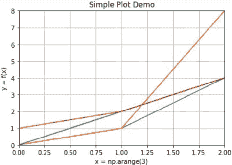

```python
plt.xlim([0, 2])

plt.ylim([0, 8])

plt.show()
```

这段代码生成的输出与图 5-12 完全相同。你可以添加标题和轴标签，如下所示：

```python
x = np.arange(3)

plt.plot(x, x**2, x, x**3, x, 2*x, x, 2**x)

plt.grid(True)

plt.xlabel('x = np.arange(3)')

plt.xlim([0, 2])

plt.ylabel('y = f(x)')

plt.ylim([0, 8])

plt.title('Simple Plot Demo')

plt.show()
```

这将生成包含标签和标题的输出，如图 5-13 所示。

**图 5-13.** 轴的标题和标签

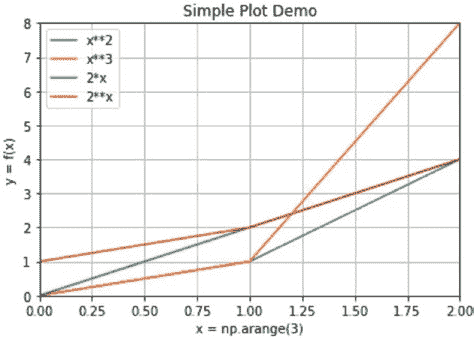

我们可以在 `plot()` 函数中为 `label` 参数传递一个实参，然后调用 `legend()` 函数来创建图例，如下所示：

```python
x = np.arange(3)

plt.plot(x, x**2, label='x**2')

plt.plot(x, x**3, label='x**3')

plt.plot(x, 2*x, label='2*x')

plt.plot(x, 2**x, label='2**x')

plt.legend()

plt.grid(True)

plt.xlabel('x = np.arange(3)')

plt.xlim([0, 2])

plt.ylabel('y = f(x)')

plt.ylim([0, 8])

plt.title('Simple Plot Demo')

plt.show()
```

这将生成带有曲线图例的输出，如图 5-14 所示。

**图 5-14.** 带有图例的输出

除了将图例字符串作为实参传递给 `plot()` 函数外，我们还可以将字符串列表作为实参传递给 `legend()` 函数，如下所示：

```python
x = np.arange(3)

plt.plot(x, x**2, x, x**3, x, 2*x, x, 2**x)

plt.legend(['x**2', 'x**3', '2*x', '2**x'])

plt.grid(True)

plt.xlabel('x = np.arange(3)')

plt.xlim([0, 2])

plt.ylabel('y = f(x)')

plt.ylim([0, 8])

plt.title('Simple Plot Demo')

plt.show()
```

它生成的输出与图 5-14 完全相同。

我们还可以通过修改上述代码来更改图例框的位置，如下所示：

```python
plt.legend(['x**2', 'x**3', '2*x', '2**x'], loc='upper center')
```

输出如图 5-15 所示。

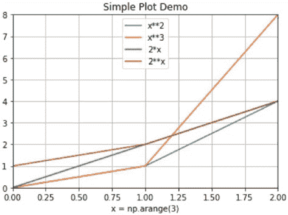

**图 5-15.** 图例位于中上位置的输出

## 颜色、样式和标记

到目前为止，在多线图的情况下，我们已经看到 Matplotlib 会自动分配颜色、样式和标记。我们也看到了一些自定义它们的例子。在本节中，我们将详细探讨如何自定义它们。

我们从颜色开始。下面的代码列出了 Matplotlib 支持的所有基本颜色（在本例中，我们没有自定义样式和标记）。

```python
x = np.arange(5)

y = x

plt.plot(x, y+1, 'g')

plt.plot(x, y+0.5, 'y')

plt.plot(x, y, 'r')

plt.plot(x, y-0.2, 'c')

plt.plot(x, y-0.4, 'k')

plt.plot(x, y-0.6, 'm')

plt.plot(x, y-0.8, 'w')

plt.plot(x, y-1, 'b')

plt.show()
```

输出如图 5-16 所示。

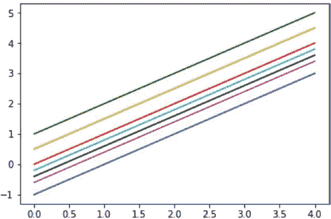

我们也可以将上述代码编写如下：

```python
plt.plot(x, y+1, 'g', x, y+0.5, 'y', x, y, 'r', x, y-0.2, 'c', x, y-0.4, 'k', x, y-0.6, 'm', x, y-0.8, 'w', x, y-1, 'b')

plt.show()
```

输出将与图 5-16 完全相同。

**图 5-16.** 颜色演示

我们可以如下自定义线条样式：

```python
plt.plot(x, y, '-', x, y+1, '--', x, y+2, '-.', x, y+3, ':')

plt.show()
```

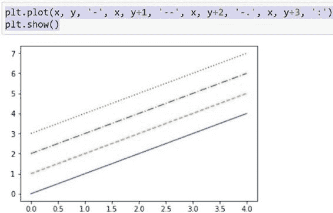

**图 5-17.** 线条样式

你甚至可以像这样更改标记：

```python
plt.plot(x, y, '.')

plt.plot(x, y+0.5, ',')

plt.plot(x, y+1, 'o')

plt.plot(x, y+2, '<')

plt.plot(x, y+3, '>')

plt.plot(x, y+4, 'v')

plt.plot(x, y+5, '^')
```


```python
plt.plot(x, y+6, '1')
plt.plot(x, y+7, '2')
plt.plot(x, y+8, '3')
plt.plot(x, y+9, '4')
plt.plot(x, y+10, 's')
plt.plot(x, y+11, 'p')
plt.plot(x, y+12, '*')
```

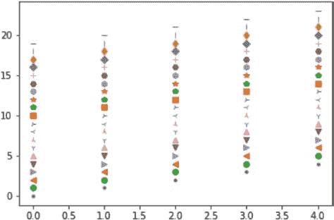

## 第 5 章 使用 NumPy 和 Matplotlib 进行数据可视化

```python
plt.plot(x, y+13, 'h')
plt.plot(x, y+14, 'H')
plt.plot(x, y+15, '+')
plt.plot(x, y+16, 'D')
plt.plot(x, y+17, 'd')
plt.plot(x, y+18, '|')
plt.plot(x, y+19, '_')
plt.show()
```

输出结果如图 5-18 所示。

***图 5-18.** 标记样式*

所有三个特性（颜色、标记和线条样式）可以组合起来自定义可视化效果，如下所示：

```python
plt.plot(x, y, 'mo--')
plt.plot(x, y+1 , 'g*-.')
plt.show()
```

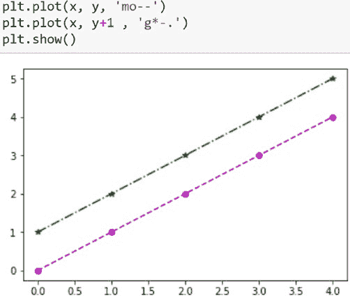

## 第 5 章 使用 NumPy 和 Matplotlib 进行数据可视化

输出结果如图 5-19 所示。

***图 5-19.** 自定义所有元素*

这些是基本自定义，但你可以更详细地自定义所有内容。例如，使用以下代码自定义其他细节：

```python
plt.plot(x, y, color='g', linestyle='--', linewidth=1.5,
         marker='^', markerfacecolor='b', markeredgecolor='k',
         markeredgewidth=1.5, markersize=5)
plt.grid(True)
plt.show()
```

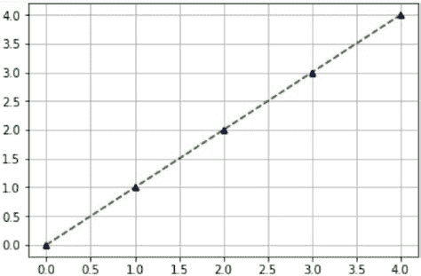

## 第 5 章 使用 NumPy 和 Matplotlib 进行数据可视化

输出结果如图 5-20 所示。

***图 5-20.** 自定义更多细节*

你甚至可以按如下方式自定义 `x` 和 `y` 轴上的刻度值：

```python
x = y = np.arange(10)
plt.plot(x, y, 'o--')
plt.xticks(range(len(x)), ['a', 'b', 'c', 'd', 'e', 'f', 'g',
                             'h', 'i', 'j'])
plt.yticks(range(0, 10, 1))
plt.show()
```

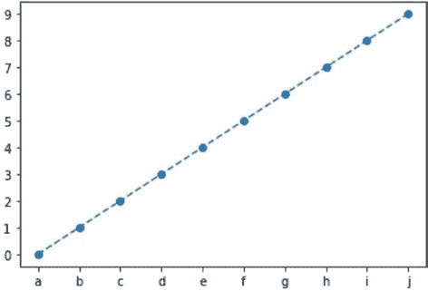

## 第 5 章 使用 NumPy 和 Matplotlib 进行数据可视化

输出结果如图 5-21 所示。

***图 5-21.** 自定义坐标轴刻度*

## 小结

本章重点介绍了可视化可用的各种自定义方法。我们学到了大量关于数据可视化的知识。本章涵盖的概念将在本书中持续用于数据可视化。

在下一章中，我们将进一步探索数据可视化。

我们将学习可视化图像和 3D 形状，并了解图像操作的基础知识。

## 第 6 章

## 可视化图像

## 与 3D 形状

在第 5 章中，我们开始使用 Python 3 中的 `Matplotlib` 库进行可视化。在本章中，我们将继续使用 `Matplotlib` 和 `NumPy` 来探索图像和 3D 形状的可视化。让我们通过以下主题继续数据可视化的探索：

-   图像可视化
-   图像操作
-   3D 可视化

学完本章后，你将能够处理图像和 3D 形状。

## 图像可视化

在本节中，我们将学习如何可视化图像。我们首先为本章创建一个新的笔记本。`Matplotlib` 的 `imread()` 函数可以读取 `.png` 格式的图像文件。要使其能读取其他格式的文件，你必须安装另一个名为 `pillow` 的图像处理库。在笔记本单元格中运行以下命令来安装它：

```python
!pip3 install pillow
```

© Ashwin Pajankar 2021
A. Pajankar, *实用 Python 数据可视化*,
[`doi.org/10.1007/978-1-4842-6455-3_6`](https://doi.org/10.1007/978-1-4842-6455-3_6#DOI)

## 第 6 章 可视化图像与 3D 形状

使用我们在第 5 章中讨论过的魔术命令，让笔记本能够显示 `Matplotlib` 的可视化结果：

```python
%matplotlib inline
```

使用以下命令导入 `Matplotlib` 的 `Pyplot` 模块：

```python
import matplotlib.pyplot as plt
```

现在，让我们使用 `imread()` 函数将图像读入变量，如下所示：

```python
img1 = plt.imread('D:\\Dataset\\4.1.02.tiff')
```

如果你使用的是 Linux、Unix 或 MacOS 计算机，则需要使用以下文件路径约定：

```python
img1 = plt.imread('/home/pi/book/dataset/4.1.02.tiff')
```

你使用的路径必须是绝对路径。如果图像文件与程序位于同一目录下，则只需提供文件名即可。

此函数读取图像并将其存储为 `NumPy ndarray`（数值矩阵）。我们可以通过运行以下代码行来验证这一点：

```python
print(type(img1))
```

输出如下：

```
<class 'numpy.ndarray'>
```

这证实了科学计算 Python 库将图像视为 `NumPy ndarray`。

我们可以使用 `Matplotlib` 的 `imshow()` 函数显示图像，然后使用 `show()` 函数将其作为图形显示，如下所示：

```python
plt.imshow(img1)
plt.show()
```

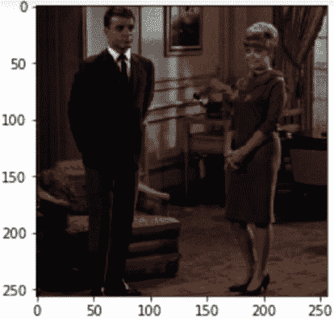

## 第 6 章 可视化图像与 3D 形状

输出结果如图 6-1 所示。

***图 6-1.** 可视化彩色图像*

你可以按如下方式关闭坐标轴：

```python
plt.imshow(img1)
plt.axis(False)
plt.show()
```

**注意** 我用于演示的所有图像均下载自 [`www.imageprocessingplace.com/root_files_V3/image_databases.htm`](http://www.imageprocessingplace.com/root_files_V3/image_databases.htm)。

让我们按如下方式读取一幅灰度图像：

```python
img2 = plt.imread('D:\\Dataset\\5.3.01.tiff')
```


## 第 6 章 可视化图像与 3D 形状

我们可以使用以下代码显示它：

```python
plt.imshow(img2)
plt.axis(False)
plt.show()
```

图 6-2 显示了输出结果。

***图 6-2.** 使用默认颜色映射可视化灰度图像*

正如你所见，颜色看起来有些奇怪，而且这根本不是一幅彩色图像。`Matplotlib` 正在使用默认颜色映射显示灰度图像。我们可以显式指定灰度颜色映射来正确可视化此图像，如下所示：

```python
plt.imshow(img2, cmap=plt.cm.gray)
plt.axis(False)
plt.show()
```


## 第 6 章 可视化图像与 3D 形状

图 6-3 显示了结果。

***图 6-3.** 使用灰度颜色映射可视化灰度图像*

我们也可以按如下方式指定颜色映射：

```python
plt.imshow(img2, cmap='gray')
plt.axis(False)
plt.show()
```

接下来，我们转向图像的基本操作。

## 图像操作

我们可以使用 `NumPy` 对图像执行基本操作，并使用 `Matplotlib` 可视化输出结果。首先，我们来学习一些算术运算。我们需要两幅尺寸相同的图像来进行算术运算。让我们按如下方式读取另一幅彩色图像：

```python
img3 = plt.imread('D:\\Dataset\\4.1.03.tiff')
```


## 第 6 章 可视化图像与 3D 形状

我们可以按如下方式将其可视化：

```python
plt.imshow(img3)
plt.axis(False)
plt.show()
```

图 6-4 显示了输出结果。

***图 6-4.** 用于图像操作的另一幅彩色图像*

我们可以将两幅图像相加并可视化结果，如下所示：

```python
add = img1+img3
plt.imshow(add)
plt.axis(False)
plt.show()
```


## 第 6 章 可视化图像与 3D 形状

图 6-5 显示了输出结果。

***图 6-5.** 两幅图像相加*

加法运算是一种可交换的算术运算。这意味着，如果我们改变操作数的顺序，不会影响输出结果。

```python
add1 = img3+img1
plt.imshow(add)
plt.axis(False)
plt.show()
```

让我们尝试一下减法运算：

```python
sub1= img1-img3
plt.imshow(sub1)
plt.axis(False)
plt.show()
```


## 第 6 章 可视化图像与 3D 形状

图 6-6 显示了输出结果。

***图 6-6.** 减法结果*

我们知道减法运算是不可交换的。这意味着，如果我们改变操作数的顺序，结果会不同。

我们来试试看：

```python
sub1 = img3-img1
plt.imshow(sub1)
plt.axis(False)
plt.show()
```

如图 6-7 所示的输出结果因此与之前的输出（图 6-6）不同。


## 第 6 章 可视化图像与 3D 形状

***图 6-7.** 减法结果*


我们已经学习到，在 SciPy 中图像被表示为 NumPy 的 ndarray。彩色图像与灰度图像的区别在于，彩色图像由多个通道组成。这些通道本身也是 ndarray。我们可以使用 NumPy 的索引操作拆分彩色图像，并单独可视化其各个通道。彩色图像分别对应红色、绿色和蓝色三个通道。可以通过如下 NumPy 索引来拆分图像：

`r = img3[:, :, 0]`

`g = img3[:, :, 1]`

`b = img3[:, :, 2]`

下面我们使用 Matplotlib 的 subplots 来可视化原始图像及其各个颜色通道：

`plt.subplots_adjust(hspace=0.4, wspace=0.1)`

`plt.subplot(2, 2, 1)`  
`plt.title('Original')`  
`plt.imshow(img3)`  

`plt.subplot(2, 2, 2)`  
`plt.title('Red')`  
`plt.imshow(r, cmap='gray')`  

`plt.subplot(2, 2, 3)`  
`plt.title('Green')`  
`plt.imshow(g, cmap='gray')`  

`plt.subplot(2, 2, 4)`  
`plt.title('Blue')`  
`plt.imshow(b, cmap='gray')`  

`plt.show()`

我们来分析一下上述代码。我们使用 `subplot()` 函数创建了一个 2×2 的网格。`subplots_adjust()` 函数用于调整各可视化之间的间距。在 2×2 网格中，左上角位置为 1，同一行中相邻位置为 2，以此类推，右下角是第四个位置。在调用 `imshow()` 或 `plot()` 之前使用 `subplot()` 函数，可以指定可视化图应放置的位置。输出结果如图 6-8 所示。

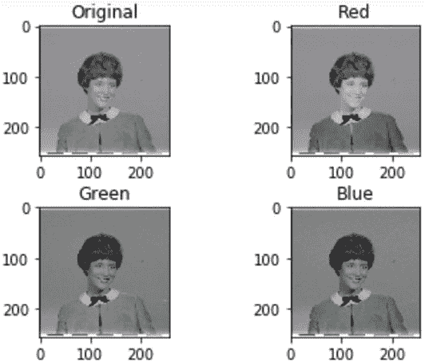

**图 6-8.** 分离后的颜色通道

这些颜色通道本身是二维矩阵，对于 8 位无符号整数格式的彩色图像，其成员值范围在 0 到 256 之间。当它们组合在一起时，Matplotlib 会将其解释为彩色图像。我们可以使用合适的颜色图谱来可视化，如下所示：

`plt.subplots_adjust(hspace=0.4, wspace=0.1)`  

`plt.subplot(2, 2, 1)`  
`plt.title('Original')`  
`plt.imshow(img3)`  

`plt.subplot(2, 2, 2)`  
`plt.title('Red')`  
`plt.imshow(r, cmap='Reds')`  

`plt.subplot(2, 2, 3)`  
`plt.title('Green')`  
`plt.imshow(g, cmap='Greens')`  

`plt.subplot(2, 2, 4)`  
`plt.title('Blue')`  
`plt.imshow(b, cmap='Blues')`  

`plt.show()`

输出结果如图 6-9 所示。

**图 6-9.** 使用合适颜色图谱可视化的分离颜色通道

我们可以将各个通道组合起来以恢复原始图像，代码如下：

```
import numpy as np
img4 = np.dstack((r, g, b))
```

这里我们使用了 NumPy 库中的 `dstack()` 函数。然后使用常规代码可视化输出：

`plt.imshow(img4)`  
`plt.axis(False)`  
`plt.show()`

以上就是执行非常基础的图像处理操作的方法。

我们目前学到的只是图像处理的冰山一角，更深入的演示则需要另外一本书来阐述。

## 3D 可视化

在本节中，我们将探讨使用 Python 3 进行 3D 可视化的方法。到目前为止，我们都在 notebook 中直接显示可视化结果。这个过程对于 2D 可视化效果良好。然而，对于 3D 可视化，notebook 只会以一个固定的角度进行显示。因此我们需要采用另一种方法。最佳实践是使用另一个魔法命令，在独立的 Qt 窗口中显示可视化，如下所示：

`%matplotlib qt`

假设您将在整个章节中继续使用同一个 notebook，那么我们已经在前面的单元格中导入了 Matplotlib 的 `pyplot` 模块和 NumPy。接下来我们需要通过以下语句导入更多功能：

```
from mpl_toolkits.mplot3d import Axes3D
from mpl_toolkits.mplot3d import axes3d
```

让我们从简单的开始。我们已经学习了如何绘制简单的二维图，现在我们将以同样的方式绘制三维图。从一条简单的参数曲线开始。首先定义图形和坐标轴：

`fig = plt.figure()`  
`ax = fig.gca(projection='3d')`


对于 3D 可视化，我们通过参数和实参对 `projection='3d'` 启用了 3D 投影。接下来，定义数据。

你需要数据点的 `x`、`y` 和 `z` 坐标。首先按如下方式定义数据点的极坐标：

```
theta = np.linspace(-3 * np.pi, 3 * np.pi, 200)
z = np.linspace(-3, 3, 200)
r = z**3 + 1
```

现在，按如下方式计算 `x` 和 `y` 坐标：

```
x = r * np.sin(theta)
y = r * np.cos(theta)
```

我们使用 NumPy 库中的三角函数来计算 `x` 和 `y`。最后，按如下方式绘制它：

```
ax.plot(x, y, z, label='Parametric Curve')
ax.legend()
plt.show()
```

输出将显示在一个单独的窗口中，如图 6-10 所示，并且它是可交互的，这样我们就能改变视角。

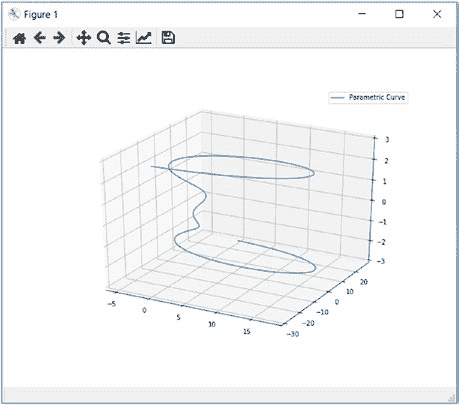

**图 6-10.** 可视化参数曲线

**注意：** 如果单独的输出窗口没有弹出，并且 3D 可视化显示在浏览器本身中，那么你必须重启 Jupyter 内核并重新执行相关单元格。在这种情况下，不要执行包含 `%matplotlib inline` 的单元格。

接下来，让我们创建一个 3D 条形图。现在按如下方式计算数据：

```
x = np.arange(4)
y = np.arange(4)
xx, yy = np.meshgrid(x, y)
print(xx);print(yy)
```

函数 `meshgrid()` 从坐标向量创建并返回坐标矩阵，如下所示：

```
[[0 1 2 3]
 [0 1 2 3]
 [0 1 2 3]
 [0 1 2 3]]
[[0 0 0 0]
 [1 1 1 1]
 [2 2 2 2]
 [3 3 3 3]]
```

然后使用函数 `ravel()` 来展平这两个矩阵，如下所示：

```
X, Y = xx.ravel(), yy.ravel()
print(X); print(Y);
```

这将产生以下输出：

```
[0 1 2 3 0 1 2 3 0 1 2 3 0 1 2 3]
[0 0 0 0 1 1 1 1 2 2 2 2 3 3 3 3]
```

现在，计算更多值：

```
top = X + Y
bottom = np.zeros_like(top)
width = depth = 1
```

接下来，创建一个图形和坐标轴，并按如下方式创建条形图：

```
fig = plt.figure(figsize=(8, 3))
ax1 = fig.add_subplot(121, projection='3d')
ax2 = fig.add_subplot(122, projection='3d')
ax1.bar3d(X, Y, bottom, width, depth, top, shade=True)
ax1.set_title('Shaded')
ax2.bar3d(X, Y, bottom, width, depth, top, shade=False)
ax2.set_title('Not Shaded')
plt.show()
```

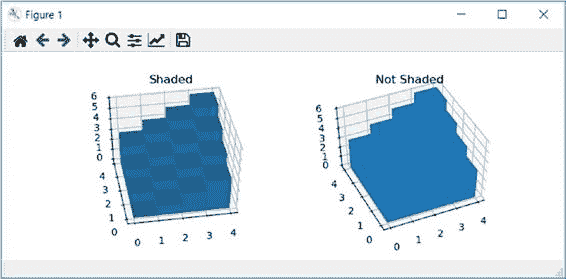

**图 6-11.** 可视化 3D 条形图

接下来，让我们按如下方式可视化一个线框图：

```
fig = plt.figure()
ax = fig.gca(projection='3d')
X, Y, Z = axes3d.get_test_data(delta=0.1)
ax.plot_wireframe(X, Y, Z)
plt.show()
```

在这段代码片段中，我们首先在 3D 模式下创建一个图形和一个坐标轴。然后内置函数 `get_test_data()` 返回测试数据。接下来我们使用函数 `plot_wireframe()` 来绘制线框模型。输出如图 6-12 所示。

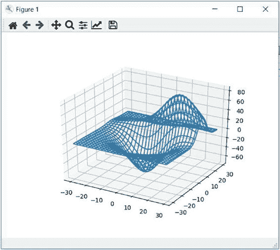

**图 6-12.** 可视化 3D 线框图

最后，让我们计算并可视化一个曲面。首先，计算 `x` 和 `y` 坐标，然后计算网格：

```
x = np.arange(-3, 3, 0.09)
y = np.arange(-3, 3, 0.09)
X, Y = np.meshgrid(x, y)
print(X); print(Y)
```

输出如下所示：

```
[[-3.  -2.91 -2.82 ... 2.76 2.85 2.94]
 [-3.  -2.91 -2.82 ... 2.76 2.85 2.94]
 [-3.  -2.91 -2.82 ... 2.76 2.85 2.94]
 ...
 [-3.  -2.91 -2.82 ... 2.76 2.85 2.94]
 [-3.  -2.91 -2.82 ... 2.76 2.85 2.94]
 [-3.  -2.91 -2.82 ... 2.76 2.85 2.94]]

[[-3.  -3.  -3.  ... -3.  -3.  -3. ]
 [-2.91 -2.91 -2.91 ... -2.91 -2.91 -2.91]
 [-2.82 -2.82 -2.82 ... -2.82 -2.82 -2.82]
 ...
 [ 2.76 2.76 2.76 ... 2.76 2.76 2.76]
 [ 2.85 2.85 2.85 ... 2.85 2.85 2.85]
 [ 2.94 2.94 2.94 ... 2.94 2.94 2.94]]
```

接下来，按如下方式计算 `z` 坐标：

```
R = np.sqrt(X**2 + Y**2)
Z = np.cos(R)
print(Z)
```

最后，创建图形和坐标轴，并可视化 3D 曲面：

```
fig = plt.figure()
ax = fig.gca(projection='3d')
surf = ax.plot_surface(X, Y, Z,
                       cmap=plt.cm.cool,
                       linewidth=0,
                       antialiased=False)
plt.show()
```

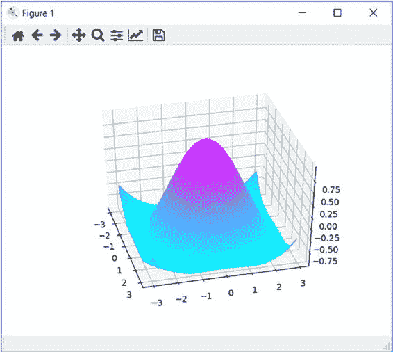


这将生成如图 6-13 所示的输出。

**图 6-13.** 可视化三维曲面

**总结**

在本章中，你学习并演示了如何可视化图像。

你还学习并演示了图像的基本操作，例如算术运算以及将彩色图像分割为各个通道。我们还涵盖了编写用于三维可视化的程序，包括曲线、条形图、线框和网格。

下一章将探讨如何可视化网络和图数据结构。

## 第 7 章

## 可视化图与网络

在第 6 章中，我们演示了如何使用 Python 3 和 Matplotlib 可视化图像和三维对象。我们还学习了一些图像处理知识。

本章重点介绍一种称为图或网络的数据结构的可视化。让我们通过以下主题继续我们的数据可视化之旅：

-   图与网络
-   在 Python 3 中可视化图
-   更多类型的图
-   为节点分配自定义标签

完成本章后，你将能够使用 Python 3 可视化图与网络。

## 图与网络

图是一种抽象数据类型，也称为网络。它由一个有限的顶点（也称为节点）集合和一个有限的边（也称为链接）集合组成。当我们指代图时，使用术语“顶点”和“边”；当我们指代相同结构为网络时，则使用“节点”和“链接”。为了保持一致性，本章我将使用术语“图”、“节点”和“边”来指代此数据结构。

在图中，顶点通过边相互连接。树是图的一个子类型。图中可以存在环，而树中则不能。

我们也可以有有向图和无向图。可以为图中的边赋值，这样的图称为加权图。在本章中，我们将讨论无向且无加权图的可视化。

### Python 3 中的图

要处理并可视化图，Python 3 有一个名为 `networkx` 的易用库。你可以通过在 Jupyter Notebook 单元格中运行以下命令来安装它：

```
!pip3 install network
```

现在，导入它和其他库 Matplotlib。我们还会在笔记本中启用绘图功能：

```
%matplotlib inline
import networkx as nx
import matplotlib.pyplot as plt
```

你可以按如下方式创建一个新的空图：

```
G = nx.Graph()
```

让我们按如下方式确定其类型：

```
type(G)
```

输出如下：

```
networkx.classes.graph.Graph
```

你可以查看节点和边的列表，还可以按如下方式查看它们的数据类型：

```
print(G.nodes())
print(G.edges())
print(type(G.nodes()))
print(type(G.edges()))
```

这将产生以下输出：

```
[]
[]
<class 'networkx.classes.reportviews.NodeView'>
<class 'networkx.classes.reportviews.EdgeView'>
```

你可以按如下方式添加一个节点：

```
G.add_node('a')
```

或者，你也可以添加列表中指定的多个节点：

```
G.add_nodes_from(['b', 'c'])
```

我们将再次打印节点列表和边列表（由于我们尚未添加任何边，边列表应为空）：

```
print('Nodes of the graph G: ')
print(G.nodes())
print('Edges of the graph G: ')
print(G.edges())
```

输出看起来像这样：

```
Nodes of the graph G:
['a', 'b', 'c']
Edges of the graph G:
[]
```

请看以下语句：

```
G.add_edge(1, 2)
```

它添加了两个节点和一条相应的边。如果函数调用中的参数已经是图节点列表的一部分，则不会重复添加。以下是另一种添加方式：

```
edge = ('d', 'e')
G.add_edge(*edge)
edge = ('a', 'b')
G.add_edge(*edge)
```

让我们再次打印节点和边的列表，如下所示：

```
print('Nodes of the graph G: ')
print(G.nodes())
print('Edges of the graph G: ')
print(G.edges())
```


