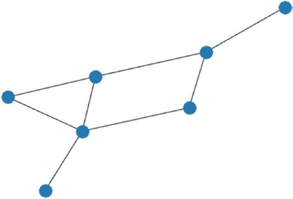
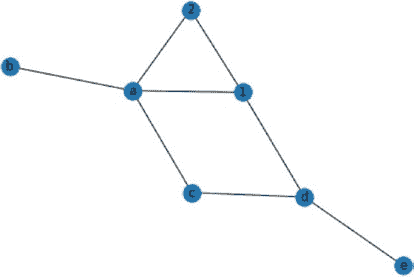

# 第 7 章 可视化图与网络

输出如下：

```
Nodes of the graph G:
['a', 'b', 'c', 1, 2, 'd', 'e']
Edges of the graph G:
[('a', 'b'), ('a', 'c'), ('a', 1), ('a', 2), ('c', 'd'), (1, 2), (1, 'd'), ('d', 'e')]
```

## 在 Python 3 中可视化图

本节重点介绍如何使用`networkx`库对图进行可视化。

你已在前一节中准备了一个图。现在你可以按如下方式对其进行可视化：

```
nx.draw(G)
plt.show()
```

输出如图 7-1 所示。

图 7-1. 图的视觉表示

请注意，这些可视化是随机生成的，每次运行该语句时，都会为视觉表示生成不同的图像。

然而，这些可视化所表示的图是同构的。

图 7-2 显示了再次执行相同单元格时的输出。



