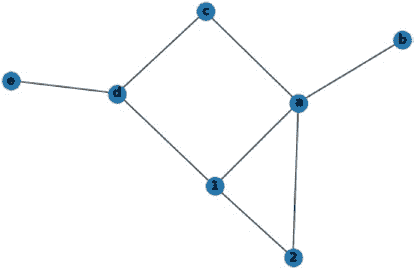

# 第 7 章 可视化图与网络

***图 7-2.** 同一张图的另一种视觉表示*

你可以看到这两个可视化是**同构**的，因为它们由同一张图生成。你可能还注意到节点没有显示任何名称。你可以使用以下代码显示节点名称：

```
nx.draw(G, with_labels=True)
plt.show()
```

图 7-3 显示了结果。

***图 7-3.** 带标签的节点*



