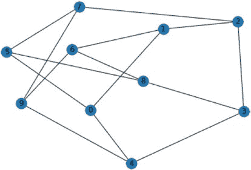

# 第 7 章 可视化图与网络

输出如下：
```
Nodes of the graph G:
[0, 1, 2, 3]
Edges of the graph G:
[(0, 1), (1, 2), (2, 3)]
```

接下来，让我们创建它的可视化：
```
nx.draw(G, with_labels=True)
plt.show()
```
结果如图 7-5 所示。

**图 7-5.** 四个节点的路径图

## Petersen 图

下一种类型的图是`Petersen`图，一个具有 10 个顶点和 15 条边的无向图。我们可以使用以下代码创建它并查看边和节点的值：
```
G = nx.petersen_graph()
print('Nodes of the graph G: ')
print(G.nodes())
print('Edges of the graph G: ')
print(G.edges())
```

