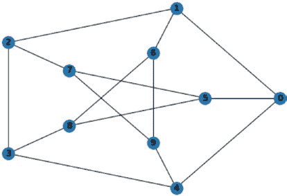
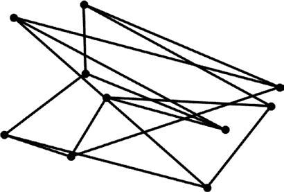

# 第 7 章 可视化图与网络

## 我们可以按如下方式对其进行可视化：

```python
nx.draw(G, with_labels=True)
plt.show()
```

输出如图 7-6 所示。

`图 7-6. Petersen 图`

现在，有很多方法可以更好地描绘它。我们可以将其描绘成一个内部带有五角星、带有五个辐条的五边形。以下代码实现了这一点。

```python
nx.draw_shell(G, nlist=[range(5, 10), range(5)],
              with_labels=True,
              font_weight='bold')
plt.show()
```

这段代码以壳形展示图形。我们在参数`nlist`中指定了按层排列的节点列表。输出如图 7-7 所示，它与前面的输出是同构的。



