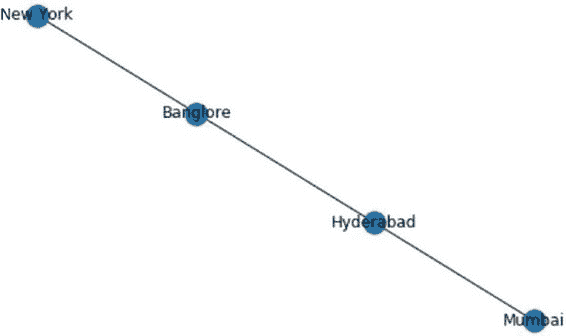

# 图形可视化与网络分析

**图 7-7.** 可视化彼得森图为壳形布局

我们可以自定义图形的展现方式。使用以下代码自定义节点大小和线条宽度：

```python
options = {'node_color': 'black', 'node_size': 100, 'width': 3}
```

现在让我们用这些选项可视化彼得森图：

```python
nx.draw_random(G, **options)
plt.show()
```

图 7-8 展示了输出结果。

**图 7-8.** 自定义节点与边的彼得森图


接下来，我们可以在圆形布局中对其进行可视化：

```python
nx.draw_circular(G, **options)
plt.show()
```

输出结果如图 7-9 所示。

**图 7-9.** 圆形布局中的彼得森图

我们也可以使用谱布局来描绘彼得森图：

```python
nx.draw_spectral(G, **options)
plt.show()
```


图 7-10 展示了输出结果。

**图 7-10.** 谱布局中的彼得森图

我们可以使用自定义选项在壳形布局中描绘彼得森图：

```python
nx.draw_shell(G, nlist=[range(5, 10), range(5)], **options)
plt.show()
```

输出结果如图 7-11 所示。

**图 7-11.** 壳形布局中自定义节点与边的彼得森图


我们还可以创建一个十二面体图：

```python
G = nx.dodecahedral_graph()
```

它可以在壳形布局中可视化如下：

```python
shells = [[2, 3, 4, 5, 6],
          [8, 1, 0, 19, 18, 17, 16, 15, 14, 7],
          [9, 10, 11, 12, 13]]
nx.draw_shell(G, nlist=shells, **options)
plt.show()
```

图 7-12 展示了输出结果。

**图 7-12.** 壳形布局中自定义节点与边的十二面体图

您可以使用以下命令将任何图形文件保存到磁盘：

```python
plt.savefig('graph.png')
```

这条语句会将文件保存到程序所在位置（与 notebook 相同的目录）的磁盘上。

## 图形与网络可视化——为节点分配自定义标签

您可以使用以下代码为节点分配自定义标签：

```python
G = nx.path_graph(4)
cities = {0: 'Mumbai', 1: 'Hyderabad',
          2: 'Banglore', 3: 'New York'}
H = nx.relabel_nodes(G, cities)
print('Nodes of the graph H: ')
print(H.nodes())
print('Edges of the graph H: ')
print(H.edges())
```

以下是输出结果：

```
Nodes of the graph H:
['Mumbai', 'Hyderabad', 'Banglore', 'New York']
Edges of the graph H:
[('Mumbai', 'Hyderabad'), ('Hyderabad', 'Banglore'),
 ('Banglore', 'New York')]
```

使用以下代码创建可视化：

```python
nx.draw(H, with_labels=True)
plt.show()
```



图 7-13 展示了输出结果。

**图 7-13.** 在线性或路径图中重新标记的节点

## 总结

本章探讨了图的概念，介绍了不同类型的图。您学会了以不同方式将它们可视化。现在您应该能够熟练地使用 Python 3 对图数据结构进行可视化。

下一章将介绍 SciPy 的数据科学库——pandas。我们将介绍 pandas 库中多功能的数据结构——Series 和 DataFrame，并附带几个数据可视化的示例。

# 第 8 章 Pandas 入门

第 7 章介绍了使用 Python 的 `networkx` 库进行图形可视化。本章将聚焦于 SciPy 数据科学与分析库——pandas 的基础知识。首先，我们将探索该库中的数据结构。您还将学习如何从 `.csv` 数据集读取数据。最后，您将学习如何创建简单的可视化演示。以下是本章涵盖的主题：

- pandas 简介
- pandas 中的 `DataFrame`
- 使用 pandas 进行可视化

完成本章后，您应能熟练使用 pandas 进行基本可视化。