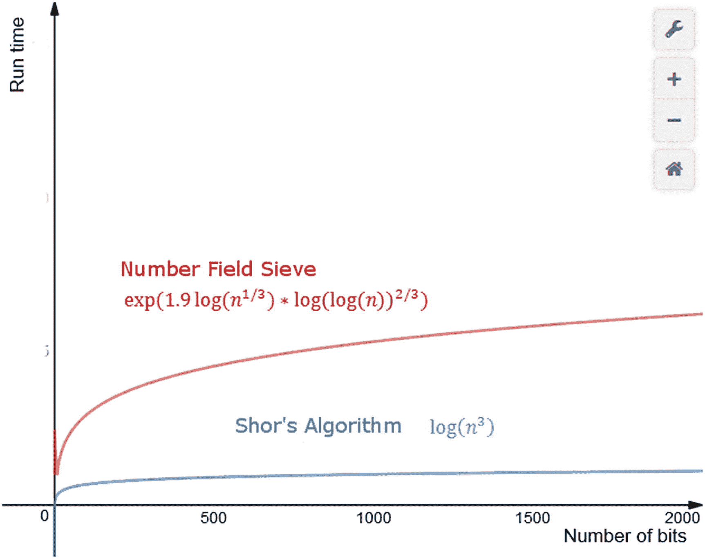

## 引言

我撰写本书的目的是为了成为在云端编程量子计算机的终极指南。得益于 IBM 研究部的杰出同仁，现在这已成为可能。IBM 不仅向研究界，也向所有对这个计算领域感兴趣的普通个人开放了其原型量子装置（即 `IBM Q Experience`）。

量子计算正日益受到关注，现在是学习编程这些机器的时候了。未来几年内，首批商用量子计算机有望问世，它们承诺相较于经典计算机能带来显著的计算加速。请看下图，它展示了两种大整数因子分解算法的时间复杂度对比：经典算法中最佳的`数域筛法`与彼得·`肖尔`开发的量子因子分解算法。

对于构成当前密码学基础的问题，`肖尔算法`比`数域筛法`快得多。该算法的实际应用将使当前的非对称加密变得毫无用处！

总而言之，本书是一段理解的旅程。如果你觉得各章节中解释的概念难以掌握，请不必气馁——你并不孤单。伟大的物理学家理查德·`费曼`曾说过：`如果有人自称理解了量子力学，那恰恰说明他并不理解量子力学`。即便是这一怪异理论的巨擘们，也一直在努力理解它究竟意味着什么。

我尽力通过运用真实世界的算法、电路、代码和图形结果来探索量子计算。本书中包含的一些算法违背了逻辑，看起来更像是巫毒魔法，而非对一个物理系统的计算描述。这正是我决定挑战这一主题的主要原因。尽管我发现很难理解量子力学那些令人费解的原理，但我始终被这一绝妙的理论所吸引。因此，当 IBM 推出其独一无二的云端量子计算平台并向我们所有人开放时，我抓住了这个学习并撰写本书的机会。

最终，这是我对云端量子计算的理解，希望你能像我享受写作过程一样享受阅读。我的浅见是：学习编程量子计算机吧；很快它们就会无处不在，出现在数据中心里，处理从搜索、模拟到医药、人工智能等一切事务。一切你所能想到的。总的来说，本书分为以下几个章节：

**第 1 章：量子力学——怪异而精彩的世界**

一切都始于 20 世纪 30 年代，从那位不情愿的天才马克斯·`普朗克`开始。他对光谱的能量分布提出了新的解释。他极不情愿地首次提出，光子的能量并非像经典物理学家所认为的那样由一个连续函数描述，而是由他所称的微小“量子”构成，由此拉开了这场伟大革命的序幕。他即将开启本世纪科学领域最伟大的革命：量子力学。本章是主菜前的开胃菜，探讨了物理学两大巨人——阿尔伯特·`爱因斯坦`和尼尔斯·`玻尔`——之间的交锋。量子力学在 20 世纪 30 年代是一项革命性的理论，当时大多数科学界人士都不愿接受它，其中包括本世纪的巨擘：阿尔伯特·`爱因斯坦`。刚获得诺贝尔奖的`爱因斯坦`从未接受量子力学的概率本质。这导致了他与量子力学的最大拥护者——尼尔斯·`玻尔`——之间产生裂痕。这两位伟人辩论了数十年，却从未化解分歧。最终，量子力学经受住了 70 年的理论和实验挑战，始终屹立不倒。阅读本章，在这两位非凡人物扣人心弦的故事背景下，探索理论、实验与结果。

**第 2 章：量子计算：扭曲现实本身的结构**

20 世纪 80 年代，另一位伟大的物理学家——理查德·`费曼`——提出了量子计算机的概念，即一种能够利用量子力学原理更快地解决问题的计算机。一场建造这种机器的竞赛由此展开。本章以通俗的方式探讨了量子计算机的基本架构：`量子比特`——量子计算的基本单元。它们看起来或许不起眼，但却拥有近乎神奇的特性：叠加态——信不信由你，一个`量子比特`可以同时处于两种状态：0 和 1。这个概念在我们所处的宏观世界中难以理解。然而，在原子尺度上，一切皆有可能。这一事实已通过 70 多年的实验得到证实。因此，叠加态使得量子计算机能够用相对较少的`量子比特`执行大量计算，从而超越经典计算机。另一个令人费解的概念是量子纠缠：探究起来，这似乎更像是巫毒魔法而非物理原理。被纠缠的`量子比特`在被观测时，其状态的传递速度可以超越光速，跨越时空！好好琢磨一下这个概念吧。总的来说，本章探讨了量子计算机的所有物理组件：`量子门`、不同类型的`量子比特`（如`超导环`、`离子阱`、`拓扑编织`等）。此外，还介绍了当前所有主要科技公司在这一课题上的努力，以及其他类型的量子计算，例如`量子退火`。

**第 3 章：进入 IBM Q Experience：独一无二的云端量子计算平台**

在本章中，你将首次接触 IBM Q Experience。这是首个在云端提供真实或模拟量子设备的量子计算平台，面向我们这些普通用户。以往，真实量子设备仅用于研究目的。但如今情况已大不相同，多亏了 IBM 的团队，他们数十年来一直致力于此，并慷慨地决定将其向公众开放。

你将学习如何使用可视化 `Composer` 创建量子电路，或者利用出色的 Python SDK 编写代码——这适合具有编程思维的读者。然后，在真实设备上执行你的电路，探索结果，并迈出你作为量子程序员职业生涯的第一步。IBM 可能创造了第一个云端量子计算平台，但它的竞争对手也已紧随其后。预计在不久的将来，其他 IT 巨头也会推出新的云平台。现在正是学习的良机。

**第 4 章：QISKit，用于 Python 量子编程的出色 SDK**

`QISKit` 代表量子信息软件工具包（Quantum Information Software Kit）。它是一个 Python SDK，用于在云端或本地模拟器中编写量子程序。在本章中，你将学习如何在个人电脑上配置 Python SDK。接着，你将了解如何利用线性代数描述量子门，从而更深入地理解其背后的运作原理。这是你第一个量子程序的开胃菜，一个非常简单的例子，旨在让你熟悉 Python SDK 的语法。最后，你将在真实量子设备上运行它。当然，量子程序也可以在 `Composer` 中以可视化方式创建。你将更深入地理解量子门——量子程序的基本构建模块。本章将涵盖所有这些内容，并且不止于此。

**第 5 章：启动引擎：从量子随机数到量子隐形传态，超密编码中途停留**

本章将带你探索量子系统三项卓越的信息处理能力。量子随机数生成探索了量子力学作为真正随机性来源的本质。你将学习如何利用非常简单的逻辑门和 Python SDK 实现这一点。接着，本章探讨两种相关的信息处理协议：超密编码和量子隐形传态。它们拥有炫酷的名称和近乎神奇的特性。发现它们的秘密，为 `Composer` 编写电路，使用 Python 远程执行，最后解释并验证其结果。

**第 6 章：趣味量子游戏**

在本章中，你将学习如何在量子计算机上实现一个基础游戏。为此，我们使用了 `QISKit` Python 教程中附带的经典“量子战舰”游戏。第一部分将介绍游戏的机制，但我们并不会止步于此。本章的第二部分将在此基础上进行重大升级，为游戏进行全面的“焕新”。在这一部分，你将把“量子战舰”部署到云端，为其添加基于浏览器的用户界面、一个用于消费事件并将其分发给量子模拟器的 Apache CGI 接口，以及更多功能。通过让你的亲朋好友在云端用网页浏览器玩“量子战舰”，给他们留下深刻印象。

**第 7 章：博弈论：借助量子力学，胜算永远站在你这边**

即使以量子力学的标准来看，这章也颇为奇特。本章探讨了两个游戏谜题，展示了量子算法相对于经典算法的卓越能力：假币谜题和梅明-佩雷斯魔方阵。在假币谜题中，使用量子算法在有限次使用天平寻找假币时，相比经典解法实现了四次方级的加速。梅明-佩雷斯魔方阵则是量子伪心灵感应的一个例子，它展现了玩家近乎能读取彼此心智的能力，实现了只有在游戏过程中进行沟通才能达到的结果。

**第 8 章：借助 Grover 和 Shor 算法加速搜索，并威胁非对称密码学根基**

本章以两个算法作为收尾，它们激发了人们对实用量子计算可能性的热情：`Grover` 搜索算法，一种非结构化量子搜索算法，能够平均在 `N` 的平方根步数内找到输入。这远比最优经典解法所需的 `N/2` 步要快得多。这看起来可能不算什么，但当我们讨论非常庞大的数据库时，这个算法能在数据中心里将其性能碾压。预计未来所有的网络搜索都将由 `Grover` 算法执行。`Shor` 的整数分解算法：著名的量子分解算法，专家称其足以让当前的非对称密码学崩溃。这是展现量子计算威力的最佳范例，它提供了相比最优经典解法指数级的加速。

