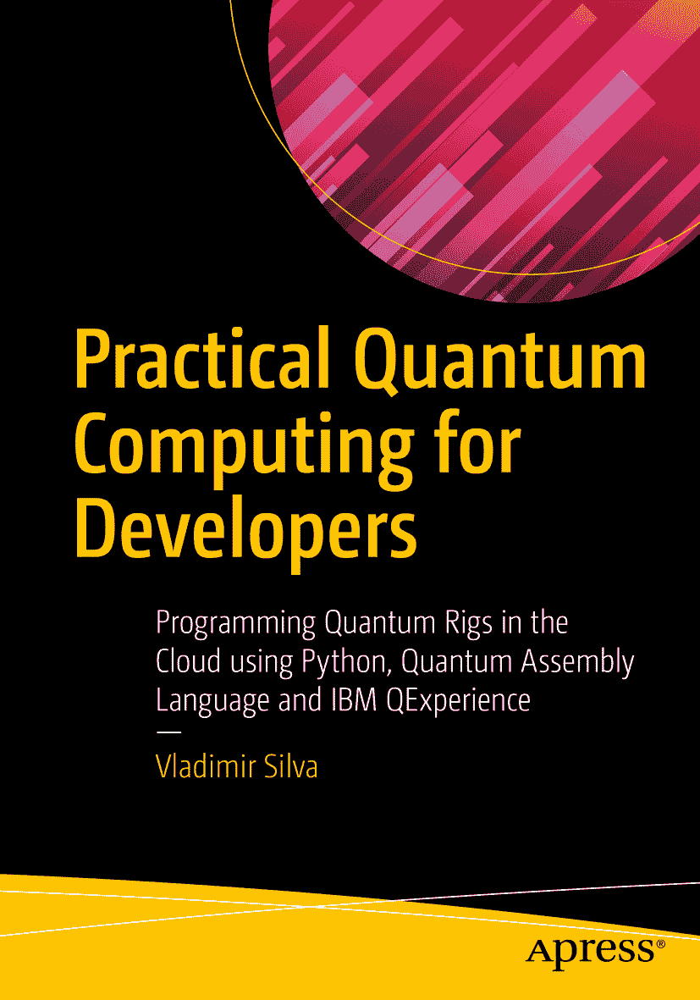
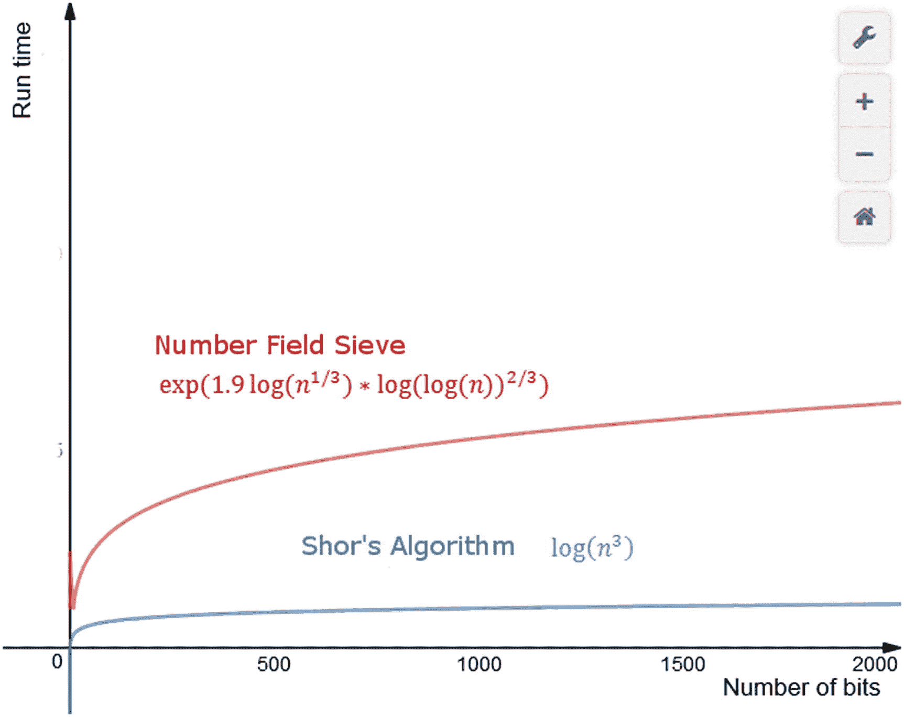

# 量子力学：怪异而精彩的世界

`ISBN 978-1-4842-4217-9`  
`e-ISBN 978-1-4842-4218-6`  
[`doi.org/10.1007/978-1-4842-4218-6`](https://doi.org/10.1007/978-1-4842-4218-6)  
`Library of Congress Control Number: 2018966346`

© Vladimir Silva 2018

标准 Apress 出版物。本书中可能出现商标名称、标识和图像。我们仅以编辑方式使用这些名称、标识和图像，并旨在维护商标所有者的权益，无意侵犯任何商标。本书中使用的商品名、商标、服务标志及类似术语，即使未被明确标识，也不应被视为对它们是否受所有权保护的任何意见的表达。尽管本书中的建议和信息在出版时被认为是真实准确的，但作者、编辑及出版商均不对可能存在的任何错误或遗漏承担法律责任。出版商对本书所含内容不提供任何明示或暗示的保证。

本书通过 Springer Science+Business Media New York 向全球图书贸易发行，地址：233 Spring Street, 6th Floor, New York, NY 10013。电话：`1-800-SPRINGER`，传真：`(201) 348-4505`，电子邮件：`orders-ny@springer-sbm.com`，或访问：`www.springeronline.com`。Apress Media, LLC 是一家加利福尼亚有限责任公司，其唯一成员（所有者）是 Springer Science + Business Media Finance Inc (SSBM Finance Inc)。SSBM Finance Inc 是一家特拉华州公司。

## 引言

我撰写本书的目的是为了成为在云端编程量子计算机的终极指南。得益于 IBM 研究部的杰出同仁，现在这已成为可能。IBM 不仅向研究界，也向所有对这个计算领域感兴趣的普通个人开放了其原型量子装置（即 IBM Q Experience）。

量子计算正日益受到关注，现在是学习编程这些机器的时候了。未来几年内，首批商用量子计算机有望问世，它们承诺相较于经典计算机能带来显著的计算加速。请看下图，它展示了两种大整数因子分解算法的时间复杂度对比：经典算法中最佳的数域筛法与彼得·肖尔开发的量子因子分解算法。

对于构成当前密码学基础的问题，肖尔算法比数域筛法快得多。该算法的实际应用将使当前的非对称加密变得毫无用处！

总而言之，本书是一段理解的旅程。如果你觉得各章节中解释的概念难以掌握，请不必气馁——你并不孤单。伟大的物理学家理查德·费曼曾说过：*如果有人自称理解了量子力学，那恰恰说明他并不理解量子力学*。即便是这一怪异理论的巨擘们，也一直在努力理解它究竟意味着什么。

我尽力通过运用真实世界的算法、电路、代码和图形结果来探索量子计算。本书中包含的一些算法违背了逻辑，看起来更像是巫毒魔法，而非对一个物理系统的计算描述。这正是我决定挑战这一主题的主要原因。尽管我发现很难理解量子力学那些令人费解的原理，但我始终被这一绝妙的理论所吸引。因此，当 IBM 推出其独一无二的云端量子计算平台并向我们所有人开放时，我抓住了这个学习并撰写本书的机会。

最终，这是我对云端量子计算的理解，希望你能像我享受写作过程一样享受阅读。我的浅见是：学习编程量子计算机吧；很快它们就会无处不在，出现在数据中心里，处理从搜索、模拟到医药、人工智能等一切事务。一切你所能想到的。总的来说，本书分为以下几个章节：

## 第 1 章：量子力学——怪异而精彩的世界

一切都始于 20 世纪 30 年代，从那位不情愿的天才马克斯·普朗克开始。他对光谱的能量分布提出了新的解释。他极不情愿地首次提出，光子的能量并非像经典物理学家所认为的那样由一个连续函数描述，而是由他所称的微小“*量子*”构成，由此拉开了这场伟大革命的序幕。他即将开启本世纪科学领域最伟大的革命：*量子力学*。本章是主菜前的开胃菜，探讨了物理学两大巨人——阿尔伯特·爱因斯坦和尼尔斯·玻尔——之间的交锋。量子力学在 20 世纪 30 年代是一项革命性的理论，当时大多数科学界人士都不愿接受它，其中包括本世纪的巨擘：阿尔伯特·爱因斯坦。刚获得诺贝尔奖的爱因斯坦从未接受量子力学的概率本质。这导致了他与量子力学的最大拥护者——尼尔斯·玻尔——之间产生裂痕。这两位伟人辩论了数十年，却从未化解分歧。最终，量子力学经受住了 70 年的理论和实验挑战，始终屹立不倒。阅读本章，在这两位非凡人物扣人心弦的故事背景下，探索理论、实验与结果。

## 第 2 章：量子计算：扭曲现实本身的结构

20 世纪 80 年代，另一位伟大的物理学家——理查德·费曼——提出了量子计算机的概念，即一种能够利用量子力学原理更快地解决问题的计算机。一场建造这种机器的竞赛由此展开。本章以通俗的方式探讨了量子计算机的基本架构：量子比特——量子计算的基本单元。它们看起来或许不起眼，但却拥有近乎神奇的特性：叠加态——信不信由你，一个量子比特可以同时处于两种状态：0 和 1。这个概念在我们所处的宏观世界中难以理解。然而，在原子尺度上，一切皆有可能。这一事实已通过 70 多年的实验得到证实。因此，叠加态使得量子计算机能够用相对较少的量子比特执行大量计算，从而超越经典计算机。另一个令人费解的概念是量子纠缠：探究起来，这似乎更像是巫毒魔法而非物理原理。被纠缠的量子比特在被观测时，其状态的传递速度可以超越光速，跨越时空！好好琢磨一下这个概念吧。总的来说，本章探讨了量子计算机的所有物理组件：量子门、不同类型的量子比特（如超导环、离子阱、拓扑编织等）。此外，还介绍了当前所有主要科技公司在这一课题上的努力，以及其他类型的量子计算，例如量子退火。

