# 量子计算：弯曲现实本身的结构

自真空管时代以来，半导体已经取得了长足的进步。很难相信如今的晶体管尺寸约为 14 纳米（即接近一个分子大小）。在本章中，你将了解量子计算的起源，从晶体管的命运开始。半导体工艺和晶体管似乎正与物理定律发生冲突。接下来，我们将深入探讨量子计算机的基本组件：量子比特，包括叠加、纠缠等奇特效应，以及使用逻辑门进行量子比特操控。此外，量子比特设计是一个重要课题，本章将描述主要 IT 公司的领先原型设计，包括各自的优缺点。

你还将了解目前量子计算机与传统计算机的对比情况。目前量子技术还面临一些困难，但这在未来几年内将会改变。尽管如此，量子计算机仍面临几个源于量子力学理论的固有陷阱：它们脆弱且容易出错；本章将探讨其原因。本章还讨论了通往所谓的“量子霸权”的有趣探索。IT 巨头之间的竞争十分激烈，目前尚无赢家。另一个讨论话题是备受争议的量子退火领域，以及它与本书中普遍使用的标准量子门方法的区别。

本章最后介绍了通往通用量子计算的道路，包括所有主要厂商的努力：短期内，预计量子计算机将出现在数据中心。长期来看，随着大量资源投入航空航天、医学、人工智能等领域，前景一片光明。这场竞赛正在变得全球化。让我们开始吧。

## 晶体管与物理定律的冲突

出于好奇，你是否曾查看过家用电脑的内部，看看它是由什么构成的？它基本上是一块硅主板，上面布满了各种电子元件，中央则是一个黑色的大方块——中央处理器（CPU）。根据你电脑的类型，可能包含多个 CPU、图形处理单元（GPU）、音频、网卡以及各种模块化组件。所有这些组件都由数百万个晶体管构成，而晶体管是许多电子设备的基本构建模块。晶体管本质上是一个微小的开关，具有开/关状态，允许电子通过或不通过。这种特性反过来又被用来编码 0 或 1，这是所有电子设备使用的二进制语言的基础。

晶体管被组合起来构成逻辑门（见表 2-1）。这些逻辑门又产生了基本的算术功能：加、减、乘、除。这些简单的操作为我们提供了运行强大的科学模拟、玩游戏、加密数据、浏览网页、给朋友发电子邮件等等所需的所有能力。

表 2-1 基本逻辑门

| 类型 | 符号 | 描述 | 真值表 |
| --- | --- | --- | --- |
| 非门 | 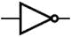 | 对输入取反。 | `A` | `~A` |
|  |  |  | 0 | 1 |
|  |  |  | 1 | 0 |
| 与门 | 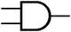 | 逻辑与。 | `A` | `B` | `A 与 B` |
|  |  |  | 0 | 0 | 0 |
|  |  |  | 0 | 1 | 0 |
|  |  |  | 1 | 0 | 0 |
|  |  |  | 1 | 1 | 1 |
| 或门 | 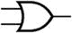 | 逻辑或。 | `A` | `B` | `A 或 B` |
|  |  |  | 0 | 0 | 0 |
|  |  |  | 0 | 1 | 1 |
|  |  |  | 1 | 0 | 1 |
|  |  |  | 1 | 1 | 1 |
| 与非门 | 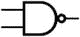 | 对逻辑与取反。 | `A` | `B` | `A 与非 B` |
|  |  |  | 0 | 0 | 1 |
|  |  |  | 0 | 1 | 1 |
|  |  |  | 1 | 0 | 1 |
|  |  |  | 1 | 1 | 0 |
| 或非门 | 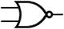 | 对逻辑或取反。 | `A` | `B` | `A 或非 B` |
|  |  |  | 0 | 0 | 1 |
|  |  |  | 0 | 1 | 0 |
|  |  |  | 1 | 0 | 0 |
|  |  |  | 1 | 1 | 0 |
| 异或门 | 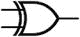 | 异或：当两个输入值不同时，双输入异或门的输出为 1；当两个输入值相同时，输出为 0。 | `A` | `B` | `A 异或 B` |
|  |  |  | 0 | 0 | 0 |
|  |  |  | 0 | 1 | 1 |
|  |  |  | 1 | 0 | 1 |
|  |  |  | 1 | 1 | 0 |

晶体管为我们的社会带来了巨大的技术进步。它们无处不在：计算机、通信设备、医疗设备、航空航天硬件等等。任何你能想到的机器可能都是由晶体管构成的，然而晶体管即将面临一个不可逾越的障碍：物理定律，特别是量子力学。

### 五纳米晶体管：大问题

自 20 世纪 60 年代以来，传统计算机的性能呈指数级增长，同时体积也变得越来越小。如今，计算机由数百万个晶体管组成，但一旦晶体管的尺寸开始接近原子大小，量子力学的奇异世界便会介入，一切皆充满变数。

参考图 2-1 和图 2-2，它们展示了 1970 年至 2020 年的半导体制造工艺尺寸。从 20 世纪 70 年代约 10 微米的尺寸开始，到 80 年代末，尺寸变得越来越小（约 1 微米）。更令人担忧的是，从 20 世纪 90 年代至今乃至未来，尺寸急剧下降到纳米级（1 纳米 = 10^(-9) 米）（见图 2-2）。我们谈论的是尺寸接近分子的晶体管。到 2020 年，晶体管的尺寸将达到约 5 纳米。在这个尺度下，量子力学的奇异特性可能会对经典计算机造成严重破坏。

表 2-3 图 2-2 的半导体尺寸数据

| 年份 | 尺寸（纳米） |
| --- | --- |
| 1995 | 600 |
| 2001 | 130 |
| 2010 | 32 |
| 2014 | 14 |
| 2019 | 7 |
| 2021 | 5 |

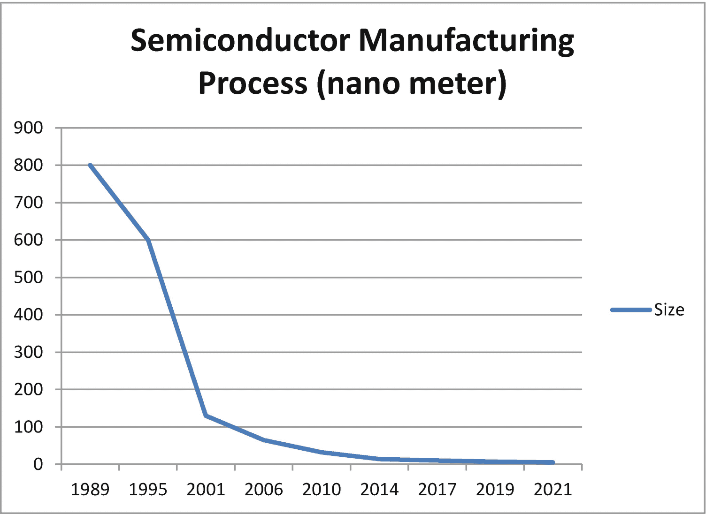

图 2-2 20 世纪 90 年代及以后的半导体尺寸

表 2-2 图 2-1 的半导体尺寸数据

| 年份 | 尺寸（微米） |
| --- | --- |
| 1971 | 10 |
| 1974 | 6 |
| 1977 | 3 |
| 1982 | 1.5 |
| 1985 | 1 |

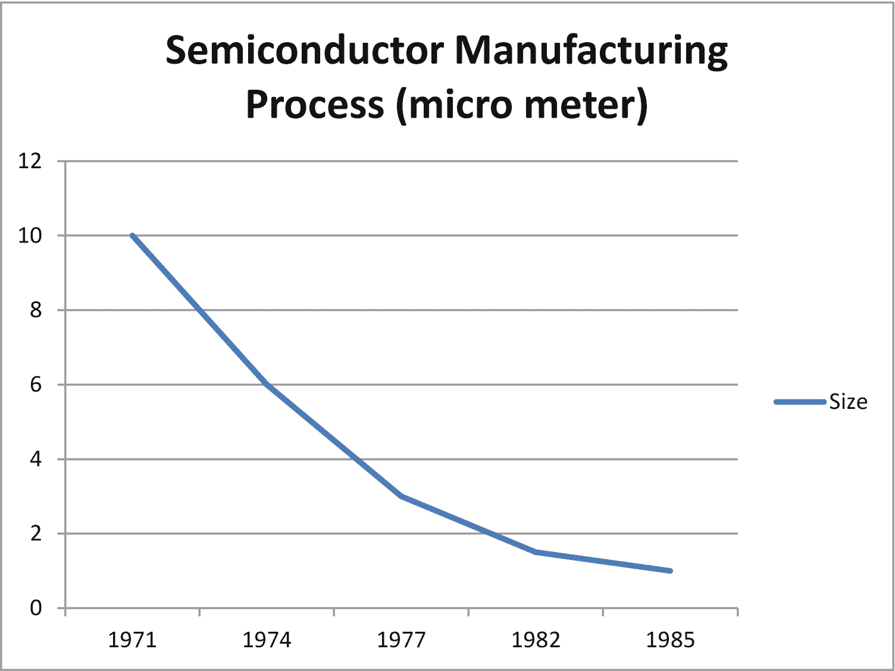

图 2-1 20 世纪 70 年代至 80 年代的半导体尺寸

图 2-3 展示了 2020 年晶体管（约 5 纳米）与一个水分子（0.275 纳米）的尺寸对比。遗憾的是，尺寸不可能永远无限缩小。存在一个阈值，将使经典计算机变得无用，这个阈值被称为量子尺度。

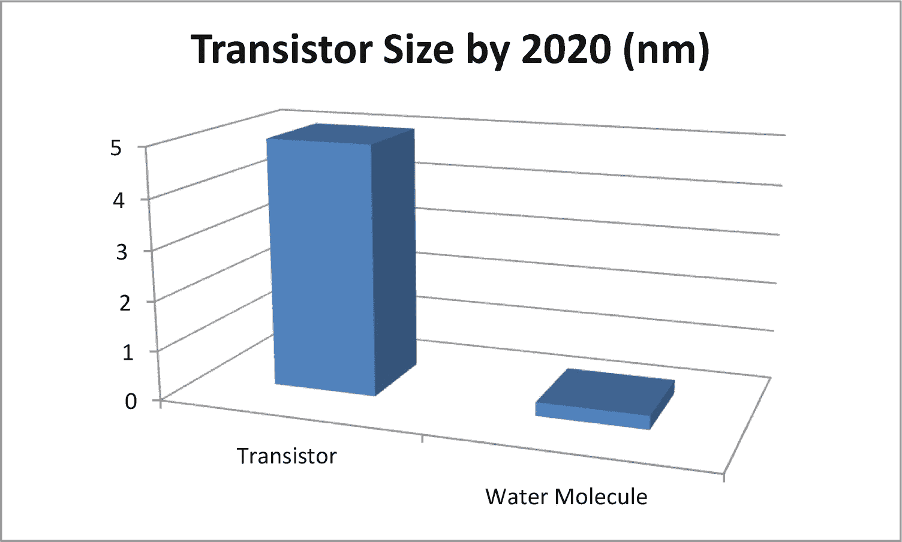

图 2-3 晶体管与水分子的尺寸对比

#### 量子尺度与晶体管的终结

或许“晶体管的终结”这种说法有些夸张。然而，“量子尺度”及其对晶体管的影响却是真实存在的。在物理学中，量子尺度是指在一个孤立系统中，量子力学效应变得明显的距离。这个奇怪的边界存在于 100 纳米或更小的尺度，或者极低的温度下。严格来说，量子尺度是指作用量或角动量被量子化的距离。

量子效应可以级联到微观尺度领域，给当前的微电子学带来问题。最典型的效应是电子的隧穿效应和干涉现象，正如单双缝实验所展示的那样。

##### 电子隧穿

电子隧穿，也称为量子隧穿，指的是粒子穿过在经典尺度下无法逾越的势垒的现象。这对晶体管来说是个大麻烦，原因如下。

假设我们有一个能量为 `E` 的粒子，试图越过顶部势能为 `V` 的势垒。根据经典的能量守恒定律，粒子需要其能量 `E > V` 才能通过，也就是说，粒子的动能必须大于势能 `V`（见图 2-4）。

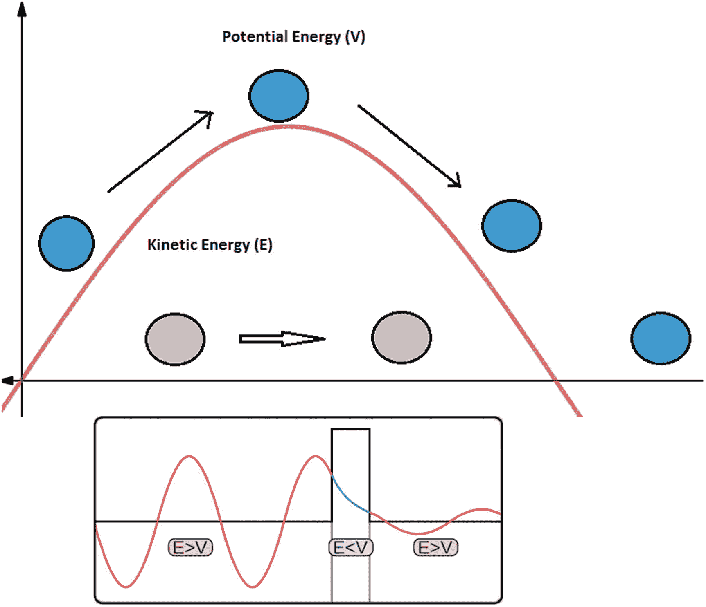

图 2-4 量子隧穿效应示意图

电子隧穿可能给晶体管带来灭顶之灾，但一方的损失却是另一方的收获。这一重要特性促成了扫描隧道显微镜（`STM`）的发明，它对化学、生物学和材料科学研究产生了深远影响。

### 图 4 展示了经典力学和量子隧穿效应的结果

根据量子力学，即使电子的动能小于势垒的势能（`E < V`），它也有一定的概率穿过势垒。这是由于海森堡不确定性原理（`HUP`）所致。在上一章中，你了解了光子及其他粒子的波粒二象性：既是波又是粒子。对于波，薛定谔的波函数占主导；对于粒子，尼尔斯·玻尔描述了原子在获得或失去能量时状态的变化（量子跃迁）。不确定性原理通过引入粒子在给定时间的位置和动量的概率，弥合了这一鸿沟。

当一个粒子（如电子或光子）接近一个势垒（如晶体管）时，它存在一定概率直接穿过去。这是因为其波函数从正弦形式衰减为指数形式，其解变为方程 2.1。

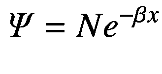

(2.1)

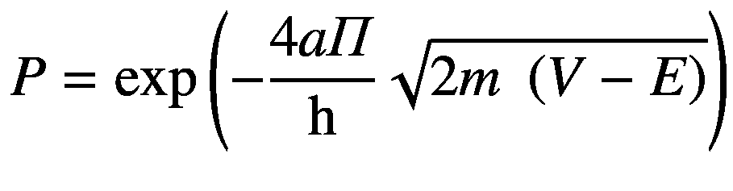

(2.2)

其中

* `ψ` 是薛定谔衰减后的波函数。
* `N` 是归一化常数。
* `β = √(2m(V-E)/h²)`
* `m` 是粒子的质量。
* `V` 是势能，`E` 是动能。
* `h` 是普朗克常数 `6.626x10⁻³⁴` `m²kg/s`。
* `a` 是势垒的厚度。

根据恩格尔¹的研究，粒子穿过势垒的概率 `P` 可由公式 2.2 计算得出。此外，量子隧穿的发生必须满足以下条件：

* 势垒的高度必须是有限的，且势垒的厚度应足够薄。
* 势垒的势能超过其动能（`E < V`）。
* 粒子具有波动性，这表明量子隧穿仅适用于纳米尺度的物体，例如电子、光子等。

下面我们来计算当前半导体制造工艺中各种势垒尺寸下的量子隧穿概率，这很有趣。接下来的章节将通过一系列练习来详细展示这一过程。

### 练习 1

使用你喜欢的工具（例如 `Excel` 电子表格）计算电子的量子隧穿概率，针对公式 2.2，假设以下值：

* 电子的动能 `E = 4.5 eV`。
* 矩形势垒的势能 `V = 5 eV`。请记住，为了使量子隧穿发生，需要 `E < V`。
* 使用上一节中半导体制造工艺在量子尺度下的势垒尺寸；因此对于 2000 年及以后的年份，尺寸 < 100 `nm`（使用上一节中的表 2-2 和 2-3）。
* 不要忘记普朗克常数 `h = 6.626x10⁻³⁴` 和电子质量 `m = 9.1x10⁻³¹ kg`。

### 提示

`eV` 是电子伏特，即量子力学中的基本能量单位。1 `eV` = 1.6X10⁻¹⁹ 焦耳 (`J`)。在概率计算中，此值用于单位转换。

### 解法一

我已使用一个 `Excel` 电子表格，通过表格和公式轻松计算数值，该公式包含在本手稿的源代码中。因此，在 `Excel` 中选择一个单元格，输入公式 2.2。请记住，`(V-E)` 部分必须乘以 `1.6X10^(−19) J/eV` 进行缩放。于是，`Excel` 中的公式 2.2 变为：

```
EXP(((−4*D5*3.14)/(6.626E−34)) * SQRT(2 * (9.1E−31) * (5 − 4.5) * (1.6E−19)))
```

在上述公式中，单元格 `D5` 包含势垒尺寸，其余为常数 `π = 3.14`、`h = 6.626e^(−34)`、`m = 9.1e^(−31)` 以及 `1 eV = 1.6x10¹⁹ J`。公式设置完成后，创建一个新表格，包含制造年份和以纳米为单位的势垒尺寸（来自表格 2-2 和 2-3）。最后，对所有年份和势垒尺寸的单元格数据，逻辑复制该公式（参见表格 2-4）。

**表 2-4**

半导体工艺的电子隧穿概率

| 年份 | 势垒尺寸 (m) | 概率 |
| --- | --- | --- |
| 1989 | 0.0000008 | 0 |
| 2001 | 1.30E−07 | 0 |
| 2006 | 0.000000065 | 6.5829E−205 |
| 2010 | 0.000000032 | 3.0188E−101 |
| 2014 | 0.000000014 | 1.053E−44 |
| 2017 | 1.00E−08 | 3.86767E−32 |
| 2019 | 7.00E−09 | 1.02616E−22 |
| 2021 | 5.00E−09 | 1.96664E−16 |
| Beyond | 5E−10 | 0.026876484 |

从这些数据中能得出什么结论？

* 概率看起来很低，即使对于即将在 2021 年出现的 5 纳米制造工艺也是如此（`1.9e−16`）。请记住，该值必须乘以 100 才能得到百分比。
* 当势垒尺寸达到约 500 皮米（`pm`）时，情况开始变得有点棘手。概率为 `0.0268`；也就是说，电子有 2.68% 的概率穿过势垒。这意味着，例如，如果你发送了一条加密消息，将有 2.68% 的比特丢失！这可不妙。

### 提示

一皮米（`pm`）是 1/1000 纳米，即 `10e^(−12)` 米。

### 练习二

用你最喜欢的编程语言编写一个小程序，计算上一练习中所示的概率。验证结果是否相同。将结果输出到标准输出，如下面段落所示。

```
当前半导体工艺的量子隧穿概率。
2001   1.30e-07    0.000e+00
2010   3.20e-08    2.684e-101
2014   1.40e-08    1.000e-44
2019   7.00e-09    1.000e-22
2021   5.00e-09    1.931e-16
Beyond 5.00e-10    2.683e-02
```

### 解法二

清单 2-1 展示了一个小型 `Java` 程序，用于计算当前制造工艺各年份及尺寸下的概率，如同上一练习所做的那样。

# 清单 2-1：用于计算 2000 年及以后半导体制造工艺量子隧穿概率的 Java 程序

```java
public class Quantum Tunnelling {
    /** 普朗克常数 */
    static final double K_PLANK = 6.626e-34;
    /** 电子质量 (kg) */
    static final double K_ELECTRON_MASS = 9.1e-31;
    /** 电子伏特 */
    static final double K_EV = 1.6e-19;
    /**
     * 恩格尔量子隧穿概率
     *
     * @param size 势垒尺寸，单位米。
     * @param E    动能，单位电子伏特 (eV)。
     * @param V    势能，单位 eV。
     * @return 量子隧穿概率
     */
    static double EngelProbability(double size, double E, double V) {
        if (E > V) {
            throw new IllegalArgumentException
                ("势能 (V) 必须大于动能 (E)");
        }
        double delta = V - E;
        double p1 = ((-4 * size * Math.PI) / K_PLANK);
        double p2 = Math.sqrt(2 * K_ELECTRON_MASS * delta * K_EV);
        return Math.exp(p1 * p2);
    }
    /** 当前半导体工艺的简单测试 */
    public static void main(String[] args) {
        try {
            // 当前半导体工艺的势垒尺寸 (m)
            final double[] SIZES = { 130e-9, 32e-9, 14e-9, 7e-9, 5e-9, 500e-12 };
            // 用于显示的日期
            final String[] DATES = { "2001", "2010", "2014", "2019", "2021", "Beyond" };
            final double E = 4.5; // 电子的动能 (eV)
            final double V = 5.0; // 势能 (eV)
            // 显示它们...
            for (int i = 0; i < DATES.length; i++) {
                double p = EngelProbability(SIZES[i], E, V);
                System.out.println(String.format("%s\t%2.2e\t%2.3e", DATES[i], SIZES[i], p));
            }
        } catch (Exception e) {
            e.printStackTrace();
        }
    }
}
```

清单 2-1 定义了一个函数`EngelProbability`，该函数接受三个参数：势垒尺寸（以米为单位）、粒子的动能（`E`，以 eV 为单位）和势能（`V`，以 eV 为单位）。它应用公式 2.1 并返回概率。然后，主程序遍历一个包含制造工艺年份的数组`String[] DATES = { "2001", "2010", "2014", "2019", "2021", "Beyond" }`和对应的尺寸`double[] SIZES = { 130e-9, 32e-9, 14e-9, 7e-9, 5e-9, 500e-12 }`。数据被格式化为表格并输出到标准输出。

## 练习三

将练习一或练习二中获得的数据绘制成图表，以便更直观地观察情况。最后，大胆推测当前半导体制造工艺中晶体管失效的年份！

## 解法三

电子表格是处理统计数值的绝佳工具。之前的数据可以快速绘制成酷炫的折线图，如图 2-5 所示。

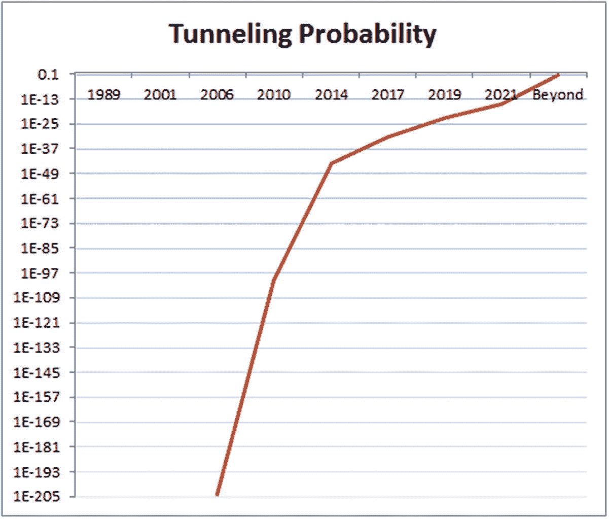

**图 2-5** 半导体制造工艺的量子隧穿概率

现在到了重头戏，晶体管的消亡应该发生在……年份？我对估算这样的年份感到怀疑。关于量子力学，我学到的一点是，一切皆由不确定性主宰。如果我们假设量子隧穿概率达到 1% 对于当前制造工艺是不可接受的，那么上述数据显示，大约在 2025 年，当势垒尺寸介于 1 纳米和 500 皮米之间时，晶体管以及所有计算机可能变得不可用。不过，我的猜测是晶体管会演变成其他形态，也许是有机物，或者更奇特的东西。尽管如此，是时候开始学习如何为量子计算机编程了，以防万一。

现在，让我们看看下一个给晶体管带来麻烦的量子效应：由基本狭缝实验所展示的位置或动量的不确定性。

### 狭缝实验

这些实验是几十年前进行的，旨在作为量子力学奇异世界的基本演示。它们有多种形式：单狭缝、双狭缝等等。在单狭缝实验中，激光穿过一个几英寸宽的垂直狭缝，并投射到一个表面上。狭缝的宽度可以根据需要减小。正如预期的那样，我们看到一个光点投射在表面上。现在，如果狭缝宽度减小，投射的光点会变得越来越窄；同样，这是预期的结果。但是，当狭缝宽度减小到大约 1/100 英寸时，情况就变得疯狂了。光点并没有变窄，而是爆炸成一个宽大的水平线状。这极不符合直觉。

#### 提示

关于这个实验的更详细描述和图示，请参见第 1 章。

狭缝实验在讨论晶体管时很重要，因为它们展示了量子力学在微小尺度下的奇异效应。总而言之，牛顿力学和相对论关于时间和空间的定律在此尺度下不再适用，并将给晶体管带来麻烦。

### 晶体管的可能未来

也许我过早地宣告了晶体管的消亡。事实上，科学界已经在展望可能的替代方案（除了量子计算之外）。目前有一些引人入胜的项目正在着手解决这个问题：

-   **分子电子学**：一个令人兴奋的领域。它承诺通过使用分子构建模块来制造电子元件，从而突破小规模硅基集成电路的极限。这是一个跨学科领域，涉及物理学、化学和材料科学。
-   **有机电子学**：这个术语听起来既迷人，又仿佛出自科幻电影。这是材料科学的一个领域，涉及设计和应用那些表现出理想电子特性（如导电性）的有机分子或聚合物。想象一下由碳等有机材料制成的晶体管。虽然不完全是活的机器，但也相差不远了。

### 走进理查德·费曼与量子计算机

基于量子特性的计算系统概念源于诺贝尔奖得主、物理学家理查德·费曼。1982 年，他提出了一种“量子计算机”，能够利用量子力学的效应为己所用。^(³) 此后的大部分时间里，对量子计算的兴趣主要停留在理论层面，但情况即将改变。1995 年，彼得·肖尔在他那篇著名的论文《量子计算机上的素数分解与离散对数的多项式时间算法》^(⁴)中，提出了一种在量子计算机上运行的大素数分解算法。当数学上证明了他的算法的时间复杂度（大`O`或执行时间）远比经典计算领域的当前冠军——数域筛法——快得多时，一场制造实用量子计算机的竞赛就此拉开帷幕。

肖尔算法本身的意义极其深远。请参考图 2-6，其中展示了数域筛法与肖尔算法的时间复杂度对比。

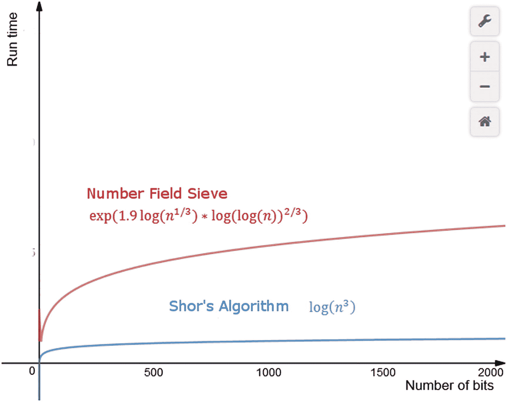

**图 2-6** 数域筛法与肖尔算法的时间复杂度对比

根据数学估算，肖尔算法能够在数秒内分解一个 232 位的整数（`RSA-232`），这是当前最大的整数之一。因此，一台能够执行肖尔算法的实用量子计算机将使现有的非对称加密变得毫无用处。请记住，非对称加密在社会中无处不在：例如，在银行用于加密数据和账户，在网络中用于浏览、通信，凡此种种。

但先别急着冲到银行，把所有的钱取出来塞到床垫底下。该算法的实际应用还需要几十年的时间。本书后续章节会详细讨论这个引人入胜的算法。

现在回到费曼和他的量子计算机。在经典计算机中，基本单元是比特（一个`0`或`1`）。在费曼的计算机中，基本单元是量子比特（qubit）或量子位。这个单元和它所依据的理论一样奇特。

### 量子比特：既怪异又了不起

就像它的经典表亲一样，量子比特可以取值`0`或`1`。在物理上，量子比特可以表示为任何两级量子系统，例如：

-   粒子在磁场中的自旋，其中向上表示`0`，向下表示`1`；或者
-   单个光子的偏振，其中水平偏振表示`1`，垂直偏振表示`0`。你可以用光来制造一台量子计算机。这有多奇特。

在这两种情况下，`0` 和 `1` 都是唯一可能的状态。从几何上看，量子比特可以用一个称为布洛赫球的形状来可视化，该仪器以瑞士物理学家菲利克斯·布洛赫的名字命名（见图 2-7）。

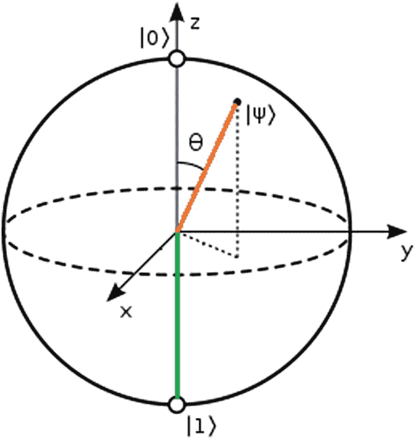

## 态的叠加

形式上，布洛赫球是两级量子系统或量子比特纯态在三维希尔伯特空间中的几何表示。球的北极和南极分别代表标准基向量 `|0>` 和 `|1>`；它们又分别对应于电子的自旋向上和自旋向下。除了基本向量，球体上还可以存在介于两者之间的状态；这被称为叠加态，它本质上是 `0` 或 `1` 的概率。关键在于，我们无法预测最终会是哪个状态，除非在观测的瞬间，概率坍缩为一个确定的状态。

想象一下，如果你能抛出一枚硬币，它不仅可以落在正面或反面，还可以同时落在正反两面。这样的硬币会更强大。然而，有一个问题：一旦你观察这枚量子硬币，它就被迫呈现出正面或反面，你永远无法知道它之前处于什么状态。这就是测量量子比特时需要小心的原因之一，因为它们一旦被观察就会改变。总而言之，叠加态是一个规则改变者。让我们看看为什么：

-   一台 `1 位` 经典计算机一次可以处于（或存储） `2` 种状态中的 `1` 种： `0` 或 `1`。一台 `1` 量子比特的量子计算机一次可以处于（或存储） `2` 种状态。即 `2¹ = 2`。
-   一台 `2 位` 经典计算机一次只能存储 `2² = 4` 种可能组合中的 `1` 种。一台 `2` 量子比特的量子计算机可以同时存储 `2² = 4` 个可能的值。

假设字节（`8 bits`）是两种系统中用于存储信息的基本单位，那么量子计算机中可以同时存储的值的数量将是 `2^n`，其中 `n` 是量子比特的数量。将此与经典计算机的存储容量（如表 2-5 所示）进行比较，你就会明白为什么量子比特如此强大。

表 2-5 — 量子比特同时存储容量

| 比特/量子比特 | 经典存储（字节） | 量子存储（比特） | 量子存储（字节） |
| :-----------: | :--------------: | :--------------: | :--------------: |
|       4       |        1         |        16        |        2         |
|       8       |        1         |       256        |        32        |
|      32       |        4         |    4294967296    |     536870912    |
|      64       |        8         |   1.84467E+19    |   2.30584E+18    |

因此，量子计算机中能够同时存储的数据量是惊人的，以至于出现了一个新术语：量子霸权。这意味着量子计算机将能够解决所有经典计算机无法解决的问题。本章后面部分将更多讨论这个主题。但现在，让我们看看量子比特的下一个奇特属性：纠缠。

## 纠缠：观察一个量子比特会揭示其伙伴的状态

很久以前，阿尔伯特·爱因斯坦将量子纠缠称为“鬼魅般的超距作用”。信不信由你，纠缠已在 1982 年由法国物理学家阿兰·阿斯佩实验证明。他证明了在两个关联粒子中，一个粒子上的效应会以超光速传播！

> **提示**
> 颇具讽刺意味且令人惋惜的是，人类无法利用纠缠以超光速发送信息，因为信息本身无法以这样的速度传播。这种悖论以及阿斯佩克的实验，将在第 1 章中更详细地解释。

如果一组量子比特处于纠缠态，那么无论它们相距多远（例如，在银河系的两端，这听起来非常不可思议），其中一个量子比特的状态发生变化时，另一个会瞬时响应。这很有用，因为如果我们测量了一个量子比特的属性，就可以推断出其纠缠伙伴的属性，而无需直接观察。此外，纠缠可以通过一个称为量子层析成像的过程在不直接观察的情况下进行测量。量子层析成像旨在通过对来自源的系统进行测量，来确定纠缠集合在测量前的状态。换句话说，它计算了测量到系统每一种可能状态的概率。

> **注释**
> 多量子比特纠缠代表着在实现大规模量子计算方面迈出了一步。这是一个活跃的研究领域。目前，中国物理学家已在超导电路上实验性地展示了包含 10 个量子比特的量子纠缠。^(⁵)

纠缠是量子比特操控的一个方面；另一个令人费解的特性是通过量子门进行操控。

## 使用量子门操控量子比特

门是量子计算机中的基本构建模块。就像它们的经典对应物一样，它们对一组输入进行操作以产生另一组输出。然而，与经典门不同的是，它们同时在量子比特的所有可能状态下运行，这使得它们既酷炫又怪异。量子计算机的基本门包括：

### 测量门

我们知道，测量或观察量子比特的行为会改变其状态。这个过程也被认为是一个门。测量门以处于叠加态中的量子比特作为输入，并输出一个 `0` 或 `1`。此外，输出并非随机。输出为 `0` 或 `1` 的概率取决于量子比特最初所处的状态（见图 2-8）。

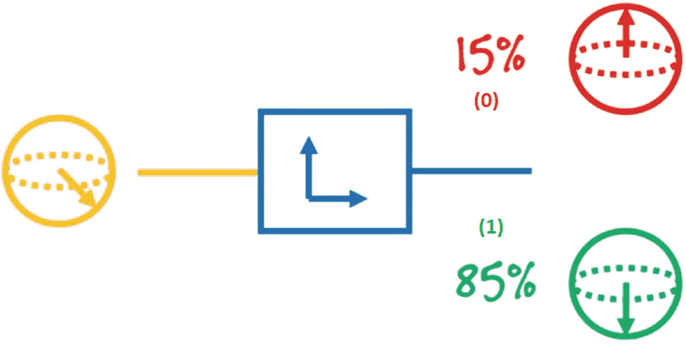

请注意，测量门应该是量子线路上的最终操作，因为量子力学告诉我们，在计算过程中间观察量子比特会使其波函数坍缩，从而破坏由叠加态达成的并行性。

### 交换门

交换门接收 `2` 个量子比特并交换它们的状态，如图 2-9 所示。

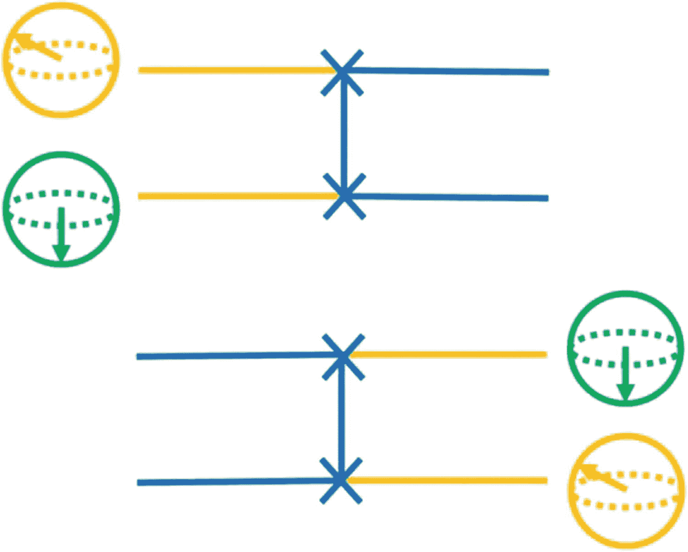

### 泡利 X 门

泡利门是经典非门的量子模拟。形式上，它将量子比特绕 X 轴旋转 `180` 度。请注意，X 轴指向屏幕外，如图 2-7 的布洛赫球所示。

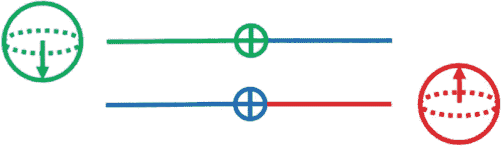

> **提示**
> 泡利门以奥地利出生的量子物理学之父之一——沃尔夫冈·恩斯特·泡利命名。他因提出不相容原理（或称泡利原理，该原理本质上说明没有两个电子可以处于完全相同的量子态）而于 `1945` 年获得诺贝尔物理学奖。^(⁶) 他深受阿尔伯特·爱因斯坦的钦佩，并且与量子力学巨匠尼尔斯·玻尔和伯纳德·海森堡是密友。

### 旋转门：Y 门和 Z 门

绕 Y 轴和 Z 轴的旋转门分别称为泡利 Y 门和泡利 Z 门。

-   泡利 Y 门作用于单个量子比特。它将布洛赫球绕 Y 轴旋转 `π` 弧度（`180` 度）。它将 `|0>` 映射为 `i|1>`，将 `|1>` 映射为 `–i|0>`。
-   泡利 Z 门作用于单个量子比特。它将布洛赫球绕 Z 轴旋转 `π` 弧度。它保持基态 `|0>` 不变，并将 `|1>` 映射为 `–|1>`。

### 阿达马门

阿达马门作用于单个量子比特。它是两次旋转的组合：

1.  绕 X 轴旋转 `π`
2.  绕 Y 轴旋转 `π/2`

阿达马门在量子计算中相当于阿达马矩阵，这是一个方阵，其元素为 `+1` 或 `−1`，且其行相互正交。

```
$$ H=\frac{1}{\sqrt{2}}\left[\begin{array}{cc}1&amp; 1\\ {}1&amp; -1\end{array}\right] $$
```

> **提示**
> 阿达马变换在数据加密以及许多信号处理和数据压缩算法中很有用。

### 受控门

受控门作用于 `2` 个或更多量子比特上，其中一个或多个量子比特作为某个操作的控制位。例如，受控非门（`CNOT` 或 `cX`）作用于 `2` 个量子比特，仅当第一个量子比特为 `|1>` 时，才对第二个量子比特执行非操作，否则保持其不变。

### 托佛利门

这是一个作用于 `3` 个量子比特的受控门。如果前两个量子比特处于状态 `|1>`，则它在第三个量子比特上应用泡利 X 门（或非门）；否则不进行任何操作。该门将 `|a,b,c>` 映射为 `|a,b,c + ab>`。

表 2-6 中显示的量子门是量子线路的基本构建模块，就像表 2-1 中的经典逻辑门用于传统数字电路一样。

表 2-6 — 基本量子门

| 门名称 | 符号 | 详情 |
| :----- | :--: | :--- |
| 测量 | 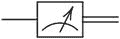 | 它以一个处于叠加态的量子比特作为输入，并输出 `0` 或 `1`。 |

# 量子门与量子比特设计

## 量子门

| 量子门 | 图示 | 描述 |
| :--- | :--- | :--- |
| X (非门) | 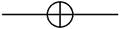 | 它将量子比特绕 X 轴旋转 180 度。将 `|0⟩` 映射为 `|1⟩`，将 `|1⟩` 映射为 `|0⟩`。 |
| Y | 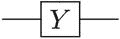 | 它绕布洛赫球面的 Y 轴旋转 π 弧度。由泡利矩阵表示：`Y = [[0, -i], [-i, 0]]`，其中 `i = √(-1)` 称为虚数单位。 |
| Z | 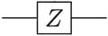 | 它绕布洛赫球面的 Z 轴旋转 π 弧度。由泡利矩阵表示：`Z = [[1, 0], [0, -1]]`。 |
| 哈达玛 | 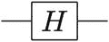 | 它表示绕 `(X+Z)/√2` 轴旋转 π。换句话说，它将状态映射为：`|0⟩` 到 `(|0⟩+|1⟩)/√2`，`|1⟩` 到 `(|0⟩-|1⟩)/√2`。 |
| 交换门 (S) | 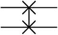 | 它基于基 `|00⟩`、`|01⟩`、`|10⟩`、`|11⟩` 交换 2 个量子比特。由矩阵表示：`S = [[1, 0, 0, 0], [0, 0, 1, 0], [0, 1, 0, 0], [0, 0, 0, 1]]`。 |
| 受控门 (`cX`、`cY`、`cZ`) | 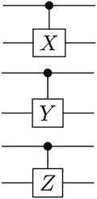 | 它作用于 2 个或更多量子比特，其中 1 个或多个量子比特作为某个操作的**控制**位。其通用形式由矩阵描述：`C(U) = [[1, 0, 0, 0], [0, 1, 0, 0], [0, 0, u00, u01], [0, 0, u10, u11]]`，其中 `U` 是泡利矩阵之一 `σ[x]`、`σ[y]` 或 `σ[z]`。 |
| 托佛利门 (`CCNOT`) | 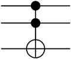 | 这是一个可逆门，这意味着其输出可以从输入重建（状态被移动，且物理熵没有增加）。它有 3 位输入和输出；如果前两位都设置为 1，则它会翻转第三位；否则所有位保持不变。可逆门很重要，因为它们散发的热量更少。当逻辑门消耗其输入时，信息就会丢失，因为输出中包含的信息少于输入。这种信息丢失会以热量形式将能量散发到周围环境。在量子计算中，`托佛利`门很重要，因为量子力学要求变换是可逆的，并且允许比经典计算机更通用的状态（叠加态）。 |

因此，量子门操纵输入叠加态，旋转概率，并产生另一个叠加态作为其输出。在物理上，量子比特可以通过多种方式构建，科技公司目前正从不同方向着手行动，每种设计都有其自身的优势和劣势。让我们来看一下。

## 量子比特设计

在量子比特设计方面，只有资金雄厚的公司才能参与构建实用量子计算机的竞争。由于量子力学的奇异性和复杂性，这绝非易事。在《科学》杂志⁷ 的一篇文章中，作者加布里埃尔·波普金概述了这些科技巨头的努力。似乎所有公司都希望以不同的设计参与其中。目前，尚无明确的赢家；尽管如此，竞争已经开始。根据波普金的说法，以下是最常见的量子比特类型：

### 超导环路

当电流通过导体时，部分能量会以热量和光的形式损失。这称为电阻，其大小取决于材料类型；像铜或金这样的金属是很好的电导体，因此电阻较低。科学家发现，材料温度越低，其导电性越好。因此，温度越低，电阻越低。然而，无论金或铜的温度多低，它们总会表现出一定程度的电阻。

然而，汞的情况不同。1911 年，科学家发现，当将汞冷却到 4.2 开尔文（接近绝对零度）时，其电阻变为零。这个实验导致了**超导体**的发现，这是一种在极低温度下电阻为零的材料。此后，人们发现了许多其他超导材料：铝、镓、铌等，它们在临界温度下呈现零电阻。超导体的优点在于，电流可以在没有任何损耗的情况下流动，因此闭合环路中的电流理论上可以永远流动。

> **提示**：这一原理已通过实验得到证实，科学家们能够使电流在超导环上持续流动数年。

在一个由超导体环路制成的量子比特中，电流在环路中来回振荡。注入的微波会激发电流进入叠加态（参见图 2-11 )。让我们看看这种设计的优缺点。

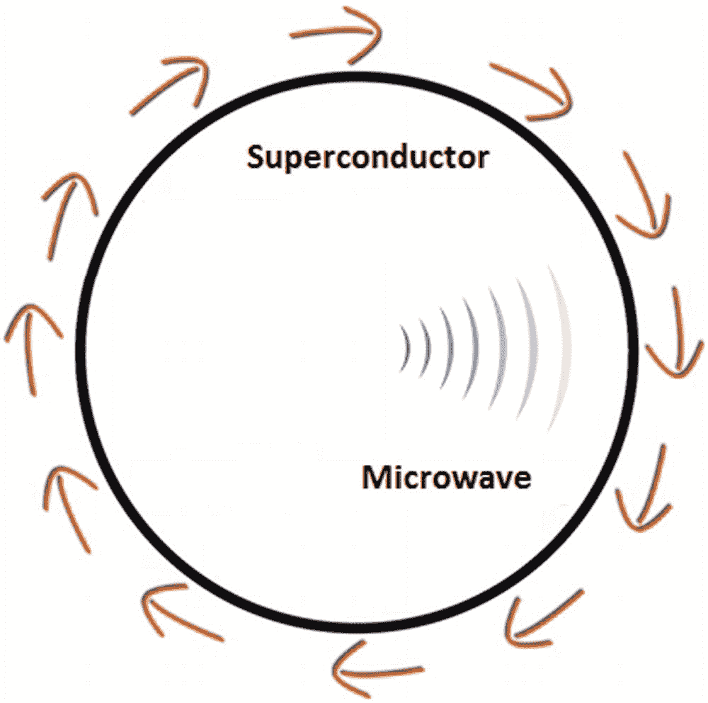
**图 2-11**：超导体环路量子比特

**优点：**
* 低错误率（约 99.4% 的逻辑成功率）
* 速度快，基于现有材料构建
* 可纠缠的量子比特数量可观（9 个），能够执行 2 量子比特操作

**缺点：**
* 寿命短：0.00005 秒。即叠加态能够保持的最短时间
* 必须保持在极低的温度，即超低温 –271°C

此设计被 IBM 的云平台 Q Experience 所采用，该平台是本书所用代码的基础。谷歌和一家名为 Quantum Circuits, Inc. (QCI) 的私营企业也采用了此设计，后者正致力于制造基于超导体的实用量子计算机。

### 离子阱

`离子阱`是一种在量子比特中控制量子态的技术。它利用电场或磁场的组合，将带电粒子（离子）捕获在与外部环境隔离的系统中。通过施加激光，可以耦合量子比特态以执行单量子比特操作，或耦合内部态与外部运动态以实现纠缠。

离子阱试图通过扩展`离子阱阵列`来实现大规模通用量子计算的梦想。该技术还能通过光子连接的远程纠缠`离子链`网络，或结合这两种思路（参见图 2-12），来构建大规模纠缠态。

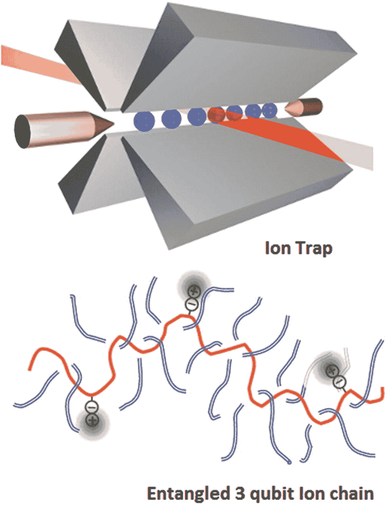
**图 2-12** – 用于大规模量子计算的离子阱与离子链

让我们来看看离子阱的优缺点：

**优点：**
*   **高寿命：** 专家称，离子阱可维持纠缠长达 1000 秒，与超导环（0.00005 秒）相比优势巨大。
*   **更高的成功率（99.9%）：** 高于超导体的 99.4%。差距虽不大，但仍是优势。
*   **迄今最高数量（14 个）：** 能够执行二量子比特操作的纠缠量子比特数。

**缺点：**
*   **操作速度慢：** 需要大量激光器。

开发此项技术的领先公司是位于美国马里兰州的 `IonQ`。

### 硅量子点

个人电脑 CPU 巨头`英特尔`正引领这一设计。在硅量子点中，电子被垂直限制在砷化镓（`GaAs`）量子阱的基态上，形成二维电子气（`2DEG`）。`2DEG` 电子气可在二维方向上自由移动，但在第三方向上受到强烈约束（参见图 2-13）。这种强约束导致第三方向上的运动产生量子化能级，这在基于量子结构的领域中可能具有高度价值。

> **提示：** `2DEG` 目前常见于半导体制造的晶体管中。它们还会展现量子效应，例如霍尔效应，即在低温强磁场下，二维电子电导会量子化。

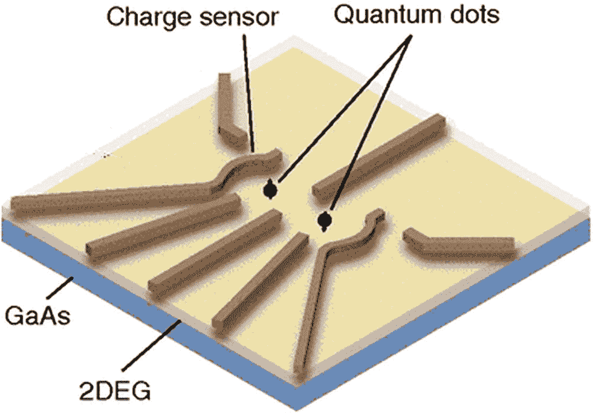
**图 2-13** – 由砷化镓制成的量子点

硅量子点的优缺点如下：

**优点：**
*   **稳定：** 基于现有半导体材料构建。
*   **寿命更长：** 达 0.03 秒，优于超导环。

**缺点：**
*   **纠缠量子比特数量少（2 个）：** 能执行二量子比特操作。
*   **成功率较低：** 虽不及超导环或离子阱，但 99% 的成功率依然很高。

### 拓扑量子比特

拓扑量子比特旨在消除量子计算机特有的错误水平。错误源于量子力学的概率特性，并通过量子比特纠缠的寿命或持续时间来描述。拓扑量子比特利用称为任意子的二维准粒子，这些粒子在三维时空中的路径相互缠绕形成辫子。这些辫子构成了构成计算机的逻辑门。

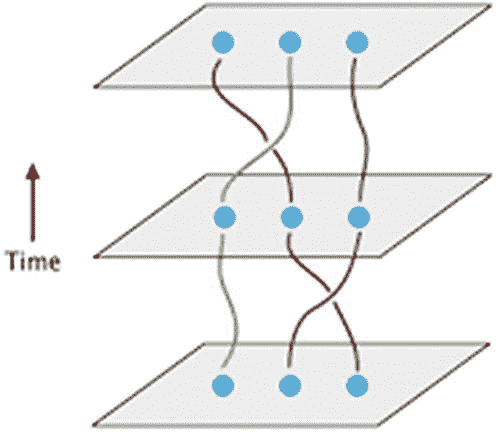

**图 2-14** – 逻辑门由辫子构成的拓扑量子比特

**优点：**

*   **稳定、无错误：** （不适用寿命概念）

**缺点：**

*   **目前纯属理论：** 尽管近期实验表明，这些元素可能通过使用由砷化镓制成的半导体，在接近绝对零度和强磁场条件下在现实世界中得以创造。

`微软`和`贝尔实验室`是支持该设计的部分公司。

### 金刚石空位

金刚石空位是指金刚石晶格中本应有碳原子但实际缺失的位置。金刚石空位旨在利用金刚石材料中的纳米级原子缺陷来充当量子比特。已通过原子力显微镜观察到，天然金刚石表面显现出几种类型的缺陷。这种缺陷或空位，连同氮原子，会向金刚石晶格添加一个电子。随后，可用激光控制该电子的量子自旋，如图 2-15 所示。

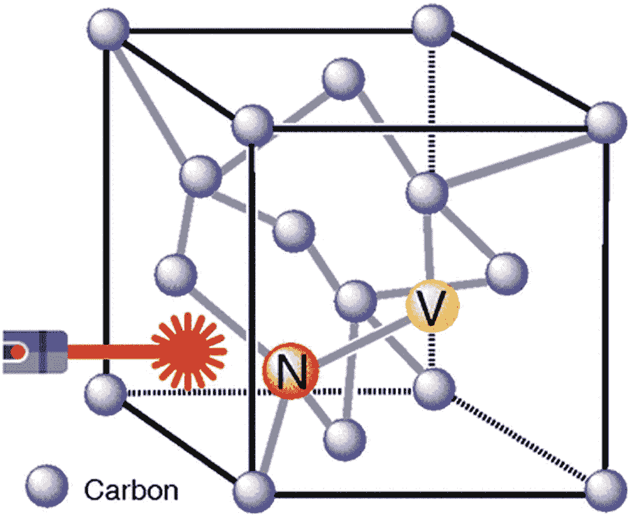

**图 2-15** – 金刚石空位量子比特

据`麻省理工学院电气工程与计算机科学学院`的`德克·恩格伦德`及其同事称，金刚石空位以简单的方式解决了从量子比特中读取信息这一长期难题。金刚石是天然发光体，因此，金刚石空位发出的光粒子保留了状态的叠加态，从而可以在量子计算设备之间传递信息。最棒的是，它们能在室温下工作，无需冷却到零下 272 度！

恩格伦德指出，金刚石空位的一个缺陷是，金刚石表面只有大约 2% 的区域存在这种空位。尽管如此，研究人员正在开发用电子束轰击金刚石以产生更多空位的工艺。

**优点：**

*   **高寿命：** 10 秒。
*   **高成功率：** 99.2%。
*   **可观的纠缠量子比特数量（6 个）：** 能够执行二量子比特操作。
*   **量子比特在室温下工作：** 这是多么不可思议。

**缺点：**

*   **表面材料空位数量少：** 约 2%。
*   **难以纠缠。**

总而言之，自`理查德·费曼`时代以来，量子计算机已取得了长足进步，一些世界顶级公司正寻求从中获利。目前，超导环处于领先地位。然而，令人惊叹的新设计，如金刚石空位，正试图实现大规模量子计算的梦想。

## 量子计算机与传统硬件

量子计算机在某些任务上胜过传统硬件。请参考表 2-7，该表展示了量子计算机与传统计算机在两项特定任务上的时间复杂度对比。

**表 2-7** 特定任务的量子与经典时间复杂度对比

| 任务 | 量子算法 | 时间复杂度 | 经典算法 | 时间复杂度 |
| :--- | :--- | :--- | :--- | :--- |
| 搜索 | 格罗弗算法 | `√n` | 快速搜索 | `n/2` |
| 大整数分解 | 肖尔算法 | `log(n³)` | 数域筛法 | `exp(1.9log(n^(1/3)) * log(log(n))^(2/3))` |

对于搜索任务，`格罗弗算法`的性能优于传统搜索。这对谷歌、微软和雅虎等公司的数据中心可能产生深远影响。想象一下，你的网络搜索由云端的量子处理器驱动。虽然目前距离这一目标还很遥远，但这正是大型科技公司大力投资开发量子平台的原因之一。

另一项任务，或许也是量子计算如此火热的主要原因，是大整数分解。当`彼得·肖尔`提出他的量子分解算法时，他对构成我们社会基础的密码安全性造成了严重冲击。`肖尔算法`通过快速分解大整数，威胁着当前的加密系统。这些整数被用于生成加密密钥，以保护网络上的所有数据：银行账户、商业交易、聊天记录、猫咪视频，应有尽有。事实上，`肖尔算法`速度极快，能够在几分钟内分解当今最大的整数。相比之下，当前经典的数域筛法可能需要数十亿年才能分解这类数字。

除了搜索和密码学，量子计算机还可以成为模拟、分子建模、人工智能、神经网络等领域的宝贵工具。让我们来看看具体应用。

### 复杂模拟

物理学家一致认为，原子级别的模拟是量子机器大显身手的领域。毕竟，这是一个完美的契合：一台以原子为基础构建的机器，能够比经典计算机更精确地模拟量子力学系统。据估计，一台仅有几十个量子比特的量子计算机就能进行经典计算机需要无法估量的时间才能完成的模拟。例如，以英国物理学家约翰·哈伯德命名的`哈伯德模型`（描述晶体中电子运动），就可以用量子计算机进行模拟。^(⁸) 哈伯德认为，这是一项超出经典计算机能力的任务。

### 分子建模与新材料

根据`《科学》`杂志上的一篇文章，位于热那亚的意大利理工学院的理论化学家们在一台量子计算机上模拟了氢化铍分子，^(⁹) 这是一种由两个氢原子和一个铍原子组成的小型化合物。按当今的经典标准来看，这算不上什么大事，但却是通往充满新药发现希望的未来的一块垫脚石。

分子建模对量子机器来说是一个全新的领域，因为物理学家和化学家通常使用计算机来模拟原子和分子的行为。数学家声称，大多数模拟都需要巨大的计算能力。分子模拟尤其如此，因为粒子间的相互作用会随着数量的增加而呈指数级复杂化。再加上量子力学那古怪的定律，使得计算分子内这些电子的分布变得异常困难。表 2-8 展示了当前该领域的一些实验。

**表 2-8** 分子建模领域的量子实验

| 年份 | 公司 | 实验 |
| :--- | :--- | :--- |
| 2016 | 谷歌 | 位于加州威尼斯量子计算实验室的研究人员使用 3 个量子比特计算了一个氢分子能量最低的电子排布。 |
| 2017 | IBM | IBM 开发了一种交互式算法来计算特定分子的基态。科学家使用多达 6 个超导量子比特，通过将每个分子的电子排布编码到量子计算机中，然后将分子微调至其基态并对该基态进行测量，最后再编码到传统计算机上，从而分析了氢、氢化锂和氢化铍。 |

总而言之，分子建模虽然起步不大，但对于化学和制药公司来说，前景依然光明。分子模拟有望成为量子计算的一项杀手级应用。

### 复杂的深度学习

在深度学习方面，传统问题分为三类：模拟、优化和采样。在之前的章节中，我们已经看到了量子计算机如何在模拟（尤其是在分子和原子层面）表现出色，那么优化问题呢？由于解决优化问题所需的交互变量数量极其庞大，某些优化问题在传统硬件上是不可行的。这些问题的例子包括蛋白质折叠、航天器飞行模拟等等。量子计算机可以使用一种称为`随机梯度下降`的技术高效地处理优化问题。这是一种从大量可能的解决方案中寻找最佳方案的技术，可以比作在连绵起伏的山丘和山谷景观中寻找最低点。

> **提示：** 事实上，一家名为 D-Wave 的加拿大公司已经在销售专为处理优化问题而设计的商用量子计算机，它们采用`随机梯度下降`等技术。其客户包括国防承包商洛克希德·马丁公司和谷歌。

量子采样问题属于从概率分布中生成样本的计算问题范畴。能够展示量子算法威力的两类采样问题是`玻色子采样`和`瞬时量子多项式时间采样`。这两种技术已有多个小规模实现，并借助量子光学完成。

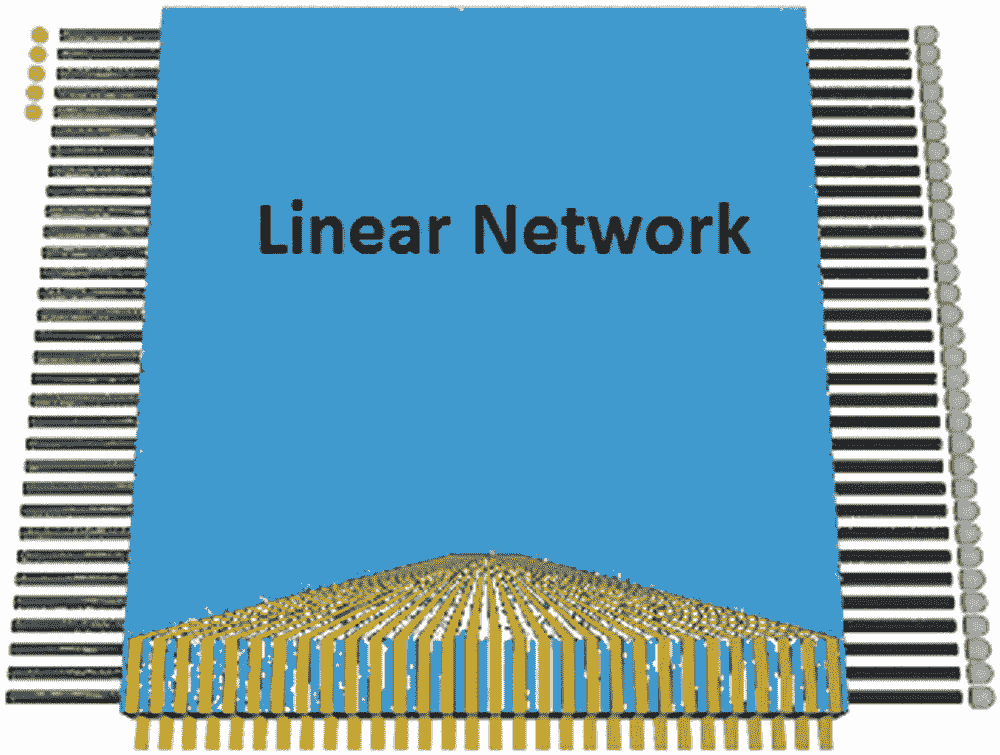

**图 2-16** 玻色子采样问题示意图

图 2-16 展示了 32 模式实例的`玻色子采样`问题示意图。五个光子（左）被注入一个具有散射矩阵（底部）的线性网络，所有输出都在福克基下被检测（右）。根据 `A. P. Lund`、`Michael J. Bremner` 和 `T. C. Ralph` 在`《自然》`杂志“量子信息”板块发表的一篇文章，这个问题对于经典计算机来说是难以处理的，即使是对于中等规模的系统（例如，2500 条路径中的 50 个玻色子）也是如此。即使是较小的系统（20 个玻色子和 400 条路径），目前也已知不存在能够执行此模拟的可行经典算法。^(¹⁰)

然而，量子采样问题的情况则不同，它为实验性地展示量子算法在该领域的优越性提供了一条途径。深度学习和人工智能是高级计算中相辅相成的两个学科，而神经网络则是当前研究领域王冠上的明珠。

#### 量子神经网络与人工智能

量子神经网络目前更多是科幻小说的素材，而非科学现实。尽管如此，其理论基础自 20 世纪 90 年代以来就已存在，并且目前在众多方向上开展了广泛的研究，包括：

*   **利用量子信息处理来改进现有的神经网络模型**^(¹¹)：其核心在于通过更快、更高效的算法来增强现有模型。这是量子计算大放异彩的领域。这项研究的动机源自经典神经网络训练的困难，尤其是在大数据应用中。人们希望量子计算的特性，如并行性、干涉和纠缠效应，能够被用作资源。

*   **大脑中潜在的量子效应**^(¹²)：这条路径融合了量子物理学和神经科学，引发了一场超越科学边界的激烈辩论。先驱者们正孜孜不倦地耕耘于目前仍以理论为主的量子生物学领域，该领域因以下发现而势头渐长：
    *   光合作用中因量子效应而出现高效能量传输的迹象。
    *   关于核磁共振扫描仪患者出现"马格滞后"效应的报告，表明大脑中精妙的相互作用可能在本质上具有量子特性。

*   **量子联想记忆**：这是`丹·文图拉`和`托尼·马丁内斯`于 1999 年提出的一种新算法。^(¹³) 他们提出了一种模拟联想记忆的基于电路的量子计算机。该算法将记忆状态写入叠加态，然后使用类似`格罗弗算法`的量子搜索来检索最接近给定输入的记忆状态，其最终目标是模拟人脑的特征。

# 黑洞：信不信由你，已有观点提出将黑洞建模为量子神经网络，并认为黑洞和大脑可能以类似方式存储记忆。^(¹⁴)

总而言之，如果未来某天一个类似"天网"的人工智能量子计算机要奴役人类，那么它很可能会由某种量子神经网络构成。这听起来或许像是个玩笑，但像斯蒂芬·霍金这样的科学巨匠已经对此发出了警告。我们应当明智地听取这些意见。在下一节中，我们将探讨导致量子计算机难以制造的陷阱。

## 量子计算机的陷阱：退相干与干涉

退相干和干涉是量子力学中的基本原理，它们给大规模量子计算带来了麻烦。

### 退相干（寿命）

在量子力学中，粒子由波函数描述。量子力学的一个基本属性称为相干性，或态之间的确定相位关系。这种相干性对于量子计算机的运行是必要的。然而，当一个量子系统与其周围环境接触时，相干性会随时间衰减，这个过程称为量子退相干。形式上，退相干是指叠加态消失所需的时间，它源于波函数的概率性质。可以将其视为信息从系统流失到环境中。

> **提示**
>
> 退相干的概念是由德国物理学家 H. 迪特尔·泽于 1970 年提出，用以理解波函数坍缩。^(¹⁵)

退相干可以通过实验进行检验：量子力学认为粒子可以同时处于多种状态（例如，非激发态与激发态，或处于两个不同位置）。只有观测行为才会给出某个特定状态的随机值。如果通过粒子的能级来测量激发态（低能级表示未激发，高能级表示激发），当以适当频率向该粒子发射电磁波时，粒子将在高能级和低能级之间交替变化。然后可以测量并平均粒子的状态，从而产生所谓的拉比振荡。由于粒子从未完全隔离（例如受到原子碰撞、电磁场或热浴的影响），叠加态会停止，振荡也会消失。

因此，退相干提供了关于量子客体及其环境相互作用的信息，这对量子计算至关重要。也就是说，退相干时间（系统保持叠加态的时间）越长，量子比特的质量就越高。一些量子比特设计，如超导环，其寿命非常短，需要保持在极低的温度（`-271°C`）下才能抵消这一效应。而其他设计，如离子阱和金刚石空位，则拥有非常长的寿命，可以在室温下工作。从事量子设计的科技公司正面临着与量子比特寿命作斗争的艰巨挑战。关于这些努力的更详细描述，请参见"量子比特设计"部分。

### 量子纠错

量子纠错旨在通过在信息中保护其免受退相干和其他环境噪声引起的错误影响，从而实现容错量子计算。当量子计算机设定好一些量子比特后，它会应用量子门来纠缠它们并操纵概率，最后测量输出，使叠加态坍缩为最终的 0 或 1 序列。这意味着你可以同时完成电路中所有的计算。最终，你只能从所有可能的解中测量出一个输出。每个可能的解都有一定的正确概率，因此可能需要重新检查和再次尝试。这个过程称为量子纠错。

在经典世界中，纠错是通过冗余来实现的，即创建数据的副本，然后为可能的错误情况分配概率，最后将最可能的情况与原始消息进行比较，以确定是否发生错误。为了说明这个过程，请考虑下表，它代表了一位信息：

| 消息 | 冗余副本 | 错误(1) | 错误(1,2) |
| --- | --- | --- | --- |
| `0` | `0` | `1` | `1` |
|     | `0` | `0` | `1` |
|     | `0` | `0` | `0` |
| 概率 |     | (1/3) = 0.33 | (1/3)*(1/3) = 0.11 |

假设我们有一条 1 位的消息（`0`），并创建了三个冗余副本用于纠错。假设噪声错误是独立的并以某种概率发生，那么错误更有可能发生在单个比特上，而传输的消息是三个 `0`。也有可能出现双比特错误，导致传输的消息等于三个 `1`，但这种结果的可能性较小。因此，在经典系统中出现错误时，我们可以使用此方法来纠正消息。不幸的是，由于**不可克隆定理**，这在量子尺度上是无法实现的。

> **注**
>
> 不可克隆定理指出，不可能创建任意未知量子态的完全相同的副本。该定理由物理学家詹姆斯·L·帕克于 1970 年提出并证明。^(¹⁶)

不可克隆定理给量子计算带来了麻烦，因为无法为纠错创建量子比特的冗余副本。尽管如此，可以将 1 个量子比特的信息扩展到多个物理量子比特的高度纠缠态中。这项技术由彼得·肖尔发现，他提出了一种纠错码方法，将 1 个量子比特的信息存储在 9 个纠缠的量子比特上。然而，这种方案只能防止有限形式的错误。随着时间的推移，人们开发出了几种量子纠错码方案。其中最重要的包括：

#### 三量子比特码

这是量子纠错最基础、也是起始点的编码方式。该方法将单个逻辑量子比特编码到三个物理量子比特中，其特性是能够纠正泡利 X 矩阵（`σ[x]`）中的单一比特翻转错误。该代码无需测量原始量子比特的状态即可纠正错误，它利用 2 个额外的量子比特，从数据块中提取所谓的*症状*信息（关于可能错误的信息），同时不干扰原始状态。

此代码的局限性在于它无法同时纠正比特翻转和相位（符号）翻转，只能纠正单一比特翻转。彼得·肖尔利用此方法开发出了 9 量子比特纠错码。

#### 肖尔码

此纠错码基于三量子比特码，能够纠正比特翻转、符号翻转或两者同时发生的情况。肖尔码的工作原理是将 1 个逻辑量子比特编码到 9 个物理量子比特中，利用这个额外的真实状态来存储关于可能错误的*症状*信息。请注意，此代码只能纠正单个量子比特中的错误。这种代码往往更简单，允许电路结构更好地适应计算机架构的物理限制。此外，量子纠错的其他现代进展包括：

*   **玻色子码**：这些代码试图利用谐振子在单个物理系统中具有无限能级的优势，将纠错信息存储在玻色子模式中。^(¹⁷)

*   **拓扑码**：这些代码由物理学家阿列克谢·基塔耶夫在其用于拓扑纠错的*环面*码中引入。其结构定义在二维晶格上，使用错误链来定义覆盖代码表面的非平凡拓扑路径。^(¹⁸)

总而言之，退相干和量子纠错给那些希望实现大规模容错量子计算梦想的 IT 公司带来了不小的挑战。尽管如此，得益于具有高寿命的新型量子比特设计和改进的量子纠错码，这一领域仍在快速发展。事实上，进展如此迅速，以至于该领域的专家为大规模量子计算创造了一个引人注目的新术语：`量子霸权`。

### 50 量子比特处理器与量子霸权探索

量子霸权确实是一个引人注目的术语。它由物理学家约翰·普雷斯基尔创造，用于描述量子计算机能够解决经典计算机无法解决的问题的时刻。这是一个非常有力的主张，因为它需要证明相对于最好的经典计算机有超多项式级的加速。

**提示**

超多项式级加速是指算法执行速度的提升超越了多项式的界限。例如，一个运行时间为 `k1n^(c1) + k2n^(c2) +…`（其中 `k` 和 `c` 是任意常数，`n` 是输入大小）的算法被认为是多项式时间算法。而运行时间为 `2^n`（`n` 是输入大小）的算法则被认为是超多项式时间算法。

研究人员正致力于证明量子霸权，目前已存在几种算法能够提供相对于经典冠军算法的超多项式级加速。以下段落详述了这些努力的时间线。

*   **1982 年**：量子力学巨擘理查德·费曼提出了一种量子计算机，可以利用叠加、干涉和纠缠等原子原理。这样的机器将改变游戏规则。

*   **1994 年**：数学家彼得·肖尔提出了他那著名的量子计算机因式分解算法。当估算出该算法的时间复杂度以超多项式级加速击败了经典超级冠军（数域筛法（NFS））时，该算法引起了轰动。该算法尚未得到实现或实验验证；尽管如此，瓶中的精灵已经被放出，人们的兴奋之情几乎与肖尔算法相对于 NFS 的加速速度一样快。

*   **2012 年**：物理学家约翰·普雷斯基尔在论文《量子计算与纠缠前沿》中创造了术语*量子霸权*，用于正式描述量子计算机将接管一切的时间点。信息技术巨头们之间的竞赛就此展开。

*   **2016 年**：搜索巨头谷歌决定接受挑战，计划在 2017 年底前通过构建一个 49 量子比特芯片来证明量子霸权，该芯片将能够在合理时间内采样任何当前经典计算机无法企及的分布。这一努力最终失败。

*   **2017 年**：IBM T. J. Watson 实验室的研究人员在劳伦斯利弗莫尔国家实验室的常规 Blue Gene/Q 超级计算机上模拟了 49 和 56 量子比特电路，从而提高了实现量子霸权所需的量子比特数量。^(¹⁹)

*   **2018 年**：随着量子计算的缺陷愈发明显，对证明量子霸权的怀疑情绪也在增长：量子纠错在每个周期上的开销估计高达输入的 3%。与经典计算机相比，量子计算机的噪声和错误率要高得多。容错量子计算机成为了圣杯。

尽管距离最终证明量子霸权还有很长的路要走，但 IT 业内人士预测，公司将在几年内开始看到其在量子领域的投资回报。无论这个所谓的量子霸权何时或是在多少量子比特数下实现，届时即便是超级计算机也无法望其项背。信不信由你，加拿大有一家名为 D-Wave Systems 的公司正在商业销售 2000 量子比特的计算机。尽管由于他们使用了称为量子退火的过程，其工作仍然存在争议。下一节将解释原因。

## 量子退火与能量最小化争议

量子退火，有时也称为绝热量子计算，是一种依赖绝热定理进行计算的形式。在不深入技术细节的情况下，以下是一些有助于理解此过程的概念：

*   **绝热定理**：由马克斯·玻恩和弗拉基米尔·福克于 1928 年提出，其内容是：一个受到缓慢变化外部条件影响的量子力学系统会适应其函数形式，但当受到快速变化的条件影响时，系统没有足够的时间来适应其函数形式，因此空间概率密度保持不变。

*哈密顿量*：量子力学中的一个重要概念，对于量子退火尤其重要。在量子力学中，哈密顿量在大多数情况下是与系统总能量相对应的算子。换句话说，它是所有粒子的动能之和，加上与系统相关的粒子势能。

#### 提示

通过一个在垂直平面内摆动的钟摆的简单例子，可以更好地理解绝热定理。如果突然移动钟摆的支撑点，钟摆的振荡模式将会改变。另一方面，如果缓慢移动支撑点，钟摆相对于支撑点的运动将保持不变。这就是绝热过程的精髓：*外部条件的逐渐变化使得系统能够适应，从而保持其初始特性*。

一般而言，量子退火可以通过以下步骤描述：

1.  找到一个可能很复杂的哈密顿量，其基态描述了所关注问题的解。

2.  准备一个具有简单哈密顿量的系统，并将其初始化为基态。

3.  使用绝热过程将简单哈密顿量演化到所需的复杂哈密顿量。根据绝热定理，系统将保持在基态，因此在过程结束时，系统的状态描述了问题的解。

这种量子计算形式的先驱是一家名为 D-Wave Systems 的公司，该公司已商业销售了多台量子比特数量相当可观的量子计算机。

### 2000 量子比特：表象之下别有洞天

以下是 D-Wave 公司商业销售的一系列量子系统发展时间线。

- 2007 年：D-Wave 展示了其首个 16 量子比特硬件。

- 2011 年：D-Wave One，一款 128 量子比特计算机，以 1000 万美元售予洛克希德·马丁公司。

- 2013 年：D-Wave Two，一款 512 量子比特计算机，售予谷歌，用于其旨在证明量子优越性的量子人工智能实验室。

- 2015 年：D-Wave 2X，突破 1000 量子比特大关，售予一家未公开的合作方。

- 2017 年：D-Wave 2000Q，其最新的 2000 量子比特计算机，以 1500 万美元售予一家名为 Temporal Defense Systems 的网络安全公司。

当 IBM 和谷歌这样的巨头才刚刚开始构建 16 量子比特系统时，一台 2000 量子比特的量子计算机却已经售出，这似乎令人难以置信。考虑到 IBM 是一家专门从事大规模硬件制造且财力雄厚的公司，他们绝不会坐视这种情况发生。然而，事实是，尽管 D-Wave 2000Q 拥有大量的量子比特，但它却无法解决 IBM Q 系统能够解决的大部分问题。

实际上，D-Wave 计算机只能解决量子退火问题，即那些可通过绝热定理求解的问题。

### 量子退火：量子计算的一个子集

量子退火被该领域专家认为具有局限性，并因以下事实引发了一些争议：

- IBM Q 等平台使用逻辑门来控制量子比特，而量子退火计算机没有逻辑门，因此无法完全控制量子比特的状态。

- D-Wave Systems 利用了其量子比特趋向于最低能量态这一特性。它们无法通过量子门进行控制，但其行为可通过绝热定理进行预测。这使得它们成为解决能量最小化问题的优秀工具。

- 量子退火主要用于组合优化问题，这类问题的搜索空间是离散的，且存在局部最小值（例如，寻找无序磁体/自旋玻璃的基态）。^(²⁰) 量子退火利用了所有物理系统都趋向于最低能量态这一概念。举例来说，一杯热咖啡放在柜台上一段时间后，会开始冷却，直到其温度等于周围环境的温度。因此，它趋向于最低能量态。

#### 小提示

数学优化是局部搜索家族中的一种技术。它是一种迭代方法，从一个问题的任意解开始，然后尝试通过增量改变该解中的单个元素来寻找更好的解。如果改变产生了更好的解，则对新解再进行增量改变，重复此过程，直到无法找到进一步的改进。

关于 D-Wave 的量子退火机是否能在性能上超越经典计算机，这个问题尚无定论，多项研究也得出了不同结论：2016 年 1 月，谷歌的科学家使用 D-Wave 系统进行了一系列测试，将量子退火求解器在*有限范围隧穿*问题上的表现，与单核经典处理器上的*模拟退火*和模拟*量子蒙特卡洛*进行了比较。^(²¹) 他们的结果是：量子退火求解器的性能比模拟退火和量子蒙特卡洛高出 10⁸倍。

这令人印象深刻，然而其他人则表示不可操之过急：瑞士联邦理工学院的研究人员声称 D-Wave 芯片没有实现量子加速，但也不排除未来实现的可能性。

图 2-17 展示了量子退火处理器（如 D-Wave 的处理器）的基本内部工作原理。它由一个二维的量子比特阵列组成，这些量子比特由承载电流的超导环制成。量子比特就像磁铁，可以指向上、指向下，或者根据量子力学特性，同时指向上和指向下。阵列中的每个量子比特都可以通过可编程的连接器与其他量子比特相互作用，这些连接器可以被设置为使量子比特通过指向相同或相反方向来降低其能量。其想法是通过指定芯片中所有可能的相互作用来编码一个问题，并通过找到量子比特的最低能量或*基态*来求解该问题。

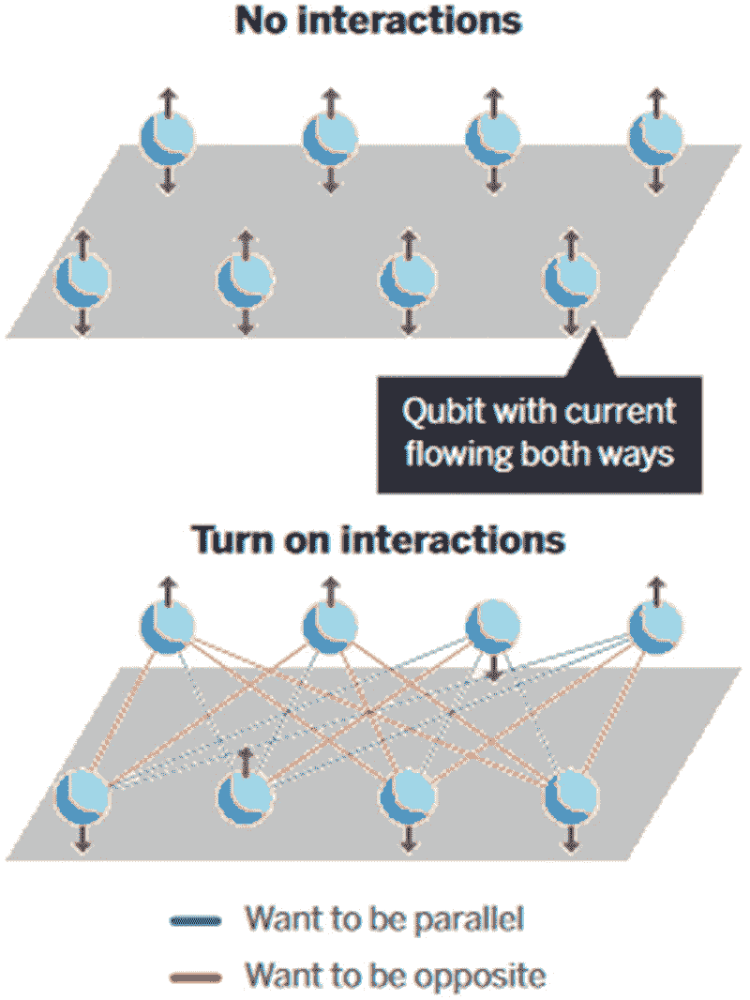

图 2-17

量子退火处理器示意图

为了找到基态，机器将阵列置于纠缠态，然后缓慢地开启相互作用。系统随后会像滚过峰谷寻找最深点的球一样，寻找最低能量状态。在经典物理学中，热能的扰动推动球体穿过山谷到达低点；这被称为*热退火*。然而在量子力学中，球体可以通过隧穿效应穿过低点，更快速地找到最低点。这就是为什么人们认为量子退火在处理模式识别或机器学习等问题时速度更快的原因。

因此，D-Wave 的架构与传统量子计算机的不同之处在于它只能解决能量最小化问题。这引发了一定程度的争议，IBM 的一些人甚至称其为“死胡同”。就连在 D-Wave 2X 上针对 K 阶二进制优化实例进行量子退火实验的谷歌科学家，也在其总结中打趣说，模拟退火是为“无知或绝望者”准备的。加剧争议的另一事实是，D-Wave 无法执行秀尔算法，因为它不是一个能量最小化过程。秀尔算法需要一种称为通用量子计算机的机器，这种计算机可以执行任何量子算法。

### 通用量子计算与未来

通用量子计算机，也称为量子图灵机，是终极量子机器。它被定义为一种能够发挥量子计算所有能力的抽象机器。也就是说，它能够执行任何量子算法。尽管距离实现这一梦想还有几十年的时间，但一场新的全球竞赛已经开始，各大 IT 行业巨头和政府都在为这些机器的研发投入大量资源。

### 谷歌与量子人工智能

谷歌是 D-Wave 的早期客户，并利用其机器开展了一系列优化实验。实验结果表明，在单核处理器上，量子退火比模拟退火的速度要快得多。此外，谷歌已宣布正在开发自己的量子计算技术，鉴于其拥有的庞大资源，这一举措完全合理。尽管目前尚无任何成果可供展示，但这似乎是 IBM 基于门的方案与 D-Wave 量子退火方案的混合体。

事实上，谷歌在 2017 年 6 月宣布正在测试一台`20`量子比特的量子计算机，并希望在 2018 年前建造一台`49`量子比特的机器。看来他们想在追求量子霸权上与 IBM 一较高下。谷歌已明确表达了其量子领域的目标：人工智能。在提交给《施普林格·自然》的论文《早期量子技术的商业化》中，他们介绍了量子人工智能实验室，其目标是构建一台能够解决任何问题的容错量子机器。谷歌的努力集中在机器学习和人工智能的三个关键领域：

- **模拟**：最受期待的应用之一是对化学反应和材料的建模：用于飞机的更强聚合物、改进的汽车催化转换器、更高效的太阳能材料、新药物以及透气织物。量子计算有望通过将制造这些材料所需的计算能力提升到新水平，来节省巨额资金。计算材料学是一个庞大的行业，已为量子模拟构建了多种商业模式：付费订阅获取访问权限、咨询、用股权交换量子辅助创新等等。

- **优化**：传统计算机难以解决优化问题。最好的经典方法使用统计方法，例如能量最小化（热退火）。量子原理可以通过隧道效应穿过热势垒，以找到最低能量点或最佳解决方案，从而提供显著的加速。在线推荐和广告竞价策略是需要强大优化算法的一些任务。总的来说，大多数机器学习问题都可以从量子优化中受益。物流公司、医疗健康领域的患者诊断以及网络搜索公司都可以实现巨大的创新。

- **采样**：主要涉及推理和模式识别等机器学习任务。量子采样可以在概率分布查询中提供卓越的性能。不仅如此，量子计算机实现的大规模并行性可以利用采样来提供量子霸权的确凿证据。

谷歌在量子优化和风险管理的未来上押下了重注，但目前 IBM 凭借其为商业客户提供的`20`量子比特平台以及向所有人免费开放的`16`量子比特云平台“Q Experience”占据优势。有一件事是确定的：预计很快所有主要厂商都会推出基于云的量子平台。

### 数据中心中的量子机器

量子比特的设计和制造基于极端工程学。由于量子力学奇特的性质，量子比特极易受到环境噪声的影响，因退相干原理而容易出错，并且通常难以大规模控制和构建。因此，不要指望短期内能在当地的百思买柜台上看到量子计算机。也别指望在未来几十年内，你的孙子能买到一台量子计算机并将其插在家中的客厅里。除非技术取得重大飞跃，否则这几乎不可能发生。这部分是因为当前的量子比特必须保持在极低温的`0.015 K`（约`–273 °C`）才能避免环境噪声。要直观理解这个温度，可以参考下表，它展示了宇宙不同区域的平均温度。

| **位置** | **温度 (开尔文)** | **温度 (摄氏度)** |
| --- | --- | --- |
| `量子比特` | `0.015` | `–273` |

## 太空真空温度

| 温度描述 | 摄氏度(°C) | 开尔文(K) |
|---|---|---|
| 太空真空（由均匀背景辐射或宇宙大爆炸*余晖*产生的温度） | `2.7` | `–270` |
| 地球平均温度 | `331` | `58` |
| 月球白昼与夜晚的温度 | `373`/`100` | `100`/`–173` |

### 提示

开尔文是物理学中温度的主要单位。零开尔文被定义为绝对零度，或经典热力学描述下所有热运动停止时的温度。

短期内极有可能发生的情况是，量子计算机将接管数据中心。这意味着量子计算机不会取代台式机，而是替代它执行数据中心中的大部分繁重任务，例如搜索、模拟、建模等。此外，业内人士预计，量子计算机将补充传统计算机，提供加密、科学智能和人工智能等新型服务。

因此，几年后，你手机或家中的数字助手可能会由量子计算机驱动。这里有一些值得思考的东西：大约十年后，我们大部分时间可能都在与量子计算机对话。

### 竞赛走向全球

当整个政府通过巨额投资介入该领域时，事情就达到了新的层面。根据数字单一市场的一份新闻稿，欧盟委员会计划在 2018 年启动一项价值 10 亿欧元的旗舰计划，并在未来 20 年内提供大量资金。^(²²) 这是在已投入 5.5 亿欧元用于各个单项计划之外的后续投资，旨在使欧洲处于他们所谓的第二次量子革命的前沿。

此外，根据阿里云在 2015 年 7 月的一份新闻稿，中国科学院正与国内最大的电子商务公司阿里巴巴合作，创建`中科院量子计算实验室`。量子计算已成为一场全球竞赛，其影响将是深远的。

### 未来应用

量子计算的巨大潜力所能实现的事情是无限的。以下是未来可能的应用及其对社会影响的列表。

- **航空工业**：飞机制造公司正在致力于开发和利用量子算法进行气流模拟，与传统算法相比可将研发时间缩短数年。这将使飞机更坚固、更高效，同时在更短的时间内实现低噪音和低排放。

- **太空应用**：美国宇航局一直在尝试使用`D-Wave`系统处理从最优结构到航天器有效载荷最优封装等任务。其他应用包括量子人工智能算法和量子-经典混合算法。

- **医药领域**：量子计算能够提供卓越的分子模拟，从而催生新药、实现闪电般的蛋白质建模和更快的药物测试。这将缩短药物上市周期。下一代药物和癌症治疗方法已近在咫尺。

以上仅是量子计算未来应用的一部分。请注意，我们并未提及数据加密和安全等当前突破：量子因子分解以及打破非对称密码学的可能性，可以说是近年来量子计算迅猛发展的主要原因。在下一章中，你将初步尝试使用 IBM Q Experience。这是首个云量子计算平台，可随心所欲地使用真正的量子设备。

脚注 1 2 3 4 5 6 7 8 9 10 11 12 13 14 15 16 17 18 19 20 21