# 进入 IBM Q Experience：独一无二的云端量子计算平台

在本章中，我们将通过 IBM Q Experience 探索云端量子计算：这是首个此类平台。本章首先概述了 Composer——用于可视化创建电路、提交实验、探索硬件设备等的 Web 控制台。接下来，你将学习如何创建第一个实验并将其提交到模拟器或真实量子设备。IBM Q Experience 具有强大的 REST API 来控制实验的生命周期，本章将通过详细的端点描述和请求参数展示具体操作方法。最后，本章以官方 Python 库（名为 `IBMQuantumExperience`）在 Node JS 中的实际实现作为结尾。这个自定义 Node JS 库将考验你的异步 JavaScript 和 REST API 技能。让我们开始吧。

IBM 无疑在云端量子计算的竞赛中占据了早期领先地位。他们推出了一个名为 Q Experience 的非常酷的平台，用于远程运行实验。但不知是否只有我觉得，这些工具的名称与音乐理论有很多相似之处？来看看：用于创建量子电路的可视化编辑器被称为 *Composer*（作曲家）。还不够奇怪？用该编辑器构建的量子电路被称为 *scores*（乐谱），而且从视觉上看，该编辑器的确很像音乐作品的书面乐谱。我之所以这么说，是因为我弹古典吉他很久了，第一次看到 Composer 时就有一种诡异的熟悉感（量子门看起来很像音符）。还觉得我疯了？这个平台叫 Q Experience；你听说过 Jimi Hendrix Experience 吗？也许 Composer 就是那个乐谱工作簿，你将在其中创作出供我们其他人欣赏的伟大杰作。量子计算确实有能力改变现状。

## 初步体验 IBM Q Experience

Q Experience 是 IBM 的云端量子计算平台，它真的很酷。让我们来看一看（所有转载均经国际商业机器公司许可，© 国际商业机器公司）：

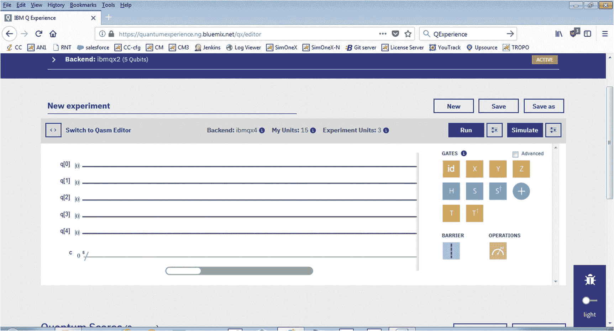

**图 3-1** IBM Q Experience 主窗口

- 在 `https://quantumexperience.ng.bluemix.net/qx/experience` 创建一个账户。你需要提供邮箱，等待批准并确认。

- 登录 Web 控制台，导航到顶部的 Composer 标签页（见图 3-1）。

### 量子 Composer

Composer 是用于创建量子电路或乐谱的可视化工具。其顶部显示实验的量子比特直方图，供你使用的量子比特（见图 3-2）。

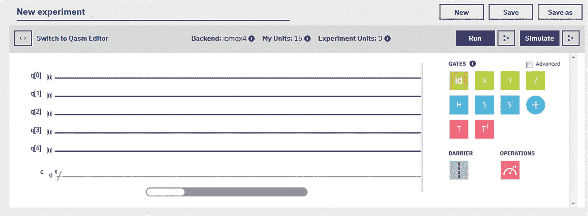

**图 3-2** 实验 Composer

- 在直方图左侧，我们看到 `ibmqx4` 处理器可用的 5 个量子比特。它们全部初始化为基态 `|0>`。底部的线是测量线，电路的结果将在此处收集。请记住，测量应该是电路中最后执行的操作，因为所有门操作在叠加态中是并行执行的。

- 在右侧，我们看到了量子门。将门拖拽到特定量子比特的直方图位置，即可开始构建电路。

让我们看看这些门及其含义。

### 量子门

IBM Q Experience 支持的量子门如表 3-1 所述。

**表 3-1** IBM Q Experience 的量子门

| 门 | 描述 |
| --- | --- |
| 泡利 X 门 | 使量子比特绕 X 轴旋转 180 度。将 `|0>` 映射为 `|1>`，将 `|1>` 映射为 `|0>`。也称为比特翻转门或非门。其矩阵表示为：`X = [[0, 1], [1, 0]]` |
| 泡利 Y 门 | 使量子比特绕布洛赫球的 Y 轴旋转 π 弧度。其泡利矩阵表示为：`Y = [[0, -i], [-i, 0]]`，其中 `i = sqrt(-1)` 为虚数单位。 |
| 泡利 Z 门 | 使量子比特绕布洛赫球的 Z 轴旋转 π 弧度。其泡利矩阵表示为：`Z = [[1, 0], [0, -1]]` |
| 阿达玛门 | 表示绕轴 `(X + Z) / sqrt(2)` 旋转 π。换句话说，它将状态映射为：• `|0>` 至 `(|0> + |1>) / sqrt(2)` • `|1>` 至 `(|0> - |1>) / sqrt(2)`。此门用于创建叠加态。 |
| 相位门 `sqrt(Z)` | 具有将 `X` 映射为 `Y` 并将 `Z` 映射为 `Z` 的特性。此门扩展了 `H` 门，用于创建复杂的叠加态。 |
| `S` 的转置共轭 | 将 `X` 映射为 `-Y`，并将 `Z` 映射为 `Z`。 |
| 受控非门 (CNOT) | 这是一个两量子比特门，如果控制量子比特处于状态 1，则翻转目标量子比特（应用泡利 X 门）。此门用于生成纠缠态。 |
| 相位门 `sqrt(S)` | `sqrt(S)` 门执行一半的两量子比特交换操作。它具有通用性，任何多量子比特门都可以仅由 `sqrt(swap)` 和单量子比特门构建而成。其矩阵表示为：`sqrt(S) = [[1, 0, 0, 0], [0, 1/2(1+i), 1/2(1-i), 0], [0, 1/2(1-i), 1/2(1+i), 0], [0, 0, 0, 1]]` |
| `T` 的转置共轭或 `T-dagger` | 矩阵表示为：`sqrt(S) = [[1, 0, 0, 0], [0, 1/2(1-i), 1/2(1+i), 0], [0, 1/2(1+i), 1/2(1-i), 0], [0, 0, 0, 1]]` |
| 屏障 | 阻止其所在线路上的变换操作。 |
| 测量 | 测量门接收一个处于叠加态的量子比特作为输入，并输出一个 0 或 1。此外，输出并非随机。输出为 0 或 1 的概率取决于量子比特的初始状态。 |
| 条件 | 有条件地应用一个量子操作。 |
| 物理部分旋转 (U 门) | `U1`：这是一个单参数单量子比特相位门，持续时间为零。`U2`：这是一个双参数单量子比特门，持续时间为一个门时间单位。`U3`：这是一个三参数单量子比特门，持续时间为两个门时间单位。 |
| 恒等门 | 恒等门使量子比特处于空闲操作状态，持续时间等于一个时间单位。 |

你可以从合成器右侧拖放门来创建电路，或者如果你更倾向于编写汇编代码，可以切换到 QASM 编辑器模式，如图 3-3 所示。

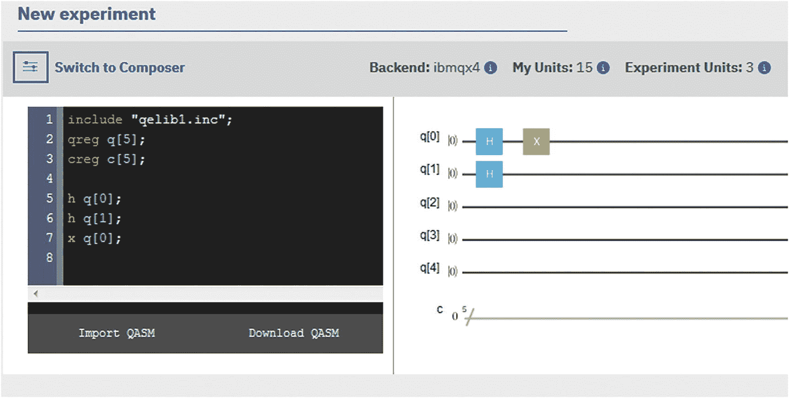

**图 3-3**：QASM 编辑器模式下的实验编辑器

#### 提示

QASM 是一种量子汇编语言，构建于 OPENQASM 平台之上，用于实现低深度量子电路的实验。尽管汇编器某种程度上已成为一门失传的艺术，但有些人可能会觉得其原始能力比 Python SDK 甚至可视化编辑器更具吸引力。

现在让我们来看一下可用的各种量子处理器。

### 可供使用的量子后端

有一些量子处理器可供实验选择。表 3-2 展示了根据 IBM Q Experience 后端信息网站，按量子比特数量排名的官方列表。

**表 3-2**：IBM Q Experience 用户可用的量子后端官方列表

| 名称 | 详情 |
| --- | --- |
| `ibmqx2` | 代号：Sparrow，量子比特数：5，上线时间：2017 年 1 月 24 日 |
| `ibmqx4` | 代号：Raven，量子比特数：5，上线时间：2017 年 9 月 25 日 |
| `ibmqx3` | 代号：Albatross，量子比特数：16，上线时间：2017 年 6 月 |
| `ibmqx5` | 代号：Albatross，量子比特数：16，上线时间：2017 年 9 月 28 日。该设备是 `ibmqx3` 的重新配置版本。 |

表 3-2 展示了撰写本书时可用的官方处理器列表，但有一个更有趣的方法可以通过优秀的 REST API 实时获取最新的可用机器列表。本章“通过 REST API 远程访问”部分将更详细地描述此 API，但现在让我们演示如何通过 *可用后端列表* REST 端点来获取始终最新的后端列表：

```
https://quantumexperience.ng.bluemix.net/api/Backends?access_token=ACCESS-TOKEN
```

#### 提示

要获取访问令牌（access token），请参阅本章“通过 REST API 进行远程访问”下的“通过 API 令牌进行身份验证”部分。请注意，API 令牌与访问令牌不同。API 令牌用于通过 Python SDK 执行量子程序。访问令牌用于调用 REST API。

上一段中的 URL 返回一个 JSON 格式的量子处理器列表。以下是撰写本文时的样子。请注意，你的结果可能有所不同：

```markdown

```json
[{
"name": "ibmqx2",
"version": "1",
"status": "on",
"serialNumber": "Real5Qv2",
"description": "5 transmon bowtie",
"basisGates": "u1,u2,u3,cx,id",
"onlineDate": "2017-01-10T12:00:00.000Z",
"chipName": "Sparrow",
"id": "28147a578bdc88ec8087af46ede526e1",
"topologyId": "250e969c6b9e68aa2a045ffbceb3ac33",
"url": "https://ibm.biz/qiskit-ibmqx2",
"simulator": false,
"nQubits": 5,
"couplingMap": [
[0, 1],
[0, 2],
[1, 2],
[3, 2],
[3, 4],
[4, 2]
]
}, {
"name": "ibmqx5",
"version": "1",
"status": "on",
"serialNumber": "ibmqx5",
"description": "16 transmon 2x8 ladder",
"basisGates": "u1,u2,u3,cx,id",
"onlineDate": "2017-09-21T11:00:00.000Z",
"chipName": "Albatross",
"id": "f451527ae7b9c9998e7addf1067c0df4",
"topologyId": "ad8b182a0653f51dfbd5d66c33fd08c7",
"url": "https://ibm.biz/qiskit-ibmqx5",
"simulator": false,
"nQubits": 16,
"couplingMap": [
[1, 0],
...
[15, 14]
]
}, {
"name": "Device Real5Qv1",
"status": "off",
"serialNumber": "Real5Qv1",
"description": "Device Real5Qv1",
"id": "cc7f910ff2e6860e0d4918e9ee0ebae0",
"topologyId": "250e969c6b9e68aa2a045ffbceb3ac33",
"simulator": false,
"nQubits": 5,
"couplingMap": [
[0, 1],
[0, 2],
[1, 2],
[3, 2],
[3, 4],
[4, 2]
]
}, {
"name": "ibmqx_hpc_qasm_simulator",
"status": "on",
"serialNumber": "hpc-simulator",
"basisGates": "u1,u2,u3,cx,id",
"onlineDate": "2017-12-09T12:00:00.000Z",
"id": "084e8de73c4d16330550c34cf97de3f2",
"topologyId": "7ca1eda6c4bff274c38d1fe66c449dff",
"simulator": true,
"nQubits": 32,
"couplingMap": "all-to-all"
}, {
"name": "ibmqx4",
"version": "1",
"status": "on",
"serialNumber": "ibmqx4",
"description": "5 qubits transmon bowtie chip 3",
"basisGates": "u1,u2,u3,cx,id",
"onlineDate": "2017-09-18T11:00:00.000Z",
"chipName": "Raven",
"id": "c16c5ddebbf8922a7e2a0f5a89cac478",
"topologyId": "3b8e671a5a3b56899e6e601e6a3816a1",
"url": "https://ibm.biz/qiskit-ibmqx4",
"simulator": false,
"nQubits": 5,
"couplingMap": [
[1, 0],
[2, 0],
[2, 1],
[2, 4],
[3, 2],
[3, 4]
]
}, {
"name": "ibmqx3",
"version": "1",
"status": "off",
"serialNumber": "ibmqx3",
"description": "16 transmon 2x8 ladder",
"basisGates": "u1,u2,u3,cx,id",
"onlineDate": "2017-06-06T11:00:00.000Z",
"chipName": "Albatross",
"id": "2bcc3cdb587d1bef305ac14447b9b0a6",
"topologyId": "db99eef232f426b45d2d147359580bc6",
"url": "https://ibm.biz/qiskit-ibmqx3",
"simulator": false,
"nQubits": 16,
"couplingMap": [
...
]
}, {
"name": "QS1_1",
"version": "1",
"status": "standby",
"serialNumber": "QS1_1",
"description": "20 qubit device v1",
"basisGates": "SU2+CNOT",
"onlineDate": "2017-10-20T11:00:00.000Z",
"chipName": "Qubert",
"id": "cb141f7bb641b8a10487a6fab8483b86",
"topologyId": "25197b9b73c4b52ca713ca4d126417b5",
"simulator": false,
"nQubits": 20,
"couplingMap": [
...
]
}, {
"name": "ibmqx_qasm_simulator",
"status": "on",
"description": "online qasm simulator",
"basisGates": "u1,u2,u3,cx,id",
"id": "18da019106bf6b5a55e0ef932763a670",
"topologyId": "250e969c6b9e68aa2a045ffbceb3ac33",
"simulator": true,
"nQubits": 24,
"couplingMap": "all-to-all"
}]
```

*列表 3-1*: 来自后端信息 REST API 调用的 HTTP 响应

列表 3-1 显示了当前可用的处理器列表，该列表与 IBM Q Experience 网站上的官方列表基本一致。不过，其中还包含大量关于这些机器结构布局的有趣信息：
- 额外的处理器和模拟器：
    - 似乎有两个远程模拟器可供使用（`ibmqx_qasm_simulator`， `ibmqx_hpc_qasm_simulator`），尽管官方文档只提到了一个：`ibmqx_qasm_simulator`。在测试复杂电路时，这些信息可能会派上用场：更多的模拟器总是件好事。
- 关于 20 量子比特处理器的传言已经流传了一段时间。甚至有传言说，到 2018 年底，将会推出一款 50 量子比特的巨型处理器。这份列表至少证实了 20 量子比特机器的存在。但先别激动；这台机器仅供企业客户使用。
- 除了机器名称、版本、状态、量子比特数量等常见信息外，我们还应熟悉一些术语：
    - `basisGates`：这些是处理器的物理量子比特门。它们是构建更复杂逻辑门的基础。列表中的大多数处理器使用 `u1`、`u2`、`u3`、`cx`、`id`。
        - `u1`、`u2`、`u3` 门被称为 `部分非门`，它们执行一个量子比特在 X、Y、Z 轴上分别以 theta、phi 或 lambda 弧度进行的旋转。
        - `cx` 被称为 `受控非门`（`CNOT` 或 `CX`）。它作用于两个量子比特，并且仅当第一个量子比特为 `|1>` 时，才对第二个量子比特执行非操作，否则保持不变。
        - `id` 是恒等门，它对一个量子比特执行一个时间单位的空闲操作。
    - `couplingMap`：耦合映射定义了单个量子比特之间的相互作用，同时保持量子相干性（或一个纯态——想象一组士兵在通过一座旧桥时步调不一致，这样他们的脚落地时的振幅就不会叠加从而毁掉这座桥）。量子比特耦合用于简化量子电路，并允许系统被分解成更小的单元。
现在，回到合成器，开始我们的第一次量子合成。

### 作品 1：贝尔态和 GHZ 态的变奏

这个合成比较奇特。我们在此探讨两个用以展示量子力学奇异性的令人费解的量子实验：

```

- `贝尔态`：它们证明了物理学不能用局域实在性来描述。这就是爱因斯坦所说的 `幽灵般的超距作用`。

- `GHZ态`：比贝尔态更为奇异，GHZ态（以其提出者格林伯格-霍恩-泽林格的名字命名）是贝尔态在 3 量子比特上的推广。

让我们更详细地看看它们。

### 贝尔态与幽灵般的超距作用

`Bell`态是著名贝尔不等式的实验验证。1964 年，爱尔兰物理学家约翰·贝尔提出了一种检验量子纠缠（幽灵般的超距作用）的方法。他提出的一组不等式在物理学界变得极其重要。这组不等式被称为贝尔定理，其内容大致如下。

考虑三种不同角度 `A = 0`、`B = 120` 和 `C = 240` 下的光子偏振（即光在特定平面内的振动）。实在论认为，光子在这三种偏振设置下具有确定的同步值，且必须对应表 3-3 所示的八种情况。

**表 3-3**

三种角度下光子偏振的排列组合

| 计数 | A(0) | B(120) | C(240) | [AB] | [BC] | [AC] | 总和 | 平均值 |
| --- | --- | --- | --- | --- | --- | --- | --- | --- |
| 1 | A+ | B+ | C+ | 1(++) | 1(++) | 1(++) | 3 | 1 |
| 2 | A+ | B+ | C– | 1(++) | 0 | 0 | 1 | 1/3 |
| 3 | A+ | B– | C+ | 0 | 0 | 1(++) | 1 | 1/3 |
| 4 | A+ | B– | C– | 0 | 1(−−) | 0 | 1 | 1/3 |
| 5 | A− | B+ | C+ | 0 | 1(++) | 0 | 1 | 1/3 |
| 6 | A− | B+ | C− | 0 | 0 | 1(−−) | 1 | 1/3 |
| 7 | A− | B− | C+ | 1(−−) | 0 | 0 | 1 | 1/3 |
| 8 | A− | B− | C− | 1(−−) | 1(−−) | 1(−−) | 3 | 1 |

现在贝尔定理问道：*任一相邻角度下的偏振与第一个角度偏振相同的概率是多少？* 我们还计算了偏振的总和与平均值。假设实在论成立，那么通过观察表 3-3，这个问题的答案就是概率必须 `>= 1/3`。这正是贝尔不等式所给出的：提供了一种检验这一论断的手段。令人难以置信之处在于：信不信由你，量子力学违反了贝尔不等式，给出的概率小于 `1/3`。这一点于 1982 年由法国物理学家阿兰·阿斯佩首次通过实验证明。

###### 提示

关于阿斯佩实验与贝尔不等式的更详细描述，请参见第 1 章《EPR 佯谬被破解：玻尔笑到最后》。

现在，让我们将前文中的光子偏振转化为可在量子计算机上运行的实验。1969 年，约翰·克劳泽、迈克尔·霍恩、阿布纳·西蒙尼和理查德·霍尔特提出了贝尔定理的一个证明：即 CHSH 不等式，其正式表述为

```
S = ⟨A,B⟩ - ⟨A,B′⟩ + ⟨A′,B⟩ + ⟨A′,B′⟩
```

```
S ≤ 2
```

为了说明这一点，我们设置两个探测器：爱丽丝和鲍勃。假设`A`和`A′`是爱丽丝一侧的探测器设置，`B`和`B′`是鲍勃一侧的设置，四种组合在不同实验中进行测试。实在论认为，对于一对纠缠粒子，展示所有可能排列的奇偶性表格如下所示：

| A | B | 1 |
| --- | --- | --- |
| A | B' | 0 |
| A' | B | 0 |
| A' | B' | 1 |

在经典实在论中，CHSH 不等式变为 `|S| = 2`。然而，量子力学的数学形式体系预测`S`的最大值为 `|S| = 2√2`，因此违反了该不等式。这可以通过四个独立的量子电路（每个测量对应一个电路）进行检验，每个电路包含 2 个量子比特。为简化起见，设爱丽丝探测器的测量为`A = Z`和`A′ = X`，鲍勃探测器的测量为`B = W`和`B′ = V`（见表 3-4）。实验开始时，必须构建一个与恒等矩阵匹配的基态贝尔态（见图 3-4）：

```
1/√2 (|00 + |11)
```

上述表达式本质上意味着爱丽丝持有的量子比特可以是 0 或 1。如果爱丽丝在标准基下测量她的量子比特，结果将是完全随机的，每种可能性概率均为 `1/2`。但如果鲍勃随后测量他的量子比特，其结果将与爱丽丝得到的结果相同。因此，如果鲍勃进行测量，他乍一看也会得到一个随机结果，但如果爱丽丝和鲍勃进行通信，他们会发现，尽管结果看似随机，但它们却是相关的。

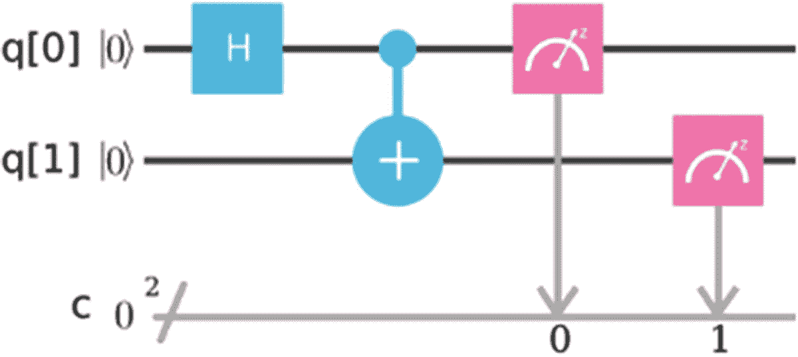

**图 3-4**

基态贝尔态

在图 3-4 中，2 个量子比特制备于基态 `|0>`。`H`门将第一个量子比特置于叠加态 `1/√2 (|00 + |10)`。随后，`CNOT`门在第一个量子比特激发时翻转第二个量子比特，得到态 `1/√2 (|00 + |11)`。这就是表 3-4 中四次测量所需的初始纠缠态（所有重印均经国际商业机器公司许可，© 国际商业机器公司）。

-   要将测量基底旋转至 `ZW` 轴，请使用门序列 `S-H-T-H`。

-   要将测量基底旋转至 `ZV` 轴，请使用门序列 `S-H-T′-H`。

-   `XW` 和 `XV` 测量的执行方式与前文相同，`X` 测量则通过在标准测量之前施加一个 `Hadamard` 门来实现。

###### 提示

在 Composer 中执行实验之前，请确保乐谱中的拓扑结构（量子比特数量和目标设备）在模拟器上设置为 2。某些拓扑结构（例如真实量子设备中的 5 个量子比特）不支持量子比特 0 和 1 的纠缠，这会在设计时产生错误。请注意，目标设备可以是真实的量子处理器或模拟器。总而言之，只要你使用模拟器，就应该没问题。

**表 3-4** 贝尔态的量子线路

| 贝尔态测量 | 100 次测量的结果 |
| --- | --- |
| AB (ZW)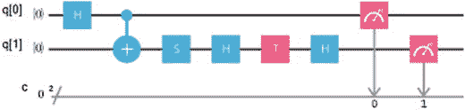 |  | c[2] | 概率 |  | 11 | 0.39 |  | 10 | 0.06 |  | 00 | 0.46 |  | 01 | 0.09 |
| AB′ (ZV)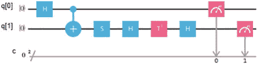 |  | c[2] | 概率 |  | 11 | 0.49 |  | 10 | 0.07 |  | 00 | 0.36 |  | 01 | 0.08 |
| A′B (XW)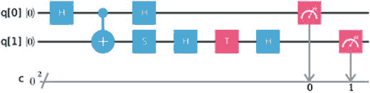 |  | c[2] | 概率 |  | 11 | 0.42 |  | 10 | 0.05 |  | 00 | 0.49 |  | 01 | 0.04 |
| A′B′ (XV)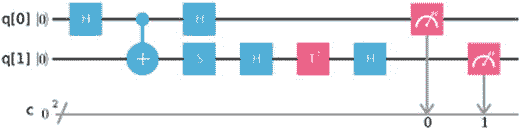 |  | c[2] | 概率 |  | 11 | 0.05 |  | 10 | 0.52 |  | 00 | 0.03 |  | 01 | 0.40 |

现在我们需要构建一个表格，包含每次测量的结果以及 A 和 B 之间的相关概率 `<AB>`。纠缠粒子奇偶性的概率之和由下式给出

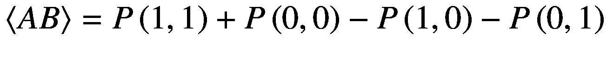

请记住，最终目标是确定 `S ≤ 2` 还是 `|S| = 2`；因此，通过编译所有测量的结果，我们得到表 3-5。

**表 3-5** 贝尔实验的编译结果

|     | `P(00)` | `P(11)` | `P(01)` | `P(10)` | `<AB>` |
| --- | --- | --- | --- | --- | --- |
| `AB (ZW)` | 0.46 | 0.39 | 0.09 | 0.06 | 0.68 |
| `AB′ (ZV)` | 0.36 | 0.49 | 0.08 | 0.07 | 0.73 |
| `A′B (XW)` | 0.49 | 0.42 | 0.04 | 0.05 | 0.47 |
| `A′B′(XV)` | 0.03 | 0.05 | 0.4 | 0.52 | −0.32 |

将 `<AB>` 列的绝对值相加，得到 `|S| = 2.2`。这些结果违反了贝尔不等式（正如量子力学所预测的那样），并且非常接近 IBM 科学家于 2017 年 5 月 2 日在 8192 次测量中进行的官方测试结果。²⁴ 你的结果如何？

## 注释

GHZ 态的重要性在于，它们表明超过两个粒子的纠缠不仅在统计（概率）预测方面与定域实在论相冲突，而且在非统计（确定性）预测方面也是如此。

简单来说，GHZ 态显示出对贝尔不等式更强的违反。让我们通过一个简单的谜题来看看：想象三个独立的盒子，每个盒子包含两个变量 `X` 和 `Y`。每个变量有两个可能的结果：1 和 -1。问题是找到一组 `X` 和 `Y` 的值，使得以下一组恒等式成立：

```
(1)   XYY = 1
(2)   YXY = 1
(3)   YYX = 1
(4)   XXX = –1
```

对于没有耐心的人来说，这个方程组无解。例如，将 `Y = 1` 代入 (1)、(2) 和 (3)，然后将它们相乘，即 (5) = (1) * (2) * (3)。这组等式就变成了：

```
(1)   X11 = 1
(2)   1X1 = 1
(3)   11X = 1
(4)   XXX = –1
(5)   将 (1) (2) (3) 相乘得到 XXX = 1
```

没有解，因为恒等式 (4) `XXX = –1` 与恒等式 (5) `XXX = 1` 矛盾。可怕的地方在于，一个 GHZ 态确实可以为这个问题提供解，这在经典实在论的确定性观点看来似乎是不可能的，但在量子力学的世界里，没有什么是不可能的，只是概率低而已。

不可思议的是，GHZ 测试可以在单次实验运行后以确定性排除对定域实在的描述，但首先我们必须构建一个 GHZ 基态。

### 更令人毛骨悚然：GHZ 态测试

这些以物理学家格林伯格-霍恩-泽林格（Greenberger-Horne-Zeilinger）的名字命名，他们提出了针对 N 个纠缠量子比特的推广测试，最简单的是三量子比特 GHZ 态：

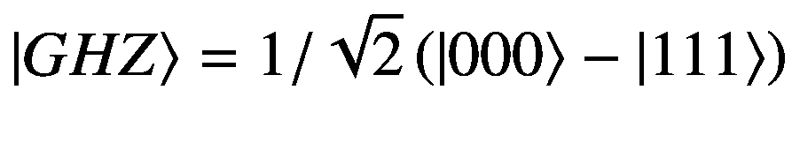

#### 表 3-6. GHZ 基态

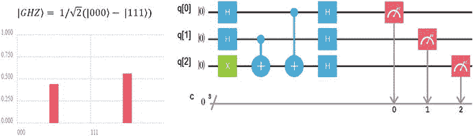

为了启动实验，GHZ 基态（以及大约为一半的概率结果）如表 3-6 所示：

1. 在基础电路中，量子比特 1 和 2 上的哈达玛门将它们置于叠加态 `|00,01,01,11>`。同时，X 门翻转量子比特 3；因此我们最终得到状态 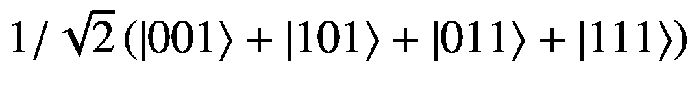。

2. 两个 CNOT 门将所有量子比特纠缠到状态 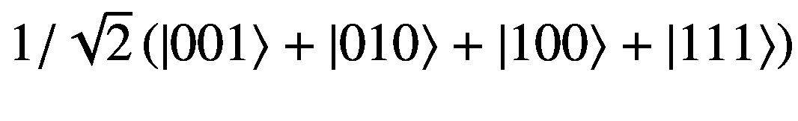。

3. 最后，三个哈达玛门将步骤 2 映射到状态 `½*(| 000⟩ − | 111⟩)`。

现在，按照表 3-7 所示，为上一节的恒等式 `XYY`、`YXY`、`XYY` 和 `XXX` 创建量子线路（所有重印均经国际商业机器公司许可，© 国际商业机器公司）。

#### 表 3-7 GHZ 态的量子线路

| 测量 | 100 次测量的结果 |
| --- | --- |
| `YYX`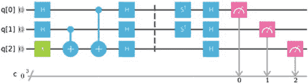 | \| c[3] \| 概率 \|<br>\| 011 \| 0.34 \|<br>\| 101 \| 0.23 \|<br>\| 110 \| 0.23 \|<br>\| 000 \| 0.20 \| |
| `YXY`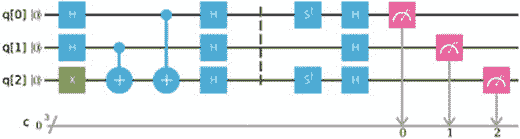 | \| c[3] \| 概率 \|<br>\| 011 \| 0.23 \|<br>\| 101 \| 0.28 \|<br>\| 110 \| 0.25 \|<br>\| 000 \| 0.24 \| |
| `XYY`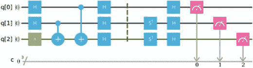 | \| c[3] \| 概率 \|<br>\| 011 \| 0.23 \|<br>\| 101 \| 0.26 \|<br>\| 110 \| 0.35 \|<br>\| 000 \| 0.16 \| |
| `XXX`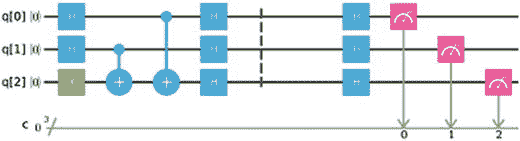 | \| c[3] \| 概率 \|<br>\| 010 \| 0.25 \|<br>\| 100 \| 0.32 \|<br>\| 111 \| 0.22 \|<br>\| 001 \| 0.21 \| |

- 对于 `X` 的测量，将 `H` 门应用于相应的量子比特。
- 对于每个 `Y` 实例，将 `S^†`（S- dagger）和 `H` 门应用于相应的量子比特。

最后，将前述实验的结果与来自 IBM Q Experience 的官方数据进行比较。²⁵ 你的结果表现如何？总而言之，本节展示的量子力学原理一直受到一个称为“超决定论”的理论的挑战，该理论提供了一种出路。

### 超级决定论：摆脱量子诡异性的出路，爱因斯坦一直是对的？

在 1969 年接受 BBC 采访时，物理学家约翰·贝尔谈到了他在量子力学方面的工作。他说，我们必须接受这样的预测：纠缠粒子之间的作用转移速度超过光速，但同时我们无法利用这一点做任何事情。信息不能传播得比光速快，这一事实也由量子力学本身所预言。仿佛自然在跟我们开玩笑。他还提到，有一条摆脱这个谜团的出路，就是通过一个称为`超级决定论`的原理。

粒子纠缠意味着，对一个粒子进行的测量会瞬间影响另一个粒子，即使相隔遥远的距离（想想星系或宇宙的两端），甚至跨越时间。爱因斯坦是这一理论的激烈反对者，他曾著名地写信给尼尔斯·玻尔说*上帝不掷骰子*。他无法接受量子力学的概率性本质，所以在 1935 年，他与同事波多尔斯基和罗森一起提出了著名的`EPR 悖论`来挑战其基础。在 `EPR 悖论`中，如果两个纠缠粒子被巨大的距离分开，对一个粒子的测量不可能瞬间影响另一个，因为该事件必须传播得比光速（宇宙中的速度极限）还快。这将违反广义相对论，从而产生一个悖论：没有任何东西比光速快，这是相对论的绝对规则。

尽管如此，1982 年，量子力学的预言被法国物理学家阿兰·阿斯佩证实。他设计了一个实验，表明纠缠光子违反了`贝尔不等式`。他还证明，对一个纠缠光子的测量传播得比光速快，以将自身状态信号传递给另一个光子。自那以后，阿斯佩的结果被反复证明是正确的（关于他实验的细节见第 1 章）。讽刺的是，存在一种可能性：爱因斯坦自始至终都是对的，纠缠只是一种幻觉。这就是`超级决定论`的原理。

> **小贴士**
>
> 简单来说，超级决定论认为，自宇宙诞生之初起，自由选择就不复存在。所有粒子关联和纠缠都是在`大爆炸`那一刻建立起来的。因此，并不需要超光速信号来告诉粒子 B 粒子 A 的结果是什么。

如果属实，这一漏洞将证明爱因斯坦在提出 EPR 悖论时是正确的，而我们在量子编程方面所做的所有艰苦工作都只是一种幻觉。但这个原理听起来更像是宗教教条（所有结果都由命运决定）而不是科学，因为贝尔认为超级决定论是不可信的。他的理由是，由于大量微小效应引入的改变，自由选择对于手头的目的而言实际上是自由的。超级决定论被称为不可检验的，因为实验者永远无法消除宇宙诞生之初就创建的那些关联。尽管如此，这并没有阻止科学家们试图证明爱因斯坦是对的，而粒子纠缠只是一种幻觉。事实上，有一个实验正在努力地试图解决这个问题，并且非常有创意。让我们来看看。

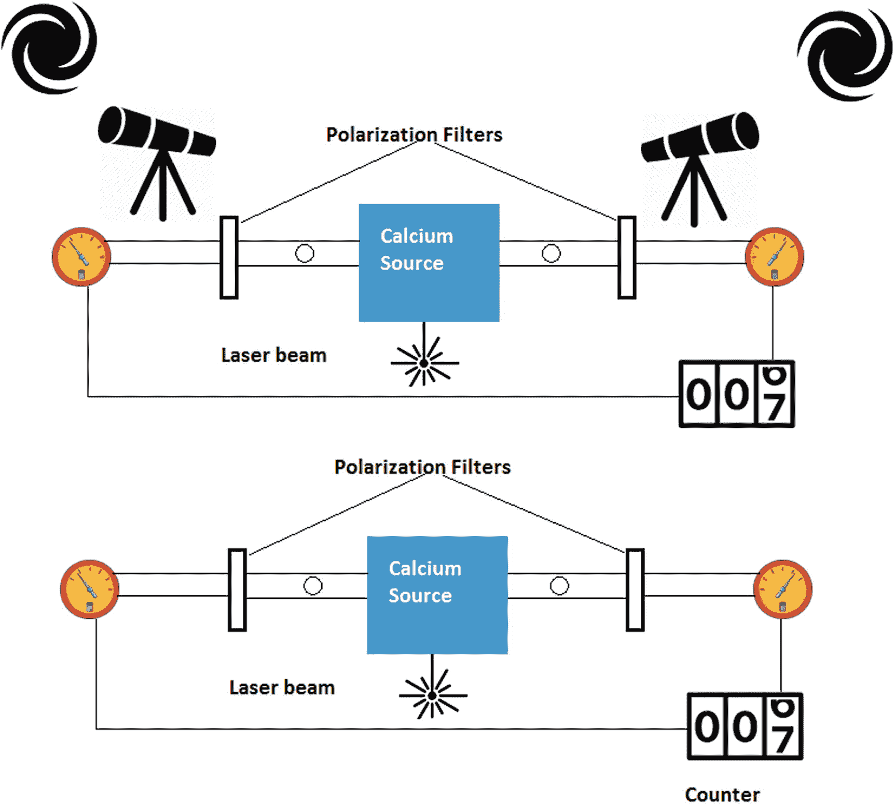

图 3-5：使用宇宙光子的贝尔不等式实验 vs. 标准测试

图 3-5 显示了标准的贝尔不等式测试实验（底部）以及由安德鲁·弗里德曼及其麻省理工学院同事使用宇宙光子（顶部）进行的实验变体。^(²⁶)

> **小贴士**
>
> 关于标准贝尔不等式测试的完整描述，请参见第 1 章“EPR 悖论被击败：玻尔笑到最后”。

弗里德曼及其同事提出了一个使用宇宙射线的标准贝尔实验的新颖变体。其想法是利用对银河系内遥远恒星、遥远类星体或宇宙微波背景斑块的实时天文观测，本质上是让宇宙来决定如何设置实验，而不是使用标准的量子随机数生成器。也就是说，遥远星系发出的光子被用来在纠缠光子到达之前立即控制偏振滤光片的方向。

如果成功，其影响将是开创性的。如果这类实验的结果没有违反贝尔不等式，那就意味着超级决定论终究可能是真的。粒子纠缠将是一种幻觉，纠缠粒子之间的信号传递不可能像相对论所预言的那样快过光速。爱因斯坦将是对的，并且不存在超距幽灵作用。

对我们量子力学爱好者来说幸运的是，到目前为止还没有发生过这样的事情。请记住，弗里德曼及其同事并不是唯一这样做的团队。有多个团队正试图解开这个谜团。事实上，他们的大多数结果都与量子力学一致。也就是说，他们的结果违反了贝尔不等式。所以，爱因斯坦和玻尔早在很久以前在相对论与量子力学之争中制造的裂痕，似乎依然存在且活跃。不过，我还是把赌注押在量子力学上。继续前进，下一节将展示如何通过其简洁的 REST API 远程访问 IBM Q Experience。

## 通过 REST API 进行远程访问

Q Experience 拥有一个相对不为人知的 REST API，它在幕后处理所有远程通信。当前的 Python SDK 都在使用它：

*   `QISKit`：量子信息软件套件是 Python 量子编程的事实上的访问工具。
*   `IBMQExperience`：一个与 `QISKit` 捆绑在一起的鲜为人知的库，它用 Python 客户端封装了 REST API。

在本节中，我们将深入探究 `IBMQExperience`，并查看用于远程访问的不同 REST 端点。但首先，需要进行身份验证。

### 身份验证

要调用任何 REST API，我们必须首先获取一个访问令牌。这将是调用本节中任何调用的访问密钥。请注意，访问令牌与 API 令牌不同（API 令牌用于在 Python 中执行量子程序）。有两种方法可以获得访问令牌：

*   **使用您的 API 令牌**：要获取 API 令牌，请登录 IBM Q Experience 控制台，并按照下一节的说明操作。
*   **使用您的账户用户名和密码**：让我们看看如何使用 REST 完成此操作。

> **小贴士**
>
> 要获取您的 API 令牌，请登录 IBM Q Experience 控制台，点击您的用户名 ➤ `我的账户`，然后点击右上方的 `高级` 选项卡。最后点击 `生成`，然后 `复制 API 令牌`（见图 3-6）。请始终确保令牌的安全。

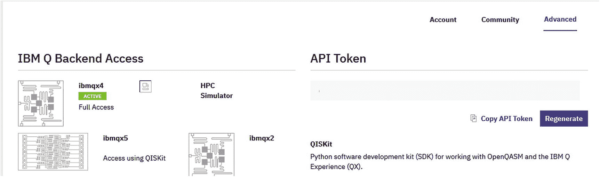

图 3-6：从控制台获取您的 API 令牌

#### 通过 API 令牌进行身份验证

*   **HTTP 方法：** `POST`
*   **URL：** `https://quantumexperience.ng.bluemix.net/api/users/loginWithToken`
*   **载荷：** `{"apiToken": "YOUR_API_TOKEN"}`

#### 通过用户密码进行身份验证

- **HTTP 方法：** `POST`
- **URL：** [`https://quantumexperience.ng.bluemix.net/api/users/login`](https://quantumexperience.ng.bluemix.net/api/users/login)
- **负载：** `{"email": "USER-NAME", "password": "YOUR-PASSWORD"}`

两种方法的响应如下：

```json
{
  "id": "ACCESS_TOKEN",
  "ttl": 1209600,
  "created": "2018-04-15T20:21:03.204Z",
  "userId": "USER-ID"
}
```

其中，`id` 是您的访问令牌，`ttl` 是生存时间（或过期时间，以毫秒为单位），`userId` 是您的用户 ID。请保存访问令牌和用户 ID，以便在本节中使用。请注意，当您的会话过期时，需要生成一个新的访问令牌。

### 列出可用的后端

此调用返回 IBM Q Experience 中所有可用后端和模拟器的 JSON 列表：

- **HTTP 方法：** `GET`
- **URL：** [`https://quantumexperience.ng.bluemix.net/api/Backends?access_token=ACESS-TOKEN`](https://quantumexperience.ng.bluemix.net/api/Backends%253Faccess_token%253DACESS-TOKEN)

#### 请求参数

| 名称 | 值 |
| --- | --- |
| `access_token` | 您的账户访问令牌 |

#### HTTP 头部

| 名称 | 值 |
| --- | --- |
| `x-qx-client-application` | 默认为 `qiskit-api-py` |

#### 响应示例

所有 API 调用的响应内容类型均为 `application/json`。下一段展示了对该端点调用后的部分结果。请注意，此端点将同时返回真实处理器和模拟器。

```json
[{
  "name": "ibmqx2",
  "version": "1",
  "status": "on",
  "serialNumber": "Real5Qv2",
  "description": "5 transmon bowtie",
  "basisGates": "u1,u2,u3,cx,id",
  "onlineDate": "2017-01-10T12:00:00.000Z",
  "chipName": "Sparrow",
  "id": "28147a578bdc88ec8087af46ede526e1",
  "topologyId": "250e969c6b9e68aa2a045ffbceb3ac33",
  "url": "https://ibm.biz/qiskit-ibmqx2",
  "simulator": false,
  "nQubits": 5,
  "couplingMap": [
    [0, 1],
    [0, 2],
    [1, 2],
    [3, 2],
    [3, 4],
    [4, 2]
  ]
}, ..]
```

上表响应中最重要的键值对在表 3-8 中进行了描述。

**表 3-8** 可用后端响应键值

| 键 | 描述 |
| --- | --- |
| `Name` | 运行代码时所使用的处理器的名称 ID。 |
| `Version` | 字符串或正整数，可能用于追踪处理器的变更。 |

| `Description` | 这可能是对用于制造芯片的硬件的描述。您可能会看到类似以下内容：• 5 transmon bowtie • 16 transmon 2x8 ladder。注意：transmon 被定义为一种抗噪声的超导电荷量子比特。由罗伯特·J·肖尔科夫、米歇尔·德沃雷特、史蒂文·M·格尔文及其耶鲁大学的同事于 2007 年开发。^((27)) |
| `basisGates` | 这些是处理器的物理量子比特门。它们是构建更复杂逻辑门的基础。 |
| `nQubits` | 处理器使用的量子比特数量。 |
| `couplingMap` | 耦合映射定义了单个量子比特之间在保持量子相干性时的相互作用。它用于简化量子电路，并使系统能够分解为更小的单元。 |

### 获取给定处理器的校准信息

此调用返回 Q Experience 中给定处理器校准参数的 JSON 列表。这些参数在 IBMQX 后端信息站点中有详细记录。^((28))

- **HTTP 方法：** `GET`
- **URL：** [`https://quantumexperience.ng.bluemix.net/api/Backends/NAME/calibration?access_token=ACCESS-TOKEN`](https://quantumexperience.ng.bluemix.net/api/Backends/NAME/calibration%253Faccess_token%253DACCESS-TOKEN)

#### 请求参数

| 名称 | 值 |
| --- | --- |
| `access_token` | 您的账户访问令牌 |

#### HTTP 头部

| 名称 | 值 |
| --- | --- |
| `x-qx-client-application` | 默认为 `qiskit-api-py`（官方客户端的默认值，但我认为它可以被修改）。 |

#### 响应示例

量子比特对错误和环境噪声高度敏感。校准信息概述了处理器内部量子比特的质量。清单 3-2 展示了 `ibmqx4` 校准参数的简化响应。其中一些最显著的参数包括：

- **`gateError`：** 这是特定时间点量子比特门操作的错误率。
- **`readoutError`：** 这是特定时间点量子比特读取操作的错误率。

###### 提示

量子比特质量评估涉及四个阶段（操作）：准备、存储、门操作和读取。错误率在门操作和读取阶段进行计算，以追踪量子比特的质量。这就是此 API 调用返回的信息。请注意，使用后，量子比特必须被重置（冷却）到基态。

```json
{
  "lastUpdateDate": "2018-04-15T10:47:03.000Z",
  "qubits": [{
    "gateError": {
      "date": "2018-04-15T10:47:03Z",
      "value": 0.0012019552727863259
    },
    "name": "Q0",
    "readoutError": {
      "date": "2018-04-15T10:47:03Z",
      "value": 0.049
    }
  }, ...
  ],
  "multiQubitGates": [{
    "qubits": [1, 0],
    "type": "CX",
    "gateError": {
      "date": "2018-04-15T10:47:03Z",
      "value": 0.03024023736391171
    },
    "name": "CX1_0"
  },...
  ]
}
```

**清单 3-2** `ibmqx4` 校准参数的简化响应

清单 3-2 中的信息可以在 IBM Q Experience 控制台主菜单的*设备*选项卡下查看（见图 3-7）。通过 REST 获取校准信息，并将其与 Web 控制台进行比较（经 International Business Machines Corporation 许可转载，© International Business Machines Corporation）。

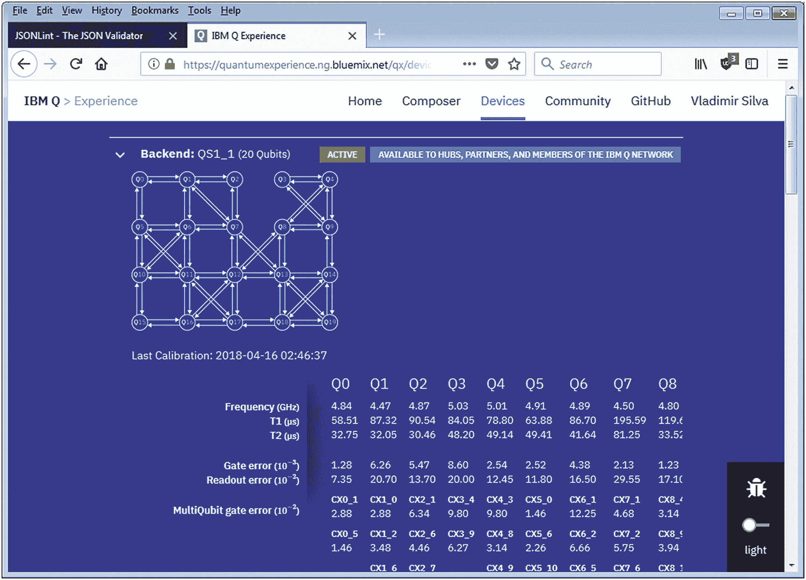

**图 3-7** Web 控制台报告的校准信息

### 获取后端参数

此调用返回 Q Experience 中给定处理器后端参数的 JSON 列表。其中一些参数包括：

- 量子比特冷却温度（以开尔文为单位）：例如，对于 `ibmqx4`，我得到了 `0.021 K`——即极冷温度 –459.6 `°`F 或 –273.1 `°`C。
- 缓冲时间（以 `ns` 为单位）。
- 门操作时间（以 `ns` 为单位）。
- 其他量子规格，在后端信息站点中有更详细的记录。^((29))

请求类型和端点 URL 为：

- **HTTP 方法：** `GET`
- **URL：** [`https://quantumexperience.ng.bluemix.net/api/Backends/NAME/parameters?access_token=ACCESS-TOKEN`](https://quantumexperience.ng.bluemix.net/api/Backends/NAME/parameters%253Faccess_token%253DACCESS-TOKEN)

#### 请求参数

| 名称 | 值 |
| --- | --- |
| `access_token` | 您的账户访问令牌 |

#### HTTP 头部

| 名称 | 值 |
| --- | --- |
| `x-qx-client-application` | 默认为 `qiskit-api-py` |

#### 响应示例

清单 3-3 展示了 `ibmqx4` 参数的 JSON 简化响应。

```json
{
  "lastUpdateDate": "2018-04-15T10:47:03.000Z",
  "fridgeParameters": {
    "cooldownDate": "2017-09-07",
    "Temperature": {
      "date": "2018-04-15T10:47:03Z",
      "value": 0.021,
      "unit": "K"
    }
  },
  "qubits": [{
    "name": "Q0",
    "buffer": {
      "date": "2018-04-15T10:47:03Z",
      "value": 10,
      "unit": "ns"
    },
    "gateTime": {
      "date": "2018-04-15T10:47:03Z",
      "value": 50,
      "unit": "ns"
    },
    "T2": {
      "date": "2018-04-15T10:47:03Z",
      "value": 16.5,
      "unit": "μs"
    },
    "T1": {
      "date": "2018-04-15T10:47:03Z",
      "value": 45.2,
      "unit": "μs"
    },
    "frequency": {
      "date": "2018-04-15T10:47:03Z",
      "value": 5.24208,
      "unit": "GHz"
    }
  },..
  ]
}
```

**清单 3-3** `ibmqx4` 参数的简化响应

### 获取处理器队列状态

此调用返回特定量子处理器事件队列的状态。

- **HTTP 方法：** `GET`
- **URL：** `https://quantumexperience.ng.bluemix.net/api/Backends/NAME/queue/status`

#### 请求参数

这看起来有些奇怪，但此 API 调用似乎不需要访问令牌。

#### HTTP 标头

| 名称 | 值 |
| --- | --- |
| `x-qx-client-application` | 默认为 `qiskit-api-py` |

#### 响应示例

例如，要获取 `ibmqx4` 的事件队列，请在浏览器中粘贴以下 URL：

`https://quantumexperience.ng.bluemix.net/api/Backends/ibmqx4/queue/status`

响应看起来类似于 `{"state":true,"status":"active","lengthQueue":0}`，其中：

- **`state`：** 处理器的状态。如果正常运行，则为 `true`，否则为 `false`。
- **`status`：** 执行队列的状态 – `active`（活跃）或 `busy`（繁忙）。
- **`lengthQueue`：** 执行队列的大小，即等待执行的模拟任务数量。

###### 提示

当您向 IBM Q Experience 提交实验时，该实验将进入执行队列。此 API 调用有助于监控处理器在特定时间内的繁忙程度。

### 列出执行队列中的任务

此调用返回处理器执行队列中的任务列表。

- **HTTP 方法：** `GET`

## 获取任务信息

- **URL：** `https://quantumexperience.ng.bluemix.net/api/Jobs?access_token=ACCESS-TOKEN&filter=FILTER`

#### 请求参数

| 名称 | 值 |
| --- | --- |
| `access_token` | 您的账户访问令牌。 |
| `filter` | 一个 JSON 格式的结果大小提示。例如，`{"limit":2}` 最多返回两条记录。 |

#### HTTP 标头

| 名称 | 值 |
| --- | --- |
| `x-qx-client-application` | 默认为 `qiskit-api-py` |

#### 响应示例

清单 3-4 展示了此调用的响应格式。这些信息似乎是实验执行的历史记录，包含状态、日期、结果、代码、校准等信息。

```json
[{
"qasms": [{
"qasm": "...",
"status": "DONE",
"executionId": "331f15a5eed1a4f72aa2fb4d96c75380",
"result": {
"date": "2018-04-05T14:25:37.948Z",
"data": {
"creg_labels": "c[5]",
"additionalData": {
"seed": 348582688
},
"time": 0.0166247,
"counts": {
"11100": 754,
"01100": 270
}
}
}
}],
"shots": 1024,
"backend": {
"name": "ibmqx_qasm_simulator"
},
"status": "COMPLETED",
"maxCredits": 3,
"usedCredits": 0,
"creationDate": "2018-04-05T14:25:37.597Z",
"deleted": false,
"id": "d405c5829274d0ee49b190205796df87",
"userId": "ef072577bd26831c59ddb212467821db",
"calibration": {}
}, ...]
```

*清单 3-4：获取任务 API 调用的简化响应*

###### 注意
根据执行队列的大小，如果队列中没有任务，您可能会得到一个空结果（`[]`），或者得到如清单 3-4 所示的正式结果。无论哪种情况，请确保 HTTP 响应代码为 `200`（成功）。

### 获取账户信用信息
创建账户时，每个用户会被分配一定数量的默认执行信用额度（15 点），运行实验时会消耗这些额度。此调用会列出您的信用信息。
- **HTTP 方法：** `GET`
- **URL：** `https://quantumexperience.ng.bluemix.net/api/users/USER-ID?access_token=ACCESS-TOKEN`

###### 提示
可以通过 API 令牌或用户密码的身份验证响应来获取用户 ID。详见“身份验证”部分。

#### 请求参数

| 名称 | 值 |
| --- | --- |
| `access_token` | 您的账户访问令牌。 |

#### HTTP 标头

| 名称 | 值 |
| --- | --- |
| `x-qx-client-application` | 默认为 `qiskit-api-py` |

#### 响应示例

清单 3-5 展示了此调用的示例响应。

```json
{
"institution": "Private Research",
"status": "Registered",
"blocked": "None",
"dpl": {
"blocked": false,
"checked": false,
"wordsFound": {},
"results": {}
},
"credit": {
"promotional": 0,
"remaining": 150,
"promotionalCodesUsed": [],
"lastRefill": "2018-04-12T14:05:09.136Z",
"maxUserType": 150
},
"additionalData": {
},
"creationDate": "2018-04-01T15:36:16.344Z",
"username": "",
"email": "",
"emailVerified": true,
"id": "",
"userTypeId": "...",
"firstName": "...",
"lastName": "..."
}
```

*清单 3-5：信用信息示例响应*

### 列出用户的实验
此调用列出指定用户 ID 的所有实验。
- **HTTP 方法：** `GET`
- **URL：** `https://quantumexperience.ng.bluemix.net/api/users/USER-ID/codes/lastest?access_token=ACCESS-TOKEN&includeExecutions=true`

#### 请求参数

| 名称 | 值 |
| --- | --- |
| `USER-ID` | 从身份验证步骤获取的用户 ID。 |
| `access_token` | 您的账户访问令牌。 |
| `includeExecutions` | 如果为 `true`，则在结果中包含执行记录。 |

#### HTTP 标头

| 名称 | 值 |
| --- | --- |
| `x-qx-client-application` | 默认为 `qiskit-api-py` |

#### 响应示例

清单 3-6 展示了此调用的示例响应。

```json
{
"total": 17,
"count": 17,
"codes": [{
"type": "Algorithm",
"active": true,
"versionId": 1,
"idCode": "...",
"name": "3Q GHZ State YXY-Measurement 1",
"jsonQASM": {
...
},
"qasm": "",
"codeType": "QASM2",
"creationDate": "2018-04-14T19:09:51.382Z",
"deleted": false,
"orderDate": 1523733740504,
"userDeleted": false,
"displayUrls": {
"png": "URL"
},
"isPublic": false,
"id": "...",
"userId": "..."
}]}
```

*清单 3-6：实验列表响应*

### 运行实验
此调用在 IBM Q Experience 上远程运行一个实验。
- **HTTP 方法：** `POST`
- **URL：** `https://quantumexperience.ng.bluemix.net/api/codes/execute?access_token=ACCESS-TOKEN&shots=SHOTS&deviceRunType=RUN-TYPE`

#### 请求参数

| 名称 | 值 |
| --- | --- |
| `shots` | 要执行的实验次数（shots）。次数越高，结果精度越好。请注意，消耗信用额度按每 1024 次实验 3 点信用计算。量子世界中的空间非常珍贵。 |
| `access_token` | 您的账户访问令牌。 |
| `deviceRunType` | 运行实验的设备。可以是：<br>• 真实设备名称，如 `ibmqx2` 和 `ibmqx3`，用于真实处理器。<br>• 模拟器：`simulator` 或 `sim_trivial_2`。 |
| `seed`（可选） | 仅模拟器需要的可选随机数。 |

#### HTTP 标头

| 名称 | 值 |
| --- | --- |
| `x-qx-client-application` | 默认为 `qiskit-api-py` |
| `Content-Type` | `application/json` |

#### 负载格式
请求体是一个描述实验的 JSON 文档，如下所示：

```json
{
"name": "Experiment NAME",
"codeType": "QASM2",
"qasm": "CODE"
}
```

#### 响应示例

这可以说是该 API 中最重要的调用。作为练习，让我们从前一节中选取一个贝尔态，利用 REST API 在模拟器和真实设备上分别运行它。

# 贝尔态 XW 测量实验

## 代码清单 3-7：汇编代码

代码清单 3-7 展示了上一节中利用 Web 控制台执行的一个贝尔态 (XW) 实验的汇编代码。

```
IBMQASM 2.0;
include "qelib1.inc";
qreg q[2];
creg c[2];
h q[0];
cx q[0],q[1];
h q[0];
s q[1];
h q[1];
t q[1];
h q[1];
measure q[0] -> c[0];
measure q[1] -> c[1];
```

获取此代码并创建一个 JSON 负载，格式为：`{"name": "NAME", "codeType": "QASM2", "qasm": "ONE-LINE-QASM"}`。请注意，我们必须为其指定一个实验名称，并且 QASM 代码必须格式化为单行，包含换行符（`\n`）；因此最终的负载变为：

```
{"name": "REST Bell State XW", "codeType": "QASM2", "qasm": "IBMQASM 2.0;\ninclude \"qelib1.inc\";\nqreg q[2];\ncreg c[2];\nh q[0];\ncx q[0],q[1];\nh q[0];\ns q[1];\nh q[1];\nt q[1];\nh q[1];\nmeasure q[0] -> c[0];\nmeasure q[1] -> c[1];"}
```

现在，我们已准备好通过 REST 提交实验。别忘了，您必须先进行身份验证以获取访问令牌。

#### 提示

大多数（即便不是全部）当前浏览器都提供 REST 客户端。安装您喜欢的浏览器 REST 客户端，并按照“身份验证”部分所述创建一个身份验证请求。保存并把它放在手边，以便随时获取您的访问令牌。

我将使用 Chrome 的 `YARC`（Yet Another REST Client）首先将负载提交到模拟器，然后再提交到真实设备（参见图 3-8）。

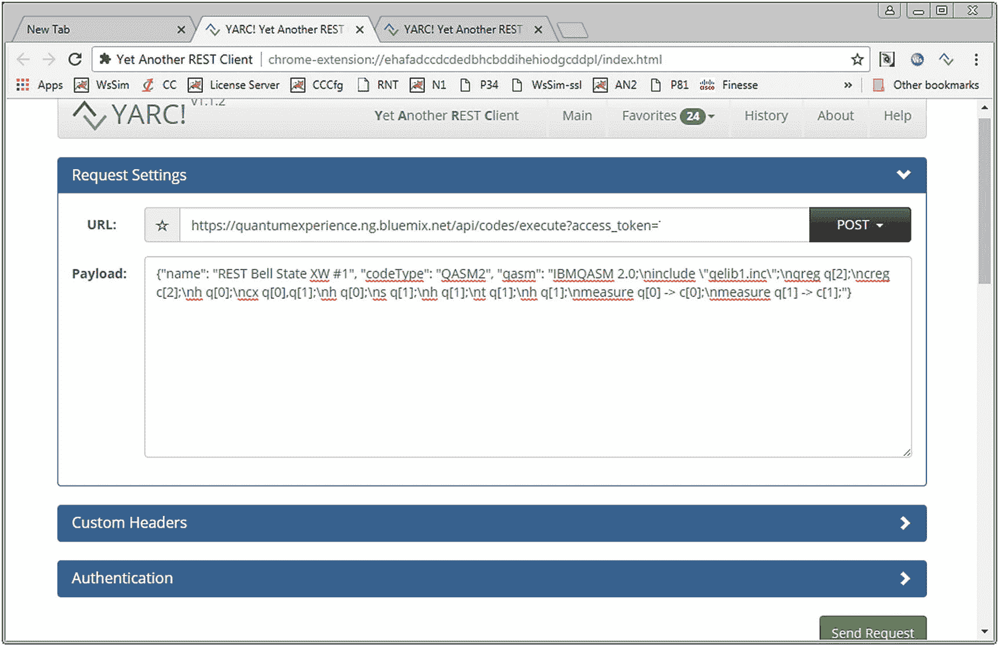

图 3-8 用于贝尔态 XW 实验的 Chrome `YARC` REST 客户端及负载

### 提交至模拟器

要提交至模拟器，请使用以下请求参数：

```
access_token=ACESS_TOKEN&shots=1&deviceRunType=simulator
```

验证响应代码是否为 200 (OK)，并查看响应输出。验证该实验已记录在 `Q Experience` 控制台中（参见图 3-9）。

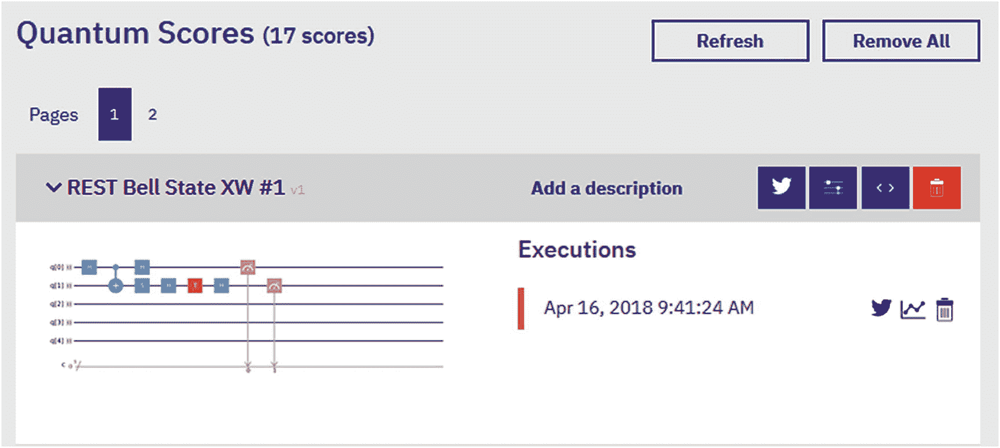

图 3-9 显示通过 REST 提交的贝尔态 XW 实验的 Web 控制台

### 提交至真实设备

要提交至真实设备（此处为 `ibmqx4`），请将请求参数改为：

```
access_token=ACESS_TOKEN &shots=1&deviceRunType=ibmqx4
```

#### 注意事项

真实量子设备可能因维护或其他原因而离线。如果发生这种情况，提交将失败，并返回 400（错误请求）HTTP 响应。在提交至真实量子设备之前，请确保该设备在线！

如果一切顺利，该作业应被放入执行队列并记录在 Web 控制台中。代码清单 3-8 显示了向真实设备提交的结果，其状态为 `PENDING_IN_QUEUE`。

```
{
"startDate": "2018-04-16T13:05:43.440Z",
"modificationDate": 1523883943441,
"typeCredits": "plan",
"status": {
"id": "WORKING_IN_PROGRESS"
},
"deviceRunType": "real",
"ip": {
"ip": "...",
"city": "Raleigh",
"country": "United States",
"continent": "North America"
},
"shots": 1,
"paramsCustomize": {},
"deleted": false,
"userDeleted": false,
"id": "...",
"codeId": "...",
"userId": "...",
"infoQueue": {
"status": "PENDING_IN_QUEUE",
"position": 21,
"estimatedTimeInQueue": 735
},
"code": {
"type": "Algorithm",
"active": true,
"versionId": 1,
"idCode": "...",
"name": "REST Bell State XW #1",
"jsonQASM": {
...
"numberGates": 7,
"hasMeasures": true,
"numberColumns": 11,
"include": "include \"qelib1.inc\";"
},
"qasm": "...",
"codeType": "QASM2",
"creationDate": "2018-04-16T13:05:42.547Z",
"deleted": false,
"orderDate": 1523883943351,
"userDeleted": false,
"isPublic": false,
"id": "...",
"userId": "..."
}
}
```

代码清单 3-8 通过 REST 提交的贝尔态 XW 实验的简化 HTTP 响应

至此，您已成功通过 REST 提交了第一个实验。尝试增加实验的重复次数（`shots`），以获得更高的精度。

## 运行作业

此调用与之前的*运行实验*非常相似；但它有两个端点：

- **端点 1：** 适用于 `IBM Q Experience` 的普通用户。

- **端点 2：** 适用于企业客户。需要提供 `hub`、`group` 和 `project` ID。

企业客户享有高级访问权限，并可访问强大的 20 量子比特处理器，以及可能在 2018 年底推出的传说中的 50 量子比特芯片。

- **HTTP 方法：** POST

- **URL 1：** (5, 16 量子比特) `https://quantumexperience.ng.bluemix.net/api/Jobs?access_token=ACCESS-TOKEN`

- **URL 2：** (20+ 量子比特，企业版) `https://quantumexperience.ng.bluemix.net/api/Network/HUB/Groups/GROUP/Projects/PROJECT/jobs?access_token=ACCESS-TOKEN`

### 请求参数

| 名称 | 值 |
| --- | --- |
| `access_token` | 您的账户访问令牌 |

### HTTP 标头

| 名称 | 值 |
| --- | --- |
| `x-qx-client-application` | 默认为 `qiskit-api-py` |
| `Content-Type` | `application/json` |

### 负载格式

负载的格式将所有执行参数（后端名称、重复次数和代码）嵌入到一个 `JSON` 文档中，如下所示：

```
{
"backend": {
"name": "simulator"
},
"shots": 1,
"qasms": [{
"qasm": "qams"
}, ...]
}
```

#### 提示

通过“运行作业”端点提交的实验不会记录在作曲家的*分数*部分，而是放入执行队列中等待处理。

另一方面，通过“运行实验”端点提交将会在作曲家中记录一个条目。此外，请注意，提交给模拟器的任何实验都会立即返回结果。提交给真实量子设备的实验将始终以 `PENDING` 状态进入执行队列。完成后，将向用户发送通知电子邮件。让我们快速地向真实设备 `ibmqx4` 发送一个作业。将以下端点粘贴到您的 `REST` 客户端中：

`https://quantumexperience.ng.bluemix.net/api/Jobs?access_token=access_token`

按照上一节的描述，将 `HTTP` 方法设置为 `POST`，并设置访问令牌和标头。使用以下 `JSON` 负载：

```markdown
# 获取 API 版本

此接口返回 Q Experience REST API 的版本号。

- **HTTP 方法：** `GET`
- **URL：** `https://quantumexperience.ng.bluemix.net/api/version?access_token=ACCESS-TOKEN`

## 请求参数

| 名称 | 值 |
| --- | --- |
| `access_token` | 您的账户访问令牌 |

## HTTP 请求头

| 名称 | 值 |
| --- | --- |
| `x-qx-client-application` | 默认为 `qiskit-api-py` |

## 响应格式

该接口返回一个包含 API 版本的字符串，在撰写本文时版本为 `6.4.8`。

我们已经剖析了 Python 版 `IBMQuantumExperience` REST API，以了解其幕后运作机制。作为练习，让我们为 Node JS 构建一个自定义客户端。具体方法如下。

# IBMQuantumExperience 的 Node JS 客户端

本节将展示一个简单练习，用于模拟 Python SDK（也称为 QISKit，即量子信息软件工具包）的其中一个组件。在下一章中，我们将更详细地探讨 Python SDK，但首先需要说明的是，该 SDK 构建于两个基础库之上：

- `IBMQuantumExperience`：这是一个用 Python 实现的 REST 客户端库，我通过剖析它来呈现上一节中介绍的 REST API。这个库的文档并不完善，但这也在情理之中，因为它被设计成一个未来可能会发生变化的模块化库。
- QISKit SDK：这是所有量子程序的主要入口点。它包含门逻辑、汇编转换、模拟器（包括本地 Python 模拟器和快速 C++ 模拟器）以及更多功能。该库还通过 REST 调用 `IBMQuantumExperience`，以完成与 IBM Q Experience 平台的所有交互。

Python 是一种出色的语言，但 Node JS 目前在数据中心领域风头正劲；因此，本节将为 Node JS 提供一个简单的 REST API 实现。以下是构建这样一个库的一些理由：

- Node JS 是网络 I/O 异步调用的强大引擎。它速度快，是构建 REST 客户端的理想平台。
- Python 是一种优秀的语言，拥有大量出色的数值计算、数学和图表库，但它也有一些可能让某些人觉得不讨喜的特性。例如，缩进在 Python 中很重要（你不能混用制表符 `TAB` 和空格——没有花括号来区分代码块）。这起初让我抓狂，花了我不少时间才弄清楚，因为几乎所有其他计算机语言都使用花括号来区分逻辑块。但在 Python 中并非如此，你必须使用空格或制表符，而且不能混用。我不喜欢这点。我认为这是糟糕的设计，因为一旦出错，你就无法知道一个逻辑块在哪里结束。这正是花括号的作用所在。
- 多样性总是好的：在经历了 Python 带来的种种麻烦之后，我认为这个库可以作为 Node JS 版 QISKit 克隆的基础。

那么，让我们开始吧。

## 构建 IBMQuantumExperience 的 Node 模块

我尽量保持名称与 Python 版本尽可能接近。要创建一个 Node JS 模块，请创建一个名为 `IBMQuantumExperience` 的文件夹，并按照以下命令集初始化 Node JS：

```
$ mkdir IBMQuantumExperience
$ cd IBMQuantumExperience
$ npm init
```

**提示：** Linux 用户：我是在 Windows 系统上编写本节的；此外，我假定你已经安装了 Node JS、熟悉 Node 模块并能用 Javascript 编写代码。总之，你可以从 `https://nodejs.org/en/` 获取适用于所有平台的 Node 安装程序。另请注意，Linux 系统会因包名使用大写字母而报错。为了避免麻烦，建议使用 Windows 来阅读本节。

Node 提供了一个名为 `npm` 的包管理器（这与 Python 的 `pip` 非常相似），可用于初始化你的模块。第三个命令会在当前文件夹中创建两个文件：

- `index.js`：这是你的模块代码。注意：对于 Linux 用户，这个文件可能不会被创建。如果是这样，请手动创建它。
- `package.json`：这是模块描述文件，包含名称、版本、作者、依赖项等信息。

在同一位置创建一个 `test` 文件夹，用于存放单元测试，并安装强大的 Node REST 客户端 `request`：

```
$ mkdir test
$ npm install request
```

第二条命令会在当前文件夹中安装流行的 HTTP 请求包及其所有依赖项。现在，我们准备开始实现上一节介绍的 REST API。在你喜欢的编辑器中打开 `index.js`，让我们开始吧。

## 导出 API 方法

要通过 Node 暴露 API，请使用 `module.exports` 库，如下代码清单 3-9 所示。请注意，这是该库的部分实现，各部分将在后续章节中逐步组装完成。尽管如此，本书源代码的 `Workspace\Ch03\IBMQuantumExperience` 目录下提供了完整实现。话虽如此，你应该能够将所有代码片段粘贴到 `index.js` 中。再次强调，此处我假定你熟悉如何用 Node JS 编写模块。

```
const log = require('./log'); // 一个简单的自定义日志库（参见调试章节）
const request = require('request');
//...
module.exports =  {
  init: function (cfg) {
    _config = cfg;
    var debug = _config.debug ? _config.debug : false;
    log.init (debug);
    return loginWithToken ();
  },
  getCalibration  : calibration,
  getBackends    : backends,
  getParameters  : parameters,
  runExperiment  : experiment
  // 留作练习  getJobs      : jobs,
  // 留作练习  getMyCredits  : credits
}
```

在代码清单 3-9 中，我们使用 `require` 关键字导入了一个外部库：
```

- 第 2 行导入了 `request` HTTP 客户端库，用于与 Q Experience 交互。

- 第 5 行声明了此模块要暴露的公共方法：
  - `init`：此方法按照上一节“通过 REST API 远程访问”所述，对 Q Experience 平台进行身份验证。
  - `getCalibration`：返回指定设备的平台校准参数。
  - `getBackends`：返回可供使用的量子设备（和模拟器）列表。
  - `getParameters`：返回设备参数，如 Composer Web 控制台的“设备”部分所述。
  - `runExperiment`：在模拟器或真实量子设备上远程运行实验。
  - `getJobs`：返回实验执行队列中的当前任务列表。
  - `getMyCredits`：返回用户的执行积分及其他有用信息。

### 使用令牌进行身份验证

在身份验证之前，库的初始化方式与在 Python 中相同，需要一个包含平台 URL、API 令牌等信息的配置 JSON 对象。例如，下面是我们测试获取后端信息 REST API 调用的方式（取自 `test.js`）：

```javascript
// 从同一目录引入 `index.js` 文件
const qx = require('index.js');
// 在此处输入你的 API 令牌
var config = { APItoken: 'YOUR_API_TOKEN'
, debug    : true
, 'url'    : 'https://quantumexperience.ng.bluemix.net/api'
, 'hub'    : 'MY_HUB'
, 'group'  : 'MY_GROUP'
, 'project'  : 'MY_PROJECT'
}
// 获取后端信息
async function testBackends() {
    await qx.init(config);
    var result = await qx.getBackends();
    console.log("---- 后端列表 ----\n" + JSON.stringify(result) + "\n-----" );
}
```

请注意，`hub`、`group` 和 `project` 仅适用于企业客户参数；因此在此实现中未使用；不过可以轻松添加对它们的支持。初始化完成后，只需按 REST API 所述提交一个 POST 请求，使用令牌登录（见清单 3-10）。请注意，此代码以及本节中的所有代码清单都应放在 `index.js` 中。

```javascript
function loginWithToken () {
    let options = {
        url: _config.url + '/users/loginWithToken',
        form: {'apiToken': _config.APItoken}
    };
    return new Promise(function(resolve, reject) {
        // 执行异步任务
        // 返回结果: {"id":"访问令牌","ttl":1209600,"created":"2018-04-17T23:30:21.089Z","userId":"用户 ID"}
        request.post(options, function(err, res, body) {
            if (err) {
                reject(err);
            }
            else {
                var json     = JSON.parse(body);
                _accessToken  = json.id;
                _userId      = json.userId;
                log.debug("获取到用户:" + _userId + " 令牌:" +  _accessToken);
                resolve(JSON.parse(body));
            }
        });
    })
}
```
清单 3-10 通过 REST 进行令牌认证

在清单 3-10 中：

- 使用 `request.post` 系统调用，通过 JSON 载荷 `{'apiToken': 'YOUR_TOKEN'}` 向端点 `https://quantumexperience.ng.bluemix.net/api/users/loginWithToken` 发送 HTTP POST 请求。如 REST API 所述，此调用返回一个新的 JSON 文档：`{"id":"TOKEN","ttl":1209600,"created":"DATE","userId":"USERID"}`。该文档被解析，访问令牌（`id`）和用户 ID（`userId`）被保存以供后续使用。

- 请注意，由于 Node 中所有网络 I/O 都是异步的，所有方法都返回一个 `Promise`。这基本上是一个异步任务，封装了在读取结果之前必须等待任务完成的复杂性。因此，如果 HTTP 请求调用成功，`Promise` 中的 `resolve` 回调将携带 HTTP 响应数据触发；否则将调用 `Promise` 的 `reject` 回调。

##### 提示

对于异步代码而言，Promise 是回调函数的一种引人注目的替代方案。但有时它们也会让人感到困惑。总而言之，Promise 正逐渐成为 Javascript 异步编程事实上的标准。

不过，如果你觉得 `Promise` 处理代码过于复杂，还有一种更简单的方法来处理，这将在下一节展示，我们将实现一个获取后端列表的方法。

### 列出后端

清单 3-11 展示了一个从 Q Experience 获取后端的 Node 请求。

- 它向 `https://quantumexperience.ng.bluemix.net/api/Backends?access_token=TOKEN` 发送一个 HTTP GET 请求。
- 它返回一个 `Promise`，可以在任何异步函数中通过使用 Javascript 新的 `async/await` 特性来进行调用。

```javascript
const _defaultHdrs = {
    'x-qx-client-application': _userAgent
};
function backends () {
    let options = {
        url: _config.url + '/Backends?access_token=' + _accessToken,
        headers: _defaultHdrs
    };
    return new Promise(function(resolve, reject) {
        // 执行异步任务
        request.get(options, function(err, res, body) {
            if (err) {
                reject(err);
            }
            else {
                resolve(JSON.parse(body));
            }
        });
    })
}
```
清单 3-11 通过 Node 获取后端列表

要测试上述方法，我们可以使用 Node.js >=7.6 中的 `async/await` 特性，如下代码片段所示：

```javascript
async function testBackends() {
    await qx.init(config);
    var result = await qx.getBackends();
    console.log("---- 后端列表 ----\n" + JSON.stringify(result) + "\n-----" );
}
```

##### 提示

一个 `async` 函数可以包含一个 `await` 表达式，该表达式会暂停 async 函数的执行，等待传入的 Promise 解析完成，然后恢复 async 函数的执行并返回解析后的值。

### 列出校准参数

清单 3-12 展示了如何在 IBM Q Experience 中获取特定后端的校准和硬件参数：

- 通过向 `https://quantumexperience.ng.bluemix.net/api/Backends/NAME/calibration?access_token=TOKEN` 发送 GET 请求获取校准信息，其中 `NAME` 是你要查询的后端，`TOKEN` 是从身份验证步骤获取的访问令牌。
- 通过向类似的 GET 请求 `https://quantumexperience.ng.bluemix.net/api/Backends/NAME/parameters?access_token=TOKEN` 获取后端参数。
- 两个请求的响应格式在本章的“通过 REST API 进行远程访问”部分中描述。

### 清单 3-12

```javascript
function calibration (name) {
let options = {
url: _config.url + '/Backends/' + name +'/calibration?access_token=' + _accessToken,
headers: _defaultHdrs
};
return new Promise(function(resolve, reject) {
request.get(options, function(err, res, body) {
if (err) {
reject(err);
}
else {
resolve(JSON.parse(body));
}
});
})
}
function parameters (name) {
let options = {
url: _config.url + '/Backends/' + name +'/parameters?access_token=' + _accessToken,
headers: _defaultHdrs
};
return new Promise(function(resolve, reject) {
request.get(options, function(err, res, body) {
if (err) {
reject(err);
}
else {
resolve(JSON.parse(body));
}
});
})
}
```

获取设备校准和参数数据

要测试代码，创建一个 `async` 函数并使用 `await` 关键字从异步任务中获取响应，如下代码片段所示：

```javascript
async function testCalibration() {
await qx.init(config);
var result1 = await qx.getCalibration('ibmqx4');
var result2 = await qx.getParameters('ibmqx4');
console.log(JSON.stringify(result1) );
console.log(JSON.stringify(result1) );
}
```

最后一步，让我们看看如何运行一个实验。

### 运行实验

这是 API 中最重要的调用，执行后，实验应记录在 IBM Q Experience Web 控制台的得分部分（见清单 3-13）。要以编程方式提交实验，请向 `/codes/execute` 端点发送一个带有 JSON 载荷的 HTTP POST 请求：

- 请记住，汇编代码必须格式化为单行，使用换行符（`\n`）分隔指令。例如，以下代码声明了 5 个量子比特和 5 个经典寄存器：`"\n\ninclude \"qelib1.inc\";\nqreg q[5];\ncreg c[5];\n"`。

- `name` 参数定义了要在 Web 控制台中记录的实验名称。

- `shots` 参数是量子处理器执行的 shots 次数。

- `device` 参数可以是 `simulator`（用于远程模拟器）或真实的量子设备名称，例如 `ibmqx4`。

```json
{'name': name, "codeType": "QASM2", "qasm":  "YOUR_QASM_CODE"}
```

###### 提示

如果你在真实设备上运行实验，该实验将进入执行队列等待后续处理。实验完成后你将收到一封电子邮件。另一方面，如果在远程模拟器上运行实验，结果将同步返回。

```javascript
const _userAgent = 'qiskit-api-py'; // 全局变量
function experiment (name, qasm, shots, device) {
let options = {
url: _config.url + '/codes/execute?access_token=' + _accessToken
+ '&shots=' + shots + '&deviceRunType=' + device,
headers: {'Content-Type': 'application/json', 'x-qx-client-application': _userAgent} ,
form: {'name': name, "codeType": "QASM2", "qasm": qasm}
};
return new Promise(function(resolve, reject) {
request.post(options, function(err, res, body) {
if (err) {
reject(err);
}
else {
resolve(JSON.parse(body));
}
});
})
}
```

代码清单 3-13

运行实验

将代码清单 3-13 粘贴到 `index.js` 中，使用以下代码片段在真实量子设备 `ibmqx4` 上运行实验，然后验证实验已记录在网络控制台中，最后等待通知邮件。

```javascript
async function testExperiment () {
await qx.init(config);
var name   = "REST Experiment from Node JS #1"
var qasm   =  "\n\ninclude \"qelib1.inc\";\nqreg q[5];\ncreg c[5];\nu2(-4*pi/3,2*pi) q[0];\nu2(-3*pi/2,2*pi) q[0];\nu3(-pi,0,-pi) q[0];\nu3(-pi,0,-pi/2) q[0];\nu2(pi,-pi/2) q[0];\nu3(-pi,0,-pi/2) q[0];\nmeasure q -> c;\n";
var shots   = 1;
var device   = "ibmqx4";
var result   = await qx.runExperiment(name, qasm, shots, device);
console.log("---- 实验 " + name + " ----\n" + JSON.stringify(result) + "\n-----" )
}
```

###### 提示

`IBMQuantumExperience` Node 模块的代码包含在本书源码的 `Workspace\Ch03\IBMQuantumExperience` 目录下。该项目在 `test/tests.js` 中有一个测试脚本。编辑此文件，添加你的 API 令牌，并在 `IBMQuantumExperience` 目录中使用命令 `node test/tests.js` 执行它。

### 调试与测试

对于简单的调试，我创建了子模块 `log.js`（与 `index.js` 在同一层级），并使用了经典的 `console` 对象将信息显示到控制台，如下所示：

```javascript
var _debug = false;
function LOGD( tag, txt ) {
if ( _debug ) {
console.log('[DBG-QX] ' + tag + ' '  + (txt ? txt : "));
}
}
function LOGE( tag, txt ) {
console.error('[ERR-QX] ' + tag + ' ' + (txt ? txt : "));
}
function init (debug) {
_debug = debug;
}
exports.init = init;
exports.debug = LOGD;
exports.error = LOGE;
```

主模块（`index.js`）使用此子模块在控制台中显示调试消息。最后，要测试该包，请编辑 `test/tests.js` 并粘贴本节中描述的测试片段，如下面来自 `tests.js` 的部分代码所示：

```
// test/tests.js require the `index.js` file from the same directory.
const qx = require('../');
// 在此处放置你的 API 令牌
var config = { APItoken: 'API-TOKEN'
, debug: true
, 'url': 'https://quantumexperience.ng.bluemix.net/api'
, 'hub': 'MY_HUB'
, 'group': 'MY_GROUP'
, 'project': 'MY_PROJECT'
};
async function testBackends() {
await qx.init(config);
var result = await qx.getBackends();
console.log("---- 后端 ----\n" + JSON.stringify(result) + "\n-----" );
}
async function testJobs () {
await qx.init(config);
var filter = '{"limit":2}';
var jobs = await qx.getJobs(filter);
console.log ("---- 任务 ----\n" + JSON.stringify(jobs) + "\n----");
}
// 在此处粘贴所有测试片段...
// ....
try {
testBackends();
testJobs ();
// 更多测试...
}
catch (e){
console.error(e);
}
```

要运行测试，请在 `IBMQuantumExperience` 文件夹内执行 `node test\tests.js`。请注意，我留下了两个方法 `getJobs` 和 `getMycredits` 作为练习。有了这个基础，你应该能够轻松实现并测试它们。

### 与世界分享：发布你的模块

如果你希望与世界分享你的工作，可以将模块发布到 npm 注册表。为此，你需要在 [`www.npmjs.com/`](http://www.npmjs.com/) 创建一个用户帐户，或手动使用以下命令：

```
npm adduser
npm publish
```

请确保通过在根文件夹中添加一个 Markdown 文档（`readme.md`）来记录你的代码。发布后，导航到 [`npmjs.com/package/<package>`](https://npmjs.com/package/%253cpackage%253e) 查看你的在线模块。现在其他人应该可以这样安装它：

```
npm install IBMQuantumExperience
```

Node JS 开发人员现在可以使用如下代码向 Q Experience 提交实验：

```
const qx = require('IBMQuantumExperience');
...
async function sendExperiment () {
var config = { APItoken: 'API-TOKEN'
, 'url': 'https://quantumexperience.ng.bluemix.net/api', 'debug': false};
await qx.init(config);
var name   = "REST Experiment from Node JS #1"
var qasm   =  "MY_QASM";
var device   = "ibmqx4";
var result   = await qx.runExperiment(name, qasm, 1024, device);
}
```

在本章中，你已迈出了成为量子程序员的第一步。IBM 创建了一个令人惊叹的云平台来学习这些不可思议的机器。我们应该感谢 IBM 的善良员工，使这个平台对大众免费开放。目前，量子计算机还是实验性机器，所以不要指望能在当地的硬件商店买到一台。然而，它们很快将接管数据中心，所以现在是学习如何编程它们的时候了。

脚注 1   2   3   4   5   6   7