# QISKit：用于 Python 量子编程的卓越 SDK

在本章中，你将开始使用 QISKit，这是目前最好的量子编程 SDK。你将学习如何在本地系统上轻松安装此 SDK。但在编写第一个量子程序之前，理解什么是量子计算以及它如何区别于经典计算总是很有帮助的。为此，本节使用线性代数对量子比特态和量子门进行了非常基础的解释。本节还展示了量子计算如何镜像其经典对应物，并进一步找到更快的途径来获得结果。接下来，本章将介绍量子程序的解剖结构，包括系统调用、电路编译格式、量子汇编等内容。

QISKit 提供了一套有用的模拟器，可以在本地或远程执行你的程序，但也允许你在真实设备上运行。你将逐步学习如何在强大的 IBM Q Experience 云平台提供的真实设备上运行量子程序。所以，启动你的桌面，让我们开始吧。

## 安装 QISKit

QISKit 是量子信息软件工具包（Quantum Information Software Kit），是云端量子编程的事实标准 SDK。它用 Python 编写，Python 是一种用于科学计算的强大脚本语言。我的背景主要是在商业领域，所以多年来我没有写过太多 Python 代码，那么让我们看看如何将 SDK 安装在 Linux CentOS 6–7 和 Windows 64 位上。我们将从最简单的（Windows）开始，然后跳到最具挑战性的（CentOS）。


### 在 Windows 中设置

QISKit 需要 Python 3.5 或更高版本。如果你的系统是 Windows，很可能没有安装 Python。如果是这样，你可以从 Python.org 网站获取安装程序。下载安装程序并运行，然后在命令窗口中运行以下命令来验证安装：

```
C:\>Python -V
Python 2.7.6
```

我使用的是老旧的 Python 2.7，但你也可以同时安装多个版本的 Python。就我而言，我下载了可嵌入的 zip 文件并解压到了 `C:\Python36-64`，因此：

```
C:\>C:\Python36-64\Python.exe -V
Python 3.6.4
```

Python 有一个出色的包管理器 `pip`（首选的安装程序），它让模块安装变得非常简单。因此，要安装 QISKit，只需在控制台输入：

```
C:\>pip install qiskit
```

你的屏幕输出应类似于清单 4-1。确保没有错误消息。

```
Collecting qiskit
Using cached qiskit-0.4.11.tar.gz
Collecting IBMQuantumExperience>=1.8.28 (from qiskit)
Using cached IBMQuantumExperience-1.9.0-py3-none-any.whl
Collecting matplotlib=2.1 (from qiskit)
Using cached matplotlib-2.1.2.tar.gz
Collecting networkx=2.0 (from qiskit)
Downloading networkx-2.0.zip (1.5MB)
100% |████████████████████| 1.6MB 400kB/s
Collecting numpy=1.13 (from qiskit)
Downloading numpy-1.14.2-cp36-cp36m-manylinux1_i686.whl (8.7MB)
100% |████████████████████| 8.7MB 105kB/s
...
Running setup.py install for pycparser ... done
Running setup.py install for matplotlib ... done
Running setup.py install for networkx ... done
Running setup.py install for ply ... done
Running setup.py install for mpmath ... done
Running setup.py install for sympy ... done
Running setup.py install for qiskit ... done
Successfully installed IBMQuantumExperience-1.9.0 qiskit-0.4.11 requests-2.18.4 ...
```

就是这样；你已经迈出了成为量子程序员的第一步。对于 Linux 用户，让我们在 CentOS 6 或 7 中进行设置。

### 在 Linux CentOS 中设置

在 CentOS 6 或 7 中设置会稍微复杂一些。这是因为 CentOS 主要侧重于稳定性，而不是追求最前沿的软件。因此 CentOS 默认自带 Python 2.7；此外，官方发行版并未提供 Python 3.5 的包。但这并不意味着无法安装 Python 3.5。让我们来看看如何安装。

**提示：** 本节中的说明适用于任何基于 Red Hat 基础架构的 Linux 发行版，例如 RHEL 6-7、CentOS 6-7 和 Fedora Core。

#### 步骤 1：准备系统

首先，通过运行以下命令确保 `yum`（Linux 更新管理器）是最新的：

```
$ sudo yum -y update
```

接下来，安装 `yum-utils`，这是一个用于扩展和补充 `yum` 的工具和插件集合：

```
$ sudo yum -y install yum-utils
```

安装 CentOS 开发工具。这些工具包括编译器和库，用于构建和编译多种类型的软件：

```
$ sudo yum -y groupinstall development
```

现在，让我们安装 Python 3。请注意，我们将运行多个 Python 版本：官方的 2.7 版本和用于开发的 3.6 版本。

#### 步骤 2：安装 Python 3

要摆脱默认 CentOS 发行版的限制，我们可以使用一个名为 *Inline with Upstream Stable* (IUS) 的社区项目。这是一套为无法提供最新开发库的操作系统（如 CentOS）提供的最新开发库。让我们通过 `yum` 安装 IUS：

```
$ sudo yum -y install https://centos7.iuscommunity.org/ius-release.rpm (CentOS7)
$ sudo yum -y install https://centos6.iuscommunity.org/ius-release.rpm (CentOS6)
```

IUS 安装完成后，我们就可以安装最新版本的 Python (3.6)：

```
$ sudo yum -y install python36u
```

检查安装是否成功：

```
$ python3.6 -V
Python 3.6.4
```

现在，让我们安装 `pip` 并验证：

```
$ sudo yum -y install python36u-pip
$ pip3.6 -V
```

最后，我们需要安装 IUS 包 `python36u-devel`，它提供了有用的 Python 开发库：

```
$ sudo yum -y install python36u-devel
```

#### 步骤 3：避免干扰他人——设置虚拟环境

仅当你的多用户系统运行多个版本的 Python，并且你不想干扰其他用户时，此步骤才有用。例如，在你的主文件夹中创建一个虚拟环境：

```
$ mkdir $HOME/qiskit
$ cd $HOME/qiskit
$ python3.6 -m venv qiskit
```

上述命令序列在用户主目录下创建了一个名为 `qiskit` 的文件夹，用于存放你的所有量子程序。在该文件夹内，还创建了一个名为 `qiskit` 的虚拟 Python 3.6 环境。使用以下命令激活该环境：

```
$ source qiskit/bin/activate
(qiskit) [centos@localhost qiskit]$
```

在虚拟环境中，如果你愿意，可以使用命令 `python` 代替 `python3.6`，使用 `pip` 代替 `pip3.6`：

```
$ python -V
Python 3.6.4
```

**提示：** 如果你没有激活虚拟环境，则必须使用 `python3.6` 和 `pip3.6`，而不是 `python` 和 `pip`。

#### 步骤 4：安装 QISKit

激活你的虚拟环境并使用以下命令安装 QISKit：

```
$ pip install qiskit
```

清单 4-2 显示了上述命令的标准输出。

```
Collecting qiskit
Downloading qiskit-0.5.7.tar.gz (4.5MB)
100% |████████████████████| 4.5MB 183kB/s
Collecting IBMQuantumExperience>=1.8.28 (from qiskit)
Downloading IBMQuantumExperience-1.9.0-py3-none-any.whl
Collecting matplotlib=2.1 (from qiskit)
Downloading matplotlib-2.1.2.tar.gz (36.2MB)
100% |████████████████████| 36.2MB 18kB/s
Complete output from command python setup.py egg_info:
=======================================================================
Edit setup.cfg to change the build options
BUILDING MATPLOTLIB
matplotlib: yes [2.1.2]
python: yes [3.6.4 (default, Dec 19 2017, 14:48:15)  [GCC
4.4.7 20120313 (Red Hat 4.4.7-18)]]
platform: yes [linux]
...
Installing collected packages:  IBMQuantumExperience, numpy, python-dateutil, pytz, cycler, pyparsing, matplotlib, decorator, networkx, ply, scipy, mpmath, sympy, pillow, qiskit
Running setup.py install for pycparser ... done
Running setup.py install for matplotlib ... done
Running setup.py install for networkx ... done
Running setup.py install for ply ... done
Running setup.py install for mpmath ... done
Running setup.py install for sympy ... done
Running setup.py install for qiskit ... done
Successfully installed IBMQuantumExperience-1.9.0  qiskit-0.4.11 requests-2.18.4 requests-ntlm-1.1.0 scipy-1.0.1 six-1.11.0 sympy-1.1.1 urllib3-1.22
(qiskit) [centos@localhost qiskit]$
```

**提示：** 在虚拟环境下，Python 包将安装到环境的主目录 `lib/python3.6/site-packages` 中，而不是系统的路径中，如图 4-1 所示。

我们现在可以开始编写量子代码了。让我们看看如何进行。


## 量子比特 101：不过是基础代数

在开始编写量子程序之前，我们需要温习一些基础数学知识，以便理解背后所发生的运作。在上一章中，你了解了如何用布洛赫球来表示量子比特：一个用于表示双能级量子力学系统（量子比特）纯态的几何表示。但也许理解量子比特基本模型以及量子门效应更好的方式是采用其代数表示。为此，你需要回顾一些基础的线性代数概念，包括：

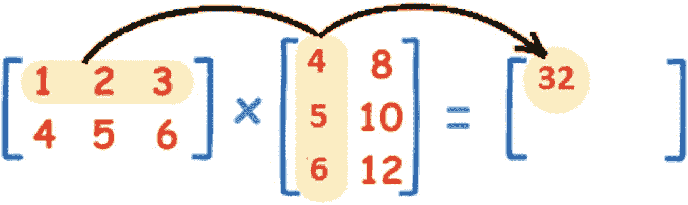

图 4-2 基本矩阵乘法运算

- *线性向量*：简单的向量，例如 `[[1],[0]]`，用于表示量子比特的基态。
- *复数*：复数由实部和虚部构成，记作 `a + bi`，其中 `i = sqrt(-1)`。请注意，复数在我们的物理现实中并不存在。量子比特叠加态 `ψ = α|0⟩ + β|1⟩` 的系数 `α`、`β` 就是复数。
- *复共轭*：在讨论量子门时你经常会听到这个术语。要得到复共轭，只需将虚部的符号取反；因此 `a + bi` 变为 `a - bi`，反之亦然。
- *矩阵乘法*：如果 `A` 是一个 `n × m` 矩阵，`B` 是一个 `m × p` 矩阵，那么它们的乘积 `AB` 是一个 `n × p` 矩阵，其中 `A` 一行中的 `m` 个元素与 `B` 一列中的 `m` 个元素相乘后求和，得到 `AB` 中的一个元素。从第一个矩阵中取第一行，与第二个矩阵的第一列中的每个元素相乘，结果即为结果矩阵中的第一个元素（见图 4-2）；但别担心，我们即将看到的大部分矩阵都是仅由 0 或 1 元素构成的 2x2 矩阵。

### 量子比特的代数表示

在经典模型中，信息的基本单位是比特，用 0 或 1 表示。比特在物理上对应于流经晶体管的电压。在量子计算中，基本单位是量子比特，它在物理上对应于对光子、电子或原子的操控。在代数上，量子比特用右矢符号表示。

> **提示：** 右矢符号由物理学家保罗·狄拉克于 1939 年提出，也称为狄拉克符号。右矢通常表示为一个列向量，写作 `|φ⟩`。

#### 狄拉克右矢符号

使用狄拉克符号，量子比特的基本量子态由向量 `|0⟩` 和 `|1⟩` 表示。这些被称为计算基态。

> **提示：** 量子比特的量子态是二维复向量空间中的一个向量。让我们用一个简单的图来说明这一点。

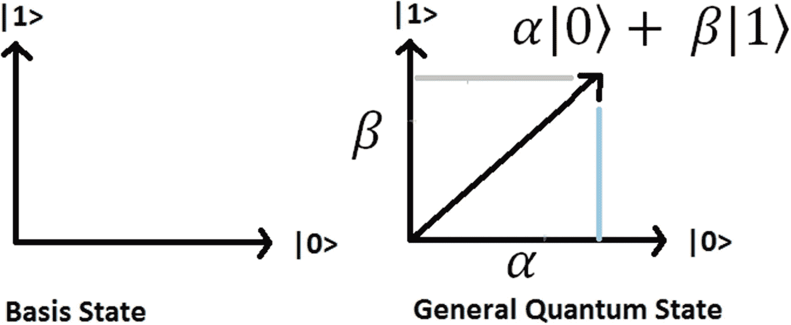

图 4-3 量子比特的量子态

图 4-3 展示了用于表示量子比特状态的复向量空间。左侧是所谓的基态，由状态 `|0⟩` 和 `|1⟩` 的狄拉克符号表示的两个单位向量组成。右侧是一个一般的量子态，由这两者的线性组合构成。因此，基态和一般量子态可以写成向量形式：

```
|0⟩ = [[1],[0]], |1⟩ = [[0],[1]]
```

```
α|0⟩ + β|1⟩
```

其中 `α` 和 `β` 是单位向量的振幅系数。请注意，单位向量的振幅必须为 1；因此 `α` 和 `β` 必须满足约束条件 `|α|² + |β|² = 1`。这种代数表示是理解逻辑门作用于量子比特效应的关键，你将在后续内容中看到。

那么，为什么量子比特的状态要表示为一个看起来比经典比特更复杂的向量形式呢？为什么一定要用向量？原因在于，正如我们将在研究量子门和状态叠加时看到的那样，它有助于构建更好的计算模型。总而言之，量子力学是经过数十年发展起来的理论，而归根结底，向量是一个非常简单的数学对象，易于理解和操作。或许它是完成这项工作的最佳工具。

#### 叠加只是一个花哨的词

物理学家将叠加定义为原子粒子同时存在于多种状态的特性。如果你觉得这个概念难以理解，那么线性代数可以帮到你。

> **提示：** 叠加就是 `|0⟩` 和 `|1⟩` 状态的线性组合。即 `α|0⟩ + β|1⟩`，其中状态向量的长度为 1，如图 4-3 所示。

#### 右矢符号太奇怪？改用向量吧

如果你喜欢代数，并且觉得右矢符号令人困惑，那就改用熟悉的向量表示。因此，上一节中的叠加可以写成：

```
|Ψ⟩ = α|0⟩ + β|1⟩ = α[[1],[0]] + β[[0],[1]] = [[α],[β]]
```

请注意，因为右矢是向量，它们遵循与向量相同的规则，例如，乘以标量：

```
2(α|0⟩ + β|1⟩) = 2[[α],[β]] = [[2α],[2β]]
```

### 用量子门改变量子比特的状态

量子门的目的是操控量子比特的状态以达到期望的结果。它们是量子计算的基本构建模块，正如经典逻辑门之于经典世界。有些量子门与其经典对应物是等价的。让我们来看一下。


好的，作为一名高级文档工程师和翻译员，我将严格按照您提供的注意事项和示例格式，对给定的英文文本进行翻译。


#### 非门（泡利 X）

这是最简单的量子门，作用于单个量子比特。它是经典非门的量子对应物，与它的经典对应物一样，它会翻转量子比特的状态。因此：

`|0⟩ → |1⟩`，`|1⟩ → |0⟩`

对于一个叠加态，`X`门是线性作用的，这意味着它会翻转相应的状态；因此，`|0>` 变为 `|1>`，`|1>` 变为 `|0>`：

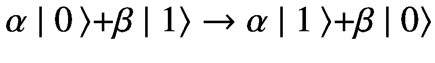

在量子电路中，非门用 `X` 表示，也称为泡利 X 门，以奥地利物理学家、量子力学奠基人之一沃尔夫冈·泡利的名字命名。

|  | 电路从量子比特 0 的基态 `|0>` 开始，该状态流过量子线，直到对其执行操作，然后输出继续通过量子线。 |

还有另一种看待 `X` 门作用的方式；通过使用它的矩阵表示，我们可以准确地看到如何使用泡利矩阵来翻转状态：

![$$ X=\left[\begin{array}{cc}0&amp; 1\\ {}1&amp; 0\end{array}\right] $$](images/469026_1_En_4_Chapter/469026_1_En_4_Chapter_TeX_Equf.png)

量子比特的状态通过使用 `X` 的矩阵表示以及向量 `|0⟩ = [1 0]^T` 和 `|1⟩ = [0 1]^T` 来翻转；因此：

![$$ X\kern0.28em \mid 0\left\rangle =\left[\begin{array}{cc}0&amp; 1\\ {}1&amp; 0\end{array}\right]\left[\begin{array}{c}1\\ {}0\end{array}\right]=\left[\begin{array}{c}0+0\\ {}1+0\end{array}\right]=\left[\begin{array}{c}0\\ {}1\end{array}\right]=\mid 1\right\rangle $$](images/469026_1_En_4_Chapter/469026_1_En_4_Chapter_TeX_Equg.png)

![$$ X\kern0.28em \mid 1\left\rangle =\left[\begin{array}{cc}0&amp; 1\\ {}1&amp; 0\end{array}\right]\left[\begin{array}{c}0\\ {}1\end{array}\right]=\left[\begin{array}{c}0+1\\ {}0+0\end{array}\right]=\left[\begin{array}{c}1\\ {}0\end{array}\right]=\mid 0\right\rangle $$](images/469026_1_En_4_Chapter/469026_1_En_4_Chapter_TeX_Equh.png)

还有一个更简单的量子电路，它是最简单的，即用希腊符号 `∣ψ⟩` 表示的量子线，它描述了随时间变化的计算状态。这可能看起来微不足道，但物理上这是最难实现的。由于量子线的原子尺度（想想光子、电子或单个原子），它非常脆弱，容易受到环境引入的误差影响。

`X` 门的另一个有趣特性是，连续两个非门会得到单位矩阵 (`I`)，这是线性变换中的一个非常重要的工具。我们来计算一下：

| `∣ψ⟩ → XX ∣ ψ⟩` | 为了理解电路的效果，让我们看看两个 X 矩阵相乘的结果：![$$ XX=\left[\begin{array}{cc}0&amp; 1\\ {}1&amp; 0\end{array}\right]\left[\begin{array}{cc}0&amp; 1\\ {}1&amp; 0\end{array}\right]=\left[\begin{array}{cc}0+1&amp; 0+0\\ {}0+0&amp; 1+0\end{array}\right]=\left[\begin{array}{cc}1&amp; 0\\ {}0&amp; 1\end{array}\right]=I $$](images/469026_1_En_4_Chapter/469026_1_En_4_Chapter_TeX_IEq5.png) |

`X` 门是量子逻辑门、电路和计算的最简单示例。在下一节中，我们将介绍一个真正的量子门——哈达玛门，以及它如何使用电路和代数触发叠加态。

#### 真正的量子：使用哈达玛门实现叠加态

哈达玛门在基态上的作用形式化定义为：

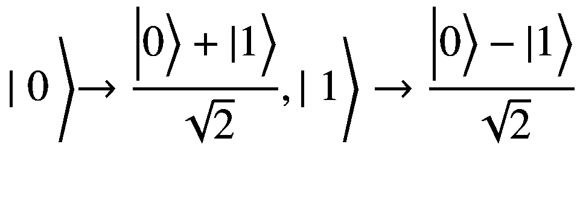

此外，对于叠加态 `α|0⟩+β|1⟩`，哈达玛门将其映射为：


在电路和矩阵表示中，哈达玛门作用于单个量子比特。

| ![$$ H=\frac{1}{\sqrt{2}}\left[\begin{array}{cc}1&amp; 1\\ {}1&amp; -1\end{array}\right] $$](images/469026_1_En_4_Chapter/469026_1_En_4_Chapter_TeX_IEq6.png) | 将 `H` 应用于基态 `|0⟩` 和 `|1⟩`：![$$ H\mid 0\Big\rangle =\frac{1}{\sqrt{2}}\left[\begin{array}{cc}1&amp; 1\\ {}1&amp; -1\end{array}\right]\left[\begin{array}{c}1\\ {}0\end{array}\right]=\frac{1}{\sqrt{2}}\left[\begin{array}{c}1\\ {}1\end{array}\right]=\frac{1}{\sqrt{2}}\left(\left[\begin{array}{c}1\\ {}0\end{array}\right]+\left[\begin{array}{c}0\\ {}1\end{array}\right]\right)=\frac{\left&#124;0\Big\rangle +&#124;1\right\rangle }{\sqrt{2}} $$](images/469026_1_En_4_Chapter/469026_1_En_4_Chapter_TeX_IEq9.png)![$$ H\mid 1\Big\rangle =\frac{1}{\sqrt{2}}\left[\begin{array}{cc}1&amp; 1\\ {}1&amp; -1\end{array}\right]\left[\begin{array}{c}0\\ {}1\end{array}\right]=\frac{1}{\sqrt{2}}\left[\begin{array}{c}1\\ {}-1\end{array}\right]=\frac{1}{\sqrt{2}}\left(\left[\begin{array}{c}1\\ {}0\end{array}\right]-\left[\begin{array}{c}0\\ {}1\end{array}\right]\right)=\frac{\left&#124;0\Big\rangle -&#124;1\right\rangle }{\sqrt{2}} $$](images/469026_1_En_4_Chapter/469026_1_En_4_Chapter_TeX_IEq10.png) |

那么，哈达玛门的计算原因是什么？它给我们带来了什么好处？如果不深入技术细节，答案是哈达玛门扩展了量子电路可能达到的状态范围。这很重要，因为状态的扩展创造了寻找捷径的可能性，从而可以更快地进行计算。打个比方，就像下国际象棋。例如，如果你的马可以同时像皇后和马一样移动（状态的扩展），这将使局势对你有利，并允许你更快地实现将杀。这就是哈达玛门带来的作用：为你的量子机器提供更强大的马力。


### 量子态的测量比你想象的更棘手

假设你家地下室有个实验室。你拿到一个处于状态 `|ψ⟩ = α|0⟩+β ∣ 1⟩` 的量子比特和一台测量仪器，要求你计算出 `α` 和 `β` 系数，也就是求出这个量子态。这看似是个简单的任务，但实际上却不可能完成。量子力学的原理指出，系统的量子态是无法直接观测的。我们最多只能猜测出 `α` 和 `β` 的近似信息。这个过程被称为计算基测量。

| 对量子态 `|ψ⟩ = α|0⟩+β ∣ 1⟩` 进行测量的结果会得到经典比特：`α ∣ 0⟩+β ∣ 1⟩ → 0 的概率为 ∣α²∣`，`α ∣ 0⟩+β ∣ 1⟩ → 1 的概率为 ∣β²∣` |

因此，测量过程给出的经典比特 0 和 1 的概率，分别等于系数 `α` 和 `β` 模的平方。从物理角度想象这个过程，就是通过测量仪器去观测一个真实的光子、原子或电子。这也是为什么测量通常被视为一种量子门。

测量会干扰量子系统的状态，从而得到一个经典比特结果。需要记住的重要一点是，在这个过程中，系数 `α` 和 `β` 被销毁了。这意味着我们无法在单个量子比特中存储大量信息。想象一下，如果我们能测量出 `α` 和 `β` 的精确值，那么理论上，利用复数就有可能将无限多的经典信息存储在这个量子比特状态中。通过计算出 `α` 和 `β` 的精确值，我们就能提取出所有这些经典信息。但这是不可能的，量子力学禁止这样做。

关于测量的最后一点是**量子态的归一化**：在计算基 `α ∣ 0⟩+β ∣ 1⟩` 上测量时，得到经典比特 0 和 1 的概率之和必须为 1。也就是说，

```
Probability(0) + Probability(1) = ∣α²∣ + ∣β²∣ = 1
```

这意味着量子态向量的长度必须为 1（即归一化）。这是因为测量概率之和为 1。在下一节中，我们将讨论单量子比特门如何推广，它们是什么，以及如何用它们来构建更复杂的电路。

### 推广的单量子比特门

到目前为止，我们已经看到了两个简单的门：`X` 和 `H`，它们分别用以下矩阵表示：

```
X = [[0, 1], [1, 0]]
H = (1/√2)[[1, 1], [1, -1]]
```

同时请记住，量子态的叠加态可以表示为向量 `|Ψ⟩ = [α, β]^T`。那么，对于任何酉矩阵，将这两个门应用于量子态的过程都可以推广为：

```
H[α, β]^T, X[α, β]^T, U[α, β]^T where U = H, X
```

在满足 `U` 必须是酉矩阵这一约束条件下，`U` 被称为推广的单量子比特门。

###### 提示

如果一个矩阵 `U` 与其厄米转置 `U^†` 相乘得到单位矩阵：`U^† U = I`，那么这个矩阵 `U` 就是酉矩阵。厄米转置，也称为共轭转置，用剑标（†）符号表示：`U^† = (U^T)*`，即转置矩阵的复共轭。

矩阵的转置是一个新矩阵，其行是原矩阵的列。例如，如果 `A = [[a, b], [c, d]]`，那么 `A^T = [[a, c], [b, d]]`。然后，要得到厄米转置 `A^† = [[a, c], [b, d]]*`，则对每个元素取复共轭。（`a + bi` 的复共轭，其中 `a` 和 `b` 为实数，是 `a – bi`，即改变虚部（如果有的话）的符号。）

请注意，`H` 和 `X` 这两个门都必须是酉矩阵。这很容易通过计算 `X^† X = I` 和 `H^† H = I` 来验证：

```
X = [[0, 1], [1, 0]]
X^† = [[0, 1], [1, 0]] → X^† X = XX = I

H = (1/√2)[[1, 1], [1, -1]]
H^† = (1/√2)[[1, 1], [1, -1]] → H^† H = HH = I
```

### 酉矩阵适用于量子门

上一节引出一个问题：为什么要费这么大劲？为什么 `X` 和 `H` 必须是酉矩阵？答案是，酉矩阵能保持向量长度不变。这对量子门非常有用，因为量子门要求输入和输出状态都是归一化的（向量长度为 1）。事实上，酉矩阵是唯一一类能保持长度的矩阵，因此也是唯一一类可用于量子门的矩阵。总之，一个更深层次的问题出现了：为什么量子门首先必须是线性的？为什么一定要使用矩阵表示？我们将在后面章节尝试回答这个问题，但目前，我们只能先接受这个事实。


#### 其他单量子比特门

在上一节中，我们介绍了单量子比特门`X`和`H`。同时，还有其他一些在量子计算中很有用的单量子比特门。

`X`门有两个伙伴`Y`和`Z`。它们三者组成了被称为泡利西格玛（`σ`）门的三元组。

| `$$ X=\left[\begin{array}{cc}0& 1\\ {}0& 1\end{array}\right],Y=\left[\begin{array}{cc}0& -i\\ {}i& 1\end{array}\right],Z=\left[\begin{array}{cc}1& 0\\ {}0& -1\end{array}\right] $$` | 这三个矩阵对于信息处理任务非常有用，例如超密编码（SDC），这是一种旨在高效地在量子比特中存储经典信息的过程。在分析原子属性（如电子自旋）时，它们也会出现。此外，它们与空间的三个维度 XYZ 密切相关。 |
| 旋转门 `$$ \left[\begin{array}{cc}\cos \kern0.28em \theta & -\sin \theta \\ {}\sin \theta & \cos \theta \end{array}\right] $$` | 这是我们在实空间中熟悉的绕角度`θ`的旋转。这是一个酉矩阵，在这种特殊情况下，`T`门执行的是绕 Z 轴旋转`Π/4`的操作。该门是实现通用控制所必需的。 |

门也可以操控多个量子比特，我们将在下一节中看到。

#### 受控非门实现量子纠缠

这个门完善了量子计算所需的量子门库。受控非门（`CNOT`）是一个双量子比特门，它有四个计算基态。

对于一个叠加态，`CNOT`给出的四个基态为`α ∣ 00⟩+β ∣ 01⟩+δ ∣ 10⟩+γ ∣ 11⟩`，其中`α`（阿尔法）、`β`（贝塔）、`δ`（德尔塔）和`γ`（伽马）是叠加态系数。基态下`CNOT`的矩阵表示如下：

```
$$ \left[\begin{array}{cccc}1& 0& 0& 0\\ {}0& 1& 0& 0\\ {}0& 0& 0& 1\\ {}0& 0& 1& 0\end{array}\right] $$
```

| ∣00⟩∣01⟩∣10⟩∣11⟩ | 加号（`+`）符号被称为**目标量子比特**，而它下面的蓝点则是**控制量子比特**。它的作用很简单：
• 如果控制量子比特被设置为 1，那么它会翻转目标量子比特。
• 否则，它不做任何操作。
更精确地说，如果第一个比特是控制比特，那么：
`∣00⟩ → ∣ 00⟩` *控制比特为 0，不做操作*
`∣01⟩ → ∣ 01⟩` *控制比特为 0，不做操作*
`∣10⟩ → ∣ 11⟩` *控制比特为 1，翻转第 2 个比特*
`∣11⟩ → ∣ 10⟩` *控制比特为 1，翻转第 2 个比特*
上述状态的一个简单表示是：`∣*xy*⟩ → ∣ *x  y ⊕ x*⟩` |

###### 提示

`CNOT`门是生成纠缠所必需的，并且在各种任务中都至关重要，包括量子隐形传态、超密编码以及几乎所有现有的量子算法。

例如，要纠缠两个量子比特，可以对第一个量子比特应用哈达玛门（`H`），然后对第二个量子比特应用`CNOT`门，如下所示：

| 对于量子比特（2）中的基态，应用哈达玛门得到 `$$ \mid 00\Big\rangle \to \frac{\left|00\Big\rangle +|10\right\rangle }{\sqrt{2}} $$` 应用`CNOT`门后，如果控制比特为 1，则翻转第二个量子比特，因此得 `$$ \mid 00\Big\rangle \to \frac{\left|00\Big\rangle +|11\right\rangle }{\sqrt{2}} $$` 这有效地在量子比特 1 和 2 之间创建了一个纠缠态。 |

总而言之，`CNOT`门和单量子比特门是用于量子计算的强大库。由于它们可以构建任意数量量子比特上的酉运算，因此它们被认为是量子计算中的通用门集。这意味着，要构建一台能够解决任何量子任务的量子计算机，只需使用单量子比特门以及`CNOT`门和测量门就足够了。

### 通用量子计算相对于经典计算的优势

你可能会想，前面部分中所有的电路和代数，如何能帮助解决那些在经典系统中可能执行起来更容易、成本也更低的计算任务呢。如果你考虑一个经典系统的所谓比特强度：

`$$ x\to f(x) $$`

其中，给定某个输入`x`，目标是计算一个函数`f(x)`，且需要至少`2^(k-1)`次基本运算（其中`k`是比特强度），那么通用量子计算可以提供一个规模大致相同的等效电路，该电路包含相同的经典模型：

`$$ \mid x\left\rangle, 0\to \mid x\right\rangle, f(x) $$`

上述电路令人兴奋之处在于，有时可以利用量子计算更强大的能力找到捷径，从而更快地得到结果。这意味着，你可以在少于`2^(k-1)`次运算中计算出`f(x)`。对于一些量子算法，比如因式分解，其加速效果是指数级的！这就是量子系统的真正力量。那么，既然你已经探索了量子电路的基本数学模型，是时候切换到编程模式了，看看如何将这一切转化为一个可以在真实量子设备上执行的实际计算机程序。


## 你的第一个量子程序

让我们通过一个最简示例来剖析量子程序的构成。在这个例子中，我们将创建一个量子比特（qubit）、一个用于测量该量子比特的经典寄存器（classic register），然后在量子比特上应用泡利 X 门（比特翻转），最后测量其值。程序的基本伪代码如下：

1. 创建一个量子程序。
2. 创建一个或多个量子比特以及用于测量量子比特的经典寄存器。
3. 创建一个量子电路，将量子比特组织在一个逻辑执行单元中。
4. 在量子比特上应用量子门，以达到期望的结果。
5. 将量子比特测量到经典寄存器中，以收集最终结果。
6. 编译程序。此步骤会以特定格式生成程序的 JSON 表示形式，该格式将在本节后续部分介绍。
7. 在模拟器或真实量子设备上运行。
8. 获取结果。

现在让我们详细地看一看 Python 代码和 Composer 电路。

```
#############################
import sys
import qiskit
import logging
from qiskit import QuantumProgram
##### 主函数
def main():
### 创建一个程序
qp = QuantumProgram()
### 创建 1 个量子比特
quantum_r = qp.create_quantum_register("qr", 1)
### 创建 1 个经典寄存器
classical_r = qp.create_classical_register("cr", 1)
### 创建一个电路
qp.create_circuit("Circuit", [quantum_r], [classical_r])
### 通过名称获取电路
circuit = qp.get_circuit('Circuit')
### 启用日志记录
qp.enable_logs(logging.DEBUG);
### 对量子寄存器 "qr" 中的量子比特 1 应用泡利 X 门
circuit.x(quantum_r[0])
### 从量子比特 0 到经典比特 0 的测量门
circuit.measure(quantum_r[0], classical_r[0])
### 后端模拟器
backend = 'local_qasm_simulator'
### 要执行的电路组
circuits = ['Circuit']
### 编译你的程序
qobj = qp.compile(circuits, backend)
### 在模拟器中运行
result = qp.run(qobj, timeout=240)
### 显示结果计数
print (str(result.get_counts('Circuit')))
###########################################
# Linux :main()
### windows
if __name__ ==  '__main__':
main()
代码清单 4-3
量子程序剖析
```

我们来看看代码清单 4-3 中的具体内容：

*   第 2–5 行导入所需的库：`sys`（系统）、`qiskit`（量子类）、`logging`（用于调试）和 `QuantumProgram`：所有程序的基础类。
*   接下来，第 11 行创建了一个 `QuantumProgram`。这是所有操作的入口点。
*   要创建一个量子比特列表，请使用系统调用 `create_quantum_register(NAME, SIZE)`，其中 `NAME` 是寄存器列表的名称，`SIZE` 是量子比特的数量。本例中为 1（第 14 行）。
*   对于每个量子比特，创建一个经典寄存器以使用系统调用 `create_classical_register(NAME, SIZE)` 执行测量。
*   接下来，使用系统调用 `create_circuit(NAME, QUANTUM_SET, CLASSIC_SET)` 创建一个电路，其中 `NAME` 是电路的名称，`QUANTUM_SET` 是量子比特列表，`CLASSIC_SET` 是经典寄存器列表。电路是容纳所有量子比特和经典寄存器的逻辑单元（第 20 行）。
*   （可选）使用系统调用 `enable_logs(LEVEL)` 启用调试，其中 `LEVEL` 可以是 `logging.DEBUG`、`logging.INFO` 等之一（就是通常的日志记录那套东西）。
*   接下来，通过量子门运行量子比特并对量子比特执行测量以收集结果。在本例中，我们应用了泡利 X 门，它将量子比特从基态|0>翻转到|1>（第 25–29 行）。
*   最后，编译程序并在模拟器或真实设备上运行。在本例中，我们在本地 Python 模拟器（`local_qasm_simulator`）中运行（第 37–41 行）。

Windows 开发者请注意！你必须将程序包装在一个主函数中，然后通过以下方式调用它：

```
if __name__ ==  '__main__':
main()
```

这在 Windows 中是必需的，因为 QISKit 使用异步任务（执行器）执行程序，当任务触发时，子进程会在启动时执行主模块。因此，你需要保护主代码以避免递归地创建子进程。当我的程序在 CentOS 中运行正常但在 Windows 中失败时，我艰难地发现了这一点，错误信息如下：

```
RuntimeError:
An attempt has been made to start a new process before the
current process has finished its bootstrapping phase.
This probably means that you are not using fork to start your
child processes and you have forgotten to use the proper idiom
in the main module:
if __name__ == '__main__':
freeze_support()
...
如果程序不会被冻结以生成可执行文件，则可以省略 "freeze_support()" 这一行。
```

这对于 Python 新手来说可能是一个让人头疼的问题。现在，运行程序查看输出：

```
INFO:qiskit._jobprocessor:
{'1': 1024}
```

结果是 JSON 文档 `{'1': 1024}`，其中 `1` 是量子比特的测量结果（记住我们使用了 X 门来翻转比特），`1024` 是该结果出现的迭代次数。该结果的概率通过将结果迭代次数（1024）除以程序的总迭代次数（1024）来计算。本例中 P = 1024/1024 = 1。

###### 提示

量子计算机是概率机器。因此，所有测量结果都附带有该特定结果的概率。

代码清单 4-3 也可以用一个等效的量子电路来描述，该电路可以在 IBM Q Experience Composer 中快速构建并执行，如图 4-4 所示。

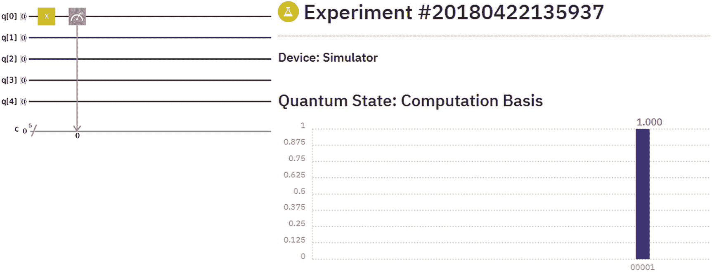

**图 4-4** 代码清单 4-3 的 Composer 实验

图 4-4 展示了代码清单 4-3 的量子电路，包括实验结果以及附带的概率。可以看到这个电路非常简单：在 Composer 中，将一个 X 门拖到量子比特 0 上，然后对同一个量子比特执行测量。你会发现 Composer 是一个很棒的工具，可以用来构建相对简单的电路、执行它们并可视化其结果！现在，让我们深入了解一下 SDK 的内部机制，看看这段代码在幕后是如何被处理的。

### SDK 内部：电路编译与 QASM

图 4-5 展示了程序运行时的幕后情况：

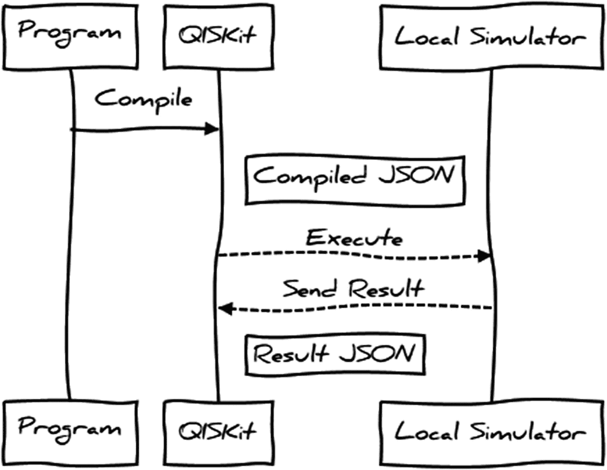

**图 4-5** 程序、QISKit 和本地模拟器之间的时序图

*   QISKit 将你程序的电路编译成 JSON 文档提交给本地模拟器。
*   模拟器解析该文档，运行电路，并返回一个不透明的 JSON 文档（对开发者隐藏）。
*   QISKit 将结果 JSON 文档封装在一个对象中，供主程序使用。例如，调用 `result.get_counts('Circuit')` 会从该文档中提取计数信息。


#### 电路编译

`清单 [4-4]` 展示了提交给模拟器之前的已编译程序格式。该文档由以下部分组成：

*   一个执行 `id`
*   一个包含模拟器信息的头部，包括名称、执行中使用的信用点数以及运行交互次数（`shots`）
*   电路部分包含一个电路对象数组。每个电路由以下部分组成：
    *   电路名称
    *   一个包含信息的头部（`config`），例如量子比特耦合图、基础（物理）门、运行时种子等
    *   一个已编译的电路部分，其头部包含关于量子比特和经典寄存器的信息，以及应用于该电路的操作（或门）数组及其参数

```
{
"id": "aA46vJHgnKQko3u5L1QqbUDk31sY2m",
"config": {
"max_credits": 10,
"backend": "local_qasm_simulator",
"shots": 1024
},
"circuits": [{
"name": "Circuit",
"config": {
"coupling_map": "None",
"layout": "None",
"basis_gates": "u1,u2,u3,cx,id",
"seed": "None"
},
"compiled_circuit": {
"operations": [{
"name": "u3",
"params": [3.141592653589793, 0.0, 3.141592653589793],
"texparams": ["\\pi", "0", "\\pi"],
"qubits": [0]
}, {
"name": "measure",
"qubits": [0],
"clbits": [0]
}],
"header": {
"number_of_qubits": 1,
"qubit_labels": [
["qr", 0]
],
"number_of_clbits": 1,
"clbit_labels": [
["cr", 1]
]
}
},
"compiled_circuit_qasm": "OPENQASM 2.0;\ninclude \"qelib1.inc \";\nqreg qr[1];\ncreg cr[1];\nu3(3.14159265358979,0,3.14159265358979) qr[0];\nmeasure qr[0] -> cr[0];\n"
}]
}
```

要在程序中显示已编译的电路，请按如下命令打印编译步骤的结果：

```
qobj = qp.compile(circuits, backend)
print(str(qobj))
```

###### 注意

编译格式对程序员是不透明的，不应直接访问，而应通过 SDK API 访问。原因是它的格式可能因版本而异。然而，理解后台发生的事情总是有益的。

#### 执行结果

这是从本地模拟器返回到 QISKit 的响应文档。此文档的格式如 `清单 [4-5]` 所示。值得注意的信息包括：

*   运行状态、执行时间、模拟器名称等。
*   结果数据。这是程序中通过调用以下代码获得的信息：`print (str(result.get_counts('Circuit')))`。

```
{
"backend": "local_qiskit_simulator",
"id": "aA46vJHgnKQko3u5L1QqbUDk31sY2m",
"result": [{
"data": {
"counts": {
"1": 1024
},
"time_taken": 0.0780002
},
"name": "Circuit",
"seed": 123,
"shots": 1024,
"status": "DONE",
"success": true,
"threads_shot": 4
}],
"simulator": "qubit",
"status": "COMPLETED",
"success": true,
"time_taken": 0.0780002
}
```

获取结果文档稍微有点棘手，因为它是一个不透明的对象，不会暴露给用户程序。尽管如此，你可以保存上一节中的已编译电路，然后手动将其输入到模拟器中，以获得 `清单 [4-5]` 所示的结果。不过，这个任务就留给你自己完成了。需要记住的重要一点是，结果文档（以及编译格式）对程序员是不透明的。原因是它们的格式可能会随着时间的推移而改变；然而，理解幕后的工作原理总是有帮助的。

###### 提示

编译和结果格式对于模拟器开发者很有用。例如，你可以为示例电路保存编译和结果格式，修复 C++ 模拟器中的一个错误，输入该结果，并比较结果。这样，你的模拟器就可以轻松地与 SDK 集成，供我们其他人使用。

#### 汇编代码

`清单 [4-4]` 中的已编译电路包含一个部分，该部分将程序翻译成量子汇编（QASM），如下一段所示。

```
OPENQASM 2.0;
include "qelib1.inc";
qreg qr[1];
creg cr[1];
x qr[0];
measure qr[0] -> cr[0];
```

###### 提示

QASM 仅在 IBM Q Experience 提供的远程模拟器中运行时才有效。

#### QISKit 本地模拟器

在 IBM Q Experience 中访问真实的量子设备受到信用点系统的限制，该系统会随着使用而减少；因此，我们不应该运行像 `清单 [4-3]` 这样琐碎的程序。为此，QISKit 打包了大量的模拟器，以满足你所有的测试需求。`表 [4-1]` 提供了截至编写本文时，通过 QISKit 和 IBM Q Experience 可用的本地和远程模拟器列表。

**表 4-1** IBM Q Experience 的本地和远程模拟器列表

| 名称 | 描述 |
| --- | --- |
| `local_qasm_simulator` | 这是 QISKit 附带的默认 Python 模拟器。它非常慢，但能完成任务。 |
| `local_clifford_simulator` 也称为 `local_qiskit_simulator` | 一个用 C++ 编写的高性能模拟器，具有逼真的噪声和误差模拟。 |
| `ibmqx_qasm_simulator` | Q Experience 提供的一个 24 量子比特高性能远程 QASM 模拟器。这是默认的远程模拟器。 |
| `ibmqx_hpc_qasm_simulator` | Q Experience 提供的一个 32 量子比特、功能极其强大的并行模拟器。这是默认远程模拟器的备份。 |

作为一个简单的练习，可以通过将以下 REST API URL 粘贴到浏览器中来获取 IBM Q Experience 模拟器和真实设备的列表：

```
https://quantumexperience.ng.bluemix.net/api/Backends?access_token=ACCESS_TOKEN.
```

当然，你需要一个访问令牌，可以通过第 [3] 章的远程访问 API 轻松获得。接下来，让我们在其他本地模拟器（包括 IBM Q Experience 远程模拟器）中运行我们的程序。最后，让我们对运行进行计时，看看哪个模拟器最快。

#### 在本地 C++ 模拟器中运行

QISKit 默认使用纯 Python 模拟器（`local_qasm_simulator`）。但是，你也可以通过将程序的后端名称更改为 `local_clifford_simulator` 或 `local_qiskit_simulator`（`清单 [4-3]` 中的第 35 行）来使用具有逼真噪声和错误率的快速 C++ 模拟器。然而，在使用它之前，需要记住一些注意事项：

*   **Linux 用户**：此模拟器使用需要 `gcc` 5.3 或更高版本的 C++11 标准。事实上，该模拟器在我的 CentOS 6 和 7 系统上无法构建。（在这种情况下，你可能需要使用 Windows）。
*   **Windows 用户**：Python 使用 `CMake` 实用程序动态构建模拟器。总之，默认源码不提供用于在 Windows 上构建的 Visual Studio 解决方案。尽管如此，我花时间提供了一个解决方案，并修复了我在 Windows 7 中遇到的几个崩溃问题。

###### 提示

C++ 模拟器的 Windows 64 位二进制文件可以在本书的源码 `Ch04\qiskit-simulator\qiskit-simulator\x64\Debug` 下找到。如果你希望自己构建，还提供了一个 Visual Studio 2017 解决方案。如果缺少文件，请确保将此文件夹中的所有文件复制到 `PYTHON-HOME\Lib\site-packages\qiskit\backends` 目录下。

#### 在远程模拟器中运行

为了在 IBM Q Experience 提供的远程模拟器中运行，需要对 `清单 [4-3]` 进行一些更改。让我们看看如何操作：

我们首先需要的是一个 IBM Q Experience 配置描述符，其中包含如下一段所示的执行参数：

```
APItoken = 'YOU-API-TOKEN'
config = {
'url': 'https://quantumexperience.ng.bluemix.net/api',
##### 以下内容仅 IBM Q 用户可能需要。
'hub': 'MY_HUB',
'group': 'MY_GROUP',
'project': 'MY_PROJECT'
}
```


好的，作为一名高级文档工程师和翻译员，我将遵循您的所有注意事项，将给定的英文文本翻译成中文。


###### 提示

上述代码应保存在一个单独的文件（`Qconfig.py`）中，并与主程序放在同一文件夹内。从 IBM Q Experience Web 控制台获取您的 API 令牌（如第 3 章所示），并将其粘贴到代码中。请注意，`hub`、`group` 和 `project` 仅对企业客户是必需的。

接下来，将上述描述符导入主程序：

```python
##### Q Experience config
import Qconfig
##### Main sub
def main():
```

最后，将执行后端切换到远程模拟器：

1.  将后端名称更改为 `ibmq_qasm_simulator`。
2.  通过系统调用 `qp.set_api(Qconfig.APItoken, Qconfig.config['url'])` 设置 API 参数，以告知量子程序使用 IBM Q Experience。其中 `APItoken` 和 `URL` 的值来自配置描述符。
3.  在 IBM Q Experience 中使用系统调用执行：`result = qp.execute(circuits, backend, shots=512, max_credits=3)`。请注意，我们不再像之前那样编译和运行电路。因此，您必须移除对 `qobj = qp.compile(circuits, backend)` 和 `result = qp.run(qobj, wait=2, timeout=240)` 的调用。

更改内容如下面的命令所示。确保您移除了旧的编译和运行调用，否则程序将运行失败：

```python
backend = 'ibmqx_qasm_simulator'
##### Group of circuits to execute
circuits = ['Circuit']
##### set the APIToken and Q Experience API url
qp.set_api(Qconfig.APItoken, Qconfig.config['url'])
result = qp.execute(circuits, backend, shots=512, max_credits=3, wait=10, timeout=240)
```

最后，执行并测试。输出应类似于：

```
DEBUG:qiskit.backends._qeremote:Running on remote backend ibmq_qasm_simulator with job id: 3677ff592e5e5a6fd31a569b0b4faf92
INFO:qiskit._jobprocessor:
{'1': 512}
```

现在，让我们将所有这些整合起来，看看谁是最快的模拟器。我赌 C++。

#### 最快模拟器与执行时间对比

我已经收集了在一台运行 Windows 7 的 x64 机器上所有模拟器的执行时间。令人难以置信的是，最快的模拟器是 IBM Q Experience 远程模拟器，紧随其后的是纯 Python 模拟器，而最后一名是我个人最喜欢的：C++（见图 4-6）。

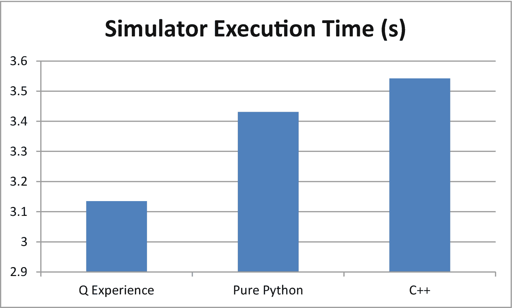

图 4-6 — QISKit 模拟器的执行时间

尽管调用需要通过网络，但 IBM Q Experience 远程模拟器仍然能够超越其他模拟器。让我感到费解的是，一个解释型 Python 模拟器竟然能比原生代码实现的模拟器更快。这可能是因为原生调用使用了异步任务来生成 C++ 模拟器进程，从而使得速度减慢，以至于 Python 代码能够超越它。现在您已经学会了如何在模拟器中运行程序，接下来让我们在真实的设备上操作。

### 在真实量子设备上运行

让我们修改上一节的程序，来创建一个更复杂的电路。清单 4-6 展示了一个示例电路，它对量子计算机的第一个量子比特执行了一系列旋转操作。这些旋转演示了真实量子处理器 `ibmqx4` 的物理门（`u1`、`u2` 和 `u3`）的用法，用于将单个量子比特在 Bloch 球体的 X、Y 和 Z 轴上旋转 `theta`、`phi` 或 `lambda` 度。

###### 提示

Bloch 球体是单个量子比特的几何表示，其中 Z 轴的顶部代表基态 |0>，底部代表基态 |1>。绕给定轴旋转代表在测量时量子比特坍缩到某个特定方向的概率（见图 4-7）。

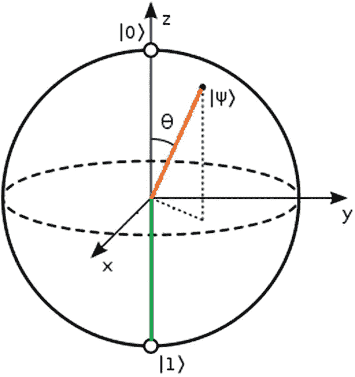

图 4-7 — 量子比特的 Bloch 球体表示

物理门（也称为基础门）非常重要，因为它们构成了构建更复杂逻辑门的基础。因此，清单 4-6 执行了以下步骤：

- 它分配了 5 个量子比特和五个经典测量寄存器，对应于 Q Experience 中 `ibmqx4` 处理器可用的 5 个量子比特（第 17-20 行）。
- 接下来，使用基础门 `u1`、`u2` 和 `u3` 对第一个量子比特执行一系列旋转操作（第 29-34 行）。
- 最后，对量子比特执行一次测量，并将结果存储在经典寄存器中。
- 在执行之前，将后端设置为 `ibmqx4`（一个 5 量子比特处理器——第 42 行），并通过 `set_api(Qconfig.APItoken, Qconfig.config['url'])` 设置认证令牌和 API URL。
- 要在真实的量子设备上执行，请使用 `QuantumProgram` 执行系统调用 `execute(NAMES, BACKEND, shots=SHOTS, max_credits=CREDITS, timeout=TIMEOUT)`，其中：
    - `NAMES` 是一个电路名称列表。
    - `SHOTS` 是电路执行的迭代次数。次数越高，精度越高。
    - `CREDITS` 是您希望从执行账户中扣除的最大积分点数（默认启动数为 15）。请注意，执行的 shot 次数越多，从您的账户中扣除的积分就越多。请在积分用完之前牢记这一点。
    - `TIMEOUT` 是从远程端点的读取超时时间。

###### 注意

针对真实设备执行的 Python 量子程序/实验不会记录在 IBM Q Experience 的 Composer-Scores 部分。这是因为 Python 在后台使用了 Jobs REST API，该 API 会将实验放入执行队列中。如果您希望在 Composer 中记录您的执行，您可以使用 Web 控制台或 REST API，如下一节所示。

```python
import sys,time,math
import qiskit
import logging
from qiskit import QuantumProgram
##### Q Experience config
import Qconfig
##### Main sub
def main():
# create a  program
qp = QuantumProgram()
##### create 1 qubit
quantum_r = qp.create_quantum_register("qr", 5)
##### create 1 classical register
classical_r = qp.create_classical_register("cr", 5)
##### create a circuit
circuit = qp.create_circuit("Circuit", [quantum_r], [classical_r])
##### enable logging
qp.enable_logs(logging.DEBUG);
##### first physical gate: u1(lambda) to qubit 0
circuit.u2(-4 *math.pi/3, 2 * math.pi, quantum_r[0])
circuit.u2(-3 *math.pi/2, 2 * math.pi, quantum_r[0])
circuit.u3(-math.pi, 0, -math.pi, quantum_r[0])
circuit.u3(-math.pi, 0, -math.pi/2, quantum_r[0])
circuit.u2(math.pi, -math.pi/2, quantum_r[0])
circuit.u3(-math.pi, 0, -math.pi/2, quantum_r[0])
##### measure gate from qubit 0 to classical bit 0
circuit.measure(quantum_r[0], classical_r[0])
circuit.measure(quantum_r[1], classical_r[1])
circuit.measure(quantum_r[2], classical_r[2])
##### backend
backend = 'ibmqx4'
##### Group of circuits to execute
circuits = ['Circuit']
##### set the APIToken and Q Experience API url
qp.set_api(Qconfig.APItoken, Qconfig.config['url'])
result = qp.execute(circuits, backend, shots=512, max_credits=3, timeout=240)
##### Show result counts
print ("Job id=" + str(result.get_job_id()) + " Status:" + result.get_status())
###########################################
if __name__ ==  '__main__':
start_time = time.time()
main()
print("--- %s seconds ---" % (time.time() - start_time))
```

清单 4-6 – 示例电路 #2


#### 作曲家的量子电路

`清单 [4-6]` 中的程序也可以在 IBM Q Experience Composer 中通过其流畅的拖放用户界面创建。只需将量子门拖入量子位直方图中，如`图 [4-8]`所示，设置门的参数，最后保存并在模拟器或真实设备上运行。

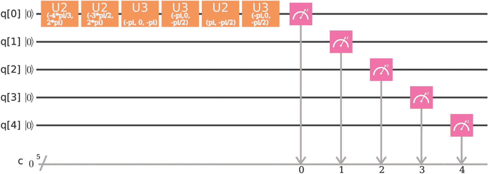

**图 4-8** – `清单 [4-6]`在 Q Experience Composer 中的电路图

对于那些偏爱汇编强大功能的用户，Composer 允许将代码直接复制粘贴到汇编模式的控制台中，如`图 [4-9]`所示。它甚至能解析代码中的任何语法错误，并显示有问题的行。

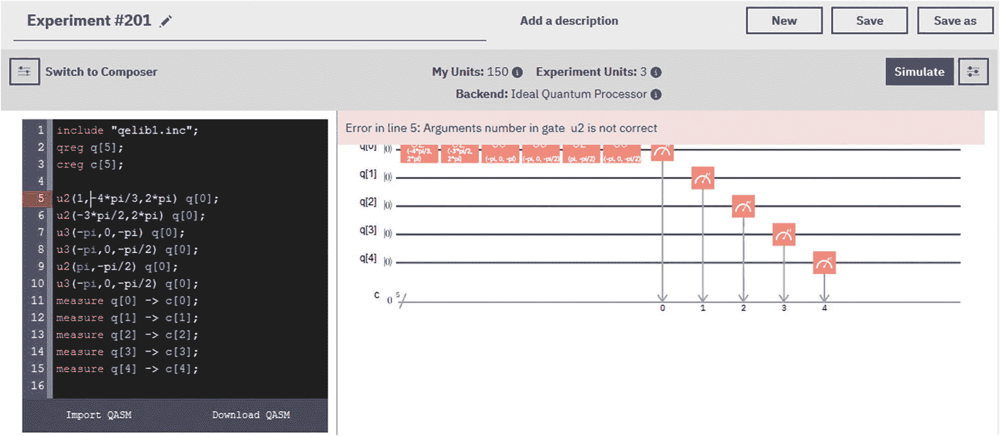

**图 4-9** – `图 [4-8]`中电路的汇编模式 Composer

在 IBM Q Experience 中有多种执行实验的方法；其中最有意思的一种是使用其强大的 REST API。

### 通过你喜爱的 REST 客户端执行

这是与 Q Experience 交互的最激动人心的方式之一。通过使用简单的 REST 请求，你几乎可以完成在 Python 或 Composer 中能做的所有事情：

*   列出后端设备。
*   列出真实设备的硬件或校准参数。
*   获取作业执行队列的信息。
*   获取作业或实验的状态。
*   提交或取消作业。
*   执行实验并将其记录在 Composer 的分数部分。

> **提示：** REST API 允许你使用任何语言来创建你自己的 Q Experience 接口（甚至是一个 Web 浏览器）。该 API 在`第 [3] 章`中有详细描述。

使用 REST 提交实验有两种方法：通过 Jobs API 和 Execute API。让我们来看看具体方法。

#### 通过 Jobs API 运行

你可以使用你最喜欢的浏览器 REST 客户端来提交`清单 [4-6]`中的实验。例如，使用 Chrome 的 YARC（Yet Another REST Client）创建一个 HTTP POST 请求到端点：

```
https://quantumexperience.ng.bluemix.net/api/Jobs?access_token=ACCESS_TOKEN
```

棘手的部分是获取你的访问令牌或访问密钥。为此，你必须使用你的 API 令牌或用户名和密码进行身份验证。请注意，API 令牌与访问令牌不同。要获取访问令牌，你必须执行一个身份验证请求。（请参阅`第 [3] 章`中的“通过 REST API 进行远程访问”部分。）

> **提示：** Chrome 的 YARC 允许你构建 REST 请求并将其保存为收藏夹。按照`第 [3] 章`中的描述，创建一个对 IBM Q Experience 的身份验证请求，将其保存为收藏夹，然后每次使用它来获取访问令牌以测试其他 REST API 调用。

请求负载是一个 JSON 文档，如`清单 [4-7]`所示。其格式在`表 [4-2]`中进行了描述。

**表 4-2** – Jobs API 的请求格式

| 键 | 描述 |
| --- | --- |
| `qasms` | 这是一个汇编代码程序的数组，所有代码在一行中，由换行符（`\n`）分隔。 |
| `Shots` | 你的代码将进行的迭代次数。 |
| `backend` | 这是一个描述后端（此处为 `ibmqx4`）的对象。 |
| `maxCredits` | 这是将从你的账户余额中抵扣的信用点数的提示值。 |

```
{
"qasms": [{
"qasm": "\n\ninclude \"qelib1.inc\";\nqreg q[5];\ncreg c[5];\nu2(-4*pi/3,2*pi) q[0];\nu2(-3*pi/2,2*pi) q[0];\nu3(-pi,0,-pi) q[0];\nu3(-pi,0,-pi/2) q[0];\nu2(pi,-pi/2) q[0];\nu3(-pi,0,-pi/2) q[0];\nmeasure q -> c;\n"
}],
"shots": 1024,
"backend": {
"name": "ibmqx4"
},
"maxCredits": 3
}
```

**清单 4-7** – Jobs API 的 HTTP 请求

一旦你获得了访问令牌，将`清单 [4-7]`中的负载复制粘贴到你的 REST 客户端中，提交，然后等待响应。如果一切顺利，你应该会看到类似于`清单 [4-8]`的响应。

```
{
"qasms": [
{
"qasm": "\n\ninclude \"qelib1.inc\";\nqreg q[5];\ncreg c[5];\nu2(-4*pi/3,2*pi) q[0];\nu2(-3*pi/2,2*pi) q[0];\nu3(-pi,0,-pi) q[0];\nu3(-pi,0,-pi/2) q[0];\nu2(pi,-pi/2) q[0];\nu3(-pi,0,-pi/2) q[0];\nmeasure q -> c;\n",
"status": "WORKING_IN_PROGRESS",
"executionId": "e9d758c3480a54a6455f72c84c5cc2a6"
}
],
"shots": 1024,
"backend": {
"id": "c16c5ddebbf8922a7e2a0f5a89cac478",
"name": "ibmqx4"
},
"status": "RUNNING",
"maxCredits": 3,
"usedCredits": 3,
"creationDate": "2018-04-24T00:12:07.847Z",
"deleted": false,
"id": "33d58594fcb7204e4d2ccdb65cd3c88c",
"userId": "ef072577bd26831c59ddb212467821db"
}
```

**清单 4-8** – Q Experience 的 HTTP 响应

部分响应格式在`表 [4-3]`中进行了描述。

**表 4-3** – Jobs API 的响应格式

| 键 | 描述 |
| --- | --- |
| `qasms` | 一个对象数组，包含：提交的代码。运行时状态：`WORKING_IN_PROGRESS`、`COMPLETED` 或 `FAILED`。代码的执行 ID。 |
| `shots` | 实验的迭代次数。 |
| `backend` | 一个包含后端信息（如名称和 ID）的对象。 |
| `status` | 作业的整体状态：`RUNNING`、`COMPLETED` 或 `FAILED`。 |
| `maxCredits` | 此运行使用的最大信用点数。 |
| `usedCredits` | 此运行实际花费的信用点数。 |
| `creationDate` | 作业创建的日期。 |
| `deleted` | 如果已提交删除作业的请求，则为 `True`，否则为 `false`。注意：已取消或删除的作业将在被清除出队列之前暂留一段时间。 |
| `id` | 此作业的 ID。 |
| `userId` | 所有者的用户 ID。 |

> **提示：** Jobs（以及 Execute）API 目前尚未文档化，且不打算直接访问。因此，响应格式可能会随时间变化。也许将来会有所改变，REST API 将成为官方 SDK 的一部分。但在此之前，你的结果可能与我的不同。

#### 通过 Execute API 运行

这与 Jobs API 的主要区别在于，Execute API 会在 Composer 中注册实验。要了解具体操作，请创建一个 HTTP POST 请求到端点：

```
https://quantumexperience.ng.bluemix.net/api/codes/execute?access_token=TOKEN&shots=1&seed=SEED&deviceRunType=ibmqx4
```

请求的参数是：

*   `access_token`：你的访问令牌
*   `shots`：实验的迭代次数
*   `seed`：仅当在模拟器中运行时才需要的随机执行种子
*   `deviceRunType`：运行实验的设备名称

请求负载如`清单 [4-9]`所示。每个实验都必须包含一个名称。代码类型是 `QASM2`，汇编代码必须写在一行中，由换行符（`\n`）分隔。

```
{
"name": "Experiment #20180410193125",
"codeType": "QASM2",
"qasm": "\n\ninclude \"qelib1.inc\";\nqreg q[5];\ncreg c[5];\nu2(-4*pi/3,2*pi) q[0];\nu2(-3*pi/2,2*pi) q[0];\nu3(-pi,0,-pi) q[0];\nu3(-pi,0,-pi/2) q[0];\nu2(pi,-pi/2) q[0];\nu3(-pi,0,-pi/2) q[0];\nmeasure q -> c;\n"
}
```

**清单 4-9** – Execute API 的 HTTP 请求负载

使用你的 REST 客户端提交请求并等待结果。`清单 [4-10]`显示了实验的简化响应格式。


###### 提示

省去不必要的麻烦。请务必确保设备在线，且提交前 `qasm` 写为包含换行符（`\n`）的单行格式，否则你将遭遇大量问题。请再三检查这一点，否则你的请求大部分时间都会失败。

```
{
"startDate": "2018-04-24T22:31:23.555Z",
"modificationDate": 1524609083555,
"typeCredits": "plan",
"status": {
"id": "WORKING_IN_PROGRESS"
},
"deviceRunType": "real",
"ip": {
"ip": "172.58.152.206",
"country": "United States",
"continent": "North America"
},
"shots": 1,
"paramsCustomize": {},
"deleted": false,
"userDeleted": false,
"id": "1203b1158e6ae537e8b770cb8049a6ae",
"codeId": "e0f5c573eef75581cf16bce4187ecab8",
"userId": "ef072577bd26831c59ddb212467821db",
"infoQueue": {
"status": "PENDING_IN_QUEUE",
"position": 108
},
"code": {
"type": "Algorithm",
"active": true,
"versionId": 1,
"idCode": "e86d38c389f4449e62756922a1aa5729",
"name": "Experiment #201",
"jsonQASM": {
"gateDefinitions": [],
"topology": "3b8e671a5a3b56899e6e601e6a3816a1",
"playground": [
{
"name": "q",
"line": 0,
"gates": [
...
]
},
{
"name": "q",
"line": 4,
"gates": [
{
"name": "measure",
"qasm": "measure",
"position": 10,
"measureCreg": {
"line": 5,
"bit": 4
}
}
]
},
{
"name": "c",
"line": 0
}
],
"numberGates": 7,
"hasMeasures": true,
"numberColumns": 11,
"include": "include \"qelib1.inc\";"
},
"qasm": "\n\ninclude \"qelib1.inc\";\nqreg q[5];\ncreg c[5];\nu2(-4*pi/3,2*pi) q[0];\nu2(-3*pi/2,2*pi) q[0];\nu3(-pi,0,-pi) q[0];\nu3(-pi,0,-pi/2) q[0];\nu2(pi,-pi/2) q[0];\nu3(-pi,0,-pi/2) q[0];\nmeasure q -> c;\n",
"codeType": "QASM2",
"creationDate": "2018-04-24T22:31:22.561Z",
"deleted": false,
"orderDate": 1524609083391,
"userDeleted": false,
"isPublic": false,
"id": "e0f5c573eef75581cf16bce4187ecab8",
"userId": "ef072577bd26831c59ddb212467821db"
}
}
```
*清单 4-10*：Execute API 的响应格式

此响应返回了大量信息，其中大部分数据一目了然。不过，表 4-4 描述了最重要的值。

**表 4-4**：Execute API 返回的杂项信息

| 键 | 说明 |
| --- | --- |
| `status` | 执行的状态。可以是以下之一：`WORKING_IN_PROGRESS`（正在工作中）、`COMPLETED`（已完成）或 `FAILED`（失败）。 |
| `deviceRunType` | 实验运行的设备：`real`（真实设备）或 `simulator`（模拟器）。 |
| `infoQueue` | 关于执行队列的信息，包括：• 状态：`PENDING_IN_QUEUE`（在队列中等待）。• 在队列中的位置。 |
| `code` | 实验的详细描述，包括：• 量子门、参数、位置等。• 汇编代码。• 杂项信息，如名称、类型、状态、版本等。 |

###### 提示

收到响应后，登录 IBM Q Experience 控制台。实验名称应显示在 Composer 的 Quantum Scores（量子分数）部分中。

## 量子汇编：幕后的力量

你可能已经意识到，在 Composer 或 REST 客户端中执行实验时，幕后发生了什么。电路被翻译成量子汇编（QASM），然后在真实设备或模拟器中执行。量子汇编是高级 Python 代码的中间表示，是 IBM Q Experience 与开源社区合作的成果。

###### 提示

QASM 基于其经典汇编的同类语言，后者在某种程度上已成为一门失传的艺术。但 QASM 并没有它的同类语言那么可怕。事实上，它仅基于经典汇编语法的一个子集。

从形式上讲，你的 Python 程序或 Q Experience 电路的生命周期可以描述为计算中量子部分与经典部分的交叉，包含以下步骤：

*   **编译**：这是一个离线步骤，发生在经典计算机上。当 Python 或 Composer 电路运行时，经典编译器将高级表示（例如 Python）翻译成 QASM 中间表示。此步骤具有以下特点：
    *   特定的问题参数尚不可知。
    *   无需与量子计算机交互。
    *   可以将经典过程编译成目标代码并进行初步优化。例如，清单 4-6 中的 Python 程序及对应的 Composer 电路被翻译成清单 4-11 所示的汇编代码。

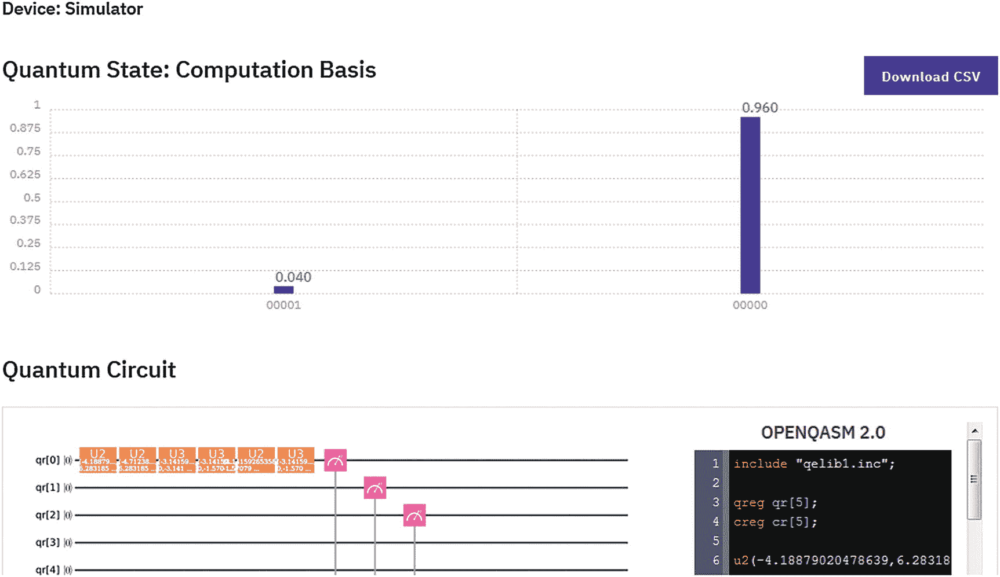

*图 4-10*：清单 4-6 的电路生命周期的后处理结果

*   **电路生成**：上一步的 QASM 被输入到电路生成阶段。此步骤发生在已知特定问题参数的经典计算机上，并且可能与量子计算机发生一些交互。此步骤具有以下特点：
    *   这是一个在线阶段（发生在量子计算机上）。
    *   输出是量子电路或量子基本块的集合，以及运行时需要的关联经典控制指令和经典目标代码。

*   **执行**：此步骤发生在物理量子计算机上。输入是使用量子电路中间表示表达的量子电路集合。这些电路在底层控制器上执行，输出是从高层控制器返回的测量结果集合。

*   **后处理**：此步骤发生在经典计算机上，接收经过处理的测量结果集合。输出是量子计算的最终结果（见图 4-10）。

```
include "qelib1.inc";
qreg qr[5];
creg cr[5];
u2(-4.18879020478639,6.28318530717959) qr[0];
u2(-4.71238898038469,6.28318530717959) qr[0];
u3(-3.14159265358979,0,-3.14159265358979) qr[0];
u3(-3.14159265358979,0,-1.57079632679490) qr[0];
u2(3.14159265358979,-1.57079632679490) qr[0];
u3(-3.14159265358979,0,-1.57079632679490) qr[0];
measure qr[0] -> cr[0];
measure qr[1] -> cr[1];
measure qr[2] -> cr[2];
```
*清单 4-11*：对应清单 4-6 中 Python 代码的 QASM 代码

总而言之，量子汇编的语法并没有其经典版本那么可怕；事实上，直接用量子汇编编程比使用 Python 更简单、更快捷。下一节将介绍一些简单技巧，供你决定直接使用 QASM 编码时使用：

*   始终从包含头文件 `include "qelib1.inc"` 开始。其中包含 Q Experience 硬件原语（量子门）。该库中提供的门在表 4-5（单量子比特门）和表 4-6（多量子比特门）中进行了描述。

**表 4-6**：量子汇编提供的多量子比特门


好的，作为一名高级文档工程师和翻译员，我将严格遵循您提供的格式和注意事项，将给定的英文文本翻译成中文。


| 名称 | 描述 |
| --- | --- |
| `cx c,t` | 受控非门：当且仅当控制量子比特 (`c`) 为 1 时，翻转第二个量子比特 (`t`)。用于纠缠两个量子比特。 |
| `cz a,b` | 受控相位门：当且仅当控制量子比特 (`a`) 为 1 时，应用相位旋转。 |
| `cy a,b` | 受控 Y 门：当且仅当控制量子比特 (`a`) 为 1 时，应用泡利 Y 旋转。 |
| `ch a,b` | 受控 H 门：当且仅当控制量子比特 (`a`) 为 1 时，将量子比特 (`b`) 置于叠加态。 |
| `ccx a,b,c` | 3 量子比特托佛利门：当且仅当量子比特 `a` 和 `b` 均为 1 时，翻转量子比特 `c`。 |

**表 4-5**

**量子汇编语言提供的单量子比特门**

| 名称 | 描述 |
| --- | --- |
| `u3(theta,phi,lambda)` | 三参数双脉冲单量子比特门。 |
| `u2(phi,lambda)` | 双参数单脉冲单量子比特门。 |
| `u1(lambda)` | 单参数单脉冲单量子比特门。 |
| `Id` | 等同于单位矩阵或 `u(0,0,0)`。 |
| `X` | 泡利 X 或 σ[x] (sigma-x) 或比特翻转。 |
| `Y` | 泡利 Y 或 σ[y] (sigma-y)。 |
| `Z` | 泡利 Z 或 σ[z] (sigma-z)。 |
| `rx(theta)` | 绕 X 轴旋转 `theta` 度。 |
| `ry(theta)` | 绕 Y 轴旋转 `theta` 度。 |
| `rz(Phi)` | 绕 Z 轴旋转 `theta` 度。 |
| `H` | 阿达马门：将单量子比特置于态叠加中。 |
| `S` | Z 的平方根门：`sqrt(Z)` 相位门。 |
| `Sdg` | S 共轭转置门：S 的复共轭。代数学上定义为 `sqrt(z)` 的转置矩阵的复共轭。 |
| `T` | `sqrt(S)` 相位门。 |
| `Tdg` | T 共轭转置门或 `sqrt(S)` 的复共轭。 |

- 声明量子比特寄存器（数组）很简单。例如，声明一个由 5 个量子比特组成的寄存器：`qreg qr[5];` 注意：所有指令均以分号分隔。

- 要声明一个由 5 个经典比特组成的寄存器，请使用 `creg cr[5];`

- 要对特定量子比特应用门，只需输入门名称和目标量子比特。例如，要将第一个量子比特置于叠加态（用于量子数生成器），请使用 `h q[0];`

- 程序的最后一步应始终是对量子比特进行测量。例如，要测量我们的叠加量子比特并将其存储在第一个经典寄存器中，请使用 `measure qr[0] -> cr[0];`

请注意，量子计算机是概率性机器；因此无法知道量子比特的确定状态（量子力学禁止这样做）。我们所能得到的仅仅是量子比特处于 0 或 1 状态的概率。对于前文中量子比特零 `h q[0]` 的简单量子数生成器，我们可以将状态 1 的概率用作我们的随机数。如 4-9 图所示，当汇编代码执行后收集结果时，可以在 IBM Q Experience Composer 显示的精美图表中看到这一点。

您已经迈出了作为云端量子程序员这一新职业的第一步。通过使用高级 Python SDK 和强大的量子汇编引擎，可以在令人惊叹的 IBM Q Experience 平台上运行实验。当量子计算机开始加入数据中心时，这些技能在未来几年将会非常有价值。在下一章中，我们将通过一组展示量子力学在计算中近乎神奇力量的算法，将事情提升到一个新的水平。请继续阅读。

