# 5. 启动引擎：从量子随机数到隐形传态，在超密编码处进站

本章将带您领略量子系统三种卓越的信息处理能力。我们从一个最简单的程序开始，探索量子力学本质上的随机性作为真正随机性的来源。接下来，本章将着眼于两个或许令人兴奋但相互关联的程序：超密编码和量子隐形传态。在超密编码中，您将学习如何使用单个量子比特发送 2 个经典比特的信息。在量子隐形传态中，您将学习如何通过混合经典-量子信息传输过程来重建一个量子比特的量子态。所有算法都包括针对 IBM Q Experience Composer 的电路设计以及 Python 和 QASM 代码。将收集结果用于展示和分析，那么让我们开始吧。

## 量子随机数生成

在本节中，您将学习如何利用量子计算机的概率性质，通过阿达马门生成随机比特或数字。

### 使用阿达马门生成随机比特

阿达马门是任何量子信息系统中的基本门之一。它用于将量子比特置于态的叠加中。代数学上，它由以下矩阵描述

```
H = 1/√2 * [[1, 1], [1, -1]]
```

为了更好地理解该矩阵如何将量子比特置于叠加态，请考虑单个量子比特的几何表示：

在图 5-1 中，量子比特的基态使用右矢符号描述，其中 `|0⟩ = [1, 0]` 且 `|1⟩ = [0, 1]`。从前一章中可知，右矢只是一个酉向量（长度为 1 的向量）。因此，一般态（或叠加态）由酉向量 ψ = α|0⟩ + β|1⟩ 定义，其中 α 和 β 是复系数。将 H 应用于基态，得到

```
H|0⟩ = 1/√2 * [[1, 1], [1, -1]] * [1, 0] = 1/√2 * [1, 1] = 1/√2 ( [1, 0] + [0, 1] ) = (|0⟩ + |1⟩) / √2
```

```
H|1⟩ = 1/√2 * [[1, 1], [1, -1]] * [0, 1] = 1/√2 * [1, -1] = 1/√2 ( [1, 0] - [0, 1] ) = (|0⟩ - |1⟩) / √2
```

对于叠加态 ψ：

```
ψ = α|0⟩ + β|1⟩ → α * ((|0⟩ + |1⟩) / √2) + β * ((|0⟩ - |1⟩) / √2) = (α + β) / √2 * |0⟩ + (α - β) / √2 * |1⟩
```

总而言之，阿达马门扩展了量子电路可能达到的状态范围。这一点很重要，因为状态的扩展创造了找到捷径的可能性，从而实现更快的计算。

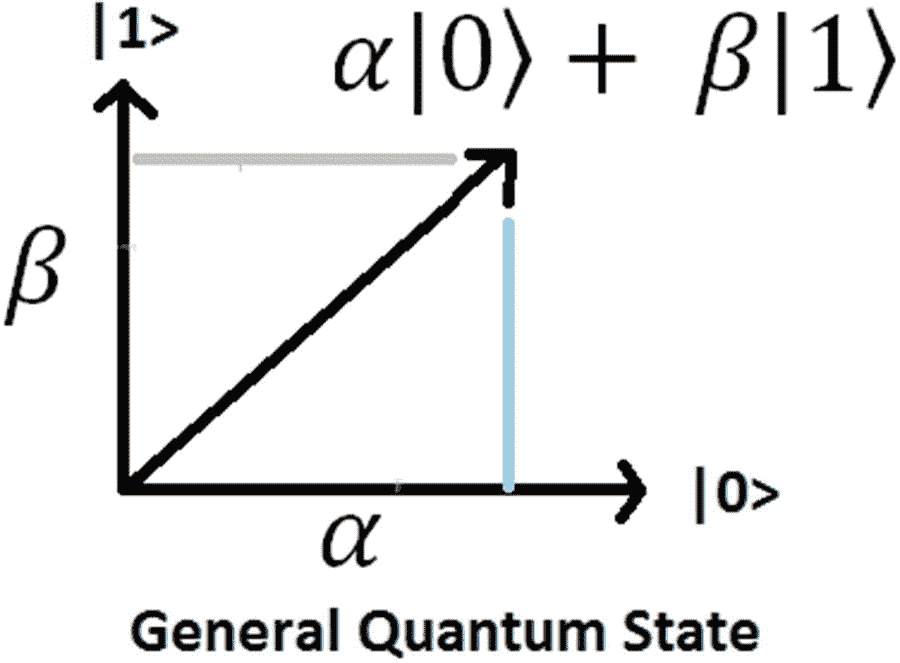

**图 5-1**  
量子比特一般（叠加）态 ψ 的几何表示


###### 提示

量子力学指出，即使完全掌握物理定律或粒子的初始条件，我们也无法确定性地预测前述基态中系数`α`和`β`的值。我们最多能做的就是计算概率。

基于这一原理，随机比特生成器电路的实现可谓简单至极。在 IBM Q Experience Composer 中，创建一个电路：为第一个量子比特添加一个 Hadamard 门，然后按图 5-2 所示在基态下执行测量。

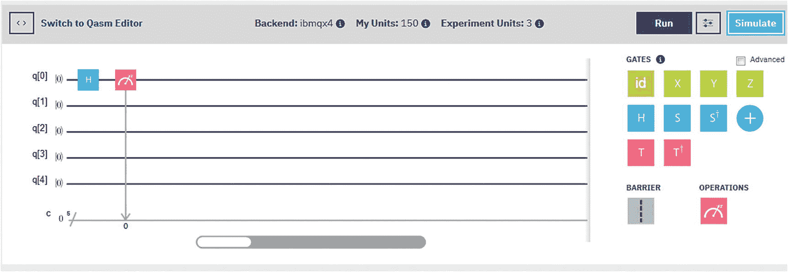

图 5-2：随机比特生成电路

不建议在实际设备上运行此电路，因为可能需要等待一段时间（请注意，执行任务需要排期，等待时间取决于运行队列中的任务数量）。此外，在实际设备上每次执行都会消耗您的积分。建议在模拟器上运行该电路以立即获得结果（见图 5-3）。请注意，每个结果（0 或 1）出现的概率均为 ½，因此我们可以这样生成随机比特：如果结果为`1`的概率 > ½，则输出 1，否则输出 0。

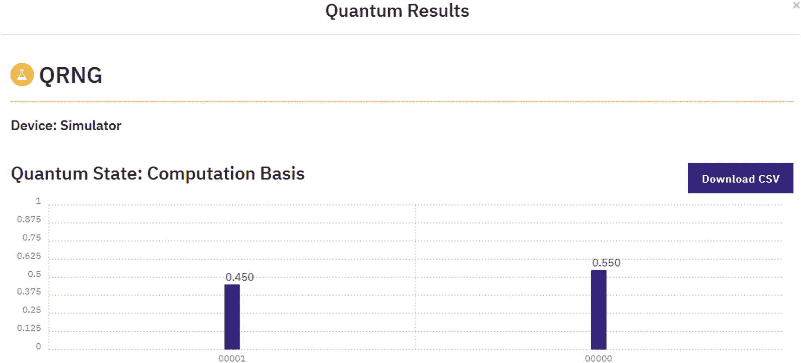

图 5-3：图 5-2 中电路的执行结果

当然，这是一种效率极低的随机比特生成方式。更好的方法是编写一个 QISKit Python 脚本，以编程方式创建电路来完成此任务。代码清单 5-1 展示了一个简单脚本，它使用`x`个量子比特生成`n`个随机数，其中比特位数为`2^x`。默认情况下，该脚本使用 3 个量子比特生成 10 个 8 位随机数，即`n = 10`且`x = 3`，对应`2³ = 8`。让我们来仔细分析：

*   第 12 行定义函数`qrng`，用于创建使用`n`个量子比特的电路。
*   使用 QISKit API，第 15-21 行创建了一个包含`n`个量子比特和`n`个经典寄存器的`QuantumProgram`，用于存储测量结果。
*   对所有量子比特应用 Hadamard 门，然后对每个量子比特执行测量，最后将结果存入经典寄存器`n`（第 30-35 行）。
*   通过系统调用`set_api(API-TOKEN, URL)`将电路编译后，在 Q Experience 远程模拟器上运行。请注意，您需要使用包含 API 令牌和端点 URL 的配置描述符。电路执行后，收集结果计数（第 40-51 行）。
*   最后，查看结果计数以生成随机比特。例如，给定结果`{'100': 133, '101': 134, '011': 131, '110': 125, '001': 109, '111': 128, '010': 138, '000': 126}`。对于每个结果，如果其计数大于平均概率，则得到 1，否则得到 0。平均概率通过将总执行次数（本例中为 1024）除以结果总数（`2^x`，其中`x`是量子比特数，默认为 3 – 1024/8 = 128）计算得出。因此，对于上述结果：

| `133` | `1` |   |   |   |
| `134` | `1` |   | `11100010 = 226` |   |
| `131` | `1` |   |   |   |
| `125` | `0` |   |   |   |
| `109` | `0` |   |   |   |
| `128` | `0` |   |   |   |
| `138` | `1` |   |   |   |
| `126` | `0` |   |   |   |

```
#############################
import sys,time
import qiskit
import logging
from qiskit import QuantumProgram
##### Q Experience config
sys.path.append('../Config/')
import Qconfig
##### Generate an 2**n bit random number where n = # of qubits
def qrng(n):
# create a  program
qp = QuantumProgram()
##### create n qubit(s)
quantum_r = qp.create_quantum_register("qr", n)
##### create n classical registers
classical_r = qp.create_classical_register("cr", n)
##### create a circuit
circuit = qp.create_circuit("QRNG", [quantum_r], [classical_r])
##### enable logging
#qp.enable_logs(logging.DEBUG);
##### Hadamard gate to all qubits
for i in range(n):
circuit.h(quantum_r[i])
##### measure qubit n and store in classical n
for i in range(n):
circuit.measure(quantum_r[i], classical_r[i])
##### backend simulator
backend = 'ibmq_qasm_simulator'
##### Group of circuits to execute
circuits = ['QRNG']
##### Compile your program: ASM print(qp.get_qasm('Circuit')), JSON: print(str(qobj))
##### set the APIToken and Q Experience API url
qp.set_api(Qconfig.APItoken, Qconfig.config['url'])
shots=1024
result = qp.execute(circuits, backend, shots=shots, max_credits=3, timeout=240)
##### Show result counts
##### counts={'100': 133, '101': 134, '011': 131, '110': 125, '001': 109, '111': 128, '010': 138, '000': 126}
counts = result.get_counts('QRNG')
bits = ""
for v in counts.values():
if v > shots/(2**n) :
bits += "1"
else:
bits += "0"
return int(bits, 2)
###########################################
if __name__ ==  '__main__':
start_time = time.time()
numbers = []
##### generate 100 8 bit rands
size = 10
qubits = 3 # bits = 2**qubits
for i in range(size):
n = qrng(qubits)
numbers.append(n)
print ("list=" + str(numbers))
print("--- %s seconds ---" % (time.time() - start_time))
```

代码清单 5-1：生成`2x`位随机数的量子程序

###### 警告

在执行任何程序之前，请务必确保您的配置正确，包括有效的 API 令牌和端点 URL。这是最常见的问题来源。请记住，如果忽略这个关键步骤，程序将运行失败。

代码清单 5-1 的量子电路如图 5-4 所示。该电路使用 3 个量子比特生成一个介于 0 到 255 之间的 8 位随机数。

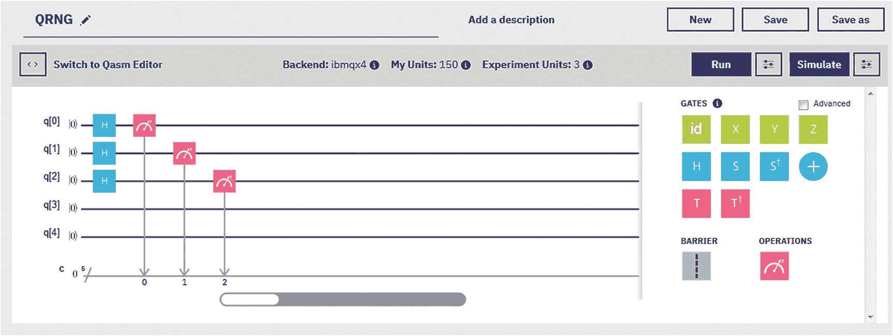

图 5-4：代码清单 5-1 的 Q Experience 电路

让我们从多次运行中收集一些数据，并对结果进行检验。

### 检验随机性结果

Linux 提供了一个便捷的程序`ent`（entropy 的缩写），它被称为伪随机数序列测试程序^(³⁰)。我们可以使用此命令来测试上一节中生成的数字。


好的，作为一名高级文档工程师和翻译员，我将根据您提供的注意事项和示例，将给定的英文文本翻译成中文。


###### 提示

Windows 用户——可从项目网站下载 Windows 32 位二进制文件。本书配套源码中的 `Workspace\Ch05\ent.exe` 也包含了一个二进制文件。

因此，我收集了约 200 个使用清单 5-1 生成的随机 8 位数。使用 `ent`，可以通过命令 `ent [infile]` 对该序列进行测试，如下一段所示。

```
C:\Workspace\Ch05>ent qrnd-stdout.txt
Entropy = 3.122803 bits per byte.
Optimum compression would reduce the size of this 805 byte file by 60 percent.
Chi square distribution for 805 samples is 29149.54, and randomly would exceed this value less than 99.9 percent of the times.
Arithmetic mean value of data bytes is 46.1503 (127.5 = random).
Monte Carlo value for Pi is 4.000000000 (error 27.32 percent).
Serial correlation coefficient is -0.356331 (totally uncorrelated = 0.0).
```

根据作者的说明，卡方检验用于判断随机序列的质量。如果卡方百分比分布小于 1% 或大于 99%，则该序列不合格。我的输出显示百分比为 99.9%，这表明这些数字的随机性很低。这很可能是因为我使用了远程模拟器。该模拟器可能基于默认的 UNIX 随机数生成器（一种质量较差的生成器）。看看你的序列是否表现更好。下表展示了由 `ENT` 的开发者提供的，来自各种确定性和量子源的测试结果对比。

表 5-1

`ENT` 收集的来自不同源的随机性测试结果

| 源 | 卡方百分比 |
| --- | --- |
| UNIX `rand()` | 500,000 个样本为 99.9%（差） |
| Park & Miller 改进的 UNIX 生成器 | 500,000 个样本为 97.53%（较好） |
| HotBits：通过放射性衰变生成的随机数 | 500,000 个样本为 40.98%（最好） |

上表清楚地表明，不应信任 UNIX `rand()` 用于随机数生成。如果需要大量真正的随机数（例如，生成加密密钥），请使用量子源，例如 HotBits。总而言之，本节的目的在于让您通过一个简单的随机数生成量子电路来初步体验。下一节将通过一种名为**超密编码**的奇异量子数据传输协议，将内容提升到新的水平。

## 超密编码

超密编码是一种数据传输协议，它展示了量子系统卓越的信息处理能力。从形式上讲，超密编码是一个简单的过程，它允许使用一个量子比特向另一方传输 2 个经典比特的信息。该协议如图 5-5 所示。

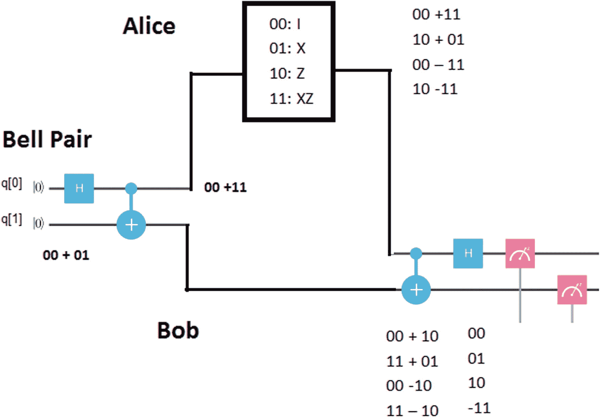

图 5-5

超密编码协议

1.  该过程从一个第三方（Eve）生成所谓的贝尔对开始。Eve 从基态 `|0>` 中的 2 个量子比特开始。她对第一个量子比特应用一个 Hadamard 门以创建叠加态。然后，她使用第一个量子比特作为控制（点），第二个量子比特作为目标（+），应用一个 CNOT 门。这产生了表 5-2 所示的状态。

    表 5-2

    贝尔对状态

    | 门 | 结果状态 | 详情 |
    | --- | --- | --- |
    | H | `∣00⟩ →  ∣ 00⟩+ ∣ 10⟩` | 当 H 门应用于第一个量子比特时，它进入叠加态；因此我们得到状态 00 + 10，其中第二个量子比特保持为 0。请注意，为简化起见，省略了 Hadamard 矩阵中的平方根 (2)。 |
    | CNOT | `∣00⟩+ ∣ 10⟩ →  ∣ 00⟩+ ∣ 11⟩` | CNOT 门将两个量子比特纠缠在一起。特别地，如果控制 (.) 为 1，它会翻转目标 (+)，否则保持不变。因此，如果第一个量子比特为 1，我们翻转第二个量子比特，得到 00 + 11。 |

2.  在该过程的第二步，第一个量子比特被发送给 Alice，第二个发送给 Bob。请注意，Alice 和 Bob 可能位于远程地点。该协议的目标是让 Alice 使用她的量子比特向 Bob 发送 2 个经典比特的信息。但在她这样做之前，她需要根据她想发送的 2 比特信息，对她自己的量子比特应用一组量子规则（或门）。（见表 5-3。）

    表 5-3

    超密编码的编码规则

    | 规则 | 结果状态 |
    | --- | --- |
    | 00: I（单位门）<br>01: X<br>10: Z<br>11: ZX | `I(00+11) = 00 + 11`<br>`X(00+11) = 10 + 01`<br>`Z(00+11) = 00 – 11`<br>`ZX(00+11) = 10 – 11` |

3.  因此，如果她发送 00，她对她自己的量子比特不做任何操作（应用单位门）。如果她发送 01，那么她应用 X 门（或比特翻转）。对于 10，她应用 Z 门。请注意，如果量子比特为 1，Z 门会翻转该量子比特的符号（相位）。因此 `Z | 0⟩ = |0⟩`，`Z | 1⟩ = − | 1⟩`。最后，如果她发送 11，那么她将门 XZ 应用于她的量子比特。然后 Alice 将她的量子比特发送给 Bob 以进行该过程的最后一步。

4.  Bob 接收 Alice 的量子比特（量子比特 0），并使用他自己的量子比特来逆转由 Eve 创建的贝尔状态的过程。也就是说，他将 CNOT 门应用于第一个量子比特，接着应用 Hadamard 门 (H)，最后在两个量子比特上进行测量，以提取编码在 Alice 量子比特中的 2 个经典比特（见表 5-4）。

    表 5-4

    恢复后的量子比特状态

    | 门 | 结果状态 | 详情 |
    | --- | --- | --- |
    | CNOT | `00 + 10`<br>`11 + 01`<br>`00 – 10`<br>`11 – 10` | 我们从第 2 步中 Alice 的状态开始：<br>`00 + 11`<br>`10 + 01`<br>`00 – 11`<br>`10 – 11`<br>CNOT 门在第一个量子比特为 1 时翻转第二个量子比特，从而得到第 #2 列中的状态。 |
    | H | `00`<br>`01`<br>`10`<br>`–11` | 将 Hadamard 应用于最后一行中的第一个量子比特，得到第 #2 列中的结果。当 Bob 在计算基态中进行测量时，他最终会得到四种可能的输出，每个输出概率为 1。这些输出与 Alice 在第 2 步第 #1 列中想要发送的内容相匹配。请注意，最后一个输出带有负号。然而，由于概率是按振幅平方计算的，–1 变成了 1，这是正确的。 |

让我们在 IBM Q Experience Composer 的一个电路中把所有这些整合起来。

### Composer 的电路

图 5-6 展示了超密编码电路以及 Composer 中的量子汇编代码：

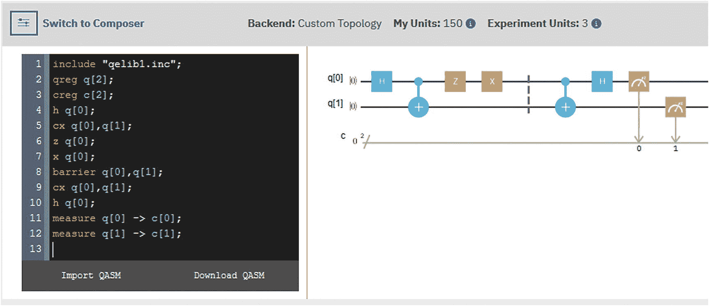

图 5-6

用于 Q Experience 的超密编码电路

- 电路首先创建贝尔对；也就是说，它将 `qubit[0]` 置于叠加态（使用 Hadamard 门），然后通过 CNOT 门将其与 `qubit[1]` 纠缠在一起。

- 接下来的两个门代表 Alice 的编码规则。记住，她应用单位门（不做任何操作）来编码比特 00，应用 X 来编码 01，应用 Z 来编码 10，应用 ZX 来编码 11。在这个特定示例中，编码的比特是 11。这在图 5-6 中屏障符号的左侧显示。请注意，屏障将阻止执行，直到两个量子比特的所有门都被消耗完毕。

- 在屏障符号的右侧，是 Bob 的协议。他基本上执行与 Alice 相反的操作。他对量子比特应用 CNOT 门，然后应用 Hadamard 门。最后，在两个量子比特上进行测量，以提取编码后的 2 个经典比特。

在模拟器中运行上述电路，结果应该是一个条形图，其中输出 11 的概率非常接近或等于 1。该结果应与下一节使用 Python 脚本获得的结果相匹配。


### 使用 Python 远程运行

清单 5-2 展示了图 5-6 中电路对应的 Python 脚本：

-   第 17-19 行创建 2 个量子比特和两个经典寄存器用于存储结果。
-   接着，利用纠缠的贝尔态（第 22-14 行）创建`superdense`电路。
-   爱丽丝通过应用`Z`和`X`门将 11 编码。可选择性地注释掉其中任意一条语句以编码不同的组合，然后确保结果与爱丽丝的编码方案一致（第 32-35 行）。
-   鲍勃反转爱丽丝的操作并测量量子比特（第 38-41 行）。
-   最后，电路在远程模拟器（`ibmq_qasm_simulator`）上执行，并使用 Python 优秀的绘图支持库显示结果。

```python
import sys,time,math
##### 导入 QISKit
from qiskit import QuantumCircuit, QuantumProgram
sys.path.append('../Config/')
import Qconfig
##### 导入基本绘图工具
from qiskit.tools.visualization import plot_histogram
def main():
##### 量子程序设置
Q_program = QuantumProgram()
Q_program.register (Qconfig.APItoken, Qconfig.config["url"])
##### 创建寄存器
q = Q_program.create_quantum_register("q", 2)
c = Q_program.create_classical_register("c", 2)
##### 创建共享纠缠态的量子电路
superdense = Q_program.create_circuit("superdense", [q], [c])
superdense.h(q[0])
superdense.cx(q[0], q[1])
##### 对于 00，不做任何操作
##### 对于 10，应用 X 门
##### superdense.x(q[0])
##### 对于 01，应用 Z 门
##### superdense.z(q[0])
##### 爱丽丝：对于 11，应用 ZX 门
superdense.z(q[0])
superdense.x(q[0])
superdense.barrier()
##### 鲍勃
superdense.cx(q[0], q[1])
superdense.h(q[0])
superdense.measure(q[0], c[0])
superdense.measure(q[1], c[1])
circuits = ["superdense"]
print(Q_program.get_qasms(circuits)[0])
backend = "ibmq_qasm_simulator" #ibmqx2 量子设备
shots = 1024       # 实验中的射击次数
result = Q_program.execute(circuits, backend=backend, shots=shots, max_credits=3,  timeout=240)
print("计数:" + str(result.get_counts("superdense")))
plot_histogram(result.get_counts("superdense"))
###########################################
##### 主函数
if __name__ ==  '__main__':
start_time = time.time()
main()
print("--- %s 秒 ---" % (time.time() - start_time))
```

*清单 5-2：超密编码 Python 脚本*

接下来，我们在下一节看看清单 5-2 单次运行的结果。

### 查看结果

清单 5-2 一次运行的标准输出如下所示：

```assembly
C:\python36-64\python.exe p05-superdensecoding.py
OPENQASM 2.0;
include "qelib1.inc";
qreg q[2];
creg c[2];
h q[0];
cx q[0],q[1];
z q[0];
x q[0];
barrier q[0],q[1];
cx q[0],q[1];
h q[0];
measure q[0] -> c[0];
measure q[1] -> c[1];
计数:{'11': 1024}
--- 167.52969431877136 秒 ---
```

脚本输出了电路的汇编代码以及结果的计数：`{'11': 1024}`，外加执行时间。结果计数用于通过将射击次数（1024）除以结果计数（1024）来计算结果的概率。因此结果为 11 的概率为 1，如清单 5-2 最后一步运行的图表所示（见图 5-7）。请注意，在模拟器中执行时，概率始终为 1，即 counts = shots。然而，如果你在真实的量子设备上运行，由于噪声和环境误差，计数次数应小于 1024，导致概率小于 1。

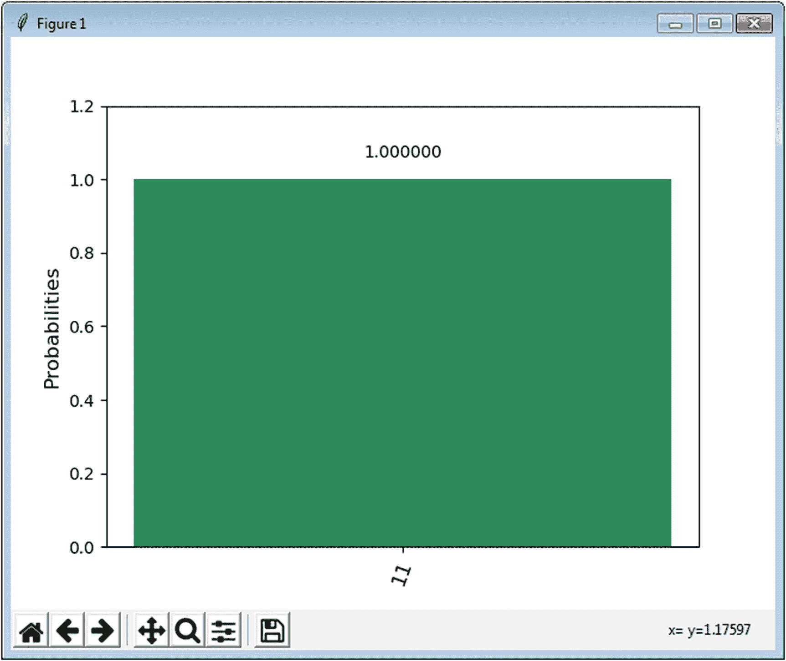

*图 5-7：超密编码结果图*

因此，超密编码提供了一种将 2 个经典比特编码到单个量子比特中的方法。值得注意的是，量子计算理论指出每个量子比特不可能存储超过一个经典比特的信息，这似乎与本协议所展示的内容相矛盾。事实上，这并不矛盾。该协议之所以有效，是因为爱丽丝和鲍勃的量子比特通过贝尔态发生了纠缠。这使得可以在爱丽丝的纠缠量子比特中发送 2 个经典比特。总之，只要你的量子比特通过贝尔态与另一个量子比特纠缠，每个量子比特最多可以存储 2 个经典比特。

从广义上讲，此协议可以解释为一组模块化抽象：一个用于创建 2 个纠缠量子比特的贝尔态生成器模块，接着是一个信息编码器模块，该模块应用爱丽丝的规则来编码 2 个经典比特的信息。最后，解码器模块从贝尔态以及编码器模块提供的量子比特中提取经典比特（如果你愿意，可以将其视为一种量子压缩/解压缩工具）。超密编码为量子信息处理提供了一个高级视角，并将帮助你理解本章的下一项内容：量子隐形传态。

###### 提示

这个简单的协议是由物理学家查尔斯·贝内特于 1992 年开发的，距离量子力学的发现已近 70 年。尽管它相对简单，但并非显而易见的过程，深入研究它可以学到很多非凡的东西。


## 量子隐形传态

量子隐形传态是一种与超级密集编码密切相关的过程。也许"隐形传态"这个术语有些夸张，因为我们实际上并没有传输任何实物，至少不是科幻或`《星际迷航》`中的那种含义。从形式上讲，量子隐形传态是指借助经典通信和上一节讨论的贝尔对，将一个量子比特的状态（`ψ`）从一个位置传输到另一个位置的过程。该过程总结在图 5-8 中。

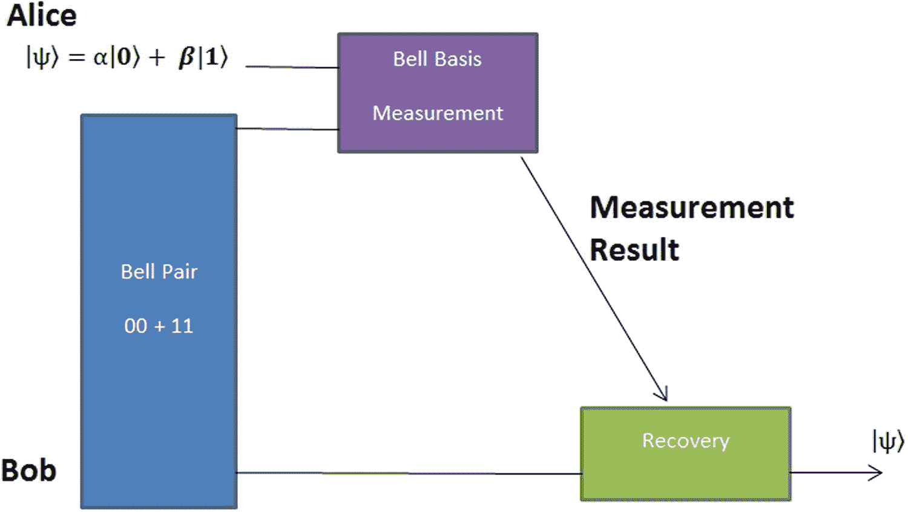

图 5-8：量子隐形传态工作流程

1. Alice 和 Bob 首先共享一个由纠缠量子比特组成的贝尔对。其中一个量子比特归 Alice，另一个归位于不同远程地点的 Bob。假设这个贝尔对由第三方（Eve）制备。
2. Alice 准备她想要隐形传态的量子比特，其状态为 `|ψ⟩ = α|0⟩ + β ∣ 1⟩`。然后，她对自己的量子比特以及 Eve 提供的贝尔对中的纠缠量子比特执行贝尔基测量。Alice 随后通过经典方式将测量结果发送给 Bob。
3. 此时，Bob 的量子比特处于一个后验状态，该状态是 Alice 所执行测量的函数。这是理解整个过程的关键；请记住，两人共享一个纠缠量子比特。因此，我们将看到 Bob 如何通过应用适当的量子门来恢复 Alice 创造的原始状态 `ψ`。

让我们通过观察 Bob 的量子比特在 Alice 测量时刻（在恢复操作之前）的后验状态来弄清楚这一点。为此，我们写出过程中涉及的三个量子比特的联合状态。注意，为了简单起见，我们忽略了右矢符号。因此，给定 Alice 的状态 `|ψ⟩ = α|0⟩ + β ∣ 1⟩`，如果我们将其与 Eve 提供的共享贝尔对中的纠缠量子比特结合，我们得到：

```
(α0 + β1) (00 + 11) = α000 + α011 + β100 + β111       (1)
```

现在，我们需要使用贝尔基态来表示前两个量子比特的状态：

| `B0 = 00 + 11` | `00 = B0 – B1` |
| --- | --- |
| `B1 = 10 + 01` | `01 = B1 – B3` |
| `B2 = 00 – 11` | `10 = B1 – B3` |
| `B3 = 10 – 01` | `11 = B0 – B2` |

表达式 (1) 变为：

```
(α0 + β1) (00 + 11) = B0 (α0 + β1) + B1 (α1 + β0) + B2 (α0 – β1) + B3 (-α1 + β0)                                                              (2)
```

表达式 (2) 展示了 Alice 执行测量后三个量子比特的状态。Bob 通过观察表达式 2 中（括号内的）量子比特后验状态，知道如何恢复 Alice 的 `ψ`。这在表 5-5 中展示得更清楚。

表 5-5：量子隐形传态恢复

| 贝尔态 | 后验状态 | Bob 的恢复操作 |
| --- | --- | --- |
| `B0` | `α0 + β1` | `ψ` |
| `B1` | `α1 + β0` | `Xψ` |
| `B2` | `α0 – β1` | `Zψ` |
| `B3` | `–α1 + β0` | `ZXψ` |

总而言之，量子隐形传态协议提供了一种方法，通过让两个远程方共享一个纠缠贝尔对来恢复任何量子比特的状态 `ψ`，因此得名"隐形传态"。现在，让我们为该协议构建一个电路，在模拟器中运行它，最后查看结果。

### 适用于 Composer 的电路

图 5-9 显示了量子隐形传态协议的 Composer 电路以及执行结果（目前仅限模拟器，无真实设备）：

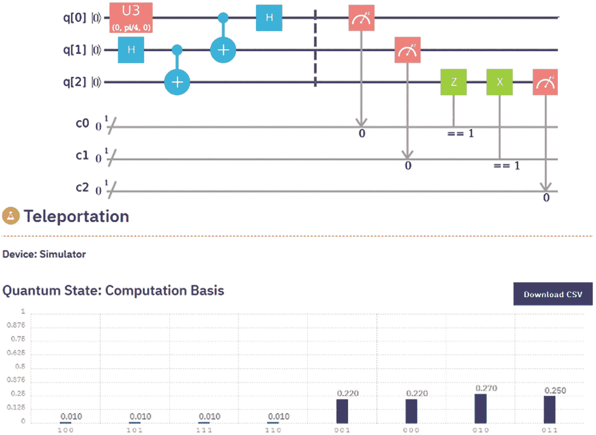

图 5-9：适用于 Composer 的量子隐形传态电路

-   障碍符（虚线）左侧的门代表由第三方 (Eve) 制备的贝尔对：量子比特 1 和 2。
-   Alice 准备她的量子比特（0）到给定的状态 `ψ`。`ψ` 的实际值无关紧要，因为它在流程的最后阶段会被 Bob 恢复。Alice 从 Eve 那里接收 `量子比特[1]`，而 `量子比特[2]` 则交给 Bob。
-   Alice 对她的量子比特 `[0, 1]` 执行测量（如虚线右侧所示），并通过经典方式将结果发送给 Bob。
-   Bob 根据 Alice 发送的结果，对上一节提到的他的量子比特（2）应用恢复规则。最后，在测量 `量子比特[2]` 之后，Bob 恢复了 Alice 最初创建的状态 `ψ`。所有这些之所以成为可能，是因为 Alice 和 Bob 共享一对纠缠量子比特，这使得整个过程得以运作。

当然，图 5-9 中的执行结果需要经过处理才能验证 Bob 的 `ψ` 是否与 Alice 的匹配。最好的方法是使用 Python 脚本。在下一节中，我们将远程运行相同的电路并查看结果，以验证协议是否有效。

### 使用 Python 远程运行

在本节中，我们使用 Python 在模拟器中远程运行量子隐形传态协议。请注意，目前，量子隐形传态无法在 IBM Q Experience 的真实量子设备上运行。这是因为硬件不支持 Alice 创建其状态 `ψ` 所需的旋转门。因此，我们将改用远程模拟器——本地 Python 模拟器也可以。清单 5-3 展示了运行的协议。具体来说：

-   创建三个量子比特以供 Alice 和 Bob 双方共享，再加上三个经典寄存器（`c0`、`c1`、`c2`）来存储 Alice 的结果（第 20-23 行）。
-   Eve 通过对量子比特 1 和 2 应用哈达玛门 (`H`) 后接受控非门 (`CNOT`) 来制备贝尔对（第 35-37 行）。
-   Alice 通过在 Y 轴上旋转 `π/4` 弧度来准备她位于量子比特 0 上的状态 `ψ`（第 32 行）。
-   Alice 现在将她的 `量子比特[0]` 与给她的贝尔对量子比特 `量子比特[1]` 纠缠起来。然后她对两者进行测量，并将结果存储在经典寄存器 0 和 1 中（第 35-41 行）。
-   轮到 Bob 了：他根据 Alice 发送的结果，对她的量子比特（2）应用 `Z` 或 `X` 门——如果经典寄存器 0 为 1，则应用 `Z` 门。如果经典寄存器 1 为 1，则应用 `X` 门。然后他测量他的量子比特并将结果存储在经典寄存器 2 中（第 47-50 行）。
-   该程序在远程模拟器 (`ibmq_qasm_simulator`) 中执行，并收集结果以供显示和验证（第 58-79 行）。


###### 提示

本程序的源代码包含在书籍源代码的 `Workspace\Ch05\p05-teleport.py` 路径下。

```python
import sys,time,math
import numpy as np
##### Importing QISKit
from qiskit import QuantumCircuit, QuantumProgram
##### Q Experience config
sys.path.append('../Config/')
import Qconfig
##### Import basic plotting tools
from qiskit.tools.visualization import plot_histogram
def main():
##### Quantum program setup
Q_program = QuantumProgram()
Q_program. register(Qconfig.APItoken, Qconfig.config["url"])
##### Creating registers
q = Q_program.create_quantum_register('q', 3)
c0 = Q_program.create_classical_register('c0', 1)
c1 = Q_program.create_classical_register('c1', 1)
c2 = Q_program.create_classical_register('c2', 1)
##### Quantum circuit to make the shared entangled state (Bell Pair)
teleport = Q_program.create_circuit('teleport', [q], [c0,c1,c2])
teleport.h(q[1])
teleport.cx(q[1], q[2])
# Alice prepares her quantum state to be teleported,
# psi = a|0> + b|1> where a = cos(theta/2), b = sin (theta/2), theta = pi/4
teleport.ry(np.pi/4,q[0])
##### Alice applies CNOT to her two quantum states followed by H, to entangle them
teleport.cx(q[0], q[1])
teleport.h(q[0])
teleport.barrier()
##### Alice measures her two quantum states:
teleport.measure(q[0], c0[0])
teleport.measure(q[1], c1[0])
circuits = ['teleport']
print(Q_program.get_qasms(circuits)[0])
###### BOB Depending on the results applies X or Z, or both, to his state
teleport.z(q[2]).c_if(c0, 1)
teleport.x(q[2]).c_if(c1, 1)
teleport.measure(q[2], c2[0])
##### dump asm
circuits = ['teleport']
print(Q_program.get_qasms(circuits)[0])
##### Execute inthe simulator (the real device does not support it yet)
#backend = "local_qasm_simulator"
backend = "ibmq_qasm_simulator"
shots = 1024       # the number of shots in the experiment
result = Q_program.execute(circuits, backend=backend, shots=shots
, max_credits=3, timeout=240)
print("Counts:" + str(result.get_counts("teleport")))
##### RESULTS
##### Alice's measurement:
data = result.get_counts('teleport')
alice = {}
alice['00'] = data['0 0 0'] + data['1 0 0']
alice['10'] = data['0 1 0'] + data['1 1 0']
alice['01'] = data['0 0 1'] + data['1 0 1']
alice['11'] = data['0 1 1'] + data['1 1 1']
plot_histogram(alice)
#BOB
bob = {}
bob['0'] = data['0 0 0'] + data['0 1 0'] +  data['0 0 1'] + data['0 1 1']
bob['1'] = data['1 0 0'] + data['1 1 0'] +  data['1 0 1'] + data['1 1 1']
plot_histogram(bob)
###########################################
##### main
if __name__ ==  '__main__':
start_time = time.time()
main()
print("--- %s seconds ---" % (time.time() - start_time))
```

代码清单 5-3：量子隐形传态的 Python 脚本

为了验证结果，需要收集模拟器返回的爱丽丝和鲍勃的结果计数。绘制结果图是验证鲍勃是否恢复了爱丽丝的 ψ 状态的最佳方式。以下是模拟器返回的示例：

```python
{'1 0 0': 37, '1 0 1': 45, '1 1 1': 43, '0 1 1': 215, '0 0 1': 200, '0 0 0': 206, '0 1 0': 230, '1 1 0': 48}
```

在此 JSON 字符串中，左侧是 3 个量子比特的逆序测量结果。例如，在第一个结果 `1 0 0` 中：B(1) A(0) A(0)，其中 A 代表爱丽丝，B 代表鲍勃。右侧是该特定结果获得的计数。请记住，该结果的概率（用于绘图）是通过将结果计数除以总实验次数（1024）计算得出的；因此

```
P(1 0 0) = 37/1024 = 0.036
```

执行代码清单 5-3 后，为爱丽丝和鲍勃的结果绘制的直方图如图 5-10 所示。

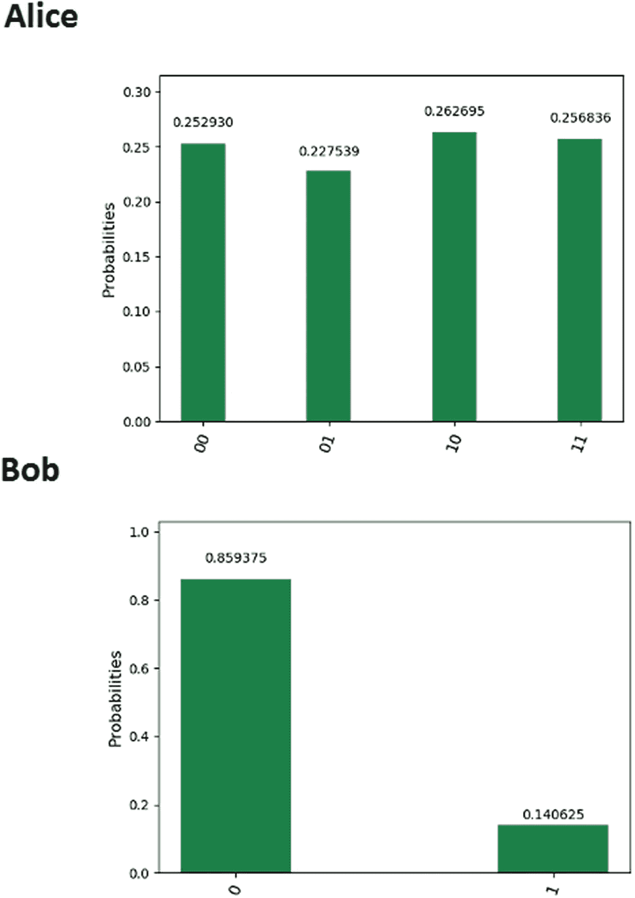

图 5-10：爱丽丝和鲍勃测量的概率结果

那么这一切意味着什么呢？我们如何知道鲍勃已经恢复了 ψ 状态？让我们更详细地看看这些结果。

### 查看结果

要解释这些结果，首先让我们看看如何根据代码清单 5-3 返回的计数计算概率：

```python
{'1 0 0': 37, '1 0 1': 45, '1 1 1': 43, '0 1 1': 215, '0 0 1': 200, '0 0 0': 206, '0 1 0': 230, '1 1 0': 48}
```

利用这些计数，我们可以计算图 5-10 中所示的爱丽丝和鲍勃结果的概率（见表 5-6）。

表 5-6：量子隐形传态实验的概率结果

| 行 |   |   | 结果 | 计数 | 概率 |   | 爱丽丝 | 总概率 |
| --- | --- | --- | --- | --- | --- | --- | --- | --- |
| 0 | 爱丽丝(00) | 鲍勃(0) | 0 0 0 | 206 | 0.201171875 |   | 0 0 | 0.237304688 |
| 1 | 爱丽丝(01) | 鲍勃(0) | 0 0 1 | 200 | 0.1953125 |   | 1 0 | 0.239257813 |
| 2 | 爱丽丝(10) | 鲍勃(0) | 0 1 0 | 230 | 0.224609375 |   | 0 1 | 0.271484375 |
| 3 | 爱丽丝(11) | 鲍勃(0) | 0 1 1 | 215 | 0.209960938 |   | 1 1 | 0.251953125 |
| 4 | 爱丽丝(00) | 鲍勃(1) | 1 0 0 | 37 | 0.036132813 |   |   |   |
| 5 | 爱丽丝(01) | 鲍勃(1) | 1 0 1 | 45 | 0.043945313 |   | **鲍勃** |   |
| 6 | 爱丽丝(10) | 鲍勃(1) | 1 1 0 | 48 | 0.046875 |   | 0 | 0.831054688 |
| 7 | 爱丽丝(11) | 鲍勃(1) | 1 1 1 | 43 | 0.041992188 |   | 1 | 0.168945313 |

如表 5-6 所示，要计算爱丽丝结果为 `00` 的总概率，我们需要将第 0 行和第 4 行的概率列相加。即 `P(A00) = 0.201 + 0.036 = 0.237`。相同的规则也适用于鲍勃。例如 `P(B0) = 0.20 + 0.19 + 0.22 + 0.20 = 0.83`（将第 0-3 行的概率列相加）。这在表格右侧的爱丽丝和鲍勃的所有结果中都已显示。这就是代码清单 5-3 中的脚本在绘制图 5-10 中的结果之前处理数据的方式。但这意味着什么，我们如何知道鲍勃已经恢复了爱丽丝的 ψ 呢？让我们看看鲍勃对其量子比特的总概率：

| `鲍勃` |   |
| `0` | `0.20 + 0.19 + 0.22 + 0.20 = 0.83` |
| `1` | `0.036 + 0.043 + 0.046 + 0.041 = 0.168` |

量子力学指出 ψ 的概率由 *P*(ψ) = |ψ|² 给定。也就是说，概率密度是 ψ 模的平方。现在回想一下，爱丽丝将 ψ 准备为

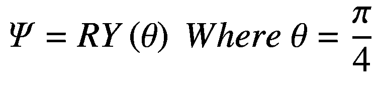

也就是说，爱丽丝在她的量子比特上应用了一个绕 Y 轴的 π/4 旋转。为了更清楚地看到这一点，让我们用几何方法可视化 ψ 状态（见图 5-11）：

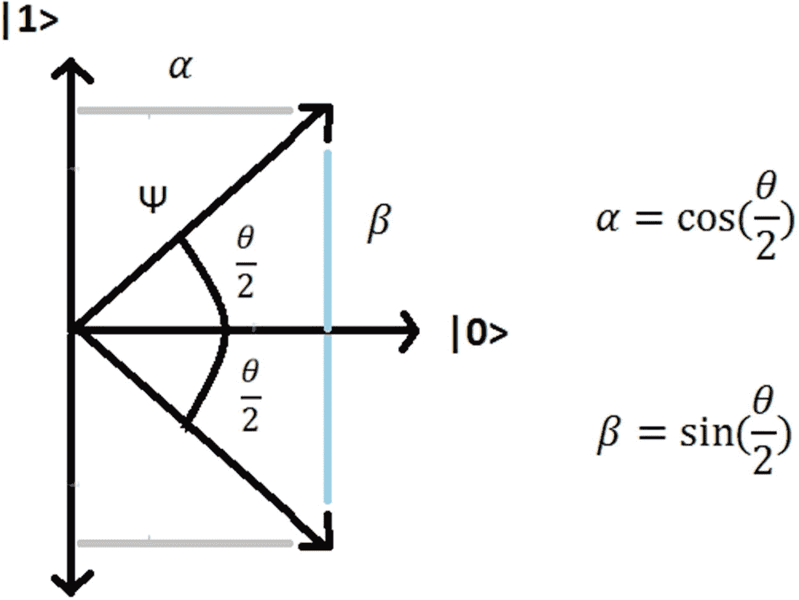

图 5-11：爱丽丝 ψ 叠加态

请记住，叠加态 ψ 是用复系数 α 和 β 描述的，如下所示：

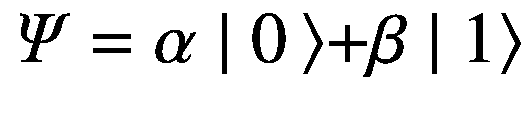

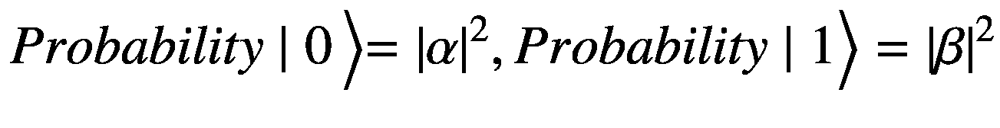

但是，从图 5-11 中，我们可以将系数表示为 α = cos(θ/2) 和 β = sin(θ/2)。因此，最终，如果 θ = π/4，那么

- 概率 (α) = |cos(π/8)|² = 0.85
- 概率 (β) = |sin(π/8)|² = 0.14

这与鲍勃从隐形传态代码清单 5-3 创建的图中得到的结果相符（见图 5-12）。大获成功！

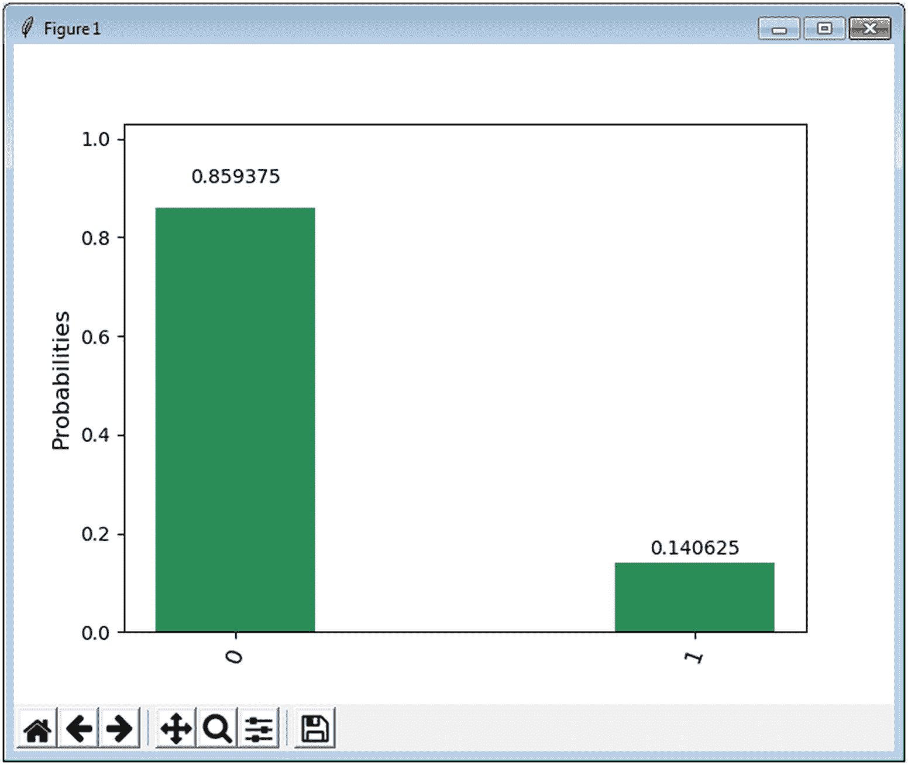

图 5-12：鲍勃的隐形传态结果


你已经迈出了理解量子系统卓越信息处理能力的第一步。我们从利用量子力学内在的真正随机性源来生成随机数的简单程序开始，还探索了两个奇特的协议：用于编码经典信息的超密编码，以及让远程方恢复量子比特状态的量子隐形传态。这些协议已通过 IBM Q Experience 的电路以及用于在模拟器或真实量子设备上远程执行的 Python 脚本进行了描述。我们已收集并对结果进行了解释，以理解其背后的工作原理。下一章将探索量子计算的轻松一面，通过用量子门创建一个简单的小游戏来获得乐趣：在我们进入后续章节的繁重内容之前，这是一个必要的休息。

脚注 1 2

