# 1. 奇异而迷人的量子力学世界

量子力学的故事是一个充满惊奇与困惑的寓言。它包含了科学、哲学、宗教的元素，我甚至敢说还有魔法。它会颠覆你的认知，有时甚至让你质疑是否存在一个全能的造物主。尽管我发现它的概念难以掌握，但它一直令我着迷。本章呈现的一些概念可能难以理解；不过不必烦恼。从来没有人能完全描述这一切的意义，即使是物理学的巨擘们也未能完全理解量子力学。但这并不意味着我们不能为之着迷。伟大的物理学家理查德·费曼曾说过：如果有人告诉你他理解了量子力学，那恰恰说明他不理解量子力学。本章是我对这个迷人寓言的解读，以及两位科学巨擘之间的博弈如何塑造了它的过去、现在和未来。

一切都始于 20 世纪 30 年代，阿尔伯特·爱因斯坦凭借狭义相对论享誉世界，该理论建立在牛顿物理学的基础上，统一了天地。当爱因斯坦仰望星空时，新一代科学家们则将目光投向了微观世界。以物理巨匠马克斯·普朗克、欧内斯特·卢瑟福和尼尔斯·玻尔为首，一场巨擘之间的交锋爆发了，也引发了 20 世纪物理学史上最伟大的辩论之一——一边是因光本质和狭义相对论的开创性发现而刚刚荣获诺贝尔奖的阿尔伯特·爱因斯坦，另一边是尼尔斯·玻尔，他对量子力学领域的贡献为他赢得了 1922 年的诺贝尔奖以及丹麦通常授予皇室的尊贵“大象勋章”。让我们来看看这两位伟人之间的博弈如何塑造了量子力学这部科学杰作。

## 二十世纪物理学的黄金时代

二十世纪初，英国科学家欧内斯特·卢瑟福在原子本质方面做出了惊人的发现。他假设原子看起来像微型的太阳系，由一个带正电的微小原子核和像微型行星一样围绕其旋转的带负电的电子组成。这是一项卓越的洞察，因为此前人们认为原子只是一个带有正负电荷的简单球状质量团。

1920 年，玻尔来到剑桥大学卢瑟福的实验室，并深深爱上了卢瑟福的原子模型，但有一个问题，而且是大问题。如果经典牛顿物理学应用于卢瑟福的模型，即带负电的电子围绕带正电的原子核旋转，那么电子最终会向内坠落并撞击原子核，造成灾难性的悖论。一切都不应该存在，因为电子会在几秒钟内撞毁。玻尔看到了这一点，并带着毫不动摇的兴奋，他推迟了婚期并取消了蜜月，试图拯救卢瑟福的模型。玻尔在一篇论文中假设，电子在固定的、不可改变的轨道上运动。这违背了牛顿物理学的基础，但借鉴了量子力学之父马克斯·普朗克的新思想。

### 马克斯·普朗克与紫外灾难拉开序幕

普朗克提出，热和光以不可分割的单位形式存在，他称之为“能量量子”。普朗克的想法源于他解决黑体辐射实验的努力，在这个实验中，一个完全吸收内部所有辐射（热量）的物体，其腔体允许部分辐射逸出（见图 1-1）。随着箱内热量增加，辐射的频率达到人眼可见的范围，发出不同颜色的光。当时的陶瓷制造者早已知道，所有物体在特定温度下都会发出固定的颜色（见表 1-1）。

**表 1-1** 不同温度下的光色

| 温度（`°C`） | 颜色 |
| --- | --- |
| 500 | 暗红色 |
| 800 | 樱桃红 |
| 900 | 橙色 |
| 1000 | 黄色 |
| 1200 | 白色 |

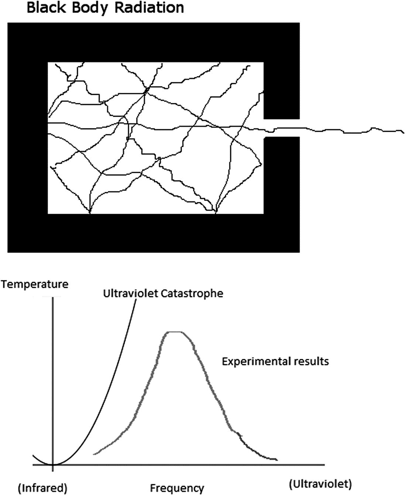

**图 1-1** 黑体辐射实验结果

图 1-1 显示了黑体辐射实验以及 19 世纪 90 年代实验收集的经典辐射理论曲线所提供的结果。经典物理学家的实验预测了紫外线光谱的无限强度。这被称为“紫外灾难”，是可疑的理论论证和实验结果的产物。如果这是真的，那将意味着，例如，坐在壁炉附近的任何地方都是危险的！普朗克寻求解决紫外灾难的方法。

普朗克利用热力学第二定律（也称熵）推导出一个公式，用于描述黑体辐射问题所得的实验结果。

`S = k log W`

这是玻尔兹曼熵（`S`），其中`k`被称为玻尔兹曼常数，`W`是对于一种元素（无论是固体、液体还是气体）出现特定原子排列的概率。

利用玻尔兹曼的统计方法来计算熵，普朗克试图找到一个与黑体实验结果相匹配的公式。通过将与频率（`f`）成比例的总能量（`e`）分成小份，他提出了方程：

`e = hf`

其中`e`是一小份能量，`h`被称为普朗克常数，`f`是频率。然而，他面临一个障碍：玻尔兹曼的统计方法要求这些小份能量随时间减少到零。这会使他的方程无效，从而否定其有效性。经过多次挣扎，普朗克被迫无奈地假设，能量值必须是有限的。于是，普朗克令人难以置信的洞察力出现了：如果这是正确的，那就意味着一个振子不可能在连续范围内吸收或发射能量。它必须以不可分割的小份`e = hf`的形式吸收或发射能量，他称之为“能量量子”，于是便有了量子力学这个术语。

### 玻尔的量子跃迁

玻尔将普朗克关于能量量子的开创性思想应用于原子——物质的最小单位。他提出了一个关于原子与光关系的大胆描述：围绕原子核旋转的电子会发射或吸收光，从而导致量子跃迁。因此，量子跃迁是两个状态之间的过渡；然而玻尔无法完全描述它。

这个想法遭到了其他科学家的质疑，他们称其理论为胡说八道，是对无知的一种廉价借口，或者太过于大胆、太奇妙而不可能是真的。结果是物理学界出现了分裂，一边是支持玻尔、相信物质量子本质的阵营，另一边是支持经典观点的阵营。爱因斯坦很快将加入这场斗争，站在经典派一方。

### 巨人之战：量子猫与不确定性原理

到 20 世纪 20 年代中期，关于物质量子本质的新理论处于岌岌可危的境地，面临着早夭的现实可能。需要两项新的开创性发现来巩固其基础。

第一个发现大约在 1926 年，德国物理学家维尔纳·海森堡试图通过为原子建立一种数学描述（即现在所称的矩阵力学）来使玻尔的观点合法化。这个想法被认为即使对于经验丰富的物理学家来说也过于复杂而难以想象。尽管如此，海森堡对该领域最大的贡献是他著名的“不确定性原理”，我们接下来将探讨这一点。第二个发现来自奥地利物理学家埃尔温·薛定谔，他提出了一种新的原子描述，不是将其视为粒子，而是视为波。这个想法建立在法国王公路易·德布罗意的论点之上，他假设粒子可能表现出波动性质，并且这种二象性可能是理解光的本质所必需的（见图 1-2）。

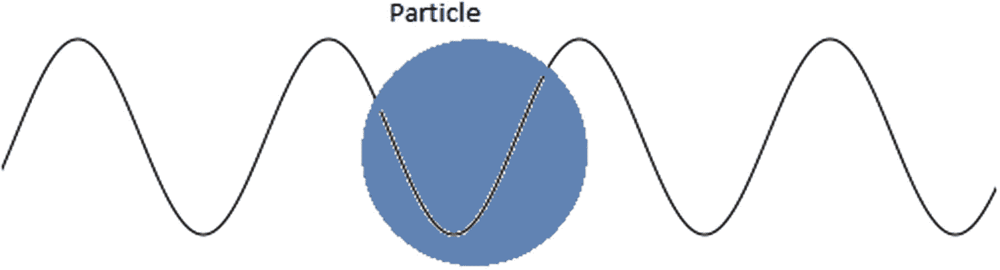

**图 1-2** 光子的二象性。它既表现为粒子又表现为波。

德布罗意利用爱因斯坦著名的能量方程`E = mc²`和普朗克的能量量子`e = hf`，找到了光子波长（`λ`）和动量（`P`）之间的关系：

`E = mc² = (m c) * c`

鉴于 (`mc`) 是光子的动量（`P`），且 `c (速度) = f (频率) * λ (波长)`，方程变为：

`E = (P) (f λ)`

但是等等，普朗克的关系式表明能量 `E = (h)(f)`；因此使用基础代数，德布罗意得出结论：

`h * f = P * (f λ)`

`h = P * λ`

`λ = h / P`

德布罗意表明，光子的波长随着动量的增加而减小（见图 1-3）。通过类比，他提出这个关系不仅适用于光子，也适用于所有粒子。鉴于在当时，电子的动量 `P = (质量)*(速度)` 可以通过实验轻松确定；这意味着波长可以从德布罗意的方程中计算出来！这个想法在当时显得荒谬绝伦，因为经典物理学家知道电子是一个粒子，这是 J. J. 汤姆逊在 1897 年早已发现的。

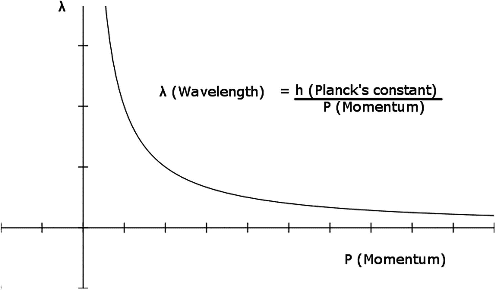

**图 1-3** 德布罗意关于光子波长与动量的关系

薛定谔利用德布罗意的思想，找到了一种更易于被主流接受的方法，标志着回归经典物理学的连续、可视化世界。他的波函数是正确的，但在迎合主流方面则大错特错。

#### 全能波函数登场

薛定谔试图寻找一个函数，该函数可应用于任何已知数学能量形式的物理系统，从而创造了由希腊符号 `ψ`（发音为普赛——见图 1-4）表示的那条著名的波函数。波函数利用**傅里叶**的方法，将任意数学函数表达为无穷级数中其他周期函数之和，从而求解方程。这种技术被称为`本征值`方法（eigen 在德语中意为“确定的”——该术语在量子物理学中很常见）。薛定谔波函数迅速被接受为一种极其强大的数学工具，用于解决与物质原子结构相关的问题，并被认为是二十世纪最伟大的成就之一。

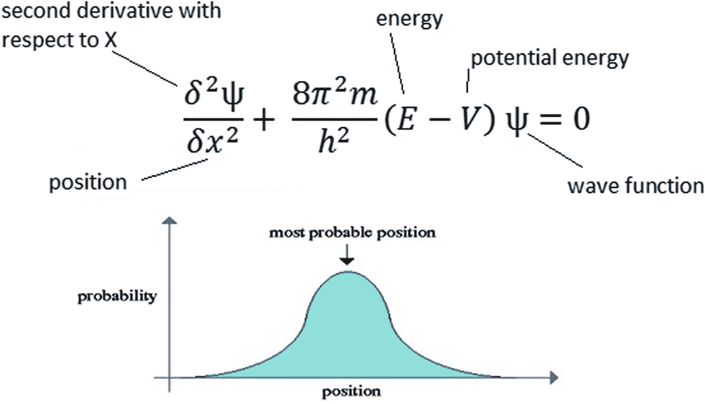

图 1-4

*薛定谔试图用他的著名波函数描述任何具有已知能量的物理系统*

鉴于薛定谔波函数的惊人威力，玻尔和海森堡决定与薛定谔联手，但他们必须先解决彼此的分歧。这一切发生在 1926 年哥本哈根一个新成立的研究所里，三位巨人在此会面讨论。

薛定谔否定了玻尔/海森堡关于原子结构中存在不连续量子跃迁的概念。他想利用自己的新发现，回归到不受突然跃迁干扰的连续物理过程。实际上，他提出了一种完全基于波的经典物质理论，甚至到了质疑粒子存在的地步。薛定谔认为粒子实际上是波的叠加，这一观点后来被`亨德里克·洛伦兹`证明是错误的，洛伦兹让他恢复了理智，证明毕竟你不可能全赢。薛定谔后来对自己关于波运动作为所有物理实在来源之重要性信念产生了动摇。

玻尔、海森堡和薛定谔争论不休，直到精疲力竭。玻尔要求所有争论都必须绝对清晰，试图迫使薛定谔承认他的解释不完整；而薛定谔则固守其经典观点，有时甚至哀叹自己的原子理论和量子跃迁研究工作（这大概并非他的本意）。

薛定谔厌恶玻尔对原子结构的解释。在二人能够就坚实的量子理论达成一致之前，还需要最后一块拼图。

### `ψ`的概率诠释：波函数本意是击败量子力学，而非成为其基础

就像伟大的摇滚吉他手`吉米·亨德里克斯`听到歌曲《嘿，乔》，随后发行翻唱版本并将其变成自己的代表作，从而创作出堪称最佳翻唱歌曲之一那样，量子力学的奠基人们也做了同样的事。他们意识到了波函数的巨大威力，并将其收为己用。关于这个故事的一个小趣闻是，薛定谔厌恶`普朗克`对能量和热的不连续诠释。他想用自己平滑、连续的波函数来击败普朗克的能量量子。这很难令人相信，但在 20 世纪 30 年代，普朗克的发现是如此具有革命性，以至于大多数物理学家都认为他疯了。然而，就像亨德里克斯对待那首歌曲一样，量子力学的奠基者们将会把波函数变成他们自己的东西。

突破来自德国物理学家`马克斯·玻恩`，他提出了波函数的概念，将其视为电子在给定状态下向某个方向散射的概率。玻恩指出，状态存在的概率（`P`）由波函数归一化振幅的平方给出，即 `P = |ψ|²`。这在当时是开创性的，因为玻恩声称不再有精确答案；我们在原子理论中得到的只是概率。这个全新的想法将玻尔对原子的解释带向了一个全新的方向（见图 1-5）。

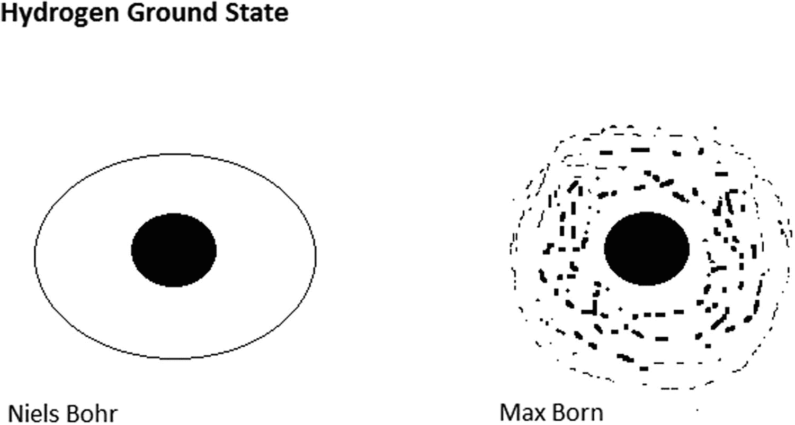

图 1-5

玻尔与马克斯·玻恩关于波函数的概率观对比

#### 量子猫试图搅乱玻恩的概率派对

随着玻恩关于 `ψ` 概率性质的观点获得认可，薛定谔感觉他的波函数被误用了，这引发了一个著名的思想实验，后来被称为量子猫，你可能听说过这个故事。在这个实验中，薛定谔试图反驳玻恩对 `ψ` 的概率诠释。实验是这样的：一只活猫被放在一个盒子里，盒子里还有一个放射性源，它触发一个锤子释放，打碎一个装有毒药的瓶子，从而杀死猫。假设每小时放射性衰变的概率为 50%，一小时后，这个机制就会被触发，从而杀死猫。薛定谔声称，根据玻恩的诠释，量子理论会预测，一小时后，盒子里会有一只既非死也非活，而是处于两种状态混合体——两个波函数叠加状态的猫。薛定谔认为这很荒谬，并会制造一个悖论。然而今天，这个所谓的悖论却被用来教授量子概率和态叠加原理。

这就是叠加的玄妙之处；一旦盒子被打开，叠加的波函数就坍缩成一个单一的波函数，使猫要么死要么活——因此，观察行为解决了这个僵局。另一个令人难以置信的洞见将来自`海森堡`，他思考了玻尔所倡导的原子结构中粒子位置存在一定不确定性的问题。

### 不确定性原理

海森堡思索着在玻尔的原子模型中，为何无法得知粒子的位置。经过反复思考，在一瞬间的顿悟中，他意识到：要知道一个粒子在哪里，你必须观察它；而要观察它，你必须用一束光子照射它。然而，当你这么做时，会扰动粒子的位置；因此，观察粒子的行为本身改变了它的位置。海森堡将这一概念称为`不确定性原理`。

为了研究这个问题，海森堡设计了一个假想实验，使用一台发射伽马射线的显微镜。伽马射线携带高动量与低频率，射向一个待观测的经过的电子。在玻尔的帮助下，实验的目标是通过估算同时测量位置与动量时的不可精确度，来描述一种定量关系。结果发现，位置测量的不可精确度接近于所用辐射的波长：`ΔX ~ λ`。

类似地，电子动量的不可精确度接近于用来照射粒子的光子的动量：`ΔP ~ h/λ`。注意，根据德布罗意方程可知，光子的动量（`P`） = `h`（普朗克常数） / `λ`（波长）。海森堡证明，将这两个不等式相乘，其乘积总是大于或等于 `h`。

```
ΔX * ΔP ≥ λ * h/λ
ΔX * ΔP ≥ h
```

这就是`海森堡不确定性原理`（`HUP`），其正式表述为：“同时测量动量与位置时的不可精确度，总是大于一个固定值，并且接近于普朗克常数 `h`。”

物理学家常用一个简单的实验来展示不确定性原理的实际作用。它被称为`单缝实验`，过程如下：一束激光射向一个垂直的宽单缝，并在投影屏幕上反射成像。当缝隙较宽时，我们看到的结果与预想完全一致：屏幕上投射出一个光点。现在，如果我们让缝隙的宽度越来越窄，光点的两侧也会开始变窄。然而，当缝隙宽度小到约 1/100 英寸时，根据海森堡，不确定性原理开始生效，光束的方向变得不确定。于是，我们观察到光开始扩散，变得越来越大！听起来很疯狂，我们让缝隙变窄，光斑反而变宽了！这极其违反直觉，但现实就是如此运作的。

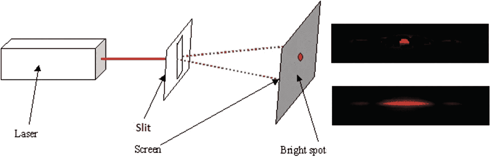

图 1-6

用于展示不确定性原理在作用中的`单缝实验`

不确定性原理极其重要，因为它弥合了薛定谔与玻尔之间的分歧，奠定了现代量子理论的基础。也就是说，电子是一个粒子（正如玻尔所假设的那样），但正如不确定性原理（海森堡）所述，我们无法确切知道它在哪里。最后，找到它的概率由波函数给出（薛定谔/玻恩）。因此，电子的本质具有二象性，既是粒子也是波。综合这一切，一种坚如磐石的量子力学观点应运而生，它后来被称为`哥本哈根诠释`。

### 干涉与双缝实验

干涉是量子力学中另一个令人难以置信的特性，它让你不禁思考，在我们的现实表象背后究竟发生了什么。伟大的物理学家理查德·费曼曾这样评价干涉：量子力学的精髓可以通过探究干涉与`双缝实验`来掌握。

众所周知，在十九世纪初，一场关于光本质的激烈辩论正在进行。一些人（如牛顿）声称光由粒子组成；另一些人则认为光的行为像波。于是，在 1801 年，托马斯·杨提出了`双缝实验`，试图一锤定音：实验中，一束光射向一个带有两条垂直狭缝的屏障。光通过狭缝后，产生的图案被记录在感光板上。当遮盖住一条狭缝时，显示出一条与开放狭缝对齐的光线。常识和直觉告诉我们，当两条狭缝都打开时，产生的图案应该是两条与狭缝对齐的光线。令人难以置信的是，事实并非如此。实际发生的情况是，穿过狭缝并显示在感光板上的光，分裂成多条明暗程度不同的条纹（见图 1-7）。

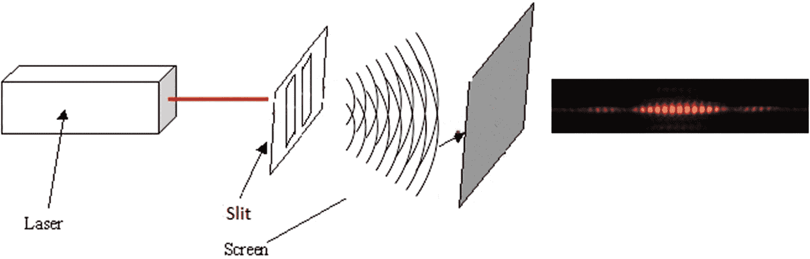

图 1-7

托马斯·杨的`双缝实验`

这个令人费解的结果让物理学家们困惑不已，他们假设实验中穿过狭缝的波与粒子之间发生了干涉。如果光束减速到足以确保单个光子撞击感光板，有人可能会预期看到两条光线（单个光子要么通过一条狭缝，要么通过另一条，最终落在两条可能的光线之一上）。然而，这并不正确。实际情况是，光以某种方式完成了不可能之事：每个光子不仅同时穿过了两条狭缝，还同时遍历了通向目标的每一条可能路径（这一原理被称为干涉）。

像干涉这样看似不可能的事件却能在原子尺度上发生，这一事实让当时最伟大的头脑都感到困惑。然而很快，这个新理论将面临其最大的挑战，对手是物理学巨擘阿尔伯特·爱因斯坦。

### 爱因斯坦对玻尔：上帝不掷骰子

如果你从事科学工作，或者即使你不是，你可能也听过爱因斯坦那句名言：“上帝不掷骰子。”这句话是在他与玻尔就量子力学本质问题的一系列往来信件中提出的。玻尔认为时空概念在原子层面并不适用。而爱因斯坦则坚信时空结构的存在，并认为这一概念可以扩展到原子尺度。这本质上是两人分歧的根源。

爱因斯坦假定，原子粒子的属性可以在不干扰它的情况下被测量，这一观点与玻尔/海森堡的诠释相悖。1927 年，两位巨人在当时最伟大的物理学家们的一次聚会上交锋，地点在布鲁塞尔。爱因斯坦试图在此一劳永逸地证明：不确定性并非现实的统治法则。

爱因斯坦向玻尔发起了一系列思想实验的挑战，旨在推翻不确定性原理。在第一轮中，爱因斯坦设计了一个盒子，他认为这个盒子既能记录光子从盒子侧面一个小孔中发射的精确时刻，又能同时测量其重量（见图 1-8）。

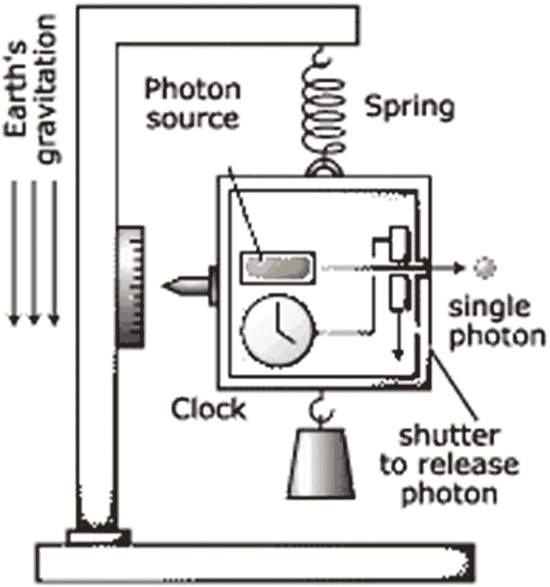

图 1-8

爱因斯坦为推翻不确定性原理而设计的实验盒子

在图 1-7 所示的思想实验中，盒子里有一个光源，并带有一个用于测量光子发射精确时间的时钟。同时，盒子挂在一个弹簧上，底部有一个砝码和相应的测量装置。这个想法很简单：在光子发射前后分别对盒子称重，同时利用时钟记录精确的时间。能量水平很容易通过爱因斯坦自己的方程`E = mc²`计算出来。当时，不确定性原理的情况看起来并不乐观。如果这个实验是正确的，不确定性原理就会被推翻，量子理论也就被击败了。

玻尔立刻着手工作，试图说服爱因斯坦，如果他的盒子成功了，那将意味着物理学的终结。玻尔最终占了上风，他指出爱因斯坦忘记考虑他自己的理论了，因为时钟会受到引力的影响，从而在测量时产生不确定性。他利用爱因斯坦的方程和红移公式证明了以下不确定性计算式`ΔE Δt ≥ h`。给定动量不确定性(`Δp`)和位置不确定性(`Δq`)：

`Δp Δq ≥ h` (1-1)

动量的不确定性(`Δp`)由`Δp ≤ t g Δm`给出；于是我们有：

`t g Δm Δq ≥ h` (1-2)

根据红移公式和时间膨胀原理：

`Δt = c^(-2) g t Δq` (1-3)

`ΔE = c² Δm` (1-4)

现在，将(1-3)和(1-4)相乘得到(1-5)：

`ΔE Δt = g t Δm Δq` (1-5)

最后，比较(1-5)和(1-2)，我们得到不确定性原理的一个不等式`ΔE Δt ≥ h`。凭借这个结果，第一轮玻尔胜出；然而这并非结束。爱因斯坦相信物理实在的完整图景，而不确定性原理挡了他的路。他会带着更大的挑战卷土重来。

## 玻尔对爱因斯坦：你不该告诉上帝该做什么

“上帝不掷骰子”是爱因斯坦不可动摇的原则。这是一种坚定的信念：实在独立于自我而存在。当爱因斯坦写信给玻尔说上帝不掷骰子时，玻尔回答说他不该告诉上帝该做什么。这为两人之间的第二轮较量奠定了基础，这次争论的内容是关于什么力量将原子核结合在一起。到 20 世纪 30 年代中期，也就是这场争论发生的时候，广义相对论和量子理论都被广泛认为是解释世界运作方式的最强有力的思想。第二轮较量聚焦于量子理论中最矛盾的一个方面——原子粒子即使在很远距离上也彼此保持联系的观点。

## 纠缠与 EPR 佯谬：鬼魅般的超距作用

起初，光被认为表现为波，但爱因斯坦证明它也表现出粒子行为，即光子。原子也是如此。它们根据所使用的测量仪器，既表现为粒子也表现为波。此外，要获得完整的图景，这两种条件都是必需的，玻尔将这一观点称为互补性。

那么，面对这两种矛盾，物质该如何被理解呢？玻尔认为，原子本身存在于我们的感知之外。这超出了爱因斯坦所能接受的范围，因为他相信时空观念是所有物理实在的基础，并希望将这一概念扩展到原子层面。另一方面，玻尔认为空间和时间是无意义的，实在不可知，我们拥有的只有现象。

大约在这个时候，爱因斯坦向玻尔发出了第二次也是最后一次挑战。在一篇与同事波多尔斯基和罗森合著的论文中，爱因斯坦提出了一个问题：量子力学是否提供了物理实在的完整视图？他提出了一个思想实验：从同一源头发射的两个粒子具有共同属性，然后彼此分离。这样一来，应该可以测量第一个粒子，并在不干扰它的情况下获得关于第二个粒子的信息。该实验的目的是为了证明玻尔关于粒子因测量装置不同而表现不同的观点是荒谬的。根据量子力学，对第一个粒子的测量会跨越时间和空间影响另一个粒子。

现在，想象一下如果这两个粒子被分隔在非常遥远的距离（例如，从宇宙的一端到另一端）。这将通过违反科学的一个基本原则——因果律——而创造出一个悖论。因果律认为，现实中所有事件都有因果联系，且事件的传递不能超过光速——宇宙中的终极速度极限。爱因斯坦称这个原则为局域因果性，或简称局域性。这个悖论后来被称为爱因斯坦-波多尔斯基-罗森悖论，即 EPR 佯谬。

玻尔一听说这篇论文的消息，就立刻放下了手头所有的工作。这个挑战必须得到回应。玻尔起初在回复中有些犹豫，但最终还是声称这两个粒子应被视为一个单一系统。换句话说，这两个粒子变得纠缠在一起，在这样的系统中，空间和时间是无意义的。因此，原子世界的图景是不可知的。

爱因斯坦将纠缠粒子在远距离上产生的效应称为“鬼魅般的超距作用”。两人之间的分歧从未得到解决。然而，1965 年，物理学家约翰·贝尔取得了突破性的进展，为平息这场争论奠定了基础。

### 贝尔不等式：检验纠缠的试金石

贝尔提出了一组不等式，为局域隐变量的存在提供实验证明。严格来说，贝尔不等式定理指出：`任何基于局域隐变量的物理理论都无法完全复现量子力学的全部预测`。^(¹)。从数学上看，该公式表达为：

`C[h] (a,c) – C[h] (b,a) – C[h] (b,c) ≤ 1`，

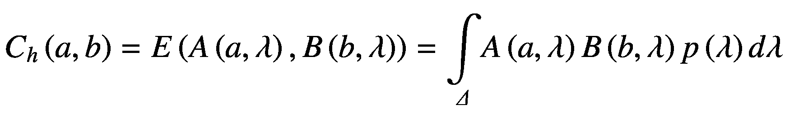

有一种简单的方法可以利用统计平均值来理解这一非常重要的定理。考虑光子在三个不同角度`A = 0`、`B = 120`和`C = 240`度（见图 1-8）下的偏振（光在特定平面内的振荡）。

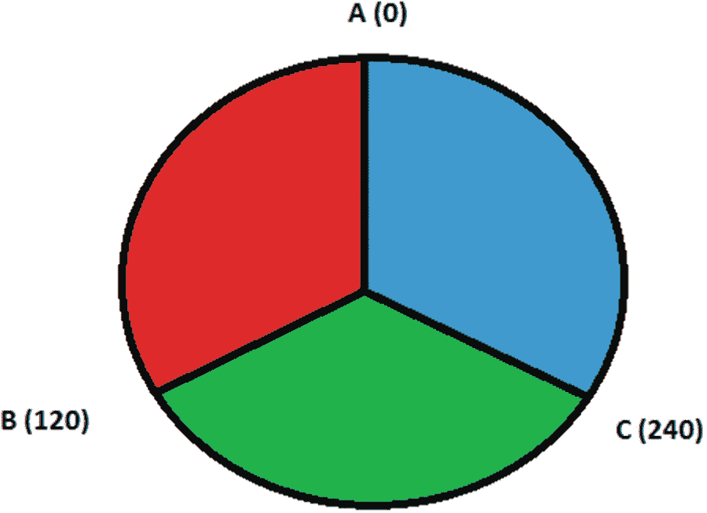

图 1-9

光在三个角度下的偏振状态

根据贝尔定理，如果现实独立于观测存在，那么光子对于这三种偏振设置必然具有确定的、同时存在的值，且这些值必须对应表 1-2 中所示的八种情况。

表 1-2

三种角度下光子偏振的排列组合表

| 序号 | A(0) | B(120) | C(240) | [AB] | [BC] | [AC] | 和 | 平均值 |
| --- | --- | --- | --- | --- | --- | --- | --- | --- |
| 1 | A+ | B+ | C+ | 1(++) | 1(++) | 1(++) | 3 | 1 |
| 2 | A+ | B+ | C– | 1(++) | 0 | 0 | 1 | 1/3 |
| 3 | A+ | B– | C+ | 0 | 0 | 1(++) | 1 | 1/3 |
| 4 | A+ | B– | C− | 0 | 1(−−) | 0 | 1 | 1/3 |
| 5 | A− | B+ | C+ | 0 | 1(++) | 0 | 1 | 1/3 |
| 6 | A− | B+ | C− | 0 | 0 | 1(−−) | 1 | 1/3 |
| 7 | A− | B− | C+ | 1(−−) | 0 | 0 | 1 | 1/3 |
| 8 | A− | B− | C− | 1(−−) | 1(−−) | 1(−−) | 3 | 1 |

现在提出一个简单的问题：如果我们在任意一个角度测量偏振，那么该偏振在相邻角度上保持相同的概率是多少？同时计算出偏振的和与平均值。在表 1-2 中，相邻偏振用`AB`、`BC`和`AC`列表示。`A`、`B`、`C`列中的`+`和`–`符号表示在给定角度下的正向或反向偏振。请注意，总共存在八种可能的排列组合，由“序号”列描述。因此，如果我们在两个相邻角度找到相同的偏振（相同的符号），则在`AB`、`BC`或`AC`列中记录`1`以及相应的符号。这是为了计算排列组合表中对应行的和与平均值所必需的。

现在，如果偏振独立于测量而存在（`局域因果性`），正如爱因斯坦所主张的那样，那么该偏振的概率必须 ≥ `1/3`。另一方面，如果玻尔是正确的，现实是由观测行为定义的，那么偏振的概率将 < `1/3`。这正是贝尔不等式的核心所在。贝尔并没有偏袒任何一方；它没有说哪一方是正确的，而是提供了通过实验发现真理的手段。事实上，在 1982 年，法国物理学家阿兰·阿斯佩克特设计了一项实验，最终一劳永逸地证明玻尔一直以来都是正确的。

### EPR 佯谬被击败：玻尔笑到最后

在阿斯佩克特的实验中，一束激光照射钙源，产生一对光子，它们同时沿相反方向传播。光子通过一个偏振滤波器，该滤波器只允许在同一平面内偏振的光子通过。如果光子通过，结果就会被记录在两侧的测量装置中。最后，这些测量装置连接到一个计数器上，该计数器记录多次相互作用的结果（见图 1-9）。

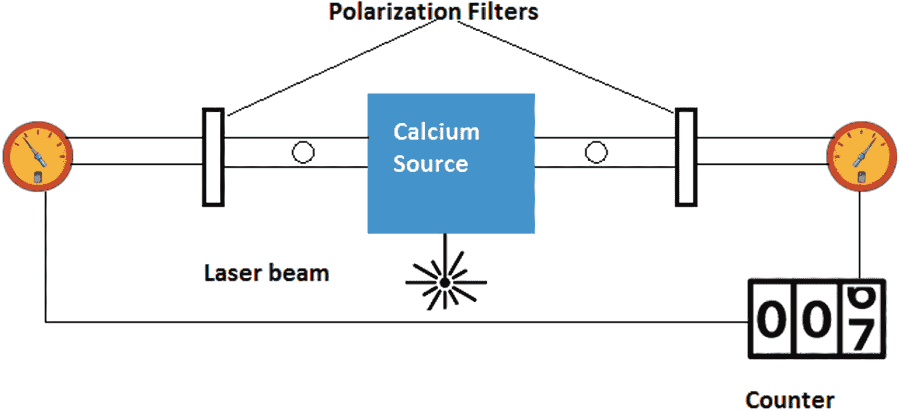

图 1-10

阿斯佩克特检验贝尔不等式的实验——第一阶段

如果两个偏振滤波器校准在同一方向上，阿斯佩克特观察到光子对之间存在关联。它们要么同时通过，要么同时被阻挡。这种关联与爱因斯坦的观点一致，即光子的偏振属性在从光源发射的那一刻就已经预先确定，而非如量子力学所预测的那样在测量时刻才被确定。

另一方面，如果滤波器的偏振设置不同，那么我们应该预期有一定的最小百分比的光子要么通过要么被阻挡。此时贝尔不等式便开始发挥作用（如前一小节表 1-2 所示）：
* 如果通过或被阻挡的光子百分比大于或等于预期最小值，则贝尔不等式成立，光子的偏振在发射时刻就已经确定（爱因斯坦获胜，量子力学被击败）。
* 另一方面，如果百分比小于预期最小值，则贝尔不等式被违反，量子物理学是正确的。偏振在测量时刻被确定（玻尔获胜，量子力学得到维护）。

阿斯佩克特在不同偏振设置下测量了许多对光子。结果令人震惊：测量结果违反了贝尔不等式；因此，偏振不可能在发射时刻被预先确定。量子力学是正确的！光子似乎是在测量时刻才共同选择了一个偏振状态。难道光子之间存在某种未知的信号，告诉它们在测量时刻选取一个共同的值吗？

爱因斯坦的相对论指出，没有任何信号能够超越光速——宇宙中的终极速度极限。他将这种看似同时发生的信号称为“鬼魅般的超距作用”。阿斯佩克特希望在他实验的第二阶段对这一论断进行检验。

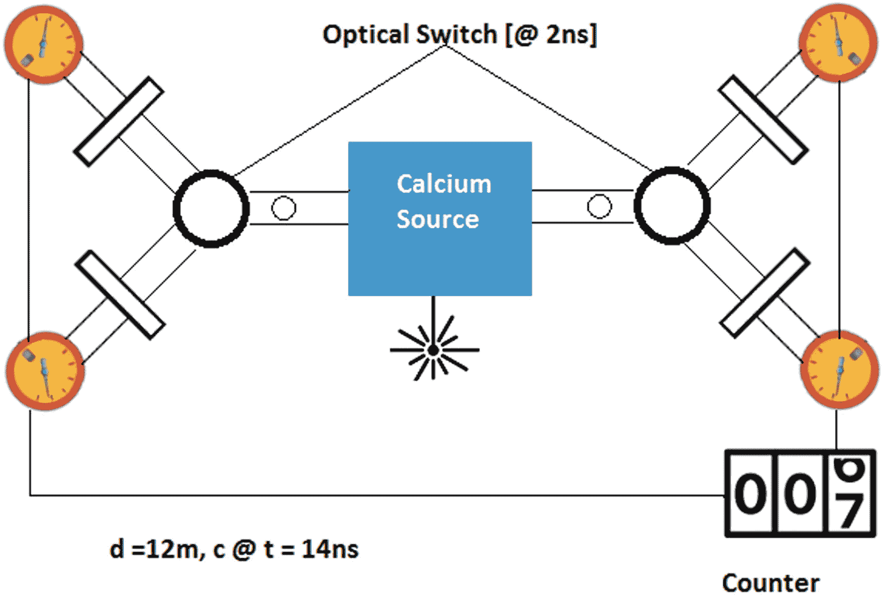

图 1-11 阿斯佩克特检验“鬼魅般的超距作用”的实验

在实验的第二阶段，阿斯佩克特使用了两个光开关，每个开关分叉连接到两个独立的偏振滤波器，每个滤波器再连接到一个测量装置（见图 1-10）。和之前一样，所有测量装置都连接到一个计数器以收集结果：
* 光开关设计为能以极快的速度（2 纳秒或 2 ns）将光子发送到两个方向之一。
* 实验两端之间的距离为 12 米。光速（以 `3*10⁸` 米/秒的速度传播）需要 40 纳秒才能从实验的一端到达另一端。

