# 7. 博弈论：有了量子力学，胜算总在你这边

本章探讨两个游戏谜题，展示量子算法相对于经典算法的非凡力量：

- *假币谜题*：这是一个经典的平衡谜题，由数学家 E. D. Schell 于 1945 年提出。它涉及使用天平，在有限次数的尝试中，通过平衡硬币来确定哪一枚重量不同（假币）。
- *Mermin-Peres 魔术正方形游戏*：这是一个量子伪心灵感应的例子，即玩家能够实现某些结果，而这些结果只有在游戏过程中神秘地通信时才有可能。

在这两种情况下，量子计算为玩家提供了近乎神奇的技能，就像他们一直在作弊一样。让我们一探究竟。

## 假币谜题

在这个谜题中，玩家有八枚硬币和一个天平。其中一枚是假币，因此重量较轻。游戏目标是通过仅使用天平两次，找出哪枚是假币。您能想到办法吗？让我们看一下图 7-1 所示的解法。

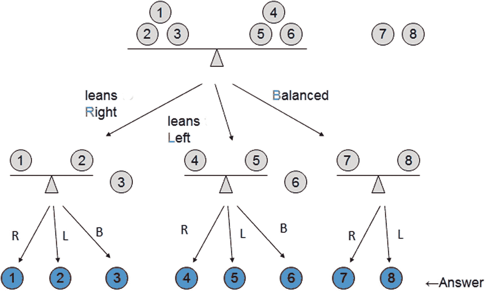

图 7-1 八枚硬币的假币谜题解法

1. 给定八枚硬币，将硬币 1-3 放在天平左侧，硬币 4-6 放在右侧。将最后两枚硬币 7 和 8 放在旁边并称重。

2. 如果天平向右倾斜，则假币在 1-3 中（左侧）。记住假币更轻。因此，取出左侧最后一枚硬币（3），然后再次称重（第二次）。
   - 如果天平向右倾斜，则假币是 1。停止。
   - 如果天平向左倾斜，则假币是 2。停止。
   - 如果天平平衡，则假币是 3。停止。

3. 如果天平向左倾斜，则假币在 4-6 中。取出最后一枚硬币（6），然后再次称重。
   - 如果天平向右倾斜，则假币是 4。停止。
   - 如果天平向左倾斜，则假币是 5。停止。
   - 如果天平平衡，则假币是 6。停止。

4. 如果天平平衡，则假币是 7 或 8 中的一个。将 7 和 8 放在天平上再次称重。
   - 如果天平向右倾斜，则假币是 7。停止。
   - 如果天平向左倾斜，则假币是 8。停止。

根据上一节的步骤，可以实现一个独立于硬币总数 `N` 和假币数量 `k` 的经典算法。一般来说，广义假币谜题的时间复杂度由下式给出

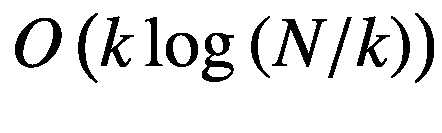

###### 提示

已有证明表明，在经典计算机上使用天平，找到一枚假币所需的最少尝试次数是两次。


### 量子版假币问题

信不信由你，有一种量子算法只需使用一次量子天平就能找出假币，且查找次数与硬币数量 `N` 无关！一般而言，对于任意数量的假币 `k`（与 `N` 无关），该算法的时间复杂度为

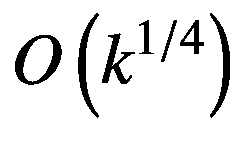

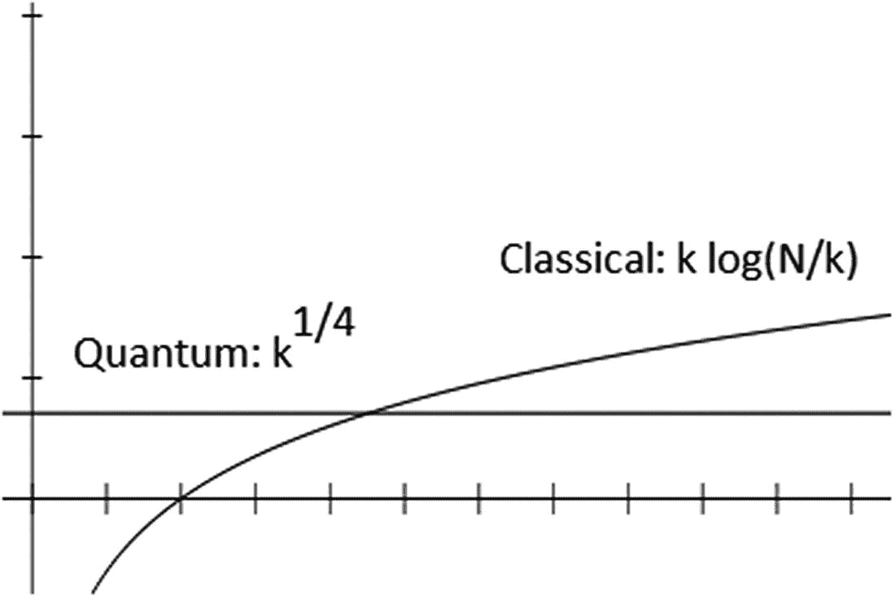

**图 7-2** 假币问题的量子与经典时间复杂度对比

> **小贴士**  
> 量子假币算法是相较于经典算法实现四次方加速的一个示例。

因此，图 7-2 展示了在假币谜题上量子算法相较于经典算法的强大之处。现在，让我们深入探讨。寻找单个假币（`k = 1`）的量子算法可归纳为三个阶段：查询量子天平、构建量子天平、识别假币。

### 第一步：查询量子天平

量子算法会以叠加态的方式查询天平。为此，我们使用一个二进制查询字符串来编码放置在托盘上的硬币。例如，查询字符串 `11101111` 表示除索引为 3 的硬币外，所有硬币都在天平上。当没有假币时天平平衡，否则天平倾斜。下表说明了这一点。

| **N (硬币数量)** | **F (假币索引)** | **查询字符串** | **结果** |
| --- | --- | --- | --- |
| 8 | 3 | `11101111` | 平衡 (0) |
| 8 | 3 | `11111111` | 倾斜 (1) |

该过程可总结如下：

1. 使用两个量子寄存器来查询量子天平，其中第一个寄存器用于存放查询字符串，第二个寄存器用于存放结果。
2. 准备所有包含偶数个 1 的二进制查询字符串的叠加态。
3. 要获得包含偶数个 1 的状态叠加，对基态 `|0>` 执行 Hadamard 变换，并检查 `|x|` 的汉明重量是否为偶数。可以证明，当且仅当 `x1 ⊕ x2 ⊕ … ⊕ xN = 0` 时，`|x|` 的汉明重量为偶数。

> **小贴士**  
> 字符串的汉明重量（`hw`）是指与该字母表零字符不同的符号数量。例如，`hw(11101) = 4`，`hw(11101000) = 4`，`hw(000000) = 0`。

4. 最后，测量第二个寄存器。如果观察到 `|0>`，那么第一个寄存器就是我们想要的所有二进制查询字符串的叠加态。如果得到 `|1>`，则重复该过程，直到观察到 `|0>` 为止。

请注意，每次重复保证成功的概率恰好为二分之一。因此，经过几次重复，我们应该能够获得所需的叠加态。列表 7-1 展示了一个用于查询量子天平的量子程序实现，对应的图形电路如图 7-3 所示。

> **注**  
> 为清晰起见，完整的假币程序被拆分到列表 7-1 至 7-3 中。虽然您可以将各部分结合起来运行该程序，但完整的代码清单可从 `Workspace\Ch07\p_counterfeitcoin.py` 源文件中获取。

```
# ------- 查询量子天平
Q_program = QuantumProgram()
Q_program.set_api(Qconfig.APItoken, Qconfig.config["url"])
##### 创建 numberOfCoins + 1 个量子/经典寄存器
##### 额外 1 个量子比特用于记录量子天平的结果
qr = Q_program.create_quantum_register("qr", numberOfCoins +1 )
##### 用于记录对 qr 的测量结果
cr = Q_program.create_classical_register("cr", numberOfCoins + 1)
circuitName = "QueryStateCircuit"
circuit   = Q_program.create_circuit(circuitName, [qr], [cr])
N = numberOfCoins
##### 创建所有长度为 N 的字符串的均匀叠加态
for i in range(N):
circuit.h(qr[i])
##### 通过从 qr[0] 到 qr[N-1] 依次应用 CNOT 门来执行 XOR(x)
##### 并将结果存储到 qr[N]
for i in range(N):
circuit.cx(qr[i], qr[N])
##### 测量 qr[N] 并将结果存储到 cr[N]。
##### 如果 cr[N] 为零则继续，否则重复
circuit.measure(qr[N], cr[N])
##### 如果 cr[0]...cr[N] 的值全为 0，则查询量子天平
##### 方法是在 qr[N] 上准备 |1> 的 Hadamard 态，即 |0> - |1>
circuit.x(qr[N]).c_if(cr, 0)
circuit.h(qr[N]).c_if(cr, 0)
##### 当 cr[N] 不为零时回退计算
for i in range(N):
circuit.h(qr[i]).c_if(cr, 2**N)
列表 7-1
查询量子天平的脚本
```

图 7-3 展示了针对 8 枚硬币（假币索引为 6）的假币谜题的完整电路。该电路在 IBM Q Experience 平台上展示了此处描述的所有阶段。算法中的第二阶段是构建天平。

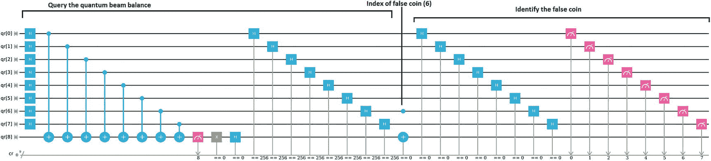

**图 7-3** 假币谜题的量子电路，其中 N = 8，k = 1，假币索引为 6（注：如需全尺寸查看，此图包含在源代码下载中）

### 第二步：构建量子天平

在上一节中，我们构建了所有汉明重量为偶数的二进制查询字符串的叠加态。在这一步中，我们通过设定假币的位置来构建量子天平。因此，给定 `k` 是假币相对于二进制字符串 `|x1, x2, …, xN>|0>` 的位置，量子天平返回

`|x1, x2, … , xN> |0⊕xk>`

这是通过一个 CNOT 门实现的，其中 `xk` 作为控制位，第二个寄存器作为目标位（参见列表 7-2 的片段）。

```
#----- 构建量子天平
k = indexOfFalseCoin
##### 在所需的叠加态（由 cr 等于零标记）上应用量子天平
circuit.cx(qr[k], qr[N]).c_if(cr, 0)
列表 7-2
构建量子天平
```


### 第三步：识别假币

在查询天平后，为了识别假币，需对二进制查询字符串应用哈达玛变换。假设我们使用汉明重量为偶数的二进制字符串查询量子束天平，那么在哈达玛变换后，通过在计算基上进行测量，我们可以识别出假币，因为假币的标签与多数不同（参见代码清单 7-3）。

```
# --- 识别假币
##### 对 qr[0] ... qr[N-1] 应用哈达玛变换
for i in range(N):
circuit.h(qr[i]).c_if(cr, 0)
##### 测量 qr[0] ... qr[N-1]
for i in range(N):
circuit.measure(qr[i], cr[i])
results   = Q_program.execute([circuitName], backend=backend, shots=shots)
answer  = results.get_counts(circuitName)
print("设备 " + backend + " 计数 " + str(answer))
##### 获取最常见的标签
for key in answer.keys():
normalFlag, _ = Counter(key[1:]).most_common(1)[0]
for i in range(2,len(key)):
if key[i] != normalFlag:
print("假币索引为: ", len(key) - i - 1)
代码清单 7-3
识别假币
```

当最左边的位为 0 时，可以通过找到与其他位值不同的位来确定假币的索引。例如，对于 `N = 8`，假币索引 = 6，则结果应为 `010111111` 或 `001000000`。请注意，因为我们使用 `cr[N]` 来控制查询天平前后操作，因此：

- 如果最左边的位为 0，则我们成功识别了假币。
- 如果最左边的位为 1，则我们未能获得所需的叠加态，必须从头开始重复该过程。

针对远程 IBM Q Experience 模拟器运行程序，得到结果（位于书籍源代码 `Workspace\Ch07\p_counterfeitcoin.py`）。请注意，我在此例中使用的是 Windows 系统：

```
c:\python36-64\python.exe p_counterfeitcoin.py
Device ibmq_qasm_simulator counts {'001000000': 1}
False coin index is:  6
```

如果你没有访问书籍源代码的权限，但仍想尝试此脚本，请将前面章节中的代码片段粘贴到代码清单 7-4 的容器脚本内（注意 Python 的缩进怪癖，它们会让你抓狂）。

```
import sys
import matplotlib.pyplot as plt
import numpy as np
from math import pi, cos, acos, sqrt
from collections import Counter
from qiskit import QuantumProgram
sys.path.append('../Config/')
import Qconfig
##### 导入基本绘图工具
from qiskit.tools.visualization import plot_histogram
def main(M = 16, numberOfCoins = 8 , indexOfFalseCoin = 6
, backend = "local_qasm_simulator" , shots = 1 ):
if numberOfCoins = M:
raise Exception("请使用 4 到 ", M-1, " 之间的 numberOfCoins")
if indexOfFalseCoin = numberOfCoins:
raise Exception("indexOfFalseCoin 必须介于 0 和 ", numberOfCoins-1, " 之间")
// 在此处粘贴代码清单 7-1 -> 7-3
#################################################
##### 主函数
#################################################
if __name__ ==  '__main__':
M = 8                          # 最大可用量子比特数
numberOfCoins = 4    # 最大为 M-1，其中 M 是可用量子比特数
indexOfFalseCoin = 2 # 此值应为 0, 1, ..., numberOfCoins - 1,
backend   = "ibmq_qasm_simulator"
#backend = "ibmqx3"
shots     = 1     # 执行一次单次实验
main(M, numberOfCoins, indexOfFalseCoin, backend, shots)
代码清单 7-4
假币谜题主容器脚本
```

### 任意数量假币的泛化

数学家 Terhal 和 Smolin 于 1998 年将假币谜题推广到任意数量的假币（`k > 1`）情况。他们的实现使用了平衡预言机模型（`B-Oracle`），其规则如下：

- 给定一个 N 位的输入 `x = x1x2…xn ∈ {0, 1}^N`。
- 构造一个 N 位三进制查询字符串，使得 `q = q1q2…qn ∈ {0, 1, -1}^N`，并且其中 1 和 -1 的数量相同。
- 答案是 1 位，使得 `χ(x; q) = { 0 如果 q1x1 + q2x2 + … + qnxn = 0（平衡），否则为 1（倾斜）}`。

###### 提示

预言机是算法中被视为黑盒的部分。它用于简化电路，并提供量子算法与经典算法之间的复杂性比较。一个好的预言机应具备速度、通用性和可行性。

`B-Oracle` 的一个运行实例如图 7-4 所示，其中包含两枚假币：`k = 2` 且 `N = 6`。

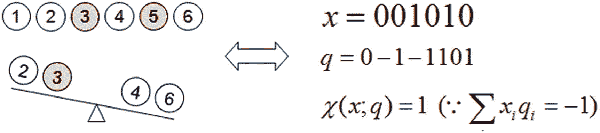

**图 7-4** 针对 N = 6 和 k = 2 的 B-Oracle

总而言之，假币谜题是量子算法相对于经典算法实现四次方加速的典型例子。在下一节中，我们将研究另一个奇异的神奇谜题，称为梅明-佩雷斯魔方。

## 梅明-佩雷斯魔方

这是另一个经典谜题，最初由物理学家戴维·梅明和 A·佩雷斯提出，作为量子伪心灵感应或两个玩家对外部观察者具有某种超自然沟通能力的例子。得益于纠缠的神奇力量，这是可能的。让我们仔细看看。

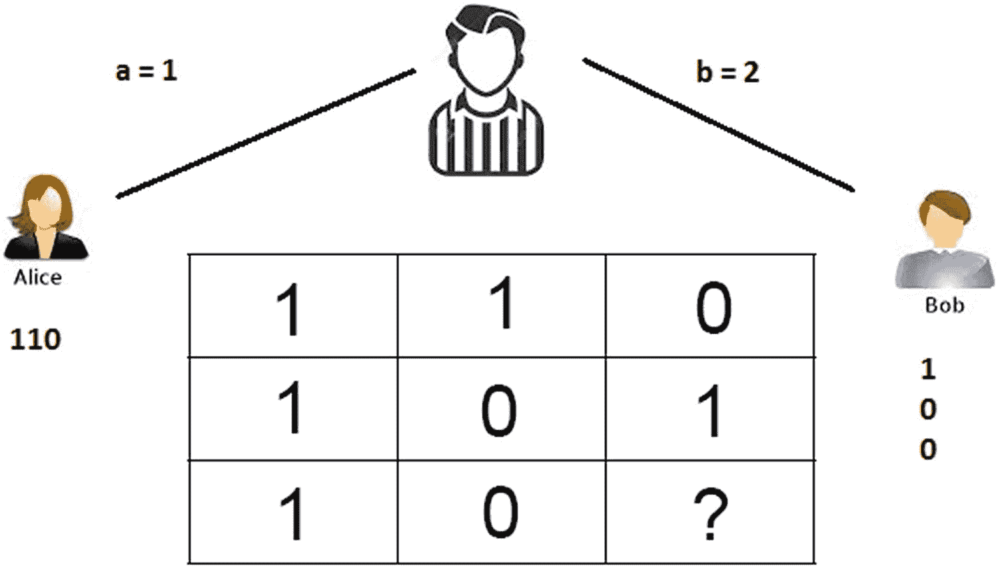

**图 7-5** 梅明-佩雷斯魔方

游戏开始时，两名玩家爱丽丝和鲍勃对抗一名裁判。魔方是一个 3x3 矩阵，规则如下（参见图 7-5）：

- 所有条目均为 0 或 1，使得每行条目的和为偶数，每列条目的和为奇数。这个游戏之所以被称为魔方，是因为这样的方阵是不可能的；如图 7-5 所示，不存在行和为偶数且列和为奇数的有效组合（你可以用纸笔亲自尝试）。这是由于矩阵中条目数为奇数所致。
- 裁判向爱丽丝发送一个整数 `a ∈ {1,2,3}`，并向鲍勃发送另一个整数 `b ∈ {1,2,3}`。爱丽丝必须回复方阵的第 `a` 行。鲍勃必须回复第 `b` 列。
- 如果爱丽丝的条目之和为偶数，鲍勃的条目之和为奇数，并且他们交集的答案相同，则爱丽丝和鲍勃获胜。否则，裁判获胜。
- 游戏开始前，爱丽丝和鲍勃可以制定策略并共享信息。例如，他们可以决定使用图 7-5 中的矩阵来回答。然而，他们在游戏过程中不允许交流。

例如，在上述矩阵中，如果裁判向爱丽丝发送 `a = 1`，向鲍勃发送 `b = 2`，爱丽丝将回复 `110`（第 1 行），鲍勃将回复 `100`（第 2 列）。答案交集处的元素（第 1 行 - 第 2 列）相同（均为 1），因此他们赢得了游戏。可以证明，在经典设定下，爱丽丝和鲍勃的获胜概率最多为 8/9。也就是说，方阵中有八分之九的排列可以获胜。因此，爱丽丝和鲍勃的获胜概率最高为 88.8%。

让我们通过一个精巧的练习来验证这一论断，证明经典情况下魔方的获胜概率确实最多为 8/9（88.88%）。


### 梅明-佩雷斯幻方练习

1.  使用二进制码 `(1, -1)` 而非 `(1, 0)` 构建一个类似于图 7-5 的幻方，要求行元素的乘积为 `1`（偶数），列元素的乘积为 `-1`（奇数）。请确认这实际上是不可能的。
2.  使用步骤 1 中的幻方，为裁判的 `a` 和 `b` 值创建一个排列表，包括：
    -   排列序号
    -   `a`、`b` 的值
    -   爱丽丝和鲍勃的响应
    -   爱丽丝和鲍勃响应的交集。记住，为了获胜，它们的交集必须相等。
    -   游戏迭代结果：胜 = `W`，负 = `L`。
3.  最后计算获胜概率，并证明其至多为 8/9。**注意**：答案在本节末尾。

### 量子获胜策略

得益于量子力学的强大力量和纠缠的魔力，爱丽丝和鲍勃可以表现得更好。事实上，他们可以 100% 地赢得游戏，就好像他们在进行心灵感应通信一样，因此才有了“伪心灵感应”这个术语。一种量子获胜策略最早由 Brassard 及其同事提出^(³²)，该策略分为三个阶段：
-   **共享的纠缠态**：这是爱丽丝和鲍勃 100% 获胜的关键。
-   **针对爱丽丝和鲍勃输入信息的酉变换**：这提供了要发回给裁判的响应。
-   **在计算基下测量**：构建最终响应的最后阶段。

### 共享的纠缠态

在量子获胜策略中，爱丽丝和鲍勃共享纠缠态：

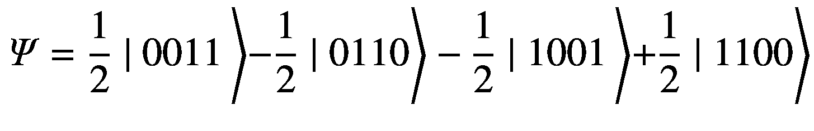

一个电路实现需要 2 个量子比特给爱丽丝，2 个给鲍勃，如图 7-6 所示。

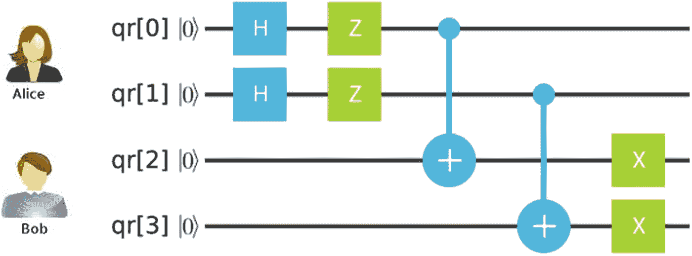

**图 7-6** 幻方的纠缠态

-   我们知道 Hadamard 门将基态 `H|0⟩` 映射为 `(1/√2)(|0⟩ + |1⟩)`。因此，将其应用于前 2 个量子比特得到 `Ψ = (1/2)|00⟩ + (1/2)|01⟩ + (1/2)|10⟩ + (1/2)|11⟩`。
-   接下来，对前 2 个量子比特应用一个 `Z` 门。请记住，`Z` 门保持 `0` 态不变，并将 `1` 映射为 `-1`（翻转前一第三项的符号）。在此阶段，态变为 `Ψ = (1/2)|00⟩ + (1/2)|01⟩ - (1/2)|10⟩ + (1/2)|11⟩`。
-   接下来，应用 `CNOT` 门来纠缠量子比特 0-2 和 1-3：`Ψ = (1/2)|0000⟩ - (1/2)⟨0101| - (1/2)|1010⟩ + (1/2)|1111⟩`。
-   最后，使用 `X` 门翻转最后 2 个量子比特，得到 `Ψ = (1/2)|0011⟩ - (1/2)|0110⟩ - (1/2)|1001⟩ + (1/2)|1100⟩`。

构建该纠缠态的 Python 脚本在代码清单 7-5 中给出。

```python
##### Create the entangle state
Q_program = QuantumProgram()
Q_program.set_api(Qconfig.APItoken, Qconfig.config["url"])
##### 4 qubits (Alice = 2, Bob = 2)
N = 4
##### Creating registers
qr = Q_program.create_quantum_register("qr", N)
##### for recording the measurement on qr
cr = Q_program.create_classical_register("cr", N)
circuitName = "sharedEntangled"
sharedEntangled = Q_program.create_circuit(circuitName, [qr], [cr])
#Create uniform superposition of all strings of length 2
for i in range(2):
    sharedEntangled.h(qr[i])
#The amplitude is minus if there are odd number of 1s
for i in range(2):
    sharedEntangled.z(qr[i])
#Copy the content of the first two qubits to the last two qubits
for i in range(2):
    sharedEntangled.cx(qr[i], qr[i+2])
#Flip the last two qubits
for i in range(2,4):
    sharedEntangled.x(qr[i])
```

**代码清单 7-5** 量子获胜策略的纠缠态

有了共享的纠缠态，爱丽丝和鲍勃现在就可以开始游戏并从裁判那里接收输入信息了。

### 酉变换

在接收到各自的输入 `a ∈ {1,2,3}` 和 `b ∈ {1,2,3}` 后，爱丽丝和鲍勃将以下酉变换应用于共享纠缠态：爱丽丝使用 `A1`、`A2`、`A3`，鲍勃使用 `B1`、`B2`、`B3`：

![$$ A1=\frac{1}{\sqrt{2}}\left[\begin{array}{cccc}i&amp; 0&amp; 0&amp; 1\\ {}0&amp; -i&amp; 1&amp; 0\\ {}0&amp; i&amp; 1&amp; 0\\ {}1&amp; 0&amp; 0&amp; i\end{array}\right],A2=\frac{1}{2}\left[\begin{array}{cccc}i&amp; 1&amp; 1&amp; i\\ {}-i&amp; 1&amp; -1&amp; i\\ {}i&amp; 1&amp; 1&amp; -i\\ {}-i&amp; 1&amp; -1&amp; -i\end{array}\right],A3=\frac{1}{2}\left[\begin{array}{cccc}-1&amp; -1&amp; -1&amp; 1\\ {}1&amp; 1&amp; -1&amp; 1\\ {}1&amp; -1&amp; 1&amp; 1\\ {}1&amp; -1&amp; -1&amp; -1\end{array}\right] $$](images/469026_1_En_7_Chapter/469026_1_En_7_Chapter_TeX_Equd.png)

![$$ B1=\frac{1}{2}\left[\begin{array}{cccc}i&amp; -i&amp; 1&amp; 1\\ {}-i&amp; -i&amp; 1&amp; -1\\ {}1&amp; 1&amp; -i&amp; i\\ {}-i&amp; i&amp; 1&amp; 1\end{array}\right],B2=\frac{1}{2}\left[\begin{array}{cccc}-1&amp; i&amp; 1&amp; i\\ {}1&amp; i&amp; 1&amp; -i\\ {}1&amp; -i&amp; 1&amp; i\\ {}-1&amp; -i&amp; 1&amp; -i\end{array}\right],B3=\frac{1}{\sqrt{2}}\left[\begin{array}{cccc}1&amp; 0&amp; 0&amp; 1\\ {}-1&amp; 0&amp; 0&amp; 1\\ {}0&amp; 1&amp; 1&amp; 0\\ {}0&amp; 1&amp; -1&amp; 0\end{array}\right] $$](images/469026_1_En_7_Chapter/469026_1_En_7_Chapter_TeX_Eque.png)


###### 注意

请记住，通过对纠缠态应用上述变换，爱丽丝和鲍勃能够构造出各自向裁判回复的前 2 个比特。

`列表 7-6` 展示了爱丽丝和鲍勃的幺正变换，以及它们在 `表 7-1` 中等效的图形化电路。

```
#------  爱丽丝和鲍勃操作的电路。
#我们首先定义分配相位所需的受控-u 门
from math import pi
def ch(qProg, a, b):
""" 受控-阿达玛门 """
qProg.h(b)
qProg.sdg(b)
qProg.cx(a, b)
qProg.h(b)
qProg.t(b)
qProg.cx(a, b)
qProg.t(b)
qProg.h(b)
qProg.s(b)
qProg.x(b)
qProg.s(a)
return qProg
def cu1pi2(qProg, c, t):
""" 受控-u1(phi/2)门 """
qProg.u1(pi/4.0, c)
qProg.cx(c, t)
qProg.u1(-pi/4.0, t)
qProg.cx(c, t)
qProg.u1(pi/4.0, t)
return qProg
def cu3pi2(qProg, c, t):
""" 受控-u3(pi/2, -pi/2, pi/2)门 """
qProg.u1(pi/2.0, t)
qProg.cx(c, t)
qProg.u3(-pi/4.0, 0, 0, t)
qProg.cx(c, t)
qProg.u3(pi/4.0, -pi/2.0, 0, t)
return qProg
#----------------------------------------------------------------------
##### 定义爱丽丝和鲍勃针对其每个输入（1、2、3）所使用的电路
##### 爱丽丝操作/电路的字典
aliceCircuits = {}
##### 爱丽丝 1、2、3 的量子电路
for idx in range(1, 4):
circuitName = "Alice"+str(idx)
aliceCircuits[circuitName]
= Q_program.create_circuit(circuitName, [qr], [cr])
theCircuit = aliceCircuits[circuitName]
if idx == 1:
#A_1 的电路
theCircuit.x(qr[1])
theCircuit.cx(qr[1], qr[0])
theCircuit = cu1pi2(theCircuit, qr[1], qr[0])
theCircuit.x(qr[0])
theCircuit.x(qr[1])
theCircuit = cu1pi2(theCircuit, qr[0], qr[1])
theCircuit.x(qr[0])
theCircuit = cu1pi2(theCircuit, qr[0], qr[1])
theCircuit = cu3pi2(theCircuit, qr[0], qr[1])
theCircuit.x(qr[0])
theCircuit = ch(theCircuit, qr[0], qr[1])
theCircuit.x(qr[0])
theCircuit.x(qr[1])
theCircuit.cx(qr[1], qr[0])
theCircuit.x(qr[1])
elif idx == 2:
theCircuit.x(qr[0])
theCircuit.x(qr[1])
theCircuit = cu1pi2(theCircuit, qr[0], qr[1])
theCircuit.x(qr[0])
theCircuit.x(qr[1])
theCircuit = cu1pi2(theCircuit, qr[0], qr[1])
theCircuit.x(qr[0])
theCircuit.h(qr[0])
theCircuit.h(qr[1])
elif idx == 3:
theCircuit.cz(qr[0], qr[1])
theCircuit.swap(qr[0], qr[1]) # 在作曲家中不支持
theCircuit.h(qr[0])
theCircuit.h(qr[1])
theCircuit.x(qr[0])
theCircuit.x(qr[1])
theCircuit.cz(qr[0], qr[1])
theCircuit.x(qr[0])
theCircuit.x(qr[1])
#在计算基中测量前两个量子比特
theCircuit.measure(qr[0], cr[0])
theCircuit.measure(qr[1], cr[1])
##### 鲍勃操作/电路的字典
bobCircuits = {}
##### 鲍勃接收到 1、2、3 时的量子电路
for idx in range(1,4):
circuitName = "Bob"+str(idx)
bobCircuits[circuitName]
= Q_program.create_circuit(circuitName, [qr], [cr])
theCircuit = bobCircuits[circuitName]
if idx == 1:
theCircuit.x(qr[2])
theCircuit.x(qr[3])
theCircuit.cz(qr[2], qr[3])
theCircuit.x(qr[3])
theCircuit.u1(pi/2.0, qr[2])
theCircuit.x(qr[2])
theCircuit.z(qr[2])
theCircuit.cx(qr[2], qr[3])
theCircuit.cx(qr[3], qr[2])
theCircuit.h(qr[2])
theCircuit.h(qr[3])
theCircuit.x(qr[3])
theCircuit = cu1pi2(theCircuit, qr[2], qr[3])
theCircuit.x(qr[2])
theCircuit.cz(qr[2], qr[3])
theCircuit.x(qr[2])
theCircuit.x(qr[3])
elif idx == 2:
theCircuit.x(qr[2])
theCircuit.x(qr[3])
theCircuit.cz(qr[2], qr[3])
theCircuit.x(qr[3])
theCircuit.u1(pi/2.0, qr[3])
theCircuit.cx(qr[2], qr[3])
theCircuit.h(qr[2])
theCircuit.h(qr[3])
elif idx == 3:
theCircuit.cx(qr[3], qr[2])
theCircuit.x(qr[3])
theCircuit.h(qr[3])
#在计算基中测量第三和第四个量子比特
theCircuit.measure(qr[2], cr[2])
theCircuit.measure(qr[3], cr[3])
```

**列表 7-6** 爱丽丝和鲍勃的幺正变换

`表 7-1` 展示了用于 IBM Q Experience Composer 的幺正变换 `A1-3`、`B1-3` 的量子电路。

**表 7-1** `列表 7-6` 中幺正变换的量子电路

| 变换 | 电路 |
| --- | --- |
| ![$$ A1=\frac{1}{\sqrt{2}}\left[\begin{array}{cccc}i&amp; 0&amp; 0&amp; 1\\ {}0&amp; -i&amp; 1&amp; 0\\ {}0&amp; i&amp; 1&amp; 0\\ {}1&amp; 0&amp; 0&amp; i\end{array}\right] $$](images/469026_1_En_7_Chapter/469026_1_En_7_Chapter_TeX_IEq7.png) |  |
| ![$$ A2=\frac{1}{2}\left[\begin{array}{cccc}i&amp; 1&amp; 1&amp; i\\ {}-i&amp; 1&amp; -1&amp; i\\ {}i&amp; 1&amp; 1&amp; -i\\ {}-i&amp; 1&amp; -1&amp; -i\end{array}\right] $$](images/469026_1_En_7_Chapter/469026_1_En_7_Chapter_TeX_IEq8.png) | 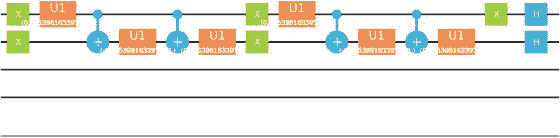 |
| ![$$ B1=\frac{1}{2}\left[\begin{array}{cccc}i&amp; -i&amp; 1&amp; 1\\ {}-i&amp; -i&amp; 1&amp; -1\\ {}1&amp; 1&amp; -i&amp; i\\ {}-i&amp; i&amp; 1&amp; 1\end{array}\right] $$](images/469026_1_En_7_Chapter/469026_1_En_7_Chapter_TeX_IEq9.png) | 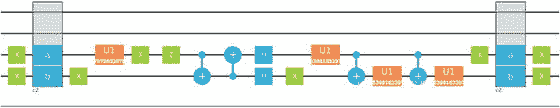 |
| ![$$ B2=\frac{1}{2}\left[\begin{array}{cccc}-1&amp; i&amp; 1&amp; i\\ {}1&amp; i&amp; 1&amp; -i\\ {}1&amp; -i&amp; 1&amp; i\\ {}-1&amp; -i&amp; 1&amp; -i\end{array}\right] $$](images/469026_1_En_7_Chapter/469026_1_En_7_Chapter_TeX_IEq10.png) | 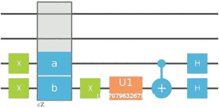 |
| ![$$ B3=\frac{1}{\sqrt{2}}\left[\begin{array}{cccc}1&amp; 0&amp; 0&amp; 1\\ {}-1&amp; 0&amp; 0&amp; 1\\ {}0&amp; 1&amp; 1&amp; 0\\ {}0&amp; 1&amp; -1&amp; 0\end{array}\right] $$](images/469026_1_En_7_Chapter/469026_1_En_7_Chapter_TeX_IEq11.png) | 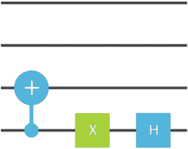 |

在`表 7-1`中，请注意不包含 `A3`，这是因为 Composer 不支持`列表 7-6` 中所需的 `swap` 门。然而，这并不意味着量子程序无法在模拟器或真实设备上运行。它仅表示该电路无法在 Composer 中创建。因此，在最后一步，爱丽丝和鲍勃在计算基中测量他们的量子比特。


### 计算基下的测量

测量结束后，爱丽丝和鲍勃各自得到两个比特作为各自的输出。为了获得第三个比特从而得到最终答案，他们应用各自的奇偶规则。也就是说，爱丽丝的和必须为偶数，鲍勃的必须为奇数。例如，当 `a = 2`、`b = 3` 时（见表 7-2）

![$$ {\displaystyle \begin{array}{l}\left(A2\otimes B3\right)\mid \psi \left\rangle =\frac{1}{2\sqrt{2}}\right\mid 0000\left\rangle -\mid 0010\right\rangle -\mid 0101\left\rangle +\mid 0111\right\rangle +\mid 1001\Big\rangle \\ {}\kern7.25em -\mid 1011\left\rangle -\mid 1100\right\rangle -\mid 1110\Big\rangle \end{array}} $$

**表 7-2**  
魔方阵在 `a = 2`、`b = 3` 时的答案排列

| ψ | 爱丽丝的答案 | 鲍勃的答案 | 方阵 |
| --- | --- | --- | --- |
| `\|0000>` | 000 | 001 | ![$$ \left[0\kern0.375em 0\kern0.375em \begin{array}{l}0\\ {}0\\ {}1\end{array}\right] $$](images/469026_1_En_7_Chapter/469026_1_En_7_Chapter_TeX_IEq12.png) |
| `\|0010>` | 000 | 100 | ![$$ \left[0\kern0.5em 0\kern0.5em \begin{array}{l}1\\ {}0\\ {}0\end{array}\right] $$](images/469026_1_En_7_Chapter/469026_1_En_7_Chapter_TeX_IEq13.png) |
| `\|0101>` | 011 | 010 | ![$$ \left[0\kern0.5em 1\kern0.5em \begin{array}{l}1\\ {}1\\ {}0\end{array}\right] $$](images/469026_1_En_7_Chapter/469026_1_En_7_Chapter_TeX_IEq14.png) |
| `\|0111>` | 011 | 111 | ![$$ \left[0\kern0.5em 1\kern0.5em \begin{array}{l}1\\ {}1\\ {}1\end{array}\right] $$](images/469026_1_En_7_Chapter/469026_1_En_7_Chapter_TeX_IEq15.png) |
| `\|1001>` | 101 | 010 | ![$$ \left[1\kern0.5em 0\kern0.5em \begin{array}{l}0\\ {}1\\ {}0\end{array}\right] $$](images/469026_1_En_7_Chapter/469026_1_En_7_Chapter_TeX_IEq16.png) |
| `\|1011>` | 101 | 111 | ![$$ \left[1\kern0.5em 0\kern0.5em \begin{array}{l}1\\ {}1\\ {}1\end{array}\right] $$](images/469026_1_En_7_Chapter/469026_1_En_7_Chapter_TeX_IEq17.png) |
| `\|1100>` | 110 | 001 | ![$$ \left[1\kern0.5em 1\kern0.5em \begin{array}{l}0\\ {}0\\ {}1\end{array}\right] $$](images/469026_1_En_7_Chapter/469026_1_En_7_Chapter_TeX_IEq18.png) |
| `\|1110>` | 110 | 101 | ![$$ \left[1\kern0.5em 1\kern0.5em \begin{array}{l}1\\ {}0\\ {}1\end{array}\right] $$](images/469026_1_En_7_Chapter/469026_1_En_7_Chapter_TeX_IEq19.png) |

清单 7-7 展示了遍历魔方阵所有轮次的脚本片段：

-   它循环遍历 `a[1,3]` 和 `b[1,3]`（包含边界值）。
-   对于每一组 `(a, b)`，从清单 7-6 中检索爱丽丝的电路（`Alice-a`）和鲍勃的电路（`Bob-b`）。
-   将共享纠缠态 `ψ` 以及 `Alice-a` 和 `Bob-b` 电路提交给模拟器或真实量子设备执行。
-   从答案（例如 `{'0011': 1}`）中为爱丽丝和鲍勃分别提取两个比特。
-   应用奇偶规则：爱丽丝的和必须为偶数，鲍勃的和必须为奇数。
-   最后验证答案，并显示获胜概率。

```
def all_rounds(backend, real_dev, shots=10):
nWins = 0
nLost = 0
for a in range(1,4):
for b in range(1,4):
print("Asking Alice and Bob with a and b are: ", a,b)
rWins = 0
rLost = 0
aliceCircuit   = aliceCircuits["Alice" + str(a)]
bobCircuit     = bobCircuits["Bob" + str(b)]
circuitName   = "Alice" + str(a) + "Bob"+str(b)
Q_program.add_circuit(circuitName, sharedEntangled+aliceCircuit+bobCircuit)
if real_dev:
ibmqx2_backend = Q_program.get_backend_configuration(backend)
ibmqx2_coupling = ibmqx2_backend['coupling_map']
results = Q_program.execute([circuitName], backend=backend, shots=shots
, coupling_map=ibmqx2_coupling, max_credits=3, wait=10, timeout=240)
else:
results = Q_program.execute([circuitName], backend=backend, shots=shots)
answer = results.get_counts(circuitName)
for key in answer.keys():
kfreq = answer[key] #frequencies of keys obtained from measurements
aliceAnswer = [int(key[-1]), int(key[-2])]
bobAnswer   = [int(key[-3]), int(key[-4])]
if sum(aliceAnswer) % 2 == 0:
aliceAnswer.append(0)
else:
aliceAnswer.append(1)
if sum(bobAnswer) % 2 == 1:
bobAnswer.append(0)
else:
bobAnswer.append(1)
if(aliceAnswer[b-1] != bobAnswer[a-1]):
#print(a, b, "Alice and Bob lost")
nLost += kfreq
rLost += kfreq
else:
#print(a, b, "Alice and Bob won")
nWins += kfreq
rWins += kfreq
print("\t#wins = ", rWins, "out of ", shots, "shots")
print("Number of Games = ", nWins+nLost)
print("Number of Wins = ", nWins)
print("Winning probabilities = ", (nWins*100.0)/(nWins+nLost))
#################################################
##### main
#################################################
if __name__ ==  '__main__':
backend = "ibmq_qasm_simulator"
#backend = "ibmqx2"
real_dev = False
all_rounds(backend, real_dev)
清单 7-7
魔方阵全部轮次的脚本
```

在 IBM Q Experience 远程模拟器上运行清单 7-7 的结果如清单 7-8 所示。

```
c:\python36-64\python.exe p_magicsq.py
For a = 1 , b = 1
ibmq_qasm_simulator answer: 1000 Alice: [0, 0, 0] Bob:[0, 1, 0]
ibmq_qasm_simulator answer: 1010 Alice: [0, 1, 1] Bob:[0, 1, 0]
ibmq_qasm_simulator answer: 1111 Alice: [1, 1, 0] Bob:[1, 1, 1]
ibmq_qasm_simulator answer: 0111 Alice: [1, 1, 0] Bob:[1, 0, 0]
ibmq_qasm_simulator answer: 0000 Alice: [0, 0, 0] Bob:[0, 0, 1]
ibmq_qasm_simulator answer: 0101 Alice: [1, 0, 1] Bob:[1, 0, 0]
#wins =  10 out of  10 shots
For a = 1 , b = 2
ibmq_qasm_simulator answer: 1000 Alice: [0, 0, 0] Bob:[0, 1, 0]
ibmq_qasm_simulator answer: 1001 Alice: [1, 0, 1] Bob:[0, 1, 0]
ibmq_qasm_simulator answer: 1111 Alice: [1, 1, 0] Bob:[1, 1, 1]
ibmq_qasm_simulator answer: 0110 Alice: [0, 1, 1] Bob:[1, 0, 0]
ibmq_qasm_simulator answer: 0000 Alice: [0, 0, 0] Bob:[0, 0, 1]
ibmq_qasm_simulator answer: 0001 Alice: [1, 0, 1] Bob:[0, 0, 1]
#wins =  10 out of  10 shots
...
For a = 3 , b = 3
ibmq_qasm_simulator answer: 1000 Alice: [0, 0, 0] Bob:[0, 1, 0]
ibmq_qasm_simulator answer: 1011 Alice: [1, 1, 0] Bob:[0, 1, 0]
ibmq_qasm_simulator answer: 1101 Alice: [1, 0, 1] Bob:[1, 1, 1]
ibmq_qasm_simulator answer: 1110 Alice: [0, 1, 1] Bob:[1, 1, 1]
ibmq_qasm_simulator answer: 0111 Alice: [1, 1, 0] Bob:[1, 0, 0]
ibmq_qasm_simulator answer: 0010 Alice: [0, 1, 1] Bob:[0, 0, 1]
#wins =  10 out of  10 shots
Number of Games =  90
Number of Wins =  90
Winning probability =  100.0
清单 7-8
魔方阵全部轮次运行后的简化标准输出
```

###### 注

如果在真实设备上运行，由于环境噪声和门错误，获胜概率将不会是 100%。


好的，作为高级文档工程师和翻译员，我将遵循您提供的注意事项和示例，将给定的英文文本翻译成中文。


### 梅明-佩雷斯魔方阵练习答案

1.  下方展示了一个行乘积为偶数、列乘积为奇数的魔方阵。请注意，由于格子数量为奇数，这样的方阵实际上是不可能的。

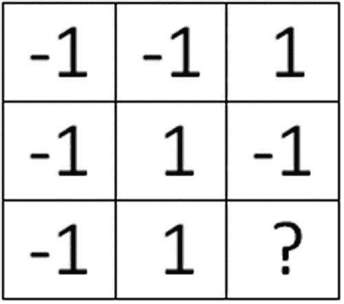

2.  答案 1 中方阵的置换表如下

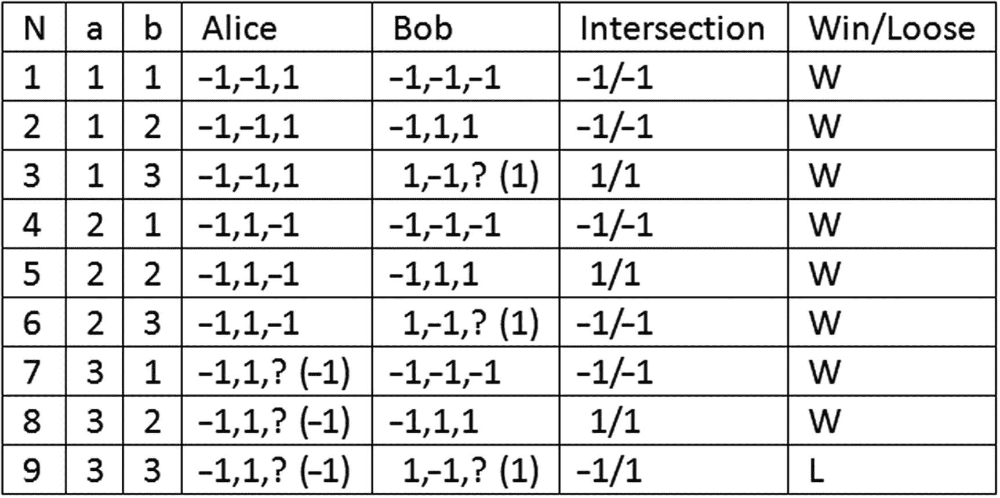

3.  请注意，在上一步的第 7-9 行中，爱丽丝的答案必须是`-1`，这样行乘积才能是偶数(`1`)。另外，在第 3、6 和 9 列中，鲍勃的答案必须是`1`，这样他的列乘积才能是奇数(`−1`)。最后，通过将获胜的总次数除以所有置换的总数来计算概率。因此

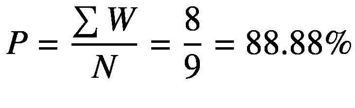

在本章中，您学习了量子纠缠的力量如何能够比经典计算提供显著的加速。借助量子天平，可以在经典难题（如假币问题）上实现四次方加速。对于其他问题，例如魔方阵，纠缠在参与者之间提供了近乎神奇的“心灵感应”。如果布拉萨德和他的同事能够为“二十一点”或扑克提出一种量子获胜策略，我们现在都可以在拉斯维加斯大杀四方了。总而言之，本章展示了量子力学一如既往地令人困惑、奇异且迷人。它从未让人失望。

在下一章也是最后一章中，您将学习可以说是所有量子算法中最著名的一个：臭名昭著的肖尔整数分解算法。一种可能瓦解非对称密码学的算法！

脚注 1

