# 8. 更快的搜索——用格罗弗和肖尔威胁非对称密码学的基础

本章以两个算法作为结束，这两个算法激发了人们对实用量子计算可能性的热情：

- **格罗弗搜索**：这是一个由洛夫·格罗弗创建的非结构化量子搜索算法，它能够使用黑盒函数或预言机，以高概率找到一个输入。它可以在  步内找到一项，而经典算法的平均步数为 `N/2`。
- **肖尔整数分解**：专家称，这种臭名昭著的量子分解算法可能使当前的非对称密码学陷入崩溃。肖尔算法可以在大约 `log(n³)` 步内分解整数，而最快的经典算法——数域筛法——则需要 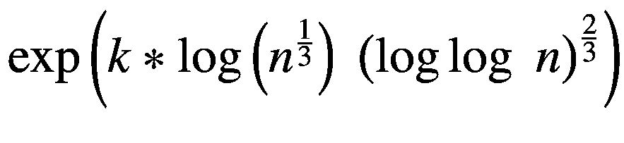 步。

让我们开始吧。

## 量子非结构化搜索

格罗弗算法是一种非结构化搜索的量子过程，用于在一个包含`N`个元素的“数字草堆”中找到一个`n`位的条目。如图 8-1 所示，格罗弗量子算法在 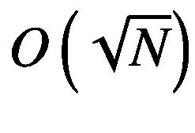 步内提供了显著的加速。与经典解决方案相比，这可能看起来不多，但当我们谈论数百万个条目时，`10⁶` 的平方根比 `10⁶` 快得多。

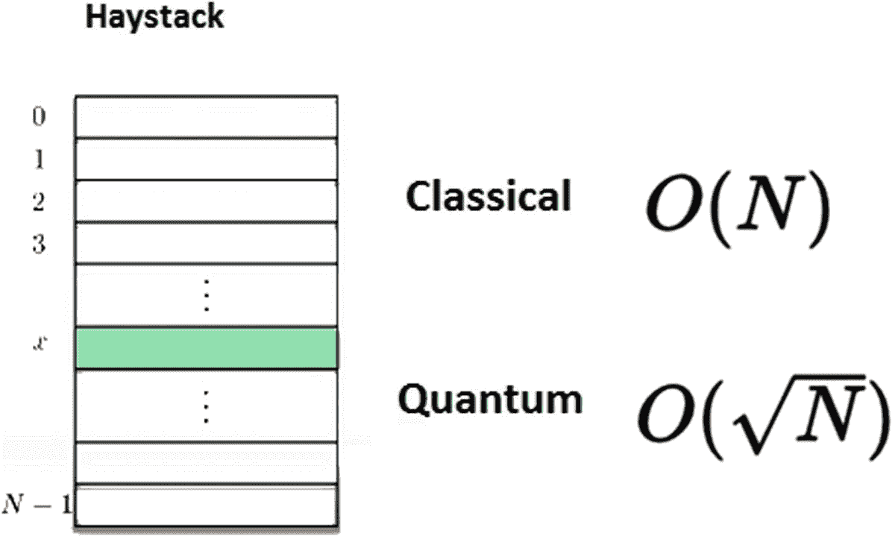
**图 8-1** 非结构化搜索的时间复杂度

如果`x`是我们正在寻找的元素，那么格罗弗算法可以用下面的伪代码描述：

1. 准备给定的输入`f`: {0, 1, … , N-1} → {0,1}。请注意，输入的大小是 `2^n`，其中`n`是位数，`N`是步骤数或“草堆”的大小。最终目标是找到满足 `f(x) = 1` 的 `x`。
2. 对所有输入量子比特应用基态叠加。
3. 对输入量子比特执行相位反转。
4. 对输入执行均值反转。
5. 重复步骤 3 和 4 至少 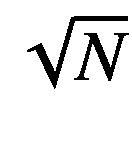 次。此时，有很大概率会找到`x`。

让我们仔细看看关键的相位反转和均值反转步骤。

### 相位反转

这是算法中的第一步，必须在“草堆”中所有状态的叠加态下执行。如果我们正在寻找的元素是 `xʹ`，并且满足 `f(xʹ) = 1`，那么叠加态可以表示为 `∑ α ∣ x⟩`。最终，相位反转的作用是


也就是说，如果给定的`x`不是我们正在寻找的元素（`x ≠ xʹ`），则保持叠加态不变；否则，反转相位（量子比特复系数`α`的符号——参见图 8-2 的图示）。

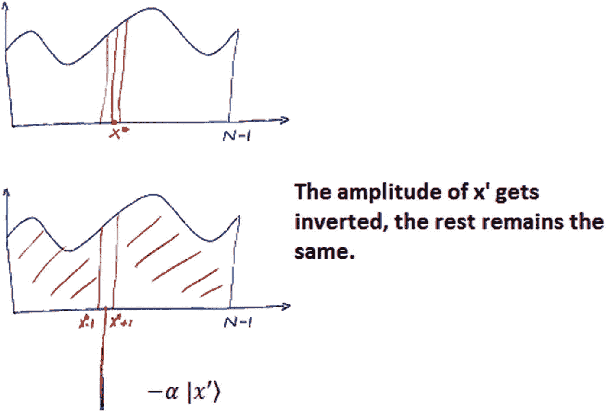
**图 8-2** 相位反转的图示

这是格罗弗算法的第一步；我们将会看到相位反转如何帮助我们找到正在寻找的元素，但现在让我们先看第二步：均值反转。

### 关于均值的反演

给定之前的叠加态 `∑ α ∣ x⟩`，我们定义均值 `μ` 为所有振幅的平均值：

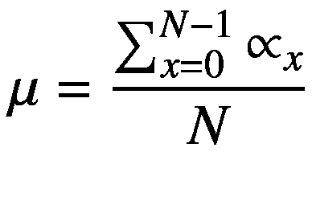

现在我们需要围绕这个均值翻转振幅，即：

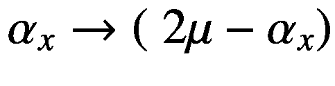

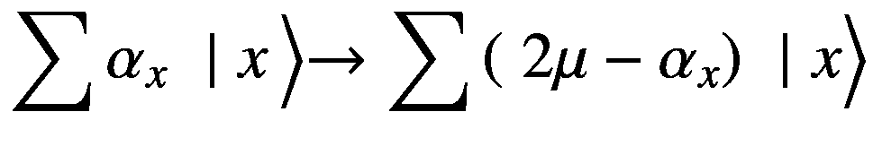

为了更好地理解这一点，图 8-3 展示了关于均值反演的图形表示。

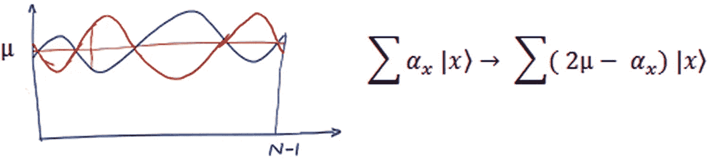
**图 8-3** – 关于均值反演的图形表示

图 8-3 显示了由波函数 `ψ` 定义的量子比特叠加态。该函数的均值或 `μ` 以图表中的水平线表示。关于均值反演的操作是将波函数 `ψ` 相对于均值 `μ` 进行镜像，从而产生一个镜像波（用虚线表示）。这相当于将波绕轴 `μ` 旋转。让我们将所有步骤整合起来，通过实际操作来理解这一切：

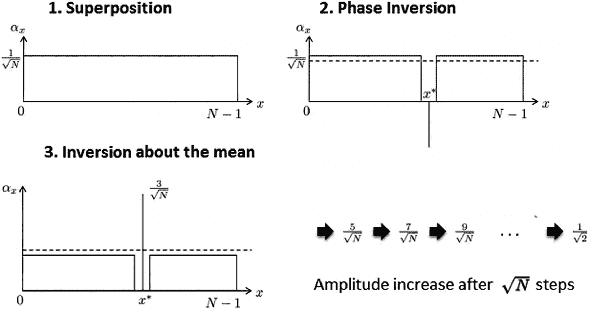
**图 8-4** – 单次 Grover 迭代

在图 8-4 中：
* 所有量子比特的叠加态将所有振幅置于 `1 / sqrt(N)`。
* 接着，相位反转将 `xʹ` 的振幅置于 `-1 / sqrt(N)`。注意，这会使均值 `μ` 的值略微降低，如图 8-4 步骤 2 中的虚线所示。
* 经过关于均值的反演后，均值振幅略有下降，但 `xʹ` 的振幅大幅上升，达到比均值 `μ` 高出 `2 / sqrt(N)` 的程度。
* 如果我们重复这一序列，`x’` 的振幅大约会增加 `2 / sqrt(N)`，直到大约经过 `sqrt(N)` 步后，振幅变为 `1 / sqrt(2)`。
* 此时，如果我们测量量子比特，根据量子力学的定义，找到 `x’`（我们正在寻找的元素）的概率是振幅的平方，即 ½。
* 至此，我们就完成了。大约经过 `sqrt(N)` 步，我们找到了标记元素 `xʹ`。

现在，让我们将这一切整合到一个量子电路以及相应的代码实现中。

### 实际实现

我们将在 IBM Q Experience 中查看 Grover 算法的一个电路。该电路演示了算法的一次迭代，使用了 2 个量子比特，如图 8-5 所示。

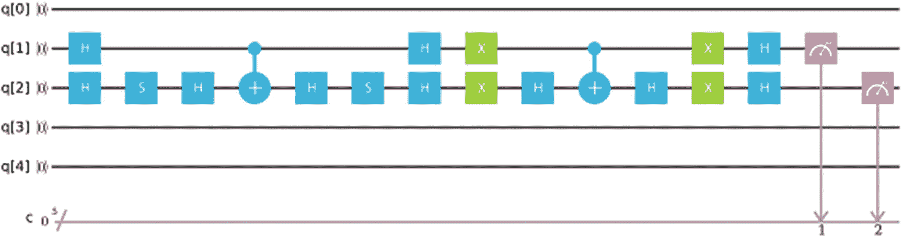
**图 8-5** – 使用 2 个量子比特且 `A = 01` 的 Grover 算法量子电路

创建图 8-5 中电路的 Python 脚本如代码清单 8-1 所示。

* 代码清单 8-1 针对 2 比特输入，使用 2 个量子比特执行了一次 Grover 算法交互。尽管上一节中的伪代码指出总迭代次数大致由 `sqrt(N)` 步决定，但关于均值的反演要求将此值乘以 `π/4` 并取其*向下取整*值（参见图 8-8 旁边的证明）。因此，我们最终得到 `IT = floor(sqrt(N) * π / 4)`，其中 `N = 2^(bits)`。因此，对于 2 比特，我们得到 `IT = floor(sqrt(4) * π / 4) = floor(1.57) = 1`。
* 脚本首先创建一个包含 2 个量子比特和两个用于存储测量结果的经典寄存器的量子电路。
* 接着，使用 Hadamard 门将所有量子比特置于叠加态。
* 在迭代之前，使用相位门（`S`）和表 8-1 中的规则准备输入。

**表 8-1** – 代码清单 8-1 的输入准备规则

| 输入 (`A`) | 门/量子比特 |
| --- | --- |
| 00 | `S(01)` |
| 10 | `S(0)` |
| 01 | `S(1)` |

## 通用电路

广义上讲，图 8-5 中的电路可以推广到任意数量的输入量子比特，如图 8-6 所示。

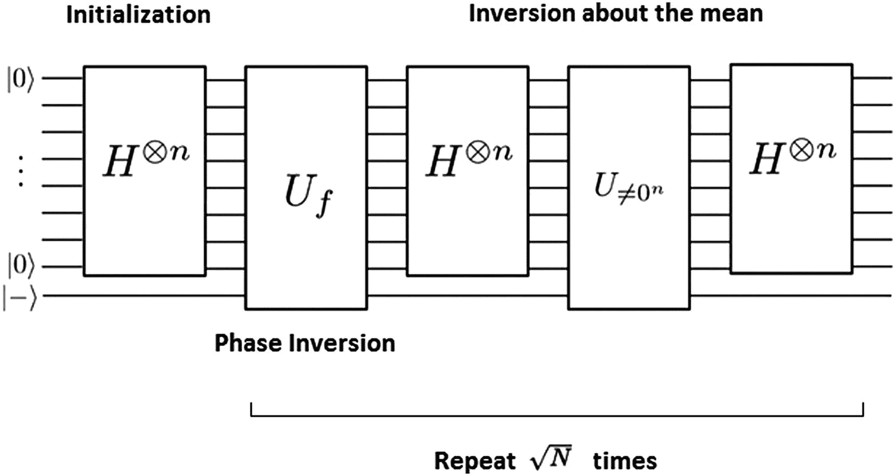
*图 8-6 Grover 算法对任意数量量子比特的推广*

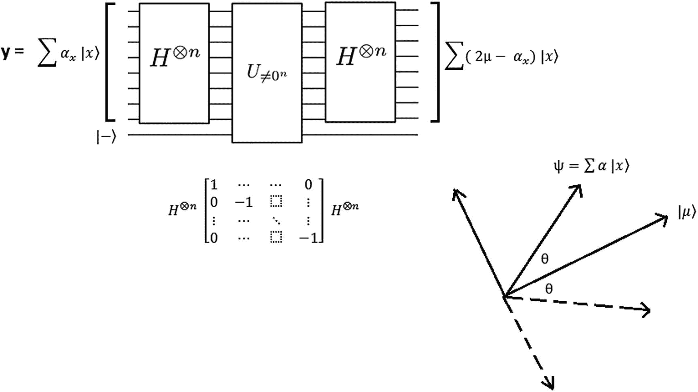
*图 8-8 均值反演电路*

- 图 8-6 中的第一个框通过对大小为 `n` 的输入应用 Hadamard 门，将所有量子比特置于叠加态。这是初始化步骤。
- 接下来，相位反转电路 (`U[f]`) 接收叠加后的输入 `ψ = ∑ α |x⟩` 和一个相位输入（负态）。这会产生期望的效果，即将相位精确地放置在我们需要的位置。因此输出变为 `∑ α (-1)^(f(x)) |x⟩`。但这是如何实现的呢？答案是，通过对负态输入应用异或运算，我们得到了期望的效果 `|b⟩ → |f(x) ⊕ b⟩`，如图 8-7 所示。`f(x)` 和 `b` 异或真值表的第三行（图 8-7 的右侧）显示了相位反转的效果。

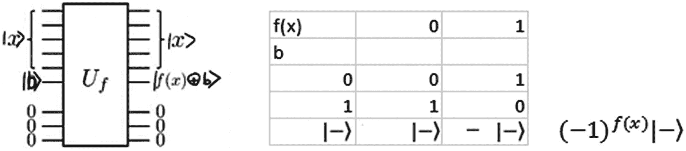
*图 8-7 相位反转电路*

- 最后，如图 8-3 所示，均值反演等同于围绕 `|μ⟩ = 1/√N ∑_x |x⟩` 进行反射。为了更好地形象化这一点，可以将叠加态 `ψ` 和均值 `μ` 表示为二维空间中的向量，如图 8-8 所示。要反射 `ψ`，请创建 `μ` 的正交向量，然后将 `ψ` 以相同角度 `θ` 投影到新的象限上。

### 均值反演的证明

均值反演将 `∑ α[x] |x⟩ → ∑ (2μ − α[x]) |x⟩` 的证明包含三个步骤，如图 8-8 中的电路所示。

1. 将 `|μ⟩` 变换为全零向量 `|0, …, 0⟩`。这是通过对输入应用 Hadamard 门实现的。
2. 围绕全零向量 `|0, …, 0⟩` 进行反射。这可以通过将其乘以稀疏矩阵 `[[1, …, 0], [0, -1, …], [⋮, …, ⋱], [0, …, -1]]` 来完成。
3. 通过再次应用 Hadamard，将 `|0, …, 0⟩` 变换回 `|μ⟩`。

因此：
`H^(⊗n) [[1, …, 0], [0, -1, …], [⋮, …, ⋱], [0, …, -1]] H^(⊗n) = H^(⊗n) ([[2, …, 0], [⋮, …, ⋱], [0, …, 0]] - I) H^(⊗n) = H^(⊗n) [[2, …, 0], [⋮, …, ⋱], [0, …, 0]] H^(⊗n) - H^(⊗n) I H^(⊗n)`
`= [[2/N, …, 2/N], [⋮, …, ⋱], [2/N, …, 2/N]] - I = [[2/N - 1, …, 2/N], [⋮, …, ⋱], [2/N, …, 2/N - 1]]` (1)

注意 `H^(⊗n) I H^(⊗n) = I` 且 `H = (2/√N) |x⟩`。最后，将矩阵 (1) 应用于状态 `ψ = α[x] |x⟩` 得到

[[2/N - 1, …, 2/N], [⋮, …, ⋱], [2/N, …, 2/N - 1]] [α₀， …, α_x, …, α_(N-1)]ᵀ → [⋮, 2/N ∑ α_y - α_x, ⋮]ᵀ = 2μ - α_x 其中 2/N ∑ α_y = 2μ

以上就是用于无结构搜索的 Grover 算法。它快速、强大，并且很快将应用于数据中心，全力处理各种数据库搜索。考虑到其相对于经典算法显著的性能提升，很可能在几年后，当量子计算机变得更易于商业应用时，大多数网络搜索将由这个量子强手执行。在结束之前，值得一提的是，在撰写本文时，IBM Q Experience 上还没有一个有用的实现或实验（能够找到真实事物的实验）。希望未来这种情况会有所改变，但就目前而言，Grover 算法仍处于理论层面。在下一节中，我们将研究著名的用于整数因子分解的 Shor 算法，以此作为强有力的收尾。

## 使用 Shor 算法进行整数因子分解

密码学与密码分析之间的猫鼠游戏仍在激烈进行：前者不断设计新方法来加密我们的日常数据，而后者则不断探测弱点，寻找可攻破的裂缝。当前的非对称密码学依赖于众所周知的大素数（数百位数字范围）因子分解的难度。本节将研究 Shor 算法的内部工作原理，这是一种使用量子计算机对整数因子分解实现指数级加速的方法。接着，我们将使用一个名为 `ProjectQ` 的库进行实现。然后，我们对样本整数进行模拟并评估结果。最后，我们将探讨量子系统中整数因子分解的当前和未来方向。让我们开始吧。

### 用量子因子分解挑战非对称密码学

在具有里程碑意义的论文《Polynomial-Time Algorithms for Prime Factorization and Discrete Logarithms on a Quantum Computer》^(³³)中，Peter Shor 提出了一种量子因子分解方法，该方法使用了数学家们熟知已久的一个原理：在乘法群`模 N`中寻找元素`a`的周期（也称为阶），即满足以下条件的最小正整数：

`x^r ≡ 1 (mod N)`

其中`N`是要分解的数，`r`是`x 模 N`的周期。

###### 提示

大整数分解是一个困扰了数学家数千年的难题。1976 年，G. L. Miller 提出，利用随机化，可以将分解问题简化为寻找元素`a modulo N`的周期，从而大大简化了这一难题。这就是肖尔算法的基本思想。

肖尔将他的算法分为三个阶段，其中两个阶段由经典计算机在多项式时间内完成：

1. 输入准备：在经典计算机上以多项式时间`log(n)`完成。

2. 通过量子电路寻找元素`a`的周期`r`，使得`a^r ≡ 1 (mod N)`。根据肖尔的理论，这需要在量子计算机上经过`O((log n)² (log log n)(log log log n))`步。

3. 后处理：在经典计算机上以多项式时间`log(n)`完成。

但为什么人们对这种方法如此兴奋呢？将它的时间复杂度（大 O 表示法）与当前经典算法中的佼佼者：数域筛法进行比较，如表 8-2 所示（还包括另一个备受青睐的算法，历史悠久的二次筛法）。

**表 8-2** 常见分解算法的时间复杂度

| 算法 | 时间复杂度 |
| --- | --- |
| 肖尔算法 | `(log n)² (log log n) (log log log n)` |
| 数域筛法 | `exp(c (log n)^{1/3} (log log n)^{2/3})` |
| 二次筛法 | `exp(sqrt(ln n ln ln n))` |

不可思议的是，肖尔算法具有多项式时间复杂度，远远优于数域筛法的指数时间复杂度，后者是经典计算机上已知最快的分解方法。事实上，专家估计，肖尔算法可以在几分钟内分解一个超过 200 位的整数。这样的壮举将撼动当前用于为所有网络通信生成加密密钥的非对称密码学的基础。

###### 提示

对称密码学对量子计算具有很高的抵抗力，因此也能抵抗肖尔算法。

但先别恐慌；在实际量子计算机上实现该算法还有很长的路要走。尽管如此，我们可以使用精巧的 Python 库`ProjectQ`在经典系统上模拟该算法。我们将在后续章节中运行`ProjectQ`的实现，但接下来，让我们看看周期寻找如何高效地解决分解问题。

### 周期寻找

周期寻找是肖尔算法的基本构建模块。通过使用模运算，问题被简化为寻找函数`f(x) = a^x mod N`的周期(`r`)（见图 8-9）。

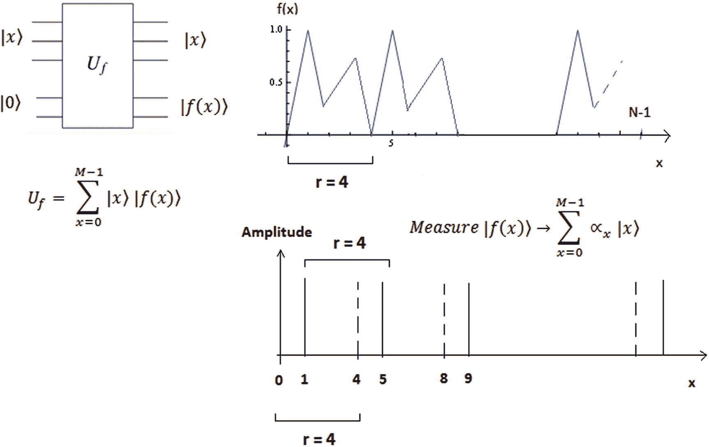

**图 8-9** 周期函数`f(x)`

图 8-9 给出了周期`r = 4`的周期函数`f(x)`的示例。为了使算法有效，`f(x)`必须满足三个条件：

1. `f(x)`在每个周期内是一一对应的；也就是说，`f(x)`的值不能重复。在图 8-9 中，这些值由每个周期内每条线的顶点表示。

2. 对于任何给定的`M`或周期数，`r`必须能整除`M`。例如，给定`M = 100`和周期`r = 4`，则`M / r = 25`。

3. `M`除以`r`必须大于`r`。也就是说，`M > r²`。

肖尔算法将`f(x)`转换为一个量子电路`U[f]`，其中输入处于叠加态。如果我们测量`U[f]`中的第二个寄存器，可能会看到振幅`sum_{x=0}^{M-1} α_x |x⟩`的值，如图 8-9 的振幅图所示。这里的振幅恰好相隔四个单位，这正是我们要寻找的周期。在这个特定情况下，我们得到周期为`r = 4`的周期叠加态。但是我们该如何处理这个周期叠加态呢？肖尔依赖于另一个技巧：傅里叶采样或量子傅里叶变换。

#### 傅里叶采样

傅里叶采样是一种数据处理过程，具有以下特性：

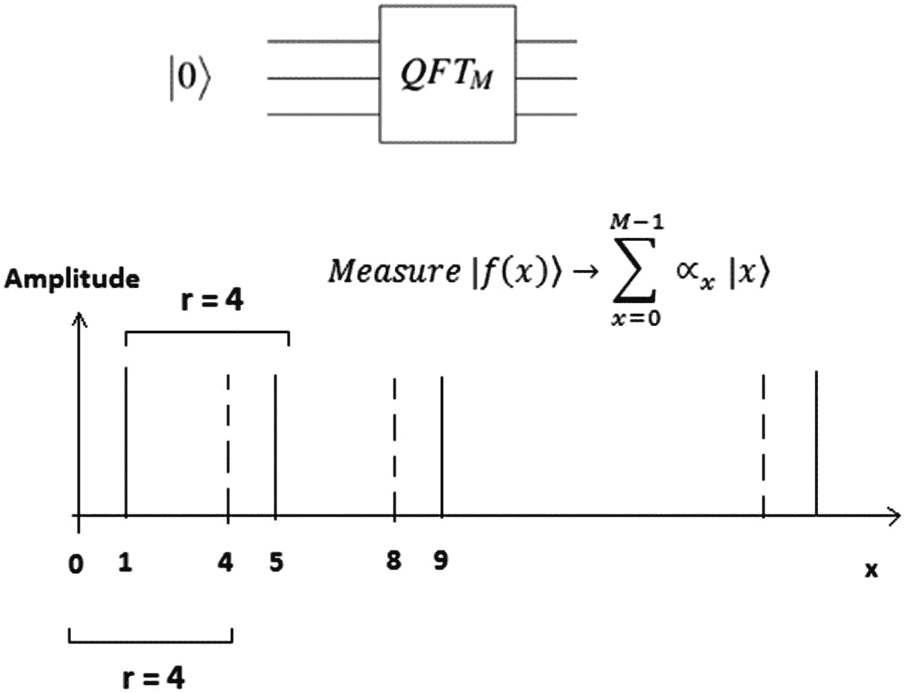

**图 8-10** 显示周期叠加的傅里叶采样

- 它允许输入移位而不改变输出分布。
- 这很好，因为现在我们有了一个周期叠加态，其中非零振幅是周期的倍数（见图 8-10）。

但是傅里叶采样的输出是什么？它又有何帮助？答案是，它的输出是`M / r`的随机倍数。在本例中，给定`M = 100`和`r = 4`，我们得到`100 / 4 = 25`的随机倍数。这对我们的目标有利。让我们来看看具体如何实现。

#### 将傅里叶采样结果输入欧几里得最大公约数算法

如果我们多次运行傅里叶采样，将会得到`M / r`的随机倍数。例如，我们可能得到`50`、`75`、`25`等。现在，如果我们对随机输出应用欧几里得最大公约数（`gcd`）算法，那么奇迹发生了：通过用`M`除以`gcd`，我们就得到了周期`r`。因此

```
r = M / gcd(50, 75, ...) = 100 / 25 = 4
```

这就是通过量子电路寻找周期的概要。要理解这种方法如何高效地找到因子，让我们通过分解数字`N = 21`来运行一个示例。我们的任务依赖于两个非常高效的操作：

- 模运算：`a = b (mod N)`。例如，`3 = 15 (mod 12)`。
- 最大公约数`gcd(a, b)`。例如，`gcd(15, 21) = 3`。

因此对于`N = 21`，我们需要求解方程`x² ≡ 1 (mod 21)`。也就是说，找到非平凡平方根`x`，使得

- `N`能整除`(x + 1)(x - 1)`。
- `N`不能整除`(x ± 1)`。
- 最后，通过对`gcd(N, x+1)`的计算来恢复一个质因子。

要找到`N = 21`的非平凡因子，随机选择一个`x`。例如，给定`N = 21`，选择`x = 2`；因此

```
2⁰ ≡ 1 (mod 21)
2¹ ≡ 2 (mod 21)
2² ≡ 4 (mod 21)
2³ ≡ 8 (mod 21)
2⁴ ≡ 16 (mod 21)
2⁵ ≡ 11 (mod 21)
2⁶ ≡ 1 (mod 21)。得到周期 r = 6。
```

在这种情况下，`2⁶ = (2³)²`。因此`2³ = 8`是一个非平凡因子，使得`21`能整除`(8 + 1)(8 - 1)`。最后，我们通过最大公约数`gcd(N, x+1) = gcd(21, 9) = 3`恢复一个因子。概括来说，随机选择一个`x`，然后遍历`x⁰, x¹, …, x^r ≡ mod N`。如果我们运气好，那么`r`是偶数，即`(x^(r/2))² ≡ 1 (mod N)`。这样我们就得到了`1 mod N`的一个非平凡平方根。

###### 提示

已经证明，我们运气好，即对于`x² ≡ 1 (mod N)`而言`r`是偶数的概率为`½`。反之，如果运气不好，我们必须从头重复整个过程。然而，鉴于成功的概率很高，这在全局中并不重要。

# ProjectQ 实现的秀尔算法

现在，让我们使用精巧的 Python 库 `ProjectQ` 来运行这个算法。

`ProjectQ` 是一个用于量子计算的开源平台，它使用斯特凡·博雷加德提出的电路^(³⁴)实现了秀尔算法。该电路使用了 `2n + 3` 个量子比特，其中 `n` 是要分解的数字 `N` 的位数。博雷加德的方法分为以下步骤：

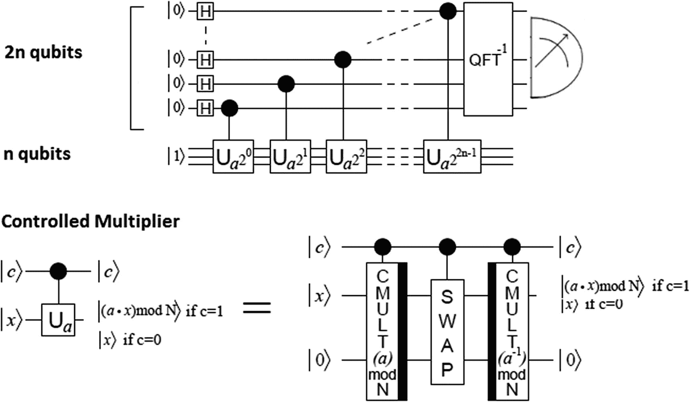  
图 8-11：用于周期查找的博雷加德量子电路

1. 如果 `N` 是偶数，则返回因子 2。
2. 通过经典计算确定 `N = p^q` 是否成立（其中 `p ≥ 1` 且 `q ≥ 2`），如果是，则返回因子 `p`（在经典计算机上，这可以在多项式时间内完成）。
3. 选择一个随机数 `a`，满足 `1 < a ≤ N – 1`。使用欧几里得最大公约数算法，判断 `gcd(a, N) > 1` 是否成立。如果成立，则返回因子 `gcd(a, N)`。
4. 使用周期查找量子电路来找出 `a` 模 `N` 的阶 `r`。在量子计算机上，此步骤可在多项式时间内完成。
5. 如果 `r` 是奇数，或者 `r` 是偶数但 `a^(r/2) = –1 (mod N)`，则返回步骤 3。否则，计算 `gcd(a^(r/2) – 1, N)` 和 `gcd(a^(r/2) + 1, N)`。检验其中一项是否是 `N` 的非平凡因子，如果是，则返回该因子（在经典计算机上，这可以在多项式时间内完成）。

博雷加德通过在傅里叶空间中使用一系列受控加法和乘法来实现周期查找，以求解 `f(x) = a^x (mod N) → a^r ≡ 1 mod N`（见图 8-11）：
- 一个受控乘法器 `U[a]` 将 `|x⟩` 映射为 `|ax (mod N)⟩`，其中：
  - `a` 是一个经典互质数，用作 `a^x (mod N)` 的底数。
  - `x` 是量子寄存器。
  - `c` 是控制量子比特的寄存器，使得当 `c = 1` 时 `U[a] = ax (mod N)`，否则保持 `x`。
- 受控乘法器 `U[a]` 进一步通过一系列双控模加法门实现，使得：
  - 如果两个控制量子比特均为 `c1 = c2 = 1`，则输出为 `f(x) = |φ(a + b mod N)⟩`，即在傅里叶空间中的 `a + b (mod N)`。注意，该门将两个数相加：一个互质数 (`a`) 和一个量子数 (`b`)。
  - 如果任一控制量子比特 (`c1`, `c2`) 处于状态 `|0⟩`，则 `f(x) = |φ(b)⟩`。
- 双控模加法门又建立在德雷珀的量子加法电路之上^(³⁵)。该电路在傅里叶空间中实现了一个经典值 (`a`) 与量子值 (`b`) 的加法。

## 使用 ProjectQ 进行因式分解

让我们安装 `ProjectQ` 并测试该算法。首先要做的是使用 Python 包管理器下载并安装 `ProjectQ`（注意，为简单起见，我使用的是 Windows。Linux 用户可以遵循相同的步骤）：
```
C:\> pip install projectq
```

接下来，从 `ProjectQ` 的示例文件夹^(³⁶)或本书的源代码 `Workspace\Ch08\p08-shor.py` 中获取 `shor.py` 脚本。然后，运行脚本并输入一个要分解的数字（参见代码清单 8-2）。
```
C:\>python shor.py
Number to factor: 21
Factoring N = 21: ..........
Factors found : 7 * 3 = 21
Gate class counts:
AllocateQubitGate : 166
CCR : 1467
CR : 7180
CSwapGate : 50
CXGate : 200
DeallocateQubitGate : 166
HGate : 2600
MeasureGate : 11
R : 608
XGate : 206
Gate counts:
Allocate : 166
CCR(0.098174770425) : 18
CCR(0.196349540849) : 30
CCR(0.392699081699) : 70
CCR(0.490873852124) : 18
CCR(0.785398163397) : 80
CCR(0.981747704246) : 38
CCR(1.079922474671) : 20
CCR(1.178097245096) : 16
...
R(5.252350217719) : 1
R(5.301437602932) : 1
R(5.497787143782) : 1
X : 206
Max. width (number of qubits) : 13.
--- 5.834410190582275 seconds ---
Listing 8-2: Shor’s Algorithm by ProjectQ in Action
```

对于 `N = 21`，该脚本输出了一组非常有用的统计数据，例如：
- **使用的量子比特数量**：给定 `N = 21`，我们需要 5 个比特；因此 `总量子比特数 = 2 * 5 + 3 = 13`。
- **按类型划分的门的总数**：在本例中，双控门 `CCR = 1467`、`CR = 7180`、`CSwap = 50`、`CX = 200`、`R = 608`、`X = 206` 等，总共有 12,646 个量子门。

`ProjectQ` 使用博雷加德算法实现了量子周期查找，如代码清单 8-3 所示：
- `run_shor` 函数接受三个参数：
  - `ProjectQ` 提供的量子引擎或模拟器，加上
  - `N`：要分解的数字
  - `a`：用作 `a^x mod N` 底数的互质数
- 然后，函数从 `a = 0` 到 `a = ln(N)` 循环，量子输入寄存器 `x` 处于叠加态；接着对 `f(a) = a^x mod N` 执行量子电路，如图 8-11 所示。
- 接下来，它根据先前的结果对 `x` 寄存器执行傅里叶采样，并进行测量。
- 最后，它将测量值求和为一个范围在 `[0,1]` 内的数字。然后使用连分数展开来返回分母，即潜在周期 (`r`)。

```
def run_shor(eng, N, a):
    n = int(math.ceil(math.log(N, 2)))
    x = eng.allocate_qureg(n)
    X | x[0]
    measurements = [0] * (2 * n)  # 将保存 2n 个测量结果
    ctrl_qubit = eng.allocate_qubit()
    for k in range(2 * n):
        current_a = pow(a, 1 << (2 * n - k - 1), N)
        # 受控乘法：a^(2^(2n-k-1)) 模 N
        for i in range(k):
            if measurements[i]:
                R(-math.pi/(1 << (k - i))) | ctrl_qubit
        H | ctrl_qubit
        # 并进行测量
        Measure | ctrl_qubit
        eng.flush()
        measurements[k] = int(ctrl_qubit)
        if measurements[k]:
            X | ctrl_qubit
    Measure | x
    # 将测量值转换为 [0,1) 区间内的数字
    y = sum([(measurements[2 * n - 1 - i]*1. / (1 << (i + 1)))
             for i in range(2 * n)])
    # 使用连分数展开得到分母（周期？）
    r = Fraction(y).limit_denominator(N-1).denominator
    # 返回（潜在）周期
    return r
```
Listing 8-3: ProjectQ Period Finding Quantum Subroutine

下一节将针对不同的 `N` 值编译一组因式分解结果。

## 模拟结果

ProjectQ 的周期查找子程序是在经典计算机上对量子电路进行模拟，因此用它来分解大数并不实际。事实上，在个人电脑上，它无法在合理时间内分解超过四位的数字。表 8-3 展示了从我笔记本电脑上收集的、针对不同 `N` 值的一组结果，数值最高达 2491。

**表 8-3** 针对不同 `N` 值的因式分解结果

| 数字 (`N`) | 量子比特 | 时间 (秒) | 内存 (MB) | 量子门计数 |

### 索引

#### A

绝热量子计算 (`AQC`) 绝热定理 航空工业 阿兰·阿斯佩实验 ProjectQ 中的算法实践 博勒加德量子电路因式分解 模拟结果 子程序 全能波函数 `API` 令牌 原子理论 认证

#### B

`basisGates` 贝尔不等式 实验 定理 贝尔态 `CHSH` 不等式 编译结果 相关概率 不等式 测量 排列 光子偏振 量子电路 量子比特 黑体辐射实验 黑洞 布洛赫球 玻尔/海森堡诠释 玻尔的原子 量子跃迁 玻尔兹曼熵 玻恩的概率派对 玻色编码 玻色采样问题

#### C

校准参数 灾难性悖论 CentOS `cgi` 软件包 中国科学院 (`CAS`) `chmod` 操作系统命令 云端量子战舰 解耦 用户界面 特性 `HTTP` 请求 `J2EE` 项目 `JSON` 文档 量子脚本 可重用 `Python` 程序 用户界面 ( *参见* 用户界面) Web 界面 Web 服务器 部署 通用网关接口 (`CGI`) 互补性 复共轭 复数 受控门 受控非 (`CNOT`) 门 哥本哈根诠释 假币谜题 构建 量子天平 平衡 假币 `cr[N]` 泛化 识别 主容器 脚本 数值 目标 量子光束天平 *与* 经典时间复杂度 对比 解决方案 耦合映射

#### D

损伤着色 数据提交 德布罗意方程 退相干 (寿命) 解耦 用户界面 深度学习与人工智能 传统问题 部署与测试 钻石空位 `document.write()` 系统 双缝实验 D-Wave 系统

#### E

特征值 爱因斯坦-波多尔斯基-罗森或 `EPR` 佯谬 爱因斯坦 实验箱 相对论 不可动摇的原理 电子隧穿 实际应用 经典力学 效应 光子方法 概率 半导体制造工艺 `Java` 程序 概率 电子表格 统计值 能量最小化问题 能量量子 纠缠测试 熵 (`ent`) `EPR` 佯谬 欧几里得最大公约数 干涉现象探索

#### F

五纳米晶体管

#### G

游戏谜题 算法 假币 ( *参见* 假币谜题) 梅尔明-佩雷斯魔方阵 门状态 `GHZ` 态 测试 Google 图形化表示 图形用户界面 图形处理单元 (`GPUs`) Grover 算法 准备 规则 `Python` 脚本 量子电路 迭代 非结构化量子搜索 ( *参见* 非结构化量子搜索)

#### H

Hadamard 门 (`H`) 海森堡不确定原理 (`HUP`) `HTTPD` 服务器 `HTTP` 请求

#### I

IBM Q 体验 贝尔态 ( *参见* 贝尔态) 作曲家 `GHZ` 态 测试 主窗口 量子后端 量子门 远程访问 REST `API` 账户信用信息 `API` 版本 认证 后端参数 后端与模拟器 校准参数 处理器执行队列中的作业 列出用户实验 运行一个作业 运行实验 量子处理器事件队列的状态 `IBMQuantumExperience` 遵循上游稳定版 (`IUS`) 安装 QISKit Linux CentOS 文件夹布局 `IUS` 准备系统 虚拟环境 Windows 干涉 离子阱

#### J

`JSON` 字符串

#### K

开尔文 狄拉克符号

#### L

光 着色 线性向量 逻辑门

#### M

机器学习 人工智能 数学优化 矩阵乘法 测量门 医学 梅尔明-佩雷斯魔方阵 答案 练习 3x3 矩阵与规则 测量 循环 置换 所有轮次脚本 简化版 标准输出 量子伪远程传态 量子获胜策略 共享纠缠态 幺正变换 分子电子学 分子建模 测量瞬间 光子的动量 多版本 `Python` 多量子比特纠缠

#### N

不可克隆定理 Node JS 客户端 `IBMQuantumExperience` 校准与硬件参数 调试与测试 获取后端列表 `module.exports` 库 node 模块 构建 公有 `API` 方法 发布你的模块 运行实验 令牌认证 归一化 `NOT` 门 (Pauli `X`) 数域筛法 *与* Shor 算法 时间复杂度 对比

#### O

有机电子学 `OS` 命令与提取

#### P

佯谬 模式识别 Pauli `X` 门 置换表 感光板 光子偏振 光子 图形化表示 相位反转 偏振片 光的基本性质 潜在量子效应 概率性解释 `ProjectQ` `Python` `CGI` 脚本 错误 量子程序

#### Q

量子人工智能联想存储器后端战舰炸弹棋盘指令布局主循环执行模块化初始化脚本初始化棋盘上的舰船，设置用户界面作曲者计算纠缠分解方法门信息系统跳跃机制处理器事件队列采样问题规模状态优越性断层扫描 `量子退火` (`QA`) `绝热定理` 组合优化问题 `D-Wave` 系统能量最小化问题有限范围隧穿 `哈密顿量` (`H`) 模式识别处理器量子比特受限于专家 `量子汇编` (`QASM`) `量子猫` `量子电路公司` (`QCI`) `量子计算机` 人工智能 *vs* . 经典时间复杂度复杂模拟分子建模陷阱退相干（寿命） `QEC` `3 量子比特码` `肖尔码` 随机梯度下降 `量子纠错` (`QEC`) `3 量子比特码` `肖尔码` `量子砷化镓` (`GaAs`) `量子信息软件工具包` (`QISKit`) 安装，( *参见* `安装, QISKit`) `Python SDK` `量子蒙特卡洛` (`QMC`) `量子神经网络` (`QNN`) 黑洞潜在量子效应量子联想存储器量子信息处理 `量子程序剖析` `作曲者` `实验` `执行` `伪代码` `SDK 内部机制` ( *参见* `SDK 内部机制`) `量子隐形传态` `作曲者`，电路概率结果 `Python` 脚本恢复叠加态工作流 `量子隧穿` ( *参见* `电子隧穿`) `量子图灵机` (`QTM`) 应用 `谷歌` 与量子人工智能量子力学 `量子比特 101` 代数概念 `狄拉克符号` `刃矢符号` 设计金刚石空位离子陷阱硅量子点超导体回路拓扑量子比特纠缠量子门受控门 `受控非门` `阿达马门` `测量门` `非门` (`泡利 X`) `泡利门` `旋转门` `单量子比特门` `交换门` `托佛利 (CCNOT) 门` 幺正矩阵通用量子计算同时存储容量态叠加 `3 量子比特码` `9 量子比特纠错码`

#### R

`随机比特生成` `电路` `电路体验` `执行` 结果几何表示 `阿达马门` 量子程序 `随机性` 测试结果 `红移公式` `远程访问修改` `请求查询字符串` `旋转门` `run_shor` 函数 `卢瑟福模型`

#### S

## 概述

`扫描隧穿显微镜`(`STM`), 科幻/星际迷航感觉, `SDK 内部机制`, `电路编译`, `本地 C++ 模拟器`, `本地模拟器`, `QASM`, `远程模拟器`, `结果文档`, `模拟器`, `执行`, 半导体, `肖尔算法`, 代码变换, 整数分解算法, 由 `ProjectQ`, `傅里叶采样`, `周期寻找`, `周期叠加`, 多项式时间, 量子分解时间复杂度, `单缝实验`, `Slick Python 库`, `狭缝实验`, `固体量子理论`, `空间应用`, `鬼魅作用`, 随机梯度下降, `超导体回路量子比特`, `超密编码`(`SDC`), `贝尔对`状态, `作曲者`, 电路, `编码规则`, `模块化抽象`, `输出`, `绘图`, `结果`, `协议`, `Python 脚本`, 量子比特状态, `超决定论`, `叠加`, `模拟退火`(`SA`), `症候群信息`, `交换门`

## T

`热退火`, `拓扑码`, `拓扑量子比特`, `传统量子计算机`, `晶体管`, `势垒`, `逻辑门`, `分子电子学`, `纳米`, `有机电子学`, `量子尺度`, `狭缝实验`, `技术进步`, `水分子`, `Apache HTTPD 故障排除`, `二维电子气`(`2DEG`)

## U, V

`紫外灾变`, `不确定性原理`, 自然的二象性, 矩阵力学, `通用量子计算机`(`参见` `量子图灵机 (QTM)`), `UNIX rand()`, `非结构化量子搜索`, `广义电路`, `格罗弗算法`, `关于均值的反演`, `相位反演`, 时间复杂度, `用户界面`, `云战舰`, 提示与技巧, `全局 BOMBS 数组`, `HTML`, `代码响应格式`, `响应处理器`, `规则与验证`

## W, X, Y, Z

`波函数`, `WebSocket 连接`, `回调系统`, `Javascript 客户端代码`, `服务器处理器`, 供应商