# 6. 趣玩量子游戏

在本章中，你将学习如何在量子计算机上实现一个基础游戏。为此，我们使用 QISKit Python 教程附带的典型量子战舰游戏。第一部分探讨游戏的机制，包括：

*   使用量子比特表示棋盘上的舰船位置
*   如何通过量子程序计算损坏百分比，以便在本地或远程模拟器或真实量子设备上运行
*   如何使用部分非门对单个量子比特进行 X 轴旋转

但我们并不止步于此。本章的第二部分将内容提升到更高层次。通过向你展示如何实现具有以下功能的基于云的量子战舰，游戏得到了重大改观：

*   基于浏览器的用户界面，带有交互式棋盘用于放置舰船或炸弹。游戏机制保持不变。
*   使用 Apache Web 服务器的基于 CGI 的脚本，用于消费游戏事件并将其分派给量子程序。
*   对原始量子程序的修改版本，用于对量子比特执行部分非旋转以计算舰船损坏。大部分原始代码保持不变。

你将学习如何将原始代码模块化并重新用于云中不同的量子战舰版本。让我们开始吧。

## 量子战舰的变体

本节我们将探讨 QISKit 教程附带的一个名为`量子战舰`的游戏。该程序使用 5 个量子比特表示一个棋盘，每位玩家放置三艘舰船。然后，它要求每位玩家在 0-5 的位置放置一枚炸弹。最后，每艘舰船的损坏由使用双脉冲单量子比特门`U3(theta, phi, lambda)`的量子程序计算。该门称为部分非门，通过 `theta`、`phi` 或 `lambda` 弧度对 X、Y、Z 轴进行旋转。

```
4       0
|\     /|
| \   / |
|  \ /  |
|   2  |
|  / \  |
| /   \ |
|/     \|
3        1
```

在此特定情况下，舰船损坏是通过使用该位置的炸弹数量，对 X 轴（theta）进行一系列部分旋转来计算的。如果某个位置（或舰船）的损坏超过 95%，该舰船即被摧毁，一旦整个玩家的舰队被摧毁，则宣布获胜者，游戏结束。这只是我们小时候都玩过的标准战舰游戏，但后台使用的是量子计算机或模拟器。

> **注意**
> 该游戏由巴塞尔大学的 James Wootton 编写，并贡献给 QISKit Python 教程。Wootton 原始代码的修改版可从本书源代码的`Workspace\Ch06\battleship\BattleShip.py`处获得（省略了一些不必要的花哨文本）。

让我们运行程序并查看游戏机制。

### 设置说明

从本书源码中，按以下段落描述的方式执行`BattleShip.py`程序：

*   对于 CentOS 6 或 7 或任何类似 Fedora 的操作系统，激活你的 Python 虚拟环境。仅在你有多个 Python 版本（例如 2.7 和 3.6）时才需要此操作。请记住你必须使用 3.5 或更高版本。关于如何设置 Python 虚拟环境的说明已在第 3 章中介绍过。
*   将脚本`Workspace/Ch06/battleship/BattleShip.py`和配置文件`Qconfig.py`从本书源码复制到你的工作区，并执行它（如下所示）。

```
##### 在$HOME/qiskit/qiskit 激活 Python3 虚拟环境
$ source $HOME/qiskit/qiskit/bin/activate
$ python BattleShip.py
############### 量子战舰 ##################
你是否想在真实设备上玩？(y/n) n
```

让我们看看程序是如何工作的。

#### 初始化

列表 6-1 显示了脚本初始化。它从执行基本的 Python 任务开始：

*   加载系统库：所有 QISKit 操作所需的 `sys` 和 `QuantumProgram`。
*   确保你使用的是 Python 3.5 或更高版本。
*   询问你希望使用模拟器还是真实的量子计算机。然后将执行次数设置为默认的 1024 次。

```
#################################
##### 来自教程的量子战舰 @
##### https://github.com/QISKit/qiskit-tutorial
##################################
import sys
##### 检查 PYTHON 的版本；我们仅支持 > 3.5
if sys.version_info < (3,5):
raise Exception('请使用 Python 3.5 或更高版本。')
from qiskit import QuantumProgram
import Qconfig
import getpass, random, numpy, math
## 1\. 选择后端：IBM 模拟器 (ibmqx_qasm_simulator) 或真实芯片 ibmqx2
d = input("你是否想在真实设备上玩？(y/n)\n").upper()
if (d=="Y"):
device = 'ibmqx2'
else:
device = 'ibmqx_qasm_simulator'
##### 注意，设备应为 'ibmqx_qasm_simulator'、'ibmqx2' 或 'local_qasm_simulator'
##### 在此，我们设置执行次数
shots = 1024
```
列表 6-1 脚本初始化

> **提示**
> 要在真实设备上运行量子程序，必须将配置文件（`Qconfig.py`）放在与主脚本相同的位置。该配置包含你所需的 API 令牌和 IBM Q Experience 端点。

```
APItoken = '你的 API 令牌'
config = {
'url': 'https://quantumexperience.ng.bluemix.net/api',
}
```

现在，让我们在棋盘上放置一些舰船。

### 在棋盘上放置战舰

程序使用一个基础的文本界面处理所有用户输入。清单 6-2 展示了每位玩家输入战舰位置的逻辑。按回车键开始，为每位玩家输入最多三艘战舰的位置（位置从零开始计数）。

- 脚本可以绕过用户选择，随机选取位置；否则玩家必须为三艘战舰输入位置。
- 位置存储在二维列表 `shipPos` 中，其中 `shipPos[0]` 包含玩家 1 的位置，`shipPos[1]` 包含玩家 2 的位置。请记住每位玩家仅允许放置三艘战舰。

```
##### 2. 玩家设置棋盘
randPlace = input("> 按回车键开始放置战舰...\n").upper()
##### 变量 ship[X][Y] 将存储玩家 X+1 的第 Y 艘战舰的位置
shipPos = [ [-1]*3 for _ in range(2)]
##### 遍历两位玩家以及每位玩家的三艘战舰
for player in [0,1]:
##### 如果选择跳过玩家输入而使用随机位置，则执行随机逻辑
if ((randPlace=="r")|(randPlace=="R")):
randPos = random.sample(range(5), 3)
for ship in [0,1,2]:
shipPos[player][ship] = randPos[ship]
else:
for ship in [0,1,2]:
##### 为每艘战舰询问一个位置
choosing = True
while (choosing):
##### 获取玩家输入
position = getpass.getpass("玩家 " + str(player+1)
+ ", 请为战舰 " + str(ship+1) + " 选择一个位置 (0-4)\n" )
##### 检查输入是否有效，无效则再次询问
if position.isdigit(): # 有效答案必须是整数
position = int(position)
##### 位置需在 0 到 4 之间
if (position in [0,1,2,3,4]) and (not position in shipPos[player]):
shipPos[player][ship] = position
choosing = False
print ("\n")
elif position in shipPos[player]:
print("\n 该位置已有你的战舰。请重试。\n")
else:
print("\n 位置无效。请重试。\n")
else:
print("\n 位置无效。请重试。\n")
```
清单 6-2 在棋盘上放置战舰

以下部分展示了标准输出，虽然非常基础，但目前为止运行良好。

```
是否要在真实设备上玩？(y/n)
n
玩家 1，请为战舰 1 选择一个位置 (0, 1, 2, 3 或 4)

玩家 1，请为战舰 2 选择一个位置 (0, 1, 2, 3 或 4)

玩家 1，请为战舰 3 选择一个位置 (0, 1, 2, 3 或 4)

玩家 2，请为战舰 1 选择一个位置 (0, 1, 2, 3 或 4)

玩家 2，请为战舰 2 选择一个位置 (0, 1, 2, 3 或 4)

玩家 2，请为战舰 3 选择一个位置 (0, 1, 2, 3 或 4)
```

有趣的部分发生在主循环中。让我们来看一下。

## 主循环与结果

主循环执行以下任务：

- 要求两位玩家在`[0-4]`范围内选择一个位置放置炸弹。炸弹数量存储在一个包含五个元素的二维列表中（两位玩家，五个炸弹计数）。注意，玩家可以多次轰炸同一位置；因此如果玩家 1 两次轰炸位置 0，则`bombs = [[2,0,0,0,0],[0,0,0,0,0]]`。

- 创建一个`QuantumProgram`来容纳 5 个量子比特（每个棋盘点位对应一个）和五个用于存储测量结果的经典寄存器。

- 如果炸弹位置与对手战舰位置（来自`shipPos`列表）匹配，则通过在每个炸弹计数上，使用单量子比特部分非门对 X 轴执行一次旋转来计算伤害：`gridScript.u3(1/(ship +1) * math.pi, 0.0, 0.0, q[position])`。注意，炸弹的有效性还取决于被轰炸的是哪艘战舰（0、1、2）。

- 为了完成电路，对该位置的量子比特执行一次测量，并将结果存储在相应的经典寄存器中：`gridScript.measure(q[position], c[position])`。

- 接着，程序在目标设备上执行，并将结果存储在二维列表`grid`中。例如，如果玩家 1 的位置 0 被轰炸，则`grid = [[1,0,0,0,0],[0,0,0,0,0]]`。以下段落展示了实现方法：
```
results = Q_program.execute(["gridScript"], backend=device, shots=shots)
grid[player] = results.get_counts("gridScript")
```
- 对结果进行错误检查。如果没有错误，并且`grid`列表中该位置包含 1，则会计算一个`[0, 1]`区间内的伤害百分比。这些百分比存储在二维列表`damage`中。因此`damage = [[0.95, 0, 0, 0, 0], [0, 0, 0, 0, 0]]`表示玩家 1 在位置 0 的战舰已被摧毁。

- 最后，通过一个简单的文本界面将结果显示给玩家。该过程不断重复，直至所有战舰被摧毁并宣布获胜者（见清单 6-3）。

```
      100%  
|\     /|  
| \   / |  
|  \ /  |  
|   ?   |  
|  / \  |  
| /   \ |  
|/     \|  
?        ?  
```

每次迭代开始时，先询问每位玩家希望在对方网格的哪个位置投放炸弹。量子计算机计算轰炸效果并展示结果。游戏持续进行，直到某一方的所有舰船被摧毁。

```python  
game = True  
# 变量`bomb[X][Y]`存储的是玩家X+1在位置Y投放炸弹的次数  
bomb = [[0]*5 for _ in range(2)] # 所有值初始化为零  
# 变量`grid[player]`将存储每位玩家网格的结果  
grid = [{},{}]  

while (game):  
    input("> 按回车键投放炸弹...\n")  
    # 询问两位玩家希望轰炸的位置  
    for player in range(2):  
        print("\n\n 现在轮到玩家 " + str(player+1) + "。\n")  
        # 持续询问，直到获得有效答案  
        choosing = True  
        while (choosing):  
            # 获取玩家输入  
            position = input("选择轰炸位置 (0, 1, 2, 3 或 4)\n")  
            # 检查输入是否有效。如果无效则要求重新输入  
            if position.isdigit():   
                position = int(position)  
                if position in range(5):  
                    bomb[player][position] = bomb[player][position] + 1  
                    choosing = False  
                    print ("\n")  
                else:  
                    print("\n 位置无效，请重试。\n")  
            else:  
                print("\n 位置无效，请重试。\n")  

    # 现在为每位玩家创建并运行量子程序  
    for player in range(2):  
        if device=='ibmqx2':  
            print("\n 使用量子计算机模拟玩家 " + str(player+1) + " 的舰船状态。\n")  
        else:  
            print("\n 使用模拟器模拟玩家 " + str(player+1) + " 的舰船状态。\n")  

        # 设置量子程序 (QASM) 来模拟该玩家的网格  
        Q_program = QuantumProgram()  
        # 设置 API 令牌和 API 网址  
        Q_program.set_api(Qconfig.APItoken, Qconfig.config["url"])  
        # 声明包含 5 个量子位的寄存器  
        q = Q_program.create_quantum_register("q", 5)  
        # 声明包含 5 个经典位的寄存器，用于存储测量结果  
        c = Q_program.create_classical_register("c", 5)  
        # 创建电路  
        gridScript = Q_program.create_circuit("gridScript", [q], [c])  

        # 添加炸弹（由对方玩家投放）  
        for position in range(5):  
            # 添加该位置已投放的炸弹数量  
            for n in range(bomb[(player+1)%2][position]):  
                # 炸弹的效果（即我们应用的量子操作）取决于它是哪种舰船  
                for ship in [0,1,2]:  
                    if (position == shipPos[player][ship]):  
                        frac = 1/(ship+1)  
                        # 在 QASM 中添加这部分非门操作  
                        gridScript.u3(frac * math.pi, 0.0, 0.0, q[position])  

        #最后，进行测量  
        for position in range(5):  
            gridScript.measure(q[position], c[position])  

        # 若要查看量子计算机执行的任务，可打印 QASM 文件  
        # 这行代码通常被注释掉  
        #print(Q_program.get_qasm("gridScript"))  

        # 编译并运行 QASM  
        results = Q_program.execute(["gridScript"], backend=device, shots=shots)  
        # 提取数据  
        grid[player] = results.get_counts("gridScript")  

        # 如需检查数据，可取消注释下面的代码  
        #print(grid[0])  
        #print(grid[1])  

        # 如果某次运行失败，通知玩家并重新开始本轮  
        if (('Error' in grid[0].values()) or ('Error' in grid[1].values())):  
            print("\n 进程超时。请重试本轮。\n")  
        else:  
            # 查看所有量子位的损伤情况（即使没有舰船的位置也会查看）  
            # 该数组将存储每位玩家每个量子位出现 1 的概率  
            damage = [[0]*5 for _ in range(2)]  
            # 为此，我们遍历每位玩家的所有 5 位字符串  
            for player in range(2):  
                for bitString in grid[player].keys():  
                    # 然后遍历所有位置  
                    for position in range(5):  
                        # 如果字符串在该位置为 1，则累加损伤贡献  
                        # 注意位置 0 对应的位在最右侧，即`bitString[4]`  
                        if (bitString[4-position]=="1"):  
                            damage[player][position] += grid[player][bitString]/shots  

            # 向玩家展示结果  
            for player in [0,1]:  
                input("\n 按回车键查看玩家 " + str(player+1) + " 的舰船结果...\n")  
                # 报告受显著损伤的舰船所在量子位的损伤情况  
                # 理想情况下损伤非零，因此我们选择 5% 作为阈值  
                display = [" ?  "]*5  
                # 遍历所有舰船所在的量子位  
                for position in shipPos[player]:  
                    # 如果损伤足够高，则显示损伤  
                    if (damage[player][position] > 0.1):  
                        if (damage[player][position]>0.9):  
                            display[position] = "100%"  
                        else:  
                            display[position] = str(int(100*damage[player][position])) + "% "  

                print("以下是被轰炸舰船的损伤百分比。\n")  
                print(display[4] + "    " + display[0])  
                print(" |\     /|")  
                print(" | \   / |")  
                print(" |  \ /  |")  
                print(" |  " + display[2] + " |")  
                print(" |  / \  |")  
                print(" | /   \ |")  
                print(" |/     \|")  
                print(display[3] + "    " + display[1])  
                print("\n")  
                print("损伤达到 95% 或以上的舰船已被摧毁\n")  
                print("\n")  

            # 如果某位玩家的所有舰船均被摧毁，则游戏结束  
            # 理想情况下这意味 100% 损伤，但由于噪声原因，我们采用 90% 作为标准  
            if (damage[player][shipPos[player][0]]>.9) and (damage[player][shipPos[player][1]]>.9) and (damage[player][shipPos[player][2]]>.9):  
                print("***玩家 " + str(player+1) + " 的所有舰船已被摧毁！***\n\n")  
                game = False  

    if (game is False):  
        print("")  
        print("=======游戏结束=======")  
        print("")  
```

## 清单 6-3 战舰主循环

注意，如果损伤超过 90%，则标记该舰船为已摧毁。清单 6-4 展示了一次游戏交互的输出结果。

```
> 按回车键投放炸弹...
现在轮到玩家 1。
选择轰炸位置 (0, 1, 2, 3 或 4)
现在轮到玩家 2。
选择轰炸位置 (0, 1, 2, 3 或 4)
现在使用模拟器查看玩家 1 的舰船状态。
现在使用模拟器查看玩家 2 的舰船状态。
按回车键查看玩家 1 的舰船结果...
以下是被轰炸舰船的损伤百分比。
?      100%
|\     /|
| \   / |
|  \ /  |
|   ?   |
|  / \  |
| /   \ |
|/     \|
?       ?
损伤达到 95% 或以上的舰船已被摧毁
按回车键查看玩家 2 的舰船结果...
以下是被轰炸舰船的损伤百分比。
?      100%
|\     /|
| \   / |
|  \ /  |
|   ?   |
|  / \  |
| /   \ |
|/     \|
?       ?
损伤达到 95% 或以上的舰船已被摧毁
```

## 清单 6-4 一次游戏交互的标准输出

因此，主循环持续运行，直到宣布胜者为止。总而言之，您已了解如何实现一个简单的游戏，利用量子计算机通过量子位 X 轴的旋转来执行简单的损伤计算。这个版本虽然简陋，但依然有趣。不过我们还能做得更好；在下一节中，我们将为这个游戏赋予更佳的外观和体验。

## 云端战舰：为远程访问改造

能够通过简单的文本界面在量子计算机上玩战舰游戏已经非常酷了，但通过在云端的网络浏览器上玩同样的游戏则更加酷炫。在本节中，我们对量子战舰进行改造，为其进行急需的外观升级（见图 6-1）。

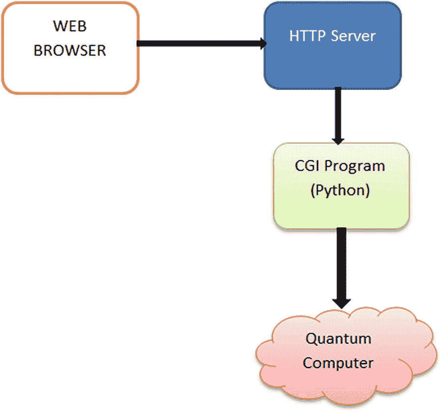

**图 6-1** 云端量子战舰布局

其理念是：

*   摒弃枯燥的文本界面，改用可部署在云端的 HTML 页面。

*   利用 Apache HTTP 服务器通用网关接口（CGI），通过 Python 出色的 CGI 支持，将量子逻辑部署在脚本中。

*   让玩家选择运行计算的设备：本地模拟器、远程模拟器，或真实的量子设备。

接下来，我们通过以下几节描述的一系列练习来完成这一改造。

### 练习 1：将用户界面与游戏逻辑解耦

面向对象设计的一个基本原则：绝不要将呈现层（用户界面）与业务逻辑混合。这样可以构建模块化组件，并实现全平台复用，从而节省大量时间和成本。在战舰游戏中，我们需要移除或注释掉以下内容：

-   脚本中读取每位玩家战舰位置的第一部分（一大段代码），注意不要移除任何数据结构或变量。

-   所有 `print` 语句和键盘输入语句。

-   游戏主循环中持续询问轰炸位置的 `while` 循环也必须移除。脚本必须在处理完 HTTP 请求中的数据后终止。不能包含无限循环，否则请求会挂起。

-   为脚本添加 Python 的 CGI 支持，使其能够从 HTTP 请求中读取数据，包括：

    -   每位玩家的战舰位置

    -   每位玩家的炸弹位置和数量

    -   执行量子计算的设备

-   脚本必须通过 HTTP 响应返回一份损伤报告（最好使用 JSON 格式），供浏览器用 Javascript 进行渲染。

请注意，大部分代码（数据结构、局部变量和量子逻辑）将会被复用；只需注释掉所有输入和 `print` 语句即可。本练习（以及每个练习）的解决方案均位于本节末尾。

### 练习 2：为战舰-炸弹面板构建 Web 界面

构建一个类似于文本界面、基于 HTML 的图形用户界面，并使用 AJAX 异步发送请求到 CGI 脚本。获取损伤结果后，更新玩家面板。改进后的外观如图 6-2 所示。

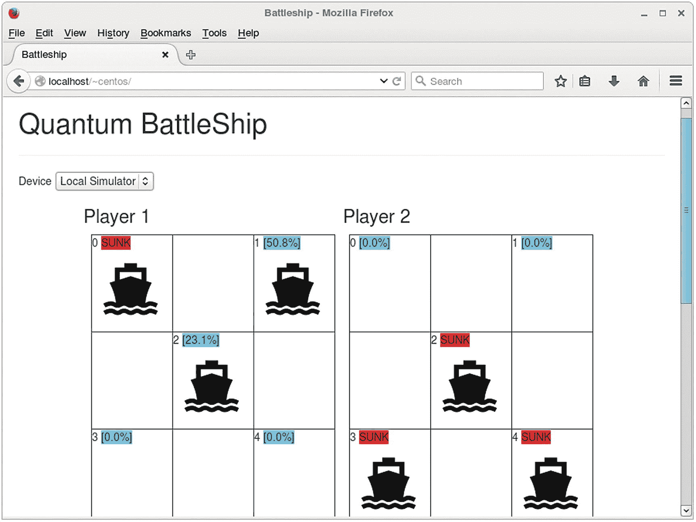

图 6-2：新一代量子战舰的用户界面

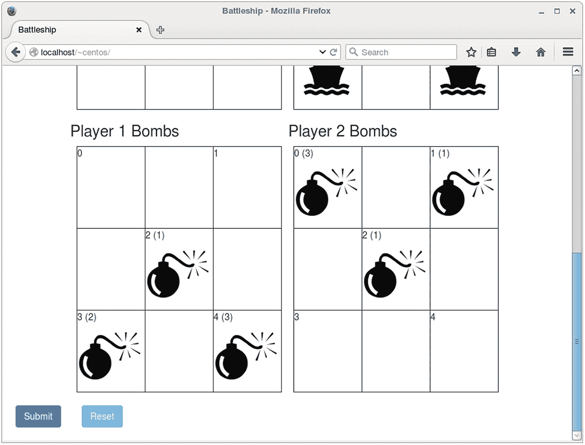

图 6-3：显示炸弹面板的量子战舰

-   HTML 文件将包含四个 3×3 的面板。顶部面板用于在五个量子比特位置上放置三艘战舰。这些将通过 HTML 复选框（`<INPUT TYPE="checkbox">`）实现。我们将使用 CSS 用图片替换开关按钮，这样当玩家点击方框时，就会切换战舰图片。

-   底部面板允许玩家在五个位置放置炸弹，使用与前文相同的 CSS，但将以 `<INPUT TYPE="radio">` 实现，以便每个位置可以放置多枚炸弹。

-   尽管面板是 3×3 布局，但只允许用户输入与量子程序中每个量子比特对应的五个位置。

-   每个战舰位置将显示一个量子比特编号以及由后端返回的、带颜色标识的损伤百分比。

-   游戏机制与文本版完全相同。每位玩家在面板上放置三艘战舰，然后轮流向一个位置放置炸弹并点击“提交”。Python CGI 脚本将通过 AJAX 接收请求，运行练习 1 中创建的量子程序，并返回一个损伤结果供 Javascript 渲染。

-   请注意，所有游戏状态（数组、变量及其他数据）都保存在客户端的 HTML 中；因此，我们必须使用 AJAX **异步** 发送请求，否则每次玩家提交时数据都会丢失。页面不会进行刷新。

图 6-3 显示了底部的 3×3 面板，其中展示了量子比特编号、每个炸弹的点击次数，以及通过 CSS 渲染的图片单选按钮。当每位玩家放置好三艘战舰并选择好轰炸位置后，点击 *提交* 按钮即可向服务器发送 AJAX 请求。*重置* 按钮可在任意时刻重新开始游戏。请注意，所有状态均保存在客户端（浏览器）中。由于 HTTP 是一个无状态的请求-响应协议，Python 脚本中不会保留任何数据。这意味着当收到请求时，程序由 Web 服务器执行，响应被打印到请求的输出缓冲区，然后程序终止。与前一个练习一样，解决方案位于本节末尾。

### 练习 3：在 Apache HTTPD 中部署与故障排除

当所有组件就位后，就可以部署到 Web 服务器了。我将使用 CentOS 6 上的 Apache HTTPD，但这应该适用于任何 CentOS、Fedora 或 Red Hat 系列（可能也适用于任何当前运行 Apache HTTPD 的 Linux 发行版）。请注意，每个发行版在配置系统软件时都有自己的独特之处。例如，CentOS 注重稳定性和安全性，这让我在配置 HTTPD 和 Python 时遇到了很多麻烦。

### 解决方案 1：一个可复用的 Python 程序

本节介绍了 Python CGI 脚本，它接收来自浏览器的 HTTPD 请求，并以 JSON 字符串形式回复损伤报告及其他信息。程序的第一部分保持不变，唯一区别是现在必须使用 Python 的 `cgi` 库从 HTTP 请求中解析输入（见清单 6-5）。

```
import sys
from qiskit import QuantumProgram
import Qconfig
import getpass, random, numpy, math
import cgi
import cgitb
##### 解决相对依赖：如果您从 Git 仓库克隆 QISKit 并作为全局库使用。
sys.path.append('../../qiskit-sdk-py/')
##### 调试
cgitb.enable(display=0, logdir=".")
##### 变量 ship[X][Y] 将存储玩家 X+1 的第 Y 艘战舰的位置
##### 所有值初始化为不可能的位置 -1
shipPos = [ [-1]*3 for _ in range(2)]
##### 变量 bombs[X][Y] 将存储玩家 X+1 在位置 Y 上放置炸弹的次数
bomb = [ [0]*5 for _ in range(2)] # 所有值初始化为零
清单 6-5：模块化的量子战舰初始化
```

清单 6-5 展示了脚本的第一部分。第 6 行和第 7 行导入了 Python 库：`cgi` 和 `cgitb`（CGI 工具箱），分别用于从 HTTP 请求读取数据和调试 CGI 程序。

#### 提示

以下段落中的代码会激活一个特殊的异常处理器，当发生任何错误时，它会在 Web 浏览器中显示详细的报告。

```
import cgitb
cgitb.enable()
```

请记住，如果发生错误，我们无法向客户端展示程序的内部细节，因为客户端期望的是 JSON 格式的响应，所以我们必须将任何错误报告保存到当前工作目录中，代码如下：

```
cgitb.enable(display=0, logdir=".")
```

上述代码将在开发过程中省去很多麻烦，因为任何异常都会被转储到当前工作目录中一个整洁的 HTML 文档中。该文档的格式将在本章的“故障排除”部分展示。清单 6-5 也展示了用于存储游戏状态的数据结构。这些结构与旧版本相同：

*   `shipPos`：一个二维列表，用于存储每位玩家的三艘船的位置，初始化为 -1；因此 `shipPos = [[-1, -1, -1], [-1, -1, -1]]`。

*   `bomb`：一个二维列表，用于存储每位玩家在每个位置的炸弹数量，初始化为 0：`bomb = [[0,0,0,0,0], [0,0,0,0,0]]`。注意，同一位置可以被多次轰炸；因此需要存储计数。此列表将用于计算船只的损伤。

接下来，脚本从 HTTP 请求中读取游戏数据（见清单 6-6）。

#### 清单 6-6 从 HTTP 请求读取数据

*   要从 HTTP 请求读取数据，请使用 `form = cgi.FieldStorage()`。这个 CGI 调用会返回一个键值对的字典或哈希映射，用于从请求中提取查询字符串参数。在此特定情况下，预期的值有：
    *   `ships1`：一个包含玩家 1 船只位置的三元素 JSON 数组。
    *   `ships2`：一个包含玩家 2 船只位置的三元素 JSON 数组。
    *   `bombs1`：一个包含玩家 1 炸弹数量的五元素 JSON 数组。
    *   `bombs2`：一个包含玩家 2 炸弹数量的五元素 JSON 数组。
    *   `device`：量子程序将在其上执行的设备。可以是：
        *   `local_qasm_simulator`：与 QISKit 一起打包的本地模拟器
        *   `ibmq_qasm_simulator`：IBM 提供的远程模拟器
        *   `ibmqx2`：IBM Q Experience 提供的 5 量子比特量子处理器

*   Python 的卓越之处在于，HTTP 请求提供的 JSON 可以瞬间映射到其优秀的集合支持中：
    ```python
    shipPos[0] = list(map(int, ships1.split(",")))
    bomb[0] = list(map(int, bombs1.split(",")))
    ```

完整的清单 6-6 代码如下：

```python
##### CGI - 解析 HTTP 请求
form = cgi.FieldStorage()
ships1 = form["ships1"].value
ships2 = form["ships2"].value
bombs1 = form["bombs1"].value
bombs2 = form["bombs2"].value
##### 'local_qasm_simulator', 'ibmqx_qasm_simulator'
device = str(form["device"].value)
shipPos[0] = list(map(int, ships1.split(","))) # [0,1,2]
shipPos[1] = list(map(int, ships2.split(","))) # [0,1,2]
bomb[0] = list(map(int, bombs1.split(",")))
bomb[1] = list(map(int, bombs2.split(",")))
stdout = "船只位置: " + str(shipPos) +  " 炸弹计数: " + str(bomb) + ""
```

##### 提示

在 Python 中，`split(SEPARATOR)` 系统调用用于创建 `String` 类型的元素列表。但我们需要的是一个整数列表。为此，我们使用 `map(DATA-TYPE, LIST)` 系统调用。请注意，在 Python 3 中，`map` 返回的是一个哈希映射（字典）；因此，我们必须使用 `list` 系统调用来将其转换为所需的整数列表。这样做的好处是，脚本能够重用旧的数据结构，并保持大部分量子逻辑不变。

清单 6-6 的最后一行仅是一个标准输出的字符串缓冲区，它将返回给浏览器用于调试目的。最后，清单 6-7 展示了脚本的主体部分，这部分基本保持不变。

#### 清单 6-7 量子脚本主程序段

```python
##### 变量 grid[player] 将保存每个玩家网格的结果
grid = [{},{}]
##### 现在我们创建并运行量子程序，为每个玩家在网格上实现此功能
for player in range(2):
    ##### 现在设置量子程序 (QASM) 来模拟该玩家的网格
    Q_program = QuantumProgram()
    Q_program.set_api(Qconfig.APItoken, Qconfig.config["url"])
    ##### 声明一个包含 5 个量子比特的寄存器
    q = Q_program.create_quantum_register("q", 5)
    ##### 声明一个包含 5 个经典比特的寄存器，用于保存测量结果
    c = Q_program.create_classical_register("c", 5)
    ##### 创建电路
    gridScript = Q_program.create_circuit("gridScript", [q], [c])
    ##### 添加炸弹（来自对手的）
    for position in range(5):
        ##### 添加已放置在此位置的炸弹数量
        for n in range( bomb[(player+1)%2][position] ):
            ##### 炸弹的效力
            ##### （即我们应用的量子操作）
            ##### 取决于它属于哪艘船
            for ship in [0,1,2]:
                if ( position == shipPos[player][ship] ):
                    frac = 1/(ship+1)
                    ##### 将这一部分的 NOT 门添加到 QASM 中
                    gridScript.u3(frac * math.pi, 0.0, 0.0, q[position])
    ##### 最后，进行测量
    for position in range(5):
        gridScript.measure(q[position], c[position])
    ##### 要查看量子计算机被要求做什么，我们可以打印 QASM 文件
    ##### 这行通常被注释掉
    #print( Q_program.get_qasm("gridScript") )
    ##### 编译并运行 QASM
    results = Q_program.execute(["gridScript"], backend=device, shots=shots)
    ##### 提取数据
    grid[player] = results.get_counts("gridScript")
    ##### 如果某次运行失败，通知玩家并重新开始这一轮
    if ( ( 'Error' in grid[0].values() ) or ( 'Error' in grid[1].values() ) ):
        stdout += "过程超时。请重试这一轮。"
    else:
        ##### 查看所有量子比特上的损伤（我们甚至会对没有船只的位置进行检查）
        damage = [ [0]*5 for _ in range(2)]
        ##### 为此，我们遍历每个玩家的所有 5 位字符串
        for player in range(2):
            for bitString in grid[player].keys():
                ##### 然后遍历所有位置
                for position in range(5):
                    ##### 如果字符串在该位置为 1，我们就向损伤值添加贡献
                    ##### 记住位置 0 的位是最右边的位，因此在 bitString[4] 处
                    if (bitString[4-position]=="1"):
                        damage[player][position] += grid[player][bitString]/shots
        stdout += "损伤: " + str(damage) + ""
```

对原始脚本的主程序部分做了几处小修改：

*   所有 `print` 语句已被移除。取而代之的是，使用一个标准输出字符串缓冲区将信息返回给客户端。这样做的原因是 Python 的 `print` 会将信息直接转储到 HTTP 响应中，这会扰乱我们必须返回的 JSON 格式（Javascript 期望从 AJAX 获取正确的 JSON）。请注意，这是一个纯粹可选但有益步骤，旨在将调试信息返回给客户端。总而言之，你可以通过简单地注释掉所有 `print` 语句来应付过去（当然，如果发生错误，你将很难找出问题所在）。

*   所有用户输入语句（`读取炸弹位置`、`按回车继续` 等）已被移除。请记住，船只位置和炸弹数量是从 HTTP 请求中映射而来的。

*   原始脚本使用一个无限的 `while` 循环来读取炸弹位置。这个循环已被移除，否则脚本将永远运行下去，并导致 HTTP 请求挂起。

最后，脚本将一个 JSON 文档返回给浏览器用于 UI 更新，如清单 6-8 所示。

#### 清单 6-8 返回 JSON 文档

## 响应

```python
print ("Content-type: application/json\n\n")
print ("{\"status\": 200, \"message\": \"" + stdout + "\", \"damage\":" + str(damage) + "}")
```

清单 6-8 将响应发送回浏览器。

要使用 Python CGI 将响应发送回浏览器，只需将标准的 HTTP 响应打印到标准输出即可。也就是说，一个或多个 HTTP 头，后跟两个换行符和响应正文。例如，要发送一个用于损伤数据的 JSON 文档，我们使用以下代码片段：

```
Content-type: application/json
{ "status" : 200, "message": "设备 ibmqx_qasm_simulator", "damage": [[0.5, 0, 0, 0, 0], [0, 0.9, 0, 0, 0]]}
```

上面的 JSON 文档指明了玩家 1 的量子比特 (0) 和玩家 2 的量子比特 (1) 的损伤情况。该文档将由浏览器 AJAX 代码解析，并在屏幕上更新其数值。

## 提示

本练习的代码可从本书源代码 `Workspace\Ch06\battleship\cgi-bin\qbattleship.py` 中获得。

### 解决方案 2：用户界面

网页使用一个 2x2 的 HTML 表格来呈现四个 3x3 的内部表格，这些内部表格代表每位玩家的船只和炸弹棋盘，如图 6-4 和清单 6-9 所示。

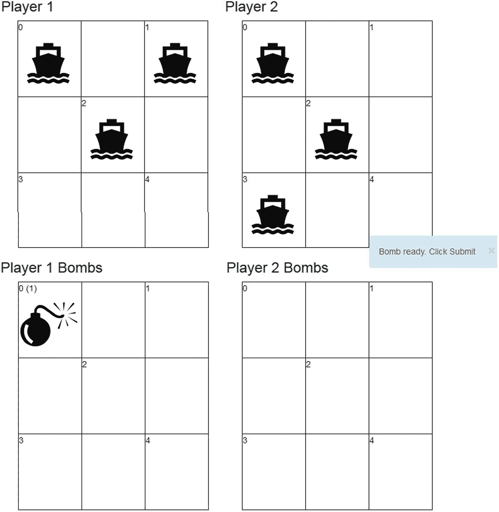
图 6-4 量子海战用户界面

```
设备

本地模拟器
IBM 模拟器
ibmqx2

&nbsp;&nbsp;&nbsp;每位玩家放置 3 艘船，放置一颗炸弹并点击提交。

玩家 1
 table(1, 's')

玩家 2
 table(2, 's')

玩家 1 炸弹
 table(1, 'b')

玩家 2 炸弹
 table(2, 'b')

清单 6-9
图 6-4 的 HTML 代码
```

3x3 的棋盘使用 `document.write()` 系统调用动态渲染，如清单 6-10 所示。

```javascript
// type: 's' (船) = 复选框, 'b' (炸弹) = 单选按钮
function table (player, type) {
var d     = document;
var html  = '\n';
var qubit = 0;
for ( var i = 0 ; i < 3; i++ ) {
html += '\n';
for ( var j = 0 ; j < 3; j++ ) {
html += '';
if ( type == 's' ) {
html += '<INPUT type="checkbox" name="player' + player + '_ship" value="' + qubit + '">';
}
else {
html += '<INPUT type="radio" name="player' + player + '_bomb" value="' + qubit + '">';
}
if ( type == 's' ) {
// 船只索引 损伤图像
html += '' + (qubit - 1)
+ ' '
+ ''
+ '&nbsp;'
}
else {
html += '&nbsp;';
}
html += '\n';
}
html += '\n';
}
html += '';
d.write(html);
}
```

清单 6-10 使用 `document.write()` 动态渲染的表格。

表 6-1 展示了用户界面的主要亮点。

**表 6-1 云海战用户界面技巧与提示**

| 我们使用样式表隐藏复选框和单选按钮。第 1 行和第 2 行的选择器利用否定伪类来对旧版浏览器隐藏规则。第 3 至 5 行设置宽度、外边距和内边距，以便准确定位替代图形。第 6 行设置不透明度，使标准用户界面不可见。 |
| :--- |
| `input[type=checkbox]:not(old),`<br>`input[type=radio   ]:not(old){`<br>`width   : 104px;`<br>`margin  : 0;`<br>`padding : 0;`<br>`opacity : 0;`<br>`}` |
| 舰船表格中的每个单元格显示<br>• 一个量子比特编号<br>• 用于显示损坏百分比的 HTML span 元素<br>• 一个 `<INPUT type=”checkbox”>`，经过修改后使用 100x100 像素的图像代替常规控件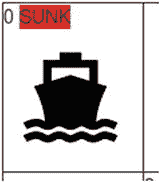 |
| `input[type=checkbox]:not(old) + label {`<br>`display      : inline-block;`<br>`margin-left  : -104px;`<br>`padding-left : 104px;`<br>`background   : url('img/ship.png') no-repeat 0 0;`<br>`line-height  : 100px;`<br>`}` |
| 我们定位标签并显示未选中状态的图像。第 2 行将标签设置为 inline-block 元素，这使得第 6 行能够将其高度设置为与替代图形高度一致，并使文本垂直居中。第 3 行使用负外边距覆盖标准用户界面本应显示的区域，第 4 行则利用内边距将标签文本恢复到正确位置。此处使用的 104 像素值等于图像的宽度加上一些额外内边距，以使标签文本不至于离图像太近。第 5 行在标签文本之前的空白区域显示未选中状态的图像。 |
| 每个炸弹单元格包含<br>• 一个量子比特编号<br>• 用于显示该位置炸弹计数的 HTML span 元素<br>• 一个 `<INPUT type=”radio”>`，通过 CSS 修改后使用 100x100 像素的图像代替常规控件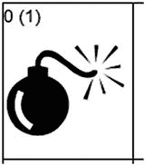 |
| 用于格式化炸弹的样式如下所示：<br><br>`input[type=radio   ]:not(old) + label{`<br>`display      : inline-block;`<br>`margin-left  : -104px;`<br>`padding-left : 104x;`<br>`background   : url('img/bomb.png') no-repeat 0 0;`<br>`line-height  : 100px;`<br>`}` |
| 接下来，当复选框和单选按钮被选中时，我们显示对应的选中图像：<br><br>`input[type=checkbox]:not(old):checked + label{`<br>`background-position : 0 -100px;`<br>`}`<br><br>`input[type=radio]:not(old):checked + label{`<br>`background-position : 0 -100px;`<br>`}` |
| 由于我们将不同状态的图像合并到了同一张图片中，上述规则通过修改背景位置来显示相应的图像。 |
| 使用精良的 jQuery、Bootstrap 和 Bootstrap-Growl 库将消息和调试信息渲染到 JS 控制台： |
| `<script type="text/javascript" src="js/log.js"></script>`<br>`<script type="text/javascript" src="js/jquery.js"></script>`<br>`<script type="text/javascript" src="js/bootstrap.js"></script>`<br>`<script type="text/javascript" src="js/bootstrap-growl.js"></script>`<br>`<script type="text/javascript" src="js/notify.js"></script>` |
| HTML 使用经典的 Bootstrap 库进行 GUI 设计美化。消息则借助优秀的 JS 库 Bootstrap-Growl 显示在屏幕上：<br><br>`notify('炸弹准备就绪。单击“提交”', info);`<br><br>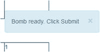 |

### 游戏规则与验证

由于 HTTP 是一种无状态协议，所有数据结构和验证逻辑都必须迁移到客户端。例如：

*   不允许玩家在棋盘上放置超过三艘舰船。
*   放置炸弹后，不允许更改任何舰船。
*   在所有玩家放置完舰船之前，不能放置炸弹。
*   使用一个全局炸弹计数数组来跟踪用户点击：`var BOMBS = [[0,0,0,0,0], [0,0,0,0,0]]`。该数组与其 Python 对应部分相匹配：`bomb = [[0]*5 for _ in range(2)]`。

可以通过在点击舰船或炸弹单元格时分别添加回调函数来强制执行这些规则，如清单 6-11 所示。

### 点击回调函数与游戏规则

清单 6-11 展示了使用点击回调函数执行游戏规则的代码（摘自书籍源码 `index.html`）。

```javascript
// 点击舰船单元格时触发
function cell_click_ship ( obj ) {
var id     = obj.id;
var player = parseInt(id.charAt(1));
var qubit  = parseInt(id.charAt(3));
var json = countShipsBombs();
LOGD('单元格被点击 ' + id  + ' 计数:' + JSON.stringify(json));
if ( json.ships[0] > 3 || json.ships[1] > 3) {
return error('所有玩家只能放置 3 艘舰船。');
}
// 炸弹放置后不允许更改舰船
if ( json.bombs[0] > 0 || json.bombs[1] > 0 ) {
return error('炸弹放置后不允许更改舰船。');
}
return true;
}

// 点击炸弹单元格时触发
function cell_click_bomb ( obj ) {
var id     = obj.id;     // 对于炸弹：p[玩家]b[量子比特]
var player = parseInt(id.charAt(1));
var qubit  = parseInt(id.charAt(3));
// 验证: { 'ships': [s1, s2], 'bombs': [b1, b2]}
var json = countShipsBombs();
LOGD('炸弹被点击 ' + id  + ' 计数:' + JSON.stringify(json));
if ( json.ships[0] = 2 ) {
if ( BOMBS[player - 1 ][qubit] < 1 ) {
$('#' + id).attr('checked', false);
}
return error("还没轮到你。轮到玩家 " + ((1-(player-1)) + 1) );
}
// 计数炸弹
BOMBS[player - 1 ][qubit]++;
// 将计数赋值给: d[玩家][量子比特]
$('#b' + player + qubit).html("(" + BOMBS[player - 1 ][qubit] + ")");
// 炸弹已放置，点击提交
notify('炸弹准备就绪。单击“提交”', 'info');
mustSubmit = true;
}

function error (msg) {
notify(msg, 'danger');
return false
}
```

现在可以将数据发送到后端进行处理。

### 端点与响应格式

每个请求都必须使用 AJAX 方式异步发送到 Web 服务器。此外，查询字符串必须使用特定的格式。因此，请求-响应格式如下：

给定端点 `http://localhost/~centos/battleship/cgi-bin/qiskit-driver.sh`，我们假设：

*   用户名为 `centos`。

*   代码已部署到用户的主文件夹：`$HOME/centos/public_html/battleship`。

*   必须使用包装脚本 `qiskit-driver.sh` 来激活 Python 3。只有当主机上存在多个 Python 版本时才需要这样做（请参见“运行多个版本的 Python”一节）。

请求查询字符串中需要包含以下值：

*   `ships1`：玩家 1 船只的三个位置的逗号分隔列表。

*   `ships2`：玩家 2 船只的三个位置的逗号分隔列表。

*   `bombs1`：玩家 1 的五个炸弹数量的逗号分隔列表。

*   `bombs2`：玩家 2 的五个炸弹数量的逗号分隔列表。

*   `device`：量子设备。例如，`local_qasm_simulator`，`ibmq_qasm_simulator`，或 `ibmqx2`。

例如，以下是在 IBM 远程模拟器中运行的完整 AJAX 请求：

```
http://localhost/~centos/battleship/cgi-bin/qiskit-driver.sh?ships1=0,1,2&ships2=0,1,2&bombs1=0,1,0,0,0&bombs2=0,0,0,0,0&device=ibmqx_qasm_simulator
```

当玩家点击“提交”时，船只位置 `ships1` 和 `ships2`，以及炸弹数量 `bombs1` 和 `bombs2`，会根据 DOM 树和全局 `BOMBS` 数组组合而成。请求端点和查询字符串被定义，HTTP GET 请求通过 AJAX 发送，如代码清单 6-12 所示。

```javascript
function submit() {
var frm  = $('#frm1');
var url  = "cgi-bin/qiskit-driver.sh";
// Data format: ships1=0,1,2&ships2=0,1,2&bombs1=0,1,0,0,0&bombs2=0,0,0,0,0
// ships has the positions per player, bombs has the bomb position counts per player
// ships: 3 ships per player, bombs: 5 position counts
var data = ";
var s1   = ";
var s2   = ";
for ( var i = 0 ; i  0) s1 = s1.substring(1);
if (s2.length > 0) s2 = s2.substring(1);
// query string
data = 'ships1=' + s1 + '&ships2=' + s2
+ '&bombs1=' + BOMBS[0].join(',') + '&bombs2=' + BOMBS[1].join(',')
+ '&device=' + $('#device').val();
LOGD('Url:' + url + ' data=' + data);
// https://api.jquery.com/jquery.get/
$.get( url, data)
.done(function (json) {
handleResponse (json);
})
.fail(function() {
LOGD( "error" );
notify('Internal Server Error. Check logs.', 'danger');
})
}
```

代码清单 6-12 从图书源码 `index.html` 向后端提交数据。

如果出现问题，屏幕上会显示错误通知；否则，预期的响应 JSON 将被发送给一个处理程序进行消费。接下来看看是怎么办到的。

### 响应处理程序

响应处理程序的工作是消费后端响应，更新伤害统计，如有错误则显示错误消息，或者重复此过程直到决出胜负。代码清单 6-13 展示了这个过程，但在此之前，我们先看看响应 JSON 的关键格式：

```json
{"status":200,"message":"OK","damage":[[0.475,0,0,0.70,0],[0.786,0.90,0,0,0.]]}
```

最重要的键是 `damage`。它包含一个二维数组，表示每个玩家的船只伤害位置。伤害是一个介于 0 和 1 之间的百分比。此数据由响应处理程序用来更新用户界面。

*   处理程序提取伤害数组，并循环遍历每个位置，将每个玩家的伤害转换为 1-100 的百分比。

*   使用颜色编码来显示伤害百分比，以达到戏剧性的效果。每击沉一艘船，屏幕上都会显示消息（见图 6-5）。

    

    图 6-5 伤害颜色编码

*   如果某个玩家所有船只的伤害总和超过 90% 的阈值，则判定该玩家获胜，游戏结束。点击 `Reset` 按钮开始新游戏。

## 游戏重置

```javascript
function handleResponse (json) {
LOGD("Got: " + `JSON.stringify(json)`)
var damage   = `json.damage`;
var d1      = `damage[0]`;  // damage P1
var d2      = `damage[1]`;  // damage P2
for ( var i = 0 ; i  2.85 (0.95 * 3) = loss
// https://www.w3schools.com/jsref/jsref_reduce.asp
// array.reduce(function(total, currentValue, currentIndex, arr), initialValue)
var s1 = `d1.reduce`(function(total, currentValue, currentIndex, arr)
{ return total + currentValue}, 0);
var s2 = `d2.reduce`(function(total, currentValue, currentIndex, arr)
{ return total + currentValue}, 0);
var winner = 0;
if ( `s1 > 2.85`) winner = 2;
if ( `s2 > 2.85`) winner = 1;
`LOGD ("Results Damage sums s1:" + s1 + " s2:" + s2)`;
if ( `winner != 0`) {
`notify ('G.A.M.E O.V.E.R Player ' + winner + ' wins ', 'success')`;
`gameover = true`;
}
// enable submit
`$("#btnSubmit").prop("disabled", false)`;
}
```

代码清单 6-13
来自图书源码 `index.html` 的响应处理程序

要重置游戏，我们只需取消选中所有复选框和单选按钮，并重置全局 `BOMBS` 数组，如代码清单 6-14 所示。

```javascript
// Restart game: fires when the reset button is clicked
function reset_click () {
if ( ! confirm("Are you sure?")) {
return;
}
`gameover = false`;
for ( var i = 0 ; i < 5 ; i++) {
`$('#p1s' + i).attr('checked', false)`;
`$('#p2s' + i).attr('checked', false)`;
`$('#p1b' + i).attr('checked', false)`;
`$('#p2b' + i).attr('checked', false)`;
// info spans
`$('#s1' + i).html("")`;
`$('#s2' + i).html("")`;
`$('#b1' + i).html("")`;
`$('#b2' + i).html("")`;
`BOMBS[0][i] = 0`;
`BOMBS[1][i] = 0`;
}
}
```

代码清单 6-14
来自图书源码 `index.html` 的游戏重置

现在是时候运行、部署、测试，并在必要时进行故障排除了。我使用 CentOS 6 进行开发，该版本默认捆绑了 Python 2.7。请记住，我们必须在 Python 3.5 或更高版本中运行。

###### 提示

代码清单 6-9 至 6-12 可以在图书源码的 `Workspace\Ch06\battleship\index.html` 目录下找到，以及部署游戏到云所需的所有资源。

### 运行多个版本的 Python

第 3 章解释了如何分别安装和运行 Python 3.6 和 Python 2.7。在这个特定案例中，使用一个包装脚本来在调用量子程序之前激活 CGI 后端的 Python 3。

```sh
#!/bin/sh
##### home dir
root=/home/centos
program=qbattleship.py
##### Activate python 3
source $root/qiskit/qiskit/bin/activate
##### execute python quantum program
python $program
```

上面的脚本简单地激活了 Python 3 并调用了真正的量子程序 `qbattleship.py`。这是必需的，否则 Web 服务器将使用默认的 Python 安装（2.7），并且由于 QISKit 需要 Python 3.5 或更高版本，程序将会失败。请记住，Python 3 环境是在用户主目录下按如下方式创建的：

```sh
$ mkdir –p $HOME/qiskit
$ cd $HOME/qiskit
$ python3.6 -m venv qiskit
```

要激活虚拟环境：

```sh
$ source qiskit/bin/activate
```

现在终于可以部署和测试了。希望不必进行故障排除。

### 解决方案 3：部署与测试

在本节中，我们将游戏部署到 Apache HTTPD 服务器中，并实际查看游戏效果。游戏的完整源代码，包括所有支持文件、样式、图像、CGI 包装器和量子程序，都可以在图书源码的 `Workspace\Ch06\battleship` 目录下找到。文件夹布局如图 6-6 所示。

###### 注意

本部分假设您已在系统中安装了 Apache HTTPD，并且默认服务已配置并正常运行。如未满足此条件，网上有大量教程可供参考。例如，针对 CentOS 7，我推荐 [`www.liquidweb.com/kb/how-to-install-apache-on-centos-7/`](http://www.liquidweb.com/kb/how-to-install-apache-on-centos-7/)。

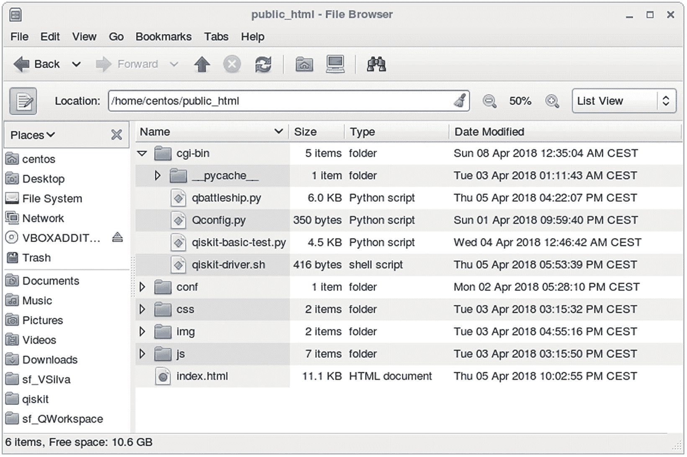

`图 6-6` 云量子战舰的文件夹布局

1. 在用户主目录下创建一个名为 `public_html` 的文件夹。

    ```sh
    $ mkdir $HOME/public_html
    ```

2. 在 `public_html` 下创建 `cgi-bin` 文件夹，用于存放 CGI Python 脚本。

    ```sh
    $ mkdir $HOME/public_html/cgi-bin
    ```

3. 配置 HTTPD 服务器，以允许访问用户的 `public_html` 以及 `public_html/cgi-bin` 文件夹（见代码清单 6-15）。请注意，`cgi-bin` 需要特殊权限才能执行 CGI 脚本。

4. 如果您想使用本书的源码，请将所有文件从 `Workspace\Ch06\battleship` 复制到 `public_html/battleship`。

5. 确保 `public_html` 文件夹及其所有子文件夹和文件的权限设置正确。这一点非常重要；如果权限不正确，浏览器将返回“500 – 内部服务器错误”。我在 CentOS 6 桌面测试时，这曾是一个主要的麻烦来源：`$ chmod -R 755 public_html`。

```apache
#UserDir disabled
#
##### 要启用对 /~user/ 的请求以提供用户的 public_html
##### 目录，请删除上面的 "UserDir disabled" 行，并取消注释
##### 以下行：
#
UserDir public_html

AllowOverride FileInfo AuthConfig Limit
Options MultiViews Indexes SymLinksIfOwnerMatch IncludesNoExec +ExecCGI
AddHandler cgi-script .cgi

Order allow,deny
Allow from all

AllowOverride None
Options ExecCGI
SetHandler cgi-script
```

**代码清单 6-15** 启用从用户 `public_html` 目录的 HTTP 请求的配置（CentOS 6/Apache HTTPD 2.2）

###### 提示

启用从 `public_html` 的请求（代码清单 6-15）需要在 `httpd.conf` 中启用 Apache 模块 `userdir`（取消注释 `LoadModule userdir_module modules/mod_userdir.so`）。此模块可能默认未启用。

将代码清单 6-15 中的脚本复制到系统文件夹`/etc/httpd/conf.d`。该文件夹包含 Apache HTTPD 启动时自动加载的配置文件。现在启动 HTTPD 服务器，在 CentOS 中（注意，这假设您已在系统中安装了 Apache HTTPD）：

```
$ sudo service httpd start       (CentOS 6)
$ sudo systemctl start httpd     (CentOS 7)
```

最后，作为压轴戏，启动浏览器并打开 URL `http://localhost/~centos/battleship/`（假设用户名为 `centos`）。希望一切顺利，您可以开始玩云量子战舰了；但如果出现问题，以下是我在设置过程中遇到的一些问题的列表。

### 故障排除

我遇到的大部分问题都与文件权限有关，这主要是因为我生疏了使用老牌 Apache HTTPD 的技巧：

* **Apache HTTPD 的特殊性**：启用来自用户主目录的请求（代码清单 6-15）需要在守护进程配置文件 `httpd.conf` 中启用模块 `userdir`。根据您的操作系统，此模块可能默认未启用。另外，HTTPD 2.4 用户请注意：代码清单 6-15 适用于 Apache v2.2；v2.4 可能需要不同的语法。

* **浏览器中显示 HTTP 状态 500 - 内部服务器错误**：确保 `public_html` 以及所有文件和子文件夹的权限设置为 `755`。您可以通过查看位于以下位置的 HTTPD 日志文件来诊断此问题：

```
/var/log/httpd/error_log
/var/log/httpd/suexec.log
```

例如，以下是来自 `suexec.log` 的一个片段，告诉我权限配置有误：

```
$ tail -f /var/log/httpd/suexec.log
[2018-04-02 17:03:45]: cannot get docroot information (/home/centos)
[2018-04-02 17:10:13]: uid: (500/centos) gid: (500/centos) cmd: first.cgi
[2018-04-02 17:10:13]: directory is writable by others: (/home/centos/public_html)
```

**提示：** Apache suEXEC 是 Apache Web 服务器的一个特性。它允许用户以不同用户身份运行 CGI 和 SSI 应用程序。在 CentOS 中，suEXEC 会将日志写入 `/var/log/httpd/suexec.log`。

* **SELinux 带来的麻烦**：这是一个 Linux 内核安全模块，提供了支持访问控制安全策略的机制。在 CentOS 中，此功能默认启用。可以通过命令行使用以下命令临时禁用它：

```
$ sudo setenforce 0
```

或者通过编辑文件 `/etc/sysconfig/selinux` 并将 `SELINUX` 键的值设置为 `disabled` 来永久禁用。

```
$ sudo vi /etc/sysconfig/selinux
SELINUX=disabled
SELINUXTYPE=targeted
```

请注意，在调用 CGI 脚本或当量子程序尝试针对 IBM 模拟器或真实设备执行远程代码时，SELinux 可能会导致问题。

* **Python 错误**：如果 Python 脚本中发生任何错误，CGI 异常处理程序将捕获它，并在当前工作目录（`cgi-bin`）中转储一个漂亮的 HTML 页面。图 6-7 显示了在真实量子设备 `ibmqx2` 上执行时发生超时错误的输出。

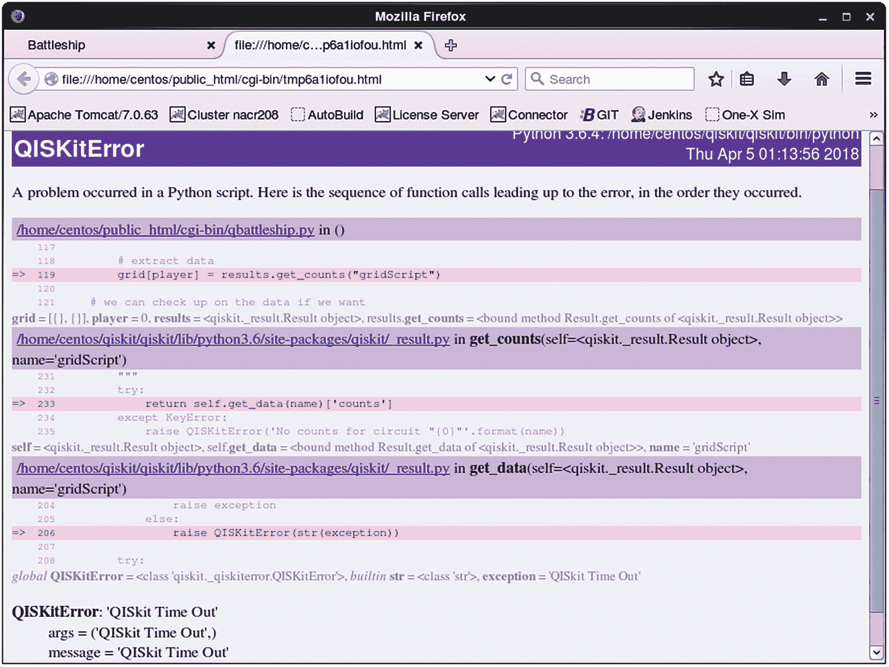

* **API 配置问题**：最后，如果要在真实的量子设备上运行，请确保 `Qconfig.py` 中的配置正确（包括您 Q Experience 账户的 API 令牌），如下面的代码片段所示：

```
APItoken = '你的-API-令牌'
config = {
'url': 'https://quantumexperience.ng.bluemix.net/api',
}
```

请注意，`Qconfig.py` 必须与量子程序 `qbattleship.py` 位于同一位置，即 `cgi-bin` 文件夹。尽管如此，游戏仍有进一步改进的空间；我们将在下一节讨论。

### 进一步的改进

上一节中的云战舰可以在某些方面进行改进，您在玩了一段时间后可能会注意到这些方面。以下是我的一些想法：

* 用户界面显示了两位玩家的战舰和炸弹棋盘。在真实的战舰游戏中，每位玩家应打开自己的浏览器窗口，布置自己的战舰，并开始轰炸对手。

* **网关状态**：由于 HTTP 是一种无状态协议，战舰、炸弹位置和量子设备的信息都保存在客户端。也就是说，一个请求到来，Python 程序运行，然后返回一个响应。之后，所有内存信息都会消失。一个真正的游戏应该使用基于服务器的玩家大厅来托管所有的游戏状态（例如，使用应用服务器），并协调浏览器窗口之间的通信。

#### 更好的云战舰游戏

终极版云量子战舰游戏应为每位玩家提供两个浏览器窗口，分别显示船只和炸弹面板。此外，应将 Apache HTTPD 替换为能够将游戏状态存储在服务器端的应用服务器（例如 Apache Tomcat）。其布局如图 6-8 所示。

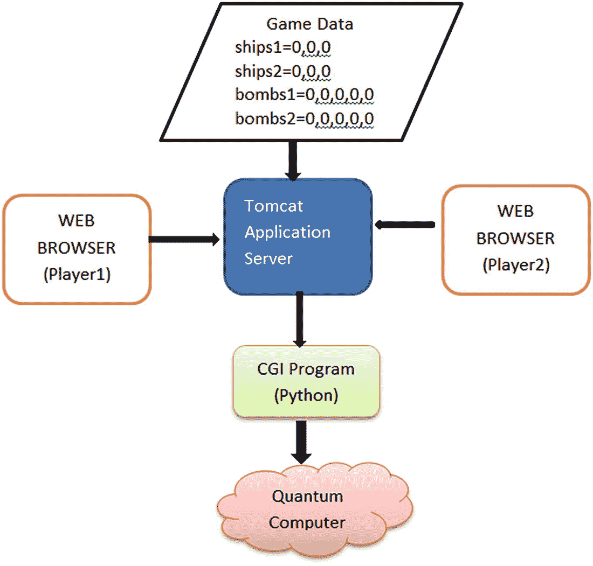

* 一个基础的游戏大厅可以作为 Tomcat 的 Web 应用来实现，用于存储船只、炸弹位置以及量子设备的信息。

* 该 Web 应用可以利用主机的操作系统运行时工具（此处指 Java 的运行时 API）来调用 Python 的量子脚本，获取伤害结果，并将其分发给每位玩家。

* 为了避免令人烦恼的浏览器页面刷新，每个浏览器可以通过 `WebSocket` 连接到应用服务器。这将保持一个永久连接，通过该连接可以在客户端之间快速发送 JSON 文本消息。

#### 通过 WebSocket 连接

UI 网页需要进行小幅修改，改为通过 `WebSocket` 而非 AJAX 进行连接，如代码清单 6-16 所示。

**提示：** 本书源码的 `Workspace\Ch06_BattleShip` 目录下提供了本节内容的 Eclipse 项目。考虑到该 Web 应用的所有复杂部分，我建议在你的 IDE 中打开此工作区并对照阅读。请注意，我默认你对使用 Eclipse/Tomcat 组合编写应用已达到相当熟练的程度。

# WebSocket 客户端实现

## 客户端 JavaScript 代码

```javascript
// 服务器 WS 端点 (文件: websocket.js)
var END_POINT = "ws://localhost:8080/BattleShip/WSBattleship";
// 用于跟踪客户端的随机 ID
var CLIENT_ID = Math.floor(Math.random() * 10000);
function WS_connect(host) {
LOGD("WS 连接 " + host);
if ('WebSocket' in window) {
this.socket = new WebSocket(host);
} else if ('MozWebSocket' in window) {
this.socket = new MozWebSocket(host);
} else {
LOGE('错误：此浏览器不支持 WebSocket。');
return;
}
this.socket.onopen = function() {
LOGD('WS 已打开 ' + host);
};
this.socket.onclose = function() {
LOGD('WS 已关闭 ' + host);
};
this.socket.onmessage = function(message) {
// { status: 200 , message :'...'}
LOGD('收到消息: ' + message.data);
var json = JSON.parse(message.data);
if ( json.status >= 300 && json.status = 400 ) {
// 错误
notify(json.message, 'danger');
return;
}
handleResponse (json);
};
}
function WS_initialize () {
var clientId = CLIENT_ID;
var host     = END_POINT;
this.url     = host + '?clientId=' + clientId;
WS_connect(this.url);
};
function WS_send (text) {
this.socket.send(text);
};
```

代码清单 6-16 `WebContent/js/websocket.js` 中的 WebSocket Javascript 客户端代码。

在客户端：
- 所有主流浏览器都实现了用于与支持 WebSocket 的服务器保持持久连接的 `WebSocket` 标准。为此，在第 2 行创建了一个形如 `ws://localhost:8080/BattleShip/WSBattleship` 的端点 URL。请注意，参数可以像普通 URL 一样在 `WebSocket` 端点中发送。因此，最终的 WS URL 是 `ws://localhost:8080/BattleShip/WSBattleship?clientId=RANDOM-ID`，其中使用随机 ID 来跟踪每位玩家。
- Javascript 中的 `WebSocket` 使用回调系统来接收事件，例如：
  - `socket.onopen`：当套接字打开时触发。第 23 行展示了用于处理此事件的回调。
  - `socket.onclose`：当连接断开时触发：例如浏览器关闭、刷新或服务器宕机时。
  - `socket.onmessage`：这是最重要的回调。当收到消息时触发，用于消费 Python 发送的 JSON 消息，就像之前版本中 AJAX 所做的那样。
当玩家浏览器页面加载时，客户端使用 DOM 的 `window.onload` 回调进行连接：

```javascript
function win_onload () {
WS_initialize ();
}
window.onload = win_onload;
```

在服务器端，我们需要一个支持 `WebSocket` 的应用服务器。幸运的是，Tomcat 在所有操作系统上都完整实现了 `WebSocket` 标准。代码清单 6-17 展示了在 Java 中一个 `WebSocket` 处理程序的基本实现。

# WebSocket 服务器端实现

## Java WebSocket 处理程序

```java
@ServerEndpoint(value = "/WSBattleship")
public class WSConnector {
    // 连接列表
    private static final List connections =
        new CopyOnWriteArrayList();
    // 游戏数据 玩家 ID => {name: 'Player-1', ships: "0,0,0:, bombs: "0,0,0,0,0 }
    private static final Map data =
        new HashMap();
    /** 此 WebSocket 的客户端 ID */
    String clientId;
    private String getSessionParameter (Session session, String key) {
        if ( ! session.getRequestParameterMap().containsKey(key)) {
            return null;
        }
        return session.getRequestParameterMap().get(key).get(0);
    }
    @OnOpen
    public void open(Session session) {
        clientId = getSessionParameter(session, "clientId");
        // 检查是否重复？
        WSConnectionDescriptor conn = findConnection(clientId);
        if ( conn != null) {
            unicast(conn.session,
                WSMessages.createStatusMessage(400
                    , "已拒绝重复的会话。").toString());
        }
        else {
            connections.add(new WSConnectionDescriptor(clientId, session));
        }
        dumpConnections("ONOPEN " +  clientId );
    }
    @OnClose
    public void end() {
    }
    @OnMessage
    public void incoming(String message) {
        WSConnectionDescriptor d = findConnection(clientId);
        try {
            JSONObject root = new JSONObject(message);
            String name    = root.getString("name");
            String action  = root.optString("action");
            .  // 重置游戏？
            if ( action.equalsIgnoreCase("reset")) {
                multicat(WSMessages.createStatusMessage(300
                    , "游戏已由 " + name + " 重置").toString());
                data.clear();
                return;
            }
            // 验证游戏规则...
            // 执行 Python 脚本
            linuxExecPython(args);
        } catch (Exception e) {
            LOGE("OnMessage", e);
        }
    }
    @OnError
    public void onError(Throwable t) throws Throwable {
        LOGE("WSError: " + t.toString());
    }
}
```

**清单 6-17 - WebSocket 服务器处理器骨架（`WSConnector.java`）**

在 Java 中，WebSocket 服务器处理器通过 J2EE 注解标准实现。这使得代码在所有供应商之间可复用。

- 在清单 6-17 的第 1 行，Java 类 `WSConnector` 定义了注解 `@ServerEndpoint(value = "/WSBattleship")`。这个强大的指令就是构建服务器处理器所需的全部。值 `WSBattleship` 是处理器的名称；因此完整的服务器端点将是 `ws://host:POT/Battleship/WSBattleship?QUERY-STRING`。

- 打开、关闭和消息事件回调分别使用 `@OnOpen`、`@OnClose` 和 `@OnMessage` 注解声明。请注意，方法名称无关紧要，重要的是参数：
    - `OnOpen`：接收一个包含连接信息的 `Session` 对象。
    - `OnClose`：没有参数。当浏览器连接断开时触发。
    - `OnMessage`：最重要的事件。当客户端发送文本消息时触发，数据作为参数。

- 请记住，`WSConnector` 类的每个实例将为每个客户端连接创建；因此在第 5 行，我们使用线程安全的静态列表 `List<WSConnectionDescriptor> connections` 来跟踪所有客户端连接。第 8 行声明了一个静态哈希映射，用于跟踪游戏数据，键是玩家 ID，值是浏览器发送的 JSON 对象。例如，`[Player-1 => {name: 'Player-1', ships: "0,0,0:, bombs: "0,0,0,0,0”, device: "local_qasm_simulator"}]`。

- 当消息回调触发时（文件 `WSConnector.java` 第 201-253 行），文本消息被解析为 JSON，数据存储在内存中，应用游戏规则，如果一切正确，则使用战舰和炸弹位置调用 Python 脚本。最后，收集结果并发送回每个客户端进行更新。

要向客户端发送消息，可以使用 `Session` 对象：

```java
session.getBasicRemote().sendText("一些文本")
```

要向所有人发送消息（多播），可以使用连接列表：

```java
static void multicast ( String message ) {
    for ( WSConnectionDescriptor conn : connections) {
        conn.session.getBasicRemote().sendText(message)
    }
}
```

### 从 Java 调用 Python 并设置文件权限

尽管 Java 语言设计为与操作系统无关，但可以通过 `Runtime.getRuntime().exec("command")` 系统调用来调用操作系统命令。清单 6-18 展示了一个非常简单的类，用于执行命令并将其标准输出读取到字符串缓冲区中。

```java
public class SysRunner {
    final String command;
    final StringBuffer stdout = new StringBuffer();
    final StringBuffer stderr = new StringBuffer();
    
    public SysRunner(String command) {
        this.command = command;
    }
    
    public void run () throws IOException, InterruptedException {
        final Process process   = Runtime.getRuntime().exec(command);
        pipeStream(process.getInputStream(), stdout);
        pipeStream(process.getErrorStream(), stderr);
        process.waitFor();
    }
    
    private void pipeStream (InputStream is, StringBuffer buf) throws IOException {
        BufferedReader br = new BufferedReader(new InputStreamReader(is));
        String line;
        while ((line = br.readLine()) != null) {
            buf.append(line);
        }
    }
    
    public StringBuffer getStdOut () {
        return stdout;
    }
    
    public StringBuffer getStdErr () {
        return stderr;
    }
}
```

**清单 6-18 - 执行操作系统命令并提取结果（`SysRunner.java`）**

要获取命令的输出，请使用进程输入流，从中读取数据，并将数据存储在字符串缓冲区中（清单 6-18 的第 17-24 行）：`pipeStream(process.getInputStream(), stdout)`。现在我们有了执行 Python 程序的工具，但仍需处理 Linux 文件权限。请记住，Python 脚本必须包含在 Web 应用程序本身中（参见图 6-9）。因此，当应用程序服务器将 Battleship Web 应用解压到文件系统（包含 Python 代码）时，脚本将采用默认文件权限 644（不可全局执行）。这将导致脚本运行时失败。

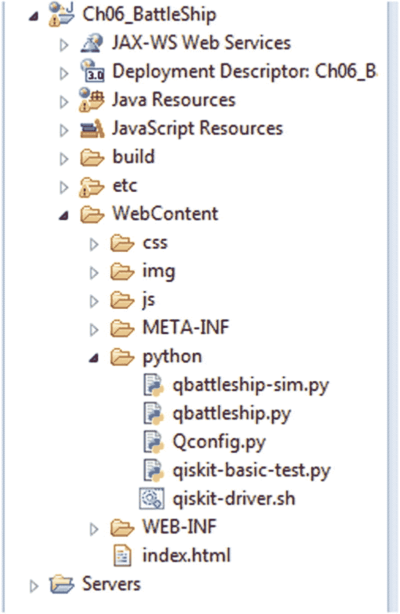

**图 6-9 - 云端战舰 J2EE 项目的项目布局**

要修复 Web 应用中 Python 代码的文件权限，请使用像下一段中所示文件名执行 `chmod` 操作系统命令：

```java
// 获取 Python 代码的基础路径
// ...webapps/BattleShip/python/
String root = IOTools.getResourceAbsolutePath("/") + "../../";
// 特殊 *&$# 字符不起作用
String cmd = "/bin/chmod 755 " + base +  "python" + File.separator;
String[] names = { "Qconfig.py", "qiskit-basic-test.py"
    , "qiskit-driver.sh", "qbattleship-sim.py", "qbattleship.py"};
for (int i = 0; i < names.length; i++) {
    SysRunner r = new SysRunner(cmd + names[i]);
    r.run();
}
```

应用安装的基础路径可以通过 Java 反射获得，如下所示：

```java
public static String getResourceAbsolutePath(String resourceName) throws UnsupportedEncodingException {
    URL url   = IOTools.class.getResource(resourceName);
    String path = URLDecoder.decode(url.getFile(), DEFAULT_ENCODING);
    // path -> Windows: /C:/.../Workspaces/.../
    // path-> Linux:  /home/users/foo...
    if ( path.startsWith("/") && OS_IS_WINDOWS) {
        // 仅在 Windows 下移除第一个斜杠！
        path = path.replaceFirst("/", "");
    }
    return path;
}
```

最终，Python 量子程序可以从 WebSocket 消息回调中执行，如清单 6-19 所示。

```
// Args: ships1=0,0,0 ships2=0,0,0 bombs1=0,0,0,0,0 bombs2=0,0,0,0,0
// device=local_qasm_simulator
private void linuxExecPython (String args) throws Exception {
    // STDOUT {status: 200, message: 'Some text', damage: [[0,0,0,0,0],[0,0,0,0,0]]}
}
```

`StringBuffer stdout = IOTools.executePython(SCRIPT_ROOT, args);`

`JSONObject resp = new JSONObject(stdout.toString());`

`// 按反向顺序发送回客户端`

`JSONArray damage = resp.getJSONArray("damage");`

`resp.remove("damage");`

`final int size = damage.length() - 1;`

`for (int i = 0; i < connections.size(); i++) {`

`resp.put("damage", damage.get( size - i));`

`unicast(connections.get(i).session, resp.toString());`

`resp.remove("damage");`

`}`

`}`

`// base: WEPAPP_PATH/python/qiskit-driver.sh`

`// args: WEPAPP_PATH/python/qbattleship.py`

`//         0,0,0 0,0,0 0,0,0,0,0 0,0,0,0,0 device`

`public static StringBuffer executePython (String base, String args)`

`throws IOException, InterruptedException {`

`String driver = base + File.separator + "python" + File.separator + "qiskit-driver.sh";`

`String program = base + File.separator + "python" + File.separator + "qbattleship.py";`

`String cmd = driver + " " + program + ( args != null ? " " + args : "");`

`SysRunner r = new SysRunner(cmd);`

`r.run();`

`return r.getStdOut();`

`}`

## 清单 6-19 执行量子程序并发送结果

为了执行 Python 量子程序，清单 6-19 中的代码：

- 获取 Web 应用内 `python` 文件夹的`位置`。即 `TOMCAT-ROOT/webapps/Battleship/python`
- 使用以下参数执行驱动脚本 `LOCATION/qiskit-driver.sh LOCATION/qbattleship.py`：
  - `ships1`：玩家 1 的舰船位置
  - `ships2`：玩家 2 的舰船位置
  - `bombs1`：玩家 1 的炸弹数量
  - `bombs2`：玩家 2 的炸弹数量
  - `device`：量子设备
- 将结果分发回客户端

最后，从您的 IDE 中，导出 Cloud Quantum Battleship Web 归档文件 (WAR)，将其部署到您的 Tomcat 容器中，然后通过两个 Web 浏览器在 `http://localhost:8080/BattleShip/` 上开始游戏（见图 6-10）。我假设您精通此操作，但以防万一：

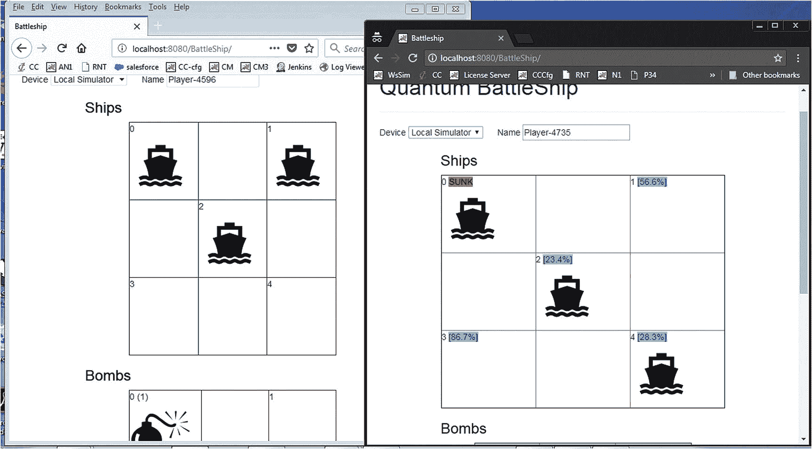
图 6-10 通过两个浏览器改进的 Cloud Battleship

1. 将 Web 应用导出为 Web 归档文件 WAR，然后在您的 IDE 中右键单击 `Ch06_Battleship` 项目（见图 6-9）。点击 *导出 > Web 归档文件*，并选择一个名称/目标位置（例如 `Ch06_Battleship.war`）。
2. 确保 Tomcat 服务已启动并正在运行。如果您的系统默认未安装，以下是一些帮助：
```bash
yum -y install java (CentOS 6,7)
yum -y install tomcat7 tomcat7-webapps tomcat7-admin-webapps (CentOS 6,7)
service tomcat7 start (CentOS 6)
systemctl start tomcat7 (CentOS 7)
```
3. 使用位于 `http://yourhost:8080/manager/` 的 Tomcat 管理器 UI 将归档文件上传并部署到您的 Linux Tomcat 容器中。（提示：管理器将要求输入用户名/密码；如果您没有，请编辑文件 `/etc/tomcat7/tomcat-users.xml`）。
4. 现在，您应该可以将两个浏览器指向 `http://localhost:8080/BattleShip/`（提示：Tomcat Web 应用部署到文件夹 `/var/lib/tomcat7/webapps`）。遇到问题？检查位于 `/var/log/tomcat7/catalina.out` 的容器日志。

本章展示了如何使用单量子比特部分非门计算舰船损伤，在量子计算机上运行流行的战舰游戏。为此，使用了 QISKit 教程中的 Quantum Battleship 示例。此外，通过对其主要界面进行重大改进，使游戏提升到了一个新的水平。您已学习了如何通过 Apache HTTPD 服务器使用 CGI 脚本在云端调用此量子代码。还通过 Tomcat J2EE 容器进行了进一步改进，以支持使用两个浏览器进行游戏。两个项目的代码均可作为 Eclipse 项目从本书源码中获得，分别位于 `Workspace\Ch06` 和 `Workspace\Ch06_BattleShip`。

下一章将探讨两个游戏谜题，展示量子算法相对于经典算法的非凡力量：假币谜题和 Mermin-Peres 魔术正方形。这些是量子伪心灵感应的例子，即玩家能够实现某些结果，而这些结果只有在游戏过程中能够读取对方思想时才有可能。

