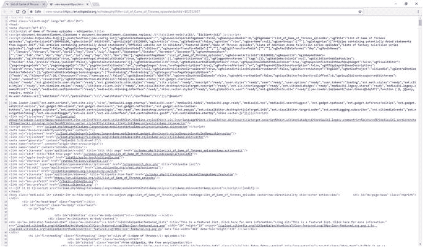
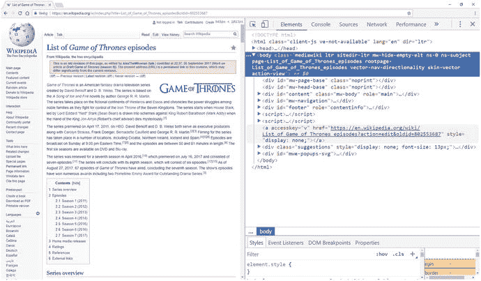
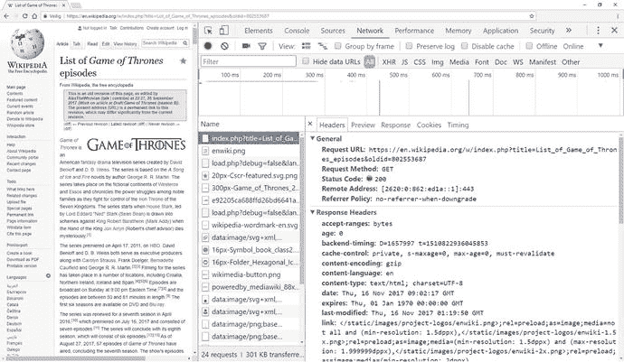
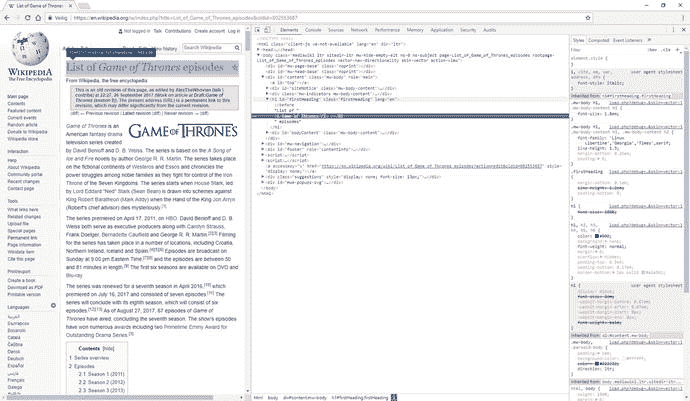

# 3. 搅拌 HTML 与 CSS 这锅“汤”

到目前为止，我们已经讨论了 HTTP 的基础知识，以及如何使用 `requests` 库在Python 中执行 HTTP 请求。然而，由于大多数网页都使用超文本标记语言（HTML）进行格式化，我们需要了解如何从这些页面中提取信息。因此，本章将介绍 HTML，以及用于格式化和美化现代网页的另一个核心构建块：层叠样式表（CSS）。随后，本章将讨论 Beautiful Soup 库，它将帮助我们理清 HTML 和 CSS 这锅“汤”。

### 示例代码

```python
import requests
url = 'https://en.wikipedia.org/w/index.php' + \
      '?title=List_of_Game_of_Thrones_episodes&oldid=802553687'
r = requests.get(url)
print(r.text)
```

### Wikipedia 版本控制

我们在这里使用了 `oldid` URL 参数，以便获取《权力的游戏》剧集列表页面的特定版本，确保后续示例能够正常运行。顺便提一下，这里你可以看到“URL 重写”的实际应用：`https://en.wikipedia.org/wiki/List_of_Game_of_Thrones_episodes` 和 `https://en.wikipedia.org/w/index.php?title=List_of_Game_of_Thrones_episodes` 这两个地址指向完全相同的页面。区别在于后者使用了 URL 参数，而前者没有，不过 Wikipedia 的 Web 服务器足够智能，能够将 URL 路由到正确的“页面”。另外，你可能注意到这里我们没有使用 `params` 参数。虽然也可以使用，但这里的 “title” 和 “oldid” 参数都不需要编码，因此我们可以直接将它们放入 URL 中，以保持其余代码更简洁。

如你所见，通过 `r.text` 捕获的响应体现在输出了一大堆看似混乱的文本。这是 HTML 格式的文本，尽管我们要找的内容就埋藏在这锅“汤”里，但我们需要学习一种恰当的方法来从中提取我们想要的信息。这正是我们在下一章要做的事情。

### 片段标识符

除了查询字符串之外，URL 其实还有另一个你可能遇到过的可选部分：片段标识符，有时也被称为“哈希”。它由井号（`#`）引导，位于 URL 的最末尾，甚至排在查询字符串之后，例如："`http://www.example.org/about.htm?p=8#contact`"。URL 的这一部分用于标识与 URL 对应的文档中的某个部分。例如，一个网页可以包含带有片段标识符的链接，点击后页面会立即滚动到该链接对应的位置。然而，片段标识符的功能与 URL 的其他部分不同，它完全由 Web 浏览器处理，Web 服务器完全不参与。事实上，规范的 Web 浏览器在向 Web 服务器请求资源时，甚至不应该在 HTTP 请求中包含片段标识符。相反，浏览器会等待 Web 服务器发送响应，然后使用片段标识符滚动到页面的正确位置。如果你在请求 URL 中包含片段标识符，大多数 Web 服务器会直接忽略它，尽管有些服务器可能被编程为也会考虑它们。再次强调：这种情况相当罕见，因为如果服务器提供的内容依赖于片段标识符，大多数 Web 浏览器将无法正常显示，因为它们会在请求中省略片段标识符部分——不过，网络世界中充满了各种有趣的边缘情况。

现在我们已经了解了 `requests` 库的基础知识。请花些时间探索该库的文档，地址是 `docs.python-requests.org/en/master/`。`requests` 文档的质量非常高，一旦你在项目中开始使用这个库，查阅它会非常方便。

## 3.1 超文本标记语言：HTML

在前一章中，我们介绍了 HTTP 的基础知识，并了解了如何使用 Python 的 `requests` 库执行 HTTP 请求，但目前我们需要找到一种解析 HTML 内容的方法。回想一下我们在上一章结尾处提到的小型维基百科示例，以及从中获取到的混乱的 HTML 内容：

```python
import requests
url = 'https://en.wikipedia.org/w/index.php' + \
'?title=List_of_Game_of_Thrones_episodes&oldid=802553687'
r = requests.get(url)
print(r.text)
```

也许你曾尝试用其他你喜欢的网站来运行这个示例……无论如何，一旦你开始更深入地了解网络的工作原理，并实际开始进行网页抓取时，你无疑会开始惊叹于你的网页浏览器为你做的所有事情：获取网页；将这种“混乱内容”转换成格式精美的页面，包括图片、动画、样式、视频等等。此时，你可能会感到非常畏惧——我们当然不必从头开始复制网页浏览器的所有功能吧？答案是，幸运的是，我们不需要。就像处理 HTTP 一样，我们将使用一个强大的 Python 库来帮助我们处理这一堆文本混乱。而且，与网页浏览器相反，我们并不关心获取完整的页面内容并进行渲染，而只关心提取我们感兴趣的那些部分。

如果你运行上面的示例，你会看到屏幕上打印出以下内容：

```
List of Game of Thrones episodes - Wikipedia
[...]
```

这就是超文本标记语言（HTML），它是用于创建网页的标准标记语言。虽然有些人会将 HTML 称为“编程语言”，但“标记语言”是更合适的术语，因为它规定了文档的结构和格式。严格来说，并不需要使用 HTML 来格式化网页——事实上，我们在上一章中处理的所有示例都只是返回简单的文本页面。然而，如果你想创建在浏览器中看起来美观的页面（哪怕只是给页面添加一些颜色），HTML 就是你要采用的方式。

HTML 提供了构建块，用于为文档提供结构和格式。这是通过一系列“标签”来实现的。HTML 标签通常成对出现，并用尖括号括起来，`"<tagname>"` 是开始标签，`"</tagname>"` 表示结束标签。有些标签以不成对的形式出现，不需要结束标签。一些常用的标签如下：

-   `<p>...</p>` 用于包含一个段落；
-   `<br>` 用于设置换行；
-   `<table>...</table>` 用于开始一个表格块；其中，`<tr>...<tr/>` 用于行；`<td>...</td>` 用于单元格；
-   `` 用于图片；
-   `<h1>...</h1>` 到 `<h6>...</h6>` 用于标题；
-   `<div>...</div>` 用于表示 HTML 文档中的一个“分区”，主要用于对一组元素进行分组；
-   `<a>...</a>` 用于超链接；
-   `<ul>...</ul>` 和 `<ol>...</ol>` 分别用于无序列表和有序列表；在这些列表内部，`<li>...</li>` 用于每个列表项。

标签可以相互嵌套，因此 `"<div><p>Hello</p></div>"` 是完全有效的，但像 `"<div><p>Oops</div></p>"` 这样的重叠嵌套则是不允许的。即使这不符合规范的 HTML，每个网页浏览器仍会尽最大努力尽可能好地解析和渲染 HTML 页面。如果网页浏览器要求所有网页都必须完全符合 HTML 标准格式，那么可以肯定大多数网站都无法通过。HTML 是一团乱麻。

成对出现的标签含有内容。例如，`"<a>click here</a>"` 会在你的浏览器中将“click here”渲染成一个超链接。标签也可以有属性，这些属性放在开始标签内。例如，`"<a href="http://www.google.com">click here"` 会在点击链接时将用户重定向到 Google 的主页。因此，`"href"` 属性指明了链接的网络地址。对于不成对出现的图片标签，`"src"` 属性用于指示浏览器应获取的图片的 URL，例如 `""`。

## 3.2 将浏览器用作开发工具

如果这一切进展得有些快，不必过于担心，因为在接下来的示例中，我们会更深入地理解 HTML。在继续之前，我们想给你提供一些在构建网络爬虫时会派上用场的技巧。

如今，大多数现代浏览器都内置了一套强大的工具包，你可以利用它们来了解 HTML 和 HTTP 的相关情况。请在你的浏览器中再次导航到维基百科页面 `https://en.wikipedia.org/w/index.php?title=List_of_Game_of_Thrones_episodes&oldid=802553687`——我们假设你接下来使用的是谷歌 Chrome 浏览器。首先，了解如何查看此页面的底层 HTML 会很有帮助。要做到这一点，你可以右键点击页面并选择“查看源代码”，或者在谷歌 Chrome 浏览器中直接按 Control+U。一个新的页面将会打开，其中包含当前页面的原始 HTML 内容（与我们使用 `r.text` 获取到的内容相同）；参见图 3-1。



**图 3-1**

在 Chrome 中查看页面源代码

此外，你还可以打开 Chrome 的“开发者工具”。为此，请选择浏览器窗口右上角的 Chrome 菜单，然后选择“更多工具”、“开发者工具”，或者按 `Control+Shift+I`。或者，你也可以右键点击任意页面元素并选择“检查”。其他浏览器如 Firefox 和 Microsoft Edge 也内置了类似的工具。你应该会看到一个类似图 3-2 所示的屏幕。



**图 3-2**

Chrome 开发者工具窗口包含许多对网络爬虫有用的工具

花些时间探索一下开发者工具面板。你的面板可能会出现在浏览器窗口的底部。如果你希望它出现在右侧，请找到带有三点冒号图标（三冒号）的菜单，并选择不同的“停靠侧边位置”。

开发者工具面板通过一系列标签页进行组织，其中“元素”和“网络”标签页将最为有用。

让我们先来看一下网络标签页。你应该会在工具栏中看到一个红色的“录制”图标，表示 Chrome 正在跟踪网络请求（如果图标未亮起，请点击它以开始跟踪）。刷新维基百科页面，然后观察开发者工具面板中发生的情况：Chrome 开始记录它发出的所有请求，从页面本身的 HTTP 请求开始（位于顶部）。请注意，你的网页浏览器还会发出许多其他请求来实际渲染页面，其中大部分是为了获取图片数据（“类型：png”）。通过点击某个请求，你可以获取关于它的更多信息。例如，点击顶部的 `"index.php"` 请求，你会看到一个类似图 3-3 的屏幕。选择某个请求会打开另一个面板，其中提供了丰富的信息，既然你已经学习了 HTTP，这些信息对你来说应该已经很熟悉了。例如，确保在侧面板中选中了“标头”标签页，我们会看到诸如请求 URL、方法（动词）以及服务器返回的状态码等常规信息，同时还包含完整的请求和响应标头列表。

最后，网络（Network）选项卡中有几个值得注意的实用复选框。启用“保留日志（Preserve log）”可以防止 Chrome 在每次执行新页面请求时“清理”概览信息。当您需要跟踪浏览网站时的一系列操作时，这会非常有用。“停用缓存（Disable cache）”将阻止 Chrome 使用其“短期记忆”。Chrome 会自作聪明，如果它仍有最近页面的内容，就会避免执行请求；如果您希望强制 Chrome 实际执行每一次请求，则可以覆盖此设置。



图 3-3 在 Chrome 中检查 HTTP 请求

转到“元素（Elements）”选项卡，我们看到与查看页面源代码时类似的视图，不过现在被整齐地格式化为基于树状的视图，带有可展开和折叠的小箭头，如图 3-4 所示。

此处特别有帮助的一点是，您可以将鼠标悬停在“元素”选项卡中的 HTML 标签上，Chrome 会在网页本身的对应视觉表示上显示一个透明框。这可以帮助您快速找到想要的内容片段。或者，您可以右键单击网页上的任意元素，然后按下“检查元素（Inspect element）”以立即在“元素”选项卡中高亮显示其对应的 HTML 代码。请注意，“元素”选项卡底部的“面包屑导航（breadcrumb trail）”会显示您当前在 HTML“树”中的位置。

#### 检查元素与查看源代码

您可能会疑惑，既然“元素”选项卡提供了更加用户友好的替代方案，为何“查看源代码（View source）”选项对于查看页面的原始 HTML 代码仍然有用？这里需要提醒一下：“查看源代码”选项显示的是 Web 服务器返回的 HTML 代码，并且在使用 `requests` 库时，其内容将与 `r.text` 相同。另一方面，“元素”选项卡中的视图则提供了 HTML 被 Web 浏览器解析后的“清理后”版本。例如，重叠的标签会被修正，多余的空白字符会被移除。因此，这两种视图之间可能存在细微差异。此外，“元素”选项卡提供的是动态的实时视图。网站可能包含由 Web 浏览器执行并能随意更改页面内容的脚本。因此，“元素”选项卡始终反映页面的当前状态。这些脚本是用一种名为 JavaScript 的编程语言编写的，可以在 HTML 中的 `<script>` 标签内找到。我们将在几个章节之后，更仔细地研究 JavaScript 以及它在网页抓取上下文中的重要性。



图 3-4 查看 Chrome 中的“元素”选项卡

接下来请注意，“元素”选项卡中的任何 HTML 元素都可以右键单击。“复制（Copy）”、“复制选择器（Copy selector）”和“复制 XPath（Copy XPath）”尤其有用，我们稍后会经常用到它们。您甚至会发现可以实时编辑 HTML 代码（网页会自我更新以反映您的编辑），不过别太把自己当成《犯罪现场调查：迈阿密》风格的黑客：这些更改当然只是本地的。它们不会对 Web 服务器本身产生任何影响，一旦您刷新页面就会消失，尽管如此，这仍是一种试验 HTML 的有趣方式。无论如何，在处理网页抓取项目时，您的 Web 浏览器将成为您最好的朋友。

# 3.3 层叠样式表：CSS

在开始用 Python 处理 HTML 之前，我们需要先讨论另一项关键技术：层叠样式表（CSS）。当你在浏览器中浏览 HTML 元素时，可能已经注意到许多标签中都有一些 HTML 属性：

*   `id`，用于为特定标签附加一个页面唯一的标识符；

*   `class`，用于列出以空格分隔的一系列 CSS 类名。

`id` 属性对于快速获取我们感兴趣的 HTML 页面部分非常有用，而 `class` 属性则需要进一步的介绍，它与 CSS 的概念密切相关。

CSS 和 HTML 是相辅相成的。回想一下，HTML 最初被设计为定义网站结构和格式的方式。因此，在早期的网络中，经常会看到许多用于定义内容外观的 HTML 标签，例如：`<b>...</b>` 用于粗体文本；`<i>...</i>` 用于斜体文本；`<font>...</font>` 用于更改字体系列、大小、颜色和其他字体属性。然而，过了一段时间，Web 开发者们开始争论——这是正确的——文档的结构和格式实际上涉及两个不同的问题。这可以类比于使用 Word 这样的文字处理器编写文档。你可以直接将格式应用于文档，但更好的方法是使用样式来指示标题、列表、表格等，然后通过修改样式的定义来轻松更改它们的格式。CSS 的工作方式类似。HTML 仍然用于定义文档的一般结构和语义，而 CSS 则控制文档应该如何被样式化，换句话说，就是决定它应该是什么样子。

CSS 语言看起来与 HTML 有些不同。在 CSS 中，样式信息被写成一系列用冒号分隔的键值对语句，每个语句本身由分号分隔，如下所示：

```css
color: 'red';
background-color: #ccc;
font-size: 14pt;
border: 2px solid yellow;
```

这些样式声明可以通过三种不同的方式包含在文档中：

*   在常规的 HTML “style” 属性中，例如：`<p style="color:'red';">...</p>`。

*   在 HTML 的 `<style>...</style>` 标签内，该标签放置在页面的 `<head>` 标签中。

*   在一个单独的文件中，然后通过页面 `<head>` 标签内的 `<link>` 标签进行引用。这是最清晰的工作方式。当加载网页时，你的浏览器会执行额外的 HTTP 请求来下载这个 CSS 文件，并将其定义的样式应用于文档。

如果样式声明被放在 “style” 属性中，那么声明应该应用于哪个元素就很明确了：就是这个 HTML 标签本身。在另外两种情况下，样式定义需要包含关于一个或多个应该应用样式的 HTML 元素的信息。这是通过将样式声明放在花括号内进行分组，并在每个组的开头放置一个“CSS 选择器”来实现的：

```css
h1 {
color: red;
}
div.box {
border: 1px solid black;
}
#intro-paragraph {
font-weight: bold;
}
```

CSS 选择器定义了用于“选择”你想要设置样式的 HTML 元素的模式。它们的语法非常全面。以下列表提供了一个完整参考：

*   `tagname` 选择所有具有特定标签名称的元素。例如，“h1” 简单地匹配页面上的所有 `<h1>` 标签。

*   `.classname` （注意点号）选择 HTML 文档中定义了特定类的所有元素。这正是 “class” 属性的用武之地。例如，`.intro` 将匹配 `<p>` 和 `<h1>`。请注意，HTML 元素可以有多个类，例如，`<p class="intro main">`。

### 3.3 CSS 选择器

*   `#idname` 基于元素的 “id” 属性来匹配元素。与类相反，规范的 HTML 文档应确保每个 “id” 都是唯一的，并且只赋予一个元素（不过，如果某些特别混乱的 HTML 页面打破了这一约定，并多次使用了相同的 id 值，也不要感到惊讶）。
*   这些选择器可以通过各种方式组合。例如，`div.box` 会选择所有 `<div class="box">` 标签，但不会选择 `<p>` 标签。
*   可以使用逗号 “,” 指定多个选择器规则，例如 `h1, h2, h3`。
*   `selector1 selector2` 定义了一个链式规则（注意空格），会选择所有在匹配 `selector1` 的元素内部的、匹配 `selector2` 的元素。注意，可以链式连接两个以上的选择器。
*   `selector1 > selector2` 会选择所有父元素匹配 `selector1` 且本身匹配 `selector2` 的元素。注意这里与上一行的细微差别。“父”元素指的是“直接父元素”。例如，`div > span` 不会匹配 `<p><span>` 中的 span 元素（因为这里的父元素是 `<p>` 标签），而 `div span` 则会。
*   `selector1 + selector2` 会选择所有紧跟在匹配 `selector1` 的元素之后（即在 HTML 层级结构中的同一层级）的、匹配 `selector2` 的元素。
*   `selector1 ~ selector2` 会选择所有位于匹配 `selector1` 的元素之后（在 HTML 层级结构中的同一层级）的、匹配 `selector2` 的元素。同样，这里与上一条规则有细微差别：这里的“之后”不需要是“直接”的；中间可以存在其他标签。
*   还可以基于元素的属性添加更精细的选择规则。`tagname[attributename]` 会选择所有具有名为 `attributename` 的属性的 `tagname` 元素。请注意，标签选择符是可选的，仅写 `[title]` 会选择所有具有 “title” 属性的元素。
*   属性选择器可以进一步细化。`[attributename=value]` 还会检查属性的实际值。如果要包含空格，请将值用双引号括起来。
*   `[attributename~=value]` 执行类似的功能，但不是进行精确值比较，这里会选择其 `attributename` 属性的值是一个空格分隔的单词列表，并且其中一个单词等于 `value` 的所有元素。
*   `[attributename|=value]` 会选择其 `attributename` 属性的值是一个空格分隔的单词列表，并且其中任何一个单词等于 “value” 或以 “value” 开头并后跟连字符 (“-”) 的所有元素。
*   `[attributename^=value]` 会选择其属性值以提供的值开头的所有元素。如果要包含空格，请将值用双引号括起来。
*   `[attributename$=value]` 会选择其属性值以提供的值结尾的所有元素。如果要包含空格，请将值用双引号括起来。
*   `[attributename*=value]` 会选择其属性值包含所提供值的所有元素。如果要包含空格，请将值用双引号括起来。
*   最后，还有一些“单冒号”和“双冒号”“伪类”也可以在选择器规则中使用。`p:first-child` 选择每个是其父元素的第一个子元素的 `<p>` 标签，而 `p:last-child` 和 `p:nth-child(10)` 提供类似的功能。

使用 Chrome 的开发者工具（或你浏览器的等效工具）来探索维基百科页面：尝试找到 “class” 属性的实例。页面的 CSS 资源是通过 `<link>` 标签引用的（请注意，页面也可以加载多个 CSS 文件）：
```html
<link rel="stylesheet" href="/w/load.php?..." />
```

我们不会使用 CSS 来构建网站。相反，我们要用它来抓取网站。因此，你可能想知道为什么关于 CSS 的讨论对我们的目标有用。原因在于，同样的 CSS 选择器语法可以用来使用 Python 快速查找和检索 HTML 页面中的元素。尝试在 Chrome 开发者工具窗格的 Elements 选项卡中右键单击一些 HTML 元素，然后选择“复制，复制 selector”。注意，你会得到一个 CSS 选择器。例如，这是获取页面上某个表格的选择器：
```css
#mw-content-text > div > table:nth-child(9)
```

或者：“在 id 为 `mw-content-text` 的元素内部，获取子元素 `div`，然后获取第 9 个子元素 `table`。”一旦我们开始在网页抓取脚本中处理 HTML，就会经常使用这些选择器。

### 3.4 Beautiful Soup 库

我们现在准备开始使用 Python 处理 HTML 页面了。回想一下下面的几行代码：
```python
import requests
url = 'https://en.wikipedia.org/w/index.php' + \
'?title=List_of_Game_of_Thrones_episodes&oldid=802553687'
r = requests.get(url)
html_contents = r.text
```

我们如何处理 `html_contents` 中包含的 HTML？为了正确解析和处理这份“汤”，我们将引入另一个名为“Beautiful Soup”的库。

#### 汤，浓郁而翠绿

最后，我们明白了为什么之前一直把混乱的 HTML 页面称为“汤”。Beautiful Soup 库的名字来源于刘易斯·卡罗尔的一首同名诗，这首诗出自《爱丽丝梦游仙境》。在这个故事中，这首诗由一只叫“假海龟”的角色演唱，内容如下：“美丽的汤，如此浓郁而翠绿，// 等候在热气腾腾的汤碗里！// 谁会不为这样的美味弯腰？// 傍晚的汤，美丽的汤！”。就像故事里一样，Beautiful Soup 试图整理复杂性：它通过修复糟糕的 HTML，并向我们呈现一个易于使用的 Python 结构，来帮助解析、构建和组织经常非常混乱的网页。

就像 `requests` 一样，用 `pip` 安装 Beautiful Soup 也很容易（如果你还需要设置 Python 3 和 pip，请回顾第 1.2.1 节），注意包名中的 “4”：
```bash
pip install -U beautifulsoup4
```

使用 Beautiful Soup 从创建一个 `BeautifulSoup` 对象开始。如果你已经将 HTML 页面包含在一个字符串中（就像我们现在这样），这很简单。别忘了添加新的导入行：
```python
import requests
from bs4 import BeautifulSoup
url = 'https://en.wikipedia.org/w/index.php' + \
'?title=List_of_Game_of_Thrones_episodes&oldid=802553687'
r = requests.get(url)
html_contents = r.text
html_soup = BeautifulSoup(html_contents)
```

尝试运行这段代码。如果一切顺利，你应该不会得到错误，不过你可能会看到如下警告：
```
Warning (from warnings module):
File "__init__.py", line 181     markup_type=markup_type))
UserWarning: No parser was explicitly specified, so I'm using the best available HTML parser for this system ("html.parser"). This usually isn't a problem, but if you run this code on another system, or in a different virtual environment, it may use a different parser and behave differently.
The code that caused this warning is on line 1 of the file . To get rid of this warning, change code so that it looks like this:
BeautifulSoup(YOUR_MARKUP})
to this:
BeautifulSoup(YOUR_MARKUP, "html.parser")
```

哎呀，这是怎么回事？Beautiful Soup 库本身依赖于一个 HTML 解析器来执行大部分繁重的解析工作。在 Python 中，有多个解析器可以做到这一点：

## 解析器

Beautiful Soup 支持多种 HTML 解析器，它们各有特点：

*   `html.parser`：Python 内置的解析器，性能不错（尤其是在使用较新版本的 Python 3 时），并且不需要额外安装。
*   `lxml`：速度非常快，但需要额外安装。
*   `html5lib`：旨在以与 Web 浏览器完全相同的方式解析网页，但速度稍慢。

由于这些解析器之间存在细微差异，如果你没有显式指定一个解析器，Beautiful Soup 会警告你，这可能导致你的代码在不同的机器上执行相同的脚本时行为略有不同。为了解决这个问题，我们只需自己指定一个解析器——这里我们将使用默认的 Python 解析器：

```python
html_soup = BeautifulSoup(html_contents, 'html.parser')
```

## BeautifulSoup 对象

Beautiful Soup 的主要任务是将 HTML 内容转换为基于树的表示形式。一旦创建了 `BeautifulSoup` 对象，你将使用两种方法从页面中获取数据：

*   `find(name, attrs, recursive, string, **keywords)`
*   `find_all(name, attrs, recursive, string, limit, **keywords)`

如果你不喜欢写下划线，Beautiful Soup 也提供了使用“驼峰式”大小写命名的大部分方法。因此，如果你愿意，可以使用 `findAll` 代替 `find_all`。

这两个方法看起来非常相似，区别在于 `find_all` 额外接受一个 `limit` 参数。为了测试这些方法，将以下行添加到你的脚本中并运行它：

```python
print(html_soup.find('h1'))
print(html_soup.find('', {'id': 'p-logo'}))
for found in html_soup.find_all(['h1', 'h2']):
    print(found)
```

这两个方法的基本概念应该相对清楚：它们用于在 HTML 树中查找元素。让我们逐步讨论这两个方法的参数。

## 参数详解

*   `name` 参数定义了你希望“查找”的标签名称。你可以传递一个字符串，或一个标签列表。将此参数保留为空字符串将会选择所有元素。
*   `attrs` 参数接受一个 Python 属性字典，并匹配具有这些属性的 HTML 元素。
    *   一些指南指出，在 `attrs` 字典中定义的属性遵循“或此或彼”的关系，即匹配至少一个属性的元素都会被检索到。然而，这不是真的：你的 `attrs` 中定义的过滤器和你用在 `**keywords` 中的关键字必须全部匹配，元素才会被检索到。
*   `recursive` 参数是一个布尔值，控制搜索的深度。如果设置为 True（默认值），`find` 和 `find_all` 方法将会在子元素、子元素的子元素等中查找... 查找匹配你查询的元素。如果为 False，它将只查找直接子元素。
*   `string` 参数用于基于元素的文本内容进行匹配。
    *   `string` 参数相对较新。在早期的 Beautiful Soup 版本中，这个参数被命名为 `text`。实际上，如果你愿意，仍然可以使用 `text` 代替 `string`。如果你同时使用两者（不推荐），那么 `text` 优先，而 `string` 最终会进入下面的 `**keywords` 列表中。
*   `limit` 参数仅在 `find_all` 方法中使用，可用于限制检索到的元素数量。请注意，`find` 在功能上等同于调用 `limit` 设置为 1 的 `find_all`，区别在于前者直接返回检索到的元素，而后者总是返回一个项目列表，即使它只包含一个元素。同样重要的一点要知道，当 `find_all` 找不到任何东西时，它会返回一个空列表，而如果 `find` 找不到任何东西，它会返回 `None`。
*   `**keywords` 是一种特殊情况。基本上，方法签名的这一部分表示你可以添加任意数量的额外命名参数，这些参数将被用作属性过滤器。因此，写 `find(id='myid')` 等同于 `find(attrs={'id': 'myid'})`。如果同时定义了 `attrs` 参数和额外的关键字，它们将一起用作过滤器。提供此功能主要是为了方便起见，以便编写更易读的代码。
    *   尽管 `**keywords` 参数在实践中非常有用，但这里有一些重要的注意事项。首先，不能将 `class` 用作关键字，因为它是 Python 的保留关键字。这很遗憾，因为它将是在 HTML 中查找内容时最常用的属性之一。幸运的是，Beautiful Soup 提供了一个变通方法。不要使用 `class`，只需写成 `class_`，如下所示：`find(class_='myclass')`。请注意，`name` 也不能用作关键字，因为它已经被用作 `find` 和 `find_all` 的第一个参数名称。遗憾的是，Beautiful Soup 没有为此提供 `name_` 替代方案。相反，如果你希望基于 "name" HTML 属性进行选择，则需要使用 `attrs`。

## Tag 对象

`find` 和 `find_all` 都返回 `Tag` 对象。使用这些对象，你可以做一些有趣的事情：

*   访问 `name` 属性来获取标签名称。
*   访问 `contents` 属性来获取一个 Python 列表，其中包含标签的子元素（其直接后代标签）作为一个列表。
*   `children` 属性执行相同的操作，但提供的是一个迭代器；`descendants` 属性也返回一个迭代器，现在以递归方式包含标签的所有后代。当你调用 `find` 和 `find_all` 时会使用这些属性。
*   类似地，你也可以通过使用 `parent` 和 `parents` 属性在 HTML 树中“向上”移动。要“横向”移动（即在层级结构中的同一层级查找前一个和下一个元素），可以使用 `next_sibling`、`previous_sibling`、`next_siblings` 和 `previous_siblings`。
*   将 `Tag` 对象转换为字符串会将标签及其 HTML 内容显示为一个字符串。例如，当你打印输出 `Tag` 对象，或者将这样的对象包装在 `str` 函数中时，就会发生这种情况。
*   通过 `Tag` 对象的 `attrs` 属性访问元素的属性。为方便起见，你也可以直接将 `Tag` 对象本身用作字典。
*   使用 `text` 属性获取 `Tag` 对象的纯文本内容（不带 HTML 标签）。
*   或者，你也可以使用 `get_text` 方法，可以向它传递一个 `strip` 布尔参数，以便 `get_text(strip=True)` 等同于 `text.strip()`。也可以指定一个字符串，用于连接元素中包含的文本片段，例如 `get_text('--')`。
*   如果一个标签只有一个子元素，并且该子元素本身就是文本，那么你也可以使用 `string` 属性来获取文本内容。但是，如果一个标签包含嵌套在其中的其他 HTML 标签，`string` 将返回 `None`，而 `text` 将递归地获取所有文本。
*   最后，并非所有的 `find` 和 `find_all` 搜索都需要从原始的 `BeautifulSoup` 对象开始。每个 `Tag` 对象本身都可以用作新的根节点，从中可以开始新的搜索。

我们已经处理了很多理论。让我们通过一些示例代码来展示这些概念：

```python
import requests
from bs4 import BeautifulSoup
url = 'https://en.wikipedia.org/w/index.php' + \
'?title=List_of_Game_of_Thrones_episodes&oldid=802553687'
r = requests.get(url)
html_contents = r.text
html_soup = BeautifulSoup(html_contents, 'html.parser')
```

##### 找到第一个 h1 标签

`first_h1 = html_soup.find('h1')`

`print(first_h1.name)`     # h1

`print(first_h1.contents)` # ['剧集列表', [...], '的']

`print(str(first_h1))`

##### 输出：剧集列表

# 权力的游戏

`print(first_h1.text)` # 权力的游戏剧集列表
`print(first_h1.get_text())` # 功能相同
`print(first_h1.attrs)`

输出：`{'id': 'firstHeading', 'class': ['firstHeading'], 'lang': 'en'}`

`print(first_h1.attrs['id'])` # firstHeading
`print(first_h1['id'])` # 功能相同
`print(first_h1.get('id'))` # 功能相同
`print('------------ 引用 ------------')`

找到前五个包含引用类的 cite 元素。
```python
cites = html_soup.find_all('cite', class_="citation", limit=5)
for cite in cites:
    print(cite.get_text())
```

在此 cite 元素内，找到第一个 a 标签。
```python
link = cite.find('a')
```
... 并显示其 URL。
```python
print(link.get('href'))
print()
```

## 关于稳健性的注意事项
请仔细查看上述示例中的"引用"部分。如果 `<cite>` 元素内没有 `<a>` 标签，会发生什么？在这种情况下，`link` 变量会被设为 `None`，而 `link.get('href')` 这行代码会导致程序崩溃。编写网络爬虫时务必小心谨慎，并为最坏情况做好准备。在"安全环境"的示例中，为了简洁起见，我们可以允许自己有些马虎，但在实际场景中，您需要额外检查 `link` 是否为 `None`，并据此采取相应措施。

在进入下一个示例之前，关于 `find` 和 `find_all` 还有两点小说明。如果您发现自己需要遍历如下标签名称链：
```python
tag.find('div').find('table').find('thead').find('tr')
```
请记住，Beautiful Soup 也允许我们用简写方式来实现：
```python
tag.div.table.thead.tr
```
同样，下面这行代码：
```python
tag.find_all('h1')
```
等同于调用：
```python
tag('h1')
```
虽然这同样是为了方便而提供，但在本书中我们仍会继续完整使用 `find` 和 `find_all`，因为我们认为在这种场景下，表达得稍微明确一些有助于提升可读性。

现在让我们尝试解决以下用例。您会注意到我们的《权力的游戏》维基百科页面中，有许多结构良好的表格列出了各集及其导演、编剧、播出日期和收视人数。让我们利用所学知识一次性获取所有这些数据：
```python
import requests
from bs4 import BeautifulSoup
url = 'https://en.wikipedia.org/w/index.php' + \
'?title=List_of_Game_of_Thrones_episodes&oldid=802553687'
r = requests.get(url)
html_contents = r.text
html_soup = BeautifulSoup(html_contents, 'html.parser')

# 我们将使用列表来存储剧集信息
episodes = []
ep_tables = html_soup.find_all('table', class_="wikiepisodetable")
for table in ep_tables:
    headers = []
    rows = table.find_all('tr')

    # 首先从第一行获取表头单元格以确定字段名称
    for header in table.find('tr').find_all('th'):
        headers.append(header.text)

    # 然后遍历除第一行之外的所有行
    for row in table.find_all('tr')[1:]:
        values = []

        # 获取列单元格，第一个单元格在 th 标签内
        for col in row.find_all(['th','td']):
            values.append(col.text)
        if values:
            episode_dict = {headers[i]: values[i] for i in range(len(values))}
            episodes.append(episode_dict)
```

### 显示结果
```python
for episode in episodes:
    print(episode)
```

目前来看，大部分代码应该相对直观，不过仍有几点值得指出：

* 我们并非凭空想出 `find_all('table', class_="wikiepisodetable")` 这一行代码，尽管仅看代码可能会产生这种错觉。回想一下我们之前提到的：浏览器的开发者工具会成为你的最佳助手。检查页面上的剧集表格。注意它们都是通过 `<table>` 标签定义的。然而，页面也包含我们不想提取的表格。经过进一步调查，我们找到了一个解决方案：所有剧集表格都将 "wikiepisodetable" 作为其 `class` 属性值，而其他表格则没有。在得出可靠的方案之前，你通常需要先在页面上摸索一番。在许多情况下，你需要进行多次 `find` 和 `find_all` 迭代，才能到达目标位置。

* 对于每个表格，我们首先需要获取表头，用作 Python 字典中的键。为此，我们首先选中第一个 `<tr>` 标签，然后选取其中所有的 `<th>` 标签。

* 接下来，我们遍历所有行（`<tr>` 标签），但跳过第一行（表头行）。对于每一行，我们遍历 `<th>` 和 `<td>` 标签来提取列值（第一列包含在 `<th>` 标签内，其他列在 `<td>` 标签内，这就是为什么我们需要同时处理两者）。每处理完一行，我们就准备向 `episodes` 变量中添加一个新条目。为了存储每个条目，我们使用一个标准的 Python 字典（`episode_dict`）。如果你对 Python 不太熟悉，这个字典对象的构造方式可能看起来有点奇怪。也就是说，Python 允许我们通过在 `[...]` 或 `{...}` 括号内放入一个 `for` 结构，来“一步到位”地构造完整的列表或字典。在这里，我们利用这个特性，立即遍历 `headers` 和 `values` 列表来构建字典对象。请注意，这假定了这两个列表的长度相同，并且它们的顺序匹配，例如，`headers[2]` 处的表头对应于 `values[2]` 处的值。由于我们处理的是相当简单的表格，这是一个安全的假设。

## 表格值得费心吗？
到目前为止，你可能对这个例子并不十分感冒。大多数现代浏览器允许你简单地选择或右键点击网页上的表格，并能直接将它们复制到诸如 Excel 之类的电子表格程序中。确实如此，如果你只需要提取一个表格，这绝对是更简单的途径。然而，一旦你需要处理大量表格，特别是当它们分布在多个页面，或者需要定期从特定网页刷新表格数据时，编写爬虫程序的好处就开始显现出来了。

多拿这个代码片段做做实验。你应该能够解决以下问题：

* 尝试从页面中提取所有链接以及它们指向的地址（提示：在 `<a>` 标签中查找 "href" 属性）。

* 尝试从页面中提取所有图片。

* 尝试从页面中提取 "ratings" 表格。这个有一点棘手。你可能会倾向于使用 `find('table', class_="wikitable")`，但你会发现，这匹配到了页面上的第一个表格，尽管它的 `class` 属性设置为 "wikitable plainrowheaders"。确实，对于可以接受多个空格分隔值的 HTML 属性（如 "class"），Beautiful Soup 会进行部分匹配。要获取我们想要的表格，你要么必须遍历页面上所有的 "wikitable" 表格，并检查其 `text` 属性以确保找到正确的那个，要么尝试找到一个唯一的父元素，然后从它开始向下钻取，例如，`find('div', align="center").find('table', class_="wikitable")` —— 至少目前是这样，你将在接下来的章节中学习到一些更高级的 Beautiful Soup 特性。

## 类是特殊的

### 匹配多个类的复杂情况
对于可以接受多个空格分隔值的 HTML 属性（如 "class"），Beautiful Soup 会进行部分匹配。这在以下情况下可能很棘手：你想进行精确匹配，例如“查找具有'myclass'类且仅有该类的元素”，或者你想选择匹配多个类的 HTML 元素。在这种情况下，你可以写类似 `find(class_='class-one class-two')` 的语句，不过这种工作方式相当脆弱且有风险（类名在 HTML 页面中必须按相同顺序且相邻出现，但这并不总是成立）。另一种方法是将你的过滤器包装在一个列表中，即 `find(class_=['class-one', 'class-two'])`，但这同样得不到想要的结果：这个语句不会匹配同时具有 "class-one" 和 "class-two" 类的元素，而是会匹配具有其中任意一个类的元素！为了稳健地解决这个问题，我们首先需要多学习一点关于 Beautiful Soup 的知识……

### 3.5 深入 Beautiful Soup

现在我们了解了 Beautiful Soup 的基础知识，可以准备进一步探索这个库了。首先，尽管我们已经了解 `find` 和 `find_all` 的基本用法，但重要的是要注意到这些方法实际上非常灵活。我们已经看到如何根据简单的标签名或标签名列表进行过滤：

```python
html_soup.find('h1')
html_soup.find(['h1', 'h2'])
```

然而，这些方法也可以接受其他类型的对象，例如正则表达式对象。下面的代码行使用 Python 的 `re` 模块构造了一个正则表达式，它将匹配所有以字母 "h" 开头的标签：

```python
import re
html_soup.find(re.compile('^h'))
```

#### 正则表达式

如果你之前没有听说过正则表达式，那么正则表达式（regex）定义了一系列模式（一个表达式），用于定义一种搜索模式。它经常被用于字符串搜索和匹配代码，以查找（和替换）字符串片段。尽管它们是非常强大的结构，但也会被误用。例如，最好不要过度使用冗长或复杂的正则表达式，因为它们的可读性很差，而且事后可能很难弄清楚某段正则表达式的作用。顺便提一下，这也是一个很好的时机来指出：你应该避免使用正则表达式来解析 HTML 页面。我们本可以更早地引入正则表达式，作为一种从 HTML soup 中解析内容片段的方法，完全不使用 Beautiful Soup。然而，这是一个糟糕的主意。正如我们所看到的，HTML 页面非常混乱，为了从页面中提取内容，你很快会陷入大量意大利面条式代码的泥潭。始终使用像 Beautiful Soup 这样的 HTML 解析器来执行繁重的工作。然后你可以使用小的正则表达式片段（如此处所示）来查找或提取内容片段。

除了字符串、列表和正则表达式，你还可以传递一个函数。这在其他方法行不通的复杂情况下很有帮助：

```python
def has_classa_but_not_classb(tag):
    cls = tag.get('class', [])
    return 'classa' in cls and not 'classb' in cls

html_soup.find(has_classa_but_not_classb)
```

请注意，你也可以将列表、正则表达式和函数传递给 `find` 和 `find_all` 的 `attrs` 字典值、`string` 和 `**keyword` 参数。

除了 `find` 和 `find_all`，还有一些其他用于搜索 HTML 树的方法，它们与 `find` 和 `find_all` 非常相似。区别在于它们会搜索 HTML 树的不同部分：

* `find_parent` 和 `find_parents` 沿着树向上搜索，使用标签的 `parents` 属性查看其父标签。请记住，`find` 和 `find_all` 是沿着树向下搜索，查看标签的后代。
* `find_next_sibling` 和 `find_next_siblings` 将使用 `next_siblings` 属性迭代并匹配标签的兄弟标签。
* `find_previous_sibling` 和 `find_previous_siblings` 做同样的事情，但使用的是 `previous_siblings` 属性。
* `find_next` 和 `find_all_next` 使用 `next_elements` 属性来迭代并匹配文档中某个标签之后的所有内容。
* `find_previous` 和 `find_all_previous` 则相反，使用 `previous_elements` 属性向后执行搜索。
* 请记住，当 `recursive` 参数设置为 `False` 时，`find` 和 `find_all` 作用于 `children` 属性；当 `recursive` 设置为 `True` 时，则作用于 `descendants` 属性。

#### 如此多的方法

虽然没有明确文档说明，但也可以使用 `findChild` 和 `findChildren` 方法（注意不是 `find_child` 和 `find_children`），它们分别被定义为 `find` 和 `find_all` 的别名。不过并没有 `findDescendant` 方法，所以请记住，使用 `findChild` 默认会搜索所有 `descendants`（就像 `find` 一样），除非你将 `recursive` 参数设置为 `False`。这确实令人困惑，所以最好避免使用这些方法。

尽管所有这些方法都可能派上用场，但你会发现 `find` 和 `find_all` 在导航 HTML 树时承担了大部分工作。然而，还有一个极其有用的方法：`select`。终于，我们之前看到的 CSS 选择器可以派上用场了。使用这个方法，你只需传递一个 CSS 选择器规则的字符串。

Beautiful Soup 会返回一个匹配该规则的元素列表：

##### 查找所有标签
`html_soup.select('a')`

##### 查找 ID 为 info 的元素
`html_soup.select('#info')`

##### 查找同时包含 classa 和 classb 这两个 CSS 类的标签
`html_soup.select('div.classa.classb')`

##### 查找 href 属性以 http://example.com/ 开头的标签
`html_soup.select('a[href^="http://example.com/"]')`

##### 查找属于 class 为 lst 的标签的子标签
`html_soup.select('ul.lst > li')`

一旦你开始习惯使用 CSS 选择器，这种方法会变得非常强大。例如，如果我们想从《权力的游戏》维基百科页面中找到引用链接，可以简单地运行：

```python
for link in html_soup.select('ol.references cite a[href]'):
    print(link.get('href'))
```

不过，Beautiful Soup 中的 CSS 选择器规则引擎并不像现代网页浏览器中的那么强大。以下规则是有效的选择器，但在 Beautiful Soup 中无法生效：

```
##### 这种方式将无法生效：
cite a[href][rel=nofollow]

##### 你可以改用：
tags = [t for t in html_soup.select('cite a[href]') \
        if 'nofollow' in t.get('rel', [])]

##### 这种方式将无法生效：
cite a[href][rel=nofollow]:not([href*="archive.org"])
```

##### 可以改用：

```python
tags = [t for t in html_soup.select('cite a[href]') \
        if 'nofollow' in t.get('rel', []) and 'archive.org' not in t.get('href')]
```

幸运的是，需要借助如此复杂选择器的情况并不多见，而且请记住，你仍然可以使用 `find()`、`find_all()` 以及相关方法（不妨尝试用上面两个示例练习一下，完全不使用 `select()` 来重写代码）。

#### 条条大路通元素

细心的读者会发现，编写 CSS 选择器来获取相同结果常有多条路径。也就是说，除了写 `cite a`，你还可以更进一步写成 `body div.reflist ol.references li cite.citation a`，结果也是一样的。不过，一般来说，写好实践规范是让选择器的粒度恰好能获取所需内容即可。网站经常变动，如果你打算长时间在生产环境使用网络爬虫，那么在精确性和鲁棒性之间找到良好的平衡，能省去不少麻烦。这样一来，即便网站所有者决定调整 HTML 结构、类名或属性等，你的爬虫也能尽可能保持对未来的兼容性。话虽如此，总会有那么一刻，网站变动的幅度之大足以破坏你的选择器。在代码中加入额外检查并提供早期预警信号，有助于构建鲁棒的爬虫。

最后，关于 Beautiful Soup 还有一个细节要提。到目前为止，我们主要讨论的是 `BeautifulSoup` 对象本身（即上文示例中的 `html_soup` 变量），以及通过 `find()`、`find_all()` 和其他搜索操作获取的 `Tag` 对象。Beautiful Soup 中还有另外两种对象类型，虽然不太常用，但了解它们也有好处：

- `NavigableString` 对象：用于表示标签内部的文本，而非标签本身。某些 Beautiful Soup 函数和属性会返回这类对象，例如标签的 `string` 属性。`descendants` 等属性在枚举时也会包含这些对象。此外，如果使用 `find()` 或 `find_all()` 方法时只提供了 `string` 参数而没有提供 `name` 参数，那么返回的将是 `NavigableString` 对象，而非 `Tag` 对象。

- `Comment` 对象：用于表示 HTML 注释（即位于注释标签 `<!-- ... -->` 中的内容）。在网络爬取时，这些内容几乎派不上用场。

如果你感兴趣，可以继续用 Beautiful Soup 多做一些练习。花些时间研究该库的文档，地址是 [`https://www.crummy.com/software/BeautifulSoup/bs4/doc/`](https://www.crummy.com/software/BeautifulSoup/bs4/doc/)。请注意，Beautiful Soup 的文档结构不如 requests 的文档清晰，读起来更像是一份完整的教程，而非参考指南。在下一章中，我们将暂时离开 HTML，回到 HTTP 并进行更深入的探讨。


