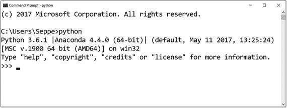
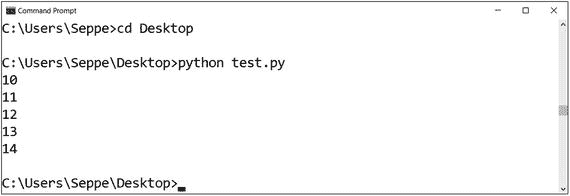

# 第一部分：网络抓取基础

## 1. 简介

在本章中，我们将向你介绍网络抓取的概念，并强调这一实践对数据科学家的用处。在展示了近年来网络抓取在各个领域和行业中的一些有趣用例之后，我们将通过准备你的编程环境，确保你已准备好开始网络抓取。


### 1.1 什么是网络爬虫？

网络“爬虫”（也称“网络采集”、“网络数据提取”甚至“网络数据挖掘”）可定义为“构建一个代理，以自动化方式从网络下载、解析并整理数据”。或者换句话说：不再是最终用户手动在网页浏览器中点击、将感兴趣的内容复制粘贴到电子表格等处，而是由网络爬虫将这一任务交给计算机程序，它能够比人类更快、更准确地执行。

从互联网上自动收集数据可能和互联网本身一样古老，而“爬虫”这个术语的出现时间远早于万维网。在“网络爬虫”作为一个术语普及之前，一种被称为“屏幕抓取”的做法早已成为从可视化表示中提取数据的成熟方式——在计算机早期（想想 20 世纪 60 年代到 80 年代），这通常简化为基于文本的“终端”。和今天一样，当时的人们也热衷于从这类终端“抓取”大量文本，并将这些数据存储起来以备后用。

#### 1.1.1 数据科学为何需要网络爬虫？

当使用普通网页浏览器上网时，你可能遇到过不少网站，考虑过收集、存储和分析其页面上展示数据的可能性。尤其对于数据科学家而言，其“原材料”就是数据，网络提供了大量有趣的机会：

*   维基百科的某个页面（或多个页面）上可能有一个你感兴趣的数据表格，想要获取它来进行一些统计分析。
*   也许你想从某个电影网站获取一份评论列表，用于执行文本挖掘、构建推荐引擎，或建立预测模型来识别虚假评论。
*   你可能希望从房地产网站获取房源列表，用于制作吸引人的地理可视化图表。
*   你可能想根据在网上找到的信息（例如天气信息）来收集额外的特征以丰富你的数据集，比如预测软饮料的销量。
*   你可能正在思考如何利用网络论坛上的个人资料数据进行社交网络分析。
*   监控某个新闻网站，以了解特定感兴趣话题的最新动态，这可能也颇有趣味。

网络包含了大量有趣的数据源，为各种有意思的应用提供了宝藏。遗憾的是，当前网络非结构化的特性，并不总能让我们轻易地收集或导出这些数据。网页浏览器非常擅长展示图像、播放动画以及布局网站，使其在视觉上对人类有吸引力，但它们并没有提供一种简单的数据导出方式，至少在大多数情况下没有。与其在你的浏览器窗口中一页一页地浏览网页，难道不能自动收集一个丰富的数据集吗？这正是网络爬虫大显身手的场合。

如果你对网络稍有了解，可能会想：“这不正是应用程序编程接口（API）的用途吗？”确实，如今许多网站都提供这样的 API，为外界提供一种结构化的方式来访问其数据存储库——这些 API 旨在供计算机程序（而非人类）使用和访问（当然，程序是由人类编写的）。例如，Twitter、Facebook、LinkedIn 和谷歌都提供了此类 API，用于搜索和发布推文、获取好友列表及其喜好、查看你与谁有联系等等。那么，为什么我们还需要网络爬虫呢？关键在于，API 是访问数据源的绝佳手段，但前提是目标网站提供了 API，并且该 API 具备你想要的功能。一般的经验法则是：在着手构建网络爬虫来收集数据之前，先寻找是否提供 API，如果可能的话，优先使用 API。例如，你可以轻松地使用 Twitter 的 API 来获取最近的推文列表，而不是重复造轮子。尽管如此，在某些情况下，使用网络爬虫仍然比使用 API 更可取：

*   你想要提取数据的网站不提供 API。
*   提供的 API 不是免费的（而网站是免费的）。
*   提供的 API 有速率限制：意味着你每秒、每天只能访问一定次数……
*   API 没有暴露你想要获取的所有数据（而网站上却有）。

在所有这些情况下，使用网络爬虫就能派上用场。事实仍然是：如果你能在网页浏览器中看到一些数据，你就能够通过程序访问并检索到它。如果你能通过程序访问它，那么这些数据就可以被存储、清洗并以任何方式使用。


#### 1.1.2 谁在使用网络爬虫？

访问和收集网络上的数据有许多实际应用，其中很多都属于数据科学领域。以下列表概述了一些有趣的实际用例：

-   Google 的许多产品都得益于其爬取网页的核心业务。例如，Google 翻译利用网络上存储的文本来训练和改进自身。
-   爬虫技术广泛应用于人力资源和员工分析领域。例如，位于旧金山的初创公司 hiQ 就通过收集和分析公开的个人资料信息（例如来自领英）来专门销售员工分析报告（领英对此并不高兴，但在一场官司之后，至今未能阻止这种做法；参见 [`https://www.bloomberg.com/news/features/2017-11-15/the-brutal-fight-to-mine-your-data-and-sell-it-to-your-boss`](https://www.bloomberg.com/news/features/2017-11-15/the-brutal-fight-to-mine-your-data-and-sell-it-to-your-boss) ）。
-   数字营销人员和数字艺术家经常利用网络数据进行各种有趣且富有创意的项目。例如，乔纳森·哈里斯和塞普·坎瓦尔创作的“我们感觉很好”，就爬取了各种博客网站中以“我感觉”开头的短语，其结果可以可视化展示全世界人们一整天的情绪感受。
-   在另一项研究中，研究人员爬取了来自推特、博客和其他社交媒体上的信息，构建了一个数据集，用于建立预测模型来识别抑郁和自杀念头的模式。这可能成为援助人员非常宝贵的工具，当然，这也需要对隐私相关问题进行深思熟虑（参见 [`https://www.sas.com/en_ca/insights/articles/analytics/using-big-data-to-predictsuicide-risk-canada.html`](https://www.sas.com/en_ca/insights/articles/analytics/using-big-data-to-predictsuicide-risk-canada.html) ）。
-   Emmanuel Sales 也爬取了推特，但他的目标是理解自己的社交圈和时间线上的帖子（参见 [`https://emsal.me/blog/4`](https://emsal.me/blog/4) ）。这里一个有趣的观察是，作者最初考虑使用推特的 API，但发现“推特对此有严格的速度限制：如果你想获取用户的关注者列表，每 15 分钟只能操作 15 次，这非常不灵活。”
-   在一篇题为“十亿美元价格项目：使用在线价格进行测量与研究”的论文中（参见 [`http://www.nber.org/papers/w22111`](http://www.nber.org/papers/w22111) ），研究人员使用网络爬虫收集了一个在线价格信息数据集，用于构建多个国家稳健的每日价格指数。
-   银行和其他金融机构正在使用网络爬虫进行竞争对手分析。例如，银行经常爬取竞争对手的网站，以了解其分支机构的开设或关闭地点，或追踪其提供的贷款利率——这些都是可以纳入其内部模型和预测的有趣信息。投资公司也经常使用网络爬虫，例如，跟踪其投资组合中相关资产的新闻文章。
-   社会政治学家正在爬取社交网站，以追踪民众情绪和政治倾向。一篇名为“剖析特朗普最狂热的网络追随者”的著名文章（参见 [`https://fivethirtyeight.com/features/dissecting-trumps-most-rabid-online-following/`](https://fivethirtyeight.com/features/dissecting-trumps-most-rabid-online-following/) ）使用语义分析来分析 Reddit 上的用户讨论，以描绘唐纳德·特朗普的网络追随者和粉丝的特征。
-   一位研究人员能够根据从 Tinder 和 Instagram 爬取的图片及其“点赞”数据来训练一个深度学习模型，以预测一张图片是否会被认为是“有吸引力的”（参见 [`http://karpathy.github.io/2015/10/25/selfie/`](http://karpathy.github.io/2015/10/25/selfie/) ）。智能手机制造商已经将此类模型整合到他们的照片应用中，以帮助你美化照片。
-   在“戴砖耳环的女孩”项目中，Lucas Woltmann 着手从 [`https://www.bricklink.com`](https://www.bricklink.com) 爬取乐高积木信息，以确定最能表现一幅图像的最佳乐高零件组合（参见 [`http://lucaswoltmann.de/art'n'images/2017/04/08/the-girl-with-the-brick-earring.html`](http://lucaswoltmann.de/art'n'images/2017/04/08/the-girl-with-the-brick-earring.html) ）（本书的一位合著者是狂热的乐高迷，所以我们一定要包括这个例子）。
-   在“用 Python 分析 1000 多种希腊葡萄酒”项目中，Florents Tselai 从一家希腊葡萄酒商店爬取了上千种葡萄酒的信息（参见 [`https://tselai.com/greek-wines-analysis.html`](https://tselai.com/greek-wines-analysis.html) ），以分析它们的产地、评分、类型和酒精度（本书的一位合著者是狂热的葡萄酒爱好者，所以我们一定要包括这个例子）。
-   总部位于伦敦的在线时尚市场 Lyst，爬取网络上半结构化的时尚产品信息，然后应用机器学习，通过一个中心网站将这些信息整洁优雅地呈现给消费者。其他数据科学家也做过类似的项目来对相似的时尚产品进行聚类（参见 [`http://talks.lystit.com/dsl-scraping-presentation/`](http://talks.lystit.com/dsl-scraping-presentation/) ）。
-   我们指导过一项研究，利用网络爬虫从招聘网站提取信息，以了解职场中不同数据科学和分析相关工具的流行程度（剧透：Python 和 R 都在稳步上升）。
-   我们研究小组的另一项研究涉及使用网络爬虫监控新闻媒体和网络论坛，以追踪公众对比特币的情绪。

无论你兴趣领域如何，几乎总能找到基于数据来改进或丰富实践的应用场景。“数据是新的石油”，这句俗话如是说，而网络上拥有大量的数据。

### 1.2 准备工作

#### 1.2.1 环境搭建

本书将全程使用 Python 3。你可以从 [`https://www.python.org/downloads/`](https://www.python.org/downloads/) 为你的平台（Windows、Linux 或 MacOS）下载并安装 Python 3。

**为什么用 Python 3 而不是 2？**

根据 Python 创始人自己的说法，“Python 2 是遗留版本，Python 3 是该语言的现在和未来。”由于我们力求提供一份现代的指南，我们特意选择了 Python 3 作为我们的工作语言。话虽如此，仍然有很多 Python 2 的代码在流传（甚至可能在你的公司里）。如果你在你的 Python 2 代码中添加以下导入语句，本书提供的大多数概念和示例也应该能在 Python 2 中正常工作：

```
from __future__ import absolute_import, division, print_function
```

你还需要安装 Python 的包管理器 “pip”。如果你安装了较新版本的 Python 3，它会自带 pip。然而，最好通过在命令行执行以下命令来确保 pip 是最新版本：

```
python -m pip install -U pip
```

或者（如果你使用的是 Linux 或 MacOS）：

```
pip install -U pip
```

**手动安装 pip**

你的系统上还没有 pip？请参考以下页面在你的系统上进行安装（参考“使用 get-pip.py 安装”部分）：[`https://pip.pypa.io/en/stable/installing/`](https://pip.pypa.io/en/stable/installing/)。

最后，你可能还希望在你的系统上安装一个合适的文本编辑器来编辑 Python 代码文件。Python 自带了一个基本的编辑器（在你的程序菜单中查找 “Idle”），但其他文本编辑器，如 Notepad++、Sublime Text、VSCode、Atom 等，也同样好用。


#### 1.2.2 Python 快速入门

我们假设你已经具备一定的编程经验，或许已经能熟练阅读和编写 Python 代码。如果尚未达到，下面的概述将帮助你快速上手。

Python 代码可以通过两种方式编写和执行：

1.  使用 Python 解释器 REPL（“读取-求值-打印-循环”），它提供了一个交互式会话，你可以逐行输入 Python 命令 (`读取`)，这些命令会被求值 (`求值`)，然后显示结果 (`打印`)。这些步骤会重复（“循环”），直到你关闭会话。
2.  在 “.py” 文件中编写 Python 源代码，然后运行这些文件。

对于几乎任何用例来说，使用规范的 “.py” 文件并运行它们都是一个好主意，尽管 Python REPL 在测试一个快速想法或试验几行代码时很方便。要启动它，只需在命令行窗口中输入 `python` 并按回车键，如图 1-1 所示。



图 1-1

从命令行打开 Python 解释器

三个尖括号 (`>>>`) 表示一个提示符，意味着 Python REPL 正在等待你的命令。尝试执行以下命令：

```
>>> 1 + 1
>>> 8 - 1
>>> 10 * 2
>>> 35 / 5
7.0
>>> 5 // 3
>>> 7 % 3
>>> 2 ** 3
```

数学运算与你预期的一致；`//` 表示整数除法；`%` 是取模运算符，返回除法后的余数；`**` 表示“乘方”。

Python 支持以下数字类型：

-   整数 (`int`)，表示有符号整数值（即非小数），例如 10、100、-700 等。
-   长整数 (`long`)，表示有符号整数值，占用比标准整数更多的内存，因此可以表示更大的数字。通过在末尾加上 `L` 来编写，例如 535633629843L、10L、-100000000L 等。
-   浮点数 (`float`)，也就是小数，例如 0.4、-10.2 等。
-   复数 (`complex`)，在非数学代码中不常用。通过在末尾加上 `j` 来编写，例如 3.14j、.876j 等。

除了数字，Python 还支持字符串 (`str`)：用双引号或单引号括起来的文本值，以及布尔 (`bool`) 逻辑值：`True` 和 `False`（注意大小写）。`None` 表示一个代表“空”的特殊值。尝试执行以下几行代码来体验这些类型：

```
>>> 'This is a string value'
'This is a string value'
>>> "This is also a string value"
'This is also a string value'
>>> "Strings can be " + 'added'
'Strings can be added'
>>> "But not to a number: " + 5
Traceback (most recent call last):
File "", line 1, in 
TypeError: must be str, not int
>>> "So we convert it first: " + str(5)
'So we convert it first: 5'
>>> False and False
False
>>> False or True
True
>>> not False
True
>>> not True
False
>>> not False and True
True
>>> None + 5
Traceback (most recent call last):
File "", line 1, in 
TypeError: unsupported operand type(s)
for +: 'NoneType' and 'int'
>>> 4  also works
False
>>> 100 >= 10 # >> 10 == 10
True
>>> None == False
False
>>> False == 0
True
>>> True == 1
True
>>> True == 2
False
>>> 2 != 3
True
>>> 2 != '2'
True
```

同样，上面的指令应该很容易理解，也许最后几行除外。在 Python 中，`==` 表示相等比较，因此返回 `True` 或 `False` 作为结果。`None` 既不等于 `False` 也不等于 `True`，但在 Python 中，`False` 被视为等于零 (0)，`True` 被视为等于一 (1)。注意，相等和不等运算符（`==` 和 `!=`）会考虑被比较的类型；因此数字 2 不等于字符串 `"2"`。

##### `is` 和 `==` 一样吗？

除了 `==`，Python 还提供了 `is` 关键字，如果两个变量指向同一个对象（因此它们的内容也总是相等的），它将返回 `True`。`==` 检查两个变量的内容是否相等，即使它们可能不指向同一个对象。通常，你会使用 `==`，但有几个例外，即检查变量是否等于 `True`、`False` 或 `None`。所有值为这些的变量在内存中都指向同一个对象，因此，除了编写 `my_var == None`，你还可以编写 `my_var is None`，这样读起来更好一些。

在 REPL 交互式会话中，我们输入的所有结果都会立即显示在屏幕上。然而，在执行 Python 文件时，情况并非如此，因此我们需要一个函数来显式地在屏幕上“打印出”信息。在 Python 中，可以通过 `print` 函数来完成：

```
>>> print("Nice to meet you!")
Nice to meet you!
>>> print("Nice", "to", "meet", "you!")
Nice to meet you!
>>> print("HE", "LLO", sep="--")
HE--LLO
>>> print("HELLO", end="!!!\n")
HELLO!!!
```

在处理数据时，我们显然希望将数据保留在程序中，以便在程序的不同部分使用。也就是说，我们希望将数字、字符串等存储在变量中。Python 简单使用 `=` 运算符进行变量赋值：

```
>>> var_a = 3
>>> var_b = 4
>>> var_a + var_b + 2
>>> var_str = 'This is a string'
>>> print(var_str)
This is a string
```

Python 中的字符串可以通过多种不同的方式进行格式化。首先，字符串中带有反斜杠 (`\`) 前缀的字符表示所谓的“转义字符”，代表了特殊的格式化指令。例如，在上面的例子中，`\n` 表示换行。另一方面，`\t` 表示制表符，而 `\\` 就是反斜杠字符本身。其次，可以通过 `format` 函数来格式化字符串：

```
>>> "{} : {}".format("A", "B")
'A : B'
>>> "{0}, {0}, {1}".format("A", "B")
'A, A, B'
>>> "{name} wants to eat {food}".format(name="Seppe", food="lasagna")
'Seppe wants to eat lasagna'
```

##### 格式化的多种方式

如果说新版 Python 有什么不需要的，那就是更多格式化字符串的方法。除了使用这里演示的 `format` 函数外，Python 还允许我们使用 `%` 运算符来格式化字符串：

```
"%s is %s" % ("Seppe", "happy")
```

Python 3.6 还增加了“f-strings”，以一种更简洁的方式格式化字符串：

```
f 'Her name is {name} and she is {age} years old.'
```

为了保持清晰，我们将坚持使用 `format`。

除了数字、布尔值和字符串，Python 还内置了一些非常有用的数据结构，我们将会经常用到它们：列表、元组、字典和集合。

列表用于存储有序的元素序列。下面的指令概述了它们在 Python 中如何工作。请注意，下面的代码片段也包含注释，这些注释将被 Python 忽略，并以 `#` 字符开头：

```
>>> li = []
>>> li.append(1) # li 现在是 [1]
>>> li.append(2) # li 现在是 [1, 2]
>>> li.pop() # 移除并返回最后一个元素
>>> li = ['a', 2, False] # 并非所有元素都必须是相同类型
>>> li = [[3], [3, 4], [1, 2, 3]] # 甚至可以是列表的列表
>>> li = [1, 2, 4, 3]
>>> li[0]
>>> li[-1]
>>> li[1:3]
[2, 4]
>>> li[2:]
[4, 3]
>>> li[:3]
[1, 2, 4]
>>> li[::2] # 通用格式是 li[start:end:step]
[1, 4]
>>> li[::-1]
[3, 4, 2, 1]
>>> del li[2] # li 现在是 [1, 2, 3]
>>> li.remove(2) # li 现在是 [1, 3]
>>> li.insert(1, 1000) # li 现在是 [1, 1000, 3]
>>> [1, 2, 3] + [10, 20]
[1, 2, 3, 10, 20]
>>> li = [1, 2, 3]
>>> li.extend([1, 2, 3])
>>> li
[1, 2, 3, 1, 2, 3]
>>> len(li)
>>> len('This works for strings too')
>>> 1 in li
True
>>> li.index(2)
>>> li.index(200)
Traceback (most recent call last):
File "", line 1, in 
ValueError: 200 is not in list
```

元组类似于列表，但它是不可变的，这意味着创建后不能添加或移除元素：

```
>>> tup = (1, 2, 3)
>>> tup[0]
```


```python
>>> type((1)) # 单元素元组必须在最后一个元素后面加逗号，但其他长度（甚至零长度）的元组不需要
>>> type((1,))
>>> type(())
>>> len(tup)
>>> tup + (4, 5, 6)
(1, 2, 3, 4, 5, 6)
>>> tup[:2]
(1, 2)
>>> 2 in tup
True
>>> a, b, c = (1, 2, 3) # a 现在是 1，b 现在是 2，c 现在是 3
>>> a, *b, c = (1, 2, 3, 4) # a 现在是 1，b 现在是 [2, 3]，c 现在是 4
>>> d, e, f = 4, 5, 6 # 你也可以省略括号
>>> e, d = d, e # d 现在是 5，e 现在是 4
```

**集合**（Sets）与列表类似，但它们存储的是唯一且无序的元素集合，就像数学中的集合：

```python
>>> empty_set = set()
>>> some_set = {1, 1, 2, 2, 3, 4} # some_set 现在是 {1, 2, 3, 4}
>>> filled_set = some_set
>>> filled_set.add(5) # filled_set 现在是 {1, 2, 3, 4, 5}
>>> other_set = {3, 4, 5, 6}
>>> filled_set & other_set # 交集
{3, 4, 5}
>>> filled_set | other_set # 并集
{1, 2, 3, 4, 5, 6}
>>> {1, 2, 3, 4} - {2, 3, 5} # 差集
{1, 4}
>>> {1, 2} >= {1, 2, 3}
False
>>> {1, 2} < {1, 2, 3}
True
>>> 2 in filled_set
True
```

**字典**（Dictionaries）存储一系列唯一键与值之间的映射关系：

```python
>>> empty_dict = {}
>>> filled_dict = {"one": 1, "two": 2, "three": 3}
>>> filled_dict["one"]
1
>>> list(filled_dict.keys())
["one", "two", "three"]
>>> list(filled_dict.values())
[1, 2, 3]
>>> "one" in filled_dict # in 是基于键进行判断的
True
>>> 1 in filled_dict
False
>>> filled_dict.get("one")
1
>>> filled_dict.get("four")
None
>>> filled_dict.get("four", 4) # 如果未找到则返回默认值
4
>>> filled_dict.update({"four":4})
>>> filled_dict["four"] = 4 # 也可以用这种方式添加/更新
>>> del filled_dict["one"] # 删除键 "one"
```

最后，Python 中的控制流也相对简单：

```python
>>> some_var = 10
>>> if some_var > 1:
...   print('Bigger than 1')
...
Bigger than 1
```

注意 `if` 语句后面的冒号（“:”），以及 REPL 中的三个点“...”，这表示在代码可以执行之前还需要更多输入。Python 代码通过空白（缩进）来组织结构，例如，`if` 块中的所有内容都应使用空格或制表符缩进。

##### 缩进（Indentation）

一些程序员初次接触 Python 时会对这种空白缩进感到困惑，但它确实能带来更易读、更清晰组织的代码。请确保不要在源代码中混用制表符和空格！

Python 中的 `if` 块还可以包含可选的 `elif` 和 `else` 块：

```python
>>> some_var = 10
>>> if some_var > 10:
...   print('Bigger than 10')
... elif some_var > 5:
...   print('Bigger than 5')
... else:
...   print('Smaller than or equal to 5')
...
Bigger than 5
```

##### 可读的 If 块

请记住，Python 中的零（0）整数、浮点数和复数都会求值为 `False`。同样，空字符串、集合、元组、列表和字典也会求值为 `False`。因此，与其写成 `if len(my_list) > 0:`，不如直接使用 `if my_list:`，这样更易读。

我们已经看到 `in` 运算符可用于检查列表、元组、集合和字典的成员关系。该运算符也可以用于编写 `for` 循环：

```python
>>> some_list = [1, 2, 3]
>>> some_string = 'a string'
>>> 1 in some_list
True
>>> 'string' in some_string
True
>>> for num in some_list:
... print(num)
...
1
2
3
>>> for chr in some_string:
...   print(chr)
...
a
s
t
r
i
n
g
```

为了遍历数字范围，Python 还提供了有用的内置函数 `range`：

*   `range(number)`：返回从零到（但不包括）给定数字的一个可迭代对象。
*   `range(lower, upper)`：返回从 `lower` 到（但不包括）`upper` 的一个可迭代对象。
*   `range(lower, upper, step)`：返回从 `lower` 到 `upper`、步长为 `step` 的一个可迭代对象。

##### 仅支持整数

遗憾的是，所有这些函数都需要整数作为输入参数。如果你想遍历一个小数范围，你需要自己定义函数。


请注意此处“可迭代对象”这一概念的使用。在 Python 中，可迭代对象本质上是一种“智能”列表。Python 不会立即用完整的列表数据填满计算机内存，而是会等到你真正需要访问元素本身时再这样做。这就是为什么使用 `range` 函数会显示如下内容：

```
>>> range(3)
range(0, 3)
```

将可迭代对象转换为真正的列表很简单，只需把值显式转为列表即可：

```
>>> list(range(3))
[0, 1, 2]
```

然而，在循环遍历可迭代对象时，你无需先显式地进行转换。

因此，你可以像下面这样直接使用 `range` 函数：

```
>>> for num in range(1, 100, 15):
...   print(num)
...

```

而且，Python 当然也支持“while”风格的循环：

```
>>> x = 0
>>> while x < 3:
...   print(x)
...   x = x + 1

```

##### 无限循环

忘了加 `x = x + 1` 这一行？试了 `while True:`，或者你的“for”循环陷入了死循环？你可以按下键盘上的 `Control+C` 来执行“键盘中断（Keyboard Interrupt）”，从而停止当前代码块的执行。

每当编写代码时，将可复用的代码片段封装起来是个好习惯，这样可以在不同地方调用和执行它们，而无需复制粘贴大量代码。实现这一点的基本方法是创建函数，这需要使用 `def` 关键字：

```
>>> def add(x, y):
...   print("x is {} and y is {}".format(x, y))
...   return x + y  # 返回值
...
>>> add(5, 6)
x is 5 and y is 6

>>> add(y=10, x=5)
x is 5 and y is 10

```

这里还有两个值得特别注意的结构：`*` 和 `**`。两者都可以在函数签名中使用，分别表示“其余的参数”和“其余的命名参数”。让我们通过一个示例来看看它们是如何工作的：

```
>>> def many_arguments(*args):
...   # args 将是一个元组
...   print(args)
...
>>> many_arguments(1, 2, 3)
(1, 2, 3)
>>> def many_named_arguments(**kwargs):
...   # kwargs 将是一个字典
...   print(kwargs)
...
>>> many_named_arguments(a=1, b=2)
{'a': 1, 'b': 2}
>>> def both_together(*args, **kwargs):
...   print(args, kwargs)
```

除了在方法签名中使用它们之外，你还可以在调用函数时使用它们，以表示你想将一个可迭代对象作为位置参数传递，或将一个字典作为命名参数传递：

```
>>> def add(a, b):
...   return a + b
...
>>> l = [1,2] # 元组也可以
>>> add(*l)

>>> d = {'a': 2, 'b': 1}
>>> add(**d)

```

最后，我们不再使用 Python 的交互式解释器（REPL），而是来看看如何通过源文件编写 Python 代码。在你能轻松找到的地方创建一个名为 `test.py` 的文件，并添加以下内容：

```
### test.py
def add(x, y):
return x + y
for i in range(5):
print(add(i, 10))
```

保存文件，然后打开一个新的命令行窗口。你可以通过将文件名传递给 `python` 可执行程序来运行这个文件，如图 1-2 所示：



图 1-2

从命令行运行 Python 源文件 (`test.py`)

至此，我们快速介绍了 Python 的基础知识。这里跳过了一些细节（如类、try-except-catch 块、迭代器与生成器、继承等），但这些并不是开始我们真正要做的：网络爬虫（web scraping）所必需的。

如果你在寻找更多关于 Python 编程的资源，可以看看这些链接：

*   Python 3 官方文档：[`https://docs.python.org/3/`](https://docs.python.org/3/)
*   深入理解 Python 3：[`http://www.diveintopython3.net/index.html`](http://www.diveintopython3.net/index.html/)
*   用 Python 自动化处理无聊的事情：[`https://automatetheboringstuff.com/`](https://automatetheboringstuff.com/)
*   Python 指南（The Hitchhiker’s Guide to Python）：[`http://docs.python-guide.org/en/latest/`](http://docs.python-guide.org/en/latest/)
*   Python 入门第一步：[`https://realpython.com/learn/python-first-steps/`](https://realpython.com/learn/python-first-steps/)

