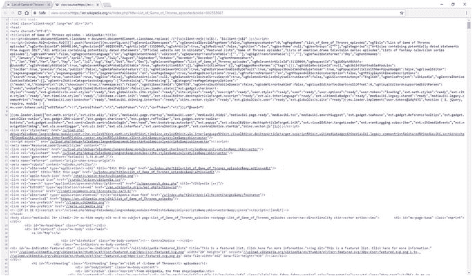
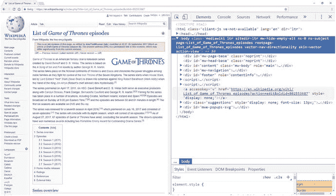
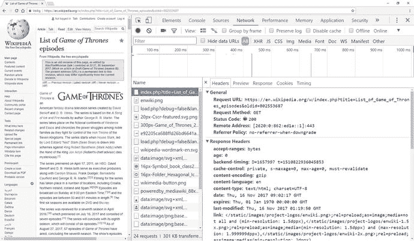
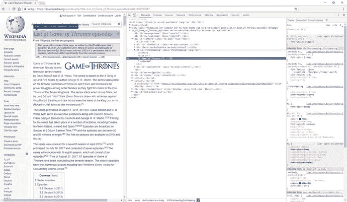

# 2. 网络语言 HTTP

在本章中，我们将在对计算机网络进行简要介绍之后，介绍构成网络的核心构建块之一：超文本传输协议（HTTP）。然后，我们将介绍 Python 的 `requests` 库，我们将用它来执行 HTTP 请求，并开始有效地使用 Python 获取网站内容。本章末尾将介绍如何在 URL 中使用参数。

### 2.1 网络的神奇之处

如今，网络已经深度融入了我们的日常生活，以至于我们很少思考其复杂性。当你上网浏览时，一系列的网络协议便会启动，用于建立与世界各地的计算机的连接并检索数据，这一切都在几秒钟内完成。例如，当你导航到一个网站，比如 [`www.google.com`](http://www.google.com) 时，你的网络浏览器会执行以下一系列步骤：


1. 你在浏览器中输入“`www.google.com`”，浏览器需要找出该网站的 IP 地址。IP 是“Internet Protocol”（互联网协议）的缩写，它是互联网的核心协议之一，使网络能够在连接的计算机之间路由和重定向通信数据包，这些计算机都被分配了一个 IP 地址。要与谷歌的 Web 服务器通信，需要知道其 IP 地址。由于 IP 地址本质上是一串数字，记住每个网站的 IP 地址会很麻烦。因此，就像你将电话号码与手机通讯录中的姓名关联起来一样，网络也提供了一种机制，将域名（如“`www.google.com`”）转换为 IP 地址。

2. 你的浏览器开始查找“`www.google.com`”对应的正确 IP 地址。为此，你的 Web 浏览器将使用另一种称为 DNS（域名系统）的协议，过程如下：首先，浏览器会检查其自身的缓存（即“短期记忆”），以确认你最近是否访问过这个网站。如果访问过，浏览器可以重用存储的地址。如果没有，浏览器会询问底层操作系统（例如 Windows），看它是否知道`www.google.com`的地址。

3. 如果操作系统也不知道这个域名，浏览器会向你的路由器发送 DNS 请求。路由器是连接你与互联网的设备，通常也维护着自己的 DNS 缓存。如果你的路由器也不知道正确的地址，浏览器将开始向已知的 DNS 服务器发送多个数据包，例如向你的互联网服务提供商（ISP）维护的 DNS 服务器发送请求——该服务器的 IP 地址已知并存储在路由器中。然后 DNS 服务器会回复，表明“`www.google.com`”映射到了 IP 地址“172.217.17.68”。请注意，即使你的 ISP 的 DNS 服务器，如果手头没有这条记录，也可能需要向其他 DNS 服务器（位于 DNS 层级结构更高层）查询。

4. 所有这些操作都只是为了找出`www.google.com`的 IP 地址。现在，你的浏览器可以连接到 Google 的 Web 服务器 172.217.17.68。许多协议（协议是通信方之间关于消息格式的标准约定）被组合在一起（可以说是相互包裹），以构建一个复杂的消息。在这个“洋葱”的最外层，我们发现了 IEEE 802.3（以太网）协议，用于与同一网络中的机器通信。由于我们不在同一个网络上通信，因此使用 IP（互联网协议）来嵌入另一条消息，表明我们希望联系地址为 172.217.17.68 的服务器。在 IP 内部，我们发现另一个名为 TCP（传输控制协议）的协议，该协议提供了一种通用、可靠的网络消息传递方式，因为它包含错误检查和将消息拆分为更小数据包的功能，从而确保这些数据包按正确顺序传递。TCP 还会在数据包传输丢失时重新发送。最后，在 TCP 消息内部，我们找到了另一条消息，其格式遵循 HTTP 协议（超文本传输协议），这是实际用于请求和接收网页的协议。基本上，这里的 HTTP 消息表达了我们 Web 浏览器的请求：“能给我你的首页吗？”

5. Google 的 Web 服务器现在发回一条 HTTP 回复，包含我们想要访问页面的内容。在大多数情况下，这个文本内容使用 HTML（一种标记语言，我们稍后会详细了解）格式化。从这一大段（通常很大）文本中，我们的 Web 浏览器可以开始渲染实际的页面，即确保所有内容按照 HTML 内容的指示整齐地显示在屏幕上。请注意，一个网页通常包含一些内容片段，浏览器会（在后台）为其发起新的 HTTP 请求。例如，如果接收到的页面指示浏览器显示一张图片，浏览器会发起另一个 HTTP 请求来获取图片内容（该内容看起来不是 HTML 格式的文本，而只是原始的二进制数据）。因此，仅渲染一个网页就可能涉及大量的 HTTP 请求。幸运的是，现代浏览器非常智能，一旦信息到达，它们就会开始渲染页面，并在获取图片和其他视觉元素时显示它们。此外，如果可能，浏览器会尝试并行发送多个请求以加快这一过程。

在如此多的协议、请求和机器之间的通信中，你能够在不到一秒内查看一个简单的网页，这实在令人惊叹。为了规范构成网络的大量协议，国际标准化组织（ISO）维护着开放系统互连（OSI）模型，该模型将计算机通信组织为七个层次：

*   第 1 层：物理层：包含以太网协议，还包括 USB、蓝牙及其他无线协议。
*   第 2 层：数据链路层：包含以太网协议。
*   第 3 层：网络层：包含 IP（互联网协议）。
*   第 4 层：传输层：包含 TCP，同时也包含像 UDP 这样的协议，UDP 为了速度不提供 TCP 那样的高级错误检查和恢复机制。
*   第 5 层：会话层：包含用于打开、关闭和管理会话的协议。
*   第 6 层：表示层：包含用于格式化和转换数据的协议。
*   第 7 层：应用层：例如 HTTP 和 DNS。

并非所有网络通信都需要使用所有这些层的协议。例如，请求一个网页会涉及第 1 层（物理层）、第 2 层（以太网）、第 3 层（IP）、第 4 层（TCP）和第 7 层（HTTP），但这些层的设计使得位于较高层的每个协议都可以包含在较低层协议的消息中。例如，当你请求一个安全网页时，HTTP 消息（第 7 层）将被编码为加密消息（第 6 层）（这就是你访问“https”地址时发生的情况）。在编程网络应用程序时，你面向的层级越低，需要处理的功能和复杂性就越多。幸运的是，对于我们这些网络爬虫来说，我们关注的是最顶层，即 HTTP，这是用于请求和接收网页的协议。这意味着我们可以将涉及 TCP、IP、以太网甚至使用 DNS 解析域名的所有复杂性留给所使用的 Python 库以及底层操作系统去处理。


### 2.2 超文本传输协议：HTTP

现在我们已经了解了你的网页浏览器是如何与世界 Wide Web 上的服务器通信的。这种消息交换的核心组件包括向 Web 服务器发送一个超文本传输协议（HTTP）请求消息，然后接收一个可以被浏览器渲染的 `HTTP` 响应（也常被称为 `HTTP` 回复）。由于我们的所有网络爬取都将基于 `HTTP`，我们确实需要更仔细地研究 `HTTP` 消息，以了解它们的样子。

实际上，`HTTP` 是一种相当简单的网络协议。它是基于文本的，这至少使其消息对最终用户具有一定可读性（相比于没有任何文本结构的原始二进制消息），并且遵循一种简单的基于请求-回复的通信模式。也就是说，联系一个 Web 服务器并接收回复仅涉及两条 `HTTP` 消息：一个请求和一个回复。如果你的浏览器想要下载或获取额外的资源（如图片），这仅仅意味着要发送额外的请求-回复消息。

**保持连接**

在最简单的情况下，`HTTP` 中的每个请求-回复周期也涉及建立一个全新的底层 `TCP` 连接。对于流量较大的网站，快速连续地建立和拆除许多 `TCP` 连接会造成大量开销，因此 `HTTP` 版本 1.1 允许我们保持 `TCP` 连接“活跃”，以用于并发的请求-回复 `HTTP` 消息。`HTTP` 版本 2.0 甚至允许我们在同一连接中进行“多路复用”（一个表示“混合消息”的复杂词汇），例如，发送多个并发请求。幸运的是，在使用 `Python` 时，我们无需过多关注这些细节，因为我们将要使用的 `requests` 库会在后台自动为我们处理这些。

现在让我们来看看一个 `HTTP` 请求和回复是什么样子的。正如我们所知道的，客户端（大多数情况下是 Web 浏览器）和 Web 服务器通过发送纯文本消息进行通信。客户端向服务器发送请求，服务器则发送响应或回复。

一条请求消息由以下几部分组成：

*   一个请求行；
*   若干请求头部，每个占一行；
*   一个空行；
*   一个可选的、可能占用多行的消息体。

`HTTP` 消息中的每一行都必须以 `<CR><LF>`（ASCII 字符 `0D` 和 `0A`）结尾。

空行仅仅是 `<CR><LF>`，没有其他额外的空白字符。

**换行**

`<CR>` 和 `<LF>` 是两个特殊字符，用于指示应开始新的一行。你并不会直接看到它们出现，但是当你在例如 `记事本` 中输入纯文本文档时，每次你按下回车键，这两个字符就会被放入文档的内容中，以表示“此处出现新的一行”。计算中一个令人烦恼的方面是，操作系统对于使用哪个字符来表示换行并未达成一致。`Linux` 程序倾向于使用 `<LF>`（“换行”字符），而较旧版本的 `MacOS` 使用 `<CR>`（“回车”字符）。`Windows` 同时使用 `<CR>` 和 `<LF>` 来表示换行，这也被 `HTTP` 标准所采纳。对此不必过于担心，因为 `Python` 的 `requests` 库会为我们处理 `HTTP` 消息的正确格式化。

下面的代码片段显示了 Web 浏览器执行的一条完整 `HTTP` 请求消息（我们不在每一行后面显示“`<CR><LF>`”，除了最后一行空行）：

```
GET / HTTP/1.1
Host: example.com
Connection: keep-alive
Cache-Control: max-age=0
Upgrade-Insecure-Requests: 1
User-Agent: Mozilla/5.0 (Windows NT 10.0; Win64; x64) AppleWebKit/537.36 (KHTML, like Gecko) Chrome/60.0.3112.90 Safari/537.36
Accept: text/html,application/xhtml+xml,application/xml;q=0.9,*/*;q=0.8
Referer: https://www.google.com/
Accept-Encoding: gzip, deflate
Accept-Language: en-US,en;q=0.8,nl;q=0.6

```

让我们仔细看看这条消息。“`GET / HTTP/1.1`” 是请求行。它包含了我们想要执行的 `HTTP` “动词”或“方法”（上面的例子中是“`GET`”）、我们想要获取的 `URL`（“`/`”）以及我们理解的 `HTTP` 版本（“`HTTP/1.1`”）。不必太担心“`GET`”动词。`HTTP` 有多个动词（我们稍后会讨论）。目前，重要的是要知道“`GET`”的意思是：“为我获取这个 `URL` 的内容。”每当你在地址栏输入一个 `URL` 并按下回车键时，你的浏览器都会执行一个 `GET` 请求。

接下来是请求头部，每个占一行。在这个例子中，我们已经有了不少头部。请注意，每个头部都包含一个名称（例如“`Host`”），后面跟着一个冒号（“`:`”），以及头部的实际值（“`example.com`”）。浏览器在其头部中包含的内容方面非常“话多”，而 `Chrome`（这里使用的 Web 浏览器）也不例外。

`HTTP` 标准包含一些标准化的头部，这些头部会被正规的 Web 浏览器所使用，不过你也可以自由地包含额外的头部。例如，“`Host`”是 `HTTP` 1.1 及更高版本中标准化且强制性的头部。它在 `HTTP` 1.0（第一个版本）中不存在的原因很简单：在那个时代，每个 Web 服务器（及其 `IP` 地址）负责提供一个特定的网站。因此，如果我们向负责“`example.com`”的 Web 服务器发送“`GET / HTTP/1.1`”，服务器就知道要获取并返回哪个页面。然而，不久就出现了这样一个聪明的主意：为什么不在同一个服务器上（使用同一个 `IP` 地址）托管多个网站呢？例如，负责“`example.com`”的同一台服务器可能也负责提供属于“`example.org`”的页面。但是，我们需要一种方式来告诉服务器我们希望从哪个域名获取页面。在请求行中包含域名，例如“`GET example.org/ HTTP/1.1`”，可能是一个不错的想法，但这会破坏与早期 Web 服务器的向后兼容性，这些服务器期望请求行中包含一个没有域名的 `URL`。于是，解决方案以强制性“`Host`”头部的形式出现，指示服务器应从哪个域名获取页面。

**错误的主机**

不要试图自作聪明，向负责“`example.com`”的 Web 服务器发送请求，并将“`Host`”头部改为“`Host: somethingentirely-different.com`”。正规的 Web 服务器会报错，并简单地返回一个错误页面，提示：“嘿，我不是托管该域名的服务器。”话虽如此，在那些可以通过欺骗此头部来混淆和误导访问的网站上，已经发现了安全问题。

除了强制性的“`Host`”头部，我们还看到许多其他头部出现，它们构成了一组“标准化的请求头部”，这些头部虽然非强制性，但所有现代 Web 浏览器都会包含。例如，“`Connection: keep-alive`”向服务器示意，如果可能的话，它应该保持连接打开以用于后续请求。“`User-Agent`”包含一个很长的文本值，浏览器通过它愉快地告知服务器自己是什么（`Chrome`）以及运行的版本。

**User-Agent 的混乱**


#### HTTP 请求与响应详解

##### User-Agent 头部的历史遗留问题

你可能会注意到，“User-Agent”头部中包含了“Chrome”，同时也包含了许多看似不相关的额外文本，例如“Mozilla”、“AppleWebKit”等等。难道是 Chrome 在伪装自己，冒充其他浏览器吗？在某种程度上确实如此，但它并不是唯一这么做的浏览器。问题在于：当“User-Agent”头部出现，浏览器开始发送自己的名称和版本号时，一些网站所有者认为检查这个头部并根据请求的浏览器返回不同版本的页面是个好主意，例如告知用户“该服务器不支持 Netscape 4.0”。负责这些检查的例程通常实现得很草率，因此会错误地将运行未知浏览器的用户拒之门外，或者无法正确检查浏览器的版本。因此，多年来，浏览器供应商别无选择，只能发挥创意，在`User-Agent`头部中包含许多其他文本字段。基本上，我们的浏览器是在说：“我是 Chrome，但我也与所有这些其他浏览器兼容，所以请让我通过。”

##### 其他请求头部

`Accept`头部告诉服务器浏览器更希望返回哪种形式的内容，`Accept-Encoding`头部告诉服务器浏览器也能接收压缩后的内容。`Referer`头部（其拼写错误是故意的）告诉服务器浏览器是从哪个页面访问过来的（在这个例子中，是点击了“google.com”上的一个链接，将浏览器带到了“example.com”）。

##### 礼貌的请求

尽管你的网络浏览器会尽量表现得礼貌，例如告诉网络服务器它接受哪些形式的内容，但没有任何保证网络服务器会真正查看这些头部或遵循它们。浏览器可能在其`Accept`头部中表明它理解“webp”图像，但网络服务器可以忽略这个请求，仍然以“jpg”或“png”格式返回图像。将这些请求头部视为礼貌的请求即可，仅此而已。

最后，我们的请求消息以一个空白的 `<CR><LF>` 行结束，并且没有消息体。`GET`请求中不包含这些，但我们稍后会看到 HTTP 消息中消息体会发挥作用的情况。

##### HTTP 响应

如果一切顺利，网络服务器会处理我们的请求并返回一个 HTTP 回复。

这些回复看起来与 HTTP 请求非常相似，并包含：

*   一个状态行，包含状态码和状态消息；
*   一些响应头部，同样每行一个；
*   一个空行；
*   一个可选的响应体。

因此，针对我们上面的请求，我们可能会得到如下响应：

```
HTTP/1.1 200 OK
Connection: keep-alive
Content-Encoding: gzip
Content-Type: text/html;charset=utf-8
Date: Mon, 28 Aug 2017 10:57:42 GMT
Server: Apache v1.3
Vary: Accept-Encoding
Transfer-Encoding: chunked

Welcome to My Web Page

```

同样，让我们逐行看一下 HTTP 回复。第一行指示请求的状态结果。它以列出服务器理解的 HTTP 版本（`HTTP/1.1`）开头，后面跟着一个状态码（`200`）和一个状态消息（`OK`）。如果一切顺利，状态码将是`200`。有许多约定俗成的 HTTP 状态码，我们稍后会详细查看，但你很可能也熟悉`404`状态消息，它表示请求中列出的 URL 无法被检索，即该页面在服务器上“未找到”。

接下来——同样地——是一些头部，这次来自服务器。就像浏览器一样，服务器在提供信息方面也可能相当健谈，并且可以包含任意多的头部。在这里，服务器在其头部中包含了当前日期和版本（`Apache v1.3`）。另一个重要的头部是`Content-Type`，因为它会向浏览器提供回复中包含的内容类型信息。这里，内容是 HTML 文本，但也可能是二进制图像数据、电影数据等等。

在头部之后是一个空白的 `<CR><LF>` 行，以及可选的响应体，包含了回复的实际内容。这里的内容是一段 HTML 文本，包含“Welcome to My Web Page。”这个 HTML 内容随后将由你的网络浏览器解析并显示在屏幕上。同样，响应体是可选的，但由于我们期望大多数请求实际上都会返回一些内容，因此在几乎所有情况下都会存在响应体。

##### 响应体

例如，即使回复的状态码是`404`，许多网站也会包含一个响应体，为用户提供一个美观的页面，指出——抱歉——找不到这个页面。如果服务器省略了它，网络浏览器就会显示其默认的“页面未找到”页面。还有其他一些情况，HTTP 回复不包含响应体，我们稍后会提及。


### 2.3 Python 中的 HTTP：Requests 库

我们已经了解了 HTTP 的基础知识，现在该动手写一些 Python 代码了。回顾一下网络爬虫的主要目的：以自动化方式从网络获取数据。基本上，我们要抛弃网页浏览器，转而使用 Python 程序来浏览网页。这意味着我们的 Python 程序需要能够使用并理解 HTTP。

当然，我们完全可以尝试在 Python（或其他语言）内置的标准网络功能基础上自行编程实现，确保我们能正确地格式化 HTTP 请求消息并解析传入的响应。然而，我们并不想重复造轮子，而且已经有很多 Python 库可以让这项任务变得更加轻松愉快，这样我们就能专注于真正要完成的目标。

事实上，Python 生态系统中相当多的库可以为我们处理 HTTP。仅举几例：

*   Python 3 自带一个名为 `urllib` 的内置模块，可以处理所有 HTTP 相关事务（参见 [`docs.python.org/3/library/urllib.html`](https://docs.python.org/3/library/urllib.html)）。与 Python 2 中的对应模块相比，该模块进行了大幅修订，在 Python 2 中，HTTP 功能分散在 `urllib` 和 `urllib2` 两个模块中，使用起来有些繁琐。
*   `httplib2`（参见 [`github.com/httplib2/httplib2`](https://github.com/httplib2/httplib2)）：一个小巧、快速的 HTTP 客户端库。最初由 Google 员工 Joe Gregorio 开发，现已由社区支持。
*   `urllib3`（参见 [`urllib3.readthedocs.io/`](https://urllib3.readthedocs.io/)）：一个功能强大的 Python HTTP 客户端，被下面的 `requests` 库所使用。
*   `requests`（参见 [`docs.python-requests.org/`](http://docs.python-requests.org/)）：一个优雅简洁的 Python HTTP 库，专为"人类"而构建。
*   `grequests`（参见 [`pypi.python.org/pypi/grequests`](https://pypi.python.org/pypi/grequests)）：扩展了 `requests` 以处理异步、并发的 HTTP 请求。
*   `aiohttp`（参见 [`aiohttp.readthedocs.io/`](http://aiohttp.readthedocs.io/)）：另一个专注于异步 HTTP 的库。

在本书中，我们将使用 `requests` 库来处理 HTTP。原因很简单：尽管 `urllib` 提供了可靠的 HTTP 功能（尤其是与 Python 2 中的情况相比），但使用它通常需要编写大量样板代码，使得该模块使用起来不那么令人愉悦，并且可读性也不佳。与 `urllib` 相比，`urllib3`（不属于标准 Python 模块）通过一些高级特性扩展了 Python 在处理 HTTP 方面的生态系统，但它同样没有真正专注于优雅或简洁。这正是 `requests` 的用武之地。这个库构建于 `urllib3` 之上，但它允许你用简短、美观且易于使用的代码来处理大多数 HTTP 使用场景。`grequests` 和 `aiohttp` 则更偏向现代化，旨在让 Python 中的 HTTP 处理更加异步化。这对于那些需要尽可能快速地发出大量 HTTP 请求的重度应用程序尤其重要。在接下来的内容中，我们将坚持使用 `requests`，因为异步编程本身就是一个颇具挑战性的主题，我们将讨论以更稳健的方式加速网络爬虫程序的传统方法。如果你日后希望从 `requests` 转向 `grequests` 或 `aiohttp`（或其他库），应该也不会有太大困难。

通过 `pip` 可以轻松安装 `requests`（如果你还需要安装 Python 3 和 `pip`，请回顾第 1.2.1 节）。在命令行窗口中执行以下命令（`-U` 参数将确保更新已存在的 `requests` 版本，如果有的话）：

```
pip install -U requests
```

接下来，创建一个 Python 文件（`firstexample.py` 是个好名字），并输入以下内容：

```
import requests
url = 'http://www.webscrapingfordatascience.com/basichttp/'
r = requests.get(url)
print(r.text)
```

如果一切顺利，执行此脚本时，你应该会看到如下一行输出：

```
Hello from the web!
```

#### Webscrapingfordatascience Dot Com？

[`www.webscrapingfordatascience.com`](http://www.webscrapingfordatascience.com) 是本书的配套网站。在本书中，我们将使用该网站上的页面来展示各种示例。鉴于网络世界瞬息万变，我们希望确保所提供的示例能够尽可能长久地正常工作。暂时停留在"安全游乐场"里不用太沮丧，因为最后一章也包含了各种真实世界的例子。

让我们看看这个简短示例中发生了什么：

*   首先，我们导入了 `requests` 模块。如果你已经在系统上正确安装了 `requests`，那么 import 这一行应该能正常工作，不会出现任何错误或警告。
*   我们将检索 [`http://www.webscrapingfordatascience.com/basichttp/`](http://www.webscrapingfordatascience.com/basichttp/) 的内容。尝试在浏览器中打开这个网页。你会看到页面上显示"Hello from the web!"。这就是我们想要用 Python 提取的内容。
*   我们使用 `requests.get` 方法向提供的 URL 执行"HTTP GET"请求。在最简单的情况下，我们只需要提供想要检索的页面的 URL。Requests 会根据我们之前看到的内容，确保格式化一个正确的 HTTP 请求消息。
*   `requests.get` 方法返回一个 `requests.Response` Python 对象，其中包含关于接收到的 HTTP 回应的许多信息。同样地，`requests` 负责解析 HTTP 回应，以便你可以立即开始使用它。
*   `r.text` 以文本形式包含 HTTP 回应内容体。在这里，HTTP 回应体只简单地包含了内容"Hello from the web!"

#### 更通用的请求

由于（目前）我们只处理 HTTP GET 请求，`requests.get` 方法将成为后续示例的基石。稍后，我们还会处理其他类型的 HTTP 请求，比如 POST。这些请求类型在 `requests` 中都有对应的方法，例如 `requests.post`。还有一个通用的请求方法，看起来像这样：`requests.request('GET', url)`。虽然写起来稍微长一点，但在你事先不知道要发起哪种类型的 HTTP 请求（GET 或其他）的情况下，它可能会派上用场。

让我们进一步扩展这个示例，看看底层发生了什么：

```
import requests
url = 'http://www.webscrapingfordatascience.com/basichttp/'
r = requests.get(url)
##### 我们从服务器获取到的 HTTP 状态码是什么？
print(r.status_code)
##### 文本形式的状态码是什么？
print(r.reason)
##### HTTP 响应头是什么？
print(r.headers)
##### 请求信息被保存为 r.request 中的一个 Python 对象：
print(r.request)
##### HTTP 请求头是什么？
print(r.request.headers)
##### HTTP 响应内容：
print(r.text)
```

如果你运行这段代码，将会看到以下结果：


*   回顾我们之前关于 HTTP 请求和响应的讨论。通过使用`request.Response`对象的`status_code`和`reason`属性，我们可以从服务器获取 HTTP 状态码和相关的文本消息。在这里，状态码和消息为“`200 OK`”，表示一切正常。
*   `request.Response`对象的`headers`属性返回一个字典，其中包含服务器在其 HTTP 回复中包含的标头。再次强调：服务器可能相当健谈。本服务器报告了其数据、服务器版本，并提供了“`Content-Type`”标头。
*   要获取有关已发出的 HTTP 请求的信息，你可以访问`request.Response`对象的`request`属性。该属性本身是一个`request.Request`对象，包含了关于所准备的 HTTP 请求的信息。
*   由于 HTTP 请求消息也包含标头，我们也可以访问此对象的`headers`属性，以获取一个表示`requests`库所包含标头的字典。请注意，`requests`库默认会礼貌地报告其“`User-Agent`”。此外，`requests`库还可以自动处理压缩页面，因此它还包含一个“`Accept-Encoding`”标头来标识这一点。最后，它包含一个“`Accept`”标头，表示“你可以发回任何格式的内容”，并且也能处理“`keep-alive`”连接。不过，在后面我们将会看到需要覆盖`requests`库默认请求标头行为的情况。

```
OK
{'Date': 'Wed, 04 Oct 2017 08:26:03 GMT',
'Server': 'Apache/2.4.18 (Ubuntu)',
'Content-Length': '20',
'Keep-Alive': 'timeout=5, max=99',
'Connection': 'Keep-Alive',
'Content-Type': 'text/html; charset=UTF-8'}

{'User-Agent': 'python-requests/2.18.4',
'Accept-Encoding': 'gzip, deflate',
'Accept': '*/*',
'Connection': 'keep-alive'}
Hello from the web!
```

#### 查询字符串：带参数的 URL

关于 HTTP 的基本工作原理，还有一点我们需要讨论：URL 参数。尝试修改上面的代码示例，以抓取 URL `http://www.webscrapingfordatascience.com/paramhttp/`。你应该会得到以下内容：

```
Please provide a "query" parameter
```

尝试在你的网页浏览器中打开此页面，以验证你得到相同的结果。现在尝试导航到页面`http://www.webscrapingfordatascience.com/paramhttp/?query=test`。你看到了什么？

URL 中可选的“`?`...”部分被称为“查询字符串”，它旨在包含不适合 URL 正常层次路径结构的数据。你在浏览网页时很可能多次遇到过这种类型的 URL，例如：

*   `http://www.example.com/product_page.html?product_id=304`
*   `https://www.google.com/search?dcr=0&source=hp&q=test&oq=test`
*   `http://example.com/path/to/page/?type=animal&location=asia`

Web 服务器是智能的软件。当服务器收到针对此类 URL 的 HTTP 请求时，它可能会运行一个程序，该程序使用查询字符串中包含的参数（即“URL 参数”）来呈现不同的内容。例如，对比`http://www.webscrapingfordatascience.com/paramhttp/?query=test`与`http://www.webscrapingfordatascience.com/paramhttp/?query=anothertest`。即使对于这个简单的页面，你也能看到响应如何动态地合并你在 URL 中提供的参数数据。

URL 中的查询字符串应遵循以下约定：

*   查询字符串位于 URL 的末尾，以一个问号“`?`”开头。
*   参数以键值对的形式提供，并用“`&`”符号分隔。
*   键和值使用等号“`=`”分隔。
*   由于某些字符不能作为 URL 的一部分，或者具有特殊含义（例如字符“`/`”、“`?`”、“`&`”和“`=`”），因此在 URL 中使用这些字符时，需要应用 URL“编码”来正确格式化它们。尝试使用 URL `http://www.webscrapingfordatascience.com/paramhttp/?query=another%20test%3F%26` 进行测试，该 URL 以编码形式将“`another test?&`”作为“`query`”参数的值发送给服务器。
*   其他确切的语义并未标准化。通常，Web 服务器不会考虑 URL 参数的指定顺序，但有些服务器可能会考虑。许多 Web 服务器也能够处理并使用不带值的 URL 参数页面，例如，`http://www.example.com/?noparam=&anotherparam`。由于完整的 URL 包含在 HTTP 请求的请求行中，Web 服务器可以决定如何解析和处理这些内容。

#### URL 重写


##### URL 参数与编码

上述说明也凸显了 URL 参数的另一个重要方面：尽管它们有一定标准化程度，但并未被视为 URL 的“特殊”部分，在 HTTP 请求中仅以纯文本行形式发送。大多数 Web 服务器会在其端解析这些参数，以便在渲染页面时使用其中的信息（甚至可能在未使用时忽略它们——例如，尝试访问 URL [`http://www.webscrapingfordatascience.com/paramhttp/?query=test` `&` `other=ignored`](http://www.webscrapingfordatascience.com/paramhttp/%3Fquery=test&other=ignored)），但近年来，URL 参数的使用正在逐渐被避免。取而代之的是，大多数 Web 框架允许我们定义“美观的”URL，这些 URL 仅将参数包含在路径中，例如，`/product/302/` 而非 `products.html?p=302`。前者对用户而言在查看 URL 时更美观，同时搜索引擎优化（SEO）专家也会告诉你，搜索引擎更青睐此类 URL。从服务器端来看，任何传入的 URL 都可被随意解析，从中提取片段并进行所谓的“重写”，因此某些部分可能最终在准备响应时被用作输入。对于我们这些网络爬虫开发者而言，这基本上意味着即使你在 URL 中看不到查询字符串，URL 中仍可能存在动态部分，服务器会根据这些部分以不同方式响应。

让我们看看如何在 `requests` 中处理 URL 参数。最简单的处理方法是直接将它们包含在 URL 中：

```python
import requests
url = 'http://www.webscrapingfordatascience.com/paramhttp/?query=test'
r = requests.get(url)
print(r.text)
##### 将显示：I don't have any information on "test"
```

在某些情况下，`requests` 会尝试帮助你编码一些字符：

```python
import requests
url = 'http://www.webscrapingfordatascience.com/paramhttp/?query=a query with spaces'
r = requests.get(url)
##### 参数将被编码为 'a%20query%20with%20spaces'
##### 你可以通过查看准备好的请求 URL 来验证：
print(r.request.url)
##### 将显示 [...]/paramhttp/?query=a%20query%20with%20spaces
print(r.text)
##### 将显示：I don't have any information on "a query with spaces"
```

然而，有时 URL 对于 `requests` 来说过于模糊，难以解析：

```python
import requests
url = 'http://www.webscrapingfordatascience.com/paramhttp/?query=complex?&'
##### 参数不会被编码
r = requests.get(url)
##### 你可以通过查看准备好的请求 URL 来验证：
print(r.request.url)
##### 将显示 [...]/paramhttp/?query=complex?&
print(r.text)
##### 将显示：I don't have any information on "complex?"
```

在这种情况下，`requests` 不确定你是想让 `?&` 按原样属于实际 URL，还是想对其进行编码。因此，`requests` 不会做任何处理，直接按原样请求该 URL。在服务器端，这个特定的 Web 服务器能够判断出第二个问号（`?`）应该是 URL 参数的一部分（并且本应正确编码，但它不会报错），不过在这种情况下，`&` 符号过于模糊。此 Web 服务器会假定它是一个常规分隔符，而非 URL 参数值的一部分。

#### 正确解决编码问题

那么，我们该如何正确解决这个问题呢？第一种方法是使用 `urllib.parse` 模块的 `quote` 和 `quote_plus` 函数。前者用于编码 URL 路径部分的特殊字符，使用百分号 `%XX` 编码对特殊字符（包括空格）进行编码。后者执行类似的操作，但将空格替换为加号，通常用于编码查询字符串：

```python
import requests
from urllib.parse import quote, quote_plus
raw_string = 'a query with /, spaces and?&'
print(quote(raw_string))
print(quote_plus(raw_string))
```

此示例将输出以下两行内容：

```
a%20query%20with%20/%2C%20spaces%20and%3F%26
a+query+with+%2F%2C+spaces+and%3F%26
```

`quote` 函数应用百分号编码，但保留斜杠（`/`）不变（至少默认情况下如此），因为此函数旨在用于 URL 路径。`quote_plus` 函数应用类似的编码，但使用加号（`+`）编码空格，并且也会编码斜杠。只要我们确保查询参数不使用斜杠，这两种编码方法都可以用于编码查询字符串。如果我们的查询字符串确实包含斜杠，并且我们仍想使用 `quote`，只需按如下方式覆盖其 `safe` 参数即可：

```python
import requests
from urllib.parse import quote, quote_plus
raw_string = 'a query with /, spaces and?&'
url = 'http://www.webscrapingfordatascience.com/paramhttp/?query='
print('\n 使用 quote:')
##### 没有安全字符，连 '/' 字符也编码，所以编码所有内容
r = requests.get(url + quote(raw_string, safe=''))
print(r.url)
print(r.text)
print('\n 使用 quote_plus:')
r = requests.get(url + quote_plus(raw_string))
print(r.url)
print(r.text)
```

此示例将输出：

```
使用 quote:
http://[...]/?query=a%20query%20with%20%2F%2C%20spaces%20and%3F%26
I don't have any information on "a query with /, spaces and?&"
使用 quote_plus:
http://[...]/?query=a+query+with+%2F%2C+spaces+and%3F%26
I don't have any information on "a query with /, spaces and?&"
```

所有这些编码操作很容易让人头疼。难道 `requests` 不应该让我们更轻松地处理这些吗？别担心，我们可以按如下方式仅使用 `requests` 重写上述示例：

```python
import requests
url = 'http://www.webscrapingfordatascience.com/paramhttp/'
parameters = {
'query': 'a query with /, spaces and?&'
}
r = requests.get(url, params=parameters)
print(r.url)
print(r.text)
```

请注意 `requests.get` 方法中 `params` 参数的用法：你可以直接传入一个包含未编码 URL 参数的 Python 字典，`requests` 将负责为你编码它们。

#### 空参数与有序参数

空参数，例如 `params={'query': ''}`，最终会在 URL 中包含一个等号，即 `?query=`。如果需要，你也可以向 `params` 传递一个列表，其中每个元素本身是由两个元素组成的元组或列表，分别表示每个参数的键和值，此时列表的顺序将被保留。你也可以传递一个 `OrderedDict` 对象（Python 3 中 `collections` 模块提供的内置对象），该对象会保留顺序。最后，你还可以传递一个表示查询字符串部分的字符串。在这种情况下，`requests` 会为你添加问号（`?`），但同样无法提供智能的 URL 编码，因此你需要自己确保查询字符串编码正确。尽管这并不常用，但在 Web 服务器期望 `?param` 末尾没有等号的情况下，这可能会派上用场——这种情况在实践中很少发生，但确实存在。

#### 完全禁用 `requests` 的编码

即使向 `params` 传递字符串，或在 `requests.get` 方法中包含完整的 URL，`requests` 仍然会尝试提供一些帮助，正如我们所见。例如，编写以下代码：

```python
requests.get('http://www.example.com/?spaces |pipe')
```

会导致请求 URL 中的查询字符串变为 `?spaces%20%7Cpipe`，其中的空格和竖线（`|`）字符已被自动编码。在极少数情况下，非常挑剔的 Web 服务器可能期望接收未经编码的 URL。同样，这种情况极为罕见，但我们确实在实际应用中遇到过此类情况。此时，你需要按以下方式覆盖 `requests` 的行为。


```python
import requests
from urllib.parse import unquote

class NonEncodedSession(requests.Session):
    # 重写默认的 send 方法
    def send(self, *a, **kw):
        # 撤销已应用的编码
        a[0].url = unquote(a[0].url)
        return requests.Session.send(self, *a, **kw)

my_requests = NonEncodedSession()
url = 'http://www.example.com/?spaces |pipe'
r = my_requests.get(url)
print(r.url)
##### 将显示：http://www.example.com/?spaces |pipe
```

作为最后的练习，请访问 [`http://www.webscrapingfordatascience.com/calchttp/`](http://www.webscrapingfordatascience.com/calchttp/)。尝试调整其中的 “a”、“b” 和 “op” URL 参数。你应该能弄清楚以下代码的功能：

```python
import requests

def calc(a, b, op):
    url = 'http://www.webscrapingfordatascience.com/calchttp/'
    params = {'a': a, 'b': b, 'op': op}
    r = requests.get(url, params=params)
    return r.text

print(calc(4, 6, '*'))
print(calc(4, 6, '/'))
```

基于以上所学，你可能已经跃跃欲试，想用真实网站来实践所学内容了。但在真正面向网络之前，我们还需要克服另一个障碍。例如，当你运行以下代码时会发生什么：

```python
import requests
url = 'https://en.wikipedia.org/w/index.php' + \
      '?title=List_of_Game_of_Thrones_episodes&oldid=802553687'
r = requests.get(url)
print(r.text)
```

#### Wikipedia 版本控制

我们在这里使用了 `oldid` URL 参数，以便获取《权力的游戏》剧集列表页面的特定版本，确保后续示例能够正常运行。顺便提一下，这里你可以看到“URL 重写”的实际应用：<https://en.wikipedia.org/wiki/List_of_Game_of_Thrones_episodes> 和 <https://en.wikipedia.org/w/index.php?title=List_of_Game_of_Thrones_episodes> 这两个地址指向完全相同的页面。区别在于后者使用了 URL 参数，而前者没有，不过 Wikipedia 的 Web 服务器足够智能，能够将 URL 路由到正确的“页面”。另外，你可能注意到这里我们没有使用 `params` 参数。虽然也可以使用，但这里的 “title” 和 “oldid” 参数都不需要编码，因此我们可以直接将它们放入 URL 中，以保持其余代码更简洁。

如你所见，通过 `r.text` 捕获的响应体现在输出了一大堆看似混乱的文本。这是 HTML 格式的文本，尽管我们要找的内容就埋藏在这锅“汤”里，但我们需要学习一种恰当的方法来从中提取我们想要的信息。这正是我们在下一章要做的事情。

#### 片段标识符

除了查询字符串之外，URL 其实还有另一个你可能遇到过的可选部分：片段标识符，有时也被称为“哈希”。它由井号（`#`）引导，位于 URL 的最末尾，甚至排在查询字符串之后，例如：“`http://www.example.org/about.htm?p=8#contact`”。URL 的这一部分用于标识与 URL 对应的文档中的某个部分。例如，一个网页可以包含带有片段标识符的链接，点击后页面会立即滚动到该链接对应的位置。然而，片段标识符的功能与 URL 的其他部分不同，它完全由 Web 浏览器处理，Web 服务器完全不参与。事实上，规范的 Web 浏览器在向 Web 服务器请求资源时，甚至不应该在 HTTP 请求中包含片段标识符。相反，浏览器会等待 Web 服务器发送响应，然后使用片段标识符滚动到页面的正确位置。如果你在请求 URL 中包含片段标识符，大多数 Web 服务器会直接忽略它，尽管有些服务器可能被编程为也会考虑它们。再次强调：这种情况相当罕见，因为如果服务器提供的内容依赖于片段标识符，大多数 Web 浏览器将无法正常显示，因为它们会在请求中省略片段标识符部分——不过，网络世界中充满了各种有趣的边缘情况。

现在我们已经了解了 `requests` 库的基础知识。请花些时间探索该库的文档，地址是 [`docs.python-requests.org/en/master/`](http://docs.python-requests.org/en/master/)。`requests` 文档的质量非常高，一旦你在项目中开始使用这个库，查阅它会非常方便。

## 3. 搅拌 HTML 与 CSS 这锅“汤”

到目前为止，我们已经讨论了 HTTP 的基础知识，以及如何使用 `requests` 库在 Python 中执行 HTTP 请求。然而，由于大多数网页都使用超文本标记语言（HTML）进行格式化，我们需要了解如何从这些页面中提取信息。因此，本章将介绍 HTML，以及用于格式化和美化现代网页的另一个核心构建块：层叠样式表（CSS）。随后，本章将讨论 Beautiful Soup 库，它将帮助我们理清 HTML 和 CSS 这锅“汤”。


### 3.1 超文本标记语言：HTML

在前一章中，我们介绍了 HTTP 的基础知识，并了解了如何使用 Python 的 `requests` 库执行 HTTP 请求，但目前我们需要找到一种解析 HTML 内容的方法。回想一下我们在上一章结尾处提到的小型维基百科示例，以及从中获取到的混乱的 HTML 内容：

```
import requests
url = 'https://en.wikipedia.org/w/index.php' + \
'?title=List_of_Game_of_Thrones_episodes&oldid=802553687'
r = requests.get(url)
print(r.text)
```

也许你曾尝试用其他你喜欢的网站来运行这个示例……无论如何，一旦你开始更深入地了解网络的工作原理，并实际开始进行网页抓取时，你无疑会开始惊叹于你的网页浏览器为你做的所有事情：获取网页；将这种“混乱内容”转换成格式精美的页面，包括图片、动画、样式、视频等等。此时，你可能会感到非常畏惧——我们当然不必从头开始复制网页浏览器的所有功能吧？答案是，幸运的是，我们不需要。就像处理 HTTP 一样，我们将使用一个强大的 Python 库来帮助我们处理这一堆文本混乱。而且，与网页浏览器相反，我们并不关心获取完整的页面内容并进行渲染，而只关心提取我们感兴趣的那些部分。

如果你运行上面的示例，你会看到屏幕上打印出以下内容：

```
List of Game of Thrones episodes - Wikipedia
[...]
```

这就是超文本标记语言（HTML），它是用于创建网页的标准标记语言。虽然有些人会将 HTML 称为“编程语言”，但“标记语言”是更合适的术语，因为它规定了文档的结构和格式。严格来说，并不需要使用 HTML 来格式化网页——事实上，我们在上一章中处理的所有示例都只是返回简单的文本页面。然而，如果你想创建在浏览器中看起来美观的页面（哪怕只是给页面添加一些颜色），HTML 就是你要采用的方式。

HTML 提供了构建块，用于为文档提供结构和格式。这是通过一系列“标签”来实现的。HTML 标签通常成对出现，并用尖括号括起来，`"<tagname>"` 是开始标签，`"</tagname>"` 表示结束标签。有些标签以不成对的形式出现，不需要结束标签。一些常用的标签如下：

-   `<p>...</p>` 用于包含一个段落；
-   `<br>` 用于设置换行；
-   `<table>...</table>` 用于开始一个表格块；其中，`<tr>...<tr/>` 用于行；`<td>...</td>` 用于单元格；
-   `` 用于图片；
-   `<h1>...</h1>` 到 `<h6>...</h6>` 用于标题；
-   `<div>...</div>` 用于表示 HTML 文档中的一个“分区”，主要用于对一组元素进行分组；
-   `<a>...</a>` 用于超链接；
-   `<ul>...</ul>` 和 `<ol>...</ol>` 分别用于无序列表和有序列表；在这些列表内部，`<li>...</li>` 用于每个列表项。

标签可以相互嵌套，因此 `"<div><p>Hello</p></div>"` 是完全有效的，但像 `"<div><p>Oops</div></p>"` 这样的重叠嵌套则是不允许的。即使这不符合规范的 HTML，每个网页浏览器仍会尽最大努力尽可能好地解析和渲染 HTML 页面。如果网页浏览器要求所有网页都必须完全符合 HTML 标准格式，那么可以肯定大多数网站都无法通过。HTML 是一团乱麻。

成对出现的标签含有内容。例如，`"<a>click here</a>"` 会在你的浏览器中将“click here”渲染成一个超链接。标签也可以有属性，这些属性放在开始标签内。例如，`"<a href="http://www.google.com">click here"` 会在点击链接时将用户重定向到 Google 的主页。因此，`"href"` 属性指明了链接的网络地址。对于不成对出现的图片标签，`"src"` 属性用于指示浏览器应获取的图片的 URL，例如 `""`。

### 3.2 将浏览器用作开发工具

如果这一切进展得有些快，不必过于担心，因为在接下来的示例中，我们会更深入地理解 HTML。在继续之前，我们想给你提供一些在构建网络爬虫时会派上用场的技巧。

如今，大多数现代浏览器都内置了一套强大的工具包，你可以利用它们来了解 HTML 和 HTTP 的相关情况。请在你的浏览器中再次导航到维基百科页面 `https://en.wikipedia.org/w/index.php?title=List_of_Game_of_Thrones_episodes&oldid=802553687`——我们假设你接下来使用的是谷歌 Chrome 浏览器。首先，了解如何查看此页面的底层 HTML 会很有帮助。要做到这一点，你可以右键点击页面并选择“查看源代码”，或者在谷歌 Chrome 浏览器中直接按 Control+U。一个新的页面将会打开，其中包含当前页面的原始 HTML 内容（与我们使用 `r.text` 获取到的内容相同）；参见图 3-1。



**图 3-1**
在 Chrome 中查看页面源代码

此外，你还可以打开 Chrome 的“开发者工具”。为此，请选择浏览器窗口右上角的 Chrome 菜单，然后选择“更多工具”、“开发者工具”，或者按 Control+Shift+I。或者，你也可以右键点击任意页面元素并选择“检查”。其他浏览器如 Firefox 和 Microsoft Edge 也内置了类似的工具。你应该会看到一个类似图 3-2 所示的屏幕。



**图 3-2**
Chrome 开发者工具窗口包含许多对网络爬虫有用的工具

花些时间探索一下开发者工具面板。你的面板可能会出现在浏览器窗口的底部。如果你希望它出现在右侧，请找到带有三点冒号图标（三冒号）的菜单，并选择不同的“停靠侧边位置”。

开发者工具面板通过一系列标签页进行组织，其中“元素”和“网络”标签页将最为有用。

让我们先来看一下网络标签页。你应该会在工具栏中看到一个红色的“录制”图标，表示 Chrome 正在跟踪网络请求（如果图标未亮起，请点击它以开始跟踪）。刷新维基百科页面，然后观察开发者工具面板中发生的情况：Chrome 开始记录它发出的所有请求，从页面本身的 HTTP 请求开始（位于顶部）。请注意，你的网页浏览器还会发出许多其他请求来实际渲染页面，其中大部分是为了获取图片数据（“类型：png”）。通过点击某个请求，你可以获取关于它的更多信息。例如，点击顶部的 `"index.php"` 请求，你会看到一个类似图 3-3 的屏幕。选择某个请求会打开另一个面板，其中提供了丰富的信息，既然你已经学习了 HTTP，这些信息对你来说应该已经很熟悉了。例如，确保在侧面板中选中了“标头”标签页，我们会看到诸如请求 URL、方法（动词）以及服务器返回的状态码等常规信息，同时还包含完整的请求和响应标头列表。


最后，网络（Network）选项卡中有几个值得注意的实用复选框。启用“保留日志（Preserve log）”可以防止 Chrome 在每次执行新页面请求时“清理”概览信息。当您需要跟踪浏览网站时的一系列操作时，这会非常有用。“停用缓存（Disable cache）”将阻止 Chrome 使用其“短期记忆”。Chrome 会自作聪明，如果它仍有最近页面的内容，就会避免执行请求；如果您希望强制 Chrome 实际执行每一次请求，则可以覆盖此设置。



图 3-3 在 Chrome 中检查 HTTP 请求

转到“元素（Elements）”选项卡，我们看到与查看页面源代码时类似的视图，不过现在被整齐地格式化为基于树状的视图，带有可展开和折叠的小箭头，如图 3-4 所示。

此处特别有帮助的一点是，您可以将鼠标悬停在“元素”选项卡中的 HTML 标签上，Chrome 会在网页本身的对应视觉表示上显示一个透明框。这可以帮助您快速找到想要的内容片段。或者，您可以右键单击网页上的任意元素，然后按下“检查元素（Inspect element）”以立即在“元素”选项卡中高亮显示其对应的 HTML 代码。请注意，“元素”选项卡底部的“面包屑导航（breadcrumb trail）”会显示您当前在 HTML“树”中的位置。

#### 检查元素与查看源代码

您可能会疑惑，既然“元素”选项卡提供了更加用户友好的替代方案，为何“查看源代码（View source）”选项对于查看页面的原始 HTML 代码仍然有用？这里需要提醒一下：“查看源代码”选项显示的是 Web 服务器返回的 HTML 代码，并且在使用 `requests` 库时，其内容将与 `r.text` 相同。另一方面，“元素”选项卡中的视图则提供了 HTML 被 Web 浏览器解析后的“清理后”版本。例如，重叠的标签会被修正，多余的空白字符会被移除。因此，这两种视图之间可能存在细微差异。此外，“元素”选项卡提供的是动态的实时视图。网站可能包含由 Web 浏览器执行并能随意更改页面内容的脚本。因此，“元素”选项卡始终反映页面的当前状态。这些脚本是用一种名为 JavaScript 的编程语言编写的，可以在 HTML 中的 `<script>` 标签内找到。我们将在几个章节之后，更仔细地研究 JavaScript 以及它在网页抓取上下文中的重要性。



图 3-4 查看 Chrome 中的“元素”选项卡

接下来请注意，“元素”选项卡中的任何 HTML 元素都可以右键单击。“复制（Copy）”、“复制选择器（Copy selector）”和“复制 XPath（Copy XPath）”尤其有用，我们稍后会经常用到它们。您甚至会发现可以实时编辑 HTML 代码（网页会自我更新以反映您的编辑），不过别太把自己当成《犯罪现场调查：迈阿密》风格的黑客：这些更改当然只是本地的。它们不会对 Web 服务器本身产生任何影响，一旦您刷新页面就会消失，尽管如此，这仍是一种试验 HTML 的有趣方式。无论如何，在处理网页抓取项目时，您的 Web 浏览器将成为您最好的朋友。


好的，作为一名高级文档工程师和翻译员，我将严格遵循您提供的注意事项和示例格式，将给定的英文文本翻译成中文。


### 3.3 层叠样式表：CSS

在开始用 Python 处理 HTML 之前，我们需要先讨论另一项关键技术：层叠样式表（CSS）。当你在浏览器中浏览 HTML 元素时，可能已经注意到许多标签中都有一些 HTML 属性：

*   `id`，用于为特定标签附加一个页面唯一的标识符；
*   `class`，用于列出以空格分隔的一系列 CSS 类名。

`id` 属性对于快速获取我们感兴趣的 HTML 页面部分非常有用，而 `class` 属性则需要进一步的介绍，它与 CSS 的概念密切相关。

CSS 和 HTML 是相辅相成的。回想一下，HTML 最初被设计为定义网站结构和格式的方式。因此，在早期的网络中，经常会看到许多用于定义内容外观的 HTML 标签，例如：`<b>...</b>` 用于粗体文本；`<i>...</i>` 用于斜体文本；`<font>...</font>` 用于更改字体系列、大小、颜色和其他字体属性。然而，过了一段时间，Web 开发者们开始争论——这是正确的——文档的结构和格式实际上涉及两个不同的问题。这可以类比于使用 Word 这样的文字处理器编写文档。你可以直接将格式应用于文档，但更好的方法是使用样式来指示标题、列表、表格等，然后通过修改样式的定义来轻松更改它们的格式。CSS 的工作方式类似。HTML 仍然用于定义文档的一般结构和语义，而 CSS 则控制文档应该如何被样式化，换句话说，就是决定它应该是什么样子。

CSS 语言看起来与 HTML 有些不同。在 CSS 中，样式信息被写成一系列用冒号分隔的键值对语句，每个语句本身由分号分隔，如下所示：

```
color: 'red';
background-color: #ccc;
font-size: 14pt;
border: 2px solid yellow;
```

这些样式声明可以通过三种不同的方式包含在文档中：

*   在常规的 HTML “style” 属性中，例如：`<p style="color:'red';">...</p>`。
*   在 HTML 的 `<style>...</style>` 标签内，该标签放置在页面的 `<head>` 标签中。
*   在一个单独的文件中，然后通过页面 `<head>` 标签内的 `<link>` 标签进行引用。这是最清晰的工作方式。当加载网页时，你的浏览器会执行额外的 HTTP 请求来下载这个 CSS 文件，并将其定义的样式应用于文档。

如果样式声明被放在 “style” 属性中，那么声明应该应用于哪个元素就很明确了：就是这个 HTML 标签本身。在另外两种情况下，样式定义需要包含关于一个或多个应该应用样式的 HTML 元素的信息。这是通过将样式声明放在花括号内进行分组，并在每个组的开头放置一个“CSS 选择器”来实现的：

```
h1 {
color: red;
}
div.box {
border: 1px solid black;
}
#intro-paragraph {
font-weight: bold;
}
```

CSS 选择器定义了用于“选择”你想要设置样式的 HTML 元素的模式。它们的语法非常全面。以下列表提供了一个完整参考：

*   `tagname` 选择所有具有特定标签名称的元素。例如，“h1” 简单地匹配页面上的所有 `<h1>` 标签。
*   `.classname` （注意点号）选择 HTML 文档中定义了特定类的所有元素。这正是 “class” 属性的用武之地。例如，`.intro` 将匹配 `<p>` 和 `<h1>`。请注意，HTML 元素可以有多个类，例如，`<p class="intro main">`。
*   `#idname` 基于元素的 “id” 属性来匹配元素。与类相反，规范的 HTML 文档应确保每个 “id” 都是唯一的，并且只赋予一个元素（不过，如果某些特别混乱的 HTML 页面打破了这一约定，并多次使用了相同的 id 值，也不要感到惊讶）。
*   这些选择器可以通过各种方式组合。例如，`div.box` 会选择所有 `<div class=”box”>` 标签，但不会选择 `<p>` 标签。
*   可以使用逗号 “,” 指定多个选择器规则，例如 `h1, h2, h3`。
*   `selector1 selector2` 定义了一个链式规则（注意空格），会选择所有在匹配 `selector1` 的元素内部的、匹配 `selector2` 的元素。注意，可以链式连接两个以上的选择器。
*   `selector1 > selector2` 会选择所有父元素匹配 `selector1` 且本身匹配 `selector2` 的元素。注意这里与上一行的细微差别。“父”元素指的是“直接父元素”。例如，`div > span` 不会匹配 `<p><span>` 中的 span 元素（因为这里的父元素是 `<p>` 标签），而 `div span` 则会。
*   `selector1 + selector2` 会选择所有紧跟在匹配 `selector1` 的元素之后（即在 HTML 层级结构中的同一层级）的、匹配 `selector2` 的元素。
*   `selector1 ~ selector2` 会选择所有位于匹配 `selector1` 的元素之后（在 HTML 层级结构中的同一层级）的、匹配 `selector2` 的元素。同样，这里与上一条规则有细微差别：这里的“之后”不需要是“直接”的；中间可以存在其他标签。
*   还可以基于元素的属性添加更精细的选择规则。`tagname[attributename]` 会选择所有具有名为 `attributename` 的属性的 `tagname` 元素。请注意，标签选择符是可选的，仅写 `[title]` 会选择所有具有 “title” 属性的元素。
*   属性选择器可以进一步细化。`[attributename=value]` 还会检查属性的实际值。如果要包含空格，请将值用双引号括起来。
*   `[attributename~=value]` 执行类似的功能，但不是进行精确值比较，这里会选择其 `attributename` 属性的值是一个空格分隔的单词列表，并且其中一个单词等于 `value` 的所有元素。
*   `[attributename|=value]` 会选择其 `attributename` 属性的值是一个空格分隔的单词列表，并且其中任何一个单词等于 “value” 或以 “value” 开头并后跟连字符 (“-”) 的所有元素。
*   `[attributename^=value]` 会选择其属性值以提供的值开头的所有元素。如果要包含空格，请将值用双引号括起来。
*   `[attributename$=value]` 会选择其属性值以提供的值结尾的所有元素。如果要包含空格，请将值用双引号括起来。
*   `[attributename*=value]` 会选择其属性值包含所提供值的所有元素。如果要包含空格，请将值用双引号括起来。
*   最后，还有一些“单冒号”和“双冒号”“伪类”也可以在选择器规则中使用。`p:first-child` 选择每个是其父元素的第一个子元素的 `<p>` 标签，而 `p:last-child` 和 `p:nth-child(10)` 提供类似的功能。

使用 Chrome 的开发者工具（或你浏览器的等效工具）来探索维基百科页面：尝试找到 “class” 属性的实例。页面的 CSS 资源是通过 `<link>` 标签引用的（请注意，页面也可以加载多个 CSS 文件）：

```
<link rel="stylesheet" href="/w/load.php?..." />
```

我们不会使用 CSS 来构建网站。相反，我们要用它来抓取网站。因此，你可能想知道为什么关于 CSS 的讨论对我们的目标有用。原因在于，同样的 CSS 选择器语法可以用来使用 Python 快速查找和检索 HTML 页面中的元素。尝试在 Chrome 开发者工具窗格的 Elements 选项卡中右键单击一些 HTML 元素，然后选择“复制，复制 selector”。注意，你会得到一个 CSS 选择器。例如，这是获取页面上某个表格的选择器：

```
#mw-content-text > div > table:nth-child(9)
```

或者：“在 id 为 `mw-content-text` 的元素内部，获取子元素 `div`，然后获取第 9 个子元素 `table`。”一旦我们开始在网页抓取脚本中处理 HTML，就会经常使用这些选择器。

### 3.4 Beautiful Soup 库

我们现在准备开始使用 Python 处理 HTML 页面了。回想一下下面的几行代码：

```
import requests
url = 'https://en.wikipedia.org/w/index.php' + \
'?title=List_of_Game_of_Thrones_episodes&oldid=802553687'
r = requests.get(url)
html_contents = r.text
```

我们如何处理 `html_contents` 中包含的 HTML？为了正确解析和处理这份“汤”，我们将引入另一个名为“Beautiful Soup”的库。

#### 汤，浓郁而翠绿

最后，我们明白了为什么之前一直把混乱的 HTML 页面称为“汤”。Beautiful Soup 库的名字来源于刘易斯·卡罗尔的一首同名诗，这首诗出自《爱丽丝梦游仙境》。在这个故事中，这首诗由一只叫“假海龟”的角色演唱，内容如下：“美丽的汤，如此浓郁而翠绿，// 等候在热气腾腾的汤碗里！// 谁会不为这样的美味弯腰？// 傍晚的汤，美丽的汤！”。就像故事里一样，Beautiful Soup 试图整理复杂性：它通过修复糟糕的 HTML，并向我们呈现一个易于使用的 Python 结构，来帮助解析、构建和组织经常非常混乱的网页。

就像 `requests` 一样，用 `pip` 安装 Beautiful Soup 也很容易（如果你还需要设置 Python 3 和 pip，请回顾第 1.2.1 节），注意包名中的 “4”：

```
pip install -U beautifulsoup4
```

使用 Beautiful Soup 从创建一个 `BeautifulSoup` 对象开始。如果你已经将 HTML 页面包含在一个字符串中（就像我们现在这样），这很简单。别忘了添加新的导入行：

```
import requests
from bs4 import BeautifulSoup
url = 'https://en.wikipedia.org/w/index.php' + \
'?title=List_of_Game_of_Thrones_episodes&oldid=802553687'
r = requests.get(url)
html_contents = r.text
html_soup = BeautifulSoup(html_contents)
```

尝试运行这段代码。如果一切顺利，你应该不会得到错误，不过你可能会看到如下警告：

```
Warning (from warnings module):
File "__init__.py", line 181     markup_type=markup_type))
UserWarning: No parser was explicitly specified, so I'm using the best available HTML parser for this system ("html.parser"). This usually isn't a problem, but if you run this code on another system, or in a different virtual environment, it may use a different parser and behave differently.
The code that caused this warning is on line 1 of the file . To get rid of this warning, change code so that it looks like this:
BeautifulSoup(YOUR_MARKUP})
to this:
BeautifulSoup(YOUR_MARKUP, "html.parser")
```

哎呀，这是怎么回事？Beautiful Soup 库本身依赖于一个 HTML 解析器来执行大部分繁重的解析工作。在 Python 中，有多个解析器可以做到这一点：

*   `html.parser`：Python 内置的解析器，性能不错（尤其是在使用较新版本的 Python 3 时），并且不需要额外安装。
*   `lxml`：速度非常快，但需要额外安装。
*   `html5lib`：旨在以与 Web 浏览器完全相同的方式解析网页，但速度稍慢。

由于这些解析器之间存在细微差异，如果你没有显式指定一个解析器，Beautiful Soup 会警告你，这可能导致你的代码在不同的机器上执行相同的脚本时行为略有不同。为了解决这个问题，我们只需自己指定一个解析器——这里我们将使用默认的 Python 解析器：

```
html_soup = BeautifulSoup(html_contents, 'html.parser')
```

Beautiful Soup 的主要任务是将 HTML 内容转换为基于树的表示形式。一旦创建了 `BeautifulSoup` 对象，你将使用两种方法从页面中获取数据：

*   `find(name, attrs, recursive, string, **keywords);`
*   `find_all(name, attrs, recursive, string, limit, **keywords).`

#### 下划线

如果你不喜欢写下划线，Beautiful Soup 也提供了使用“驼峰式”大小写命名的大部分方法。因此，如果你愿意，可以使用 `findAll` 代替 `find_all`。

这两个方法看起来非常相似，区别在于 `find_all` 额外接受一个 `limit` 参数。为了测试这些方法，将以下行添加到你的脚本中并运行它：

```
print(html_soup.find('h1'))
print(html_soup.find('', {'id': 'p-logo'}))
for found in html_soup.find_all(['h1', 'h2']):
print(found)
```

这两个方法的基本概念应该相对清楚：它们用于在 HTML 树中查找元素。让我们逐步讨论这两个方法的参数：

*   `name` 参数定义了你希望“查找”的标签名称。你可以传递一个字符串，或一个标签列表。将此参数保留为空字符串将会选择所有元素。
*   `attrs` 参数接受一个 Python 属性字典，并匹配具有这些属性的 HTML 元素。

##### 与或逻辑？

一些指南指出，在 `attrs` 字典中定义的属性遵循“或此或彼”的关系，即匹配至少一个属性的元素都会被检索到。然而，这不是真的：你的 `attrs` 中定义的过滤器和你用在 `**keywords` 中的关键字必须全部匹配，元素才会被检索到。

*   `recursive` 参数是一个布尔值，控制搜索的深度。如果设置为 True（默认值），`find` 和 `find_all` 方法将会在子元素、子元素的子元素等中查找... 查找匹配你查询的元素。如果为 False，它将只查找直接子元素。
*   `string` 参数用于基于元素的文本内容进行匹配。

##### Text 还是 String？

`string` 参数相对较新。在早期的 Beautiful Soup 版本中，这个参数被命名为 `text`。实际上，如果你愿意，仍然可以使用 `text` 代替 `string`。如果你同时使用两者（不推荐），那么 `text` 优先，而 `string` 最终会进入下面的 `**keywords` 列表中。

*   `limit` 参数仅在 `find_all` 方法中使用，可用于限制检索到的元素数量。请注意，`find` 在功能上等同于调用 `limit` 设置为 1 的 `find_all`，区别在于前者直接返回检索到的元素，而后者总是返回一个项目列表，即使它只包含一个元素。同样重要的一点要知道，当 `find_all` 找不到任何东西时，它会返回一个空列表，而如果 `find` 找不到任何东西，它会返回 `None`。
*   `**keywords` 是一种特殊情况。基本上，方法签名的这一部分表示你可以添加任意数量的额外命名参数，这些参数将被用作属性过滤器。因此，写 `find(id='myid')` 等同于 `find(attrs={'id': 'myid'})`。如果同时定义了 `attrs` 参数和额外的关键字，它们将一起用作过滤器。提供此功能主要是为了方便起见，以便编写更易读的代码。

##### 小心使用关键字

尽管 `**keywords` 参数在实践中非常有用，但这里有一些重要的注意事项。首先，不能将 `class` 用作关键字，因为它是 Python 的保留关键字。这很遗憾，因为它将是在 HTML 中查找内容时最常用的属性之一。幸运的是，Beautiful Soup 提供了一个变通方法。不要使用 `class`，只需写成 `class_`，如下所示：`find(class_='myclass')`。请注意，`name` 也不能用作关键字，因为它已经被用作 `find` 和 `find_all` 的第一个参数名称。遗憾的是，Beautiful Soup 没有为此提供 `name_` 替代方案。相反，如果你希望基于 "name" HTML 属性进行选择，则需要使用 `attrs`。

`find` 和 `find_all` 都返回 `Tag` 对象。使用这些对象，你可以做一些有趣的事情：

*   访问 `name` 属性来获取标签名称。
*   访问 `contents` 属性来获取一个 Python 列表，其中包含标签的子元素（其直接后代标签）作为一个列表。
*   `children` 属性执行相同的操作，但提供的是一个迭代器；`descendants` 属性也返回一个迭代器，现在以递归方式包含标签的所有后代。当你调用 `find` 和 `find_all` 时会使用这些属性。
*   类似地，你也可以通过使用 `parent` 和 `parents` 属性在 HTML 树中“向上”移动。要“横向”移动（即在层级结构中的同一层级查找前一个和下一个元素），可以使用 `next_sibling`、`previous_sibling`、`next_siblings` 和 `previous_siblings`。
*   将 `Tag` 对象转换为字符串会将标签及其 HTML 内容显示为一个字符串。例如，当你打印输出 `Tag` 对象，或者将这样的对象包装在 `str` 函数中时，就会发生这种情况。
*   通过 `Tag` 对象的 `attrs` 属性访问元素的属性。为方便起见，你也可以直接将 `Tag` 对象本身用作字典。
*   使用 `text` 属性获取 `Tag` 对象的纯文本内容（不带 HTML 标签）。
*   或者，你也可以使用 `get_text` 方法，可以向它传递一个 `strip` 布尔参数，以便 `get_text(strip=True)` 等同于 `text.strip()`。也可以指定一个字符串，用于连接元素中包含的文本片段，例如 `get_text('--')`。
*   如果一个标签只有一个子元素，并且该子元素本身就是文本，那么你也可以使用 `string` 属性来获取文本内容。但是，如果一个标签包含嵌套在其中的其他 HTML 标签，`string` 将返回 `None`，而 `text` 将递归地获取所有文本。
*   最后，并非所有的 `find` 和 `find_all` 搜索都需要从原始的 `BeautifulSoup` 对象开始。每个 `Tag` 对象本身都可以用作新的根节点，从中可以开始新的搜索。

我们已经处理了很多理论。让我们通过一些示例代码来展示这些概念：

```
import requests
from bs4 import BeautifulSoup
url = 'https://en.wikipedia.org/w/index.php' + \
'?title=List_of_Game_of_Thrones_episodes&oldid=802553687'
r = requests.get(url)
html_contents = r.text
html_soup = BeautifulSoup(html_contents, 'html.parser')
```


##### 找到第一个 h1 标签

`first_h1 = html_soup.find('h1')`
`print(first_h1.name)`     # h1
`print(first_h1.contents)` # ['剧集列表', [...], '的']
`print(str(first_h1))`

##### 输出：剧集列表

