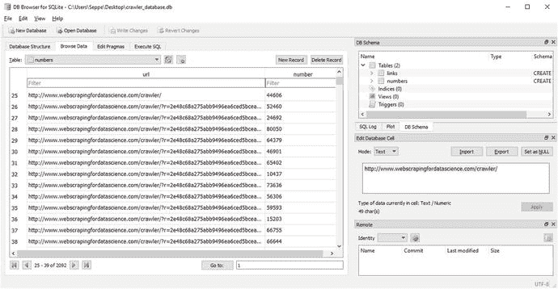

# 6. 从网页抓取到网络爬虫

到目前为止，本书中的示例都相当简单，因为我们只抓取了（大部分）单个页面。然而，在编写网络爬虫时，很多时候你需要抓取多个页面甚至多个网站。在这种情况下，通常使用“网络爬虫”这个名称，因为它会“爬行”整个站点甚至整个网络。本章将说明如何从编写网页抓取器过渡到更复杂的网络爬虫，并强调编写爬虫时需要注意的重要方面。你还将学习如何将结果存储到数据库中以便后续访问和分析。

### 6.1 什么是网络爬虫？

“网页抓取”和“网络爬虫”之间的区别相对模糊，因为许多作者和程序员会互换使用这两个术语。一般来说，“爬虫”一词表示程序自主导航网页的能力，甚至可能没有明确的目标或目的，无休止地探索站点或网络提供的内容。网络爬虫被搜索引擎（如 Google）大量使用，用于获取 URL 的内容、检查该页面上的其他链接、获取这些链接的 URL，依此类推……

在编写网络爬虫时，需要考虑一些微妙的设计选择，这些选择会改变项目的范围与性质：

- 在许多情况下，爬虫将限制在明确定义的页面集合内，例如在线商店的产品页面。这些情况相对容易处理，因为你停留在同一域名内，并且对每个产品页面的外观或要提取的数据类型有所预期。
- 在其他情况下，你将爬虫限制在单个网站（单个域名），但没有明确的信息提取目标。相反，你只是想创建一个网站的副本。在这种情况下，手动编写抓取器并非明智之举。有很多可用的工具（适用于 Windows、Mac 和 Linux）可以帮助你制作网站的离线副本，并包含大量可配置选项。要找到这些工具，请搜索“网站镜像工具”。
- 最后，在更极端的情况下，你可能希望爬虫保持非常开放。例如，你可能希望从一系列关键词开始，对每个关键词进行 Google 搜索，爬取每个查询的前 10 个结果，然后爬取这些页面中的图片、表格、文章等内容。显然，这是最难处理的高级用例。

#### 用 Python 编写健壮的爬虫

编写健壮的爬虫需要你设置各种检查机制，并仔细思考代码设计。由于爬虫可能访问网络上的任意页面，且通常需要长时间运行，因此你需要仔细思考停止条件、记录已访问页面（以及是否已到再次访问的时间）、如何存储结果，以及如何确保崩溃的脚本能在不丢失当前进度的情况下重启。以下概述提供了一些通用最佳实践和值得思考的要点：

- **仔细思考你实际需要收集哪些数据**：你是可以通过抓取一组预定义的网站来提取所需内容，还是真的需要发现未知的网站？在编写和维护代码方面，第一种选择总是更简单。
- **使用数据库**：最好使用数据库来记录待访问链接、已访问链接和收集到的数据。确保为所有内容添加时间戳，以便你知道数据的创建时间和最后更新时间。
- **将爬取与抓取分离**：大多数健壮的爬虫会将“爬取”部分（访问网站、提取链接并将其放入队列，即收集你想要抓取的页面）与实际“抓取”部分（从页面中提取信息）分开。在同一程序或循环中同时执行这两个操作很容易出错。在某些情况下，让爬虫保存页面 HTML 内容的完整副本是个好主意，这样当你想要提取信息时，就无需再次访问该页面。
- **尽早停止**：在爬取页面时，最好立即加入停止标准。也就是说，如果你在看到一个链接时就能确定它不感兴趣，就不要将其放入“待爬取”队列。同样适用于从页面抓取信息时，如果能够快速判断内容不感兴趣，就无需继续处理该页面。
- **重试或中止**：请注意，网络是一个动态环境，链接可能失效，页面也可能无法访问。仔细思考你希望针对特定链接重试多少次。
- **处理队列**：也就是说，你处理链接队列的方式也很重要。如果只是使用简单的先进先出（FIFO）或后进先出（LIFO）方法，可能会频繁重试一个失败的链接，这可能不是你想要的。因此，设置冷却期也很重要。
- **并行编程**：为了提高程序效率，你需要将其编写成可以启动多个并行工作的实例。因此，也需要有数据库支持的数据存储。始终假设你的程序随时可能崩溃，而一个新的实例应该能够立即接手任务。
- **牢记抓取的法律方面**：在下一章中，我们将更详细地探讨法律问题。有些网站可能不太乐意被爬虫访问。同时，请确保不要用大量 HTTP 请求“冲击”某个网站。虽然许多网站相对健壮，但如果你向同一网站发送数百个 HTTP 请求，有些网站甚至可能会宕机，无法服务正常访客。

在接下来的内容中，我们不会创建一个能与谷歌抗衡的产品，但会在下一节中，通过两个独立的示例，为你提供一些关于爬取的指导。

### 6.2 Python 中的网络爬取

作为第一个示例，我们将处理位于 [`http://www.webscrapingfordatascience.com/crawler/`](http://www.webscrapingfordatascience.com/crawler/) 的页面。该页面试图模拟一个简单的数字电台，它会随机输出一系列数字并生成链接，将你引导至不同的页面。

#### 数字电台

这个示例的灵感来源于 2005 年一个有趣的实验，你可以在 [`http://www.drunkmenworkhere.org/218`](http://www.drunkmenworkhere.org/218) 看到。该实验的目的是通过将网页爬虫（如 Google 和 Yahoo!）引导到一个页面迷宫中，来研究它们如何导航页面。实验的结果仍然可以在 [`http://www.drunkmenworkhere.org/219`](http://www.drunkmenworkhere.org/219) 查看，不过请注意，这个实验相当古老——搜索引擎在过去十年中已经发生了巨大变化。

花点时间在页面上操作一下，了解它是如何工作的。

#### 难以猜测
```

你会注意到，这里的页面使用了一个不可猜测的 `r` URL 参数。如果不是这样，即如果 URL 参数的所有值都落在定义明确的范围内或看起来像连续的整数，那么编写爬虫就会容易得多，因为你要获取的 URL 列表是明确已知的。在探索一个页面以评估抓取的可行性和确定需要采用的方法时，请记住这一点。

开始抓取这个网站的第一次尝试如下所示：

```python
import requests
from bs4 import BeautifulSoup
from urllib.parse import urljoin

base_url = 'http://www.webscrapingfordatascience.com/crawler/'
links_seen = set()

def visit(url, links_seen):
    html = requests.get(url).text
    html_soup = BeautifulSoup(html, 'html.parser')
    links_seen.add(url)
    
    for link in html_soup.find_all("a"):
        link_url = link.get('href')
        if link_url is None:
            continue
        full_url = urljoin(url, link_url)
        if full_url in links_seen:
            continue
        print('发现新页面:', full_url)
        # 通常，我们也会在此处存储结果
        visit(full_url, links_seen)

visit(base_url, links_seen)
```

请注意，我们在这里使用了 `urljoin` 函数。我们这样做的原因是，页面上链接的 `href` 属性引用的是相对 URL，例如 `?r=f01e7f02e91239a2003bdd35770e1173`，我们需要将其转换为绝对 URL。我们可以通过简单地在基本 URL 前添加来做到这一点，即 `base_url + link_url`，但是一旦我们开始跟随链接并深入网站 URL 树结构中的页面，这种方法就会失效。使用 `urljoin` 是正确的方法，它可以获取现有的绝对 URL，连接一个相对 URL，并得到格式良好的新绝对 URL。

### 关于绝对 `href` 值呢？

`urljoin` 方法甚至适用于绝对 `href` 链接值。使用：

```python
urljoin('http://example.org', 'https://www.other.com/dir/')
```

将返回 `https://www.other.com/dir/`，因此在爬取时，这是一个始终可靠的好函数。

如果你运行这个脚本，你会发现它会开始访问不同的 URL。然而，如果让它运行一段时间，这个脚本肯定会崩溃，而且不仅仅是因为网络问题。原因在于我们使用了递归：`visit` 函数不断地调用自身，没有机会在调用树中返回，因为每个页面都包含指向其他页面的链接：

```
Traceback (most recent call last):
  File "C:\Users\Seppe\Desktop\firstexample.py", line 23, in <module>
    visit(url, links_seen)
  [...]
    return wr in self.data
RecursionError: maximum recursion depth exceeded in comparison
```

因此，依赖递归进行网络爬取通常不是一个健壮的想法。我们可以像下面这样重写代码，避免使用递归：

```python
import requests
from bs4 import BeautifulSoup
from urllib.parse import urljoin

links_todo = ['http://www.webscrapingfordatascience.com/crawler/']
links_seen = set()

def visit(url, links_seen):
    html = requests.get(url).text
    html_soup = BeautifulSoup(html, 'html.parser')
    new_links = []
    
    for link in html_soup.find_all("a"):
        link_url = link.get('href')
        if link_url is None:
            continue
        full_url = urljoin(url, link_url)
        if full_url in links_seen:
            continue
```

#### 通常我们也会在这里存储结果

`new_links.append(full_url)`

`return new_links`

```
while links_todo:
    url_to_visit = links_todo.pop()
    links_seen.add(url_to_visit)
    print('正在访问：', url_to_visit)
    new_links = visit(url_to_visit, links_seen)
    print('发现', len(new_links), '个新链接')
    links_todo += new_links
```

你可以让这段代码运行一段时间。这个方案虽然有所改进，但仍存在几个缺陷。如果程序崩溃了（例如网络连接或网站宕机），你就得从头再来。此外，我们也不清楚 `links_seen` 集合可能会变得多大。通常你的计算机有足够的内存来轻松存储数千个 URL，但有时我们可能希望借助数据库来存储中间进度信息和结果。

### 将结果存入数据库

让我们改进示例，通过将进度和结果信息存入数据库，使其更能应对崩溃情况。我们将使用“records”库来管理 SQLite 数据库（一种基于文件但功能强大的数据库系统），在其中存储链接队列和从抓取页面中提取的数字。该库可通过 `pip` 安装：

```
pip install -U records
```

改进后的代码如下：

```python
import requests
import records
from bs4 import BeautifulSoup
from urllib.parse import urljoin
from sqlalchemy.exc import IntegrityError

db = records.Database('sqlite:///crawler_database.db')

db.query('''CREATE TABLE IF NOT EXISTS links (
url text PRIMARY KEY,
created_at datetime,
visited_at datetime NULL)''')

db.query('''CREATE TABLE IF NOT EXISTS numbers (url text, number integer,
PRIMARY KEY (url, number))''')

def store_link(url):
    try:
        db.query('''INSERT INTO links (url, created_at)
        VALUES (:url, CURRENT_TIMESTAMP)''', url=url)
    except IntegrityError as ie:
        # 该链接已存在，不做任何操作
        pass

def store_number(url, number):
    try:
        db.query('''INSERT INTO numbers (url, number)
        VALUES (:url, :number)''', url=url, number=number)
    except IntegrityError as ie:
        # 该数字已存在，不做任何操作
        pass

def mark_visited(url):
    db.query('''UPDATE links SET visited_at=CURRENT_TIMESTAMP
    WHERE url=:url''', url=url)

def get_random_unvisited_link():
    link = db.query('''SELECT * FROM links
    WHERE visited_at IS NULL
    ORDER BY RANDOM() LIMIT 1''').first()
    return None if link is None else link.url

def visit(url):
    html = requests.get(url).text
    html_soup = BeautifulSoup(html, 'html.parser')
    new_links = []
    for td in html_soup.find_all("td"):
        store_number(url, int(td.text.strip()))
    for link in html_soup.find_all("a"):
        link_url = link.get('href')
        if link_url is None:
            continue
        full_url = urljoin(url, link_url)
        new_links.append(full_url)
    return new_links

store_link('http://www.webscrapingfordatascience.com/crawler/')
url_to_visit = get_random_unvisited_link()

while url_to_visit is not None:
    print('正在访问：', url_to_visit)
    new_links = visit(url_to_visit)
    print('发现', len(new_links), '个新链接')
    for link in new_links:
        store_link(link)
    mark_visited(url_to_visit)
    url_to_visit = get_random_unvisited_link()
```

## 从 SQL 到 ORM

我们在这里手动编写 SQL（结构化查询语言）语句来与数据库交互，这在小型项目中是可行的。但对于更复杂的项目，研究一些 Python 可用的 ORM（对象关系映射）库是值得的，例如`SQLAlchemy`或`Pee-wee`，它们可以在关系数据库和 Python 对象之间实现更流畅、更可控的“映射”，这样你就可以直接操作对象，而无需处理 SQL 语句。

在示例章节中，我们将使用另一个名为`dataset`的库，它也提供了一种便捷的方式，无需编写 SQL 即可快速将信息转储到数据库。

另外请注意，在 Python 中使用 SQLite 数据库并非一定要用`records`库。Python 自带了内置的`sqlite3`模块（该模块被`records`所使用），你也可以直接使用它（参见[`docs.python.org/3/library/sqlite3.html`](https://docs.python.org/3/library/sqlite3.html)）。我们在这里使用`records`的原因是，它涉及的样板代码更少一些。

尝试运行这个脚本一段时间，然后停止它（通过关闭 Python 窗口或按`Control+C`）。你可以使用 SQLite 客户端（如“DB Browser for SQLite”，可从[`sqlitebrowser.org/`](http://sqlitebrowser.org/)获取）查看数据库（`crawler_database.db`）。图 6-1 展示了该工具的运行界面。请记住，你也可以在 Python 脚本中使用`records`库来获取存储的结果。



**图 6-1** 使用 DB Browser for SQLite 查看爬取结果

### SQLite

请注意，我们这里使用的 SQLite 数据库适用于小型项目，但一旦开始并行化你的程序，就可能出现问题。启动上述脚本的多个实例在某种程度上可能运行良好，但由于 SQLite 数据库文件被锁定（即被另一个脚本进程占用过久），偶尔可能会崩溃。同样，在脚本中使用多线程设置时，使用 SQLite 也会变得相当棘手。

在这种情况下，切换到像 MySQL 或 Postgresql 这样的客户端-服务器数据库可能是一个不错的选择。

### 构建维基百科爬虫

现在，让我们尝试使用同样的框架来构建一个维基百科爬虫。我们的计划是从主页开始，存储页面标题，并跟踪每个页面上的“（from, to）”链接。请注意，我们的数据库方案略有不同：

```python
import requests
import records
from bs4 import BeautifulSoup
from urllib.parse import urljoin, urldefrag
from sqlalchemy.exc import IntegrityError

db = records.Database('sqlite:///wikipedia.db')

db.query('''CREATE TABLE IF NOT EXISTS pages (
url text PRIMARY KEY,
page_title text NULL,
created_at datetime,
visited_at datetime NULL)''')

db.query('''CREATE TABLE IF NOT EXISTS links (
url text, url_to text,
PRIMARY KEY (url, url_to))''')

base_url = 'https://en.wikipedia.org/wiki/'

def store_page(url):
    try:
        db.query('''INSERT INTO pages (url, created_at)
        VALUES (:url, CURRENT_TIMESTAMP)''', url=url)
    except IntegrityError as ie:
        # 该页面已存在
        pass

def store_link(url, url_to):
    try:
        db.query('''INSERT INTO links (url, url_to)
        VALUES (:url, :url_to)''', url=url, url_to=url_to)
    except IntegrityError as ie:
        # 该链接已存在
        pass

def set_visited(url):
    db.query('''UPDATE pages SET visited_at=CURRENT_TIMESTAMP
    WHERE url=:url''', url=url)

def set_title(url, page_title):
    db.query('UPDATE pages SET page_title=:page_title WHERE url=:url',
             url=url, page_title=page_title)

def get_random_unvisited_page():
    link = db.query('''SELECT * FROM pages
    WHERE visited_at IS NULL
    ORDER BY RANDOM() LIMIT 1''').first()
    return None if link is None else link.url

def visit(url):
    print('正在访问：', url)
    html = requests.get(url).text
    html_soup = BeautifulSoup(html, 'html.parser')
    page_title = html_soup.find(id='firstHeading')
    page_title = page_title.text if page_title else ''
    print(' 页面标题：', page_title)
    set_title(url, page_title)
    for link in html_soup.find_all("a"):
        link_url = link.get('href')
        if link_url is None:
            # 没有 href，跳过
            continue
        full_url = urljoin(base_url, link_url)
        # 去除片段标识符部分
        full_url = urldefrag(full_url)[0]
        if not full_url.startswith(base_url):
            # 这是外部链接，跳过
            continue
        store_link(url, full_url)
        store_page(full_url)
    set_visited(url)

store_page(base_url)
url_to_visit = get_random_unvisited_page()
while url_to_visit is not None:
    visit(url_to_visit)
    url_to_visit = get_random_unvisited_page()
```

请注意，我们加入了一些额外措施来避免访问我们不希望包含的链接：我们确保不会追踪基础 URL 外部的链接。我们还使用了 `urldefrag` 函数来移除链接 URL 中的片段标识符（即“#”之后的部分），因为即使页面附带了片段标识符，我们也不想重复访问同一个页面——这相当于访问并解析没有该标识符的页面。换言之，我们不想在队列中同时包含 `"page.html#part1"` 和 `"page.html#part2"`；仅包含 `"page.html"` 就足够了。

如果你让这个脚本运行一段时间，就可以利用收集到的数据做一些有趣的事情。例如，你可以尝试使用 Python 中的 `NetworkX` 库，通过每个页面上的 `(来源, 目标)` 链接来创建一张图。在最后一章中，我们将进一步探讨此类用例。

请注意，这里我们假设事先已知要从页面中提取哪些信息（在此例中是页面标题和链接）。如果你事先并不清楚要从爬取的页面中提取什么内容，则可能需要进一步拆解爬取和解析页面的过程，例如，先存储 HTML 内容的完整副本，再由第二个脚本来解析。这是最通用的方案，但也会带来额外的复杂性，如以下代码所示：


# Wikipedia 网络爬虫示例

## 代码实现与数据结构说明

```python
import requests
import records
import re
import os, os.path
from bs4 import BeautifulSoup
from urllib.parse import urljoin, urldefrag
from sqlalchemy.exc import IntegrityError

db = records.Database('sqlite:///wikipedia.db')

# 该表用于跟踪已爬取和待爬取的页面
db.query('''CREATE TABLE IF NOT EXISTS pages (
url text PRIMARY KEY,
created_at datetime,
html_file text NULL,
visited_at datetime NULL)''')

# 该表用于跟踪 a 标签
db.query('''CREATE TABLE IF NOT EXISTS links (
url text, link_url text,
PRIMARY KEY (url, link_url))''')

# 该表用于跟踪 img 标签
db.query('''CREATE TABLE IF NOT EXISTS images (
url text, img_url text, img_file text,
PRIMARY KEY (url, img_url))''')

base_url = 'https://en.wikipedia.org/wiki/'
file_store = './downloads/'

if not os.path.exists(file_store):
    os.makedirs(file_store)

def url_to_file_name(url):
    url = str(url).strip().replace(' ', '_')
    return re.sub(r'(?u)[^-\w.]', '', url)

def download(url, filename):
    r = requests.get(url, stream=True)
    with open(os.path.join(file_store, filename), 'wb') as the_image:
        for byte_chunk in r.iter_content(chunk_size=4096*4):
            the_image.write(byte_chunk)

def store_page(url):
    try:
        db.query('''INSERT INTO pages (url, created_at)
                    VALUES (:url, CURRENT_TIMESTAMP)''',
                 url=url)
    except IntegrityError as ie:
        pass

def store_link(url, link_url):
    try:
        db.query('''INSERT INTO links (url, link_url)
                    VALUES (:url, :link_url)''',
                 url=url, link_url=link_url)
    except IntegrityError as ie:
        pass

def store_image(url, img_url, img_file):
    try:
        db.query('''INSERT INTO images (url, img_url, img_file)
                    VALUES (:url, :img_url, :img_file)''',
                 url=url, img_url=img_url, img_file=img_file)
    except IntegrityError as ie:
        pass

def set_visited(url, html_file):
    db.query('''UPDATE pages
                SET visited_at=CURRENT_TIMESTAMP,
                    html_file=:html_file
                WHERE url=:url''',
             url=url, html_file=html_file)

def get_random_unvisited_page():
    link = db.query('''SELECT * FROM pages
                       WHERE visited_at IS NULL
                       ORDER BY RANDOM() LIMIT 1''').first()
    return None if link is None else link.url

def should_visit(link_url):
    link_url = urldefrag(link_url)[0]
    if not link_url.startswith(base_url):
        return None
    return link_url

def visit(url):
    print('Now visiting:', url)
    html = requests.get(url).text
    html_soup = BeautifulSoup(html, 'html.parser')

    # 存储 a 标签链接
    for link in html_soup.find_all("a"):
        link_url = link.get('href')
        if link_url is None:
            continue
        link_url = urljoin(base_url, link_url)
        store_link(url, link_url)
        full_url = should_visit(link_url)
        if full_url:
            # 加入爬取队列
            store_page(full_url)

    # 存储 img-src 文件
    for img in html_soup.find_all("img"):
        img_url = img.get('src')
        if img_url is None:
            continue
        img_url = urljoin(base_url, img_url)
        filename = url_to_file_name(img_url)
        download(img_url, filename)
        store_image(url, img_url, filename)
    # 存储 HTML 内容
    filename = url_to_file_name(url) + '.html'
    fullname = os.path.join(file_store, filename)
    with open(fullname, 'w', encoding='utf-8') as the_html:
        the_html.write(html)
    set_visited(url, filename)

store_page(base_url)
url_to_visit = get_random_unvisited_page()
while url_to_visit is not None:
    visit(url_to_visit)
    url_to_visit = get_random_unvisited_page()
```

这里涉及的操作相当多。首先，创建了三张表：
- 一张 `pages` 表，用于跟踪 URL，记录我们是否已访问过它们（与之前的示例一样），但现在还新增了一个 `html_file` 字段，用于引用包含页面 HTML 内容的文件；
- 一张 `links` 表，用于跟踪页面上找到的链接；
- 一张 `images` 表，用于跟踪已下载的图片。

对于每个访问的页面，我们会提取所有 `<a>` 标签并存储其链接，并使用定义的 `should_visit()` 函数来判断是否也应将该链接加入 `pages` 表的待爬取队列中。接下来，我们会检查所有 `` 标签，并将它们下载到磁盘。定义了一个 `url_to_file_name()` 函数，以确保我们能够使用正则表达式生成合适的文件名。最后，访问过的页面的HTML内容也会被保存到磁盘，文件名则存储在数据库中。如果你让这个脚本运行一段时间，最终会得到大量的HTML文件和下载的图片，如图 6-2 所示。


**图 6-2** 爬取到的图片和网页集合

当然，你可以对这个设置进行许多其他修改。例如，在爬取页面时，可能没有必要存储链接和图片，因为我们也可以从保存的HTML文件中收集这些信息。另一方面，你可能希望采取一种“尽可能早地保存尽可能多的信息”的方法，并将其他媒体元素也纳入下载列表。应该清楚的是，网络爬虫脚本的形式和规模多种多样，并不存在一种“万能”的方法来解决所有项目。因此，在编写网络爬虫时，要仔细考虑所有设计角度以及如何在你的设置中实现它们。

### 更进一步

为了提及其他仍然可以探索的修改，例如，你可能还希望排除“特殊”页面或“讨论”页面，或引用文件的页面，使其不被爬取。另外请记住，我们上面的示例没有考虑从页面收集的信息可能变得“过时”的问题。也就是说，一旦一个页面被爬取过，我们的脚本就再也不会考虑它了。试着思考一种改变这一点的方法（提示：例如，`visited_at` 时间戳可用于判断是否到了再次访问某个页面的时间）。你将如何平衡探索新页面与刷新旧页面？哪些页面集合应该获得优先权，以及如何分配？

至此，我们关于 HTTP、请求、HTML、Beautiful Soup、JavaScript、Selenium 和爬取的旅程就结束了。本书的最后一章包含了一些完整的示例，展示了使用万维网上的真实网站进行的一些大型项目。然而，在此之前，我们先从技术细节中退一步，讨论网页抓取的管理和法律方面的问题。


