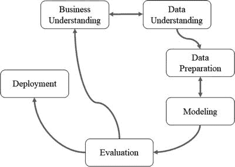

# 7. 管理与法律问题

到目前为止，我们一直非常关注本书中“网页抓取”的部分。现在，我们退后一步，将你学到的概念与数据科学的一般领域联系起来，特别关注在你计划将网页抓取纳入数据科学项目时会出现的管理问题。本章还深入讨论了网页抓取的法律方面问题。

### 7.1 数据科学流程

作为一名数据科学家（或渴望成为数据科学家的人），你可能已经体会到“数据科学”确实已经成为一个非常过载的术语。公司正在逐渐认识到，数据科学包含了非常广泛的技能组合，几乎不可能在一个人身上全部找到，因此需要一个多学科团队，包括：

- 基础理论家、数学家、统计学家（例如：回归分析、贝叶斯建模、线性代数、奇异值分解等）。

- 数据整理者（例如：熟悉`SQL`、`Python`的`pandas`库和`R`语言的`dplyr`的人）。

- 分析师和建模师（例如：使用`R`或`SAS`构建随机森林或神经网络模型）。

- 数据库管理员（例如：`DB2`或`MSSQL`专家，对数据库和`SQL`有扎实理解的人）。

- 商业智能专家（例如：负责报表和仪表板，以及数据仓库和`OLAP`立方体）。

- `IT`架构师和“开发运维”人员（例如：维护建模环境、工具和平台的人）。

- 大数据平台专家（例如：熟悉`Hadoop`、`Hive`和`Spark`的人）。

- “黑客”类型（例如：熟悉命令行的人，什么都懂一点，行动迅速，能够打破常规）。

- 业务整合者、赞助者和支持者（例如：知道如何将业务问题转化为数据需求和建模任务，并能将结果反馈给利益相关者，以及能在组织中强调数据和数据科学重要性的人）。

- 管理层（例如：将数据重点提上议程，并使其渗透到组织各层级的上级领导）。

- 当然，还有……网页抓取者（例如：你到目前为止所学的内容）。

数据科学和分析学继续快速发展。当前围绕人工智能和深度学习的炒作，又催生了组织正在寻找的另一套技能。

无论如何，数据科学是关于以扎实的方式从数据中提取价值，认识到数据在变得有价值之前需要大量利益相关者的处理和努力。因此，数据科学作为一种组织活动，通常通过“流程”来描述：这是一个工作流，描述了数据科学项目中必须采取的步骤，无论是构建预测模型来预测谁将流失、哪些客户会对营销活动做出积极反应、客户细分任务，还是简单地自动创建列出一些描述性统计数据的定期报告。原始来源就是数据。已经提出了许多这样的流程框架，其中`CRISP-DM`和`KDD`（数据库知识发现）流程是当今最流行的两种。



图 7-1 `CRISP-DM`流程

`CRISP-DM`代表“跨行业数据挖掘标准流程”。`KDnuggets`（`https://www.kdnuggets.com/`）在过去十年进行的调查显示，它是行业数据挖掘者和数据科学家使用的主要方法论。图 7-1 展示了描述`CRISP-DM`流程的图表。

`CRISP-DM`之所以受欢迎，是因为它明确强调了数据科学的循环性质：如果项目结果与你预期或希望的相符，你通常必须回到起点寻找新的数据源。`KDD`流程比`CRISP-DM`稍旧一些，描述了非常相似的步骤（更像是一条直线路径，但同样要记住，有时回退几步也可能是必要的）。它包括：

- **识别业务问题：** 类似于`CRISP-DM`中的“业务理解”步骤，第一步是对业务问题进行彻底定义。一些例子：抵押贷款组合的客户细分、后付费电信订阅的保留建模、或信用卡欺诈检测。定义分析建模练习的范围需要数据科学家和业务专家之间的密切合作。两者需要就一组关键概念达成一致，例如：我们如何定义客户、交易、流失、欺诈等；我们要预测什么（我们如何定义这个）；以及我们何时对结果感到满意。

- **识别数据源：** 接下来，需要识别所有可能具有潜在兴趣的源数据。这是一个非常重要的步骤，因为数据是任何分析工作的关键要素，并且数据的选择对后续步骤中构建的分析模型具有决定性的影响。

- **选择数据：** 这里的一般黄金法则是：数据越多越好，尽管与当前问题无关的数据源应在此步骤中丢弃。然后将所有合适的数据收集在临时区域，并整合到数据仓库、数据集市，甚至是一个简单的电子表格文件中。

- **清洗数据：** 在收集数据后，会进行一系列漫长的预处理和数据整理步骤，以消除所有不一致之处，例如缺失值、异常值和重复数据。

- **转换数据：** 预处理步骤通常还包括一个冗长的转换部分。可以考虑额外的转换，例如字母数字到数字的编码、地理聚合、改善对称性的对数变换，以及其他巧妙的“特征化”方法。

- **分析数据：** 上述步骤对应于`CRISP-DM`中的“数据理解”和“数据准备”步骤。一旦数据被充分清洗和处理，就可以开始实际的分析和建模（在`CRISP-DM`中称为“建模”）。在这里，基于预处理和转换后的数据评估一个分析模型。根据业务问题，数据科学家将选择并实施特定的分析技术。

- **解释、评估和部署模型：** 最后，一旦模型构建完成，将由业务专家对其进行解释和评估（在`CRISP-DM`中称为“评估”）。分析模型可能检测到的微不足道的模式和洞察仍然可能很有趣，因为它们提供了对模型的验证。但是，当然，关键的挑战是找到未知的、但有趣且可操作的模式，这些模式可以为你的数据提供新的见解。一旦分析模型得到适当的验证和批准，它就可以作为分析应用程序（例如，决策支持系统、评分引擎等）投入生产。重要的是要考虑如何以用户友好的方式呈现模型输出，如何将其与其他应用程序集成（例如，营销活动管理工具、风险引擎等），以及如何确保持续地适当监控分析模型。通常，分析模型的部署需要`IT`专家的支持，他们将帮助“生产化”该模型。

### 7.2 网页抓取如何融入其中？

数据科学流程中有多个部分可以融入网页抓取。然而，在大多数项目中，网页抓取将成为数据源识别和选择的重要部分。也就是说，用于收集和汇总你可以纳入数据集以进行建模的数据。

在这里提供一个警告很重要，即始终牢记你构建的模型的生产环境（“模型训练”与“模型运行”的差距）。如果你构建模型是一个一次性项目，用于描述或发现一些有趣的模式，那么请随意使用尽可能多的抓取数据和外部数据。然而，如果模型将被生产化为预测分析应用程序，请记住，模型在部署时需要能够访问与训练时相同的变量。因此，你需要仔细考虑在这样的设置中纳入抓取的数据源是否可行，因为需要确保相同的源仍然可用，并且能够在你推进的过程中继续抓取它们。网站可能会发生变化，而依赖于网页抓取的数据收集部分需要大量的维护工作，以便及时实施修复或更改。在这些情况下，你可能仍希望依赖更稳健的解决方案，例如`API`。根据你的项目，这个要求或多或少会带来麻烦。例如，如果你抓取的数据是指“在整整一年内都保持有效”的汇总数据，那么你当然可以在部署运行模型时继续使用收集到的数据（并例如在一年结束前安排好数据刷新）。始终牢记模型的生产环境：在应用和使用模型时，你也能访问所需的数据吗？还是只在模型训练期间才能访问？谁将负责确保这种数据访问？该模型只是一个保质期有限的`Proof of Concept`，还是将在未来几年内使用和维护？

在某些情况下，网页抓取部分将构成数据科学项目的主要组成部分。这在以下情况中很常见：基于抓取结果构建一些基本统计数据和也许一个吸引人的可视化，以便以用户友好的方式呈现发现并探索收集到的数据。尽管如此，这里仍然必须问同样的问题：这是一份使用时间有限的一次性报告，还是人们希望持续更新并长期使用的东西？

你回答这些问题的方式将对网络爬虫的设置产生重大影响。如果你只需要通过网页抓取快速收集结果，用于一个快速`Proof of Concept`、一个描述性模型或一份一次性报告，那么你可以为了快速获取数据而牺牲稳健性。如果抓取的数据也将在生产中使用（就像每年汇总的信息那样），那么抓取结果仍然可行，尽管最好提前考虑下次需要刷新数据集的时间，并尽可能使你的设置稳健且文档齐全。如果每次运行模型时都必须抓取信息，那么“抓取”部分实际上就成了部署设置的一部分，随之而来的是关于监控、维护和错误处理的所有头疼问题。确保提前就哪些团队负责此事达成一致！

我们想在这里提供另外两个“管理警告”。一个与数据质量有关。如果你在组织环境中处理过数据，你无疑听说过`GIGO`原则：垃圾进，垃圾出。当你依赖万维网收集数据时——伴随着所有的混乱和非结构化——准备好接受数据质量方面的“打击”。确实，在你的爬虫中加入尽可能多的清理和故障安全措施至关重要，但你几乎总是最终会遇到一个页面，其中出现了一个意料之外的额外`HTML`标签，或者你期望的文本不在那里，或者某些东西的格式略有不同。最后一个警告与可靠性有关。事实上，同样的观点不仅适用于网页抓取，也适用于`API`。在过去的几年里，出现了许多有前途的初创公司，它们利用`Twitter`、`Facebook`或其他一些`API`来提供出色的服务。如果该网站的提供者或所有者决定提高他们对其他人提供服务的价格，会发生什么？如果他们停止提供服务，会发生什么？许多产品仅仅因为其提供者改变了规则就消失了。总的来说，使用外部数据通常被视为灵丹妙药——“要是我们能得到`Facebook`拥有的信息就好了！”——但在被这样的想法冲昏头脑之前，要仔细思考并考虑所有可能的结果。

### 7.3 法律问题


# 网络数据抓取的法律战场

几年前，在 2015 年，一家名为 `hiQ Labs` 的美国年轻初创公司被《经济学人》报道，解释了他们在人力资源分析方面的新颖方法，这是当时迅速获得更多关注的数据科学应用领域，并且至今仍然势头强劲。其想法是利用大量数据集来帮助企业了解失去一名高级员工的成本、预测谁将离开公司，以及谁将是潜在新员工中的顶级候选人。2017 年 8 月，有消息透露，`hiQ Labs` 拥有并正在收集的大部分“海量数据集”源自微软旗下的 `LinkedIn`。

可以理解，`LinkedIn` 和微软的高管们对这种状况不太满意。他们认为这些数据属于 `LinkedIn`，因此发送了停止函，要求 `hiQ` 停止抓取 `LinkedIn` 的数据，并实施了各种技术措施来阻止 `hiQ Labs` 的爬虫。

这家初创公司以诉讼回击，要求 `LinkedIn` 拆除其为阻止 `hiQ` 使用数据而建立的技术障碍。`LinkedIn` 试图辩称，`hiQ Labs` 通过抓取数据违反了 1986 年的《计算机欺诈与滥用法》（`CFAA` 是在类似案件中经常被引用的法律条款）。法官不同意，他担心 `LinkedIn`“正在不公平地利用其在职业社交网络市场中的权力，以达到反竞争目的”（`hiQ` 提供了证据，表明 `LinkedIn` 正在开发自己的 `hiQ` 人才监控管理软件版本），甚至将 `LinkedIn` 的论点比作允许网站所有者“基于种族或性别歧视来阻止个人或群体访问”。法院解释说，“用户不会因为使用爬虫访问计算机而构成未经授权访问，即使面对技术反制措施，只要其访问的数据对公众是开放的。”

此案带来的公众关注无疑对 `hiQ` 有利，并吸引了更多潜在客户（参见 [https://www.bloomberg.com/news/features/2017-11-15/the-brutal-fight-to-mine-your-data-and-sell-it-to-your-boss](https://www.bloomberg.com/news/features/2017-11-15/the-brutal-fight-to-mine-your-data-and-sell-it-to-your-boss)）。虽然对于担心网页抓取法律问题的公司和个人来说，这个故事听起来很有希望，但这里必须指出两点重要内容。首先，该裁决是作为初步禁令作出的，在撰写本文时，这可能不是最终结果，因为 `LinkedIn` 已宣布将向美国第九巡回上诉法院提起诉讼。其次，“数据对公众开放”存在一些主观性。在这个特定案例中，`hiQ` 被允许抓取 `LinkedIn` 个人资料中无需登录服务即可访问的任何数据，即 `LinkedIn` 会员指定为公开可见的信息。目前尚不清楚相同的裁决是否适用于要求用户登录的页面。这为旨在保护其数据的数据巨头留下了一个简单的漏洞。例如，`Facebook` 一直要求用户登录才能查看其信息，即使对于已将其信息标记为“公开”的个人资料也是如此。

2014 年，另一家提供购物应用的初创公司 `Resultly` 通过抓取各种零售商来构建商品目录，意外地使电视零售商 `QVC` 的服务器过载，导致停机，据 `QVC` 称，这使他们损失了 200 万美元的收入。同样，`QVC` 也基于《计算机欺诈与滥用法》寻求初步禁令。然而，法院也裁定“`Resultly` 不是 `QVC` 的竞争对手，不是心怀不满的 `QVC` 员工，也不是旨在损害 `QVC` 服务器的不满的 `QVC` 客户”，因此这家初创公司缺乏意图损害 `QVC` 系统的必要条件。法院还指出，`QVC` 使用了 `Akamai` 的缓存服务，因此 `Resultly` 的爬虫访问的是 `Akamai` 的服务器，而不是 `QVC` 的。

其他一些法庭案件对抓取方来说结果并不那么理想：

### 美联社诉 Meltwater 案
媒体监控公司 `Meltwater` 一直在爬取美联社的网站，并提取和重新发布了美联社新闻文章中的大量文本。`Meltwater` 声称其行为符合版权法的合理使用规定，但法院判决美联社胜诉。

### Ticketmaster 诉 Riedel Marketing Group (RMG) 案
`RMG` 一直在抓取 `Ticketmaster` 的网站，以便大量获取热门门票进行转售。`Ticketmaster` 辩称，`RMG` 同意了网站的服务条款但却无视了它们，法院认定 `RMG` 侵犯了 `Ticketmaster` 的版权材料。

### Craigslist 诉 Naturemarket 案
`Naturemarket` 从 `Craigslist` 的网站上抓取电子邮件地址。`Craigslist` 起诉，声称版权侵权、违反《计算机欺诈与滥用法》以及违反使用条款。法院判决 `Craigslist` 获得超过一百万美元的赔偿。

### Ryanair Ltd 诉 PR Aviation BV 案
欧洲法院裁定，公开可用数据库的所有者，如果不属于数据库指令保护范围，则有权通过其网站上的合同条款来限制数据的使用。`PR Aviation` 从 `Ryanair` 的网站上提取数据，以便比较价格并在支付佣金后预订航班。`Ryanair` 要求任何访问其网站航班数据的人勾选一个框以接受其条款和条件，其中包括未经航空公司许可，禁止为商业目的自动从其网站提取数据。法院认定 `Ryanair` 可以自由地对其数据库的使用设置合同限制，因此判决其胜诉。

### 谷歌与比利时媒体公司 Copiepresse 案
2006 年，谷歌与比利时媒体公司 `Copiepresse` 陷入了一场长期的法律斗争：比利时初审法院发出禁止令，指出 `Copiepresse` 曾请求法院基于版权侵权的担忧，命令谷歌从其谷歌新闻网站中撤下其比利时出版物的所有文章、照片和图形，并且该服务还绕过了出版商从这些广告中获得相当一部分收入的广告位。基于这些认定，法院认为 `Copiepresse` 的诉求可予受理，并命令谷歌从其所有网站中撤下 `Copiepresse` 的内容。谷歌对判决提出上诉，但作为报复，也连续几个月在其主搜索引擎中停止引用这些报纸的网站（因为判决书中提到了“谷歌的所有网站”）。这导致了 `Copiepresse` 和谷歌之间的一场丑陋争斗，最终双方在 2011 年达成协议，将这些网站重新纳入索引。

### 美国合理使用原则案件
在美国的一个相关案件中，上诉法院第二巡回法庭认为，谷歌对数百万本书的扫描实际上属于合理使用，尽管这些作品受版权保护，因为其行为在合理使用原则下具有变革性：法院还确认事实不受版权保护，这表明从网站抓取事实数据本身并不构成侵权。

### Facebook 诉 Power Ventures 案
`Facebook` 还声称被告违反了《计算机欺诈与滥用法》和《`CAN-SPAM` 法案》，后者是一项禁止发送带有实质误导性信息的商业电子邮件的联邦法律。法官判决原告胜诉。

### LinkedIn 诉 Doe 被告案
`LinkedIn`（再次）对数百名未具名的个人提起诉讼，指控他们使用爬虫从其网站收集用户资料。此案仍在进行中，`Scraping Hub`（为被告提供抓取服务的公司）已被传唤出庭。

## 美国涉及的主要侵权或责任理论
这样的案例不胜枚举。显而易见的是，围绕网页抓取的法律环境仍在演变，许多被指控违反的法律在我们的数字时代尚未成熟。在美国，大多数法庭案件涉及以下一种侵权或责任理论：

### 违反条款和条件
大多数网站在其页面上发布条款和条件或最终用户许可协议，通常明确涉及通过爬虫访问其网站的问题。这旨在通过在网站所有者和爬虫之间建立合同，从而产生违约责任。然而，在网站上发布此类条款可能不足以证明爬虫违反了网站条款，因为爬虫方面没有主动接受。看起来更具可执行性的是使用明确的复选框或“我接受”链接，网络爬虫必须主动点击才能接受条款。对于登录网站以访问非公共区域的抓取应用程序也是如此，因为创建相关帐户通常也包含对条款的明确同意。

### 版权或商标侵权
在美国，法律原则“合理使用”允许在某些条件下，无需版权持有人的明确许可，有限地使用受版权保护的材料。用于戏仿、批评、评论或学术研究等目的被视为合理使用。然而，大多数对版权材料的商业用途不属于这一原则。

### 计算机欺诈与滥用法案 (CFAA)
美国有几项联邦和州法律禁止黑客入侵或未经授权访问他人计算机。`CFAA` 规定，
```
“未经授权故意访问计算机……并因此鲁莽地造成损害”的人基本上属于违规，特别是如果被侵害的网站能够证明损失或损害。
```

### 非法侵入动产
这是一个指民事过错的术语，意味着一个实体干涉了另一个实体的个人财产，导致价值损失或损害。在网页抓取案件中，有时也被用作侵权理论，例如在 1999 年的 `eBay` 诉 `Bidder's Edge` 案中。

### 爬虫排除协议
这是一个行业标准，允许网站嵌入一个 `robots.txt` 文件，向网络爬虫传达指令，表明哪些爬虫可以访问该站点以及它们可以访问哪些页面。然而，它的法律价值有限，但在你的网页抓取脚本中检查此文件可能是一个好主意，以确认网站所有者是否希望阻止爬虫。

### 数字千年版权法案 (DMCA)、CAN-SPAM 法案
这些法案在某些情况下也被纳入网页抓取的法庭案件中。

欧盟的情况受不同的立法和法律体系管辖，但许多相同的原则适用，例如与服务条款或版权作品相关的原则。欧盟的大多数网站和数据库所有者倾向于依靠版权侵权索赔来应对屏幕抓取者。其他一些关键规定包括：


-   **1996 年欧盟数据库指令：** 该指令为不受知识产权保护的数据集的创建者提供法律保护，以便数据库要素中不属于作者原始创作的部分也受到保护。具体来说，它提供了保护，条件是“在获取、验证或呈现内容方面进行了实质性的定性和/或定量投资”。欧洲法院在 2015 年涉及`Ryanair`的案例中的裁决极大地增强了网站运营商的能力，使其能够在其内容不受数据库指令保护时，通过合同条款和条件来保护其内容。

-   **计算机滥用法案和非法侵入动产：** 除了知识产权侵权外，理论上网站所有者还有其他针对网页抓取的法律论据。与美国一样，在英国，网站所有者可以尝试根据普通法提出非法侵入动产的侵权索赔。英国网站所有者也可以寻求依赖 1990 年的《计算机滥用法案》，该法案禁止未经授权访问或修改计算机资料。

很明显，网页抓取，尤其是大规模或出于商业目的的抓取，会带来复杂的法律影响。因此，建议在开展此类项目之前，始终咨询律师、合适的专家或合规官，并牢记以下关键原则：

-   **获得书面许可：** 避免法律问题的最佳方法是获得网站所有者的书面许可，明确说明你可以抓取哪些数据以及达到何种程度。

-   **检查使用条款：** 这些条款通常包含明确禁止自动提取数据的规定。通常，网站的 `API` 会附带其自己的使用条款，涉及使用方式，你也应该检查这些条款。

-   **仅限公开信息：** 如果网站公开暴露信息，没有明确要求接受条款和条件，适度的抓取很可能没问题。然而，需要你登录的网站则是另一回事。

-   **不要造成损害：** 抓取时要友善！不要用大量请求猛攻网站，使其网络过载并妨碍其正常使用。远离受保护的计算机，不要试图访问你未被授权访问的服务器。

-   **版权与合理使用：** 版权法似乎为原告提供了最强有力的诉讼依据。仔细检查你的抓取案例是否属于合理使用，不要在商业项目中使用受版权保护的作品。


