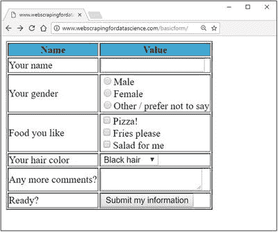
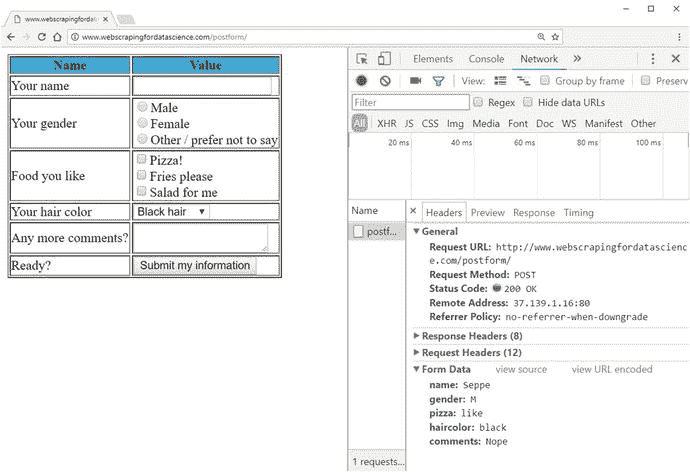
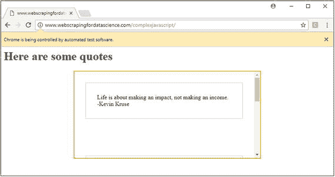
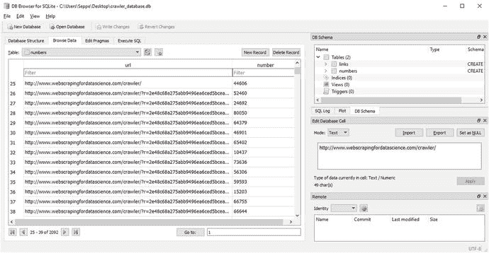
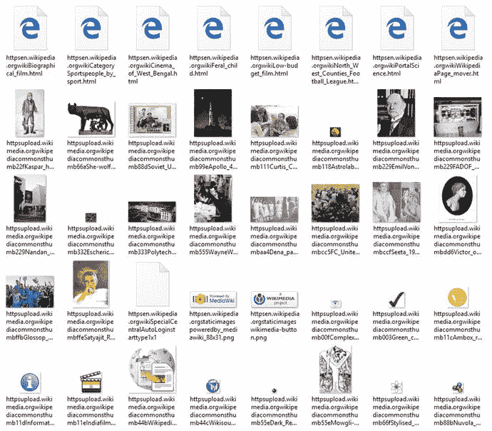

# 4. 深入研究 HTTP

我们已经了解了构成现代 Web 的大部分核心模块：`HTTP`、`HTML` 和 `CSS`。但我们对 `HTTP` 的探索尚未结束。到目前为止，我们只使用了 `HTTP` 的请求“动词”或“方法”之一：`GET`。本章将介绍 `HTTP` 提供的其他方法，首先介绍常用于提交 Web 表单的 `POST` 方法。接着，本章将进一步深入探讨 `HTTP` 请求和响应头，并展示如何使用 `requests` 库处理 `Cookie`。最后，本章会讨论除 `HTML` 格式化页面之外，你在 Web 上经常遇到的其他常见内容形式，以及如何在爬虫项目中处理它们。

## 4.1 表单与 POST 请求

我们已经看到 Web 浏览器（和你）向 Web 服务器传递输入的一种方式，即通过将输入直接包含在请求的 `URL` 中，无论是通过 `URL` 参数还是 `URL` 路径本身（前文已讨论）。然而，很容易看出这种输入方式并不友好。想象一下，我们想买几张演唱会的门票，却需要将姓名、邮箱地址等信息作为一堆 `URL` 参数发送给 Web 服务器。这确实不是个令人愉快的想法！此外，`URL` 的长度（在定义上）是有限的，因此如果我们要向 Web 服务器发送大量信息，这种“解决方案”也行不通。

网站提供了一种更好的方式来收集输入并将其发送到 Web 服务器，你肯定遇到过：`Web 表单`。无论是“订阅新闻通讯”表单、“购票”表单，还是简单的“登录”表单，`Web 表单`都用于收集相应的数据。Web 浏览器展示表单的方式，就是在 `HTML` 中加入对应的标签。也就是说，页面上的每个 `Web 表单`都对应着一块包含在 `<form>` 标签内的 `HTML` 代码：

```
[...]
```

在这些标签内部，有一些代表表单字段本身的标签。其中大部分是通过 `<input>` 标签提供的，其 `type` 属性指定了该字段的类型：

- `<input type="text">`：用于简单文本字段；

- `<input type="password">`：用于密码输入字段；

- `<input type="button">`：用于通用按钮；

- `<input type="reset">`：用于“重置”按钮（点击后，浏览器会将所有表单值重置为初始状态，但这种按钮如今已很少见）；

- `<input type="submit">`：用于“提交”按钮（稍后详述）；

- `<input type="checkbox">`：用于复选框；

- `<input type="radio">`：用于单选按钮；

- `<input type="hidden">`：用于隐藏字段，这些字段不会展示给用户，但仍可包含值。

除此之外，你还会看到成对出现的标签（`<input>` 没有结束标签）：

- `<button>...</button>`：定义按钮的另一种方式；

- `<select>...</select>`：用于下拉列表。其中的每个选项由 `<option>...</option>` 标签定义；

- `<textarea>...</textarea>`：用于较大的文本输入区域。



**图 4-1** 一个展示不同输入字段的简单 Web 表单

请访问 [`http://www.webscrapingfordatascience.com/basicform/`](http://www.webscrapingfordatascience.com/basicform/) 查看一个正在运行的基本 Web 表单（见图 4-1）。花点时间使用浏览器检查对应的 `HTML` 源代码。你会发现，某些 `HTML` 属性在此扮演着特定角色，即表单标签的 `name` 和 `value` 属性。事实证明，一旦 `Web 表单`被“提交”，这些属性将被浏览器使用。为此，请尝试点击示例网页上的“Submit my information”按钮（请先随意填写一些虚拟信息）。你看到了什么？注意，提交表单时，浏览器会发起一个新的 `HTTP` 请求，并将填写的信息包含在请求中。在这个简单的表单中，使用的是简单的 `HTTP GET` 请求，基本上将表单中的字段转换为键值对的 `URL` 参数。

### 提交表单

“提交”按钮并不是提交表单信息的唯一方式。有时，表单只包含一个文本字段，按回车键即可提交。另外，一些额外的 `JavaScript` 代码也可以负责发送表单。即使 `<form>` 块没有暴露任何明显的提交方式，你仍然可以指示 Web 浏览器通过其他方式提交表单，例如通过 `Chrome` 开发者工具的控制台。顺便提一下：同一个网页中可以包含多个 `<form>` 块（例如，一个用于“搜索”表单，另一个用于“联系我们”表单），但当用户执行“提交”操作时，通常只会提交一个表单及其包含的信息。

这种提交表单的方式与我们之前几段的讨论非常吻合：`URL` 参数是将输入发送到 Web 服务器的一种方式。不必手动在 `URL` 中输入所有信息（想象一下那将是多么糟糕的用户体验），我们现在至少看到了 `Web 表单`如何让这个过程稍微友好一些。

然而，当我们需要提交大量信息时（例如，尝试在示例页面的“comments”表单字段中填入大量文本），`URL` 由于其最大长度限制，将无法用于提交信息。即使 `URL` 没有长度限制，它们仍然无法提供完全合适的提交流程。例如，如果你将这样的 `URL` 复制粘贴到邮件中，其他人点击它，就会再次向服务器“发送”信息，会发生什么？或者，如果你不小心刷新了这样的 `URL`，又会发生什么？在向 Web 服务器发送信息，且预期此提交操作将产生永久性更改时（例如删除用户、更改个人资料信息、点击银行转账的“同意”等），简单地允许这些请求以 `HTTP GET` 请求的方式发送可能不是个好主意。

幸运的是，`HTTP` 协议除了我们迄今为止使用的 `GET` 方法外，还提供了一些不同的“方法”（或“动词”）。更具体地说，除了 `GET` 请求外，当你希望向 Web 服务器提交信息时，浏览器经常使用另一种类型的请求：`POST` 请求。为了介绍它，请访问页面 [`http://www.webscrapingfordatascience.com/postform/`](http://www.webscrapingfordatascience.com/postform/)。请注意，这个页面看起来与上面的完全相同，除了 `HTML` 源代码中有一个微小的差异：`<form>` 标签现在多了一个 `method` 属性：

```
[...]
```

`method` 属性的默认值是 `get`，它指示浏览器该特定表单的内容应通过 `HTTP GET` 请求提交。然而，当设置为 `post` 时，浏览器将被指示通过 `HTTP POST` 请求发送信息。与将所有表单信息作为 `URL` 参数不同，`POST` `HTTP` 请求将此输入作为 `HTTP` 请求体的一部分。要尝试这一点，请在确保 `Chrome` 开发者工具正在监控网络请求的情况下，点击“Submit my information”。如果你检查 `HTTP` 请求，会发现请求方法现在是 `POST`，并且 `Chrome` 包含了一条称为“Form Data”的额外信息，向你显示哪些信息作为 `HTTP` 请求体的一部分被包含在内；见图 4-2。请注意，现在提交的信息并未嵌入在请求 `URL` 中。



**图 4-2** 使用 Chrome 开发者工具检查 POST HTTP 请求

最后，请尝试访问 [`http://www.webscrapingfordatascience.com/postform2/`](http://www.webscrapingfordatascience.com/postform2/)。这个页面的工作方式与前一个完全相同，但有一个显著的区别：当你提交表单时，服务器不再返回与之前相同的内容，而是提供刚刚提交的信息概览。由于 Web 服务器能够读取包含 `HTTP` 请求方法和 `URL` 的 `HTTP` 请求行，它可以根据接收到的响应类型动态生成不同的响应，并采取不同的操作。例如，当收到 `POST` 请求时，Web 服务器可能决定在发送回复之前将提交的信息存储到数据库中。

### 关于安全性的一点说明

请注意，Web 浏览器中显示的 `URL` 并未改变，因为相同的 `URL` 可以结合 `POST` 或 `GET` 请求使用。这表明 `POST` 请求在安全性方面也提供了一个好处：即使将上述 `URL` 复制到邮件中，打开此链接的新用户最终将使用 `GET` 请求获取页面（因此不会重新向网站提交信息，只会看到一个全新的表单）。如果毫无戒心的用户被诱骗点击一个 `URL`，而该 `URL` 会立刻代表他们执行某些操作，那将是非常不安全的。这并不意味着使用 `POST` 请求就能完全保护你免受恶意行为者的侵害——例如，他们可以使用一段 `JavaScript` 代码指示访问者浏览器执行 `POST` 请求——但至少有所帮助。这并非说所有 `Web 表单`都应该使用 `POST`。比如 `Google` 上的搜索框表单，结合 `GET` 请求使用是完全没问题的。

最后，关于 Web 表单还有一点需要提及。在前面所有的例子中，提交到表单的数据是通过构建一个 HTTP 请求发送到 Web 服务器的，该请求的 URL 与表单所在的页面相同，但情况并非总是如此。为了指示“提交”操作应向不同的 URL 发起请求，可以使用 `action` 属性，如下所示：

```html
<form action="search.html">
```

这个表单片段可以包含在具有相应 URL 的不同页面上，但提交此表单将导致一个页面，例如 `search.html?query=Test`。

除了 `GET` 和 `POST`，还有其他一些 HTTP 方法需要讨论，但它们的用法远不如前两者常见，至少在通过 Web 浏览器上网时是如此。我们稍后再看这些方法；先总结一下目前所知的两种 HTTP 方法：

- `GET`：用于在地址栏输入 URL 并按回车、点击链接或提交 `GET` 表单。这里假设同一个请求可以执行多次而不会“损害”用户体验。例如，刷新 `search.html?query=Test` 这个 URL 没问题，但刷新 `doMoneyTransfer?to=Bart&from=Seppe&amount=100` 这个 URL 可能就不合适了。

- `POST`：用于提交 `POST` 表单。这里假设此请求将导致一个不应多次执行的操作。大多数浏览器实际上会在你尝试刷新由 `POST` 请求产生的页面时发出警告（“你将再次提交相同信息——确定要这样做吗？”）。

在继续介绍其他 HTTP 请求方法之前，让我们看看如何使用 Python 执行 `POST` 请求。如果 Web 表单使用 `GET` 请求提交信息，我们已经知道可以通过使用带有 `params` 参数的 `requests.get()` 方法来处理这种情况，将信息作为 URL 参数嵌入。对于 `POST` 请求，我们只需要使用一个新的方法（`requests.post()`）和一个新的 `data` 参数：

```python
import requests
url = 'http://www.webscrapingfordatascience.com/postform2/'
```

### 首先执行一个 GET 请求

```python
r = requests.get(url)
```

### 接着执行一个 POST 请求

```python
formdata = {
    'name': 'Seppe',
    'gender': 'M',
    'pizza': 'like',
    'haircolor': 'brown',
    'comments': ''
}
r = requests.post(url, data=formdata)
print(r.text)
```

与 `params` 类似，`data` 参数也是以 Python 字典对象的形式提供的，该对象表示名值对。花点时间在网页浏览器里玩玩这个 URL，看看各个输入元素的数据是如何实际提交的。特别要注意的是，对于单选按钮，它们都带有相同的 `name` 属性，表示它们属于同一个选项组，但它们的值（`"M"`、`"F"` 和 `"N"`）是不同的。如果根本没有做出选择，则此元素将不会包含在提交的表单数据中。对于复选框，要注意它们都有不同的名称，但它们的值都相同（`"like"`）。如果某个复选框未被选中，浏览器将不会把该名值对包含在提交的表单数据中。因此，有些网络服务器甚至不会费心去检查这些字段的值以确定它们是否被选中，而只是检查该名称是否出现在提交的数据中——不过这一点因服务器而异。

### 重复名称

有些网站，比如那些使用 PHP 语言构建的，也允许我们定义一系列具有相同 `name` 属性值的复选框元素。对于用 PHP 构建的网站，你会看到这些名称以 `"[]"` 结尾，例如 `"food[]"`。这向网络服务器表明传入的值应被视为数组。从 HTTP 层面来看，这意味着同一个字段名会在请求体中多次出现。URL 参数也存在同样的复杂性：从技术上讲，没有什么能阻止你指定多个同名的不同值。服务器处理它们的方式各不相同，不过你可能会好奇在 `requests` 中如何处理这种用例，因为 `params` 和 `data` 都是字典对象，不能两次包含相同的键。为了解决这个问题，`data` 和 `params` 参数都允许传递一个 `"(名称, 值)"` 元组列表来处理。

对于 `"comments"` 字段，请注意即使没有填写任何内容，它也会包含在提交的表单数据中，此时会提交一个空值。同样，在某些情况下，你也可以完全省略这个名值对，但最终取决于网络服务器想有多“挑剔”。

### 挑剔程度

甚至提交按钮也可以被命名，在这种情况下它们也会出现在提交的表单数据中（其值等于它们的 `"value"` HTML 属性）。有时，网络服务器会利用这个信息来判断当同一个表单中有多个提交按钮时，点击了哪一个；在其他情况下，这个名值对则会被忽略。就像 URL 参数的情况一样，网络服务器在解释请求时的严格或灵活程度差异很大。在使用 `requests` 提交 `POST` 请求时，没有什么能阻止你加入其他名值对，但同样，结果可能因网站而异。尽量精确地模拟浏览器中的行为通常是一个好建议。

请注意，在我们上面的例子中，我们仍然算是“礼貌”的，因为我们在通过 `POST` 发送信息之前先执行了一个常规的 `GET` 请求，尽管这并非必需。我们可以简单地注释掉 `requests.get` 这一行来直接提交信息。然而，在某些情况下，网页会足够“聪明”地阻止你这样做。为了说明这一点，尝试导航到 [`http://www.webscrapingforscience.com/postform3/`](http://www.webscrapingforscience.com/postform3/)，填写并提交表单。现在再试一次，但等一两分钟再点击“Submit my information”。网页会提示你“您提交此信息等待时间过长。”让我们尝试使用 `requests` 提交此表单：

```python
import requests
url = 'http://www.webscrapingforscience.com/postform3/'

# 不需要 GET 请求？
formdata = {
    'name': 'Seppe',
    'gender': 'M',
    'pizza': 'like',
    'haircolor': 'brown',
    'comments': ''
}
r = requests.post(url, data=formdata)
print(r.text)
```

#### 将显示：您是否在尝试从别处提交信息？

这很奇怪：网络服务器是如何知道我们在此例中正尝试从 Python 执行一个 `POST` 请求的呢？答案在于 HTML 源代码中现在出现的一个额外表单元素（您的值可能不同）：

```html
<input type="hidden" name="protection" value="2c17abf5d5b4e326bea802600ff88405">
```

可以看到，这个表单包含了一个新的隐藏字段，它将随表单的其余数据一同提交，这个字段被恰当地命名为 `"protection"`。不妨直接像下面这样将它包含在我们的 Python 源代码中：

```python
import requests
url = 'http://www.webscrapingfordatascience.com/postform3/'
formdata = {
    'name': 'Seppe',
    'gender': 'M',
    'pizza': 'like',
    'haircolor': 'brown',
    'comments': '',
    'protection': '2c17abf5d5b4e326bea802600ff88405'
}
r = requests.post(url, data=formdata)
print(r.text)
```

#### 将显示：您等待提交此信息的时间过长，请重试。

假设您在运行这段代码之前等待了一分钟，网络服务器现在会回复一条消息，表示它不想处理这个请求。确实，我们可以（使用浏览器）确认，每当我们刷新页面时，`"protection"` 字段似乎都会发生变化，而且看起来是随机的。要解决这个问题，我们别无选择，只能先通过一个 `GET` 请求获取表单的 HTML 源代码，取得 `"protection"` 字段的值，然后在随后的 `POST` 请求中使用这个值。再次引入 Beautiful Soup，可以轻松做到这一点。

```markdown
## 视图状态

上面的例子说明了一种你在现实情况中会时不时遇到的安全措施。网站管理员添加这种额外措施，不一定是为了阻止网络爬取（这确实让爬虫编写者稍微头疼，但我们已经看到如何解决它），而主要是出于安全和改善用户体验的原因。例如，为了防止相同的信息被提交两次（比如使用相同的`"protection"`值），或者为了防止某些攻击，在这些攻击中，用户被诱骗访问某个特定网页，该网页上的一段JavaScript代码会尝试向另一个站点发起`POST`请求，例如，发起转账或试图获取敏感信息。因此，安全的网站常常会在其页面上包含此类额外的检查。

```python
import requests
from bs4 import BeautifulSoup
url = 'http://www.webscrapingfordatascience.com/postform3/'
# 首先执行一个 GET 请求
r = requests.get(url)
# 获取 protection 的值
html_soup = BeautifulSoup(r.text, 'html.parser')
p_val = html_soup.find('input', attrs={'name': 'protection'}).get('value')
# 然后在 POST 请求中使用它
formdata = {
'name': 'Seppe',
'gender': 'M',
'pizza': 'like',
'haircolor': 'brown',
'comments': '',
'protection': p_val
}
r = requests.post(url, data=formdata)
print(r.text)
```

有一种网络服务器技术栈因使用此类字段而相当出名：微软的ASP和ASP.NET。使用这种技术构建的网站，在大多数情况下，会在所有表单中包含一个隐藏的输入元素，其名称设置为神秘的`"__VIEWSTATE"`，并附带一个可能非常长的加密值。当尝试向使用这种技术栈构建的站点发送`POST`请求时，如果不包含这个表单元素，结果将不会如你所愿，并且这通常是网络爬虫在现实中遇到的第一个烦人之处。解决方案很简单：在你的`POST`请求中包含它们即可。请注意，HTTP回复中返回的页面可能再次包含这样的`"__VIEWSTATE"`元素，因此你必须确保一次又一次地获取该值，并将其包含在随后的每个`POST`请求中。

在我们结束本节之前，还有几点值得一提。首先，你无疑已经注意到，我们现在可以使用`params`和`data`参数，它们看起来非常相似。如果`GET`请求使用URL参数，而`POST`请求将数据作为HTTP请求体的一部分发送，为什么我们需要区分这些参数，而我们已经可以通过使用`requests.get`或`request.post`方法来指示请求类型呢？答案在于，一个HTTP`POST`请求完全可以同时包含带参数的请求URL和包含表单数据的请求体。因此，如果你在页面源代码中遇到这样的`<form>`标签定义：

```html
<form action="..." method="post" id="..." name="...">
[...]
```

你需要在Python中编写如下代码：

```python
r = requests.post(url, params={'type': 'student'}, data=formdata)
```

你可能还想知道，如果我们试图在URL参数和表单数据中包含相同的信息会发生什么：

```python
import requests
url = 'http://www.webscrapingfordatascience.com/postform2/'
paramdata = {'name': 'Totally Not Seppe'}
formdata = {'name': 'Seppe'}
r = requests.post(url, params=paramdata, data=formdata)
print(r.text)
```

这个特定的网页会简单地忽略URL参数，而优先考虑表单数据，但这并不一定总是如此。此外，即使一个`<form>`将其`"method"`参数指定为`"POST"`，在极少数情况下，你也可以通过一个简单的`GET`请求，将这些信息作为URL参数提交。这些情况很少见，但确实可能发生。不过，最好的建议是尽可能地遵循你通过正常使用页面所观察到的行为。

最后，还有一种我们之前没有讨论过的表单元素类型。有时，你会遇到允许你从本地机器向网络服务器上传文件的表单：

```html
<form action="..." method="post" enctype="multipart/form-data">
  <input type="file" name="profile_picture">
</form>
```

请注意此代码片段中的`"file"`输入元素，以及现在出现在`<form>`标签中的`"enctype"`参数。要理解这个参数的含义，我们需要稍微讨论一下表单编码。简而言之，Web表单会首先对表单中包含的信息进行“编码”，然后再将其嵌入到HTTP`POST`请求体中。目前，HTML标准预见了三种编码方式（它们最终会成为`"Content-Type"`请求头的值）：

*   `application/x-www-form-urlencoded`（默认）：在这种方式下，请求体的格式与我们之前看到的URL参数类似，因此得名“url-encoded”，即使用“&”符号（`&`）和等号（`=`）来分隔数据字段和名称-值对。就像在URL中一样，某些字符需要以特定方式进行编码，`requests`会自动为我们完成这项工作。

*   `text/plain`：由HTML 5引入，通常仅用于调试目的，因此在现实情况中极为罕见。

*   `multipart/form-data`：这种编码方法要复杂得多，但它允许我们在请求体中包含文件的内容，这些内容可能是二进制、非文本形式的数据——因此需要一种单独的编码机制。

举个例子，考虑一个包含一些请求数据的HTTP`POST`请求：

```
POST /postform2/ HTTP/1.1
Host: www.webscrapingfordatascience.com
Content-Type: application/x-www-form-urlencoded
[... 其他请求头]
name=Seppe&gender=M&pizza=like
```

现在考虑使用`"multipart/form-data"`编码请求数据的HTTP`POST`请求：

```
POST /postform2/ HTTP/1.1
Host: www.webscrapingfordatascience.com
Content-Type: multipart/form-data; boundary=BOUNDARY
[... 其他请求头]
--BOUNDARY
Content-Disposition: form-data; name="name"
Seppe
--BOUNDARY
Content-Disposition: form-data; name="gender"
M
--BOUNDARY
Content-Disposition: form-data; name="pizza"
like
--BOUNDARY
Content-Disposition: form-data; name="profile_picture"; filename="me.jpg"
Content-Type: application/octet-stream
[... me.jpg 的二进制内容]
```

显然，这里的请求体看起来更复杂，不过我们可以看到`"multipart"`这个名称的由来：请求数据被一个“边界”字符串分割成多个部分，这个边界字符串由请求发起方（在大多数情况下是随机）决定。幸运的是，我们在使用`requests`时不需要过多关注这一点。要上传文件，我们只需使用另一个名为`files`的参数（它可以与`data`参数一起使用）：

```python
import requests
url = 'http://www.webscrapingfordatascience.com/postform2/'
formdata = {'name': 'Seppe'}
filedata = {'profile_picture': open('me.jpg', 'rb')}
r = requests.post(url, data=formdata, files=filedata)
```

这个库会负责在`POST`请求中设置适当的请求头（包括选择一个边界），并为你正确编码请求体。

### 多文件上传
```

# 对于可以上传多个文件的表单

你通常会看到它们使用了多个`<input>`标签，每个标签都有不同的名称。提交多个文件只需在`files`参数字典中放入更多的键值对即可。HTML标准也预见到了一种通过单个元素提供多个文件的方法，即使用`"multiple"`HTML参数。要使用`requests`处理这种情况，你可以向`files`参数传递一个列表，其中每个元素都是一个包含两个条目的元组：表单字段名称（可以在列表中出现多次）和文件信息——其本身又是一个包含`open`调用和关于所发送文件的其他信息的元组。关于此的更多信息可以在`requests`文档中的“POST Multiple Multipart-Encoded Files”部分找到，不过在实践中遇到这种上传表单的情况相当罕见。

## 4.2 其他HTTP请求方法

既然我们已经了解了HTTP `GET`和`POST`请求是如何工作的，我们可以花点时间讨论一下标准中存在的其他HTTP方法：

*   `GET`：`GET`方法请求指定URL的表示形式。使用`GET`的请求应该只检索数据，不应有其他影响，例如保存或更改用户信息或执行其他操作。换句话说，`GET`请求应该是“幂等的”，这意味着多次执行相同的请求应该是安全的。请记住，URL参数可以包含在请求URL中（对于任何其他HTTP方法也是如此），虽然从技术上讲，`GET`请求也可以包含一个可选的请求体，但这不符合HTTP标准的推荐做法。因此，Web浏览器在执行`GET`请求时不会在请求体中包含任何内容，并且大多数（如果不是全部）API也不会使用请求体。

*   `POST`：`POST`方法表示数据正在作为请求的一部分提交到特定的URL，例如论坛消息、文件上传、填写的表单等等。与`GET`相反，`POST`请求不期望是幂等的，这意味着提交`POST`请求可能会在网络服务器端带来变化，例如，更新你的个人资料、确认一笔货币交易、一次购买等等。`POST`请求将提交的数据编码为请求体的一部分。

*   `HEAD`：`HEAD`方法请求的响应与`GET`请求类似，但它向网络服务器表明不需要发送响应体。这在您只想要响应头而不需要实际响应内容时非常有用。`HEAD`请求不能有请求体。

*   `PUT`：`PUT`方法请求将提交的数据存储到所请求的URL下，如果该URL不存在则创建它。与`POST`一样，`PUT`请求有一个请求体。

*   `DELETE`：`DELETE`方法请求移除请求URL下列出的数据。`DELETE`请求没有请求体。

*   `CONNECT`、`OPTIONS`、`TRACE`和`PATCH`：这些是一些不太常见的请求方法。`CONNECT`通常用于请求网络服务器在客户端和目标之间建立一个直接的TCP网络连接（Web代理服务器会使用这种请求类型），`TRACE`指示网络服务器将请求原样发送回客户端（用于调试，以查看连接中的中间人是否在中间更改了你的请求），`OPTIONS`请求网络服务器列出它对于特定URL所接受的HTTP方法（这看似有用，但很少使用）。最后，`PATCH`允许我们请求对特定资源进行部分修改。

根据以上所述，似乎这套HTTP方法与用于查询和更新关系数据库中信息的基本SQL（结构化查询语言）命令集合相当吻合，即`GET`对应给定URL“SELECT”一个资源，`POST`对应“UPDATE”它，`PUT`对应“UPSERT”它（如果不存在则“UPDATE”或“INSERT”），`DELETE`对应“DELETE”它。话虽如此，但这并不是Web浏览器的工作方式。我们在上面已经看到，大多数Web浏览器只使用`GET`和`POST`请求。这意味着，例如，如果你在社交网络站点上创建一个新个人资料，你的表单数据将通过一个`POST`请求提交，而不是`PUT`。如果你之后更改你的个人资料，会使用另一个`POST`请求。即使你想删除你的个人资料，这个操作也会通过一个`POST`请求来请求。

然而，这并不意味着`requests`不支持这些方法。除了`requests.get`和`requests.post`，您还可以使用`requests.head`、`requests.put`、`requests.delete`、`requests.patch`和`requests.options`方法。

### 关于API的一点说明

尽管Web浏览器可能只使用`GET`和`POST`请求，但有许多网络协议将自己置于HTTP之上，并同样使用其他请求方法。此外，你会发现许多现代API——如Facebook、Twitter、LinkedIn等提供的——也通过HTTP暴露其功能，并且也可能使用其他HTTP请求方法，这种做法通常被称为REST（表述性状态传递）。那么了解你可以直接使用`requests`来访问这些API是很有帮助的。因此，网络爬取和使用API之间的区别主要在于请求和回复的结构化程度。使用API，你会得到结构化格式（如XML或JSON）的内容，这很容易被计算机程序解析。而在“常规”Web上，内容主要以HTML格式的文本返回。这对于人类读者在浏览器呈现后处理来说很好，但对于计算机程序来说则不太方便。因此，需要像Beautiful Soup这样的东西。但请注意，并非所有API都构建在HTTP之上——其中一些也使用其他协议，如SOAP（简单对象访问协议），这需要另一套库来访问它们。

## 4.3 关于请求头的更多内容

既然我们已经完成了HTTP请求方法的概述，是时候更仔细地看看HTTP的另一个部分以及它在爬取网站时如何发挥作用了：请求头。到目前为止，我们一直依赖`requests`来为我们构造和发送这些请求头。然而，在各种情况下，我们都需要自己修改它们。

让我们马上从下面的例子开始：

```python
import requests
url = 'http://www.webscrapingfordatascience.com/usercheck/'
r = requests.get(url)
print(r.text)
### 显示：看来你正在使用一个爬虫程序
print(r.request.headers)
```

请注意，网站回复说“看来你正在使用一个爬虫程序”。它是怎么知道的？当我们在普通浏览器中打开同一个页面时，看到的是“欢迎，普通用户”。答案在于`requests`库正在发送的请求头：

```json
{
'User-Agent': 'python-requests/2.18.4',
'Accept-Encoding': 'gzip, deflate',
'Accept': '*/*',
'Connection': 'keep-alive'
}
```

`requests`库试图保持礼貌，并包含了一个`"User-Agent"`头来自我介绍。当然，想要阻止爬虫访问其内容的网站可以通过一个简单的检查来阻止特定的用户代理访问其内容。因此，我们必须修改我们的请求头，以便“融入其中”。在`requests`中，发送自定义请求头很容易，可以通过另一个参数`headers`来实现：

```python
import requests
url = 'http://www.webscrapingfordatascience.com/usercheck/'
my_headers = {
'User-Agent': 'Mozilla/5.0 (Windows NT 10.0; Win64; x64) AppleWebKit/537.36 ' + ' (KHTML, like Gecko) Chrome/61.0.3163.100 Safari/537.36'
}
r = requests.get(url, headers=my_headers)
print(r.text)
print(r.request.headers)
```

这样就行了。请注意，`headers`参数并不会完全覆盖默认请求头，而是更新它，保留默认条目。

除了 `User-Agent` 头之外，还有一个值得特别提及的请求头：`Referer` 头（最初是 referrer 的拼写错误，并一直沿用至今）。浏览器会包含这个头来指示链接到所请求 URL 的网页的 URL。一些网站会检查这个头以防止“深度链接”生效。要测试这一点，请在浏览器中导航到 [`http://www.webscrapingfordatascience.com/referercheck/`](http://www.webscrapingfordatascience.com/referercheck/)，然后点击“秘密页面”链接。你将被链接到另一个页面（[`http://www.webscrapingfordatascience.com/referercheck/secret.php`](http://www.webscrapingfordatascience.com/referercheck/secret.php)），其中包含文本“这是一个完全秘密的页面”。现在尝试在一个新的浏览器标签页中直接打开这个 URL。你会看到一条消息“抱歉，你似乎来自另一个网页”。在 `requests` 中也会发生同样的情况：

```python
import requests
url = 'http://www.webscrapingfordatascience.com/referercheck/secret.php'
r = requests.get(url)
print(r.text)
# 显示：抱歉，你似乎来自另一个网页
```

尝试使用浏览器的开发者工具检查你的浏览器发出的请求，看看你是否能找到正在发送的 `Referer` 头。你会注意到，对于指向秘密页面的 `GET` 请求，它显示的是 [`http://www.webscrapingfordatascience.com/referercheck/`](http://www.webscrapingfordatascience.com/referercheck/)。当从另一个网站链接过来，或者在一个新标签页中打开时，这个引用字段会不同，或者不包含在请求头中。尤其是托管图片库的网站经常使用这种策略，以防止图片被直接包含在其他网页中（它们希望图片只能在自己的网站上可见，并希望避免为其他使用图片的页面支付托管费用）。在 `requests` 中遇到此类检查时，我们可以简单地伪造 `Referer` 头：

```python
import requests
url = 'http://www.webscrapingfordatascience.com/referercheck/secret.php'
my_headers = {
'Referer': 'http://www.webscrapingfordatascience.com/referercheck/'
}
r = requests.get(url, headers=my_headers)
print(r.text)
```

正如我们之前在多个场合看到的，请记住，网络服务器在发送的请求头方面可能会变得非常挑剔。诸如请求头的顺序、具有相同请求头名称的多行、或者在请求中包含自定义请求头等罕见边缘情况都可能在现实情况中出现。如果你发现 `requests` 没有返回你期望的结果，而你在浏览器中使用该网站时观察到了这些结果，请通过开发者工具检查请求头，以准确了解发生了什么，并在 Python 中尽可能地复现它。

### 重复的请求和响应头

就像 `data` 和 `params` 参数一样，如果请求头的顺序很重要，`headers` 可以接受一个 `OrderedDict` 对象。但是，这里不允许传递列表，因为 HTTP 标准不允许有多行具有相同名称的请求头。允许的是通过逗号分隔为同一个请求头提供多个值，例如 `Accept-Encoding: gzip, deflate` 这行。在这种情况下，你可以直接将该值传递给 `requests`。然而，这并不意味着一些极其怪异的网站或 API 不会使用偏离标准的设置，并检查请求中多行相同的请求头。在这种情况下，你别无选择，只能实现一个 hack 来扩展 `requests`。请注意，响应头可以包含多行具有相同名称的数据。当你访问 `r.headers` 时，`requests` 会使用逗号自动将它们连接起来，并放在一个条目下。

最后，我们还应该更仔细地看看 HTTP 回复头，首先从不同的 HTTP 响应状态码开始。在大多数情况下，状态码将是 200，这是成功请求的标准响应。完整的状态码范围可以分类如下：

*   1XX：信息性状态码，表示请求已被接收和理解，但服务器指示客户端应等待额外的响应。这些在普通 Web 上很少遇到。
*   2XX：成功状态码，表示请求已被接收、理解并成功处理。这里最普遍的状态码是 200（“OK”），尽管 204（“无内容”——表示服务器不会返回任何内容）和 206（“部分内容”——表示服务器只提供资源的一部分，例如视频片段）有时也会被使用。
*   3XX：重定向状态码，表示客户端必须采取额外操作来完成请求，最常见的是执行一个新的请求，其中包含实际内容。例如，301（“永久移动”）表示此请求和所有未来的请求都应定向到给定的 URL 而不是之前使用的 URL，302（“找到”）和 303（“参见其他”）表示对该请求的响应可以在另一个 URL 下找到。304（“未修改”）用于指示自浏览器在其缓存相关头中指定的版本以来，资源未被修改，浏览器可以重用其先前下载的副本。307（“临时重定向”）和 308（“永久重定向”）表示应使用另一个 URL 重复请求，无论是临时的还是永久的。稍后将更多关于重定向以及如何使用 `requests` 处理它们。
*   4XX：客户端错误状态码，表示发生了由请求者引起的错误。这里最广为人知的状态码是 404（“未找到”），表示请求的资源无法找到，但将来可能会变得可用。410（“已删除”）表示请求的资源曾经可用，但将不再可用。400（“错误请求”）表示 HTTP 请求格式不正确，401（“未授权”）用于指示请求的资源在未经授权的情况下不可用，而 403（“禁止”）表示请求是有效的（包括身份验证），但用户没有访问此资源的正确凭据。405（“方法不允许”）应被用于指示使用了不正确的 HTTP 请求方法。标准中还定义了 402（“需要付款”）、429（“请求过多”），甚至 451（“因法律原因不可用”），尽管这些不太常用。
*   5XX：服务器错误状态码，表示请求看似有效，但服务器未能处理它。500（“内部服务器错误”）是该集合中最通用且最广泛遇到的状态码，表示服务器代码中可能存在错误或其他问题。

### 谁需要标准？

尽管有大量的状态码可用于处理各种不同的结果和情况，但大多数网络服务器在使用它们时不会过于细粒度或具体。因此，遇到一个 500 状态码，而 400、403 或 405 可能更合适的情况并不少见；或者得到一个 404 结果码，即使页面之前存在过，而 410 可能更好。此外，不同的 3XX 状态码有时也被互换使用。因此，最好不要过度思考状态码的定义，而是看看特定服务器实际回复了什么。

从上面的列表中，有两个主题值得仔细研究：重定向和身份验证。让我们先仔细看看重定向。在浏览器中打开页面 [`http://www.webscrapingfordatascience.com/redirect/`](http://www.webscrapingfordatascience.com/redirect/)。你会看到你立即被发送到另一个页面（`destination.php`）。现在在检查浏览器开发者工具中的网络请求的同时再次执行相同操作（在 Chrome 中，你应该启用“保留日志”选项，以防止 Chrome 在重定向发生后清除日志）。请注意，你的浏览器发出了两个请求：第一个请求到原始 URL，现在返回一个 302 状态码。这个状态码指示你的浏览器向 `destination.php` URL 执行第二个请求。浏览器如何知道 URL 应该是什么？通过检查原始 URL 的响应，你会注意到现在有一个 `Location` 响应头存在，其中包含了要重定向到的 URL。请注意，我们在此处的 HTTP 响应中还包含了另一个响应头：`SECRET-CODE`，我们稍后将在 Python 示例中使用它。首先，让我们看看 `requests` 如何处理重定向：

```python
import requests
url = 'http://www.webscrapingfordatascience.com/redirect/'
r = requests.get(url)
print(r.text)
print(r.headers)
```

请注意，我们得到了与最终目标对应的 HTTP 回复（"你已从另一个页面被重定向到这里！"）。在大多数情况下，这种默认行为非常有帮助：`requests` 足够智能，可以在收到 3XX 状态码时自动“跟随”重定向。但如果这不是我们想要的呢？如果我们想获取原始页面的内容呢？这在浏览器中也不会显示，但可能存在相关的响应内容。如果我们想手动查看 `"Location"` 和 `"SECRET-CODE"` 头的内容呢？要做到这一点，你可以通过 `allow_redirects` 参数简单地关闭 `requests` 默认的跟随重定向行为：

```python
import requests
url = 'http://www.webscrapingfordatascience.com/redirect/'
r = requests.get(url, allow_redirects=False)
print(r.text)
print(r.headers)
```

现在将显示：

```
你将被重定向... 再见！
{'Date': 'Fri, 13 Oct 2017 13:00:12 GMT',
'Server': 'Apache/2.4.18 (Ubuntu)',
'SECRET-CODE': '1234',
'Location': 'http://www.webscrapingfordatascience.com/redirect/destination.php',
'Content-Length': '34',
'Keep-Alive': 'timeout=5, max=100',
'Connection': 'Keep-Alive',
'Content-Type': 'text/html; charset=UTF-8'}
```

你需要关闭跟随重定向的情况并不多，但在你希望先获取响应头（例如这里的 `"SECRET-CODE"`）然后再进行下一步操作时，可能需要这样做。然后，你需要手动检索 `"Location"` 头来执行下一个 `requests.get` 调用。

### 重定向

使用 3XX 状态码的重定向经常被网站使用，例如，在数据被处理后的 `POST` 请求的 HTTP 响应中，用于将浏览器发送到一个确认页面（然后它可以对该页面使用 `GET` 请求）。这是另一种防止用户连续两次提交相同 `POST` 请求的措施。请注意，3XX 状态码并不是浏览器可以被发送到另一个位置的唯一方式。重定向指令也可以通过 HTML 文档中的 `<meta>` 标签提供，它可以包含一个可选的超时时间（这样的网页通常会显示类似“你将在 5 秒后被重定向”的内容），或者通过一段 JavaScript 代码，它也可以触发导航指令。

最后，让我们仔细看看 401（“未授权”）状态码，这似乎表明 HTTP 提供了某种身份验证机制。确实，HTTP 标准包含许多身份验证机制，你可以通过访问 URL [`http://www.webscrapingfordatascience.com/authentication/`](http://www.webscrapingfordatascience.com/authentication/) 来看到其中一种。你会注意到，该站点通过你的浏览器请求用户名和密码。如果你按下“取消”，你会注意到网站回复了一个 401（“未授权”）结果。尝试刷新页面并输入任何用户名和密码组合。服务器现在会回复一个正常的 200（“OK”）回复。这里实际发生的情况如下：

*   你的浏览器向该页面执行一个正常的 `GET` 请求，并且不包含任何身份验证信息。
*   网站回复一个 401 响应和一个 `"WWW-Authenticate"` 头。
*   你的浏览器将此作为机会来询问用户名和密码。如果按下“取消”，此时会显示 401 响应。
*   如果用户提供了用户名和密码，你的浏览器将执行一个额外的 `GET` 请求，其中包含一个 `"Authorization"` 头，并对用户名和密码进行编码（尽管不是通过非常强的加密机制）。
*   网络服务器再次检查这个请求，例如，验证发送的用户名和密码。如果一切正常，服务器回复一个 200 页面。否则，会发送一个 403（“禁止”）（例如，如果密码不正确，或用户无权访问此页面）。

在 `requests` 中，使用基本身份验证执行请求就像包含一个 `"Authorization"` 头一样简单，所以我们仍然需要弄清楚如何加密用户名和密码。我们不必自己动手，`requests` 提供了另一种方法，即使用 `auth` 参数：

```python
import requests
url = 'http://www.webscrapingfordatascience.com/authentication/'
r = requests.get(url, auth=('myusername', 'mypassword'))
print(r.text)
print(r.request.headers)
```

除了这种基本身份验证机制（它非常不安全——网站只应在结合 HTTPS 的情况下使用它，否则你的信息将使用易于破解的加密方式进行传输），HTTP 还支持其他“方案”，例如摘要式身份验证机制，`requests` 也支持它。尽管一些较旧的网站有时仍在使用 HTTP 身份验证，但你不会经常看到 HTTP 的这个组件被使用了。大多数网站现在更喜欢使用 cookie 来处理身份验证，我们将在下一节中处理这个问题。

### 4.4 处理 Cookie

总的说来，HTTP 是一种相当简单的网络协议。它基于文本，并遵循简单的请求-回复式通信方案。在最简单的情况下，HTTP 中的每个请求-回复周期也需要建立一个新的底层网络连接，尽管 HTTP 标准的 1.1 版本允许我们建立“keep-alive”连接，其中网络连接保持打开状态一段时间，以便可以在同一连接上交换多个请求-回复 HTTP 消息。

然而，这种简单的基于请求-回复的方法给网站带来了一些问题。从网络服务器的角度来看，每个传入的请求完全独立于之前的所有请求，并且可以独立处理。然而，这并不是用户对大多数网站的期望。试想一个在线商店，可以将商品添加到购物车。当访问结账页面时，我们期望网络服务器“记住”我们之前选择和添加的商品。类似地，在 Web 表单中提供用户名和密码以访问受保护页面时，网络服务器需要某种机制来记住我们，即确定一个传入的 HTTP 请求与之前进入的请求是相关的。

简而言之，在 HTTP 引入后不久，就产生了在其之上添加状态机制的需求，换句话说，增加 HTTP 服务器在用户的“会话”期间“记住”信息的能力，在会话中可以访问多个页面。

请注意，根据我们上面所看到的，我们已经可以想到一些为网站添加此类功能的方法：

*   我们可以将一个特殊的标识符作为 URL 参数包含进来，以“链接”同一用户的多次访问，例如，`"checkout.html?visitor=20495"`。
*   对于 `POST` 请求，我们可以使用相同的 URL 参数，或者将“会话”标识符包含在一个隐藏的表单字段中。

一些较旧的网站确实使用此类机制，但这伴随着几个缺点：

*   如果一个不知情的用户复制了该链接并通过电子邮件发送出去，会发生什么？这意味着另一个打开此链接的方现在将被视为同一个用户，并且将能够查看他们所有的信息。
*   如果我们关闭并重新打开浏览器，会发生什么？我们将不得不重新登录，并再次经历所有步骤，因为我们是从一个新的会话开始的。

### 链接请求

请注意，你可能还会想到其他将请求链接在一起的方法。例如，使用访问用户的 IP 地址（可能结合 `User-Agent`）怎么样？遗憾的是，这些方法都存在类似的安全问题和缺点。IP 地址可能会改变，并且多台计算机可能共享同一个公共 IP 地址，这意味着你的所有办公计算机对于网络服务器来说看起来都像同一个“用户”。

为了以更健壮的方式解决这个问题，HTTP 中标准化了两个请求头，用于设置和发送“cookie”，即文本形式的小信息块。其工作方式相对简单。当发送 HTTP 响应时，网络服务器可以包含 `"Set-Cookie"` 头，如下所示：

```
HTTP/1.1 200 OK
Content-type: text/html
Set-Cookie: sessionToken=20495; Expires=Wed, 09 Jun 2021 10:10:10 GMT
Set-Cookie: siteTheme=dark
[...]
```

请注意，服务器在这里发送了两个具有相同名称的请求头。或者，整个头也可以作为一行提供，其中每个 cookie 用逗号分隔，如下所示：

```
HTTP/1.1 200 OK
Content-type: text/html
Set-Cookie: sessionToken=20495; Expires=Wed, 09 Jun 2021 10:10:10 GMT, siteTheme=dark
[...]
```

一些网络服务器也会使用全小写的 `"set-cookie"` 来发回 cookie 头。

`"Set-Cookie"` 头的值遵循一个定义良好的标准：

## 手动删除

提供 cookie 名称和 cookie 值，用等号 `=` 分隔。例如，在上面的例子中，`"sessionToken"` cookie 被设置为 `"20495"`，并且可能是服务器用来识别后续页面访问属于同一会话的标识符。另一个名为 `"siteTheme"` 的 cookie 被设置为值 `"dark"`，可能用于存储用户关于网站颜色主题的偏好。

可以指定额外的属性，用分号（`;`）分隔。在上面的例子中，为 `"sessionToken"` 设置了一个 `"Expires"` 属性，指示浏览器应存储该 cookie 直到指定的日期。或者，可以使用 `"Max-Age"` 属性来获得类似的结果。如果这些都没有指定，浏览器将被指示在浏览器窗口关闭后删除这些 cookie。

请注意，设置 `"Expires"` 或 `"Max-Age"` 属性不应被视为严格的指令。用户可以自由地手动删除 cookie，或者可能简单地切换到另一个浏览器或设备。

也可以设置 `"Domain"` 和 `"Path"` 属性来定义作用域。

### 这里找不到任何标签

```python
ul_tag = html_soup.find('ul')
print(ul_tag)
```

正如你将观察到的，页面的内容会原样返回，但无论是 `requests` 还是 `Beautiful Soup` 都不包含 JavaScript 引擎，这意味着不会有任何 JavaScript 被执行，页面上也不会找到 `<ul>` 标签。我们可以查看一下 `<script>` 标签，但对 `Beautiful Soup` 来说，它看起来就像其他包含大量文本的 HTML 标签一样。我们无法解析和查询实际的 JavaScript 代码。

### 显示 JavaScript 代码

```python
script_tag = html_soup.find('script', attrs={'src': None})
print(script_tag)
```

在像这样的简单情况下，这不一定是个问题。我们知道浏览器正在向 `quotes.php` 页面发送请求，而且我们需要设置一个 cookie。我们仍然可以直接抓取数据：

```python
import requests
url = 'http://www.webscrapingfordatascience.com/simplejavascript/quotes.php'
# 注意，cookie 值需要以字符串形式提供
r = requests.get(url, cookies={'jsenabled': '1'})
print(r.json())
```

这种方法有效（试试看不设置 cookie 会怎样），不过在更复杂的页面上，想出这样的方法可能会相当困难。有些网站会想方设法阻止你“逆向工程” JavaScript 代码中发生的事情。例如，访问 `http://www.webscrapingfordatascience.com/complexjavascript/`。你会注意到，这个页面在滚动到列表底部时会加载更多的引文。查看 `<script>` 标签，现在会看到以下混淆后的乱码：

```javascript
var _0x110b=["","\x6A\x6F\x69\x6E","\x25","\x73[...]\x6C"];
function sc(){
var _0xe9a7=["\x63\x6F\x6F\x6B\x69\x65","\x6E\x6F\x6E\x63\x65\x3D2545"];
document[_0xe9a7[0]]= _0xe9a7[1]
}$(function(){sc();
function _0x593ex2(_0x593ex3){
return decodeURIComponent([...],
function(_0x593ex4){
return _0x110b[2]+ [...]}
$(_0x110b[16])[_0x110b[15]]({
padding:20,
nextSelector:_0x110b[9],
contentSelector:_0x110b[0],
callback:function(){
$(_0x110b[14])[_0x110b[13]](function(_0x593ex5){
$(this)[_0x110b[10]](_0x593ex2($(this)[_0x110b[10]]()));
$(this)[_0x110b[12]](_0x110b[11])})}})})
```

显然，要弄清楚这里发生了什么是不切实际的。对于你的网络浏览器来说，解释和运行这段代码可能很简单，但对我们人类来说则不然。幸运的是，我们仍然可以尝试检查网络请求，来在一定程度上弄清楚这里发生了什么：

*   请求再次发送到了带有 `p` URL 参数的 `quotes.php` 页面，该参数用于分页。
*   这里使用了两个 cookie：`nonce` 和 `PHPSESSID`。后者我们之前遇到过，它只是包含在主页的 `Set-Cookie` 响应头中。然而，`nonce` cookie 却不在其中，这表明它可能通过 JavaScript 设置，不过我们并不确切知道它在哪里设置（聪明的读者可能能弄清楚，但为了示例的连贯性，请先跟着我们走）。

### 理清 JavaScript

安全研究人员时常会尝试理清类似这里看到的混淆后的 JavaScript 代码，以弄清楚某段特定代码的功能。显然，这是一项艰巨且令人疲惫的任务。

我们至少可以尝试“窃取” `nonce` 的 cookie 值，看看能否用 `requests` 获取到什么（请注意，你的 `nonce` cookie 值可能不同）：

```python
import requests
url = 'http://www.webscrapingfordatascience.com/complexjavascript/'
my_session = requests.Session()
# 首先获取主页，以得到 PHPSESSID cookie
r = my_session.get(url)
# 手动设置 nonce cookie
my_session.cookies.update({
'nonce': '2315'
})
r = my_session.get(url + 'quotes.php', params={'p': '0'})
print(r.text)
```

### 显示：没有你的报价！

遗憾的是，这行不通。要找出原因需要一些创造性思维，不过我们可以猜测一下哪里可能出了问题。我们通过访问主页来获取一个新的会话标识符，就像来自一个新的浏览会话一样，以提供 `PHPSESSID` cookie。然而，我们重复使用了浏览器正在使用的 `nonce` cookie 值。网页可能会发现这个 `nonce` 值与 `PHPSESSID` 信息不匹配。因此，我们别无选择，只能也重复使用 `PHPSESSID` 值。再次提醒，你的值可能不同（检查浏览器的网络请求，看看你的会话发送了哪些值）：

```python
import requests
url = 'http://www.webscrapingfordatascience.com/complexjavascript/'
my_cookies = {
'nonce': '2315',
'PHPSESSID': 'rtc4l3m3bgmjo2fqmi0og4nv24'
}
r = requests.get(url + 'quotes.php', params={'p': '0'}, cookies=my_cookies)
print(r.text)
```

至少，这让我们得到了一个不同的结果：

```
TGlmZ[...]EtydXNlCg==
CVdoY[...]iBIaWxsCg==
CVN0c[...]Wluc3RlaW4K

Load more quotes
```

这看起来像是包含我们报价的 HTML，但请注意，每条报价似乎都以某种方式进行了编码。显然，在 JavaScript 端必须有另一段编程逻辑来解码这些报价并在获取后显示它们，但同样，通过检查 JavaScript 源代码来弄清楚这到底是如何做到的非常困难。

此外，我们通过从浏览器中获取 `nonce` 和 `PHPSESSID` cookie 来重复使用它们。一旦 Web 服务器决定有一段时间没有收到我们的消息，而我们又试图使用相同的值重新运行脚本，服务器就会因为我们在使用过期的 cookie 而再次拒绝应答。这时我们需要在浏览器中重新加载页面，并替换我们脚本中的 cookie 值。

### 破解代码

诚然，你可能已经认出了这里用于编码报价的编码方案：base64，因此也许能够在 Python 中解码它们（这样做很简单）。这当然没问题，在现实场景中这可能是一种值得考虑的方法，不过请注意，上面的例子只是想说明，逆向工程 JavaScript 有时会变得相对困难。同样，你可能已经弄清楚了 `nonce` cookie 值隐藏在 JavaScript 代码的哪个位置，并且能够使用 Python 的正则表达式来获取它，但这同样与我们此处试图说明的观点无关。

## 5.3 使用 Selenium 进行抓取

显然，这种方法带来了许多问题，遗憾的是，我们目前所学的知识还无法解决这些问题。这个问题的解决方案很容易描述：我们看到报价出现在执行 JavaScript 的浏览器窗口中，那么我们不能从那里获取它们吗？确实，对于大量使用 JavaScript 的网站，我们别无选择，只能模拟一个完整的浏览器栈，并放弃使用 `requests` 和 `Beautiful Soup`。这正是我们在下一节中将要做的，使用另一个 Python 库：`Selenium`。

### 你是浏览器吗？

一些网络公司也会利用 JavaScript 来检查访客，在显示页面内容之前确认他们是否在使用真实的浏览器。例如，`CloudFlare` 将此称为“浏览器完整性检查”。在这些情况下，逆向工程其工作原理以假装你是一个浏览器，在使用 `requests` 时也会变得极其困难。

Selenium 是一个强大的网页抓取工具，最初是为自动化网站测试而开发的。Selenium 通过自动化浏览器来加载网站、检索其内容，并像用户使用浏览器时那样执行操作。因此，它也是一个强大的网页抓取工具。Selenium 可以通过多种编程语言进行控制，例如 Java、C#、PHP，当然还有 Python。

需要注意的是，Selenium 本身并不自带浏览器。相反，它需要一个名为 `WebDriver` 的集成软件来与第三方浏览器交互。大多数现代浏览器都有对应的 `WebDriver`，包括 Chrome、Firefox、Safari 和 Internet Explorer。在使用这些 `WebDriver` 时，你会看到屏幕上打开一个浏览器窗口，并执行你在代码中指定的操作。

### 无头模式

接下来，我们将安装并使用 Chrome `WebDriver` 和 Selenium，但如果你愿意，也可以使用其他 `WebDriver`。另外有趣的是，虽然在创建网页抓取工具时观察浏览器的行为可能有所帮助，但这会带来额外的开销，并且在没有显示器的服务器上设置起来可能更困难。不过别担心，Selenium 也为所谓的“无头”浏览器提供了 `WebDriver`，这些浏览器可以在不显示图形用户界面的情况下“隐形”运行。如果你想了解更多，可以看看 `PhantomJS` `WebDriver`。`PhantomJS` 是一个用 JavaScript 编写的“无头”浏览器，通常独立用于网站测试和抓取（使用 JavaScript），但通过其 `WebDriver`，它也可以用作 Selenium 的引擎，进而与 Python 一起使用。请注意，就像其他现代 Web 浏览器一样，`PhantomJS` 能够在后台渲染 HTML、处理 cookie 和执行 JavaScript。

与 `requests` 和 `Beautiful Soup` 一样，使用 `pip` 安装 Selenium 本身很简单（如果你还需要设置 Python 3 和 `pip`，请参考第 1.2.1 节）：

```
pip install -U selenium
```

接下来，我们需要下载一个 `WebDriver`。前往 [`sites.google.com/a/chromium.org/chromedriver/downloads`](https://sites.google.com/a/chromium.org/chromedriver/downloads) 并下载与你平台（Windows、Mac 或 Linux）匹配的最新版本文件。你下载的 ZIP 文件将包含一个可执行文件，在 Windows 上名为 `chromedriver.exe`，在其他平台上则名为 `chromedriver`。确保 Selenium 能找到此可执行文件的最简单方法是让该文件位于你的 Python 脚本所在的同一目录中，在这种情况下，以下小示例应该能直接运行：

```python
from selenium import webdriver
url = 'http://www.webscrapingfordatascience.com/complexjavascript/'
driver = webdriver.Chrome()
driver.get(url)
input('Press ENTER to close the automated browser')
driver.quit()
```

如果你更愿意将 `WebDriver` 可执行文件放在其他地方，也可以在 Python 中构造 Selenium 的 `webdriver` 对象时传递其路径，如下所示（不过，在接下来的示例中，我们将假定你将可执行文件放在同一目录中，以保持代码简洁）：

```python
driver_exe = 'C:/Users/Seppe/Desktop/chromedriver.exe'

# 如果你复制粘贴包含反斜杠的路径，请确保对它们进行转义
# 例如：driver_exe = 'C:\\Users\\Seppe\\Desktop\\chromedriver.exe'
driver = webdriver.Chrome(driver_exe)
```

当你运行第一个示例时，会注意到一个新的 Chrome 窗口出现，并显示警告信息，提示此窗口正被自动化测试软件控制，见图 5-1。Python 脚本会等待你按下回车键，然后关闭浏览器窗口。

页面加载完成后，你需要能够提取出 HTML 元素，就像之前用 `Beautiful Soup` 做的那样。Selenium 的方法列表看起来有些不同，但基于你目前所学的内容，理解起来应该不难：

- `find_element_by_id`
- `find_element_by_name`
- `find_element_by_xpath`
- `find_element_by_link_text`
- `find_element_by_partial_link_text`
- `find_element_by_tag_name`
- `find_element_by_class_name`
- `find_element_by_css_selector`

请注意，所有这些方法都有对应的 `find_elements_by_*` 变体（注意多了一个“s”），它与 `Beautiful Soup` 中的 `find_all` 方法类似，返回的是一个元素列表（在 Selenium 中表现为 `WebElement` 对象），而不是第一个匹配的元素。同样重要的是，上述方法在无法找到元素时会抛出 `NoSuchElementException` 异常。而 `Beautiful Soup` 在这种情况下会返回 `None`。此处的多数方法


*图 5-1 一个被 Selenium 控制的 Chrome 窗口*

都是不言自明的，但有些需要进一步解释。

`find_element_by_link_text` 方法通过匹配元素的内部文本来选择元素。`find_element_by_partial_link_text` 方法功能相同，但它是部分匹配内部文本。这两种方法在许多情况下都很方便，例如，用于根据文本值查找链接。

`find_element_by_name` 方法根据 HTML 的“name”属性来选择元素，而 `find_element_by_tag_name` 则使用实际的标签名。

`find_element_by_css_selector` 方法与 `Beautiful Soup` 的 `select` 方法类似，但它拥有更强大的 CSS 选择器规则解析器。

`find_element_by_xpath` 方法的功能类似。`XPath` 是一种用于在 XML 文档中定位节点的语言。由于 HTML 可被视为 XML 的一种实现（此处也称为 XHTML），因此 Selenium 可以使用 `XPath` 语言来选择元素。`XPath` 扩展了简单的按 id 或 name 属性定位的方法。下面快速概述一些常见的 `XPath` 表达式：

- `nodename` 选择所有名称为“nodename”的节点；
- `/` 从根节点开始选择；
- `//` 可用于跳过多个节点层级，搜索所有后代节点以进行选择；
- `.` 选择当前节点；
- `..` 选择当前节点的父节点；
- `@` 选择属性。

这些表达式可以组合起来形成强大的规则。一些 `XPath` 规则示例如下：

- `/html/body/form[1]`：获取“html”标签内“body”标签下的第一个表单元素。
- `//form[1]`：获取文档中的第一个表单元素。
- `//form[@id='my_form']`：获取“id”属性值为“my_form”的表单元素。

### 检查模式

如果你想在爬虫中使用 CSS 选择器或 `XPath` 表达式，请记住，你可以在 Chrome 开发者工具的 Elements 选项卡中右键点击 HTML 元素，选择“复制”、“复制选择器”和“复制 `XPath`”，以获取合适的选择器或表达式的轮廓。

让我们修改脚本来演示这些方法，例如，提取引文内容：

# Selenium自动化：等待条件与显式等待

## 初始代码与问题

```python
from selenium import webdriver
url = 'http://www.webscrapingfordatascience.com/complexjavascript/'
driver = webdriver.Chrome()
driver.get(url)
for quote in driver.find_elements_by_class_name('quote'):
    print(quote.text)
input('按回车键关闭自动化浏览器')
driver.quit()
```

让我们退一步看看发生了什么：导航到页面后，我们使用 `find_elements_by_class_name` 方法来检索引文元素。对于每个这样的引文元素（一个 `WebElement` 对象），我们使用它的 `text` 属性来打印其文本。与 `Beautiful Soup` 的 `find` 和 `find_all` 类似，如果你想要“深入挖掘”，也可以在已检索到的元素上调用 `find_element_*` 和 `find_elements_*` 方法。

遗憾的是，运行这段代码似乎不起作用，因为根本没有显示任何引文。原因是浏览器需要一些时间——即使只有半秒钟——来执行 JavaScript、获取引文并显示它们。与此同时，我们的 Python 脚本已经在努力查找引文元素了，而此刻它们还不存在。我们可以在代码中简单添加一个 `sleep` 行来等待几秒钟，但 `Selenium` 提供了一种更健壮的方法：等待条件。

## 隐式等待

`Selenium` 提供了两种等待类型：隐式等待和显式等待。隐式等待使得 `WebDriver` 在每次尝试定位元素时，都会轮询页面一段时间。可以把隐式等待想象成一个“包罗万象”的机制，每次尝试定位元素时，我们都会等待最长指定的时间。默认情况下，隐式等待时间设置为零，这意味着 `Selenium` 根本不会等待。然而，改变这一点很容易。正因如此，以下代码可以正常工作：

```python
from selenium import webdriver
url = 'http://www.webscrapingfordatascience.com/complexjavascript/'
driver = webdriver.Chrome()
driver.implicitly_wait(10)
driver.get(url)
for quote in driver.find_elements_by_class_name('quote'):
    print(quote.text)
input('Press ENTER to close the automated browser')
driver.quit()
```

当你刚开始接触 `Selenium` 时，隐式等待很有帮助，不过显式等待能提供更精细的控制。显式等待会令 `WebDriver` 等待，直到某个给定的条件返回非 `False` 值后，才继续执行后续操作。这个条件会被反复尝试，直到它返回某个值，或者达到给定的超时时间。要使用显式等待，我们需要借助以下导入语句：

```python
from selenium.webdriver.common.by import By
from selenium.webdriver.support.ui import WebDriverWait
from selenium.webdriver.support import expected_conditions as EC
```

上述 `EC` 对象内置了大量条件，因此我们无需自行编写这些代码。`Selenium` 直接提供了以下这些条件：

- `alert_is_present`：检查是否存在弹窗。

- `element_located_selection_state_to_be(locator, is_selected)`：检查是否定位到与 `定位器`（参见下文说明）匹配的元素，并且其选中状态与 `is_selected`（`True` 或 `False`）相符。

- `element_located_to_be_selected(locator)`：检查是否定位到与 `定位器`（参见下文说明）匹配的元素（一个 `WebElement` 对象），并且该元素已被选中。

- `element_selection_state_to_be(element, is_selected)`：检查 `element`（一个 `WebElement` 对象）的选中状态是否与 `is_selected`（`True` 或 `False`）相符。

- `element_to_be_selected(element)`：检查 `element`（一个 `WebElement` 对象）是否已被选中。

- `element_to_be_clickable(locator)`：检查是否定位到与 `定位器`（参见下文说明）匹配的元素，并且该元素可以被点击（即处于启用状态）。

- `frame_to_be_available_and_switch_to_it(locator)`：检查是否定位到与 `定位器`（参见下文说明）匹配的框架，并且可以切换过去；一旦找到，该条件会切换到这个框架。

- `invisibility_of_element_located(locator)`：检查与 `定位器`（参见下文说明）匹配的元素在页面上是否不可见或不存在（可见性意味着元素不仅被显示，而且其高度和宽度都大于 0）。

- `new_window_is_opened(current_handles)`：检查是否打开了新窗口。

- `number_of_windows_to_be(num_windows)`：检查是否打开了特定数量的窗口。

- `presence_of_all_elements_located(locator)`：检查页面上是否存在至少一个与 `定位器`（参见下文说明）匹配的元素。如果找到了，该条件会返回匹配元素的列表。

- `presence_of_element_located(locator)`：检查页面上是否存在至少一个与 `定位器`（参见下文说明）匹配的元素。如果找到了，该条件会返回第一个匹配的元素。

- `staleness_of(element)`：检查 `element`（一个 `WebElement` 对象）是否已从页面中移除。

- `text_to_be_present_in_element(locator, text_)`：检查与 `定位器`（参见下文说明）匹配的元素中是否包含给定的字符串。

- `text_to_be_present_in_element_value(locator, text_)`：检查与 `定位器`（参见下文说明）匹配的元素的 `value` 属性中是否包含给定的字符串。

- `title_contains(title)`：检查页面的标题是否包含给定的字符串。

- `title_is(title)`：检查页面的标题是否等于给定的字符串。

- `url_changes(url)`：检查当前的 URL 是否与给定的 URL 不同。

- `url_contains(url)`：检查当前的 URL 是否包含给定的 URL。

- `url_matches(pattern)`：检查当前的 URL 是否匹配给定的正则表达式模式。

- `url_to_be(url)`：检查当前的 URL 是否等于给定的 URL。

- `visibility_of(element)`：检查一个存在的 `element`（一个 `WebElement` 对象）是否可见（可见性意味着元素不仅被显示，而且其高度和宽度都大于 0）。

- `visibility_of_all_elements_located(locator)`：检查所有与 `定位器`（参见下文说明）匹配的元素是否也都可见。如果是，则返回匹配元素的列表。

- `visibility_of_any_elements_located(locator)`：检查是否存在任何与 `定位器`（参见下文说明）匹配的元素是可见的。如果是，则返回第一个可见的元素。

- `visibility_of_element_located(locator)`：检查第一个与 `定位器`（参见下文说明）匹配的元素是否也可见。如果是，则返回该元素。

接下来，我们修改之前的示例，使用显式等待来看一下它们是如何工作的：

# Selenium 动态网页抓取示例详解

```python
from selenium import webdriver
from selenium.webdriver.common.by import By
from selenium.webdriver.support.ui import WebDriverWait
from selenium.webdriver.support import expected_conditions as EC
url = 'http://www.webscrapingfordatascience.com/complexjavascript/'
driver = webdriver.Chrome()
driver.get(url)
quote_elements = WebDriverWait(driver, 10).until(
EC.presence_of_all_elements_located(
(By.CSS_SELECTOR, ".quote:not(.decode)")
)
)
for quote in quote_elements:
print(quote.text)
input('Press ENTER to close the automated browser')
driver.quit()
```

## 工作原理

这个示例的工作原理如下。首先，我们使用 `WebDriver` 对象和一个想要等待的秒数（此处为 10 秒）来创建一个 `WebDriverWait` 对象。然后，我们在这个对象上调用 `until` 方法，该方法需要一个条件对象，在本例中就是预定义的 `presence_of_all_elements_located`。注意，这个条件需要一个 `定位器` 参数，它实际上是一个包含两个元素的元组。第一个元素决定了基于哪种方法来选择元素（可选项包括：`By.ID`， `By.XPATH`， `By.NAME`， `By.TAG_NAME`， `By.CLASS_NAME`， `By.CSS_SELECTOR`， `By.LINK_TEXT` 和 `By.PARTIAL_LINK_TEXT`）；第二个元素则提供了具体的值。在这里，我们的定位器指明要根据一个给定的 CSS 选择器规则来查找元素，具体指定了所有具有 “quote” CSS 类但不具有 “decode” CSS 类的元素，因为我们想等待页面上的 JavaScript 代码完成对引文的解码。

这个条件会被反复检查，直到 10 秒过去，或者直到条件返回一个不为 `False` 的值，例如在 `presence_of_all_elements_located` 的情况下返回匹配元素的列表。然后，我们就可以直接遍历这个列表并获取引文的内容了。

### 在条件之外使用定位器元组

注意，定位器元组也可以在条件之外使用。也就是说，除了使用前面讨论的细粒度方法 `find_element_by_*` 和 `find_elements_by_*` 之外，你也可以使用通用的 `find_element` 和 `find_elements` 方法，并提供 `By` 参数和具体的值，例如 `driver.find_elements(By.XPATH, '//a')`。这在纯代码中可读性稍差，但如果你想定义自己的自定义条件，就会很方便。如下例所示，这也是可行的：

```python
class at_least_n_elements_found(object):
def __init__(self, locator, n):
self.locator = locator
self.n = n
def __call__(self, driver):
    #### 在此处执行一些操作，并返回 False 或其他值
    elements = driver.find_elements(*self.locator)
    if len(elements) >= self.n:
        return elements
    else:
        return False
```

然后，我们可以这样使用这个自定义条件：

```python
wait = WebDriverWait(driver, 10)
element = wait.until(
    at_least_n_elements_found((By.CLASS_NAME, 'my_class'), 3)
)
```

在这个示例中，定义了一个与 `presence_of_all_elements_located` 类似的新条件，但它会一直等待，直到至少找到指定数量的匹配元素。

## 处理动态加载内容

我们还需要解决一个问题。到目前为止，示例只返回了前三个引用。我们需要找出一种方法，使用 Selenium 向下滚动引用列表，以便加载所有内容。为此，Selenium 提供了一系列可由浏览器执行的“操作”，例如点击元素、点击并拖动、双击、右键单击等，我们可以利用这些操作来向下移动滚动条。不过，既然我们是在与一个功能完整的浏览器交互，我们也可以指示它执行 JavaScript 命令。既然使用 JavaScript 也可以实现滚动，那么我们可以使用 `execute_script` 方法向浏览器发送 JavaScript 命令。

下面的代码片段展示了如何使用我们自定义的等待条件来实现这一功能：

```python
from selenium import webdriver
from selenium.webdriver.common.by import By
from selenium.webdriver.support.ui import WebDriverWait
from selenium.webdriver.support import expected_conditions as EC
from selenium.common.exceptions import TimeoutException

class at_least_n_elements_found(object):
    def __init__(self, locator, n):
        self.locator = locator
        self.n = n

    def __call__(self, driver):
        elements = driver.find_elements(*self.locator)
        if len(elements) >= self.n:
            return elements
        else:
            return False

url = 'http://www.webscrapingfordatascience.com/complexjavascript/'
driver = webdriver.Chrome()
driver.get(url)

#### 对于未使用显式等待的情况，使用隐式等待
driver.implicitly_wait(10)

div_element = driver.find_element_by_class_name('infinite-scroll')
quotes_locator = (By.CSS_SELECTOR, ".quote:not(.decode)")
nr_quotes = 0

while True:
    # 向下滚动到底部
    driver.execute_script(
        'arguments[0].scrollTop = arguments[0].scrollHeight',
        div_element)

    # 尝试获取至少 nr_quotes+1 个引用
    try:
        all_quotes = WebDriverWait(driver, 3).until(
            at_least_n_elements_found(quotes_locator, nr_quotes + 1)
        )
    except TimeoutException as ex:
        # 3 秒内未找到新引用，假定已全部加载
        print("... 完成！")
        break

    # 否则，更新引用计数器
    nr_quotes = len(all_quotes)
    print("... 现在看到", nr_quotes, "条引用")

#### all_quotes 将包含所有引用元素
print(len(all_quotes), '条引用已找到\n')
for quote in all_quotes:
    print(quote.text)

input('按 ENTER 键关闭自动化浏览器')
driver.quit()
```

执行这段代码，并在浏览器的运行过程中观察 Python 控制台的输出，您应该会看到如下内容：

## 示例：使用操作实现自动滚动

现在看到 3 条引用

现在看到 6 条引用

现在看到 9 条引用

现在看到 12 条引用

现在看到 15 条引用

现在看到 18 条引用

现在看到 21 条引用

现在看到 24 条引用

现在看到 27 条引用

现在看到 30 条引用

现在看到 33 条引用

完成！
33 条引用已找到

生活在于产生影响，而非赚取收入。——凯文·克鲁斯
凡人心能想象并相信之事，必能实现。——拿破仑·希尔
不要追求成功，而要追求有价值。——阿尔伯特·爱因斯坦
林中两条岔路，我选择了人迹罕至的那一条，这造就了截然不同的人生。——罗伯特·弗罗斯特

如果您想了解如何在不使用 JavaScript 命令而使用操作（actions）来实现相同效果，可以查看下面的代码片段（注意两个新的导入）。在下一节中，我们将更多讨论如何通过操作与网页进行交互。

```python
from selenium import webdriver
from selenium.webdriver.common.by import By
from selenium.webdriver.support.ui import WebDriverWait
from selenium.webdriver.support import expected_conditions as EC
from selenium.common.exceptions import TimeoutException
from selenium.webdriver.common.action_chains import ActionChains
from selenium.webdriver.common.keys import Keys

class at_least_n_elements_found(object):
    def __init__(self, locator, n):
        self.locator = locator
        self.n = n

    def __call__(self, driver):
        elements = driver.find_elements(*self.locator)
        if len(elements) >= self.n:
            return elements
        else:
            return False

url = 'http://www.webscrapingfordatascience.com/complexjavascript/'
driver = webdriver.Chrome()
driver.get(url)

# 对于未使用显式等待的情况，使用隐式等待
driver.implicitly_wait(10)

div_element = driver.find_element_by_class_name('infinite-scroll')
quotes_locator = (By.CSS_SELECTOR, ".quote:not(.decode)")
nr_quotes = 0

while True:
    # 向下滚动到底部，现在使用操作链
    action_chain = ActionChains(driver)

    # 移动到我们的引用块
    action_chain.move_to_element(div_element)

    # 点击它使其获得焦点
    action_chain.click()

    # 按下 Page Down 键大约十次
    action_chain.send_keys([Keys.PAGE_DOWN for i in range(10)])

    # 执行这些操作
    action_chain.perform()

    # 尝试获取至少 nr_quotes+1 个引用
    try:
        all_quotes = WebDriverWait(driver, 3).until(
            at_least_n_elements_found(quotes_locator, nr_quotes + 1)
        )
    except TimeoutException as ex:
        # 3 秒内未找到新引用，假定已全部加载
        print("... 完成！")
        break

    # 否则，更新引用计数器
    nr_quotes = len(all_quotes)
    print("... 现在看到", nr_quotes, "条引用")
```

`all_quotes` 将包含所有引文元素

```python
print(len(all_quotes), 'quotes found\n')
for quote in all_quotes:
    print(quote.text)
input('Press ENTER to close the automated browser')
driver.quit()
```

## 5.4 关于 Selenium 的更多内容

我们已经了解了如何在 Selenium 中查找元素、处理条件与等待，以及向浏览器发送 JavaScript 命令，现在是时候深入了解一下这个库了。为此，我们将回到之前的一个示例，即 [`http://www.webscrapingfordatascience.com/postform2/`](http://www.webscrapingfordatascience.com/postform2/) 中的表单——这里的表单将为我们探索 Selenium 功能提供一个良好的试验场。

首先，我们来进一步谈谈导航。我们已经知道可以使用 `get` 方法在 Selenium 中导航至某个 URL。同样地，你也可以调用驱动器的 `forward` 和 `back` 方法（两者均无需参数）来在浏览器历史记录中前进或后退。关于 Cookie，了解这一点很有帮助：由于 Selenium 使用的是真实浏览器，我们无需自行管理 Cookie。如果你想输出当前可用的 Cookie，可以调用 `WebDriver` 对象的 `get_cookies` 方法。`add_cookie` 方法允许你设置一个新的 Cookie（该方法需要一个包含 "name" 和 "value" 键的字典作为参数）。

让我们开始编写一个新的 Selenium 程序来处理这个网页表单。为简化操作，我们将使用隐式等待：

```python
from selenium import webdriver

url = 'http://www.webscrapingfordatascience.com/postform2/'
driver = webdriver.Chrome()
driver.implicitly_wait(10)
driver.get(url)
input('Press ENTER to close the automated browser')
driver.quit()
```

每次使用 `find_element_by_*` 和 `find_elements_by_*` 方法（或通用的 `find_element` 和 `find_elements` 方法）检索元素时，Selenium 都会返回 `WebElement` 对象。对于这些对象，你可以访问许多有用的方法和属性：

*   首先，请记住，你可以在 `WebElement` 对象上再次使用 `find_element_by_*` 和 `find_elements_by_*` 方法（或通用的 `find_element` 和 `find_elements` 方法），从当前元素开始新的元素搜索，这与我们在 Beautiful Soup 中的操作方式相同。这对于检索页面中的嵌套元素非常有用。

*   `click` 方法用于点击元素。

*   `clear` 方法用于清除元素中的文本（如果该元素是文本输入元素）。

*   `get_attribute` 方法用于获取元素的 HTML 属性或特性，如果不存在则返回 `None`。例如：`element.get_attribute('href')`。

*   `get_property` 方法用于获取元素的属性。

*   `is_displayed`、`is_enabled` 和 `is_selected` 方法分别返回一个布尔值，指示元素对用户是否可见、是否已启用或是否已被选中。后者用于检查复选框或单选按钮是否被选中。

*   `send_keys` 方法模拟在元素中键入文本。它接受一个字符串、一个列表或一系列以列表形式传递的按键操作。

*   `submit` 方法用于提交表单。

*   `value_of_css_property` 方法返回给定属性名称的 CSS 属性值。

*   `screenshot` 方法将当前元素的屏幕截图保存到指定的 PNG 文件名中。

*   `location` 属性提供元素的位置，`size` 返回元素的尺寸，而 `rect` 返回一个包含尺寸和位置的字典。`parent` 属性引用发现该元素的 `WebDriver` 实例；`tag_name` 包含元素的标签名；而 `text` 属性返回元素的文本内容，我们之前已经使用过。`WebElement` 对象的 `page_source` 属性将返回完整页面的实时 HTML 源代码。

### 获取 HTML

`WebElement` 对象的 `page_source` 属性将返回完整页面的实时 HTML 源代码。但是，如果你只想获取元素本身的 HTML 源代码，则需要使用 `element.get_attribute('innerHTML')` 来访问 “innerHTML” 属性。”outerHTML” 属性的作用相同，但还会包含元素自身的标签。如果你仍然想使用 Beautiful Soup 来解析页面的某些组件，这些属性会非常有用。

### 下拉菜单（`Select` 对象）

对于下拉菜单（`<select>` 标签），Selenium 允许你基于给定的 `WebElement` 对象构造一个 `Select` 对象（位于 `selenium.webdriver.support.select` 下）。一旦创建了这样的对象，你就可以调用以下方法或访问以下属性：

*   `select_by_index(index)`：选择给定索引处的选项。
*   `select_by_value(value)`：选择所有值匹配参数的选项。
*   `select_by_visible_text(text)`：选择所有显示文本匹配参数的选项。
*   上述方法也都有对应的 `deselect_*` 变体，用于取消选择选项。`deselect_all` 方法用于清除所有已选条目（请注意，select 标签可以支持多选）。
*   `all_selected_options`：返回属于此 select 标签的所有已选选项列表。
*   `first_selected_option`：此 select 标签中的第一个已选选项（或者在仅允许单选的标准 select 中，为当前选中的选项）。
*   `options`：返回属于此 select 标签的所有选项列表。

### 表单填写示例

现在，让我们应用已学知识开始填写表单：

```python
from selenium import webdriver
from selenium.webdriver.support.select import Select
from selenium.webdriver.common.keys import Keys

url = 'http://www.webscrapingfordatascience.com/postform2/'
driver = webdriver.Chrome()
driver.implicitly_wait(10)
driver.get(url)

driver.find_element_by_name('name').send_keys('Seppe')
driver.find_element_by_css_selector('input[name="gender"][value="M"]').click()
driver.find_element_by_name('pizza').click()
driver.find_element_by_name('salad').click()
Select(driver.find_element_by_name('haircolor')).select_by_value('brown')
driver.find_element_by_name('comments').send_keys(
    ['First line', Keys.ENTER, 'Second line'])

input('Press ENTER to submit the form')
driver.find_element_by_tag_name('form').submit()
```

```python
#### Or: driver.find_element_by_css_selector('input[type="submit"]').click()
input('Press ENTER to close the automated browser')
driver.quit()
```

请花一些时间来运行这个示例并阅读代码。注意使用了特殊的 `Keys` 辅助对象，它可以用来发送像 `ENTER`、`PAGE_DOWN` 等按键。

### `ActionChains` 对象

除了上面直接操作动作的方式外，Selenium 还提供了一个 `ActionChains` 对象（位于 `selenium.webdriver.common.action_chains` 下），用于构建更细粒度的动作链。这对于执行更复杂的操作（如悬停和拖放）非常有用。通过提供一个驱动对象来构建它们，并公开以下方法：

-   `click(on_element=None)`：点击一个元素。如果为 `None`，则使用当前鼠标位置。
-   `click_and_hold(on_element=None)`：在元素或当前鼠标位置上按住鼠标左键。
-   `release(on_element=None)`：在元素或当前鼠标位置上释放按住的鼠标按钮。
-   `context_click(on_element=None)`：在元素或当前鼠标位置上执行上下文点击（右键点击）。
-   `double_click(on_element=None)`：在元素或当前鼠标位置上双击。
-   `move_by_offset(xoffset, yoffset)`：将鼠标移动到当前鼠标位置的偏移量处。
-   `move_to_element(to_element)`：将鼠标移动到元素的中间位置。
-   `move_to_element_with_offset(to_element, xoffset, yoffset)`：将鼠标移动到指定元素的偏移位置。偏移是相对于元素左上角的。
-   `drag_and_drop(source, target)`：在源元素上按住鼠标左键，然后移动到目标元素并释放鼠标按钮。
-   `drag_and_drop_by_offset(source, xoffset, yoffset)`：在源元素上按住鼠标左键，然后移动到目标偏移位置并释放鼠标按钮。
-   `key_down(value, element=None)`：仅发送按键按下，不释放。应仅用于修饰键（即 Control、Alt 和 Shift）。
-   `key_up(value, element=None)`：释放一个修饰键。
-   `send_keys(*keys_to_send)`：向当前聚焦的元素发送按键。
-   `send_keys_to_element(element, *keys_to_send)`：向指定元素发送按键。
-   `pause(seconds)`：等待给定的秒数。
-   `perform()`：执行动作链中定义的所有已存储的动作。这通常是您向链发出的最后一个命令。
-   `reset_actions()`：清除远程端已存储的动作。

下面的示例在功能上与上述示例等效，但它使用动作链来填写大部分表单字段：

```markdown
```python
from selenium import webdriver
from selenium.webdriver.support.select import Select
from selenium.webdriver.common.keys import Keys
from selenium.webdriver.common.action_chains import ActionChains
url = 'http://www.webscrapingfordatascience.com/postform2/'
driver = webdriver.Chrome()
driver.implicitly_wait(10)
driver.get(url)
chain = ActionChains(driver)
chain.send_keys_to_element(driver.find_element_by_name('name'), 'Seppe')
chain.click(driver.find_element_by_css_selector('input[name="gender"][value="M"]'))
chain.click(driver.find_element_by_name('pizza'))
chain.click(driver.find_element_by_name('salad'))
chain.click(driver.find_element_by_name('comments'))
chain.send_keys(['This is a first line', Keys.ENTER, 'And this a second'])
chain.perform()
Select(driver.find_element_by_name('haircolor')).select_by_value('brown')
input('Press ENTER to submit the form')
driver.find_element_by_tag_name('form').submit()

#### Or: driver.find_element_by_css_selector('input[type="submit"]').click()
input('Press ENTER to close the automated browser')
driver.quit()
```

我们现在已经讨论了 `selenium` 库中最重要的部分。请花一些时间阅读该库的文档（位于 [`selenium-python.readthedocs.io/`](http://selenium-python.readthedocs.io/)）。请注意，使用 `selenium` 可能需要一些适应过程。由于我们使用的是完整的浏览器栈，你无疑会注意到 `selenium` 的动作对应于 UI 操作，就像由人类用户执行一样（例如，点击、拖动、选择），而不是像我们之前那样直接使用 HTTP 和 HTML。最后一章包含一些更大的、真实世界中使用 `selenium` 的项目。请记住，对于大多数项目而言，使用 `requests` 和 `Beautiful Soup` 编写网络爬虫就足够了。只有在处理复杂或高度交互的页面时，才需要切换到 `selenium`。也就是说，请记住，如果需要对用 `selenium` 获取的特定元素进行解析以提取信息，你仍然可以结合使用 `Beautiful Soup` 和 `selenium`。

## 6. 从网页抓取到网络爬虫

到目前为止，本书中的示例都相当简单，因为我们只抓取了（大部分）单个页面。然而，在编写网络爬虫时，很多时候你需要抓取多个页面甚至多个网站。在这种情况下，通常使用“网络爬虫”这个名称，因为它会“爬行”整个站点甚至整个网络。本章将说明如何从编写网页抓取器过渡到更复杂的网络爬虫，并强调编写爬虫时需要注意的重要方面。你还将学习如何将结果存储到数据库中以便后续访问和分析。

### 6.1 什么是网络爬虫？

“网页抓取”和“网络爬虫”之间的区别相对模糊，因为许多作者和程序员会互换使用这两个术语。一般来说，“爬虫”一词表示程序自主导航网页的能力，甚至可能没有明确的目标或目的，无休止地探索站点或网络提供的内容。网络爬虫被搜索引擎（如 Google）大量使用，用于获取 URL 的内容、检查该页面上的其他链接、获取这些链接的 URL，依此类推……

在编写网络爬虫时，需要考虑一些微妙的设计选择，这些选择会改变项目的范围与性质：

- 在许多情况下，爬虫将限制在明确定义的页面集合内，例如在线商店的产品页面。这些情况相对容易处理，因为你停留在同一域名内，并且对每个产品页面的外观或要提取的数据类型有所预期。
- 在其他情况下，你将爬虫限制在单个网站（单个域名），但没有明确的信息提取目标。相反，你只是想创建一个网站的副本。在这种情况下，手动编写抓取器并非明智之举。有很多可用的工具（适用于 Windows、Mac 和 Linux）可以帮助你制作网站的离线副本，并包含大量可配置选项。要找到这些工具，请搜索“网站镜像工具”。
- 最后，在更极端的情况下，你可能希望爬虫保持非常开放。例如，你可能希望从一系列关键词开始，对每个关键词进行 Google 搜索，爬取每个查询的前 10 个结果，然后爬取这些页面中的图片、表格、文章等内容。显然，这是最难处理的高级用例。

#### 用 Python 编写健壮的爬虫

编写健壮的爬虫需要你设置各种检查机制，并仔细思考代码设计。由于爬虫可能访问网络上的任意页面，且通常需要长时间运行，因此你需要仔细思考停止条件、记录已访问页面（以及是否已到再次访问的时间）、如何存储结果，以及如何确保崩溃的脚本能在不丢失当前进度的情况下重启。以下概述提供了一些通用最佳实践和值得思考的要点：

- **仔细思考你实际需要收集哪些数据**：你是可以通过抓取一组预定义的网站来提取所需内容，还是真的需要发现未知的网站？在编写和维护代码方面，第一种选择总是更简单。
- **使用数据库**：最好使用数据库来记录待访问链接、已访问链接和收集到的数据。确保为所有内容添加时间戳，以便你知道数据的创建时间和最后更新时间。
- **将爬取与抓取分离**：大多数健壮的爬虫会将“爬取”部分（访问网站、提取链接并将其放入队列，即收集你想要抓取的页面）与实际“抓取”部分（从页面中提取信息）分开。在同一程序或循环中同时执行这两个操作很容易出错。在某些情况下，让爬虫保存页面 HTML 内容的完整副本是个好主意，这样当你想要提取信息时，就无需再次访问该页面。
- **尽早停止**：在爬取页面时，最好立即加入停止标准。也就是说，如果你在看到一个链接时就能确定它不感兴趣，就不要将其放入“待爬取”队列。同样适用于从页面抓取信息时，如果能够快速判断内容不感兴趣，就无需继续处理该页面。
- **重试或中止**：请注意，网络是一个动态环境，链接可能失效，页面也可能无法访问。仔细思考你希望针对特定链接重试多少次。
- **处理队列**：也就是说，你处理链接队列的方式也很重要。如果只是使用简单的先进先出（FIFO）或后进先出（LIFO）方法，可能会频繁重试一个失败的链接，这可能不是你想要的。因此，设置冷却期也很重要。
- **并行编程**：为了提高程序效率，你需要将其编写成可以启动多个并行工作的实例。因此，也需要有数据库支持的数据存储。始终假设你的程序随时可能崩溃，而一个新的实例应该能够立即接手任务。
- **牢记抓取的法律方面**：在下一章中，我们将更详细地探讨法律问题。有些网站可能不太乐意被爬虫访问。同时，请确保不要用大量 HTTP 请求“冲击”某个网站。虽然许多网站相对健壮，但如果你向同一网站发送数百个 HTTP 请求，有些网站甚至可能会宕机，无法服务正常访客。

在接下来的内容中，我们不会创建一个能与谷歌抗衡的产品，但会在下一节中，通过两个独立的示例，为你提供一些关于爬取的指导。

### 6.2 Python 中的网络爬取

作为第一个示例，我们将处理位于 [`http://www.webscrapingfordatascience.com/crawler/`](http://www.webscrapingfordatascience.com/crawler/) 的页面。该页面试图模拟一个简单的数字电台，它会随机输出一系列数字并生成链接，将你引导至不同的页面。

#### 数字电台

这个示例的灵感来源于 2005 年一个有趣的实验，你可以在 [`http://www.drunkmenworkhere.org/218`](http://www.drunkmenworkhere.org/218) 看到。该实验的目的是通过将网页爬虫（如 Google 和 Yahoo!）引导到一个页面迷宫中，来研究它们如何导航页面。实验的结果仍然可以在 [`http://www.drunkmenworkhere.org/219`](http://www.drunkmenworkhere.org/219) 查看，不过请注意，这个实验相当古老——搜索引擎在过去十年中已经发生了巨大变化。

花点时间在页面上操作一下，了解它是如何工作的。

#### 难以猜测
```

你会注意到，这里的页面使用了一个不可猜测的 `r` URL 参数。如果不是这样，即如果 URL 参数的所有值都落在定义明确的范围内或看起来像连续的整数，那么编写爬虫就会容易得多，因为你要获取的 URL 列表是明确已知的。在探索一个页面以评估抓取的可行性和确定需要采用的方法时，请记住这一点。

开始抓取这个网站的第一次尝试如下所示：

```python
import requests
from bs4 import BeautifulSoup
from urllib.parse import urljoin

base_url = 'http://www.webscrapingfordatascience.com/crawler/'
links_seen = set()

def visit(url, links_seen):
    html = requests.get(url).text
    html_soup = BeautifulSoup(html, 'html.parser')
    links_seen.add(url)
    
    for link in html_soup.find_all("a"):
        link_url = link.get('href')
        if link_url is None:
            continue
        full_url = urljoin(url, link_url)
        if full_url in links_seen:
            continue
        print('发现新页面:', full_url)
        # 通常，我们也会在此处存储结果
        visit(full_url, links_seen)

visit(base_url, links_seen)
```

请注意，我们在这里使用了 `urljoin` 函数。我们这样做的原因是，页面上链接的 `href` 属性引用的是相对 URL，例如 `?r=f01e7f02e91239a2003bdd35770e1173`，我们需要将其转换为绝对 URL。我们可以通过简单地在基本 URL 前添加来做到这一点，即 `base_url + link_url`，但是一旦我们开始跟随链接并深入网站 URL 树结构中的页面，这种方法就会失效。使用 `urljoin` 是正确的方法，它可以获取现有的绝对 URL，连接一个相对 URL，并得到格式良好的新绝对 URL。

### 关于绝对 `href` 值呢？

`urljoin` 方法甚至适用于绝对 `href` 链接值。使用：

```python
urljoin('http://example.org', 'https://www.other.com/dir/')
```

将返回 `https://www.other.com/dir/`，因此在爬取时，这是一个始终可靠的好函数。

如果你运行这个脚本，你会发现它会开始访问不同的 URL。然而，如果让它运行一段时间，这个脚本肯定会崩溃，而且不仅仅是因为网络问题。原因在于我们使用了递归：`visit` 函数不断地调用自身，没有机会在调用树中返回，因为每个页面都包含指向其他页面的链接：

```
Traceback (most recent call last):
  File "C:\Users\Seppe\Desktop\firstexample.py", line 23, in <module>
    visit(url, links_seen)
  [...]
    return wr in self.data
RecursionError: maximum recursion depth exceeded in comparison
```

因此，依赖递归进行网络爬取通常不是一个健壮的想法。我们可以像下面这样重写代码，避免使用递归：

```python
import requests
from bs4 import BeautifulSoup
from urllib.parse import urljoin

links_todo = ['http://www.webscrapingfordatascience.com/crawler/']
links_seen = set()

def visit(url, links_seen):
    html = requests.get(url).text
    html_soup = BeautifulSoup(html, 'html.parser')
    new_links = []
    
    for link in html_soup.find_all("a"):
        link_url = link.get('href')
        if link_url is None:
            continue
        full_url = urljoin(url, link_url)
        if full_url in links_seen:
            continue
```

#### 通常我们也会在这里存储结果

`new_links.append(full_url)`

`return new_links`

```
while links_todo:
    url_to_visit = links_todo.pop()
    links_seen.add(url_to_visit)
    print('正在访问：', url_to_visit)
    new_links = visit(url_to_visit, links_seen)
    print('发现', len(new_links), '个新链接')
    links_todo += new_links
```

你可以让这段代码运行一段时间。这个方案虽然有所改进，但仍存在几个缺陷。如果程序崩溃了（例如网络连接或网站宕机），你就得从头再来。此外，我们也不清楚 `links_seen` 集合可能会变得多大。通常你的计算机有足够的内存来轻松存储数千个 URL，但有时我们可能希望借助数据库来存储中间进度信息和结果。

### 将结果存入数据库

让我们改进示例，通过将进度和结果信息存入数据库，使其更能应对崩溃情况。我们将使用“records”库来管理 SQLite 数据库（一种基于文件但功能强大的数据库系统），在其中存储链接队列和从抓取页面中提取的数字。该库可通过 `pip` 安装：

```
pip install -U records
```

改进后的代码如下：

```python
import requests
import records
from bs4 import BeautifulSoup
from urllib.parse import urljoin
from sqlalchemy.exc import IntegrityError

db = records.Database('sqlite:///crawler_database.db')

db.query('''CREATE TABLE IF NOT EXISTS links (
url text PRIMARY KEY,
created_at datetime,
visited_at datetime NULL)''')

db.query('''CREATE TABLE IF NOT EXISTS numbers (url text, number integer,
PRIMARY KEY (url, number))''')

def store_link(url):
    try:
        db.query('''INSERT INTO links (url, created_at)
        VALUES (:url, CURRENT_TIMESTAMP)''', url=url)
    except IntegrityError as ie:
        # 该链接已存在，不做任何操作
        pass

def store_number(url, number):
    try:
        db.query('''INSERT INTO numbers (url, number)
        VALUES (:url, :number)''', url=url, number=number)
    except IntegrityError as ie:
        # 该数字已存在，不做任何操作
        pass

def mark_visited(url):
    db.query('''UPDATE links SET visited_at=CURRENT_TIMESTAMP
    WHERE url=:url''', url=url)

def get_random_unvisited_link():
    link = db.query('''SELECT * FROM links
    WHERE visited_at IS NULL
    ORDER BY RANDOM() LIMIT 1''').first()
    return None if link is None else link.url

def visit(url):
    html = requests.get(url).text
    html_soup = BeautifulSoup(html, 'html.parser')
    new_links = []
    for td in html_soup.find_all("td"):
        store_number(url, int(td.text.strip()))
    for link in html_soup.find_all("a"):
        link_url = link.get('href')
        if link_url is None:
            continue
        full_url = urljoin(url, link_url)
        new_links.append(full_url)
    return new_links

store_link('http://www.webscrapingfordatascience.com/crawler/')
url_to_visit = get_random_unvisited_link()

while url_to_visit is not None:
    print('正在访问：', url_to_visit)
    new_links = visit(url_to_visit)
    print('发现', len(new_links), '个新链接')
    for link in new_links:
        store_link(link)
    mark_visited(url_to_visit)
    url_to_visit = get_random_unvisited_link()
```

## 从 SQL 到 ORM

我们在这里手动编写 SQL（结构化查询语言）语句来与数据库交互，这在小型项目中是可行的。但对于更复杂的项目，研究一些 Python 可用的 ORM（对象关系映射）库是值得的，例如`SQLAlchemy`或`Pee-wee`，它们可以在关系数据库和 Python 对象之间实现更流畅、更可控的“映射”，这样你就可以直接操作对象，而无需处理 SQL 语句。

在示例章节中，我们将使用另一个名为`dataset`的库，它也提供了一种便捷的方式，无需编写 SQL 即可快速将信息转储到数据库。

另外请注意，在 Python 中使用 SQLite 数据库并非一定要用`records`库。Python 自带了内置的`sqlite3`模块（该模块被`records`所使用），你也可以直接使用它（参见[`docs.python.org/3/library/sqlite3.html`](https://docs.python.org/3/library/sqlite3.html)）。我们在这里使用`records`的原因是，它涉及的样板代码更少一些。

尝试运行这个脚本一段时间，然后停止它（通过关闭 Python 窗口或按`Control+C`）。你可以使用 SQLite 客户端（如“DB Browser for SQLite”，可从[`sqlitebrowser.org/`](http://sqlitebrowser.org/)获取）查看数据库（`crawler_database.db`）。图 6-1 展示了该工具的运行界面。请记住，你也可以在 Python 脚本中使用`records`库来获取存储的结果。



**图 6-1** 使用 DB Browser for SQLite 查看爬取结果

### SQLite

请注意，我们这里使用的 SQLite 数据库适用于小型项目，但一旦开始并行化你的程序，就可能出现问题。启动上述脚本的多个实例在某种程度上可能运行良好，但由于 SQLite 数据库文件被锁定（即被另一个脚本进程占用过久），偶尔可能会崩溃。同样，在脚本中使用多线程设置时，使用 SQLite 也会变得相当棘手。

在这种情况下，切换到像 MySQL 或 Postgresql 这样的客户端-服务器数据库可能是一个不错的选择。

### 构建维基百科爬虫

现在，让我们尝试使用同样的框架来构建一个维基百科爬虫。我们的计划是从主页开始，存储页面标题，并跟踪每个页面上的“（from, to）”链接。请注意，我们的数据库方案略有不同：

```python
import requests
import records
from bs4 import BeautifulSoup
from urllib.parse import urljoin, urldefrag
from sqlalchemy.exc import IntegrityError

db = records.Database('sqlite:///wikipedia.db')

db.query('''CREATE TABLE IF NOT EXISTS pages (
url text PRIMARY KEY,
page_title text NULL,
created_at datetime,
visited_at datetime NULL)''')

db.query('''CREATE TABLE IF NOT EXISTS links (
url text, url_to text,
PRIMARY KEY (url, url_to))''')

base_url = 'https://en.wikipedia.org/wiki/'

def store_page(url):
    try:
        db.query('''INSERT INTO pages (url, created_at)
        VALUES (:url, CURRENT_TIMESTAMP)''', url=url)
    except IntegrityError as ie:
        # 该页面已存在
        pass

def store_link(url, url_to):
    try:
        db.query('''INSERT INTO links (url, url_to)
        VALUES (:url, :url_to)''', url=url, url_to=url_to)
    except IntegrityError as ie:
        # 该链接已存在
        pass

def set_visited(url):
    db.query('''UPDATE pages SET visited_at=CURRENT_TIMESTAMP
    WHERE url=:url''', url=url)

def set_title(url, page_title):
    db.query('UPDATE pages SET page_title=:page_title WHERE url=:url',
             url=url, page_title=page_title)

def get_random_unvisited_page():
    link = db.query('''SELECT * FROM pages
    WHERE visited_at IS NULL
    ORDER BY RANDOM() LIMIT 1''').first()
    return None if link is None else link.url

def visit(url):
    print('正在访问：', url)
    html = requests.get(url).text
    html_soup = BeautifulSoup(html, 'html.parser')
    page_title = html_soup.find(id='firstHeading')
    page_title = page_title.text if page_title else ''
    print(' 页面标题：', page_title)
    set_title(url, page_title)
    for link in html_soup.find_all("a"):
        link_url = link.get('href')
        if link_url is None:
            # 没有 href，跳过
            continue
        full_url = urljoin(base_url, link_url)
        # 去除片段标识符部分
        full_url = urldefrag(full_url)[0]
        if not full_url.startswith(base_url):
            # 这是外部链接，跳过
            continue
        store_link(url, full_url)
        store_page(full_url)
    set_visited(url)

store_page(base_url)
url_to_visit = get_random_unvisited_page()
while url_to_visit is not None:
    visit(url_to_visit)
    url_to_visit = get_random_unvisited_page()
```

请注意，我们加入了一些额外措施来避免访问我们不希望包含的链接：我们确保不会追踪基础 URL 外部的链接。我们还使用了 `urldefrag` 函数来移除链接 URL 中的片段标识符（即“#”之后的部分），因为即使页面附带了片段标识符，我们也不想重复访问同一个页面——这相当于访问并解析没有该标识符的页面。换言之，我们不想在队列中同时包含 `"page.html#part1"` 和 `"page.html#part2"`；仅包含 `"page.html"` 就足够了。

如果你让这个脚本运行一段时间，就可以利用收集到的数据做一些有趣的事情。例如，你可以尝试使用 Python 中的 `NetworkX` 库，通过每个页面上的 `(来源, 目标)` 链接来创建一张图。在最后一章中，我们将进一步探讨此类用例。

请注意，这里我们假设事先已知要从页面中提取哪些信息（在此例中是页面标题和链接）。如果你事先并不清楚要从爬取的页面中提取什么内容，则可能需要进一步拆解爬取和解析页面的过程，例如，先存储 HTML 内容的完整副本，再由第二个脚本来解析。这是最通用的方案，但也会带来额外的复杂性，如以下代码所示：

# Wikipedia 网络爬虫示例

## 代码实现与数据结构说明

```python
import requests
import records
import re
import os, os.path
from bs4 import BeautifulSoup
from urllib.parse import urljoin, urldefrag
from sqlalchemy.exc import IntegrityError

db = records.Database('sqlite:///wikipedia.db')

# 该表用于跟踪已爬取和待爬取的页面
db.query('''CREATE TABLE IF NOT EXISTS pages (
url text PRIMARY KEY,
created_at datetime,
html_file text NULL,
visited_at datetime NULL)''')

# 该表用于跟踪 a 标签
db.query('''CREATE TABLE IF NOT EXISTS links (
url text, link_url text,
PRIMARY KEY (url, link_url))''')

# 该表用于跟踪 img 标签
db.query('''CREATE TABLE IF NOT EXISTS images (
url text, img_url text, img_file text,
PRIMARY KEY (url, img_url))''')

base_url = 'https://en.wikipedia.org/wiki/'
file_store = './downloads/'

if not os.path.exists(file_store):
    os.makedirs(file_store)

def url_to_file_name(url):
    url = str(url).strip().replace(' ', '_')
    return re.sub(r'(?u)[^-\w.]', '', url)

def download(url, filename):
    r = requests.get(url, stream=True)
    with open(os.path.join(file_store, filename), 'wb') as the_image:
        for byte_chunk in r.iter_content(chunk_size=4096*4):
            the_image.write(byte_chunk)

def store_page(url):
    try:
        db.query('''INSERT INTO pages (url, created_at)
                    VALUES (:url, CURRENT_TIMESTAMP)''',
                 url=url)
    except IntegrityError as ie:
        pass

def store_link(url, link_url):
    try:
        db.query('''INSERT INTO links (url, link_url)
                    VALUES (:url, :link_url)''',
                 url=url, link_url=link_url)
    except IntegrityError as ie:
        pass

def store_image(url, img_url, img_file):
    try:
        db.query('''INSERT INTO images (url, img_url, img_file)
                    VALUES (:url, :img_url, :img_file)''',
                 url=url, img_url=img_url, img_file=img_file)
    except IntegrityError as ie:
        pass

def set_visited(url, html_file):
    db.query('''UPDATE pages
                SET visited_at=CURRENT_TIMESTAMP,
                    html_file=:html_file
                WHERE url=:url''',
             url=url, html_file=html_file)

def get_random_unvisited_page():
    link = db.query('''SELECT * FROM pages
                       WHERE visited_at IS NULL
                       ORDER BY RANDOM() LIMIT 1''').first()
    return None if link is None else link.url

def should_visit(link_url):
    link_url = urldefrag(link_url)[0]
    if not link_url.startswith(base_url):
        return None
    return link_url

def visit(url):
    print('Now visiting:', url)
    html = requests.get(url).text
    html_soup = BeautifulSoup(html, 'html.parser')

    # 存储 a 标签链接
    for link in html_soup.find_all("a"):
        link_url = link.get('href')
        if link_url is None:
            continue
        link_url = urljoin(base_url, link_url)
        store_link(url, link_url)
        full_url = should_visit(link_url)
        if full_url:
            # 加入爬取队列
            store_page(full_url)

    # 存储 img-src 文件
    for img in html_soup.find_all("img"):
        img_url = img.get('src')
        if img_url is None:
            continue
        img_url = urljoin(base_url, img_url)
        filename = url_to_file_name(img_url)
        download(img_url, filename)
        store_image(url, img_url, filename)
    # 存储 HTML 内容
    filename = url_to_file_name(url) + '.html'
    fullname = os.path.join(file_store, filename)
    with open(fullname, 'w', encoding='utf-8') as the_html:
        the_html.write(html)
    set_visited(url, filename)

store_page(base_url)
url_to_visit = get_random_unvisited_page()
while url_to_visit is not None:
    visit(url_to_visit)
    url_to_visit = get_random_unvisited_page()
```

这里涉及的操作相当多。首先，创建了三张表：
- 一张 `pages` 表，用于跟踪 URL，记录我们是否已访问过它们（与之前的示例一样），但现在还新增了一个 `html_file` 字段，用于引用包含页面 HTML 内容的文件；
- 一张 `links` 表，用于跟踪页面上找到的链接；
- 一张 `images` 表，用于跟踪已下载的图片。

对于每个访问的页面，我们会提取所有 `<a>` 标签并存储其链接，并使用定义的 `should_visit()` 函数来判断是否也应将该链接加入 `pages` 表的待爬取队列中。接下来，我们会检查所有 `` 标签，并将它们下载到磁盘。定义了一个 `url_to_file_name()` 函数，以确保我们能够使用正则表达式生成合适的文件名。最后，访问过的页面的HTML内容也会被保存到磁盘，文件名则存储在数据库中。如果你让这个脚本运行一段时间，最终会得到大量的HTML文件和下载的图片，如图 6-2 所示。



**图 6-2** 爬取到的图片和网页集合

当然，你可以对这个设置进行许多其他修改。例如，在爬取页面时，可能没有必要存储链接和图片，因为我们也可以从保存的HTML文件中收集这些信息。另一方面，你可能希望采取一种“尽可能早地保存尽可能多的信息”的方法，并将其他媒体元素也纳入下载列表。应该清楚的是，网络爬虫脚本的形式和规模多种多样，并不存在一种“万能”的方法来解决所有项目。因此，在编写网络爬虫时，要仔细考虑所有设计角度以及如何在你的设置中实现它们。

### 更进一步

为了提及其他仍然可以探索的修改，例如，你可能还希望排除“特殊”页面或“讨论”页面，或引用文件的页面，使其不被爬取。另外请记住，我们上面的示例没有考虑从页面收集的信息可能变得“过时”的问题。也就是说，一旦一个页面被爬取过，我们的脚本就再也不会考虑它了。试着思考一种改变这一点的方法（提示：例如，`visited_at` 时间戳可用于判断是否到了再次访问某个页面的时间）。你将如何平衡探索新页面与刷新旧页面？哪些页面集合应该获得优先权，以及如何分配？

至此，我们关于 HTTP、请求、HTML、Beautiful Soup、JavaScript、Selenium 和爬取的旅程就结束了。本书的最后一章包含了一些完整的示例，展示了使用万维网上的真实网站进行的一些大型项目。然而，在此之前，我们先从技术细节中退一步，讨论网页抓取的管理和法律方面的问题。