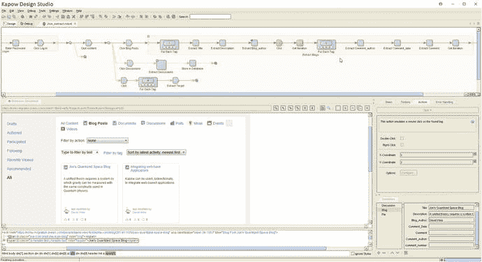

# 8. 总结性主题

现在你已经准备好开始自己的网页抓取项目了。本章通过提供一些总结性主题来收尾。首先，我们概述了你可能希望在网页抓取上下文中使用的其他有用工具和库，然后总结了网页抓取时需要考虑的最佳实践和技巧。

### 8.1 其他工具

#### 8.1.1 其他 Python 库

在本书中，我们一直使用`Python 3`以及 `requests`、`Beautiful Soup`和`Selenium`库。请记住，`Python`生态系统还提供了大量其他库来处理 `HTTP` 消息，例如内置的 `urllib` 模块，我们从中也使用了一些函数，但它可以处理所有 `HTTP` 相关的事务；`httplib2`（参见 https://github.com/httplib2/httplib2）；`urllib3`（参见 https://urllib3.readthedocs.io/）；`grequests`（参见 https://pypi.python.org/pypi/grequests）；以及 `aiohttp`（参见 http://aiohttp.readthedocs.io/）。

如果你不想使用`Beautiful Soup`，请记住`Beautiful Soup`库本身依赖一个`HTML`解析器来执行大部分繁重的解析工作。因此，如果你愿意，也可以直接使用这些更低级别的解析器。`Python`中的 `html.parser` 模块提供了这样一个解析器，我们已经将其用作`Beautiful Soup`的“引擎”，但它也可以直接使用，而 `lxml` 和 `html5lib` 是流行的替代方案。有些人最终更喜欢这种方法，因为可以认为`Beautiful Soup`增加的额外开销会导致速度变慢。这是事实，但我们发现，在大多数使用场景中，在抓取速度成为真正问题之前，你首先必须处理其他问题，例如，设置并行抓取机制。

#### 8.1.2 Scrapy

除了我们目前提到的库之外，`Python`生态系统中还有其他值得注意的抓取库。`Scrapy`（参见 https://scrapy.org/）是一个全面的 `Python` 库，用于爬取网站并从网站提取结构化数据，它也非常流行。它处理 `HTTP` 和 `HTML` 两方面的事情，并提供了一个命令行工具来快速设置、调试和部署网络爬虫。`Scrapy`是一个强大的工具，也值得学习，即使它的编程接口与 `requests` 和 `Beautiful Soup`或 `Selenium`有些不同——不过基于你已经学到的知识，这应该不会带来太多问题。特别是在你必须编写一个稳健的爬虫的情况下，看看`Scrapy`会很有帮助，因为它为重启脚本、并行爬取、数据收集等提供了许多合理的默认设置。使用`Scrapy`的主要优点是，可以很容易地将爬虫部署到“Scrapy Cloud”（参见 https://scrapinghub.com/scrapy-cloud），这是一个用于运行网络爬虫的云平台。这在你想在多个服务器上快速运行爬虫而无需自己托管这些服务器时非常有用，不过请注意，这项服务是收费的。另一种选择是将你的爬虫设置到`Amazon AWS`或`Google`的云平台上。`Scrapy`的一个显著缺点是它不能模拟完整的浏览器堆栈。因此，使用这个库处理 `JavaScript`会很麻烦。存在一个将“Splash”（一个`JavaScript`渲染服务）与`Scrapy`结合使用的插件，但这种方法的设置和维护有点繁琐。

#### 8.1.3 缓存

缓存是另一个值得讨论的有趣方面。到目前为止，我们还没有过多地讨论缓存，但值得注意的是，在构建网络爬虫时，实现一些客户端缓存解决方案是一个好主意，它会将获取的网页保存在“内存”中。这避免了持续不断地用请求猛攻 `Web` 服务器，这在脚本开发期间特别有用（在开发过程中，你经常会重启脚本以查看错误是否已修复、是否得到预期的结果等）。在这个背景下，一个非常值得关注的库是`CacheControl`（参见 http://cachecontrol.readthedocs.io/en/latest/），它可以通过 `pip` 简单地安装，并直接与 `requests` 一起使用，如下所示：

```python
import requests
from cachecontrol import CacheControl
session = requests.Session()
cached_session = CacheControl(session)
```

现在你可以像使用普通会话一样使用 `cached_session`

所有 `GET` 请求都会被缓存

#### 8.1.4 代理服务器

你也可以考虑在你的开发机上搭建一个本地 `HTTP` 代理服务器。`HTTP` 代理服务器作为 `HTTP` 请求的中介，其工作流程如下：客户端（如网页浏览器或 `Python` 程序）发送 `HTTP` 请求，但这次并非直接联系互联网上的网络服务器，而是先将请求发送给代理服务器。根据代理服务器的配置，它可能会在将请求转发至真实目标之前对其进行修改。

使用 `HTTP` 代理服务器有多种好处。首先，大多数代理服务器都包含检查 `HTTP` 请求和响应的选项，因此它们可以作为浏览器开发者工具的有力补充。其次，大多数代理服务器可以配置为启用缓存，将 `HTTP` 响应保存在内存中，这样后续的相似请求就不必多次联系最终目标服务器。最后，代理服务器也常用于匿名目的。请注意，目标网络服务器看到的 `HTTP` 请求是来自 `HTTP` 代理服务器的，而该代理服务器不一定运行在你的本地开发机上。因此，它们也被用作规避网络爬虫反制技术的一种手段——当网络服务器检测到来自同一台机器的请求过多时，你可能会被封锁。在这种情况下，你可以付费使用提供 `HTTP` 代理服务器池的服务（例如，参见 [`https://proxymesh.com/`](https://proxymesh.com/)），或者使用像`Tor`这样的匿名服务（参见 [`https://www.torproject.org/`](https://www.torproject.org/)），后者是免费的，但主要目的是提供匿名性，可能不太适合网络爬虫，因为`Tor`通常速度较慢，并且许多网络爬虫反制措施也会维护`Tor`的“出口节点”列表并将其封锁。如果想了解一些靠谱的 `HTTP` 代理服务器实现，可以看看`Squid`（[`http://www.squid-cache.org/`](http://www.squid-cache.org/)）或`Fiddler`（[`https://www.telerik.com/fiddler`](https://www.telerik.com/fiddler/)）。

#### 8.1.5 使用其他编程语言进行爬取

从 `Python` 转向其他语言时，值得一提的是，`Selenium` 也为其他多种编程语言提供了库，其中 `Java` 是该项目的另一个主要目标语言。如果你在使用 `R` 语言（另一种流行的数据科学语言），一定要看看`rvest`库（参见[`https://cran.r-project.org/web/packages/rvest/`](https://cran.r-project.org/web/packages/rvest/)），它的设计灵感来自 `Beautiful Soup` 等库，可以让你轻松地从 `R` 语言的 HTML 页面中抓取数据。最近，`JavaScript` 越来越受关注，并且作为一种服务器端脚本语言也越来越可行，这也催生了大量用于该语言的强大爬虫库。`PhantomJS` 已成为一个非常流行的选择（参见[`http://phantomjs.org/`](http://phantomjs.org/)），它模拟了一个完整的“无头”浏览器（并且也可以作为 `Selenium` 的“驱动程序”）。由于 `PhantomJS` 代码可能有些冗长，像 `Nightmare` 这样的其他库（参见[`http://www.nightmarejs.org/`](http://www.nightmarejs.org/)）被提出来，它在 `PhantomJS` 之上提供了一个更友好、更高层次的 API。该领域的其他有趣项目还有 `SlimerJS`（参见[`https://slimerjs.org/`](https://slimerjs.org/)），它与 `PhantomJS` 类似，区别在于它运行在 Gecko（`Mozilla Firefox` 的浏览器引擎）之上，而非 Webkit。`CasperJS` 是另一个高级库（参见[`http://casperjs.org/`](http://casperjs.org/)），它可以与 `PhantomJS` 或 `SlimerJS` 配合使用。另一个近期有趣的项目是 `Puppeteer`（参见[`https://github.com/GoogleChrome/puppeteer`](https://github.com/GoogleChrome/puppeteer)），这是一个提供高级 API 来控制无头 `Chrome` 浏览器的库。受 `PhantomJS` 流行的驱动，`Chrome` 开发者投入了大量精力来提供其浏览器的无头版本。到目前为止，大多数依赖完整浏览器的网络爬虫部署要么使用已经无头但与真实浏览器略有差异的 `PhantomJS`；要么使用 `Firefox` 或 `Chrome` 驱动程序配合虚拟显示器，例如在 Linux 上使用`Xvfb`。现在，随着真正无头版本的 `Chrome` 变得越来越稳定，它正在成为 `PhantomJS` 的有力竞争者，特别是因为这种无头 `Chrome` 设置也可以用作 `Selenium` 的驱动程序。`PhantomJS` 的前维护者 `Vitaly Slobodin` 已经表示：“人们最终会转向它的。`Chrome` 比 `PhantomJS` 更快、更稳定。而且它不会疯狂地消耗内存。” 2018 年 3 月，`PhantomJS` 的维护者宣布该项目将停止接受后续更新，并敦促用户转而使用 `Puppeteer`（参见[`https://github.com/ariya/phantomjs/issues/15344`](https://github.com/ariya/phantomjs/issues/15344)）。将 `Puppeteer` 与 `Python` 和 `Selenium` 结合使用仍有些“前沿”，但确实可行。如果你对这种方法感兴趣，可以看看[`https://intoli.com/blog/running-selenium-with-headless-chrome/`](https://intoli.com/blog/running-selenium-with-headless-chrome/)。

### 8.1.6 命令行工具

同样值得一提的是，一些有用的命令行工具在调试网络爬虫和与 HTTP 服务器的交互时会派上用场。`HTTPie`（参见[`https://httpie.org/`](https://httpie.org/)）是一个命令行工具，拥有漂亮的输出，并支持表单数据、会话和 JSON，这使得该工具在调试 Web API 时也非常有用。

`cURL`是一个较老的命令行工具，功能非常丰富且健壮，支持的范围远不止 HTTP（参见[`https://curl.haxx.se/`](https://curl.haxx.se/)）。该工具与 `Chrome` 的开发者工具配合得特别好，你可以在“网络”标签页中右键点击任意请求，然后选择“复制为 cURL”。这会将一条命令复制到你的剪贴板，将其粘贴到命令行窗口中后，它会执行与 `Chrome` 完全相同的请求，并且应该会为你提供相同的结果。如果你在困难的调试会话中卡住了，检查这条命令可能会给出一些线索，告诉你 `Python` 脚本中遗漏了哪个请求头或 cookie。

### 8.1.7 图形化抓取工具

最后，我们还需要简要讨论一下图形化抓取工具。这些工具既可以作为独立程序提供，也可以通过浏览器插件提供。其中一些提供免费版本，例如 `Portia`（[`https://portia.scrapinghub.com`](https://portia.scrapinghub.com)）或 `Parsehub`（[`https://www.parsehub.com`](https://www.parsehub.com)），而其他工具，如 `Kapow`（[`https://www.kofax.com/data-integration-extraction`](https://www.kofax.com/data-integration-extraction)）、`Fminer`（[`http://www.fminer.com/`](http://www.fminer.com/)）和 `Dexi`（[`https://dexi.io/`](https://dexi.io/)）则是商业产品。此类工具的功能集略有不同。有些侧重于其产品的用户友好性，“只需给我们一个 URL，我们就会像变魔术一样提取出有趣的数据。”这很好，但基于你目前所学的知识，你可以用更健壮（甚至可能更快）的方式复现相同的行为。正如我们所看到的，提取表格和链接列表是很容易的。通常情况下，一旦页面中的数据以一种不太直接的方式结构化，或者页面依赖 `JavaScript`，这些工具就会失效。价格较高的产品会相对更健壮一些。这些工具通常会模拟一个完整的浏览器实例，并允许你通过拖放和配置各种步骤，采用面向工作流的方法来编写抓取器。图 8-1 展示了 `Kapow` 的截图，它采用了这种方法。这种方法虽然更好，但也带来了一些缺点。首先，许多此类产品价格相当昂贵，这使得它们不太适合用于实验、概念验证或较小的项目。其次，元素通常基于用户简单地点击他们想要检索的条目来从页面中获取。后台所做的是构建一个 CSS 选择器或 XPath 规则，以匹配所选元素。这本身没问题（我们也在脚本中这样做过），但请注意，在微调这条规则方面，程序不如人类程序员聪明。在许多情况下，会构建一个非常细粒度、具体的规则，一旦网站返回结构略有不同的结果，或网页进行了更新，这条规则就会失效。正如用 `Python` 编写的抓取器一样，你必须记住，如果你希望长期使用这些抓取器，你仍然需要维护你的抓取器集合。图形化工具并不能为你解决这个问题，甚至可能导致抓取器更快地失效，因为底层构建的“规则”可能非常具体。许多工具允许你手动更改选择器规则，但要做到这一点，你必须学习它们的工作原理，而采用面向编程的方法可能很快就会变得更具吸引力。最后，根据我们使用这些工具的经验，我们还注意到它们包含的浏览器栈并不总是那么健壮或新潮。我们见过各种案例，其中内部浏览器在遇到大量使用 `JavaScript` 的页面时直接崩溃。



图 8-1 一个图形化网页抓取工具示例

### 8.2 最佳实践与建议

在本章的不同场合，我们提供了一些建议。通过以下概述，我们提供了一系列最佳实践，总结你在构建网页抓取器时应牢记的要点：

- 优先考虑 `API`：始终首先检查你要抓取的网站是否提供 API。如果没有，或者它没有提供你想要的信息，或者它实施了速率限制，那么你可以决定改为使用网页抓取器。

- 不要手动解析 `HTML`：使用诸如 `Beautiful Soup` 之类的解析器，而不是尝试手动梳理混乱的 HTML 代码或使用正则表达式。

- 行为要规范：不要向一个网站密集发送成百上千个 HTTP 请求，因为这样你最终被屏蔽的可能性很高。考虑联系网站站长，并找出一种合作方式。

- 考虑用户代理和引用来源：记住 `User-Agent` 和 `Referer` 请求头。许多网站会检查这些信息以防止抓取或未经授权的访问。

- Web 服务器很挑剔：无论是 URL 参数、请求头还是表单数据，一些 Web 服务器对于它们的顺序、存在性和取值有着非常挑剔和奇怪的要求。有些甚至可能偏离 HTTP 标准。


