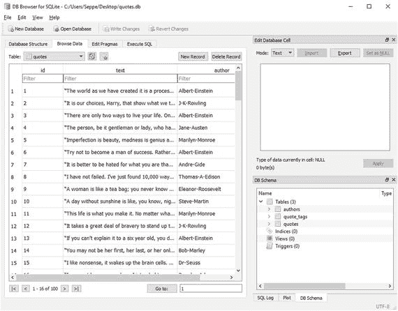
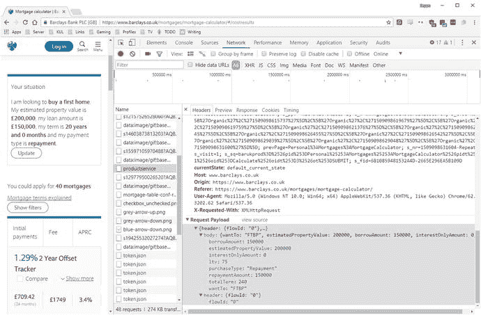
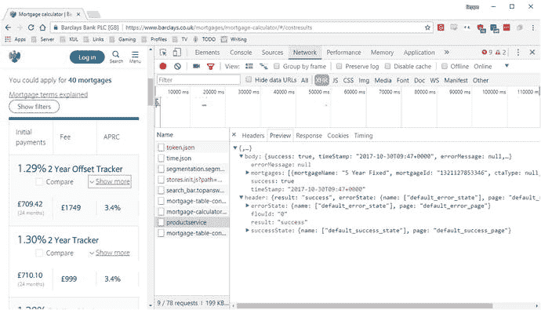
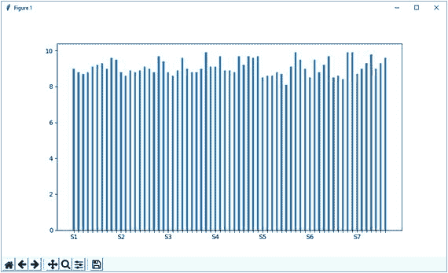
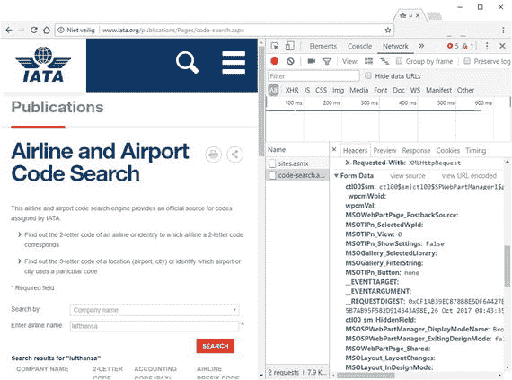

# 第三部分：管理问题与最佳实践

## 7. 管理与法律问题

到目前为止，我们一直非常关注本书中“网页抓取”的部分。现在，我们退后一步，将你学到的概念与数据科学的一般领域联系起来，特别关注在你计划将网页抓取纳入数据科学项目时会出现的管理问题。本章还深入讨论了网页抓取的法律方面问题。

### 7.1 数据科学流程

作为一名数据科学家（或渴望成为数据科学家的人），你可能已经体会到“数据科学”确实已经成为一个非常过载的术语。公司正在逐渐认识到，数据科学包含了非常广泛的技能组合，几乎不可能在一个人身上全部找到，因此需要一个多学科团队，包括：

-   基础理论家、数学家、统计学家（例如：回归分析、贝叶斯建模、线性代数、奇异值分解等）。
-   数据整理者（例如：熟悉 SQL、Python 的 `pandas` 库和 R 语言的 `dplyr` 的人）。
-   分析师和建模师（例如：使用 R 或 SAS 构建随机森林或神经网络模型）。
-   数据库管理员（例如：DB2 或 MSSQL 专家，对数据库和 SQL 有扎实理解的人）。
-   商业智能专家（例如：负责报表和仪表板，以及数据仓库和 OLAP 立方体）。
-   IT 架构师和“开发运维”人员（例如：维护建模环境、工具和平台的人）。
-   大数据平台专家（例如：熟悉 Hadoop、Hive 和 Spark 的人）。
-   “黑客”类型（例如：熟悉命令行的人，什么都懂一点，行动迅速，能够打破常规）。
-   业务整合者、赞助者和支持者（例如：知道如何将业务问题转化为数据需求和建模任务，并能将结果反馈给利益相关者，以及能在组织中强调数据和数据科学重要性的人）。
-   管理层（例如：将数据重点提上议程，并使其渗透到组织各层级的上级领导）。
-   当然，还有……网页抓取者（例如：你到目前为止所学的内容）。

数据科学和分析学继续快速发展。当前围绕人工智能和深度学习的炒作，又催生了组织正在寻找的另一套技能。

无论如何，数据科学是关于以扎实的方式从数据中提取价值，认识到数据在变得有价值之前需要大量利益相关者的处理和努力。因此，数据科学作为一种组织活动，通常通过“流程”来描述：这是一个工作流，描述了数据科学项目中必须采取的步骤，无论是构建预测模型来预测谁将流失、哪些客户会对营销活动做出积极反应、客户细分任务，还是简单地自动创建列出一些描述性统计数据的定期报告。原始来源就是数据。已经提出了许多这样的流程框架，其中 CRISP-DM 和 KDD（数据库知识发现）流程是当今最流行的两种。


**图 7-1** CRISP-DM 流程

CRISP-DM 代表“跨行业数据挖掘标准流程”。KDnuggets（https://www.kdnuggets.com/）在过去十年进行的调查显示，它是行业数据挖掘者和数据科学家使用的主要方法论。图 7-1 展示了描述 CRISP-DM 流程的图表。

CRISP-DM 之所以受欢迎，是因为它明确强调了数据科学的循环性质：如果项目结果与你预期或希望的相符，你通常必须回到起点寻找新的数据源。KDD 流程比 CRISP-DM 稍旧一些，描述了非常相似的步骤（更像是一条直线路径，但同样要记住，有时回退几步也可能是必要的）。它包括：

-   **识别业务问题：** 类似于 CRISP-DM 中的“业务理解”步骤，第一步是对业务问题进行彻底定义。一些例子：抵押贷款组合的客户细分、后付费电信订阅的保留建模、或信用卡欺诈检测。定义分析建模练习的范围需要数据科学家和业务专家之间的密切合作。两者需要就一组关键概念达成一致，例如：我们如何定义客户、交易、流失、欺诈等；我们要预测什么（我们如何定义这个）；以及我们何时对结果感到满意。

-   **识别数据源：** 接下来，需要识别所有可能具有潜在兴趣的源数据。这是一个非常重要的步骤，因为数据是任何分析工作的关键要素，并且数据的选择对后续步骤中构建的分析模型具有决定性的影响。

-   **选择数据：** 这里的一般黄金法则是：数据越多越好，尽管与当前问题无关的数据源应在此步骤中丢弃。然后将所有合适的数据收集在临时区域，并整合到数据仓库、数据集市，甚至是一个简单的电子表格文件中。

-   **清洗数据：** 在收集数据后，会进行一系列漫长的预处理和数据整理步骤，以消除所有不一致之处，例如缺失值、异常值和重复数据。

-   **转换数据：** 预处理步骤通常还包括一个冗长的转换部分。可以考虑额外的转换，例如字母数字到数字的编码、地理聚合、改善对称性的对数变换，以及其他巧妙的“特征化”方法。

-   **分析数据：** 上述步骤对应于 CRISP-DM 中的“数据理解”和“数据准备”步骤。一旦数据被充分清洗和处理，就可以开始实际的分析和建模（在 CRISP-DM 中称为“建模”）。在这里，基于预处理和转换后的数据评估一个分析模型。根据业务问题，数据科学家将选择并实施特定的分析技术。

-   **解释、评估和部署模型：** 最后，一旦模型构建完成，将由业务专家对其进行解释和评估（在 CRISP-DM 中称为“评估”）。分析模型可能检测到的微不足道的模式和洞察仍然可能很有趣，因为它们提供了对模型的验证。但是，当然，关键的挑战是找到未知的、但有趣且可操作的模式，这些模式可以为你的数据提供新的见解。一旦分析模型得到适当的验证和批准，它就可以作为分析应用程序（例如，决策支持系统、评分引擎等）投入生产。重要的是要考虑如何以用户友好的方式呈现模型输出，如何将其与其他应用程序集成（例如，营销活动管理工具、风险引擎等），以及如何确保持续地适当监控分析模型。通常，分析模型的部署需要 IT 专家的支持，他们将帮助“生产化”该模型。

### 7.2 网页抓取如何融入其中？

数据科学流程中有多个部分可以融入网页抓取。然而，在大多数项目中，网页抓取将成为数据源识别和选择的重要部分。也就是说，用于收集和汇总你可以纳入数据集以进行建模的数据。

在这里提供一个警告很重要，即始终牢记你构建的模型的生产环境（“模型训练”与“模型运行”的差距）。如果你构建模型是一个一次性项目，用于描述或发现一些有趣的模式，那么请随意使用尽可能多的抓取数据和外部数据。然而，如果模型将被生产化为预测分析应用程序，请记住，模型在部署时需要能够访问与训练时相同的变量。因此，你需要仔细考虑在这样的设置中纳入抓取的数据源是否可行，因为需要确保相同的源仍然可用，并且能够在你推进的过程中继续抓取它们。网站可能会发生变化，而依赖于网页抓取的数据收集部分需要大量的维护工作，以便及时实施修复或更改。在这些情况下，你可能仍希望依赖更稳健的解决方案，例如 API。根据你的项目，这个要求或多或少会带来麻烦。例如，如果你抓取的数据是指“在整整一年内都保持有效”的汇总数据，那么你当然可以在部署运行模型时继续使用收集到的数据（并例如在一年结束前安排好数据刷新）。始终牢记模型的生产环境：在应用和使用模型时，你也能访问所需的数据吗？还是只在模型训练期间才能访问？谁将负责确保这种数据访问？该模型只是一个保质期有限的 Proof of Concept，还是将在未来几年内使用和维护？

在某些情况下，网页抓取部分将构成数据科学项目的主要组成部分。这在以下情况中很常见：基于抓取结果构建一些基本统计数据和也许一个吸引人的可视化，以便以用户友好的方式呈现发现并探索收集到的数据。尽管如此，这里仍然必须问同样的问题：这是一份使用时间有限的一次性报告，还是人们希望持续更新并长期使用的东西？

你回答这些问题的方式将对网络爬虫的设置产生重大影响。如果你只需要通过网页抓取快速收集结果，用于一个快速 Proof of Concept、一个描述性模型或一份一次性报告，那么你可以为了快速获取数据而牺牲稳健性。如果抓取的数据也将在生产中使用（就像每年汇总的信息那样），那么抓取结果仍然可行，尽管最好提前考虑下次需要刷新数据集的时间，并尽可能使你的设置稳健且文档齐全。如果每次运行模型时都必须抓取信息，那么“抓取”部分实际上就成了部署设置的一部分，随之而来的是关于监控、维护和错误处理的所有头疼问题。确保提前就哪些团队负责此事达成一致！

我们想在这里提供另外两个“管理警告”。一个与数据质量有关。如果你在组织环境中处理过数据，你无疑听说过 GIGO 原则：垃圾进，垃圾出。当你依赖万维网收集数据时——伴随着所有的混乱和非结构化——准备好接受数据质量方面的“打击”。确实，在你的爬虫中加入尽可能多的清理和故障安全措施至关重要，但你几乎总是最终会遇到一个页面，其中出现了一个意料之外的额外 HTML 标签，或者你期望的文本不在那里，或者某些东西的格式略有不同。最后一个警告与可靠性有关。事实上，同样的观点不仅适用于网页抓取，也适用于 API。在过去的几年里，出现了许多有前途的初创公司，它们利用 Twitter、Facebook 或其他一些 API 来提供出色的服务。如果该网站的提供者或所有者决定提高他们对其他人提供服务的价格，会发生什么？如果他们停止提供服务，会发生什么？许多产品仅仅因为其提供者改变了规则就消失了。总的来说，使用外部数据通常被视为灵丹妙药——“要是我们能得到 Facebook 拥有的信息就好了！”——但在被这样的想法冲昏头脑之前，要仔细思考并考虑所有可能的结果。

### 7.3 法律问题

几年前，在 2015 年，一家名为 hiQ Labs 的美国年轻初创公司被《经济学人》报道，解释了他们在人力资源分析方面的新颖方法，这是当时迅速获得更多关注的数据科学应用领域，并且至今仍然势头强劲。其想法是利用大量数据集来帮助企业了解失去一名高级员工的成本、预测谁将离开公司，以及谁将是潜在新员工中的顶级候选人。2017 年 8 月，有消息透露，hiQ Labs 拥有并正在收集的大部分“海量数据集”源自微软旗下的 LinkedIn。

可以理解，LinkedIn 和微软的高管们对这种状况不太满意。他们认为这些数据属于 LinkedIn，因此发送了停止函，要求 hiQ 停止抓取 LinkedIn 的数据，并实施了各种技术措施来阻止 hiQ Labs 的爬虫。

这家初创公司以诉讼回击，要求 LinkedIn 拆除其为阻止 hiQ 使用数据而建立的技术障碍。LinkedIn 试图辩称，hiQ Labs 通过抓取数据违反了 1986 年的《计算机欺诈与滥用法》（CFAA 是在类似案件中经常被引用的法律条款）。法官不同意，他担心 LinkedIn“正在不公平地利用其在职业社交网络市场中的权力，以达到反竞争目的”（hiQ 提供了证据，表明 LinkedIn 正在开发自己的 hiQ 人才监控管理软件版本），甚至将 LinkedIn 的论点比作允许网站所有者“基于种族或性别歧视来阻止个人或群体访问”。法院解释说，“用户不会因为使用爬虫访问计算机而构成未经授权访问，即使面对技术反制措施，只要其访问的数据对公众是开放的。”

此案带来的公众关注无疑对 hiQ 有利，并吸引了更多潜在客户（参见 https://www.bloomberg.com/news/features/2017-11-15/the-brutal-fight-to-mine-your-data-and-sell-it-to-your-boss）。虽然对于担心网页抓取法律问题的公司和个人来说，这个故事听起来很有希望，但这里必须指出两点重要内容。首先，该裁决是作为初步禁令作出的，在撰写本文时，这可能不是最终结果，因为 LinkedIn 已宣布将向美国第九巡回上诉法院提起诉讼。其次，“数据对公众开放”存在一些主观性。在这个特定案例中，hiQ 被允许抓取 LinkedIn 个人资料中无需登录服务即可访问的任何数据，即 LinkedIn 会员指定为公开可见的信息。目前尚不清楚相同的裁决是否适用于要求用户登录的页面。这为旨在保护其数据的数据巨头留下了一个简单的漏洞。例如，Facebook 一直要求用户登录才能查看其信息，即使对于已将其信息标记为“公开”的个人资料也是如此。

2014 年，另一家提供购物应用的初创公司 Resultly 通过抓取各种零售商来构建商品目录，意外地使电视零售商 QVC 的服务器过载，导致停机，据 QVC 称，这使他们损失了 200 万美元的收入。同样，QVC 也基于《计算机欺诈与滥用法》寻求初步禁令。然而，法院也裁定“Resultly 不是 QVC 的竞争对手，不是心怀不满的 QVC 员工，也不是旨在损害 QVC 服务器的不满的 QVC 客户”，因此这家初创公司缺乏意图损害 QVC 系统的必要条件。法院还指出，QVC 使用了 Akamai 的缓存服务，因此 Resultly 的爬虫访问的是 Akamai 的服务器，而不是 QVC 的。

其他一些法庭案件对抓取方来说结果并不那么理想：

-   **美联社诉 Meltwater 案：** 媒体监控公司 Meltwater 一直在爬取美联社的网站，并提取和重新发布了美联社新闻文章中的大量文本。Meltwater 声称其行为符合版权法的合理使用规定，但法院判决美联社胜诉。

-   **Ticketmaster 诉 Riedel Marketing Group (RMG) 案：** RMG 一直在抓取 Ticketmaster 的网站，以便大量获取热门门票进行转售。Ticketmaster 辩称，RMG 同意了网站的服务条款但却无视了它们，法院认定 RMG 侵犯了 Ticketmaster 的版权材料。

-   **Craigslist 诉 Naturemarket 案：** Naturemarket 从 Craigslist 的网站上抓取电子邮件地址。Craigslist 起诉，声称版权侵权、违反《计算机欺诈与滥用法》以及违反使用条款。法院判决 Craigslist 获得超过一百万美元的赔偿。

-   **Ryanair Ltd 诉 PR Aviation BV 案：** 欧洲法院裁定，公开可用数据库的所有者，如果不属于数据库指令保护范围，则有权通过其网站上的合同条款来限制数据的使用。PR Aviation 从 Ryanair 的网站上提取数据，以便比较价格并在支付佣金后预订航班。Ryanair 要求任何访问其网站航班数据的人勾选一个框以接受其条款和条件，其中包括未经航空公司许可，禁止为商业目的自动从其网站提取数据。法院认定 Ryanair 可以自由地对其数据库的使用设置合同限制，因此判决其胜诉。

-   **2006 年，谷歌与比利时媒体公司 Copiepresse 陷入了一场长期的法律斗争：** 比利时初审法院发出禁止令，指出 Copiepresse 曾请求法院基于版权侵权的担忧，命令谷歌从其谷歌新闻网站中撤下其比利时出版物的所有文章、照片和图形，并且该服务还绕过了出版商从这些广告中获得相当一部分收入的广告位。基于这些认定，法院认为 Copiepresse 的诉求可予受理，并命令谷歌从其所有网站中撤下 Copiepresse 的内容。谷歌对判决提出上诉，但作为报复，也连续几个月在其主搜索引擎中停止引用这些报纸的网站（因为判决书中提到了“谷歌的所有网站”）。这导致了 Copiepresse 和谷歌之间的一场丑陋争斗，最终双方在 2011 年达成协议，将这些网站重新纳入索引。

-   **在美国的一个相关案件中，上诉法院第二巡回法庭认为，谷歌对数百万本书的扫描实际上属于合理使用，尽管这些作品受版权保护，因为其行为在合理使用原则下具有变革性：** 法院还确认事实不受版权保护，这表明从网站抓取事实数据本身并不构成侵权。

-   **Facebook 诉 Power Ventures 案：** Facebook 还声称被告违反了《计算机欺诈与滥用法》和《CAN-SPAM 法案》，后者是一项禁止发送带有实质误导性信息的商业电子邮件的联邦法律。法官判决原告胜诉。

-   **LinkedIn 诉 Doe 被告案：** LinkedIn（再次）对数百名未具名的个人提起诉讼，指控他们使用爬虫从其网站收集用户资料。此案仍在进行中，Scraping Hub（为被告提供抓取服务的公司）已被传唤出庭。

这样的案例不胜枚举。显而易见的是，围绕网页抓取的法律环境仍在演变，许多被指控违反的法律在我们的数字时代尚未成熟。在美国，大多数法庭案件涉及以下一种侵权或责任理论：

-   **违反条款和条件：** 大多数网站在其页面上发布条款和条件或最终用户许可协议，通常明确涉及通过爬虫访问其网站的问题。这旨在通过在网站所有者和爬虫之间建立合同，从而产生违约责任。然而，在网站上发布此类条款可能不足以证明爬虫违反了网站条款，因为爬虫方面没有主动接受。看起来更具可执行性的是使用明确的复选框或“我接受”链接，网络爬虫必须主动点击才能接受条款。对于登录网站以访问非公共区域的抓取应用程序也是如此，因为创建相关帐户通常也包含对条款的明确同意。

-   **版权或商标侵权：** 在美国，法律原则“合理使用”允许在某些条件下，无需版权持有人的明确许可，有限地使用受版权保护的材料。用于戏仿、批评、评论或学术研究等目的被视为合理使用。然而，大多数对版权材料的商业用途不属于这一原则。

-   **计算机欺诈与滥用法案 (CFAA)：** 美国有几项联邦和州法律禁止黑客入侵或未经授权访问他人计算机。CFAA 规定，“未经授权故意访问计算机……并因此鲁莽地造成损害”的人基本上属于违规，特别是如果被侵害的网站能够证明损失或损害。

-   **非法侵入动产：** 这是一个指民事过错的术语，意味着一个实体干涉了另一个实体的个人财产，导致价值损失或损害。在网页抓取案件中，有时也被用作侵权理论，例如在 1999 年的 eBay 诉 Bidder's Edge 案中。

-   **爬虫排除协议：** 这是一个行业标准，允许网站嵌入一个 `robots.txt` 文件，向网络爬虫传达指令，表明哪些爬虫可以访问该站点以及它们可以访问哪些页面。然而，它的法律价值有限，但在你的网页抓取脚本中检查此文件可能是一个好主意，以确认网站所有者是否希望阻止爬虫。

-   **数字千年版权法案 (DMCA)、CAN-SPAM 法案：** 这些法案在某些情况下也被纳入网页抓取的法庭案件中。

欧盟的情况受不同的立法和法律体系管辖，但许多相同的原则适用，例如与服务条款或版权作品相关的原则。欧盟的大多数网站和数据库所有者倾向于依靠版权侵权索赔来应对屏幕抓取者。其他一些关键规定包括：

-   **1996 年欧盟数据库指令：** 该指令为不受知识产权保护的数据集的创建者提供法律保护，以便数据库要素中不属于作者原始创作的部分也受到保护。具体来说，它提供了保护，条件是“在获取、验证或呈现内容方面进行了实质性的定性和/或定量投资”。欧洲法院在 2015 年涉及 Ryanair 的案例中的裁决极大地增强了网站运营商的能力，使其能够在其内容不受数据库指令保护时，通过合同条款和条件来保护其内容。

-   **计算机滥用法案和非法侵入动产：** 除了知识产权侵权外，理论上网站所有者还有其他针对网页抓取的法律论据。与美国一样，在英国，网站所有者可以尝试根据普通法提出非法侵入动产的侵权索赔。英国网站所有者也可以寻求依赖 1990 年的《计算机滥用法案》，该法案禁止未经授权访问或修改计算机资料。

很明显，网页抓取，尤其是大规模或出于商业目的的抓取，会带来复杂的法律影响。因此，建议在开展此类项目之前，始终咨询律师、合适的专家或合规官，并牢记以下关键原则：

-   **获得书面许可：** 避免法律问题的最佳方法是获得网站所有者的书面许可，明确说明你可以抓取哪些数据以及达到何种程度。

-   **检查使用条款：** 这些条款通常包含明确禁止自动提取数据的规定。通常，网站的 API 会附带其自己的使用条款，涉及使用方式，你也应该检查这些条款。

-   **仅限公开信息：** 如果网站公开暴露信息，没有明确要求接受条款和条件，适度的抓取很可能没问题。然而，需要你登录的网站则是另一回事。

-   **不要造成损害：** 抓取时要友善！不要用大量请求猛攻网站，使其网络过载并妨碍其正常使用。远离受保护的计算机，不要试图访问你未被授权访问的服务器。

-   **版权与合理使用：** 版权法似乎为原告提供了最强有力的诉讼依据。仔细检查你的抓取案例是否属于合理使用，不要在商业项目中使用受版权保护的作品。

## 8. 总结性主题

现在你已经准备好开始自己的网页抓取项目了。本章通过提供一些总结性主题来收尾。首先，我们概述了你可能希望在网页抓取上下文中使用的其他有用工具和库，然后总结了网页抓取时需要考虑的最佳实践和技巧。

### 8.1 其他工具

#### 8.1.1 其他 Python 库

在本书中，我们一直使用 Python 3 以及 `requests`、Beautiful Soup 和 Selenium 库。请记住，Python 生态系统还提供了大量其他库来处理 HTTP 消息，例如内置的 `urllib` 模块，我们从中也使用了一些函数，但它可以处理所有 HTTP 相关的事务；`httplib2`（参见 https://github.com/httplib2/httplib2）；`urllib3`（参见 https://urllib3.readthedocs.io/）；`grequests`（参见 https://pypi.python.org/pypi/grequests）；以及 `aiohttp`（参见 http://aiohttp.readthedocs.io/）。

如果你不想使用 Beautiful Soup，请记住 Beautiful Soup 库本身依赖一个 HTML 解析器来执行大部分繁重的解析工作。因此，如果你愿意，也可以直接使用这些更低级别的解析器。Python 中的 `html.parser` 模块提供了这样一个解析器，我们已经将其用作 Beautiful Soup 的“引擎”，但它也可以直接使用，而 `lxml` 和 `html5lib` 是流行的替代方案。有些人最终更喜欢这种方法，因为可以认为 Beautiful Soup 增加的额外开销会导致速度变慢。这是事实，但我们发现，在大多数使用场景中，在抓取速度成为真正问题之前，你首先必须处理其他问题，例如，设置并行抓取机制。

#### 8.1.2 Scrapy

除了我们目前提到的库之外，Python 生态系统中还有其他值得注意的抓取库。Scrapy（参见 https://scrapy.org/）是一个全面的 Python 库，用于爬取网站并从网站提取结构化数据，它也非常流行。它处理 HTTP 和 HTML 两方面的事情，并提供了一个命令行工具来快速设置、调试和部署网络爬虫。Scrapy 是一个强大的工具，也值得学习，即使它的编程接口与 `requests` 和 Beautiful Soup 或 Selenium 有些不同——不过基于你已经学到的知识，这应该不会带来太多问题。特别是在你必须编写一个稳健的爬虫的情况下，看看 Scrapy 会很有帮助，因为它为重启脚本、并行爬取、数据收集等提供了许多合理的默认设置。使用 Scrapy 的主要优点是，可以很容易地将爬虫部署到“Scrapy Cloud”（参见 https://scrapinghub.com/scrapy-cloud），这是一个用于运行网络爬虫的云平台。这在你想在多个服务器上快速运行爬虫而无需自己托管这些服务器时非常有用，不过请注意，这项服务是收费的。另一种选择是将你的爬虫设置到 Amazon AWS 或 Google 的云平台上。Scrapy 的一个显著缺点是它不能模拟完整的浏览器堆栈。因此，使用这个库处理 JavaScript 会很麻烦。存在一个将“Splash”（一个 JavaScript 渲染服务）与 Scrapy 结合使用的插件，但这种方法的设置和维护有点繁琐。

#### 8.1.3 缓存

缓存是另一个值得讨论的有趣方面。到目前为止，我们还没有过多地讨论缓存，但值得注意的是，在构建网络爬虫时，实现一些客户端缓存解决方案是一个好主意，它会将获取的网页保存在“内存”中。这避免了持续不断地用请求猛攻 Web 服务器，这在脚本开发期间特别有用（在开发过程中，你经常会重启脚本以查看错误是否已修复、是否得到预期的结果等）。在这个背景下，一个非常值得关注的库是 CacheControl（参见 http://cachecontrol.readthedocs.io/en/latest/），它可以通过 pip 简单地安装，并直接与 `requests` 一起使用，如下所示：

```python
import requests
from cachecontrol import CacheControl
session = requests.Session()
cached_session = CacheControl(session)
```


##### 你现在可以像使用普通会话一样使用 `cached_session`

所有 GET 请求都会被缓存

#### 8.1.4 代理服务器

你也可以考虑在你的开发机上搭建一个本地 HTTP 代理服务器。HTTP 代理服务器作为 HTTP 请求的中介，其工作流程如下：客户端（如网页浏览器或 Python 程序）发送 HTTP 请求，但这次并非直接联系互联网上的网络服务器，而是先将请求发送给代理服务器。根据代理服务器的配置，它可能会在将请求转发至真实目标之前对其进行修改。

使用 HTTP 代理服务器有多种好处。首先，大多数代理服务器都包含检查 HTTP 请求和响应的选项，因此它们可以作为浏览器开发者工具的有力补充。其次，大多数代理服务器可以配置为启用缓存，将 HTTP 响应保存在内存中，这样后续的相似请求就不必多次联系最终目标服务器。最后，代理服务器也常用于匿名目的。请注意，目标网络服务器看到的 HTTP 请求是来自 HTTP 代理服务器的，而该代理服务器不一定运行在你的本地开发机上。因此，它们也被用作规避网络爬虫反制技术的一种手段——当网络服务器检测到来自同一台机器的请求过多时，你可能会被封锁。在这种情况下，你可以付费使用提供 HTTP 代理服务器池的服务（例如，参见[`https://proxymesh.com/`](https://proxymesh.com/)），或者使用像 Tor 这样的匿名服务（参见[`https://www.torproject.org/`](https://www.torproject.org/)），后者是免费的，但主要目的是提供匿名性，可能不太适合网络爬虫，因为 Tor 通常速度较慢，并且许多网络爬虫反制措施也会维护 Tor 的“出口节点”列表并将其封锁。如果想了解一些靠谱的 HTTP 代理服务器实现，可以看看 Squid（[`http://www.squid-cache.org/`](http://www.squid-cache.org/)）或 Fiddler（[`https://www.telerik.com/fiddler`](https://www.telerik.com/fiddler/)）。

#### 8.1.5 使用其他编程语言进行爬取

从 Python 转向其他语言时，值得一提的是，Selenium 也为其他多种编程语言提供了库，其中 Java 是该项目的另一个主要目标语言。如果你在使用 R 语言（另一种流行的数据科学语言），一定要看看“rvest”库（参见[`https://cran.r-project.org/web/packages/rvest/`](https://cran.r-project.org/web/packages/rvest/)），它的设计灵感来自 Beautiful Soup 等库，可以让你轻松地从 R 语言的 HTML 页面中抓取数据。最近，JavaScript 越来越受关注，并且作为一种服务器端脚本语言也越来越可行，这也催生了大量用于该语言的强大爬虫库。PhantomJS 已成为一个非常流行的选择（参见[`http://phantomjs.org/`](http://phantomjs.org/)），它模拟了一个完整的“无头”浏览器（并且也可以作为 Selenium 的“驱动程序”）。由于 PhantomJS 代码可能有些冗长，像 Nightmare 这样的其他库（参见[`http://www.nightmarejs.org/`](http://www.nightmarejs.org/)）被提出来，它在 PhantomJS 之上提供了一个更友好、更高层次的 API。该领域的其他有趣项目还有 SlimerJS（参见[`https://slimerjs.org/`](https://slimerjs.org/)），它与 PhantomJS 类似，区别在于它运行在 Gecko（Mozilla Firefox 的浏览器引擎）之上，而非 Webkit。CasperJS 是另一个高级库（参见[`http://casperjs.org/`](http://casperjs.org/)），它可以与 PhantomJS 或 SlimerJS 配合使用。另一个近期有趣的项目是 Puppeteer（参见[`https://github.com/GoogleChrome/puppeteer`](https://github.com/GoogleChrome/puppeteer)），这是一个提供高级 API 来控制无头 Chrome 浏览器的库。受 PhantomJS 流行的驱动，Chrome 开发者投入了大量精力来提供其浏览器的无头版本。到目前为止，大多数依赖完整浏览器的网络爬虫部署要么使用已经无头但与真实浏览器略有差异的 PhantomJS；要么使用 Firefox 或 Chrome 驱动程序配合虚拟显示器，例如在 Linux 上使用`Xvfb`。现在，随着真正无头版本的 Chrome 变得越来越稳定，它正在成为 PhantomJS 的有力竞争者，特别是因为这种无头 Chrome 设置也可以用作 Selenium 的驱动程序。PhantomJS 的前维护者 Vitaly Slobodin 已经表示：“人们最终会转向它的。Chrome 比 PhantomJS 更快、更稳定。而且它不会疯狂地消耗内存。” 2018 年 3 月，PhantomJS 的维护者宣布该项目将停止接受后续更新，并敦促用户转而使用 Puppeteer（参见[`https://github.com/ariya/phantomjs/issues/15344`](https://github.com/ariya/phantomjs/issues/15344)）。将 Puppeteer 与 Python 和 Selenium 结合使用仍有些“前沿”，但确实可行。如果你对这种方法感兴趣，可以看看[`https://intoli.com/blog/running-selenium-with-headless-chrome/`](https://intoli.com/blog/running-selenium-with-headless-chrome/)。

#### 8.1.6 命令行工具

同样值得一提的是，一些有用的命令行工具在调试网络爬虫和与 HTTP 服务器的交互时会派上用场。HTTPie（参见[`https://httpie.org/`](https://httpie.org/)）是一个命令行工具，拥有漂亮的输出，并支持表单数据、会话和 JSON，这使得该工具在调试 Web API 时也非常有用。


`cURL`是一个较老的命令行工具，功能非常丰富且健壮，支持的范围远不止 HTTP（参见[`https://curl.haxx.se/`](https://curl.haxx.se/)）。该工具与 Chrome 的开发者工具配合得特别好，你可以在“网络”标签页中右键点击任意请求，然后选择“复制为 cURL”。这会将一条命令复制到你的剪贴板，将其粘贴到命令行窗口中后，它会执行与 Chrome 完全相同的请求，并且应该会为你提供相同的结果。如果你在困难的调试会话中卡住了，检查这条命令可能会给出一些线索，告诉你 Python 脚本中遗漏了哪个请求头或 cookie。

### 8.1.7 图形化抓取工具

最后，我们还需要简要讨论一下图形化抓取工具。这些工具既可以作为独立程序提供，也可以通过浏览器插件提供。其中一些提供免费版本，例如 Portia（[`https://portia.scrapinghub.com`](https://portia.scrapinghub.com)）或 Parsehub（[`https://www.parsehub.com`](https://www.parsehub.com)），而其他工具，如 Kapow（[`https://www.kofax.com/data-integration-extraction`](https://www.kofax.com/data-integration-extraction)）、Fminer（[`http://www.fminer.com/`](http://www.fminer.com/)）和 Dexi（[`https://dexi.io/`](https://dexi.io/)）则是商业产品。此类工具的功能集略有不同。有些侧重于其产品的用户友好性，“只需给我们一个 URL，我们就会像变魔术一样提取出有趣的数据。”这很好，但基于你目前所学的知识，你可以用更健壮（甚至可能更快）的方式复现相同的行为。正如我们所看到的，提取表格和链接列表是很容易的。通常情况下，一旦页面中的数据以一种不太直接的方式结构化，或者页面依赖 JavaScript，这些工具就会失效。价格较高的产品会相对更健壮一些。这些工具通常会模拟一个完整的浏览器实例，并允许你通过拖放和配置各种步骤，采用面向工作流的方法来编写抓取器。图 8-1 展示了 Kapow 的截图，它采用了这种方法。这种方法虽然更好，但也带来了一些缺点。首先，许多此类产品价格相当昂贵，这使得它们不太适合用于实验、概念验证或较小的项目。其次，元素通常基于用户简单地点击他们想要检索的条目来从页面中获取。后台所做的是构建一个 CSS 选择器或 XPath 规则，以匹配所选元素。这本身没问题（我们也在脚本中这样做过），但请注意，在微调这条规则方面，程序不如人类程序员聪明。在许多情况下，会构建一个非常细粒度、具体的规则，一旦网站返回结构略有不同的结果，或网页进行了更新，这条规则就会失效。正如用 Python 编写的抓取器一样，你必须记住，如果你希望长期使用这些抓取器，你仍然需要维护你的抓取器集合。图形化工具并不能为你解决这个问题，甚至可能导致抓取器更快地失效，因为底层构建的“规则”可能非常具体。许多工具允许你手动更改选择器规则，但要做到这一点，你必须学习它们的工作原理，而采用面向编程的方法可能很快就会变得更具吸引力。最后，根据我们使用这些工具的经验，我们还注意到它们包含的浏览器栈并不总是那么健壮或新潮。我们见过各种案例，其中内部浏览器在遇到大量使用 JavaScript 的页面时直接崩溃。


图 8-1 一个图形化网页抓取工具示例

### 8.2 最佳实践与建议

在本章的不同场合，我们提供了一些建议。通过以下概述，我们提供了一系列最佳实践，总结你在构建网页抓取器时应牢记的要点：

-   **优先考虑 API**：始终首先检查你要抓取的网站是否提供 API。如果没有，或者它没有提供你想要的信息，或者它实施了速率限制，那么你可以决定改为使用网页抓取器。
-   **不要手动解析 HTML**：使用诸如 `Beautiful Soup` 之类的解析器，而不是尝试手动梳理混乱的 HTML 代码或使用正则表达式。
-   **行为要规范**：不要向一个网站密集发送成百上千个 HTTP 请求，因为这样你最终被屏蔽的可能性很高。考虑联系网站站长，并找出一种合作方式。
-   **考虑用户代理和引用来源**：记住 `User-Agent` 和 `Referer` 请求头。许多网站会检查这些信息以防止抓取或未经授权的访问。
-   **Web 服务器很挑剔**：无论是 URL 参数、请求头还是表单数据，一些 Web 服务器对于它们的顺序、存在性和取值有着非常挑剔和奇怪的要求。有些甚至可能偏离 HTTP 标准。
-   **检查你的浏览器**：如果你搞不清楚哪里出了问题，可以启动一个新的浏览器会话，并使用浏览器的开发者工具来跟进一个正常的网页会话——最好以“无痕模式”或“私密浏览”窗口打开（以确保你从一个空的 cookie 集合开始）。如果一切顺利，你应该也能模拟出相同的行为。记住，你可以使用 `curl` 和其他命令行工具来调试困难的情况。
-   **在采用完整的 JavaScript 引擎之前，先考虑内部 API**：在转向像 `Selenium` 这样更高级的解决方案之前，请检查浏览器的网络请求，看看你是否可以直接访问 JavaScript 使用的数据源。
-   **假设它会崩溃**：网页是一个动态的环境。确保你的抓取器编写方式能够在出现问题时提供早期且详细的警告。
-   **爬虫开发是困难的**：在编写高级爬虫时，为了创建一个健壮的爬虫，你很快需要整合数据库、处理脚本重启、监控、队列管理、时间戳等事宜。


- **关于验证码**：如果页面显示验证码（`CAPTCHA`，全称“全自动区分计算机和人类的图灵测试”），这基本上是在宣告不欢迎任何爬虫。不过，也有应对方法。有些网站提供“验证码破解 API”（背后有真人操作，例如参见[`http://www.deathbycaptcha.com`](http://www.deathbycaptcha.com)），以合理的价格提供快速破解服务。一些实际项目则使用`Tesseract`等 OCR 软件（参见[`https://github.com/tesseract-ocr`](https://github.com/tesseract-ocr)和[`http://resources.infosecinstitute.com/case-study-cracking-online-banking-captcha-login-using-python/`](http://resources.infosecinstitute.com/case-study-cracking-online-banking-captcha-login-using-python/)了解用例）来构建验证码破解器。你还可以找到利用深度学习（例如使用卷积神经网络）破解验证码的实现（参见[`https://medium.com/towards-data-science/deep-learning-drops-breaking-captcha-20c8fc96e6a3`](https://medium.com/towards-data-science/deep-learning-drops-breaking-captcha-20c8fc96e6a3)、[`https://medium.com/@ageitgey/how-to-break-a-captcha-system-in-15-minutes-with-machine-learning-dbebb035a710`](https://medium.com/@ageitgey/how-to-break-a-captcha-system-in-15-minutes-with-machine-learning-dbebb035a710)或[`http://www.npr.org/sections/thetwo-way/2017/10/26/560082659/ai-model-fundamentally-cracks-captchas-scientists-say`](http://www.npr.org/sections/thetwo-way/2017/10/26/560082659/ai-model-fundamentally-cracks-captchas-scientists-say)了解相关最新报道）。同时，最好验证一下验证码是在多次请求后出现还是随机出现，如果是后者，你可以实施退避或冷却策略，简单地等待一段时间再重试。本书不打算提供如何用自动化方法破解验证码的详尽概述，但下一章的最后一个示例会提供一些入门指导，教你如何利用深度学习破解验证码。

- **工具有用，但并非全部有用**：市面上有各种公司提供“云爬取”解决方案，例如`Scrapy`。使用这些方案的主要好处是你可以利用它们的服务器集群快速并行化爬虫。不过，不要过分信任昂贵的图形化爬取工具。在大多数情况下，它们只适用于基础页面，无法处理`JavaScript`，或者构建出的爬取管道虽能工作，但使用了非常细粒度且具体的选择器规则，一旦网站`HTML`稍有变动，这些规则就会失效。

- **爬取是一场猫鼠游戏**：一些网站为了防止爬取不遗余力。研究人员已经调查了`Selenium`或`PhantomJS`等浏览器与正常浏览器之间的各种差异（例如通过检查其请求头或`JavaScript`能力）。虽然可以绕过这些检查，但总会达到一个临界点，使得爬取特定网站变得极其困难。例如，参见[`https://blog.shapesecurity.com/2015/01/22/detecting-phantomjs-based-visitors/`](https://blog.shapesecurity.com/2015/01/22/detecting-phantomjs-based-visitors/)了解检测基于`PhantomJS`访问者的有趣概述，或参见[`https://intoli.com/blog/making-chrome-headless-undetectable/`](https://intoli.com/blog/making-chrome-headless-undetectable/)了解关于无头`Chrome`的类似概述。即使通过`Selenium`使用`Chrome`，也存在专门的解决方案试图识别非人类行为模式，例如滚动、导航或点击速度过快，或者总是点击元素的中心位置等。在项目中你不太可能遇到太多此类情况，但请务必牢记这一点。

- **谨记管理与法律问题，以及网络爬取在数据科学流程中的位置**：如前所述，要考虑网络爬取带来的数据质量、鲁棒性和部署挑战。同样，要记住当你开始严重依赖网络爬取或滥用它时，可能出现的法律问题。

## 9. 示例

本章包含几个规模较大的网络爬虫示例。与之前章节中的大多数示例不同，这里的示例有双重目的。首先，它们展示了使用真实网站（而非精心策划的安全环境）的更多例子。到目前为止我们之所以没有使用太多真实示例，是因为网络具有动态性。本书涵盖的示例可能无法再提供完全相同的结果，或者在你阅读时已经失效。话虽如此，我们尝试选择了一系列对爬虫较为友好且不易变化的网站。这些示例的第二个目的是突出展示本书中各种概念如何“融合”并相互作用，同时也为一些有趣的数据科学导向的用例提供启示。

本章包含以下示例：

- **爬取 Hacker News**：此示例使用`requests`和`Beautiful Soup`爬取`Hacker News`首页。

- **使用 Hacker News API**：此示例展示了如何通过`requests`使用`API`，提供了一种替代方案。

- **爬取 Quotes to Scrape**：此示例使用`requests`和`Beautiful Soup`，并引入`dataset`库作为存储数据的简便工具。

- **爬取 Books to Scrape**：此示例使用`requests`、`Beautiful Soup`以及`dataset`库，演示了如何避免重复存储结果地运行爬虫。

- **爬取 GitHub 收藏数**：此示例使用`requests`和`Beautiful Soup`爬取`GitHub`仓库，展示如何使用`requests`执行登录，并再次强调我们关于法律问题的警告。

- **爬取抵押贷款利率**：此示例使用`requests`从一个结构特别复杂的网站爬取抵押贷款利率。

- **爬取并可视化 IMDB 评分**：此示例使用`requests`和`Beautiful Soup`获取电视剧集在`IMDB`上的评分列表。我们还引入了`matplotlib`库在`Python`中创建图表。


*   **抓取 IATA 航空公司信息**：本示例使用`requests`和 Beautiful Soup 从采用复杂网页表单的站点抓取航空公司信息。同时提供了使用 Selenium 的替代方案。抓取结果通过本示例介绍的`pandas`库转换为表格格式。

*   **抓取并分析网络论坛互动**：本示例使用`requests`和 Beautiful Soup 抓取网络论坛帖子，并使用`dataset`库存储。基于收集的结果，我们使用`pandas`和`matplotlib`创建展示用户活动的热力图。

*   **收集并聚类时装数据集**：本示例使用`requests`和 Beautiful Soup 下载一组时装图片。随后使用`scikit-learn`库对图片进行聚类分析。

*   **抓取亚马逊评论的情感分析**：本示例使用`requests`和 Beautiful Soup 从亚马逊抓取用户评论列表，并使用`dataset`库存储。然后使用 Python 的`nltk`和`vaderSentiment`库进行分析，并通过`matplotlib`绘制结果图表。

*   **抓取并分析新闻文章**：本示例使用 Selenium 抓取新闻文章列表，并使用`dataset`库存储。随后通过使用`nltk`构建主题模型，将这些文章与一系列主题关联起来。

*   **抓取并分析维基百科图谱**：在本示例中，我们扩展了维基百科爬虫，使用`requests`和 Beautiful Soup 抓取页面，并使用`dataset`库存储。随后我们利用这些数据使用`NetworkX`创建图谱，并通过`matplotlib`进行可视化。

*   **抓取并可视化董事会成员关系图**：本示例使用`requests`和 Beautiful Soup 抓取标普 500 公司的董事会成员信息。使用`NetworkX`创建关系图，并通过`Gephi`进行可视化。

*   **使用深度学习破解验证码**：本示例展示了如何利用卷积神经网络来破解验证码。

### 源代码

本书所有示例的源代码均可在配套网站上获取，网址为：[`http://www.webscrapingfordatascience.com`](http://www.webscrapingfordatascience.com/)。

### 9.1 抓取 Hacker News

我们将使用`requests`和 Beautiful Soup 抓取[`https://news.ycombinator.com/news`](https://news.ycombinator.com/news)的首页。如果你还不了解这个网站，请花些时间探索一下。Hacker News 是一个流行的新闻聚合器，聚合了“黑客”（计算机科学家、企业家、数据科学家）感兴趣的新闻。

在本示例中，我们将抓取到的信息存储在一个由字典对象组成的简单 Python 列表中。抓取该页面的代码如下所示：

```
import requests
import re
from bs4 import BeautifulSoup
articles = []
url = 'https://news.ycombinator.com/news'
r = requests.get(url)
html_soup = BeautifulSoup(r.text, 'html.parser')
for item in html_soup.find_all('tr', class_="athing"):
item_a = item.find('a', class_="storylink")
item_link = item_a.get('href') if item_a else None
item_text = item_a.get_text(strip=True) if item_a else None
next_row = item.find_next_sibling('tr')
item_score = next_row.find('span', class_="score")
item_score = item_score.get_text(strip=True) if item_score else '0 points'

#### 我们在此使用正则表达式来定位正确的元素
item_comments = next_row.find('a', string=re.compile('\d+(&nbsp;|\s)comment(s?)'))
item_comments = item_comments.get_text(strip=True).replace('\xa0', ' ') \
if item_comments else '0 comments'
articles.append({
'link' : item_link,
'title' : item_text,
'score' : item_score,
'comments' : item_comments})
for article in articles:
print(article)
```

这将输出以下内容：

```
{'link': 'http://moolenaar.net/habits.html', 'title': 'Seven habits of    effective text editing (2000)', 'score': '44 points', 'comments':     '9 comments'}
{'link': 'https://www.repository.cam.ac.uk/handle/1810/251038', 'title': 'Properties of expanding universes (1966)', 'score': '52 points',     'comments': '8 comments'}
[...]
```

尝试扩展此代码，以抓取评论页面的链接。思考一下，如果同时抓取评论本身（例如，在文本挖掘的背景下），可能会产生哪些潜在的用例。

### 9.2 使用 Hacker News API

请注意，Hacker News 还提供了一个 API，提供结构化的 JSON 格式结果（参见[`https://github.com/HackerNews/API`](https://github.com/HackerNews/API)）。让我们重新编写 Python 代码，使其充当 API 客户端，而无需依赖 Beautiful Soup 进行 HTML 解析：

```
import requests
articles = []
url = 'https://hacker-news.firebaseio.com/v0'
top_stories = requests.get(url + '/topstories.json').json()
for story_id in top_stories:
story_url = url + '/item/{}.json'.format(story_id)
print('Fetching:', story_url)
r = requests.get(story_url)
story_dict = r.json()
articles.append(story_dict)
for article in articles:
print(article)
```

这将输出以下内容：

```
Fetching: https://hacker-news.firebaseio.com/v0/item/15532457.json
Fetching: https://hacker-news.firebaseio.com/v0/item/15531973.json
Fetching: https://hacker-news.firebaseio.com/v0/item/15532049.json
[...]
{'by': 'laktak', 'descendants': 30, 'id': 15532457, 'kids': [15532761,
15532768, 15532635, 15532727, 15532776, 15532626, 15532700, 15532634], 'score': 60, 'time': 1508759764, 'title': 'Seven habits of effective
text editing (2000)', 'type': 'story', 'url': 'http://moolenaar.net/    habits.html'}
[...]
```

### 9.3 待抓取的语录

我们将使用`requests`和 Beautiful Soup 抓取[`http://quotes.toscrape.com`](http://quotes.toscrape.com/)。该页面由 Scrapinghub 提供，是一个更真实的抓取练习场。请花些时间探索该页面。我们将抓取所有信息，包括：

*   语录，及其作者和标签；
*   作者信息，即出生日期和地点，以及描述。

我们将把这些信息存储在 SQLite 数据库中。我们将使用`dataset`库（参见[`https://dataset.readthedocs.io/en/latest/`](https://dataset.readthedocs.io/en/latest/)），而不是使用`records`库并编写手动 SQL 语句。该库提供了一个简单的抽象层，无需完整的 ORM 模型就能省去大多数直接的 SQL 语句，这样我们就可以像使用 CSV 或 JSON 文件一样使用数据库来快速存储一些信息。可以通过`pip`轻松安装 dataset：

```
pip install -U dataset
```

#### 并非完整的 ORM

请注意，`dataset` 并不打算取代像 SQLAlchemy 这样的完整 ORM（对象关系映射）库（尽管它在底层使用了 SQLAlchemy）。它的目的仅在于快速地将一批数据存储在数据库中，而无需定义模式或编写 SQL。对于更高级的用例，最好考虑使用真正的 ORM 库，或者手动定义数据库模式并进行手动查询。

抓取该网站的代码如下所示：

```
import requests
import dataset
from bs4 import BeautifulSoup
from urllib.parse import urljoin, urlparse
db = dataset.connect('sqlite:///quotes.db')
authors_seen = set()
base_url = 'http://quotes.toscrape.com/'
def clean_url(url):

##### 将 '/author/Steve-Martin' 清理为 'Steve-Martin'

##### 使用 urljoin 生成绝对 URL
url = urljoin(base_url, url)

##### 使用 urlparse 提取路径部分
path = urlparse(url).path

##### 现在按 '/' 分割路径并获取第二部分

##### 例如：'/author/Steve-Martin' -> ['', 'author', 'Steve-Martin']
return path.split('/')[2]
def scrape_quotes(html_soup):
for quote in html_soup.select('div.quote'):
quote_text = quote.find(class_='text').get_text(strip=True)
quote_author_url = clean_url(quote.find(class_='author') \
.find_next_sibling('a').get('href'))
quote_tag_urls = [clean_url(a.get('href'))
for a in quote.find_all('a', class_="tag")]
authors_seen.add(quote_author_url)
```


##### 存储此条引用及其标签
`quote_id = db['quotes'].insert({ 'text' : quote_text,
'author' : quote_author_url })`
`db['quote_tags'].insert_many(
[{'quote_id' : quote_id, 'tag_id' : tag} for tag in quote_tag_urls])`
```python
def scrape_author(html_soup, author_id):
    author_name = html_soup.find(class_='author-title').get_text(strip=True)
    author_born_date = html_soup.find(class_='author-born-date').get_text(strip=True)
    author_born_loc = html_soup.find(class_='author-born-location').get_text(strip=True)
    author_desc = html_soup.find(class_='author-description').get_text(strip=True)
    db['authors'].insert({ 'author_id' : author_id,
                           'name' : author_name,
                           'born_date' : author_born_date,
                           'born_location' : author_born_loc,
                           'description' : author_desc})
```

##### 从抓取所有引用页面开始
`url = base_url`
```python
while True:
    print('现在正在抓取页面：', url)
    r = requests.get(url)
    html_soup = BeautifulSoup(r.text, 'html.parser')

    # 抓取引用
    scrape_quotes(html_soup)

    # 是否有下一页？
    next_a = html_soup.select('li.next > a')
    if not next_a or not next_a[0].get('href'):
        break
    url = urljoin(url, next_a[0].get('href'))
```

##### 现在提取作者信息
```python
for author_id in authors_seen:
    url = urljoin(base_url, '/author/' + author_id)
    print('现在正在抓取作者：', url)
    r = requests.get(url)
    html_soup = BeautifulSoup(r.text, 'html.parser')

    # 抓取作者信息
    scrape_author(html_soup, author_id)
```

这会输出以下内容：

```
现在正在抓取页面：http://quotes.toscrape.com/
现在正在抓取页面：http://quotes.toscrape.com/page/2/
现在正在抓取页面：http://quotes.toscrape.com/page/3/
现在正在抓取页面：http://quotes.toscrape.com/page/4/
现在正在抓取页面：http://quotes.toscrape.com/page/5/
现在正在抓取页面：http://quotes.toscrape.com/page/6/
现在正在抓取页面：http://quotes.toscrape.com/page/7/
现在正在抓取页面：http://quotes.toscrape.com/page/8/
现在正在抓取页面：http://quotes.toscrape.com/page/9/
现在正在抓取页面：http://quotes.toscrape.com/page/10/
现在正在抓取作者：http://quotes.toscrape.com/author/Ayn-Rand
现在正在抓取作者：http://quotes.toscrape.com/author/E-E-Cummings
[...]
```

请注意，本代码仍有多种方法可以使其更加健壮。我们在抓取引用或作者页面时，并没有检查是否存在 `None` 结果。此外，我们使用 `"dataset"` 来简单地在三个表中插入行。在这种情况下，`dataset` 会自动递增主键 `"id"`。因此，如果你想再次运行此脚本，必须首先清理数据库以重新开始，或者修改脚本以允许从中断处继续执行或正确更新结果。在后面的示例中，我们将使用 `dataset` 的 `upsert` 方法来实现这一点。

脚本运行完毕后，你可以使用 SQLite 客户端（例如 `"DB Browser for SQLite"`）查看数据库（`"quotes.db"`），该客户端可从 [`http://sqlitebrowser.org/`](http://sqlitebrowser.org/) 获取。图 9-1 展示了该工具的实际运行情况。



图 9-1

使用 `"DB Browser for SQLite"` 探索 SQLite 数据库

### 9.4 待爬取书籍

我们将使用 `requests` 和 Beautiful Soup 抓取 [`http://books.toscrape.com`](http://books.toscrape.com/) 。该页面由 Scrapinghub 提供，是一个更真实的爬取练习场。请花一些时间探索这个页面。我们将抓取所有信息，即每本书会获取以下内容：

*   书名；
*   封面图；
*   价格和库存情况；
*   评分；
*   产品描述；
*   其他产品信息。

我们将把这些信息存储到 SQLite 数据库中，同样使用 `"dataset"` 库。不过，这次我们要将程序编写为能够处理更新的方式——这样我们就可以多次运行它，而不会在数据库中插入重复记录。

抓取该网站的代码如下所示：

```python
import requests
import dataset
import re
from datetime import datetime
from bs4 import BeautifulSoup
from urllib.parse import urljoin, urlparse
db = dataset.connect('sqlite:///books.db')
base_url = 'http://books.toscrape.com/'
def scrape_books(html_soup, url):
    for book in html_soup.select('article.product_pod'):

        # 目前只存储书籍的 URL
        book_url = book.find('h3').find('a').get('href')
        book_url = urljoin(url, book_url)
        path = urlparse(book_url).path
        book_id = path.split('/')[2]

        # upsert 优先尝试更新，然后才执行插入操作
        db['books'].upsert({'book_id' : book_id,
                            'last_seen' : datetime.now()
                          }, ['book_id'])
def scrape_book(html_soup, book_id):
    main = html_soup.find(class_='product_main')
    book = {}
    book['book_id'] = book_id
    book['title'] = main.find('h1').get_text(strip=True)
    book['price'] = main.find(class_='price_color').get_text(strip=True)
    book['stock'] = main.find(class_='availability').get_text(strip=True)
    book['rating'] = ' '.join(main.find(class_='star-rating') \
        .get('class')).replace('star-rating', '').strip()
    book['img'] = html_soup.find(class_='thumbnail').find('img').get('src')
    desc = html_soup.find(id='product_description')
    book['description'] = ''
    if desc:
        book['description'] = desc.find_next_sibling('p') \
            .get_text(strip=True)
    info_table = html_soup.find(string='Product Information').find_next('table')
    for row in info_table.find_all('tr'):
        header = row.find('th').get_text(strip=True)

        # 由于我们将使用表头作为列名，对其进行清理
        # 以确保 SQLite 能够接受
        header = re.sub('[^a-zA-Z]+', '_', header)
        value = row.find('td').get_text(strip=True)
        book[header] = value
    db['book_info'].upsert(book, ['book_id'])
```

```python
#### 抓取目录中的页面
url = base_url
inp = input('是否要重新抓取目录（y/n）？')
while True and inp == 'y':
    print('现在正在抓取页面：', url)
    r = requests.get(url)
    html_soup = BeautifulSoup(r.text, 'html.parser')
    scrape_books(html_soup, url)

    # 是否有下一页？
    next_a = html_soup.select('li.next > a')
    if not next_a or not next_a[0].get('href'):
        break
    url = urljoin(url, next_a[0].get('href'))

#### 现在逐本书进行抓取，按最早出现顺序排列
books = db['books'].find(order_by=['last_seen'])
for book in books:
    book_id = book['book_id']
    book_url = base_url + 'catalogue/{}'.format(book_id)
    print('现在正在抓取书籍：', book_url)
    r = requests.get(book_url)
    r.encoding = 'utf-8'
    html_soup = BeautifulSoup(r.text, 'html.parser')
    scrape_book(html_soup, book_id)
```


#### 更新最后查看时间戳

```
db['books'].upsert({'book_id' : book_id,
'last_seen' : datetime.now()
}, ['book_id'])
```

脚本执行完成后，请记住你可以使用例如 `DB Browser for SQLite` 之类的工具查看数据库（`books.db`）。注意此示例中使用了 dataset 库的 `upsert` 方法。该方法会尝试更新已有记录（通过将给定字段名列表与现有记录进行匹配），否则会插入一条新记录。

### 9.5 爬取 GitHub Stars

我们将使用 `requests` 和 Beautiful Soup 来爬取 [`https://github.com`](https://github.com/)。我们的目标是，针对给定的 GitHub 用户名（例如 [`https://github.com/google`](https://github.com/google)），获取包含仓库列表、GitHub 分配的主要编程语言以及仓库星标数量的信息。

这个爬虫的基本结构相当简单：

```
import requests
from bs4 import BeautifulSoup
import re
session = requests.Session()
url = 'https://github.com/{}'
username = 'google'
r = session.get(url.format(username), params={'page': 1, 'tab': 'repositories'})
html_soup = BeautifulSoup(r.text, 'html.parser')
repos = html_soup.find(class_='repo-list').find_all('li')
for repo in repos:
name = repo.find('h3').find('a').get_text(strip=True)
language = repo.find(attrs={'itemprop': 'programmingLanguage'})
language = language.get_text(strip=True) if language else 'unknown'
stars = repo.find('a', attrs={'href': re.compile('\/stargazers')})
stars = int(stars.get_text(strip=True).replace(',', '')) if stars else 0
print(name, language, stars)
```

运行这段代码会输出：

```
sagetv Java 192
ggrc-core Python 233
gapid Go 445
certificate-transparency-rfcs Python 55
mtail Go 936
[...]
```

然而，如果我们尝试爬取普通用户的页面，这段代码就会失败。Google 的 GitHub 账户是企业账户，其显示方式与普通用户账户略有不同。你可以将 `username` 变量设置为 `Macuyiko`（本书作者之一）来测试这一点。因此我们需要调整代码以处理这两种情况：

```
import requests
from bs4 import BeautifulSoup
import re
session = requests.Session()
url = 'https://github.com/{}'
username = 'Macuyiko'
r = session.get(url.format(username), params={'page': 1, 'tab': 'repositories'})
html_soup = BeautifulSoup(r.text, 'html.parser')
is_normal_user = False
repos_element = html_soup.find(class_='repo-list')
if not repos_element:
is_normal_user = True
repos_element = html_soup.find(id='user-repositories-list')
repos = repos_element.find_all('li')
for repo in repos:
name = repo.find('h3').find('a').get_text(strip=True)
language = repo.find(attrs={'itemprop': 'programmingLanguage'})
language = language.get_text(strip=True) if language else 'unknown'
stars = repo.find('a', attrs={'href': re.compile('\/stargazers')})
stars = int(stars.get_text(strip=True).replace(',', '')) if stars else 0
print(name, language, stars)
```

运行这段代码会输出：

```
macuyiko.github.io HTML 0
blog JavaScript 1
minecraft-python JavaScript 14
[...]
```

作为额外练习，尝试修改此代码，以便在仓库页面被分页时（例如 Google 账户的情况）能够爬取所有页面。

最后一个附加练习：你会注意到，像 [`https://github.com/Macuyiko?tab=repositories`](https://github.com/Macuyiko?tab=repositories) 这样的用户页面还附带一段简短的简介，其中（在某些情况下）包含电子邮件地址。但是，这个电子邮件地址只有在我们登录 GitHub 后才能看到。下面，我们将尝试获取这些信息。

#### 警告

这种寻找高星标 GitHub 个人资料并提取联系信息的做法经常被招聘公司使用。尽管如此，请注意我们现在将要登录 GitHub，并且正在跨越公共信息与私人信息之间的界限。请将此视为一个演示如何在 Python 中实现该操作的练习。考虑到法律因素，建议你只爬取自己的个人资料信息，并且在完全了解潜在影响之前，不要大规模部署此类爬虫。关于爬取合法性的详细信息，请参考关于法律问题的章节。

如果你还没有 GitHub 账户，需要先创建一个。首先，我们从登录页面获取登录表单：

```
import requests
from bs4 import BeautifulSoup
session = requests.Session()
url = 'https://github.com/{}'
username = 'Macuyiko'

##### 访问登录页面
r = session.get(url.format('login'))
html_soup = BeautifulSoup(r.text, 'html.parser')
form = html_soup.find(id='login')
print(form)
```

运行这段代码会输出：

```
  -->
```

这并非我们预期的结果。查看页面源代码，我们发现该页面格式有些奇怪：

```
 -->

Sign in to GitHub

[...]

```

以下修改确保我们能获取到页面中的表单：

```
import requests
from bs4 import BeautifulSoup
session = requests.Session()
url = 'https://github.com/{}'
username = 'Macuyiko'

##### 访问登录页面
r = session.get(url.format('login'))
html_soup = BeautifulSoup(r.text, 'html.parser')
data = {}
for form in html_soup.find_all('form'):

##### 获取隐藏的表单字段
for inp in form.select('input[type=hidden]'):
data[inp.get('name')] = inp.get('value')

##### 设置你的登录详细信息：
data.update({'login': '', 'password': ''})
print('将使用以下 POST 数据进行登录：')
print(data)
if input('是否要登录 (y/n): ') == 'y':

##### 执行登录
r = session.post(url.format('session'), data=data)
```


##### 获取个人资料页面

`r = session.get(url.format(username))`
`html_soup = BeautifulSoup(r.text, 'html.parser')`
`user_info = html_soup.find(class_='vcard-details')`
`print(user_info.text)`

#### 浏览器也有漏洞

如果你一直在使用 Chrome，可能会好奇为什么在用 Chrome 开发者工具跟进登录流程时看不到表单数据。原因在于 Chrome 存在一个漏洞：当 POST 请求的状态码对应重定向时，该漏洞会阻止表单数据显示在开发者工具中。POST 数据实际上仍在发送，只是你无法在开发者工具选项卡中看到它。当你阅读本文时，这个漏洞可能已被修复，但这恰恰说明浏览器本身也会存在漏洞。

运行这段代码会输出：

```
Going to login with the following POST data:
{'utf8': 'V',
'authenticity_token': 'zgndmzes [...]',
'login': 'YOUR_USER_NAME',
'password': 'YOUR_PASSWORD'}
Do you want to login (y/n): y
KU Leuven
Belgium
macuyiko@gmail.com
http://blog.macuyiko.com
```

#### 明文密码

毋庸置疑，在实际脚本中将密码以明文形式硬编码在 Python 文件（或其他程序）中是不可取的。在真实的部署环境中，你的代码可能会被共享给他人，请务必修改脚本，使其能从安全的数据存储中获取凭据（例如操作系统环境变量、文件或数据库，最好进行加密）。可以参考 `pip` 中的 `secureconfig` 库来了解具体实现方法。



图 9-2

巴克莱银行抵押贷款模拟器通过 JavaScript 提交 POST 请求，并将请求数据嵌入为 JSON 格式

### 9.6 抓取抵押贷款利率

我们将要抓取巴克莱银行提供的抵押贷款模拟器，网址是 [`https://www.barclays.co.uk/mortgages/mortgage-calculator/`](https://www.barclays.co.uk/mortgages/mortgage-calculator/)。选择这家金融服务提供商并非特殊原因，只是因为它运用了一些有趣的技术，正好可以作为很好的示例。

花点时间浏览一下这个网站（使用“What would it cost?”功能）。系统会要求我们填写一些参数，之后就能看到希望抓取的可选产品概览。

如果你同时打开浏览器的开发者工具，会注意到一个 POST 请求被发送到 [`https://www.barclays.co.uk/dss/service/co.uk/mortgages/costcalculator/productservice`](https://www.barclays.co.uk/dss/service/co.uk/mortgages/costcalculator/productservice)，它有一个有趣的特性：执行 POST 请求的页面 JavaScript 在 `Content-Type` 头部中使用了 `application/json` 值，并将 POST 数据以纯 JSON 格式包含在内；参见图 9-2。对于 `requests` 库来说，这种情况下 `data` 参数无法生效，因为它会对 POST 数据进行编码。相反，我们需要使用 `json` 参数，这基本上会指示 `requests` 将 POST 数据格式化为 JSON。

此外，你会注意到结果页面虽然以相对复杂的表格形式呈现（每个条目都有“Show more”链接），但 POST 请求返回的响应实际上是一个格式规整的 JSON 对象；参见图 9-3，因此我们可能根本不需要使用 Beautiful Soup 来访问这个“内部 API”。



图 9-3

POST 响应数据同样以格式规整的 JSON 返回

让我们通过 Python 实现来看一下会得到什么响应：

```
import requests
url = 'https://www.barclays.co.uk/dss/service/co.uk/mortgages/' + \
'costcalculator/productservice'
session = requests.Session()
estimatedPropertyValue = 200000
repaymentAmount = 150000
months = 240
data = {"header": {"flowId":"0"},
"body":
{"wantTo":"FTBP",
"estimatedPropertyValue":estimatedPropertyValue,
"borrowAmount":repaymentAmount,
"interestOnlyAmount":0,
"repaymentAmount":repaymentAmount,
"ltv":round(repaymentAmount/estimatedPropertyValue*100),
"totalTerm":months,
"purchaseType":"Repayment"}}
r = session.post(url, json=data)
print(r.json())
```

运行这段代码会输出：

```
{'header':
{'result': 'error', 'systemError':
{'errorCode': 'DSS_SEF001', 'type': 'E',
'severity': 'FRAMEWORK',
'errorMessage': 'State details not found in database',
'validationErrors': [],
'contentType': 'application/json', 'channel': '6'}
}}
```

看起来不太对劲。请记住，当我们没有得到预期的结果时，可以尝试以下几种方法：

- 检查是否漏掉了某些 Cookie。例如，我们可能需要先访问入口页面，或者可能存在由 JavaScript 设置的 Cookie。如果在浏览器中检查请求，你会发现存在大量 Cookie。
- 检查是否漏掉了某些头部信息，或者是否需要伪造一些头部。
- 如果以上方法都无效，最后可以求助于 Selenium 来实现完整的浏览器行为。

在这个特定情况下，请求中包含了很多 Cookie，其中一些是通过常规的 `Set-Cookie` 头部设置的，但许多是通过页面中引入的大量 JavaScript 文件设置的。由于这些 JavaScript 经过了混淆处理，想要理清它们确实非常困难。不过，POST 请求中由 JavaScript 设置并包含的某些特殊头部似乎与错误信息有关。让我们尝试包含这些头部，同时伪造 `User-Agent` 和 `Referer` 头部：

```
import requests
url = 'https://www.barclays.co.uk/dss/service/co.uk/mortgages/' + \
'costcalculator/productservice'
session = requests.Session()
session.headers.update({
#### 这些是非常规头部，我们将其包含进来
'currentState': 'default_current_state',
'action': 'default',
'Origin': 'https://www.barclays.co.uk',
#### 伪造 referer、用户代理和 X-Requested-With
'Referer': 'https://www.barclays.co.uk/mortgages/mortgage-calculator/',
'User-Agent': 'Mozilla/5.0 (Windows NT 10.0; Win64; x64) AppleWebKit/537.36 ' + ' (KHTML, like Gecko) Chrome/62.0.3202.62 Safari/537.36',
'X-Requested-With': 'XMLHttpRequest',
})
estimatedPropertyValue = 200000
repaymentAmount = 150000
months = 240
data = {"header": {"flowId":"0"},
"body":
{"wantTo":"FTBP",
"estimatedPropertyValue":estimatedPropertyValue,
"borrowAmount":repaymentAmount,
"interestOnlyAmount":0,
"repaymentAmount":repaymentAmount,
"ltv":round(repaymentAmount/estimatedPropertyValue*100),
"totalTerm":months,
"purchaseType":"Repayment"}}
r = session.post(url, json=data)
#### 仅打印头部以避免输出过长
print(r.json()['header'])
```

这似乎奏效了！实际上，在这个例子中我们发现根本不需要包含任何 Cookie。现在我们可以清理一下代码：

```
import requests
def get_mortgages(estimatedPropertyValue, repaymentAmount, months):
url = 'https://www.barclays.co.uk/dss/service/' + \
'co.uk/mortgages/costcalculator/productservice'
headers = {
#### 这些是非常规头部，我们将其包含进来
'currentState': 'default_current_state',
'action': 'default',
'Origin': 'https://www.barclays.co.uk',
```


#### 伪造 Referer、User-Agent 和 X-Requested-With

```python
'Referer': 'https://www.barclays.co.uk/mortgages/mortgage-calculator/',
'User-Agent': 'Mozilla/5.0 (Windows NT 10.0; Win64; x64) AppleWebKit/537.36 ' + ' (KHTML, like Gecko) Chrome/62.0.3202.62 Safari/537.36',
'X-Requested-With': 'XMLHttpRequest',
}
data = {"header": {"flowId":"0"},
"body":
{"wantTo":"FTBP",
"estimatedPropertyValue":estimatedPropertyValue,
"borrowAmount":repaymentAmount,
"interestOnlyAmount":0,
"repaymentAmount":repaymentAmount,
"ltv":round(repaymentAmount/estimatedPropertyValue*100),
"totalTerm":months,
"purchaseType":"Repayment"}}
r = requests.post(url, json=data, headers=headers)
results = r.json()
return results['body']['mortgages']
mortgages = get_mortgages(200000, 150000, 240)

#### 打印第一条抵押贷款信息
print(mortgages[0])
```

运行此代码将输出：

```python
{'mortgageName': '5 Year Fixed', 'mortgageId': '1321127853346',
'ctaType': None, 'uniqueId': '590b357e295b0377d0fb607b',
'mortgageType': 'FIXED',
'howMuchCanBeBorrowedNote': '95% (max) of the value of your home',
'initialRate': 4.99, 'initialRateTitle': '4.99%',
'initialRateNote': 'until 31st January 2023',
[...]
```

### 9.7 抓取与可视化 IMDB 评分

接下来的系列示例将转向包含更多数据科学导向的用例。我们将从简单的任务开始——使用 IMDB（互联网电影数据库）抓取电视剧剧集的评论列表。我们以*《权力的游戏》*为例，其剧集列表可在 [`http://www.imdb.com/title/tt0944947/episodes`](http://www.imdb.com/title/tt0944947/episodes) 找到。请注意，IMDB 的概览页面分布在多个页面（按季或按年），因此我们使用一个额外的循环遍历想要获取的剧集：

```python
import requests
from bs4 import BeautifulSoup
url = 'http://www.imdb.com/title/tt0944947/episodes'
episodes = []
ratings = []

#### 遍历第 1 季到第 7 季
for season in range(1, 8):
    r = requests.get(url, params={'season': season})
    soup = BeautifulSoup(r.text, 'html.parser')
    listing = soup.find('div', class_="eplist")
    for epnr, div in enumerate(listing.find_all('div', recursive=False)):
        episode = "{}.{}".format(season, epnr + 1)
        rating_el = div.find(class_='ipl-rating-star__rating')
        rating = float(rating_el.get_text(strip=True))
        print('剧集:', episode, '-- 评分:', rating)
        episodes.append(episode)
        ratings.append(rating)
```

然后，我们可以使用`matplotlib`来绘制抓取到的评分。`matplotlib`是一个广为人知的 Python 绘图库，可以通过`pip`轻松安装：

```
pip install -U matplotlib
```

### 使用 Python 绘图

当然，你也可用 Excel 等工具复现下面的图表，但本示例仅作为入门介绍，因为我们在后续的示例中还会继续使用`matplotlib`。请注意，这绝不是在 Python 中唯一的绘图库，甚至不是最易用的，但它仍然是最流行的绘图库之一。也可以看看其他优秀的库，如 Seaborn ([`https://seaborn.pydata.org/`](https://seaborn.pydata.org/))、Altair ([`https://altair-viz.github.io/`](https://altair-viz.github.io/)) 和 ggplot ([`http://ggplot.yhathq.com/`](http://ggplot.yhathq.com/))。

将以下代码行添加到我们的脚本中，即可将结果绘制成一个简单的柱状图，如图 9-4 所示。



**图 9-4** 使用 `matplotlib` 绘制每集 IMDB 评分

添加如下代码：

```python
import matplotlib.pyplot as plt
episodes = ['S' + e.split('.')[0] if int(e.split('.')[1]) == 1 else '' \
for e in episodes]
plt.figure()
positions = [a*2 for a in range(len(ratings))]
plt.bar(positions, ratings, align="center")
plt.xticks(positions, episodes)
plt.show()
```

### 9.8 抓取 IATA 航空公司信息

我们将使用 [`http://www.iata.org/publications/Pages/code-search.aspx`](http://www.iata.org/publications/Pages/code-search.aspx) 上的搜索表单来抓取航空公司信息。这是一个有趣的案例，用以说明某些网站的“棘手之处”，尽管我们想要使用的表单看起来极其简单（页面上只显示一个下拉菜单和一个文本字段）。正如 URL 所示，驱动此页面的 Web 服务器基于 ASP.NET (`.aspx`) 构建，它在处理表单数据方面有着非常独特的机制。

建议你尝试使用浏览器提交此表单，并通过开发者工具观察发生了什么。如图 9-5 所示，似乎有大量的表单数据被包含在 POST 请求中——远远多于我们看到的两个字段。



**图 9-5** 提交 IATA 表单包含了大量表单数据

显然，手动在 Python 脚本中包含所有这些字段是不可行的。例如，`__VIEWSTATE` 字段包含会话信息，每次请求都会发生变化。甚至某些字段的名称似乎包含了一些我们无法确定未来是否会改变的部分，这会导致我们的脚本出错。此外，我们似乎还需要跟踪 Cookie。最后，看看 POST 请求返回的响应内容。这看起来像是一个部分响应（将由 JavaScript 解析并显示），而不是一个完整的 HTML 页面：

```
1|#||4|1330|updatePanel|ctl00_SPWebPartManager1_g_e3b09024_878e
[...]
MSOSPWebPartManager_StartWebPartEditingName|false|5|hiddenField|
MSOSPWebPartManager_EndWebPartEditing|false|
```

为了解决这些问题，我们将尝试使代码尽可能健壮。首先，我们将使用 `requests` 的会话机制向搜索页面发起一个 GET 请求。接下来，我们将使用 `BeautifulSoup` 提取所有表单元素及其名称和值：

```python
import requests
from bs4 import BeautifulSoup
url = 'http://www.iata.org/publications/Pages/code-search.aspx'
session = requests.Session()

#### 作为预防措施，伪造用户代理
session.headers.update({
'User-Agent' : 'Mozilla/5.0 (Windows NT 10.0; Win64; x64) AppleWebKit/537.36 ' + ' (KHTML, like Gecko) Chrome/62.0.3202.62 Safari/537.36'
})

#### 获取搜索页面
r = session.get(url)
html_soup = BeautifulSoup(r.text, 'html.parser')
form = html_soup.find(id='aspnetForm')

#### 获取表单字段
data = {}
for inp in form.find_all(['input', 'select']):
    name = inp.get('name')
    value = inp.get('value')
    if not name:
        continue
    data[name] = value if value else ''
print(data, end="\n\n\n")
```

这将输出以下内容：

```python
{'_wpcmWpid': '',
'wpcmVal': '',
'MSOWebPartPage_PostbackSource': '',
'MSOTlPn_SelectedWpId': '',
'MSOTlPn_View': '0',
'MSOTlPn_ShowSettings': 'False',
'MSOGallery_SelectedLibrary': '',
'MSOGallery_FilterString': '',
'MSOTlPn_Button': 'none',
'__EVENTTARGET': '',
'__EVENTARGUMENT': '',
[...]
```

接下来，我们将使用收集到的表单数据执行一个 POST 请求。不过，我们还需要为下拉菜单和文本框设置正确的值。我们在脚本中添加以下代码行：

```python
#### 设置我们想要搜索的查询条件
for name in data.keys():
    # 搜索方式
    if 'ddlImLookingFor' in name:
        data[name] = 'ByAirlineName'
    # 航空公司名称
    if 'txtSearchCriteria' in name:
        data[name] = 'Lufthansa'
```


