# 执行 POST 请求  
`r = session.post(url, data=data)`  
`print(r.text)`  

奇怪的是，与浏览器中的情况相反，这里的 `POST` 请求返回的是一个完整的 `HTML` 页面，而不是部分结果。不过这也不算太糟，因为我们现在可以使用 `Beautiful Soup` 来提取结果表格。

与其手动解析这个表格，不如使用一个名为 `pandas` 的热门数据科学库来处理表格数据，它内置了一个便捷的方法，可将 `HTML` 表格直接转换为数据框。使用 `pip` 即可轻松安装该库：

```
pip install -U pandas
```

为了解析 `HTML`，`pandas` 默认依赖 `lxml`，如果找不到 `lxml`，则会回退到使用 `Beautiful Soup` 和 `html5lib`。为确保 `lxml` 可用，请使用以下命令安装：

```
pip install -U lxml
```

现在，完整的脚本可以组织如下：

```python
import requests
from bs4 import BeautifulSoup
import pandas
url = 'http://www.iata.org/publications/Pages/code-search.aspx'
def get_results(airline_name):
session = requests.Session()

#### 作为预防措施，伪装用户代理
session.headers.update({
'User-Agent' : 'Mozilla/5.0 (Windows NT 10.0; Win64; x64) AppleWebKit/537.36 ' + ' (KHTML, like Gecko) Chrome/62.0.3202.62 Safari/537.36'
})
r = session.get(url)
html_soup = BeautifulSoup(r.text, 'html.parser')
form = html_soup.find(id='aspnetForm')
data = {}
for inp in form.find_all(['input', 'select']):
name = inp.get('name')
value = inp.get('value')
if not name:
continue
if 'ddlImLookingFor' in name:
value = 'ByAirlineName'
if 'txtSearchCriteria' in name:
value = airline_name
data[name] = value if value else ''
r = session.post(url, data=data)
html_soup = BeautifulSoup(r.text, 'html.parser')
table = html_soup.find('table', class_="datatable")
df = pandas.read_html(str(table))
return df
df = get_results('Lufthansa')
print(df)
```

运行这段代码将输出：

```
[                               0   1     2      3
0           Deutsche Lufthansa AG  LH 220.0  220.0
1              Lufthansa Cargo AG  LH   NaN   20.0
2         Lufthansa CityLine GmbH  CL 683.0  683.0
3 Lufthansa Systems GmbH & Co. KG  S1   NaN    NaN]
```

等效的 `Selenium` 代码如下所示：

```python
import pandas
from selenium import webdriver
from selenium.webdriver.support.ui import Select
url = 'http://www.iata.org/publications/Pages/code-search.aspx'
driver = webdriver.Chrome()
driver.implicitly_wait(10)
def get_results(airline_name):
driver.get(url)

#### 确保选择了表单的正确部分

#### 这将使查找元素更容易

#### 因为 #aspnetForm 包裹了整个页面，包括

#### 搜索框
form_div = driver.find_element_by_css_selector('#aspnetForm .iataStandardForm')
select = Select(form_div.find_element_by_css_selector('select'))
select.select_by_value('ByAirlineName')
text = form_div.find_element_by_css_selector('input[type=text]')
text.send_keys(airline_name)
submit = form_div.find_element_by_css_selector('input[type=submit]')
submit.click()
table = driver.find_element_by_css_selector('table.datatable')
table_html = table.get_attribute('outerHTML')
df = pandas.read_html(str(table_html))
return df
df = get_results('Lufthansa')
print(df)
driver.quit()
```

还有一个谜团需要我们解开：还记得吗，由 `requests` 发起的 `POST` 请求返回的是一个完整的 `HTML` 页面，而不是我们在浏览器中观察到的部分结果。服务器是如何区分这两种结果类型的？答案在于搜索表单的提交方式。在 `requests` 中，我们执行了一个只有最少头信息的简单 `POST` 请求。然而，在实时网页上，表单提交是由 `JavaScript` 处理的，它会执行实际的 `POST` 请求，并解析出部分结果进行显示。为了向服务器表明是 `JavaScript` 在发起请求，请求中包含了两个头信息，我们也可以在 `requests` 中伪装这两个头信息。如果我们像下面这样修改代码，也确实能得到相同的部分结果：

```python
#### 包含头信息以表明我们需要部分结果
session.headers.update({
'X-MicrosoftAjax'  : 'Delta=true',
'X-Requested-With' : 'XMLHttpRequest',
'User-Agent' : 'Mozilla/5.0 (Windows NT 10.0; Win64; x64) AppleWebKit/537.36 ' + ' (KHTML, like Gecko) Chrome/62.0.3202.62 Safari/537.36'
})
```

9.9 抓取并分析网络论坛互动  

在这个例子中，我们将抓取 [`http://bpbasecamp.freeforums.net/board/27/gear-closet`](http://bpbasecamp.freeforums.net/board/27/gear-closet)（一个背包客和徒步旅行者论坛）上的网络论坛帖子，以了解哪些用户最活跃，以及谁经常与谁互动。我们将记录互动次数，其构建方式如下：

- `话题`中的第一个帖子没有`回复`任何人，因此我们不将其视为互动。
- 话题中后续的帖子可能包含一个或多个引用块，这表明发帖者直接回复了另一个用户，我们将此视为一次互动。
- 如果某个帖子不包含任何引用块，我们就假定该帖子是对原帖作者的回复。实际情况可能并非如此，用户通常会使用像 `^^` 这样的小段文字来表示他们在回复直接上一位发帖者，但在这个例子中，我们会保持方法简单（不过，你也可以随意修改脚本，使其符合你自己对`互动`的定义）。

让我们开始吧。首先，我们将根据给定的论坛 `URL` 提取话题列表：

```python
import requests
import re
from bs4 import BeautifulSoup
def get_forum_threads(url, max_pages=None):
page = 1
threads = []
while not max_pages or page <= max_pages:
print('正在抓取论坛页面:', page)
r = requests.get(url, params={'page': page})
soup = BeautifulSoup(r.text, 'html.parser')
content = soup.find(class_='content')
links = content.find_all('a', attrs={'href': re.compile('^\/thread\/')})
threads_on_page = [a.get('href') for a in links \
if a.get('href') and not 'page=' in a.get('href')]
threads += threads_on_page
page += 1
next_page = soup.find('li', class_="next")
if 'state-disabled' in next_page.get('class'):
break
return threads
url = 'http://bpbasecamp.freeforums.net/board/27/gear-closet'
threads = get_forum_threads(url, max_pages=5)
print(threads)
```

注意，在分页方面我们需要稍微聪明一点。即使将大于最大页码的数字作为 `URL` 参数传入，这个论坛也会持续返回最后一页，因此我们可以检查具有 `next` 类的元素是否也同时具有 `state-disabled` 类，以判断是否到达了话题列表的末尾。由于我们只想要对应于第一页的话题链接，因此我们也要移除所有 `URL` 中包含 `page=` 的链接。在这个例子中，我们还决定只限制抓取五页。运行这段代码将输出：

```
正在抓取论坛页面: 1
正在抓取论坛页面: 2
正在抓取论坛页面: 3
正在抓取论坛页面: 4
正在抓取论坛页面: 5
['/thread/2131/before-asking-which-pack-boot', [...] ]
```

现在，对于每个话题，我们想要获取一个帖子列表。我们可以先用一个话题来尝试：

```python
import requests
import re
from urllib.parse import urljoin
from bs4 import BeautifulSoup
def get_thread_posts(url, max_pages=None):
page = 1
posts = []
while not max_pages or page <= max_pages:
print('正在抓取话题 URL/页面:', url, page)
r = requests.get(url, params={'page': page})
soup = BeautifulSoup(r.text, 'html.parser')
content = soup.find(class_='content')
for post in content.find_all('tr', class_="item"):
user = post.find('a', class_='user-link')
if not user:
```


#### 用户可能已被删除，跳过...
继续
`user = user.get_text(strip=True)`
`quotes = []`
`for quote in post.find_all(class_='quote_header'):`
`quoted_user = quote.find('a', class_='user-link')`
`if quoted_user:`
`quotes.append(quoted_user.get_text(strip=True))`
`posts.append((user, quotes))`
`page += 1`
`next_page = soup.find('li', class_="next")`
`if 'state-disabled' in next_page.get('class'):`
`break`
`return posts`

`url = 'http://bpbasecamp.freeforums.net/board/27/gear-closet'`
`thread = '/thread/2131/before-asking-which-pack-boot'`
`thread_url = urljoin(url, thread)`
`posts = get_thread_posts(thread_url)`
`print(posts)`

运行这段代码，会输出一个列表，其中每个元素都是一个元组，包含发帖人姓名以及该帖中引用的用户列表：

```
Scraping thread url/page:
http://bpbasecamp.freeforums.net/thread/2131/before-asking-which-pack-boot 1
Scraping thread url/page:
http://bpbasecamp.freeforums.net/thread/2131/before-asking-which-pack-boot 2
[('almostthere', []), ('trinity', []), ('paula53', []),                     ('toejam', ['almostthere']), ('stickman', []), ('tamtrails', []),
('almostthere', ['tamtrails']), ('kayman', []), ('almostthere',       ['kayman']), ('lanceman', []), ('trinity', ['trinity']),
('Christian', ['almostthere']), ('pollock', []), ('mitsmit', []),
('intothewild', []), ('Christian', []), ('softskull', []), ('argus',    []),('lyssa7', []), ('kevin', []), ('greenwoodsuncharted', [])]
```

将这两个函数结合，我们就得到了下面的脚本。我们将使用 Python 的 `pickle` 模块来存储爬取结果，这样就不必反复爬取论坛了：

```python
import requests
import re
from urllib.parse import urljoin
from bs4 import BeautifulSoup
import pickle

def get_forum_threads(url, max_pages=None):
    page = 1
    threads = []
    while not max_pages or page <= max_pages:
        print('正在爬取论坛页面：', page)
        r = requests.get(url, params={'page=': page})
        soup = BeautifulSoup(r.text, 'html.parser')
        content = soup.find(class_='content')
        links = content.find_all('a', attrs={'href': re.compile('^\/thread\/')})
        threads_on_page = [a.get('href') for a in links \
                           if a.get('href') and not 'page' in a.get('href')]
        threads += threads_on_page
        page += 1
        next_page = soup.find('li', class_="next")
        if 'state-disabled' in next_page.get('class'):
            break
    return threads

def get_thread_posts(url, max_pages=None):
    page = 1
    posts = []
    while not max_pages or page <= max_pages:
        print('正在爬取主题链接/页面：', url, page)
        r = requests.get(url, params={'page': page})
        soup = BeautifulSoup(r.text, 'html.parser')
        content = soup.find(class_='content')
        for post in content.find_all('tr', class_="item"):
            user = post.find('a', class_='user-link')
            if not user:
                # 用户可能已被删除，跳过...
                continue
            user = user.get_text(strip=True)
            quotes = []
            for quote in post.find_all(class_='quote_header'):
                quoted_user = quote.find('a', class_='user-link')
                if quoted_user:
                    quotes.append(quoted_user.get_text(strip=True))
            posts.append((user, quotes))
        page += 1
        next_page = soup.find('li', class_="next")
        if 'state-disabled' in next_page.get('class'):
            break
    return posts

url = 'http://bpbasecamp.freeforums.net/board/27/gear-closet'
threads = get_forum_threads(url, max_pages=5)
all_posts = []
for thread in threads:
    thread_url = urljoin(url, thread)
    posts = get_thread_posts(thread_url)
    all_posts.append(posts)

with open('forum_posts.pkl', "wb") as output_file:
    pickle.dump(all_posts, output_file)
```

接下来，我们可以加载结果，并用热力图实现可视化。我们将使用 `pandas`、`numpy` 和 `matplotlib` 来完成这项工作，这些库都可以通过 `pip` 安装（如果你已经按照之前的示例安装了 pandas 和 matplotlib，就无需再安装其他东西了）：

```bash
pip install -U pandas
pip install -U numpy
pip install -U matplotlib
```

我们先从可视化第一个主题开始（即上文爬虫输出片段中所示的内容）：

```python
import pickle
import numpy as np
import pandas as pd
import matplotlib.pyplot as plt

#### 加载存储的结果
with open('forum_posts.pkl', "rb") as input_file:
    posts = pickle.load(input_file)

def add_interaction(users, fu, tu):
    if fu not in users:
        users[fu] = {}
    if tu not in users[fu]:
        users[fu][tu] = 0
    users[fu][tu] += 1

#### 创建互动字典
users = {}
for thread in posts:
    first_one = None
    for post in thread:
        user = post[0]
        quoted = post[1]
        if not first_one:
            first_one = user
        elif not quoted:
            add_interaction(users, user, first_one)
        else:
            for qu in quoted:
                add_interaction(users, user, qu)
```


#### 在第一个线程后停止
`break`

```
df = pd.DataFrame.from_dict(users, orient="index").fillna(0)
heatmap = plt.pcolor(df, cmap="Blues")
y_vals = np.arange(0.5, len(df.index), 1)
x_vals = np.arange(0.5, len(df.columns), 1)
plt.yticks(y_vals, df.index)
plt.xticks(x_vals, df.columns, rotation="vertical")
for y in range(len(df.index)):
    for x in range(len(df.columns)):
        if df.iloc[y, x] == 0:
            continue
        plt.text(x + 0.5, y + 0.5, '%.0f' % df.iloc[y, x],
                 horizontalalignment='center',
                 verticalalignment='center')
plt.show()
```

这将为您提供如图 9-6 所示的结果。可以看到，不同的用户正在回复原始发帖人，而原始发帖人也在引用其他用户。

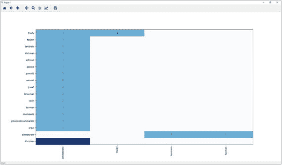

**图 9-6** 可视化一个论坛线程中的用户交互

有多种方式可以调整这个可视化效果。例如，图 9-7 展示了所有论坛线程中的用户交互，但仅考虑了直接引用的情况。

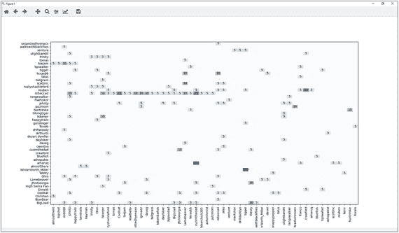

**图 9-7** 可视化所有抓取到的论坛线程中的用户交互（仅限直接引用）

### 9.10 收集并聚类时尚数据集

在这个示例中，我们将使用 Zalando（一家广受欢迎的瑞典网店）来获取一批时尚产品图片，并使用 t-SNE 算法对它们进行聚类。

#### 检查 API

请注意，Zalando 也提供了一个易于使用的 API（文档请参见 [`https://github.com/zalando/shop-api-documentation/wiki/Api-introduction`](https://github.com/zalando/shop-api-documentation/wiki/Api-introduction)）。在撰写本文时，该 API 不需要身份验证，但计划在不久的将来进行更改，届时用户需要注册才能获取 API 访问令牌。由于我们只需抓取图片，因此无需注册；不过在一个正式的“应用程序”中，使用 API 选项无疑是值得推荐的。

我们的第一个脚本会下载图片并将它们存储在一个目录中，请参见图 9-8：


**图 9-8** 收集到的连衣裙图片集合

```
import requests
import os, os.path
from bs4 import BeautifulSoup
from urllib.parse import urljoin, urlparse

store = 'images'
if not os.path.exists(store):
    os.makedirs(store)

url = 'https://www.zalando.co.uk/womens-clothing-dresses/'
pages_to_crawl = 15

def download(url):
    r = requests.get(url, stream=True)
    filename = urlparse(url).path.split('/')[-1]
    print('Downloading to:', filename)
    with open(os.path.join(store, filename), 'wb') as the_image:
        for byte_chunk in r.iter_content(chunk_size=4096*4):
            the_image.write(byte_chunk)

for p in range(1, pages_to_crawl+1):
    print('Scraping page:', p)
    r = requests.get(url, params={'p' : p})
    html_soup = BeautifulSoup(r.text, 'html.parser')
    for img in html_soup.select('#z-nvg-cognac-root z-grid-item img'):
        img_src = img.get('src')
        if not img_src:
            continue
        img_url = urljoin(url, img_src)
        download(img_url)
```

接下来，我们将使用 t-SNE 聚类算法来对照片进行聚类。t-SNE 是一种相对较新的降维技术，特别适用于可视化高维数据集，比如图像。您可以在 [`https://lvdmaaten.github.io/tsne/`](https://lvdmaaten.github.io/tsne/) 了解该技术。我们将使用"scikit-learn"以及"matplotlib"、"scipy"和"numpy"，这些都是数据科学家熟悉的库，可以通过 `pip` 安装：

```
pip install -U matplotlib
pip install -U scikit-learn
pip install -U numpy
pip install -U scipy
```

我们的聚类脚本如下所示：

```
import os.path
import numpy as np
import matplotlib.pyplot as plt
from matplotlib import offsetbox
from sklearn import manifold
from scipy.misc import imread
from glob import iglob

store = 'images'
image_data = []
for filename in iglob(os.path.join(store, '*.jpg')):
    image_data.append(imread(filename))

image_np_orig = np.array(image_data)
image_np = image_np_orig.reshape(image_np_orig.shape[0], -1)

def plot_embedding(X, image_np_orig):
    # 重新缩放
    x_min, x_max = np.min(X, 0), np.max(X, 0)
    X = (X - x_min) / (x_max - x_min)

    # 根据 t-SNE 位置绘制图像
    plt.figure()
    ax = plt.subplot(111)
    for i in range(image_np.shape[0]):
        imagebox = offsetbox.AnnotationBbox(
            offsetbox=offsetbox.OffsetImage(image_np_orig[i], zoom=.1),
            xy=X[i],
            frameon=False)
        ax.add_artist(imagebox)

print("计算 t-SNE 嵌入")
tsne = manifold.TSNE(n_components=2, init="pca")
X_tsne = tsne.fit_transform(image_np)
plot_embedding(X_tsne, image_np_orig)
plt.show()
```

这段代码的工作原理如下。首先，我们加载所有图像（使用 `imread`），并将它们转换为一个 `numpy` 数组。`reshape` 函数确保我们得到一个 *n* x *3m* 的矩阵，其中 *n* 是图像数量，*m* 是每张图像的像素数，而不是一个 *n* x *r* x *g* x *b* 的张量。在构建 t-SNE 嵌入之后，我们使用 matplotlib 根据计算出的 x 和 y 坐标绘制图像，结果如图 9-9 所示（使用了大约一千张抓取的照片）。可以看出，这里的聚类主要受图像颜色的饱和度和强度驱动。

#### 图像尺寸

幸运的是，我们抓取的所有图像都具有相同的宽度和高度。如果情况并非如此，我们首先需要进行尺寸调整，以确保每张图像都能在数据集中生成一个长度相等的向量。

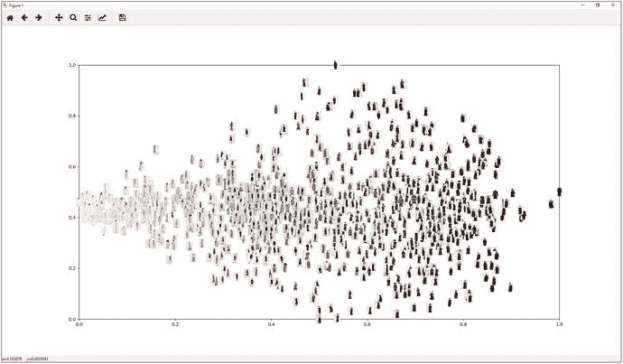

**图 9-9** t-SNE 聚类的结果（应用于大约一千张照片）

### 9.11 对抓取的亚马逊评论进行情感分析

我们将要抓取某个特定产品的一系列亚马逊评论及其评分。我们将选择一本评论数量丰富的书，比如 Mark Lutz 的《Learning Python》，你可以在 [`https://www.amazon.com/Learning-Python-5th-Mark-Lutz/dp/1449355730/`](https://www.amazon.com/Learning-Python-5th-Mark-Lutz/dp/1449355730/) 找到它。如果你点击“查看所有客户评论”，最终会到达 [`https://www.amazon.com/Learning-Python-5th-Mark-Lutz/product-reviews/1449355730/`](https://www.amazon.com/Learning-Python-5th-Mark-Lutz/product-reviews/1449355730/)。请注意，该产品的 ID 是“1449355730”，即使使用不包含产品名称的 URL [`https://www.amazon.com/product-reviews/1449355730/`](https://www.amazon.com/product-reviews/1449355730/)，同样可以访问。

#### 简单的 URL

在编写网络爬虫之前，像我们这样尝试不同的 URL 总是一个好主意。基于上述内容，我们知道一个给定的产品标识符就足以获取评论页面，而无需费心找出包含产品名称的确切 URL。那么，为什么亚马逊允许这两种方式，并且默认包含产品名称呢？原因很可能是搜索引擎优化（SEO）。像谷歌这样的搜索引擎更喜欢包含人类可读组件的 URL。

如果您探索一下评论页面，会发现评论是分页显示的。通过浏览其他页面并在浏览器开发者工具中进行追踪，我们看到 POST 请求（由 JavaScript 发起）被发送到类似于 [`https://www.amazon.com/ss/customer-reviews/ajax/reviews/get/ref=cm_cr_arp_d_paging_btm_2`](https://www.amazon.com/ss/customer-reviews/ajax/reviews/get/ref=cm_cr_arp_d_paging_btm_2) 的 URL，并在表单数据中包含了产品 ID，以及其他一些看起来相对容易模拟的表单字段。让我们看看请求能返回什么结果。


```python
import requests
from bs4 import BeautifulSoup

review_url = 'https://www.amazon.com/ss/customer-reviews/ajax/reviews/get/'
product_id = '1449355730'

session = requests.Session()
session.headers.update({
    'User-Agent': 'Mozilla/5.0 (Windows NT 10.0; Win64; x64) AppleWebKit/537.36 ' +
                  '(KHTML, like Gecko) Chrome/62.0.3202.62 Safari/537.36'
})
session.get('https://www.amazon.com/product-reviews/{}/'.format(product_id))


def get_reviews(product_id, page):
    data = {
        'sortBy': '',
        'reviewerType': 'all_reviews',
        'formatType': '',
        'mediaType': '',
        'filterByStar': 'all_stars',
        'pageNumber': page,
        'filterByKeyword': '',
        'shouldAppend': 'undefined',
        'deviceType': 'desktop',
        'reftag': 'cm_cr_getr_d_paging_btm_{}'.format(page),
        'pageSize': 10,
        'asin': product_id,
        'scope': 'reviewsAjax1'
    }
    r = session.post(review_url + 'ref=' + data['reftag'], data=data)
    return r.text


print(get_reviews(product_id, 1))
```

需要注意的是，这里我们伪造了`User-Agent`请求头。如果不这样做，亚马逊会回复一条消息，要求我们验证是否为真人（你可以从浏览器的开发者工具中复制这个请求头的值）。此外，请注意我们设置的`scope`表单字段值为`reviewsAjax1`。如果在浏览器中浏览评论页面，你会看到这个字段的值实际上每次请求都会递增，即`reviewsAjax1`、`reviewsAjax2`等。我们也可以选择模拟这种行为——如果亚马逊发现我们的策略，我们就必须这样做，不过目前看来，不这样做也能正常获取结果。

最后，注意 POST 请求返回的不是完整的 HTML 页面，而是一种手工编码的结果，通常由 JavaScript 解析：

```
["script",
"if(window.ue) { ues('id','reviewsAjax1','FE738GN7GRDZK6Q09S9G');
ues('t0','reviewsAjax1',new Date());
ues('ctb','reviewsAjax1','1');
uet('bb','reviewsAjax1'); }"
]
&&&
["update","#cm_cr-review_list",""]
&&&
["loaded"]
&&&
["append","#cm_cr-review_list","     <a class=\"a-link-normal\"title=\"5.0 out      of 5 stars\"
[...]
```

幸运的是，在稍微探索一下回复内容之后（你可以随意将完整的回复复制粘贴到文本编辑器中并通读一遍），其结构似乎很容易弄清楚：

-   回复由若干条“指令”组成，格式为 JSON 列表；
-   指令之间由三个与符号`&&&`分隔；
-   包含评论的指令以`append`字符串开头；
-   评论的实际内容格式化为 HTML 元素，位于列表的第三个位置。

让我们调整代码，以结构化格式解析评论。我们将遍历所有指令；使用`json`模块转换它们；检查`append`条目；然后使用 Beautiful Soup 解析 HTML 片段，获取评论 ID、评分、标题和正文。我们还需要一个小的正则表达式来提取评分，评分被设置为一个类，其值类似于`a-start-1`到`a-star-5`。我们可以直接使用这些值，但简单地获取`1`到`5`可能更便于后续处理，因此我们在这里预先进行一些清理：

```python
import requests
import json
import re
from bs4 import BeautifulSoup

review_url = 'https://www.amazon.com/ss/customer-reviews/ajax/reviews/get/'
product_id = '1449355730'

session = requests.Session()
session.headers.update({
    'User-Agent': 'Mozilla/5.0 (Windows NT 10.0; Win64; x64) AppleWebKit/537.36 ' +
                  '(KHTML, like Gecko) Chrome/62.0.3202.62 Safari/537.36'
})
session.get('https://www.amazon.com/product-reviews/{}/'.format(product_id))


def parse_reviews(reply):
    reviews = []
    for fragment in reply.split('&&&'):
        if not fragment.strip():
            continue
        json_fragment = json.loads(fragment)
        if json_fragment[0] != 'append':
            continue
        html_soup = BeautifulSoup(json_fragment[2], 'html.parser')
        div = html_soup.find('div', class_="review")
        if not div:
            continue
        review_id = div.get('id')
        title = html_soup.find(class_='review-title').get_text(strip=True)
        review = html_soup.find(class_='review-text').get_text(strip=True)

        # 查找并清理评分：
        review_cls = ' '.join(html_soup.find(class_='review-rating').get('class'))
        rating = re.search('a-star-(\d+)', review_cls).group(1)
        reviews.append({'review_id': review_id,
                        'rating': rating,
                        'title': title,
                        'review': review})
    return reviews


def get_reviews(product_id, page):
    data = {
        'sortBy': '',
        'reviewerType': 'all_reviews',
        'formatType': '',
        'mediaType': '',
        'filterByStar': 'all_stars',
        'pageNumber': page,
        'filterByKeyword': '',
        'shouldAppend': 'undefined',
        'deviceType': 'desktop',
        'reftag': 'cm_cr_getr_d_paging_btm_{}'.format(page),
        'pageSize': 10,
        'asin': product_id,
        'scope': 'reviewsAjax1'
    }
    r = session.post(review_url + 'ref=' + data['reftag'], data=data)
    reviews = parse_reviews(r.text)
    return reviews


print(get_reviews(product_id, 1))
```

这样就能正常工作了！剩下唯一要做的事情就是遍历所有页面，并使用`dataset`库将评论存储到数据库中。幸运的是，判断何时停止循环很容易：一旦某个页面没有获取到任何评论，我们就可以停止：

```python
import requests
import json
import re
from bs4 import BeautifulSoup
import dataset

db = dataset.connect('sqlite:///reviews.db')

review_url = 'https://www.amazon.com/ss/customer-reviews/ajax/reviews/get/'
product_id = '1449355730'

session = requests.Session()
session.headers.update({
    'User-Agent': 'Mozilla/5.0 (Windows NT 10.0; Win64; x64) AppleWebKit/537.36 ' +
                  '(KHTML, like Gecko) Chrome/62.0.3202.62 Safari/537.36'
})
session.get('https://www.amazon.com/product-reviews/{}/'.format(product_id))


def parse_reviews(reply):
    reviews = []
    for fragment in reply.split('&&&'):
        if not fragment.strip():
            continue
        json_fragment = json.loads(fragment)
        if json_fragment[0] != 'append':
            continue
        html_soup = BeautifulSoup(json_fragment[2], 'html.parser')
        div = html_soup.find('div', class_="review")
        if not div:
            continue
        review_id = div.get('id')
        review_cls = ' '.join(html_soup.find(class_='review-rating').get('class'))
        rating = re.search('a-star-(\d+)', review_cls).group(1)
        title = html_soup.find(class_='review-title').get_text(strip=True)
        review = html_soup.find(class_='review-text').get_text(strip=True)
        reviews.append({'review_id': review_id,
                        'rating': rating,
                        'title': title,
                        'review': review})
    return reviews


def get_reviews(product_id, page):
    data = {
        'sortBy': '',
        'reviewerType': 'all_reviews',
        'formatType': '',
        'mediaType': '',
        'filterByStar': 'all_stars',
        'pageNumber': page,
        'filterByKeyword': '',
        'shouldAppend': 'undefined',
        'deviceType': 'desktop',
        'reftag': 'cm_cr_getr_d_paging_btm_{}'.format(page),
        'pageSize': 10,
        'asin': product_id,
        'scope': 'reviewsAjax1'
    }
    r = session.post(review_url + 'ref=' + data['reftag'], data=data)
    reviews = parse_reviews(r.text)
    return reviews


page = 1
while True:
    print('正在抓取第', page, '页')
    reviews = get_reviews(product_id, page)
    if not reviews:
        break
    for review in reviews:
        print(' -', review['rating'], review['title'])
        db['reviews'].upsert(review, ['review_id'])
    page += 1
```

这段代码将输出以下内容：

```
正在抓取第 1 页
- 5 让我试着解释为什么这本 1600 页的书实际上可能会为你节省大量时间，并让你成为更好的 Python 程序员
- 5 很好的入门，且面向新手
- 5 软件开发领域最好的老师
- 5 非常全面
- 5 如果你喜欢大部头书籍，处理大量...
- 5 即便是对于有经验的 Python 程序员来说也是一本好书
- 5 不错的教程；你会学到很多。
- 2 哪怕解释最简单的问题也占用了太多篇幅...
- 3 每次他说“这里先简单介绍一下 X”这类话...
- 4 感觉更像是为大学课程准备的...
[...]
```


现在我们已经有了一个包含评论的数据库，让我们对这些数据做些有趣的事情。我们将对评论运行情感分析算法（为每条评论提供一个情感得分），然后将其绘制在不同评分上，以检查评分与文本情感之间的相关性。为此，我们将使用`vaderSentiment`库（可以通过`pip`轻松安装）。我们还需要安装`nltk`（自然语言工具包）库：

```
pip install -U vaderSentiment
pip install -U nltk
```

使用`vaderSentiment`库处理单个句子非常简单：

```
from vaderSentiment.vaderSentiment import SentimentIntensityAnalyzer
analyzer = SentimentIntensityAnalyzer()
sentence = "I'm really happy with my purchase"
vs = analyzer.polarity_scores(sentence)
print(vs)

##### Shows: {'neg': 0.0, 'neu': 0.556, 'pos': 0.444, 'compound': 0.6115}
```

要对较长的文本进行情感分析，一个简单的方法是计算每个句子的情感得分，然后对所有句子取平均值，如下所示：

```
from vaderSentiment.vaderSentiment import SentimentIntensityAnalyzer
from nltk import tokenize
analyzer = SentimentIntensityAnalyzer()
paragraph = """
I'm really happy with my purchase.
I've been using the product for two weeks now.
It does exactly as described in the product description.
The only problem is that it takes a long time to charge.
However, since I recharge during nights, this is something I can live with.
"""
sentence_list = tokenize.sent_tokenize(paragraph)
cumulative_sentiment = 0.0
for sentence in sentence_list:
vs = analyzer.polarity_scores(sentence)
cumulative_sentiment += vs["compound"]
print(sentence, ' : ', vs["compound"])
average_sentiment = cumulative_sentiment / len(sentence_list)
print('Average score:', average_score)
```

如果运行这段代码，`nltk`很可能会提示缺少某个资源：

```
Resource punkt not found.
Please use the NLTK Downloader to obtain the resource:
>>> import nltk
>>> nltk.download('punkt')
[...]
```

要解决此问题，请在 Python 终端中执行建议的命令：

```
>>> import nltk
>>> nltk.download('punkt')
```

资源下载并安装完成后，上述代码应该可以正常工作，并输出：

```
I'm really happy with my purchase. : 0.6115
I've been using the product for two weeks now. : 0.0
It does exactly as described in the product description. : 0.0
The only problem is that it takes a long time to charge. : -0.4019
However, since I recharge during nights, this is something I can live with. : 0.0
Average score: 0.04192000000000001
```

现在，让我们将其应用于我们的亚马逊评论列表。我们将计算每个评分的情感得分，按评分组织，然后使用`matplotlib`库绘制每个评分的提琴图：

```
from vaderSentiment.vaderSentiment import SentimentIntensityAnalyzer
from nltk import tokenize
import dataset
import matplotlib.pyplot as plt
db = dataset.connect('sqlite:///reviews.db')
reviews = db['reviews'].all()
analyzer = SentimentIntensityAnalyzer()
sentiment_by_stars = [[] for r in range(1,6)]
for review in reviews:
full_review = review['title'] + '. ' + review['review']
sentence_list = tokenize.sent_tokenize(full_review)
cumulative_sentiment = 0.0
for sentence in sentence_list:
vs = analyzer.polarity_scores(sentence)
cumulative_sentiment += vs["compound"]
average_score = cumulative_sentiment / len(sentence_list)
sentiment_by_stars[int(review['rating'])-1].append(average_score)
plt.violinplot(sentiment_by_stars,
range(1,6),
vert=False, widths=0.9,
showmeans=False, showextrema=True, showmedians=True,
bw_method='silverman')
plt.axvline(x=0, linewidth=1, color="black")
plt.show()
```

这应该会输出一个类似于图 9-10 所示的图形。在这个例子中，我们确实可以观察到评分与文本情感之间存在很强的相关性，但有趣的是，即使对于较低的评分（两星和三星），大多数评论仍然有些正面。当然，这个数据集还可以做更多的事情。例如，考虑建立一个预测模型来检测虚假评论。

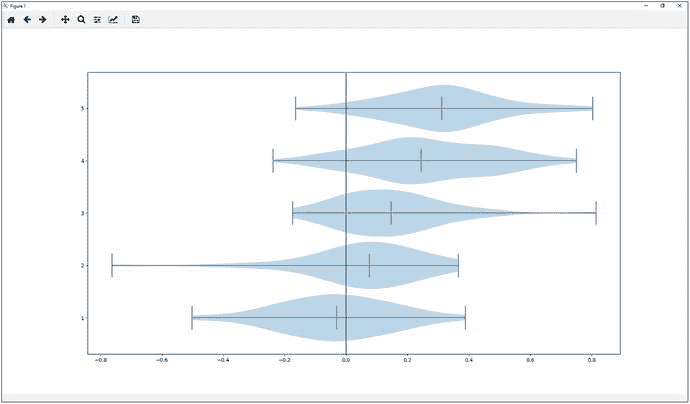

**图 9-10** 每个评分级别的情感图

### 9.12 抓取和分析新闻文章

我们将使用 Selenium 从 Google News ( [`news.google.com/news/?ned=us`](https://news.google.com/news/%3Fned=us) `&` `hl=en` ) 抓取“头条新闻”。我们的目标是访问每篇文章，并提取出标题和正文内容。

#### 并不像看起来那么简单


`from selenium import webdriver`

`base_url = 'https://news.google.com/news/?ned=us&hl=en'`

`driver = webdriver.Chrome()`

`driver.implicitly_wait(10)`

`driver.get(base_url)`

`for link in driver.find_elements_by_css_selector('main a[role="heading"]'):
    news_url = link.get_attribute('href')
    print(news_url)`

`driver.quit()`

执行这段代码会输出以下内容（当然，你实际获得的链接可能有所不同）：

```
http://news.xinhuanet.com/english/2017-10/24/c_136702615.htm
http://www.cnn.com/2017/10/24/asia/china-xi-jinping-thought/index.html
[...]
```

在浏览器中打开 `http://edition.cnn.com/2017/10/24/asia/china-xi-jinping-thought/index.html`，并打开浏览器开发者工具中的控制台。我们现在的目标是使用 Mozilla 的 Readability 的 JavaScript 实现从这个页面提取内容，这个工具通常用于以更易读的格式显示文章。也就是说，我们希望将 `https://raw.githubusercontent.com/mozilla/readability/master/Readability.js` 上的 JavaScript 代码“注入”到页面中。由于我们可以使用 Selenium 指示浏览器执行 JavaScript，因此我们需要编写一段合适的 JavaScript 代码来执行此注入。在你的浏览器控制台中，尝试执行以下代码块：

```
(function(d, script) {
script = d.createElement('script');
script.type = 'text/javascript';
script.async = true;
script.onload = function(){
console.log('The script was successfully injected!');
};
script.src = 'https://raw.githubusercontent.com/' +
'mozilla/readability/master/Readability.js';
d.getElementsByTagName('head')[0].appendChild(script);
}(document));
```

此脚本的工作方式如下：创建一个新的 `<script>` 元素，并将其 `src` 参数设置为 `https://raw.githubusercontent.com/mozilla/readability/master/Readability.js`，然后将其追加到文档的 `<head>` 中。一旦脚本加载完成，我们会在控制台上显示一条消息。这将为你提供如图 9-11 所示的结果。

但这并未按预期工作，因为 Chrome 拒绝执行此脚本：

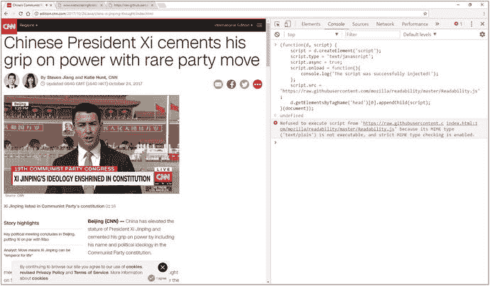

**图 9-11** 尝试使用 JavaScript 注入 `<script>` 标签

```
Refused to execute script from
'https://raw.githubusercontent.com/mozilla/readability/master/Readability.js'
because its MIME type ('text/plain') is not executable, and strict MIME type checking is enabled.
```

问题在于 GitHub 在其响应头中指明此文档的内容类型是 `text/plain`，而 Chrome 阻止我们将其用作脚本。为了解决这个问题，我们将自己托管一份脚本副本，地址为 `http://www.webscrapingfordatascience.com/readability/Readability.js`，然后重试：

```
(function(d, script) {
script = d.createElement('script');
script.type = 'text/javascript';
script.async = true;
script.onload = function(){
console.log('The script was successfully injected!');
};
script.src = 'http://www.webscrapingfordatascience.com/readability/Readability.js';
d.getElementsByTagName('head')[0].appendChild(script);
}(document));
```

这应该能得到正确的结果：

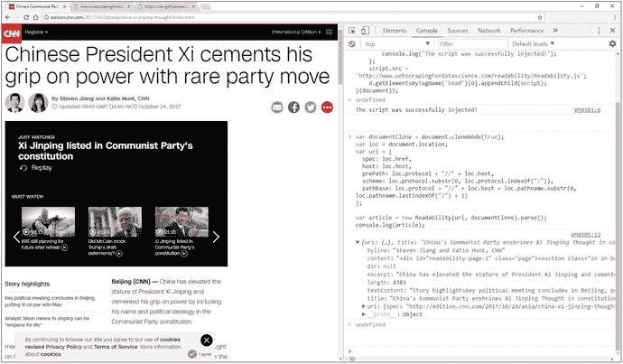

**图 9-12** 提取文章信息

```
The script was successfully injected!
```

现在，`<script>` 标签已注入并执行，我们需要弄清楚如何使用它。Mozilla 在 `https://github.com/mozilla/readability` 的文档为我们提供了一些说明，基于这些说明，我们可以尝试执行以下代码（仍在控制台窗口中）：

```
var documentClone = document.cloneNode(true);
var loc = document.location;
var uri = {
spec: loc.href,
host: loc.host,
prePath: loc.protocol + "//" + loc.host,
scheme: loc.protocol.substr(0, loc.protocol.indexOf(":")),
pathBase: loc.protocol + "//" + loc.host +
loc.pathname.substr(0, loc.pathname.lastIndexOf("/") + 1)
};
var article = new Readability(uri, documentClone).parse();
console.log(article);
```

这应该提供如图 9-12 所示的结果，看起来确实很有希望：`article` 对象包含一个 `title` 属性和一个 `content` 属性，我们将能够使用它们。

现在的问题是如何将这些信息返回给 Selenium。请记住，我们可以通过 `execute_script` 方法从 Selenium 执行 JavaScript 命令。一种获取我们所需信息的可行方法是，使用 JavaScript 将整个页面的内容替换为我们想要的信息，然后使用 Selenium 提取该信息。


```
from selenium import webdriver
base_url = 'http://edition.cnn.com/2017/10/24/asia/china-xi-jinping-thought/index.html'
driver = webdriver.Chrome()
driver.implicitly_wait(10)
driver.get(base_url)
js_cmd = '''
(function(d, script) {
script = d.createElement('script');
script.type = 'text/javascript';
script.async = true;
script.onload = function(){
var documentClone = document.cloneNode(true);
var loc = document.location;
var uri = {
spec: loc.href,
host: loc.host,
prePath: loc.protocol + "//" + loc.host,
scheme: loc.protocol.substr(0, loc.protocol.indexOf(":")),
pathBase: loc.protocol + "//" + loc.host +
loc.pathname.substr(0, loc.pathname.lastIndexOf("/") + 1)
};
var article = new Readability(uri, documentClone).parse();
document.body.innerHTML = '' + article.title + '' +
'' + article.content + '';
};
script.src = 'http://www.webscrapingforscience.com/readability/Readability.js';
d.getElementsByTagName('head')[0].appendChild(script);
}(document));
'''
driver.execute_script(js_cmd)
title = driver.find_element_by_id('title').text.strip()
content = driver.find_element_by_id('content').text.strip()
print('Title was:', title)
driver.quit()
```

`document.body.innerHTML` 这一行在 JavaScript 命令中会替换 `<body>` 标签的内容，改为一个标题和一个 `<div>` 标签，我们可以从中直接获取所需信息。

然而，`execute_script` 方法也允许我们将 JavaScript 对象传回 Python，因此以下方法同样可行：

```
from selenium import webdriver
from selenium.webdriver.common.by import By
from selenium.webdriver.support.ui import WebDriverWait
from selenium.webdriver.support import expected_conditions as EC
base_url = 'http://edition.cnn.com/2017/10/24/asia/china-xi-jinping-thought/index.html'
driver = webdriver.Chrome()
driver.implicitly_wait(10)
driver.get(base_url)
js_cmd = '''
(function(d, script) {
script = d.createElement('script');
script.type = 'text/javascript';
script.async = true;
script.onload = function() {
script.id = 'readability-script';
}
script.src = 'http://www.webscrapingforscience.com/readability/Readability.js';
d.getElementsByTagName('head')[0].appendChild(script);
}(document));
'''
js_cmd2 = '''
var documentClone = document.cloneNode(true);
var loc = document.location;
var uri = {
spec: loc.href,
host: loc.host,
prePath: loc.protocol + "//" + loc.host,
scheme: loc.protocol.substr(0, loc.protocol.indexOf(":")),
pathBase: loc.protocol + "//" + loc.host +
loc.pathname.substr(0, loc.pathname.lastIndexOf("/") + 1)
};
var article = new Readability(uri, documentClone).parse();
return JSON.stringify(article);
'''
driver.execute_script(js_cmd)
wait = WebDriverWait(driver, 10)
wait.until(EC.presence_of_element_located((By.ID, "readability-script")))
returned_result = driver.execute_script(js_cmd2)
print(returned_result)
driver.quit()
```

这里有一些细节需要额外说明。首先，注意我们使用了两次 `execute_script` 方法：第一次用于注入 `<script>` 标签，第二次用于获取 `article` 对象。然而，由于脚本执行可能需要一些时间，而 Selenium 的隐式等待在使用 `execute_script` 时并不会考虑这一点，因此我们使用显式等待来检查 id 为 `readability-script` 的元素是否存在，该 id 由 `script.onload` 函数设置。一旦找到这样的 id，我们就知道脚本已加载完毕，可以执行第二条 JavaScript 命令。这里，我们必须使用 `JSON.stringify` 来确保返回给 Python 的是一个 JSON 格式的字符串，而不是原始的 JavaScript 对象，因为 Python 无法理解这个返回值，它可能会将其转换为一个包含 `None` 值的列表（不过简单类型，如整数和字符串，是可以正常转换的）。

让我们稍微整理一下脚本，并将其与我们的基础框架合并：

```
from selenium import webdriver
from selenium.webdriver.common.by import By
from selenium.webdriver.support.ui import WebDriverWait
from selenium.webdriver.support import expected_conditions as EC
base_url = 'https://news.google.com/news/?ned=us&hl=en'
inject_readability_cmd = '''
(function(d, script) {
script = d.createElement('script');
script.type = 'text/javascript';
script.async = true;
script.onload = function() {
script.id = 'readability-script';
}
script.src = 'http://www.webscrapingforscience.com/readability/Readability.js';
d.getElementsByTagName('head')[0].appendChild(script);
}(document));
'''
get_article_cmd = '''
var documentClone = document.cloneNode(true);
var loc = document.location;
var uri = {
spec: loc.href,
host: loc.host,
prePath: loc.protocol + "//" + loc.host,
scheme: loc.protocol.substr(0, loc.protocol.indexOf(":")),
pathBase: loc.protocol + "//" + loc.host +
loc.pathname.substr(0, loc.pathname.lastIndexOf("/") + 1)
};
var article = new Readability(uri, documentClone).parse();
return JSON.stringify(article);
'''
driver = webdriver.Chrome()
driver.implicitly_wait(10)
driver.get(base_url)
news_urls = []
for link in driver.find_elements_by_css_selector('main a[role="heading"]'):
news_url = link.get_attribute('href')
news_urls.append(news_url)
for news_url in news_urls:
print('Now scraping:', news_url)
driver.get(news_url)
print('Injecting scripts')
driver.execute_script(inject_readability_cmd)
wait = WebDriverWait(driver, 10)
wait.until(EC.presence_of_element_located((By.ID, "readability-script")))
returned_result = driver.execute_script(get_article_cmd)
```


```python
##### Do something with returned_result
driver.quit()
```

注意，我们使用了两个“for”循环：一个用于提取我们要抓取的链接，并将它们存储在一个列表中；另一个用于遍历该列表。在这种情况下，使用一个循环是行不通的：因为当我们在循环内部导航到其他页面时，Selenium 会在尝试使用 `find_elements_by_css_selector` 查找下一个链接时抱怨“元素失效”。这基本上是在说：“我正在为你查找下一个元素，但页面在这期间已经发生了变化，所以我无法再确定你想要获取什么内容。”

如果你尝试执行这个脚本，你会注意到它很快就会失败。这是怎么回事？要弄清楚出了什么问题，试着在浏览器中打开另一个链接，例如 [`https://www.washingtonpost.com/world/chinas-leader-elevated-to-the-level-of-mao-in-communist-pantheon/2017/10/24/ddd911e0-b832-11e7-9b93-b97043e57a22_story.html?utm_term=.720e06a5017d`](https://www.washingtonpost.com/world/chinas-leader-elevated-to-the-level-of-mao-in-communist-pantheon/2017/10/24/ddd911e0-b832-11e7-9b93-b97043e57a22_story.html?utm_term=.720e06a5017d) （一个使用 HTTPS 的网站），然后在浏览器控制台中手动执行第一个 JavaScript 命令，也就是复制粘贴并执行：

```javascript
(function(d, script) {
script = d.createElement('script');
script.type = 'text/javascript';
script.async = true;
script.onload = function() {
script.id = 'readability-script';
}
script.src = 'http://www.webscrapingfordatascience.com/readability/Readability.js';
d.getElementsByTagName('head')[0].appendChild(script);
}(document));
```

你可能会得到类似下面的结果：

```
GET https://www.webscrapingfordatascience.com/readability/Readability.js net::ERR_CONNECTION_CLOSED
```

在其他页面上，你可能会得到：

```
Mixed Content: 页面 [...] 是通过 HTTPS 加载的，但请求了一个不安全的脚本 'http://www.webscrapingfordatascience.com/readability/Readability.js'。
此请求已被阻止；内容必须通过 HTTPS 提供。
```

这里的情况很明显：如果我们通过 HTTPS 加载一个网站，并尝试通过 HTTP 注入一个脚本，Chrome 会因为认为该请求不安全（事实也确实如此）而阻止它。其他网站可能会采用其他方法来防止脚本注入，例如，使用 `Content-Security-Policy` 头信息，这会导致如下错误：

```
Refused to load the script
'http://www.webscrapingfordatascience.com/readability/Readability.js'  because it violates the following Content Security Policy directive:
"script-src 'self' 'unsafe-eval' 'unsafe-inline'".
```

Chrome 有一些可用的扩展可以禁用此类检查，但我们将采用一种不同的方法，该方法适用于大多数页面，除了那些具有最严格内容安全策略的页面：我们将不再尝试注入一个 `<script>` 标签，而是直接获取我们 JavaScript 文件的内容，并使用 Selenium 直接执行它们。我们可以通过从本地文件加载内容来实现这一点，但由于我们已经将文件托管在线上，我们将使用 `requests` 来获取内容：

```python
from selenium import webdriver
import requests
base_url = 'https://news.google.com/news/?ned=us&hl=en'
script_url = 'http://www.webscrapingfordatascience.com/readability/Readability.js'
get_article_cmd = requests.get(script_url).text
get_article_cmd += '''
var documentClone = document.cloneNode(true);
var loc = document.location;
var uri = {
spec: loc.href,
host: loc.host,
prePath: loc.protocol + "//" + loc.host,
scheme: loc.protocol.substr(0, loc.protocol.indexOf(":")),
pathBase: loc.protocol + "//" + loc.host +
loc.pathname.substr(0, loc.pathname.lastIndexOf("/") + 1)
};
var article = new Readability(uri, documentClone).parse();
return JSON.stringify(article);
'''
driver = webdriver.Chrome()
driver.implicitly_wait(10)
driver.get(base_url)
news_urls = []
for link in driver.find_elements_by_css_selector('main a[role="heading"]'):
news_url = link.get_attribute('href')
news_urls.append(news_url)
for news_url in news_urls:
print('Now scraping:', news_url)
driver.get(news_url)
print('Injecting script')
returned_result = driver.execute_script(get_article_cmd)

##### 对 returned_result 做一些处理
driver.quit()
```

这种方法还有一个好处，即我们可以一次性执行整个 JavaScript 命令，而不再需要依赖显式等待来检查脚本是否加载完成。剩下的唯一工作就是将获取的结果转换为 Python 字典，并使用“dataset”库将结果存储到数据库中：

```python
from selenium import webdriver
import requests
import dataset
from json import loads
db = dataset.connect('sqlite:///news.db')
base_url = 'https://news.google.com/news/?ned=us&hl=en'
script_url = 'http://www.webscrapingfordatascience.com/readability/Readability.js'
get_article_cmd = requests.get(script_url).text
get_article_cmd += '''
var documentClone = document.cloneNode(true);
var loc = document.location;
var uri = {
spec: loc.href,
host: loc.host,
prePath: loc.protocol + "//" + loc.host,
scheme: loc.protocol.substr(0, loc.protocol.indexOf(":")),
pathBase: loc.protocol + "//" + loc.host +
loc.pathname.substr(0, loc.pathname.lastIndexOf("/") + 1)
};
var article = new Readability(uri, documentClone).parse();
return JSON.stringify(article);
'''
driver = webdriver.Chrome()
driver.implicitly_wait(10)
driver.get(base_url)
news_urls = []
for link in driver.find_elements_by_css_selector('main a[role="heading"]'):
news_url = link.get_attribute('href')
news_urls.append(news_url)
for news_url in news_urls:
print('Now scraping:', news_url)
driver.get(news_url)
print('Injecting script')
returned_result = driver.execute_script(get_article_cmd)

##### 将 JSON 字符串转换为 Python 字典
article = loads(returned_result)
if not article:
##### 未能提取文章，直接继续
continue

##### 添加 URL
article['url'] = news_url

##### 删除 'uri'，因为它本身是一个字典
del article['uri']
```


##### 添加到数据库

`db['articles'].upsert(article, ['url'])`
`print('Title was:', article['title'])`
`driver.quit()`

输出结果如下：

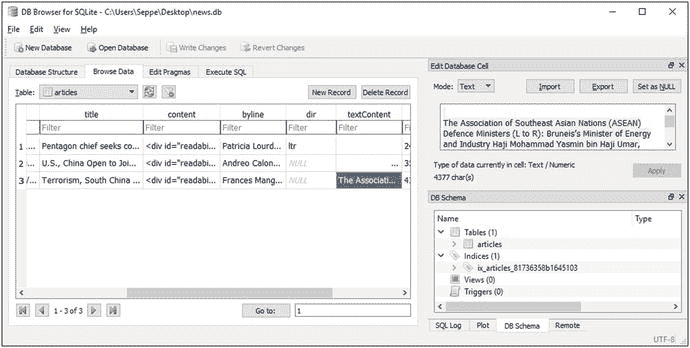

**图 9-13** 使用 DB Browser for SQLite 浏览已抓取的文章

```
Now scraping: https://www.usnews.com/news/world/articles/2017-10-24/
china-southeast-asia-aim-to-build-trust-with-sea-drills-singapore-says Injecting script
Title was: China, Southeast Asia Aim to Build Trust With Sea Drills,      Singapore Says | World News
Now scraping: http://www.philstar.com/headlines/2017/10/24/
1751999/pentagon-chief-seeks-continued-maritime-cooperation-asean Injecting script
Title was: Pentagon chief seeks continued maritime cooperation with ASEAN | Headlines News, The Philippine Star,
[...]
```

请务必使用 `DB Browser for SQLite` 等 SQLite 客户端查看数据库 (`news.db`)；见图 9-13。

现在我们能用 Python 分析收集到的文章了。我们将使用潜在狄利克雷分配（LDA）构建一个主题模型，帮助我们按主题对文章进行分类。为此，我们将使用 `nltk`、`stop-words` 和 `gensim` 库，这些库只需通过 `pip` 即可安装：

```
pip install -U nltk
pip install -U stop-words
pip install -U gensim
```

首先，我们将遍历所有文章，使用一个简单的正则表达式对它们进行分词（将文本转换为单词元素列表），去除停用词，并应用词干提取：

```
import dataset
from nltk.tokenize import RegexpTokenizer
from nltk.stem.porter import PorterStemmer
from stop_words import get_stop_words
db = dataset.connect('sqlite:///news.db')
articles = []
tokenizer = RegexpTokenizer(r'\w+')
stop_words = get_stop_words('en')
p_stemmer = PorterStemmer()
for article in db['articles'].all():
    text = article['title'].lower().strip()
    text += " " + article['textContent'].lower().strip()
    if not text:
        continue

    # 分词
    tokens = tokenizer.tokenize(text)

    # 移除停用词和小词
    clean_tokens = [i for i in tokens if not i in stop_words]
    clean_tokens = [i for i in clean_tokens if len(i) > 2]

    # 词干提取
    stemmed_tokens = [p_stemmer.stem(i) for i in clean_tokens]

    # 添加到列表
    articles.append((article['title'], stemmed_tokens))
print(articles[0])
```

我们的第一篇文章现在看起来像这样（我们保留标题以便后续报告）：

```
('Paul Manafort, former business partner to surrender in Mueller investigation', ['presid', 'trump', 'former', 'campaign', 'chairman', [...]]
```

要生成一个 LDA 模型，我们需要计算每个词条在每篇文档中出现的频率。为此，我们可以用 `gensim` 构建一个文档-词条矩阵：

```
from gensim import corpora
dictionary = corpora.Dictionary([a[1] for a in articles])
corpus = [dictionary.doc2bow(a[1]) for a in articles]
print(corpus[0])
```

`Dictionary` 类遍历文本，为每个独特的词条分配一个唯一的整数 ID，同时收集词频和相关统计信息。接下来，我们的字典被转换成一个词袋语料库，该语料库生成一个向量列表，其数量等于文档数量。每个文档向量都由一系列 `(id, count)` 元组构成：

```
[(0, 10), (1, 17), (2, 7), (3, 11), [...]]
```

现在我们准备构建一个 LDA 模型：

```
from gensim.models.ldamodel import LdaModel
nr_topics = 30
ldamodel = LdaModel(corpus, num_topics=nr_topics,
                    id2word=dictionary, passes=20)
print(ldamodel.print_topics())
```

这将输出类似如下的结果：

```
[(0, '0.027*"s" + 0.018*"trump" + 0.018*"manafort" + 0.011*"investig"    + 0.008*"presid" + 0.008*"report" + 0.007*"mueller" + 0.007*"year"  + 0.007*"campaign" + 0.006*"said"'),
(1, '0.014*"s" + 0.014*"said" + 0.013*"percent" + 0.008*"1" +           0.007*"0" + 0.006*"year" + 0.006*"month" + 0.005*"increas" +        0.005*"3" + 0.005*"spend"'),
[...]
]
```

此概览展示了每个主题的条目。每个主题由一个按出现概率排序的可能出现在该主题中的词条列表表示。请注意，调整模型中的主题数量和 `passes` 迭代次数对于获得良好结果至关重要。一旦结果看起来可以接受（我们已增加了抓取集的主题数量），我们就可以使用该模型为文档分配主题：

```
from random import shuffle

##### 通过前三个词条展示主题
for t in range(nr_topics):
    print(ldamodel.print_topic(t, topn=3))

##### 展示一些随机文章
idx = list(range(len(articles)))
shuffle(idx)
for a in idx[:3]:
    article = articles[a]
    print('==========================')
    print(article[0])
    prediction = ldamodel[corpus[a]][0]
    print(ldamodel.print_topic(prediction[0], topn=3))
    print('Probability:', prediction[1])
```

这将输出类似如下的内容：

```
0.014*"new" + 0.013*"power" + 0.013*"storm"
0.030*"rapp" + 0.020*"spacey" + 0.016*"said"
0.024*"catalan" + 0.020*"independ" + 0.019*"govern"
0.025*"manafort" + 0.020*"trump" + 0.015*"investig"
0.007*"quickli" + 0.007*"complex" + 0.007*"deal"
0.018*"earbud" + 0.016*"iconx" + 0.014*"samsung"
0.012*"halloween" + 0.007*"new" + 0.007*"star"
0.021*"octopus" + 0.014*"carver" + 0.013*"vega"
0.000*"rapp" + 0.000*"spacey" + 0.000*"said"
0.025*"said" + 0.017*"appel" + 0.012*"storm"
0.039*"akzo" + 0.018*"axalta" + 0.017*"billion"
0.024*"rapp" + 0.024*"spacey" + 0.017*"said"
0.000*"boehner" + 0.000*"one" + 0.000*"trump"
0.033*"boehner" + 0.010*"say" + 0.009*"hous"
0.000*"approv" + 0.000*"boehner" + 0.000*"quarter"
0.017*"tax" + 0.013*"republican" + 0.011*"week"
0.012*"trump" + 0.008*"plan" + 0.007*"will"
0.005*"ludwig" + 0.005*"underlin" + 0.005*"sensibl"
0.015*"tax" + 0.011*"trump" + 0.011*"look"
0.043*"minist" + 0.032*"prime" + 0.030*"alleg"
0.058*"harri" + 0.040*"polic" + 0.032*"old"
0.040*"musk" + 0.026*"tunnel" + 0.017*"compani"
0.055*"appl" + 0.038*"video" + 0.027*"peterson"
0.011*"serv" + 0.008*"almost" + 0.007*"insid"
0.041*"percent" + 0.011*"year" + 0.010*"trump"
0.036*"univers" + 0.025*"econom" + 0.012*"special"
0.022*"chees" + 0.021*"patti" + 0.019*"lettuc"
0.000*"boehner" + 0.000*"said" + 0.000*"year"
0.000*"boehner" + 0.000*"new" + 0.000*"say"
0.030*"approv" + 0.025*"quarter" + 0.021*"rate"
==========================
Paul Manafort, Who Once Ran Trump Campaign, Indicted on Money Laundering and Tax Charges
0.025*"manafort" + 0.020*"trump" + 0.015*"investig"
Probability: 0.672658189483
==========================
Apple fires employee after daughter's iPhone X video goes viral
0.055*"appl" + 0.038*"video" + 0.027*"peterson"
Probability: 0.990880503145
==========================
Theresa May won't say when she knew about sexual harassment allegations
0.043*"minist" + 0.032*"prime" + 0.030*"alleg"
Probability: 0.774530402797
```

#### 抓取主题

这方面仍有很大改进空间，例如探索其他主题模型映射算法、应用更好的分词方法、添加自定义停用词、扩充文章集或调整参数。或者，你也可以考虑直接从 Google 新闻页面抓取每篇文章的标签，这些标签在其页面上也作为`主题`列出。

### 9.13 抓取并分析维基百科图

在本示例中，我们将再次处理维基百科（我们已在关于网络爬虫的章节中使用过维基百科）。我们的目标是抓取维基百科页面的标题，同时跟踪它们之间的链接，我们将利用这些链接来构建一个图，并使用 Python 进行分析。我们将再次使用 `dataset` 库作为存储结果的简便方法。以下代码包含了完整的爬虫设置：


```python
import requests
import dataset
from bs4 import BeautifulSoup
from urllib.parse import urljoin, urldefrag
from joblib import Parallel, delayed
db = dataset.connect('sqlite:///wikipedia.db')
base_url = 'https://en.wikipedia.org/wiki/'
def store_page(url, title):
    print('已访问页面:', url)
    print(' 标题:', title)
    db['pages'].upsert({'url': url, 'title': title}, ['url'])
def store_links(from_url, links):
    db.begin()
    for to_url in links:
        db['links'].upsert({'from_url': from_url, 'to_url': to_url},
                           ['from_url', 'to_url'])
    db.commit()
def get_random_unvisited_pages(amount=10):
    result = db.query('''SELECT * FROM links
                         WHERE to_url NOT IN (SELECT url FROM pages)
                         ORDER BY RANDOM() LIMIT {}'''.format(amount))
    return [r['to_url'] for r in result]
def should_visit(base_url, url):
    if url is None:
        return None
    full_url = urljoin(base_url, url)
    full_url = urldefrag(full_url)[0]
    if not full_url.startswith(base_url):
        # 这是一个外部链接
        return None
    ignore = ['Wikipedia:', 'Template:', 'File:', 'Talk:', 'Special:',
              'Template talk:', 'Portal:', 'Help:', 'Category:', 'index.php']
    if any([i in full_url for i in ignore]):
        return None
```


#### 这是一个需要忽略的页面

`return None`
`return full_url`

`def get_title_and_links(base_url, url):`
```
html = requests.get(url).text
html_soup = BeautifulSoup(html, 'html.parser')
page_title = html_soup.find(id='firstHeading')
page_title = page_title.text if page_title else ''
links = []
for link in html_soup.find_all("a"):
    link_url = should_visit(base_url, link.get('href'))
    if link_url:
        links.append(link_url)
return url, page_title, links
```

```
if __name__ == '__main__':
    urls_to_visit = [base_url]
    while urls_to_visit:
        scraped_results = Parallel(n_jobs=5, backend="threading")(
            delayed(get_title_and_links)(base_url, url) for url in urls_to_visit
        )
        for url, page_title, links in scraped_results:
            store_page(url, page_title)
            store_links(url, links)
        urls_to_visit = get_random_unvisited_pages()
```

这里有很多值得额外解释的地方：

*   数据库的结构如下：表 `"pages"` 保存了已访问的 URL 及其页面标题。方法 `store_page` 用于在此表中存储条目。另一个表 `"links"` 仅包含 URL 对，用于表示页面之间的链接。方法 `store_link` 用于更新这些信息，并且两个方法都使用了 `"dataset"` 库。对于后者，我们在单个显式数据库事务中执行多次更新插入（upsert）操作以加快速度。

*   方法 `get_random_unvisited_pages` 现在返回一个未访问 URL 列表，而不仅仅是单个 URL，它通过从尚未出现在 `"pages"` 表（因此尚未被访问）中的被链接 URL 里随机选择列表来实现。

*   `should_visit` 方法用于确定一个链接是否应被考虑用于爬取。如果该链接应被包含，则返回一个格式正确的 URL，否则返回 `None`。

*   `get_title_and_links` 方法执行实际的页面抓取，获取其标题和 URL 列表。

*   脚本本身循环执行，直到没有更多未访问的页面（基本上会永远运行，因为会不断发现新页面）。它会拉取一个我们尚未访问的随机页面列表，获取其标题和链接，并将这些信息存储在数据库中。

*   请注意，我们在这里使用 `"joblib"` 库来建立并行方法。如果简单地将 URL 逐一访问，那会太慢了，因此我们使用 joblib 建立一种多线程方法来同时访问链接，从而有效地产生多个网络请求。重要的是不要过度负担我们自己的连接或维基百科，所以我们将 `n_jobs` 参数限制为五个。这里使用 `back-end` 参数表示我们希望使用多个线程而不是多个进程来建立并行计算。这两种方法在 Python 中各有优劣。多进程方法的设置开销稍大，但由于 Python 的内部线程系统可能会因为“全局解释器锁”（GIL）而变得有些繁琐，因此多进程方法可能更快（关于 GIL 的完整讨论超出了本文范围，但如果你是第一次听说，可以随时在网上查找更多信息）。在我们的案例中，工作本身相对简单：执行一个网络请求并执行一些解析，因此多线程方法是可以的。

*   这也是我们不在 `get_title_and_links` 方法内部直接将结果存储到数据库，而是等待并行任务执行完毕并返回结果的原因。SQLite 不喜欢同时从多个线程或多个进程写入数据，因此我们等到收集到结果后再将其写入数据库。另一种方案是使用客户端-服务器数据库系统。请注意，我们应该避免用大量的结果过度重载数据库。不仅中间结果必须存储在内存中，而且在写入大量结果时也会产生等待时间。由于 `get_random_unvisited_pages` 方法最多返回十个 URL 的列表，在我们的案例中对此不必过于担心。

*   最后，请注意脚本的主入口点现在被放置在 `if __name__ == '__main__':` 之下。在其他示例中，为了简单起见我们没有这样做，尽管这样做是良好的实践。原因如下：当 Python 脚本导入另一个模块时，该模块中包含的所有代码会立即执行。例如，如果我们想在另一个脚本中重用 `should_visit` 方法，我们可以使用 `"import myscript"` 或 `"from myscript import should_visit"` 导入原始脚本。在这两种情况下，`"myscript.py"` 中的完整代码都将被执行。如果此脚本包含一个代码块，比如我们本例中的 `"while"` 循环，那么在导入脚本时就会开始执行该代码块，这不是我们想要的；我们只想加载函数定义。因此，我们希望向 Python 指出“仅当脚本被直接执行时才执行此代码块”，这正是 `if __name__ == '__main__':` 检查的作用。如果我们从命令行启动脚本，特殊的 `__name__` 变量将被设置为 `__main__`。如果我们的脚本是从另一个模块导入的，`__name__` 将被设置为该模块的名称。当我们像这里一样使用 joblib 时，脚本的内容将被发送给所有“工作进程”（线程或进程），以便它们执行正确的导入并加载正确的函数定义。例如在我们的案例中，不同的工作进程需要知道 `get_title_and_links` 方法。然而，由于工作进程也会执行脚本中包含的完整代码（就像导入一样），我们还需要阻止它们运行主代码块，这就是我们需要提供 `if __name__ == '__main__':` 检查的原因。

你可以让爬虫运行任意长时间，但请注意它极不可能完成，而且一个较小的图在下一步中也更容易查看。一旦它运行了一段时间，直接中断即可停止。由于我们使用了 `"upsert"`，可以随时稍后恢复运行（它只会从上次停止的地方继续爬取）。

现在，我们可以使用抓取的结果进行一些有趣的图形分析。在 Python 中，有两个流行的库可以用来做这件事，即 NetworkX（pip 中的 `"networkx"` 库）和 iGraph（pip 中的 `"python-igraph"`）。我们将在这里使用 NetworkX 以及 `"matplotlib"` 来可视化图形。

#### 图形可视化是困难的

正如 NetworkX 文档本身所述，适当的图形可视化是困难的，并且库作者建议人们使用专门用于此任务的工具来可视化图形。对于我们简单的用例，内置方法就足够了，尽管我们需要与 matplotlib 周旋一番才能使效果更具吸引力。如果你对图形可视化感兴趣，可以看看诸如 Cytoscape、Gephi 和 Graphviz 之类的程序。在下一个示例中，我们将使用 Gephi 来处理可视化工作。

以下代码用于可视化图形。我们首先构建一个新的 NetworkX 图形对象，并将页面作为已访问节点添加进去。接下来，我们添加边，但仅限于已访问的页面之间。作为额外步骤，我们还删除完全未连接的节点（尽管在此阶段它们应该不存在）。然后，我们计算一个称为介数（betweenness）的中心性度量，作为节点重要性的衡量指标。该指标的计算基于所有节点到其他所有节点的最短路径中，穿过我们正在计算指标的那个节点的数量。一个节点位于两个其他节点之间最短路径上的次数越多，根据此指标它就越重要。我们将根据此指标为节点着色，赋予它们不同的蓝色阴影。我们对介数度量应用一个快速而粗糙的 Sigmoid 函数，以将值“压缩”到一个能产生更具吸引力可视化的范围内。我们还手动为节点添加标签，以便它们显示在实际节点上方。这将产生如图 9-14 所示的结果。

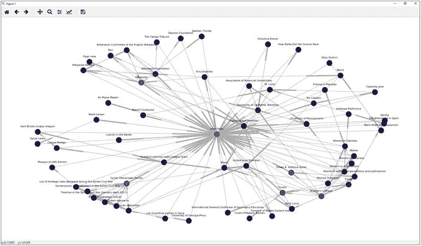

**图 9-14** 可视化我们抓取的图形

#### 忽略警告

在运行可视化代码时，你很可能会看到来自 matplotlib 的警告，抱怨 NetworkX 使用了已弃用的函数。这没关系，可以安全地忽略，尽管未来版本的 matplotlib 可能无法再与 NetworkX 良好兼容。目前尚不清楚 NetworkX 的作者未来是否会继续专注于可视化。正如你会注意到的那样，可视化中边的“箭头”看起来也不太美观。这是 NetworkX 的一个长期存在的问题。再次强调：NetworkX 适用于分析和图形处理，但不太适合可视化。如果可视化是你的核心关注点，请了解一下其他库。

```
import networkx
import matplotlib.pyplot as plt
import dataset
db = dataset.connect('sqlite:///wikipedia.db')
G = networkx.DiGraph()
print('正在构建图形...')
for page in db['pages'].all():
    G.add_node(page['url'], title=page['title'])
for link in db['links'].all():
```


##### 仅当端点均已被访问时才执行 `addedge`
```python
if G.has_node(link['from_url']) and G.has_node(link['to_url']):
    G.add_edge(link['from_url'], link['to_url'])
```

##### 移除孤立节点以精简图形
```python
G.remove_nodes_from(networkx.isolates(G))
```

##### 计算节点介数中心性作为重要性度量
```python
print('正在计算介数...')
betweenness = networkx.betweenness_centrality(G, endpoints=False)
print('正在绘制图形...')
```

##### 使用 Sigmoid 函数使颜色（稍微）更美观
```python
squash = lambda x : 1 / (1 + 0.5**(20*(x-0.1)))
colors = [(0, 0, squash(betweenness[n])) for n in G.nodes()]
labels = dict((n, d['title']) for n, d in G.nodes(data=True))
positions = networkx.spring_layout(G)
networkx.draw(G, positions, node_color=colors, edge_color='#AEAEAE')
```

##### 手动绘制标签使其显示在节点上方
```python
for k, v in positions.items():
    plt.text(v[0], v[1]+0.025, s=labels[k],
             horizontalalignment='center', size=8)
plt.show()
```

### 9.14 抓取与可视化董事会成员关系图

本示例中，我们的目标是构建一个标普 500 企业的社交关系图，展示它们通过董事会成员形成的相互关联性。我们将从路透社的标普 500 页面（[`https://www.reuters.com/finance/markets/index/.SPX`](https://www.reuters.com/finance/markets/index/.SPX)）入手，获取股票代码列表：

```python
from bs4 import BeautifulSoup
import requests
import re

session = requests.Session()
sp500 = 'https://www.reuters.com/finance/markets/index/.SPX'
page = 1
regex = re.compile(r'\/finance\/stocks\/overview\/.*')
symbols = []

while True:
    print('正在抓取页面：', page)
    params = {'sortBy': '', 'sortDir': '', 'pn': page}
    html = session.get(sp500, params=params).text
    soup = BeautifulSoup(html, "html.parser")
    pagenav = soup.find(class_='pageNavigation')
    if not pagenav:
        break
    companies = pagenav.find_next('table', class_="dataTable")
    for link in companies.find_all('a', href=regex):
        symbols.append(link.get('href').split('/')[-1])
    page += 1

print(symbols)
```

获取股票代码列表后，我们可以抓取每个公司的董事会成员页面（例如：[`https://www.reuters.com/finance/stocks/company-officers/MMM.N`](https://www.reuters.com/finance/stocks/company-officers/MMM.N)），提取董事会成员表格，并将其存储为 pandas 数据框，最后使用 pandas 的 `to_pickle` 方法保存。如果尚未安装 pandas，请先安装：

```bash
pip install -U pandas
```

将以下代码添加至脚本末尾：

```python
import pandas as pd

officers = 'https://www.reuters.com/finance/stocks/company-officers/{symbol}'
dfs = []

for symbol in symbols:
    print('正在抓取代码：', symbol)
    html = session.get(officers.format(symbol=symbol)).text
    soup = BeautifulSoup(html, "html.parser")
    officer_table = soup.find('table', {"class": "dataTable"})
    df = pd.read_html(str(officer_table), header=0)[0]
    df.insert(0, 'symbol', symbol)
    dfs.append(df)
```


#### 存储结果
```
df = pd.concat(dfs)
df.to_pickle('sp500.pkl')
```

这类信息可以催生许多有趣的用例，尤其是在图分析和社交网络分析领域。我们将再次使用 `NetworkX`，但只需解析收集到的信息，并将图导出为 `Gephi` 可读取的格式。`Gephi` 是一款流行的图可视化工具，可从 [`https://gephi.org/users/download/`](https://gephi.org/users/download/) 下载：

```
import pandas as pd
import networkx as nx
from networkx.readwrite.gexf import write_gexf
df = pd.read_pickle('sp500.pkl')
G = nx.Graph()
for row in df.itertuples():
    G.add_node(row.symbol, type='company')
    G.add_node(row.Name, type='officer')
    G.add_edge(row.symbol, row.Name)
write_gexf(G, 'graph.gexf')
```

在 `Gephi` 中打开该图文件，并应用 “ForceAtlas 2” 布局技术执行几次迭代。我们还可以显示标签，最终得到如图 9-15 所示的图形。

如果你愿意，可以花些时间探索 `Gephi` 的可视化和过滤选项。你在 `NetworkX` 中设置的所有属性（本例中的 “type”）也将在 `Gephi` 中可用。图 9-16 显示了针对谷歌、亚马逊和苹果及其董事会成员的过滤图，这些成员充当着与其他公司的连接点。


图 9-16
展示谷歌、亚马逊和苹果的相关董事会成员

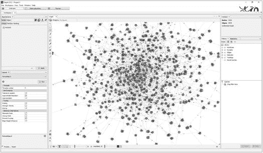

图 9-15
使用 `Gephi` 可视化爬取到的图

### 9.15 利用深度学习破解验证码

这最后一个例子无疑是最具挑战性的，同时它也与“数据科学”更相关，而非网络爬取。实际上，我们在这里不会使用任何网络爬取工具。相反，我们将通过一个相对独立的示例，说明如何将预测模型集成到网络爬取流程中，以绕过验证码检查。

我们首先需要安装一些工具。我们将使用 `OpenCV`（一个非常全面的计算机视觉库）以及 `numpy`（用于基本数据处理）。最后，我们将使用 `captcha` 库来生成示例图像。所有这些都可以通过以下命令安装：

```
pip install -U opencv-python
pip install -U numpy
pip install -U captcha
```

接下来，在你的系统中创建一个目录，用于存放我们将要创建的 Python 脚本。第一个脚本（`constants.py`）将包含一些常量：

```
CAPTCHA_FOLDER = 'generated_images'
LETTERS_FOLDER = 'letters'
CHARACTERS = list('QWERTPASDFGHKLZXBNM')
NR_CAPTCHAS = 1000
NR_CHARACTERS = 4
MODEL_FILE = 'model.hdf5'
LABELS_FILE = 'labels.dat'
MODEL_SHAPE = (100, 100)
```

另一个脚本（`generate.py`）将生成一批验证码图像，并保存到 `generated_images` 目录中：

```
from random import choice
from captcha.image import ImageCaptcha
import os.path
from os import makedirs
from constants import *
makedirs(CAPTCHA_FOLDER)
image = ImageCaptcha()
for i in range(NR_CAPTCHAS):
    captcha = ''.join([choice(CHARACTERS) for c in range(NR_CHARACTERS)])
    filename = os.path.join(CAPTCHA_FOLDER, '{}_{}.png'.format(captcha, i))
    image.write(captcha, filename)
    print('Generated:', captcha)
```

运行此脚本后，你应该会得到一批验证码图像（正确答案包含在文件名中），如图 9-17 所示。

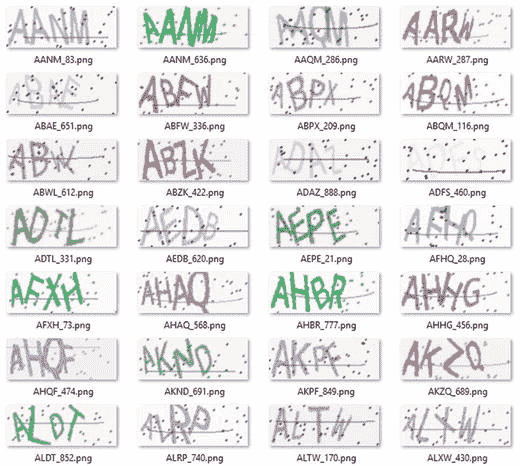

图 9-17
生成的一批验证码图像

#### 这不算作弊吗？

当然，我们很幸运，这里是自己生成验证码，因此有机会同时保留答案。但在现实世界中，验证码不会暴露其答案（否则就违背了验证码的初衷），因此我们需要另寻途径来创建训练集。一种方法是找出某个网站生成验证码所用的库，并用它来收集自己的训练图像，尽可能还原原始验证码。另一种方法是手动标注图像，虽然听起来很繁琐，但你可能不需要标注数千张图像就能达到理想效果。由于人们在填写验证码时也会出错，我们就有多次机会获取正确答案，因此无需追求 100% 的准确率。即使我们的预测模型每十张图像只能正确识别一张，经过几次重试后，也足以突破验证码。

接下来，我们将编写另一个脚本，将图像切割成单独的小块，每个字符一块。我们也可以尝试构建一个一次性预测完整答案的模型，但在许多情况下，逐字符预测要容易得多。为了切割图像，我们需要借助 `OpenCV` 来完成一些繁重的工作。关于 `OpenCV` 和计算机视觉的完整讨论足以写成一本书，因此我们只介绍一些基础知识。这里用到的主要概念是阈值处理、开运算和轮廓检测。为了演示其工作原理，我们先创建一个小的测试脚本：

```
import cv2
import numpy as np

##### 将此路径改为你生成的图像之一：
image_file = 'generated_images/ABQM_116.png'
image = cv2.imread(image_file)
cv2.imshow('原始图像', image)

##### 转换为灰度图，然后进行阈值处理得到黑白图像
gray = cv2.cvtColor(image, cv2.COLOR_BGR2GRAY)
_, thresh = cv2.threshold(gray, 0, 255, cv2.THRESH_BINARY_INV | cv2.THRESH_OTSU)
cv2.imshow('黑白图像', thresh)

##### 应用开运算：先“腐蚀”后“膨胀”
denoised = thresh.copy()
kernel = np.ones((4, 3), np.uint8)
denoised = cv2.erode(denoised, kernel, iterations=1)
kernel = np.ones((6, 3), np.uint8)
denoised = cv2.dilate(denoised, kernel, iterations=1)
cv2.imshow('去噪后', denoised)
```


##### 现在查找轮廓并将其叠加到原始图像上
```
_, cnts, _ = cv2.findContours(denoised.copy(), cv2.RETR_TREE, cv2.CHAIN_APPROX_NONE)
cv2.drawContours(image, cnts, contourIdx=-1, color=(255, 0, 0), thickness=-1)
cv2.imshow('Contours', image)
cv2.waitKey(0)
```

如果运行此脚本，您将获得一系列预览窗口，如图 9-18 所示。在前两个步骤中，我们用 OpenCV 打开图像，并将其转换为简单的纯黑白表示。接下来，我们应用一个“开运算”形态学变换，它本质上就是先进行腐蚀，再进行膨胀。腐蚀的基本思想就像土壤侵蚀：这种变换通过在图像上滑动一个“核”（可以理解为“窗口”），来“侵蚀掉”前景对象（假定为白色）的边界，只有当周围核中的所有像素也都是白色时，这些白色像素才会被保留，否则就变为黑色。膨胀则相反：它通过将像素设置为白色（如果周围核中至少有一个像素是白色）来扩大图像。应用这些步骤是去除图像噪声的常见策略。上面脚本中使用的核大小只是反复尝试的结果，对于其他类型的验证码图像，您可能需要调整这些值。请注意，我们允许图像中残留一些噪声。我们不需要获得完美的图像，因为我们相信我们的预测模型能够“忽略这些噪声”。


**图 9-18** 使用 OpenCV 处理图像。从左到右依次为：原始图像、转换为黑白后的图像、应用开运算去除噪声后的图像，以及在原始图像上以蓝色叠加显示提取到的轮廓。

接下来，我们使用 OpenCV 的 `findContours()` 方法来提取由白色像素连接而成的“斑点”。OpenCV 提供了多种方法来执行此提取，并以不同方式表示结果（例如，是否简化轮廓、是否构建层级关系等）。最后，我们使用 `drawContours()` 方法来绘制发现的斑点。这里的 `contourIdx` 参数表示我们要绘制所有顶层轮廓，`thickness` 值为 `-1` 则指示 OpenCV 填充这些轮廓。

#### 使用掩码提取单个字符

现在我们仍然需要一种方法来利用轮廓创建独立的图像：每个字符一张。我们将通过使用掩码来实现这一点。请注意，OpenCV 也允许获取每个轮廓的“外接矩形”，这会使“裁剪”图像变得容易得多，但如果字符的部分区域相互靠近，这可能会给我们带来麻烦。相反，我们将采用以下代码片段所示的方法：

```
import cv2
import numpy as np
image_file = 'generated_images/ABQM_116.png'

##### 执行阈值处理、腐蚀和轮廓查找，与之前所示相同
image = cv2.imread(image_file)
gray = cv2.cvtColor(image, cv2.COLOR_BGR2GRAY)
_, thresh = cv2.threshold(gray, 0, 255, cv2.THRESH_BINARY_INV | cv2.THRESH_OTSU)
denoised = thresh.copy()
kernel = np.ones((4, 3), np.uint8)
denoised = cv2.erode(denoised, kernel, iterations=1)
kernel = np.ones((6, 3), np.uint8)
denoised = cv2.dilate(denoised, kernel, iterations=1)
_, cnts, _ = cv2.findContours(denoised.copy(), cv2.RETR_TREE, cv2.CHAIN_APPROX_NONE)

##### 创建一个全新的“掩码”图像
mask = np.ones((image.shape[0], image.shape[1]), dtype="uint8") * 0

##### 我们将使用第一个轮廓作为示例
contour = cnts[0]

##### 在掩码上绘制此轮廓
cv2.drawContours(mask, [contour], -1, (255, 255, 255), -1)
cv2.imshow('Denoised image', denoised)
cv2.imshow('Mask after drawing contour', mask)
result = cv2.bitwise_and(denoised, mask)
cv2.imshow('Result after and operation', result)
retain = result > 0
result = result[np.ix_(retain.any(1), retain.any(0))]
cv2.imshow('Final result', result)
cv2.waitKey(0)
```

如果运行此脚本，您将获得如图 9-19 所示的结果。首先，我们创建一个与起始去噪图像尺寸相同的新黑色图像。我们取一个轮廓，并将其以白色绘制在此“掩码”上。然后，对去噪图像和掩码执行按位“与”操作，如果两个输入图像中对应的像素都是白色，则保留该白色像素，否则将其设置为黑色。接着，我们应用一些巧妙的 numpy 切片来裁剪图像。

这足以让我们入门，但还有一个问题需要解决：重叠。如果字符重叠，它们会被检测为一个大的轮廓。为了解决这个问题，我们将应用以下操作。首先，从一个轮廓列表开始，检查两个不同轮廓之间是否存在显著的重叠，如果存在，则只保留较大的那个。接下来，我们根据轮廓的大小进行排序，取前 `n` 个轮廓，然后按横轴方向从左到右排序（其中 `n` 是验证码中的字符数）。这仍然可能导致轮廓数量少于我们所需，因此我们遍历每个轮廓，检查其宽度是否高于预期值。一个很好的预期值启发式方法是：估算宽度，即图像中最左侧白色像素到最右侧白色像素的距离除以我们期望看到的字符数。如果某个轮廓的宽度超出预期，我们将其切割成 `m` 个相等的部分，其中 `m` 等于该轮廓的宽度除以预期宽度。这是一种启发式方法，仍然可能导致某些字符无法被完美切割（有些字符比其他字符大），但这一点我们只能接受。如果在所有这些操作之后，我们最终没有得到所需的字符数，我们将直接跳过该图像。

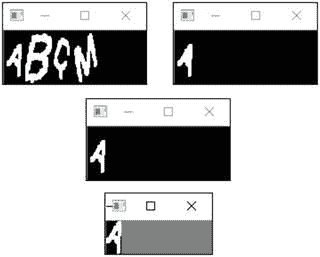

**图 9-19** 使用 OpenCV 中的轮廓掩码提取图像的一部分。左上角显示的是起始图像。右侧创建了一个新图像，轮廓以白色绘制并填充。这两幅图像通过按位“与”操作合成，得到第二行中部的图像。最下方的图像显示了应用裁剪后的最终结果。

#### 将所有内容整合到一个辅助模块中

我们将在单独的函数列表（位于 `functions.py` 文件中）中实现所有这些功能：

```
import cv2
import numpy as np
from math import ceil, floor
from constants import *

def overlaps(contour1, contour2, threshold=0.8):
    # 检查两个轮廓的外接矩形是否重叠
    area1 = contour1['w'] * contour1['h']
    area2 = contour2['w'] * contour2['h']
    left = max(contour1['x'], contour2['x'])
    right = min(contour1['x'] + contour1['w'], contour2['x'] + contour2['w'])
    top = max(contour1['y'], contour2['y'])
    bottom = min(contour1['y'] + contour1['h'], contour2['y'] + contour2['h'])
    if left < right and top < bottom:
        intArea = (right - left) * (bottom - top)
        intRatio = intArea / min(area1, area2)
        if intRatio >= threshold:
            # 如果第二个轮廓更大，则返回 True
            return area2 > area1
    # 不重叠或未超过阈值
    return None

def remove_overlaps(cnts):
    contours = []
    for c in cnts:
        x, y, w, h = cv2.boundingRect(c)
        new_contour = {'x': x, 'y': y, 'w': w, 'h': h, 'c': c}
        for other_contour in contours:
            overlap = overlaps(other_contour, new_contour)
            if overlap is not None:
                if overlap:
                    # 保留当前这个...
                    contours.remove(other_contour)
                    contours.append(new_contour)
                # ... 否则不做任何操作：保留原始的那个
                break
        else:
            # 没有 break，所以未发现重叠，添加该轮廓
            contours.append(new_contour)
    return contours

def process_image(image):
```


##### 执行基本预处理

```python
gray = cv2.cvtColor(image, cv2.COLOR_BGR2GRAY)
_, thresh = cv2.threshold(gray, 0, 255, cv2.THRESH_BINARY_INV | cv2.THRESH_OTSU)
denoised = thresh.copy()
kernel = np.ones((4, 3), np.uint8)
denoised = cv2.erode(denoised, kernel, iterations=1)
kernel = np.ones((6, 3), np.uint8)
denoised = cv2.dilate(denoised, kernel, iterations=1)
return denoised
```

```python
def get_contours(image):
    # 检索轮廓
    _, cnts, _ = cv2.findContours(image.copy(), cv2.RETR_TREE, cv2.CHAIN_APPROX_NONE)

    # 移除重叠的轮廓
    contours = remove_overlaps(cnts)

    # 按大小排序，仅保留前 NR_CHARACTERS 个
    contours = sorted(contours, key=lambda x: x['w'] * x['h'], reverse=True)[:NR_CHARACTERS]

    # 从左到右排序
    contours = sorted(contours, key=lambda x: x['x'], reverse=False)
    return contours
```

```python
def extract_contour(image, contour, desired_width, threshold=1.7):
    mask = np.ones((image.shape[0], image.shape[1]), dtype="uint8") * 0
    cv2.drawContours(mask, [contour], -1, (255, 255, 255), -1)
    result = cv2.bitwise_and(image, mask)
    mask = result > 0
    result = result[np.ix_(mask.any(1), mask.any(0))]
    if result.shape[1] > desired_width * threshold:
        # 此轮廓比预期更宽，将其分割
        amount = ceil(result.shape[1] / desired_width)
        each_width = floor(result.shape[1] / amount)

        # 注意：基于 im[y1:y2, x1:x2] 进行索引
        results = [result[0:(result.shape[0] - 1), (i * each_width):((i + 1) * each_width - 1)] \
                   for i in range(amount)]
        return results
    return [result]
```

```python
def get_letters(image, contours):
    desired_size = (contours[-1]['x'] + contours[-1]['w'] - contours[0]['x']) / NR_CHARACTERS
    masks = [m for l in [extract_contour(image, contour['c'], desired_size) \
                         for contour in contours] for m in l]
    return masks
```

至此，我们终于可以开始编写切割脚本（`cut.py`）了。

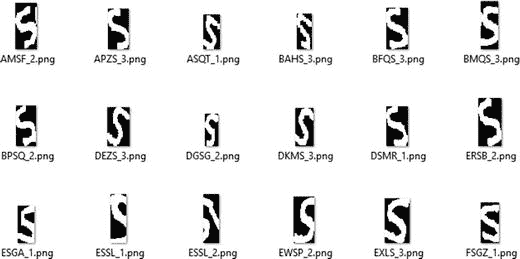

**图 9-20** 提取出的"S"图像集合

```python
from os import makedirs
import os.path
from glob import glob
from functions import *
from constants import *

image_files = glob(os.path.join(CAPTCHA_FOLDER, '*.png'))
for image_file in image_files:
    print('正在处理文件:', image_file)
    answer = os.path.basename(image_file).split('_')[0]
    image = cv2.imread(image_file)
    processed = process_image(image)
    contours = get_contours(processed)
    if not len(contours):
        print('[!] 无法提取轮廓')
        continue
    letters = get_letters(processed, contours)
    if len(letters) != NR_CHARACTERS:
        print('[!] 无法提取所需数量的字符')
        continue
    if any([l.shape[0] < 10 or l.shape[1] < 10 for l in letters]):
        print('[!] 部分提取的字符尺寸过小')
        continue
    for i, mask in enumerate(letters):
        letter = answer[i]
        outfile = '{}_{}.png'.format(answer, i)
        outpath = os.path.join(LETTERS_FOLDER, letter)
        if not os.path.exists(outpath):
            makedirs(outpath)
        print('[i] 保存', letter, '为', outfile)
        cv2.imwrite(os.path.join(outpath, outfile), mask)
```

如果你运行此脚本，`letters` 目录下现在应为每个字母创建一个子目录，具体可参考图 9-20。现在我们已经准备好构建深度学习模型。我们将使用一个简单的卷积神经网络架构，并借助 `Keras` 库来实现。

```
pip install -U keras
```

要使用 `Keras`，我们还需要安装一个后端（可以理解为 `Keras` 所使用的“引擎”）。你可以使用功能相对有限的 `theano` 库、谷歌的 `Tensorflow`，或者微软的 `CNTK`。我们假设你使用的是 Windows 系统，因此 `CNTK` 是最容易上手的选择。（否则，请改用 `pip` 安装 `theano` 库。）要安装 `CNTK`，请访问 [`https://docs.microsoft.com/en-us/cognitive-toolkit/setup-windows-python?tabs=cntkpy231`](https://docs.microsoft.com/en-us/cognitive-toolkit/setup-windows-python?tabs=cntkpy231) 并查找与你 Python 版本对应的 URL。如果你的计算机有兼容的 GPU，可以使用 `GPU` 选项。如果这不起作用或者遇到问题，请坚持使用 `CPU` 选项。然后按如下方式执行安装（使用 GPU Python 3.6 版本 URL）：

```
pip install -U https://cntk.ai/PythonWheel/GPU/cntk-2.3.1-cp36-cp36m-win_amd64.whl
```

接下来，我们需要创建一个 `Keras` 配置文件。运行一个 Python REPL 并按如下方式导入 `Keras`：

```python
>>> import keras
Using TensorFlow backend.
Traceback (most recent call last):
  File "<stdin>", line 1, in <module>
  File "<path>\site-packages\keras\__init__.py", line 3, in <module>
    from . import utils
  File "<path>\site-packages\keras\utils\__init__.py", line 6, in <module>
    from . import conv_utils
  File "<path>\site-packages\keras\utils\conv_utils.py", line 3, in <module>
    from .. import backend as K
  File "<path>\site-packages\keras\backend\__init__.py", line 83, in <module>
    from .tensorflow_backend import *
  File "<path>\site-packages\keras\backend\tensorflow_backend.py", line 1, in <module>
    import tensorflow as tf
ModuleNotFoundError: No module named 'tensorflow'
```

`Keras` 会提示无法找到其默认后端 `Tensorflow`。这没关系；只需退出 REPL。接下来，在 Windows 文件资源管理器中导航到 `%USERPROFILE%\.keras`。那里应该有一个 `keras.json` 文件。使用记事本或其他文本编辑器打开此文件，并将内容替换为如下所示：

```json
{
    "floatx": "float32",
    "epsilon": 1e-07,
    "backend": "cntk",
    "image_data_format": "channels_last"
}
```

#### 使用其他后端

如果你使用的是 `Tensorflow`，只需将 `backend` 值保留为 `tensorflow`。如果你使用的是 `theano`，请将该值设置为 `theano`。请注意，在后一种情况下，你可能还需要在系统中查找 `.theanorc.txt` 文件并修改其内容，以确保一切正常工作，尤其是 `device` 条目，如果 `theano` 无法找到 GPU，则应将其设置为 `cpu`。

完成此更改后，尝试在一个新的 REPL 会话中再次测试导入 `Keras`。现在你应该看到以下输出：

```python
>>> import keras
Using CNTK backend
Selected GPU[1] GeForce GTX 980M as the process wide default device.
```

`Keras` 现已设置完成，并且能够识别我们的 GPU。如果 `CNTK` 报错，请记得尝试 CPU 版本，但要注意，在这种情况下（以及只能使用 CPU 计算时的 `theano` 和 `Tensorflow`），训练模型所需的时间会显著增加。

现在我们可以创建另一个 Python 脚本来训练模型（`train.py`）：

```python
import cv2
import pickle
from os import listdir
import os.path
import numpy as np
from glob import glob
from sklearn.preprocessing import LabelBinarizer
from sklearn.model_selection import train_test_split
from keras.models import Sequential
from keras.layers.convolutional import Conv2D, MaxPooling2D
from keras.layers.core import Flatten, Dense
from constants import *

data = []
labels = []
nr_labels = len(listdir(LETTERS_FOLDER))

##### 将每个图像转换为数据矩阵
for label in listdir(LETTERS_FOLDER):
    for image_file in glob(os.path.join(LETTERS_FOLDER, label, '*.png')):
        image = cv2.imread(image_file)
        image = cv2.cvtColor(image, cv2.COLOR_BGR2GRAY)

        # 调整图像大小，使所有图像具有相同的输入形状
        image = cv2.resize(image, MODEL_SHAPE)

        # 扩展维度以满足 Keras 的要求
        image = np.expand_dims(image, axis=2)
        data.append(image)
        labels.append(label)

##### 归一化数据，使每个值介于 0 和 1 之间
data = np.array(data, dtype="float") / 255.0
labels = np.array(labels)

##### 创建训练-测试拆分
(X_train, X_test, Y_train, Y_test) = train_test_split(data, labels,
                                                      test_size=0.25, random_state=0)

##### 对标签进行二值化
lb = LabelBinarizer().fit(Y_train)
Y_train = lb.transform(Y_train)
Y_test = lb.transform(Y_test)

##### 保存二值化结果供后续使用
with open(LABELS_FILE, "wb") as f:
    pickle.dump(lb, f)
```


##### 构建模型架构

```
model = Sequential()
model.add(Conv2D(20, (5, 5), padding="same",
input_shape=(MODEL_SHAPE[0], MODEL_SHAPE[1], 1), activation="relu"))
model.add(MaxPooling2D(pool_size=(2, 2), strides=(2, 2)))
model.add(Conv2D(50, (5, 5), padding="same", activation="relu"))
model.add(MaxPooling2D(pool_size=(2, 2), strides=(2, 2)))
model.add(Flatten())
model.add(Dense(500, activation="relu"))
model.add(Dense(nr_labels, activation="softmax"))
model.compile(loss="categorical_crossentropy", optimizer="adam", metrics=["accuracy"])

##### 训练并保存模型
model.fit(X_train, Y_train, validation_data=(X_test, Y_test),
batch_size=32, epochs=10, verbose=1)
model.save(MODEL_FILE)
```

我们在这里做了几件事。首先，我们遍历所有已生成的图像，调整其大小，并存储它们的像素矩阵以及对应的答案。接着，我们对数据进行归一化处理，使每个值都介于 0 和 1 之间，这能让神经网络更容易处理。然后，由于 Keras 无法直接处理 `"Q"`、`"W"` 等标签，我们需要对其进行二值化处理：每个标签都被转换成一个输出顶点，每个索引对应一个可能的字符，其值设为 1 或 0，这样一来，`"Q"` 就变成了 `[1, 0, 0, 0,…]`，`"W"` 则变成了 `[0, 1, 0, 0,…]`，依此类推。我们保存了这个转换关系，因为在应用模型时，我们还需要用它来将输出转换回字符。接下来，我们构建神经网络架构（实际上相对简单），并开始训练模型。如果你运行这个脚本，你会得到类似如下的输出：

```
Using CNTK backend
Selected GPU[0] GeForce GTX 980M as the process wide default device.
Train on 1665 samples, validate on 555 samples
Epoch 1/10
C:\Users\Seppe\Anaconda3\lib\site-packages\cntk\core.py:361: UserWarning: your data is of type "float64", but your input variable (uid "Input4")
expects "". Please convert your data           beforehand to speed up training.
(sample.dtype, var.uid, str(var.dtype)))
32/1665 [..............................] - ETA: 36s - loss: 3.0294 - acc: 0.0312
64/1665 [>.............................] - ETA: 22s - loss: 5.1515 - acc: 0.0312
[...]
1600/1665 [===========================>..] - ETA: 0s - loss: 7.6135e-04 - acc: 1.0000
1632/1665 [============================>.] - ETA: 0s - loss: 8.3265e-04 - acc: 1.0000
1664/1665 [============================>.] - ETA: 0s - loss: 8.2343e-04 - acc: 1.0000
1665/1665 [==============================] - 3s 2ms/step - loss: 8.2306e-04 - acc:
1.0000 - val_loss: 0.3644 - val_acc: 0.9207
```

我们在验证集上获得了 92% 的准确率，这成绩相当不错！剩下的唯一一件事就是展示如何使用这个网络来预测验证码（`apply.py`）：

```
from keras.models import load_model
import pickle
import os.path
from glob import glob
from random import choice
from functions import *
from constants import *
with open(LABELS_FILE, "rb") as f:
lb = pickle.load(f)
model = load_model(MODEL_FILE)

##### 我们在这里随机选取一张训练图像来演示预测的工作方式。在实际场景中，你显然会将其接入你的网络抓取流程，并传入一个"实时的"验证码图像。
image_files = list(glob(os.path.join(CAPTCHA_FOLDER, '*.png')))
image_file = choice(image_files)
print('Testing:', image_file)
image = cv2.imread(image_file)
image = process_image(image)
contours = get_contours(image)
letters = get_letters(image, contours)
for letter in letters:
letter = cv2.resize(letter, MODEL_SHAPE)
letter = np.expand_dims(letter, axis=2)
letter = np.expand_dims(letter, axis=0)
prediction = model.predict(letter)
predicted = lb.inverse_transform(prediction)[0]
print(predicted)
```

如果你运行这个脚本，你应该会看到类似如下的输出：

```
Using CNTK backend
Selected GPU[0] GeForce GTX 980M as the process wide default device.
Testing: generated_images\NHXS_322.png
N
H
X
S
```

如你所见，网络正确地预测了验证码中的字符序列。这就结束了我们对验证码破解的简要介绍。正如我们之前讨论过的，请记住，存在几种替代方法，例如训练 OCR 工具包，或者以低成本使用提供“人工破解”的服务。同时请注意，如果你计划将这个想法应用于其他验证码，你可能需要对 OpenCV 和 Keras 模型进行微调，而且我们这里使用的验证码生成器仍然相对“简单”。然而，最重要的一点是，验证码本身就是一个警告，明确表示不欢迎网络爬虫。在开始四处破解验证码之前，请务必牢记这一复杂性。

#### 甚至传统模型也可能奏效

正如我们所看到的，建立一个深度学习流程并非易事。如果你想知道像随机森林或支持向量机这样的传统预测建模技术是否也能奏效（例如，这两者在 `scikit-learn` 中都有提供，并且设置和训练起来快得多），答案是肯定的，在某些情况下它们确实可能有效，尽管准确率会大打折扣。这些传统技术难以理解图像的二维结构，而这正是卷积神经网络旨在解决的问题。话虽如此，我们曾使用随机森林和大约 100 张手动标注的验证码图像搭建过流程，获得的准确率较低，大约只有 10%，但足以在尝试几次后得到正确的答案。

## 索引

### A

- Amazon 评论
- 浏览器开发者工具
- 数据集库
- `json` 模块
- 《Learning Python by Mark Lutz》
- `matplotlib` 库
- `ntlk`
- `POST` 请求
- Python 交互式解释器
- 情感评分图，评分等级
- 文本编辑器
- `vaderSentiment` 库

#### 应用程序编程接口（API）

#### 美联社（AP）与 Meltwater

### B

- 巴克莱银行抵押贷款模拟器
- Beautiful Soup
  - `attrs` 参数
  - 代码片段
  - `Comment` 对象
  - 复杂选择器
  - CSS 选择器
  - 文档
  - 元素
  - 剧集表格
  - `find` 和 `find_all`
  - 权力的游戏
  - HTML 页面
  - HTML 树
  - 安装
  - `**keywords`
  - `limit` 参数
  - 列表与正则表达式
  - 方法
  - `name` 参数
  - `NavigableString` 对象
  - 解析器
  - `recursive` 参数
  - `string` 参数
  - 基于树的表示
  - 警告
- 董事会成员
- 可供抓取的书籍

### C

- `CacheControl`
- 缓存
- 层叠样式表（CSS）
- Chrome 开发者工具
  - 格式化
  - HTML 属性
  - 选择器
  - 样式声明
  - Wikipedia 页面
- 云端抓取
- 聚类，时尚商品
- 命令行工具
- 全自动区分计算机和人类的图灵测试（CAPTCHA）
  - 轮廓，分离图像
  - `drawContours` 方法
  - `generated_images`
  - Keras 配置文件
  - Keras 库
  - 卷积核大小
  - `letters` 目录
  - 神经网络架构
  - OpenCV
  - Python 脚本
  - 土壤侵蚀
  - 阈值处理、开运算与轮廓检测
  - `train.py`
- 《计算机欺诈与滥用法案》（CFAA）
- Cookie 劫持
- Craigslist 与 Naturemarket
- 跨行业数据挖掘标准流程（CRISP-DM）
  - 商业理解
  - 数据清洗
  - 数据分析
  - 数据来源
  - 描述
  - 解释、评估与部署
  - KDD 过程
  - 数据选择
  - 数据转换
- `cURL`

### D, E

- 数据科学
  - 分析师与建模师
  - 大数据平台专家
  - 业务整合者、赞助者与倡导者
  - 商业智能专家
  - CRISP-DM


### 参见

### C

- `跨行业数据挖掘标准流程 (CRISP-DM)`
- `数据库管理员`
- `数据整理员`
- `基础理论家、数学家与统计学家`
- `黑客画像`
- `IT 架构师`
- `管理层`
- `利益相关者`

### D

- `网络爬取`
- `应用程序接口 (API)`
- `数据源`
- `管理警告`
- `模型训练与模型运行差距`
- `生产环境`
- `产品`
- `爬取数据`
- `网站`
- `《数字千年版权法案》(DMCA)`

### F

- `Facebook 诉 Power Ventures 案`
- `表单数据`

### G

- `Gephi 可视化`
- `GitHub`
- `全局解释器锁 (GIL)`
- `图形化爬取工具`

### H

- `Hacker News API`
- `HTTPie`
- `超文本标记语言 (HTML)`
- `Google Chrome`
  - `开发者工具`
  - `元素标签页`
  - `网络标签页`
  - `保留日志`
  - `查看源代码`
- `维基百科`
- `编程语言`
- `Python 库`
- `标签`
- `网页浏览器`
- `维基百科`
- `超文本传输协议 (HTTP)`
  - `“Accept-Encoding”`
  - `二进制`
  - `空白 <CR><LF> 行`
  - `CONNECT 和 OPTIONS 方法`
  - `“Content-Type”`
  - `Cookies`
  - `“action” 属性`
  - `浏览器开发者工具`
  - `缺点`
  - `邪恶 Cookie`
  - `指纹追踪`
  - `功能`
  - `GET 请求`
  - `多值消息头`
  - `网络协议`
  - `PHPSESSID`
  - `基于请求-响应的模式`
  - `秘密代码`
  - `“Set-Cookie” 消息头`
  - `DELETE 方法`
  - `表单与 POST 请求`
    - `“action” 属性`
    - `Chrome 开发者工具`
    - `“comments” 字段`
    - `“Content-Type” 请求`
    - `data 参数`
    - `“<form>” 标签`
    - `“<input>” 标签`
    - `方法`
    - `保护字段`
    - `Python 字典`
    - `请求数据`
    - `URL 参数`
    - `网页浏览器`
    - `网页表单`
    - `网络服务器`
    - `网站`
  - `内容形式`
  - `“GET / HTTP/1.1”`
  - `消息头`
  - `allow_redirects 参数`
  - `auth 参数`
  - `认证机制`
  - `浏览器开发者工具`
  - `类别`
  - `destination.php`
  - `“保留日志” 选项`
  - `“Referer”`
  - `requests 库`
  - `“User-Agent”`
  - `HEAD 方法`
  - `JSON`
  - `POST 请求`
  - `PUT 方法`
  - `Python`
  - `参见 Python, requests 库`
  - `请求消息头`
  - `请求消息`
  - `请求-响应消息`
  - `会话机制`
  - `状态码`
  - `TRACE 和 PATCH 方法`
  - `“User-Agent” 消息头`

### I

- `IATA 航空公司信息`
- `互联网电影数据库 (IMDB)`
- `互联网服务提供商 (ISP)`

### J, K

- `JavaScript`
  - `客户端网页浏览器`
  - `Cookies`
  - `定义`
  - `片段`
  - `“$()” 函数`
  - `“getJSON” 函数`
  - `“jsenabled” cookie`
  - `网络请求`
  - `nonce 和 PHPSESSID cookies`
  - `“quotes.php”`
  - `requests 和 Beautiful Soup`
  - `逆向工程`
  - `“<script>” 标签`
  - `源代码`

### L

- `潜在狄利克雷分配 (LDA) 模型`
- `法律问题`
  - `美联社 (AP) 诉 Meltwater 案`
  - `CFAA`
  - `版权保护, 谷歌图书`
  - `Craigslist 诉 Naturemarket 案`
  - `欧盟 (EU)`
  - `《计算机滥用法》与非法侵入动产`
  - `《1996 年欧盟数据库指令》`
  - `Facebook`
  - `Facebook 诉 Power Ventures 案`
  - `谷歌新闻网站`
  - `hiQ Labs`
  - `LinkedIn 与微软高管`
  - `LinkedIn 诉 Doe 被告案`
  - `潜在客户`
  - `项目原则`
  - `QVC`
  - `瑞安航空有限公司诉 PR Aviation BV 案`
  - `Ticketmaster 诉 Riedel Marketing Group (RMG) 案`
  - `美国`
    - `违反服务条款`
    - `CFAA`
    - `版权/商标侵权`
    - `《数字千年版权法案》、《反垃圾邮件法》`
    - `爬虫排除协议`
    - `非法侵入动产`
  - `LinkedIn 诉 Doe 被告案`

### M

- `抵押贷款利率`

### N

- `网络`
  - `通信`
  - `OSI 模型层级`
  - `建立连接`
  - `www.google.com`
  - `DNS 服务器`
  - `建立到 172.217.17.68 的连接`
  - `HTTP 请求`
  - `IP 地址`
  - `操作系统`
  - `TCP`
  - `文本内容，HTML`
- `新闻文章`
  - `浏览器控制台`
  - `Chrome`
  - `“Content-Security-Policy”`
  - `dataset 库`
  - `DB Browser for SQLite`
  - `execute_script 方法`
  - `提取文章信息`
  - `for 循环`
  - `GitHub`
  - `LDA 模型`
  - `链接`
  - `加载本地文件内容`
  - `Mozilla 文档`
  - `Mozilla 的 Readability 实现, JavaScript`
  - `nltk, stop-words, 与 gensim 库`
  - `readability-script`
  - `“<script>” 标签`
  - `来自 Google News 的“热门故事”`

### O

- `对象关系映射 (ORM)`
- `开放系统互连 (OSI) 模型`

### P

- `Parsehub`
- `PhantomJS`
- `Portia`
- `编程语言`
- `代理服务器`
- `Puppeteer`
- `Python`
  - `尖括号 (“> > >”)`
  - `参数`
  - `布尔逻辑值`
  - `控制流`
  - `字典`
  - `等于与不等于运算符 (“==” 和 “!=”)`
  - `for 循环`
  - `“if” 代码块`
  - `解释器 REPL`
  - `可迭代对象`
  - `列表`
  - `取模运算符`
  - `数字类型`
  - `print 函数`
  - `range 函数`
  - `资源`
  - `运行源文件`
  - `集合`
  - `“`.py`” 文件中的源代码`
  - `字符串`
  - `元组`
  - `变量`
  - `while 循环`
- `Python, requests 库`
  - `“Accept-Encoding” 消息头`
  - `aiohttp`
  - `创建 Python 文件`
  - `错误/警告`
  - `grequests`
  - `headers 属性`
  - `“HTTP GET” 请求`
  - `httplib2`
  - `HTTP 状态码`
  - `安装 requests`
  - `网络功能`
  - `request.Response 对象`
  - `requests`
  - `requests.get 方法`
  - `r.text`
  - `urllib`
  - `urllib3`
  - `“User-Agent”`

### Q

- `查询字符串, URL 参数`
  - `“a”, “b” 和 “op”`
  - `字符`
  - `代码示例`
  - `约定`
  - `空参数与有序参数`
  - `片段标识符`
  - `HTML 格式文本`
  - `质量，requests 文档`
  - `requests`
  - `requests.get 方法`
  - `斜杠 (“/”)`
  - `“url-lib.parse” 函数`
  - `网络服务器`
  - `维基百科`
- `要爬取的引用`

### R

- `路透社`
- `瑞安航空有限公司诉 PR Aviation BV 案`

### S

- `爬取 Hacker News`
- `Scrapy`
- `屏幕抓取`
- `Selenium`
  - `ActionChains 对象`
  - `属性`
  - `Chrome 窗口`
  - `条件`
  - `Cookies`
  - `自定义等待条件`
  - `定义`
  - `库文档`
  - `下载 WebDriver`
  - `execute_script 方法`
  - `HTML 元素`
  - `隐式等待与显式等待`
  - `JavaScript 命令与操作`
  - `特殊键辅助对象`
  - `定位器参数`
  - `定位器元组`
  - `匹配元素`
  - `方法与属性`
  - `导航`
  - `Python 控制台`
  - `引用元素`
  - `实际项目`
  - `requests 与 Beautiful Soup`
  - `操作选择`
  - `WebDrivers`
  - `WebDriverWait 对象`
  - `WebElement 对象`
  - `网页操作`
  - `XPath 表达式与规则`
- `siteTheme`
- `SlimerJS`
- `SQLite 数据库`

### T, U, V

- `第三方 Cookie`
- `Ticketmaster 诉 Riedel Marketing Group (RMG) 案`
- `传输控制协议 (TCP)`

### W, X, Y, Z

- `网络爬虫`
  - `数据库`
  - `数据收集`
  - `描述`
  - `关键词`
  - `法律问题`
  - `并行编程`
  - `在线商店的产品页面`
  - `使用 Python`
  - `队列`
  - `重试/中止`
  - `与爬取分离`
  - `单个网站`
  - `提前停止`
  - `将进度存储到 SQLite 数据库中`
  - `已爬取的图像与网页`
  - `爬取结果`
  - `HTML 内容`
  - `NetworkX 库`
  - `对象关系映射 (ORM)`
  - `链接队列`
  - `records 库`
  - `urldefrag 函数`
  - `维基百科`
- `网络论坛交互`
- `网页爬取`
  - `银行与金融机构`
  - `最佳实践`
    - `API`
    - `Beautiful Soup`
    - `验证码`
    - `猫鼠游戏`
    - `检查浏览器`
    - `云端爬取`
    - `爬虫`
    - `HTTP 请求`
    - `JavaScript 引擎`
    - `管理与法律问题`
    - `用户代理与引荐来源`
    - `警告`
    - `网络服务器`
  - `比特币`
  - `数据科学`
    - `API`
    - `机遇`
    - `原材料`
  - `网页浏览器`
    - `定义`
    - `数字营销人员与数字艺术家`
    - `Emmanuel Sales`
    - `时尚产品`
    - `谷歌产品`
    - `希腊葡萄酒`
    - `人力资源与员工分析`
    - `互联网`
    - `招聘网站`
    - `法律问题`
    - `参见法律问题`
    - `乐高积木信息`
    - `社交媒体消息`
    - `在线价格信息`
    - `实际应用案例`
    - `环境设置`
      - `命令行`
      - `安装 Python 3`
      - `文本编辑器`
    - `社会政治学家`
    - `Tinder 与 Instagram`
  - `维基百科图`
    - `客户端-服务器数据库系统`
    - `爬取设置`
    - `数据库，页面与链接表`
    - `dataset 库`
    - `get_random_unvisited_pages 方法`
    - `get_title_and_links 方法`
    - `“if __name__ == ’__main__’:”`
    - `iGraph`
    - `joblib 库`
    - `多线程方法`
    - `NetworkX`
    - `should_visit 方法`
