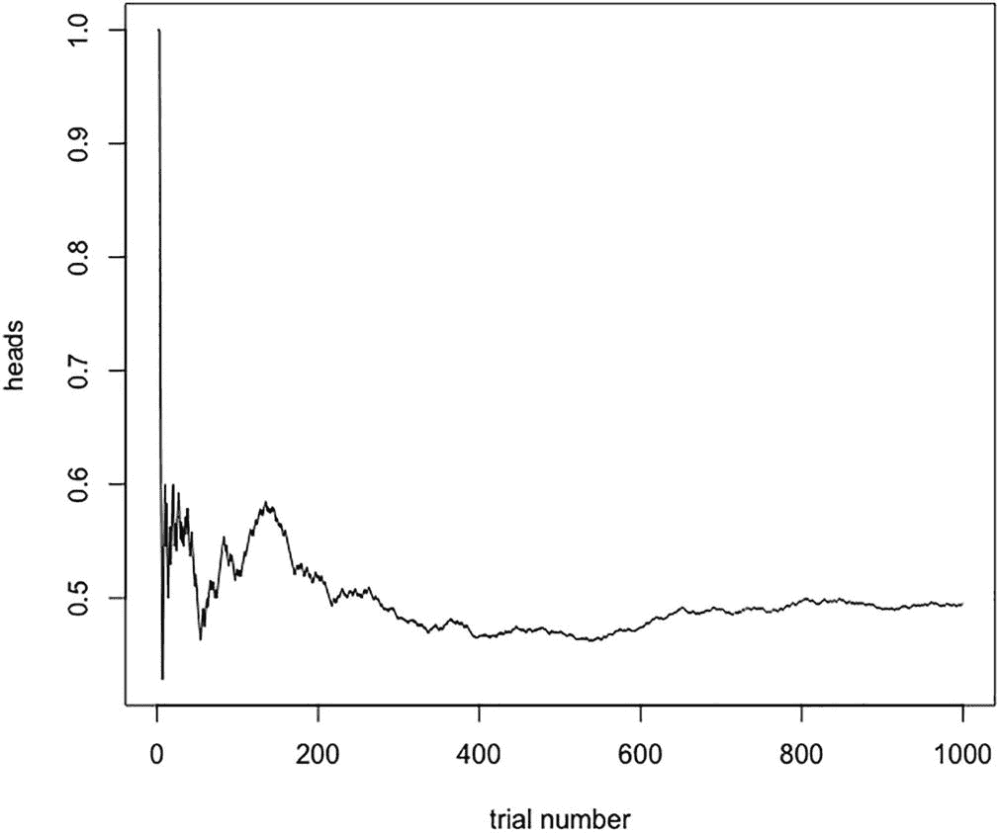
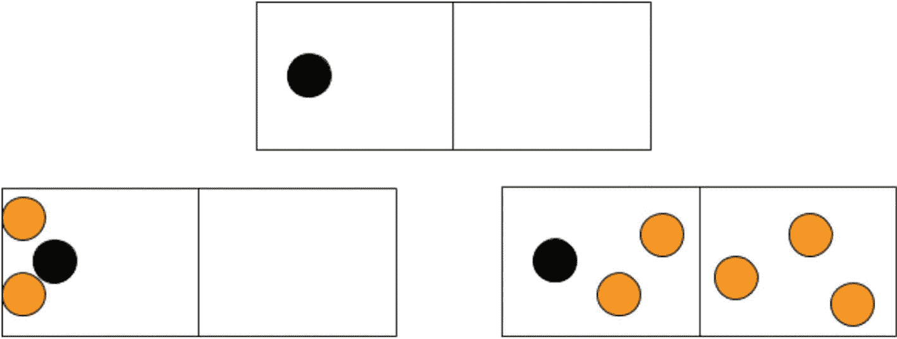
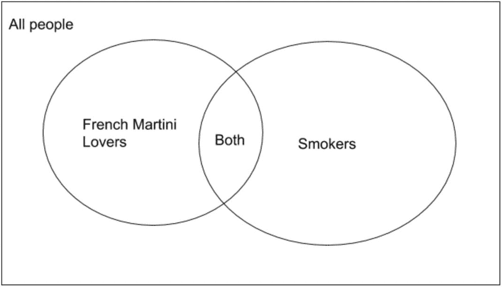
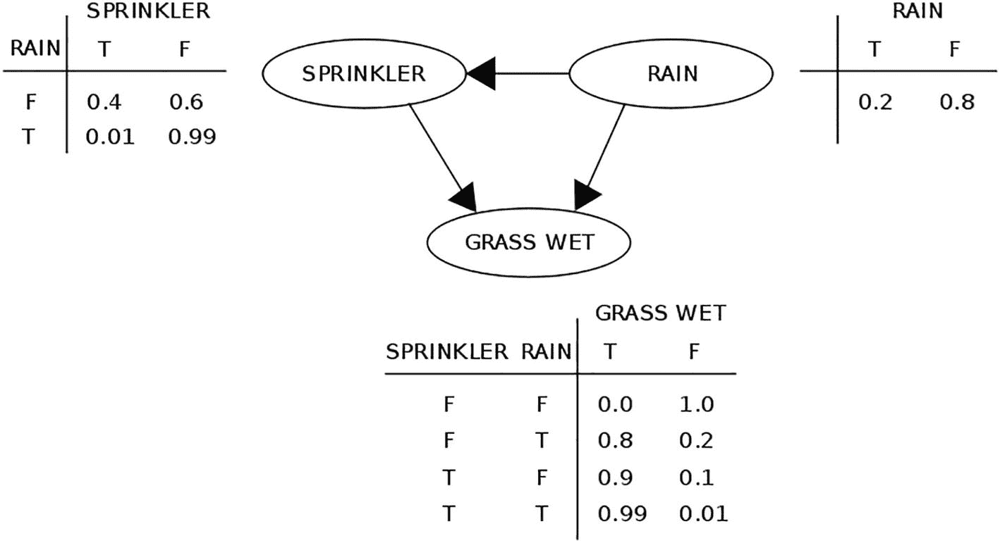

# 4. 概率：用贝叶斯还是不用贝叶斯？

> *“生活是一所概率学校。”*
> ——沃尔特·白哲特

什么是概率？

如果你不是数据科学家，你可能通过学校课程或基于常识对概率有直观的理解。对于许多事件，不可能每次都正确预知结果。但我们知道，某些结果比其他结果更可能发生。简单来说，概率是一种表达和研究哪些结果更可能或更可能发生的方式。“probable”一词的词源学对我们今天如何使用它有着有趣的启示；它源自 14 世纪的法语单词*probable*，意为“可证明或可论证的”，最初源自拉丁语动词*probare*——“尝试、测试”。

如果我问你，抛一枚公平硬币得到反面的概率是多少，你可能会说是 50%。直观上这很合理。然而，你可能无法从数学上解释为什么这应该是正确的。抛硬币是计算概率的一个简单案例。你如何定义曼联赢得下一届欧冠联赛的概率？你可能对哪支足球队最好有个人信念（这种信念每年都可能改变），但你得出这个概率的方式“感觉”与抛硬币的情况不同。

如果你坚信曼联会赢得本赛季的欧冠联赛，你可能会说给它 70%的概率。但你怎么知道不是 71%？或者 61%？在抛硬币的场景中，如果有人告诉你得到正面的概率是 51%，那么你会说这枚硬币不公平。在赌场里，游戏中概率 1%的变化可能就是赌场大赚一笔或蒙受巨额亏损的差异。

我们都熟悉概率——它甚至影响着我们日常生活的细微之处，比如公交车准点到达的可能性——它是我们表达和评估不确定性的主要工具。想想你一周内说了多少次“可能”。尽管如此，定义概率并准确理解它是如何（以及为什么）起作用的，实际上非常棘手。

## 频率学派还是贝叶斯学派？

概率最流行的定义，也可以说是最直观的定义，是频率学派的定义（也称为*频率主义*）。根据频率学派的观点，一个事件的概率被定义为该事件在大量试验中频率的极限。

这到底是什么意思？让我们回到抛一枚公平硬币的例子。你可能会说，单次抛掷得到正面的概率是 50%。然而，你怎么知道这是真的呢？如果连续十次都抛到反面呢？这会改变抛到正面的概率吗？显然不会。直觉上这说得通，但原因何在？

我做了一个抛硬币实验（用`R`编程语言模拟^(¹⁶)），你可以在图 4-1 中看到结果。正面比例非常快地收敛到了 50%。


**图 4-1** — 抛硬币实验

这就是实践中频率学派概率的定义。如果你反复执行一个实验很多次，那么其频率将收敛到它们的真实概率。

在历史上大部分时期，频率学派统计学都是正统的统计学分支。亚里士多德在其《修辞学》中写道：“所谓‘概然’者，乃多数情况下会发生之事。”统计学实践基于这样一种信念：你可以从一个总体中抽取一个样本，然后研究该总体的性质。如果我们把样本中的每个实体都看作一次实验，那么我们收集的样本越多，就越接近真相。

然而，对于某些事件，频率学派的解释毫无意义。这其中许多事件对我们的生活有着重大影响——例如，选举或公投的结果。我们无法进行 1000 次选举实验来观察会发生什么。同样，我们无法进行 1000 场欧冠决赛来确定曼联获胜的真实概率。

正是在这一点上，贝叶斯概率的定义派上了用场。

尽管托马斯·贝叶斯牧师从未亲自发表过他的理论——这些理论是由他的朋友理查德·普莱斯在他去世后记录并编辑的——但贝叶斯定理（或称贝叶斯理论）却以他的名字命名。具有讽刺意味的是，没有人确切知道贝叶斯出生的时间（尽管他于 1761 年去世），或他的长相；虽然有一幅肖像画流传下来，但画中人是否*确实*是贝叶斯本人并不确定。

贝叶斯在 1763 年提交给皇家学会的《论机会学说中一个问题的求解》一文中使用了条件概率（你很快就会学到）。贝叶斯的工作涉及以下问题：仅根据一个事件过去发生——或未发生——的次数，你如何能知道该事件的概率？贝叶斯使用了一个思想实验来阐述他的论点。

贝叶斯背对着桌子，他的助手将一个球扔到桌上。球落在桌上任何位置的概率都是相等的。贝叶斯必须猜出球在哪里。第一次扔球时，贝叶斯面临着最大的不确定性，因为球可能落在桌子上的任何地方。

下一步，他的助手又扔了一个球，并报告这个球是落在第一个球的左边还是右边。假设这次球落在了桌子的右边。我们可以推断，第一个球现在更可能是在左边。如果第一个球本来落在左边，那么右边就会有更多空间让另一个球落下。

然后，助手再次扔球，这个球又落在了右边。这使得第一个球在左边的可能性进一步增大。因此，随着每一次投掷，我们都在越来越精确地缩小第一个球的位置范围。图 4-2 展示了这一思想。


**图 4-2** — 贝叶斯论点的图示

如图 4-2 所示，第一个球（黑球）扔出后，第二个球（橙色球）在桌子右侧的空间比左侧大。在第二行（左图）中，你可以看到只有少数位置能让第二个球落在第一个球的左边。在第二行（右图）中，你看到的是第一个球右边所有橙色球可能落到的位置。很明显，第一个球右边的空间更大，而且大部分空间位于桌子的右侧。不过，橙色球仍有可能位于黑球的右边，但却在桌子的左侧。因此，仅凭两次掷球不足以完全确定黑球的位置。

在现代世界中，这或许让我们有点想起“海战棋”桌游。在海战棋中，每个玩家（游戏只有两名玩家）需要将舰船放置在一个方形棋盘上。每轮，玩家指定棋盘上的一个点进行攻击。如果击中了船的一部分，对方玩家会告知他们成功击中了船的一部分，但不提供其他信息。舰船在棋盘上可以有两种放置方式（水平或垂直）。因此，玩家必须首先通过一次命中找到船的位置，然后猜测船剩下的部分在哪里。通过在棋盘上尝试更多点，对舰船位置的不确定性会一轮轮地降低。

想想 1976 年著名的小品《双人组》中的“四根蜡烛”。对店主说“叉柄”（fork handles）在发音上与说“四根蜡烛”（four candles）相同；这是一对同音词。如果你在一家既卖叉柄也卖蜡烛的五金店，那么有 50% 的概率顾客想要的是蜡烛。但如果你在一家蜡烛店，这就是一条新信息，那么顾客要的是蜡烛——而非叉柄——的概率就增加了。

贝叶斯理论背后的主要概念如下：

-   *初始信念 + 新信息 = 新信念*

用现代术语表述，就变成了：

-   *先验 + 似然 = 后验*

你接下来会学到更多。

贝叶斯本人从未专注于这个如今以他名字命名的定理。他同时代的数学家们对他的方法并不满意，原因有二。第一，“猜测”听起来不像一个严谨的过程。第二，在缺乏信息的情况下，贝叶斯假设所有结果都是等可能的。用现代统计学的说法，我们会说先验是均匀的。不得不赋予一个先验信念概率似乎是一个额外的障碍。

这个定理被有史以来最杰出的数学家之一独立发现：皮埃尔-西蒙·德·拉普拉斯。拉普拉斯重新发现了这一原理，并于 1774 年发表。1781 年，拉普拉斯在访问巴黎时，终于得知了贝叶斯更早的发现。拉普拉斯改进他的公式，并决定对其进行检验。

拉普拉斯想知道，出生男孩多于女孩这一事实究竟是自然规律，还是仅仅是统计异常。他收集了来自伦敦、巴黎、圣彼得堡、法国乡村地区、埃及和中美洲的记录。利用他的定理，他成功地得出结论，即这确实似乎是一条自然规律。^(¹⁷)

# 拉普拉斯与概率论史

拉普拉斯继续为天文学等其他科学领域做出了重大贡献。有一句广为流传的名言据说出自拉普拉斯。故事是这样的：拿破仑问他为何在解释天体运动时不将上帝纳入其中，拉普拉斯回答道：`Je n'avais pas besoin de cette hypothèse-là,` 即“我不需要那个假设。”

拉普拉斯与牛顿同属一个学者时代，他们发起了一场科学革命，将数学和理性作为解释不确定性的主要工具（取代了宗教和形而上学解释）。

但尽管拉普拉斯完成了贝叶斯定理的大部分工作，他的名字却从未与之挂钩。

拉普拉斯后来发现了“中心极限定理”，这是现代数学中最强大、最重要的发现之一（你将在后文再次遇到）。发现该定理后，他意识到一旦我们拥有大量数据，贝叶斯方法就会趋近于传统的频率学派方法。于是，拉普拉斯转向了频率主义，并终身恪守。

需要特别指出的是，尽管当今的主要争论集中在频率学派和贝叶斯学派之间，但关于概率论这一主题，还有其他一些观点值得讨论。

拉普拉斯、雅各布·伯努利（17 世纪末瑞士数学家）和布莱兹·帕斯卡（17 世纪法国数学家，以“帕斯卡的赌注”闻名）使用的经典概率定义，运用了样本空间的概念：为了得到某个结果的概率，我们只需将有利结果的总数除以所有可能结果的总数。伯努利还提出了所谓的“无差别原则”。根据该原则，如果我们研究多个结果，而这些结果除了名称不同外彼此无法区分，那么它们应被赋予相等的概率。这一原则和经典定义引导我们得出掷骰子每一面朝上的概率为 `1/6`。

事件在无限次试验极限下趋近其真实概率的观点后来才出现，对其影响最大的人物包括罗纳德·费希尔（1890–1962）、冯·米塞斯（1883–1973）和约翰·文（1834–1923）。这一定义与频率主义关联更紧密，并且由于引入了“试验”这一概念，它无法为选举和足球比赛等一次性、不可重复的事件赋予概率。

查尔斯·皮尔斯（1839–1914）和卡尔·波普尔（1902–1994）都支持概率的倾向性观点。也就是说，某些事件在特定条件下具有发生的`倾向`。一枚硬币有 50%的概率抛出正面，这是由赋予它这种倾向的物理因素决定的。大数定律在这一定义中扮演着核心角色（你将在后文进一步了解该定律）。根据这种观点，经过大量试验后，我们会在 50%的情况下得到正面，因为这是系统倾向性的体现。

最后，还有两种更贴近贝叶斯观点的概率观。布鲁诺·德·菲内蒂（1906–1985）提出了将概率视为主观信念的观点，弗兰克·拉姆齐（1903–1930）也支持这一观点。杰弗里斯和鲁道夫·卡尔纳普则将概率视为经典逻辑的延伸。概率论的正统定义属于俄罗斯数学家安德烈·柯尔莫哥洛夫（1903–1987），他提供了定义概率所需的公理。

由于所有这些定义现在要么被归入频率学派，要么被归入贝叶斯学派，让我们继续探索这两种理论。

## 贝叶斯定理的公式表述

不要被以下方程晦涩的外表吓倒。初看之下，你可能会觉得自己被扔回了一堂混乱不堪的代数课，但理解贝叶斯定理很可能比你想象的要容易。

贝叶斯定理的公式如下：

```
P(B) = P(A) * P(A) / P(B)
```

回想一下，贝叶斯使用了条件概率。这是在给定另一个事件的情况下，一个事件发生的概率。在给定事件 `B` 的情况下，事件 `A` 发生的条件概率写作 `P(A|B)`。

贝叶斯定理用通俗语言翻译如下：

- “在 `B` 发生的情况下，`A` 发生的概率，等于在 `A` 发生的情况下 `B` 发生的概率，乘以 `A` 的概率，再除以 `B` 的概率。”

另一种分解分母的方式（可能会让数学感更强的人更清楚）如下：

```
P(B) = P(A) * P(A) / sum(P(B|A') * P(A'))
```

`B` 发生的概率，等于给定任何可能的 `A` 时，`B` 的条件概率之和。那么，我们来看一个例子。假设你知道在你的小镇上，有些人酷爱法式马提尼酒。喜欢法式马提尼的人通常也喜欢抽烟。让我们定义 `A`=法式马提尼爱好者，`B`=抽烟。贝叶斯表达式变为：

```
P(抽烟) = P(法式马提尼爱好者) * P(法式马提尼爱好者) / (P(法式马提尼爱好者) * P(法式马提尼爱好者) + P(非法式马提尼爱好者) * P(非法式马提尼爱好者))
```

分母给出了一个人抽烟的总概率，无论他是否喜欢法式马提尼。

图 4-3 用文氏图展示了这个概率。考虑到有些人既是吸烟者又是法式马提尼爱好者，一个人是法式马提尼爱好者的概率会受到他是否吸烟的影响。所以，如果我问你，当一个人是吸烟者时，他喜欢法式马提尼的概率是多少，你只需将图 4-3 中“两者交集”的面积除以“吸烟者”的面积即可。



**图 4-3** – 代表前述公式所在示例宇宙的文氏图

抛开法式马提尼不谈，贝叶斯定理有众多用途。首先，贝叶斯定理在许多问题中以原始形式被直接使用。其次，它催生了贝叶斯统计及其他模型（如贝叶斯网络），这些模型有着广泛的应用。

贝叶斯定理最有用的例子之一是它在医学检测中的应用。假设你怀疑自己可能患上了一种每 1000 人中仅有 1 人罹患的疾病。你决定去看医生并做一项检测。该检测的准确率为 99%。你做了检测，结果呈阳性。那么你患病的概率是多少？

许多人会说他们肯定生病了。然而，在这种情况下，实际患病的概率大约只有 9%，并不高。但是，如果你做了两次检测，结果都是阳性，那么概率就会跃升至 90%。

由此可见，贝叶斯定理在医学统计中很有用。但这只是它众多应用中的一种。贝叶斯定理让我们能够将先验知识纳入计算。赋予的值可能是基于经验的猜测，并不精确，但它们提供了一个起点，以及至少一个粗略的比较和分析基础。

### 贝叶斯定理在其他模型中的应用

贝叶斯定理在其他模型中也扮演着重要角色。`贝叶斯网络`是一类流行的模型，它使我们能够表达不同变量之间的相互依赖关系。图 4-4 展示了一个最著名且最简单的贝叶斯网络示例。



一个流程图。`下雨`连接至`洒水器`和`草地湿润`，`洒水器`连接至`草地湿润`。该图包含三个真值表：左侧为`下雨`和`洒水器`的 2 列 2 行表格，右侧为`下雨`的 2 列 1 行表格，底部为`洒水器`、`下雨`和`草地湿润`的 4 列 4 行表格。

**图 4-4** 贝叶斯网络示例

圆圈（称为“节点”）代表变量，即关于世界真伪的陈述。通过观察一个变量，我们可以了解其他变量的一些信息，具体取决于它们之间的连接方式。箭头表示依赖关系。例如，如果草地是湿的，那么这要么是由于下雨，要么是由于洒水器打开了。然而，如果下雨，洒水器很可能不会打开。如果我们观察到草地是湿的，那么下雨的概率是多少？如果洒水器也开着，这个概率又会如何变化？虽然这个例子看起来很简单，但该模型更复杂的版本可用于诊断疾病等问题。

尽管这个例子很简单，但还存在更复杂的网络版本，其中所有因果关系都被清晰地勾勒出来。在撰写本文时，在 Google Scholar 上搜索“贝叶斯网络”会得到超过 180 万条结果。

尽管贝叶斯定理非常有用，但它并非一直受到学术主流的认可。它大多潜伏在幕后，直到最近才作为建模不确定性的一个重要工具重新流行起来。让我们简要回顾一下它的历史。

## 拉普拉斯之后

在贝叶斯理论复兴之前，“中心极限定理”抢尽了风头，权威们开始收集关于一切事物的数据，认为概率可以是主观的看法听起来似是而非且不够严谨。约翰·斯图尔特·密尔认为概率是对无知的量化，并将其引入了科学领域。

然而，一些科学家仍然在使用它。其中一位是约瑟夫·路易·弗朗索瓦·伯特兰（1822–1900），一位在从经济学到热力学的众多科学领域都有所贡献的法国数学家。伯特兰基于贝叶斯理论，为火炮射击设计了一种方法。该方法处理了诸如风向或敌人位置等不确定性，以优化射击。

法国博学家亨利·庞加莱（1854–1912）在著名的德雷福斯事件中进行了干预，在法庭上提出贝叶斯定理作为阿尔弗雷德·德雷福斯中尉不是叛徒的证据。这是现代法国历史上最著名的审判之一，贝叶斯定理使德雷福斯免于在当时法属圭亚那的终身监禁。可以说，贝叶斯定理是在法庭上处理证据的唯一合理方式，而庞加莱——尽管他是一名频率主义者——也认识到了这一点。

非常遗憾的是，2011 年英国的一家法院裁定贝叶斯定理不能再用于审判^(¹⁸)。一个数学理论（或其缺失）竟能对例如一级谋杀案产生如此重大的影响，这似乎有些奇怪。但这正是 1999 年萨莉·克拉克身上发生的事情，她被错误地判定闷死了自己两个年幼的儿子；陪审员和法官错误地将他们的判决建立在了两个兄弟姐妹同时死于婴儿猝死综合征的统计不可能性上。事实上，母亲蓄意杀害自己两个孩子的统计概率要罕见得多。克拉克的判决被推翻，她最终于 2003 年获释。虽然有时可能难以理解其背后的直觉，但贝叶斯定理非常强大。

另一位我们应该铭记的著名统计学家是哈罗德·杰弗里斯爵士（1891–1989）。杰弗里斯与物理学家伯莎·斯沃尔斯（1903–1999）于 1939 年合著了一本名为《概率论》的书。在随后的几十年里，他们的书是唯一一本解释如何在科学中实践贝叶斯统计的书籍。杰弗里斯对贝叶斯主义的贡献还包括著名的“杰弗里斯先验”。当我们对先验分布一无所知时，就会使用杰弗里斯先验。

伟大的数学家兼计算机科学发明者艾伦·图灵（1912–1954）也使用贝叶斯理论来破解恩尼格玛密码机。恩尼格玛是二战期间德国军队使用的加密代码。在此过程中，他提出了一个名为`ban`的概念，其定义与我们目前在计算机科学中使用的`bit`概念非常相似。事实上，信息论之父克劳德·香农（1916–2001）在其理论发展中也使用了贝叶斯理论。他意识到不确定性是可以量化的，信息可以减少不确定性，而加密则会增加不确定性。

俄罗斯数学家安德雷·科尔莫戈罗夫（1903–1987）发现概率论可以从基本的数学公理推导出来。当德国人在二战期间进攻俄罗斯时，他建议使用伯特兰为火炮射击开发的贝叶斯方法。

20 世纪其他对贝叶斯统计学做出贡献的人包括：图灵的助手之一 I·J·古德（1916–2009），以及丹尼斯·林德利和 L·J·萨维奇。古德于 1950 年撰写了《概率与证据权衡》一书。丹尼斯·林德利（1923–2013）成功地在英国开设了大约十个贝叶斯统计学系。萨维奇（1917–1971）于 1954 年出版了《统计学基础》。

尽管这些开创性的——甚至可以说是改变历史的——贡献，频率主义在 20 世纪的大部分统计学领域中占据了主导地位。这种方法的代表人物是罗纳德·费希尔、耶日·内曼和卡尔·皮尔逊。罗纳德·费希尔（1890–1962）可能是其中最有影响力的一位——他提出了许多定义现代统计学的定理和方法，包括`极大似然`和`实验设计`。内曼和皮尔逊发现了`内曼-皮尔逊引理`，它在假设检验中扮演着重要角色。

假设检验和线性回归成为各种不同科学领域使用的主要工具。对这些方法采用的频率主义方法，在科学出版物和政府研究机构中，如今仍然是主导方法。总的来说，当我们能够设计实验，或者重复实验的类比合理时，频率主义方法效果很好。因此，在赌博、保险、农作物和遗传学等领域，频率主义方法可能是最佳选择。但是，当我们没有足够的信息时，它们就会失效。

当我们知道某个事件可能发生，但没有相关数据时，频率主义的统计学解释就无法帮助我们。同样，它也无法帮助我们处理独特事件，通常是那些具有巨大潜在影响的事件，比如选举——或者流行病。

罗伯特·O·施莱弗（1914–1994）和霍华德·雷法（1924–2016）致力于解决商业决策问题。高管们常常缺乏数据，许多决策必须基于主观判断。这正是贝叶斯概率方法自然适用的地方。1959 年，施莱弗撰写了《商业决策的概率与统计学》一书；随后在 1961 年，施莱弗和雷法合著了《应用统计决策理论》。这两本书都是商业文献中的标准读物。他们将他们的方法称为`不确定性下的决策`，现在称为贝叶斯决策理论。

约翰·图基（1915–2000）是一位著名的频率主义统计学家，通常被认为是`bit`术语的创造者，也有传闻说他曾使用贝叶斯方法来预测选举。他成功预测了 1960 年尼克松与肯尼迪之间的选举，之后为 NBC 工作了二十年。然而，他从未公开过他的方法。直到 2008 年，统计学家内特·西尔弗使用贝叶斯方法正确预测了美国总统选举的结果，贝叶斯主义才在选举预测中声名鹊起。

然而，尽管西尔弗对 2008 年美国大选的成功预测被归功于贝叶斯统计学，但当他在 2016 年完全失准（预测失败）时，并没有多少贝叶斯统计学的支持者感到兴奋。我们将在关于预测的章节中进一步探讨这一点。

还有两个历史例子展示了贝叶斯统计学在研究独特事件时的实用性。诺曼·拉斯穆森（1927–2003）受美国原子能委员会委托，研究核事故的概率。1975 年，他发表了 `WASH-1400`《反应堆安全研究》。他使用了贝叶斯方法，但当时主观概率的观点仍然不受欢迎。五年后，美国核管理委员会撤回了对该研究的支持；而两个月后，三哩岛核事故发生了。当一位承包商被聘请研究航天飞机失事的概率时，他们（使用贝叶斯方法）估计发生事故的概率为 1/35。而美国国家航空航天局的估计是 1/100,000。几年后，1986 年，挑战者号航天飞机爆炸，机上七名成员全部遇难。

在过去的二三十年里，贝叶斯统计学经历了复兴。第一个原因是计算能力的提升和`马尔可夫链蒙特卡洛`方法使得计算贝叶斯模型成为可能。从历史上看，贝叶斯模型比传统统计模型更难计算。直到 1980 年代之后，才可能开发出更先进的模型。

贝叶斯统计学复兴的另一个原因是它们与机器学习的重叠。事实上，机器学习背后的部分理论是基于贝叶斯概率的。你将在后面学到更多关于机器学习的知识，但举个例子，凯文·墨菲的教科书《机器学习：概率视角》就是这种方法的一个很好的例子。

一些贝叶斯主义的支持者认为，任何与数据相关的算法（包括机器学习算法）都应该基于贝叶斯统计学。例如，`神经网络`——机器学习中最成功的算法之一——也有其贝叶斯版本。然而，这场争论仍在继续，因此我在本书中对这个问题不持固定立场。由你来决定——贝叶斯还是不贝叶斯？

脚注 1   2   3   4

