# 5. 数学与概率分布的力量

> “概率论不过是把常识简化为计算。”
> ——皮埃尔-西蒙·拉普拉斯

“概率分布”是数学史上最重要的概念之一。在充满不确定性的环境中，我们无法百分之百预测结果。无论是预测骰子的下一次点数，还是体育比赛的结果，我们只能在部分情况下猜对，而非每次都正确。如果我们能找到一种方法来表达不同结果的概率呢？由此，我们便可计算出有用的结果，比如最可能发生的结果，或其他诸如方差（稍后会介绍）等有用量值。

第 1 章曾说明，不确定性分为两种：认知不确定性和偶然不确定性。认知不确定性源于知识匮乏。例如，假设我们使用一台医疗仪器采集血液数据，试图通过这些预测某人是否感染了严重病毒。这些数据并非完全准确——实际上，任何测量值都可能存在约 20%的误差。十年后，我们或许能研发出更精密的仪器（误差可能仅 10%），这便是认知不确定性。

在抛硬币实验中，我们面临的是偶然不确定性。假设硬币是均匀的，正面或反面朝上便是一种随机现象。同样，在骰子被掷出之前，我们无法预知结果。“Epistemic”源自希腊语“知识”（episteme）；而“Aleatoric”则源于拉丁语中表示骰子的词（alea）——或指掷骰者（aleator）。这种词源差异有助于我们区分两种不确定性。

概率分布为我们提供了一种简洁的表达方式，来刻画这两种不确定性。大多数概率分布并非随意构造，而是源自对现实世界过程的特定建模。

让我们以研究美国男性平均身高的例子来说明。

你会预期见到一个身高 180 厘米（5 英尺 10 英寸）的人吗？这很合理。那一个身高 250 厘米（8 英尺 2 英寸）的成年人呢？这几乎不可能。同样，身高 150 厘米（4 英尺 9 英寸）的成年男性也不多见。直觉告诉我们，某些数值出现的概率更高。我们不仅要捕捉这种规律，还要确定某些数值比另一些*究竟*高多少。

如果从总体中采集一个样本，总容量为 1000 人，你可能会得到如图 5-1 所示的直方图。

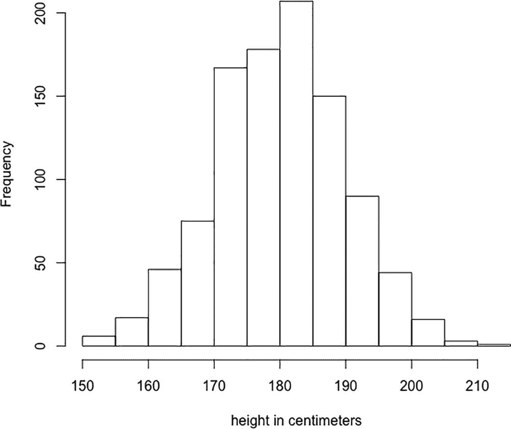
**图 5-1** 1000 位成年男性身高（厘米）测量值的直方图

频率对身高（厘米）的直方图呈现钟形趋势。最高峰位于（180, 210）附近。数值为近似值。

众所周知，人类身高可以相当精确地通过高斯分布来建模。高斯分布以 18 世纪德国数学家卡尔·弗里德里希·高斯（1777–1855）命名，它出现在许多物理现象以及重要的统计定理中——例如你将在后续章节学到的中心极限定理。

为什么这个结论如此重要？正态分布具有某些特定性质。首先，它有两个完全表征该分布的变量（我们称之为参数）：均值（以希腊字母 μ 表示）和标准差（以希腊字母 σ 表示），或者方差（标准差的平方）。均值是分布的中心，标准差则描述分布的离散程度。见图 5-2。

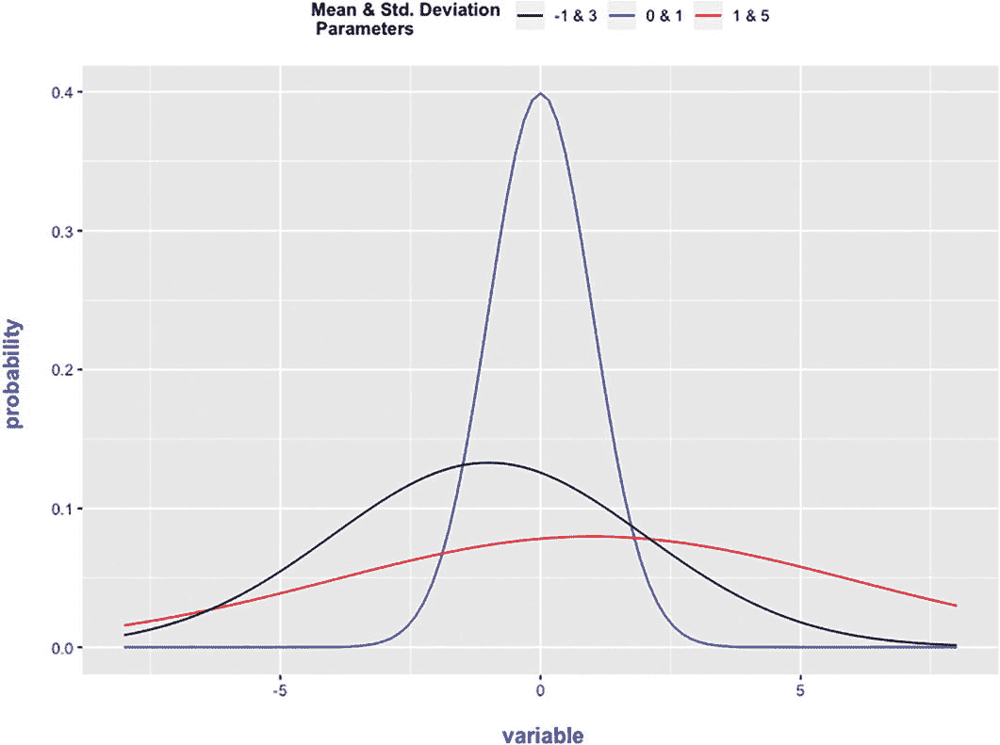
**图 5-2** 不同均值和标准差的正态分布

概率对变量的曲线图展示了两个正态曲线和一个平缓的钟形曲线。峰值（0, 0.4）的曲线均值和标准差分别为 0 和 1；峰值（-2, 0.135）的曲线均值和标准差分别为-1 和 3；平缓曲线的均值和标准差分别为 1 和 5。

那么，为何这一切如此重要？原因有二：

1.  它捕捉了我们对哪些数值更可能出现的直觉判断。

2.  正态分布保证了落在特定区间内的人群比例。

正态分布具有以下性质：95%的个体位于均值两个标准差之内，99%的个体位于均值三个标准差之内。虽然我们无法确定下一个样本的确切值，但我们可以对其所在区间抱有不同程度的置信度。

让我们回到研究美国男性身高的例子。该直方图的均值为 180，标准差为 10。这意味着，如果我们从总体中随机选取一个人，在 100 次尝试中，有 95 次这个人的身高会在 160 到 200 厘米之间。如果我们收集了整个总体的数据，就能得到总体的真实均值——假设为 181.23 厘米，真实标准差为 10.54。此时，我们已完全消除了估计中的认知不确定性。

然而，对于新出生的男性个体，我们在其最终身高上仍然面临偶然不确定性。通过使用高斯分布模型来刻画总体特征，这一统计框架可以解决该问题。

前文提到，高斯分布完全由两个参数表征：均值和标准差。这是参数统计中的一个重要概念^(²⁰)。如果一个现象遵循某种分布，那么该分布由特定参数表征，知道这些参数就等同于掌握了所需的一切信息。统计学家的目标是获取足够大的样本，以高精度确定这些参数。一旦完成，我们就能从样本推断出总体的属性。

因此，在这个例子中，我们能够成功建模新生个体成年身高的偶然不确定性。于是我们可以说：身高~*N*(181.23, 10.54)，这意味着每个新生个体的身高服从一个均值为 181.23、标准差为 10.54 的正态分布^(²¹)。

你可能已经注意到，这个方法完全是数学性的——我们在任何环节都没有依赖关于研究对象（男性身高）参数的主观信念。这是一种纯粹频率主义的方法。频率主义之所以如此突出，部分原因在于中心极限定理及其相关定理——这些定理在未提及任何主观信念的情况下，很好地解释了如何逼近参数的真实值。

频率主义具有某种智力上的吸引力：我们无需借助假设，就能达到关于世界的真实状态。它也更符合经久不衰的浪漫主义理想——科学家通过研究和过程达到客观真理。本质上，它提供了*确定性*。

然而，贝叶斯主义对这些过程有自己独特的解读。

在频率主义中，我们相信我们寻找的参数是固定的，而数据是随机的。其中一个重要概念是“置信区间”（confidence interval）。我们之前已经通过正态分布看到了这个概念的一个例子。在频率学派的解释下，置信区间是一个值的范围。在这个范围内，我们期望在一定次数内看到参数的真实值。因此，如果使用 95%的置信区间，我们期望在 95%的情况下，参数的真实值会落在我们样本的这个范围内。

在贝叶斯主义中，概率是对值的不确定性的度量，因此我们将数据视为固定的，而将参数视为随机值。我们使用可信区间（credible interval）代替置信区间。一个 95%的可信区间意味着，参数的真实值位于该区间内的概率为 95%²²。

这种差异可能看起来很学术，对于非统计学家来说可能没什么吸引力，但正如我们之前所见，我们现在拥有了一种讨论不确定性的客观语言，这一事实本身就具有巨大价值。否则，我们该如何谈论并赋予不确定的命题以价值呢？这就像试图描述一个橙子却不知道“橙色”这个词一样。

关于哪种解释更好，存在一场激烈的争论。频率主义方法在其历史上大部分时间里主导了统计学。然而，贝叶斯方法在某些问题上取得了令人难以置信的成功。通常，这发生在满足两个条件的时候：

1.  我们对问题有先验知识（prior knowledge）。

2.  我们拥有的数据有限；例如，我们没有关于某些我们知道原则上可能发生的事件的数据。

先验知识指的是我们对世界已知的事情。例如，如果我们使用一个统计模型来预测体育赛事的结果，我们也许知道 A 队比 B 队强。贝叶斯方法可以非常容易地处理这一点。此外，有些事件是半独特的（我们将在后面讨论）。例如，选举在所有民主国家都以半规律的间隔发生，但每次都有很多事情可能不同（例如候选人）。与此相比，掷骰子每次的结果都差不多，并且我们可以无限次地重复这个实验。对于半独特的事件，贝叶斯方法是一个更好的选择。

## 其他分布模型

存在着无数的分布用来解释各种问题和不确定性。我们在此将解释其中的一部分，但如果您觉得过于技术性，可以忽略此部分。另一个著名的分布是泊松分布（Poisson distribution）——以 19 世纪法国数学家西梅翁·德尼·泊松（Simeon Denis Poisson）的名字命名——用于模拟稀有事件的发生，例如地震。见图 5-3。

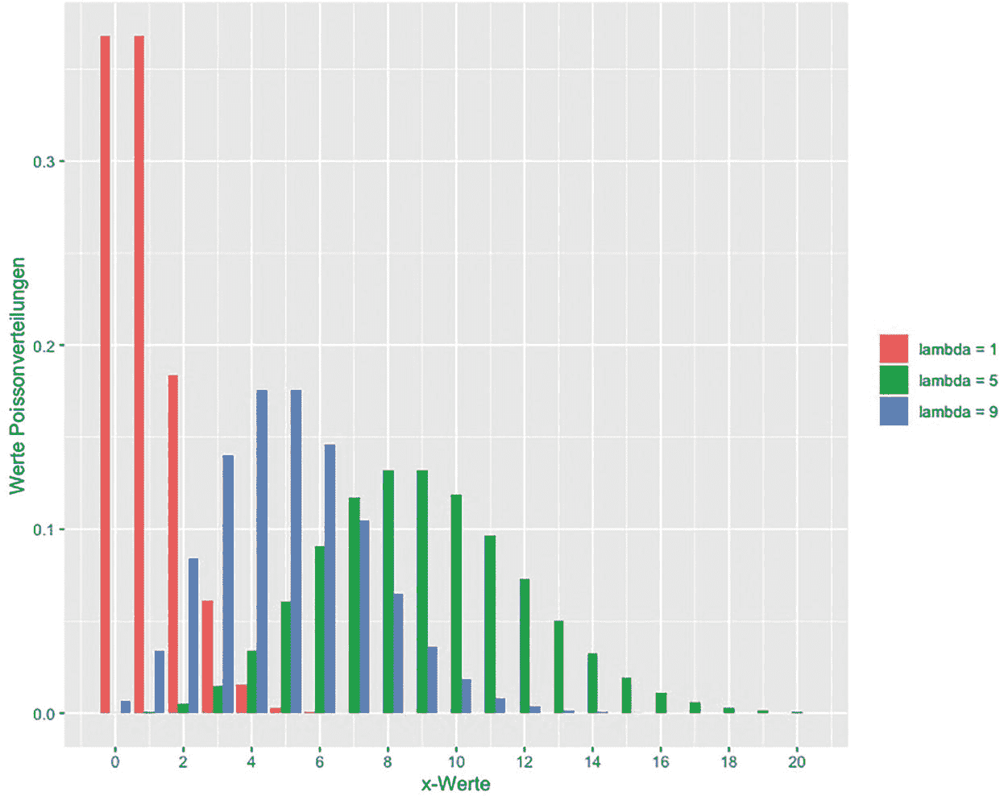
图 5-3 不同参数`lambda`值下的泊松分布

一个泊松分布与`x`值的条形图描绘了 3 条不同的曲线。当`lambda = 1`时呈现递减趋势，当`lambda = 5`和`9`时呈现钟形趋势。这些条形图相互重叠。

另一个流行的分布是指数分布（exponential distribution）。这是一种等待时间的分布。如果我们模拟救护车的到达，我们可能会问：下一辆救护车到达需要多长时间？见图 5-4。

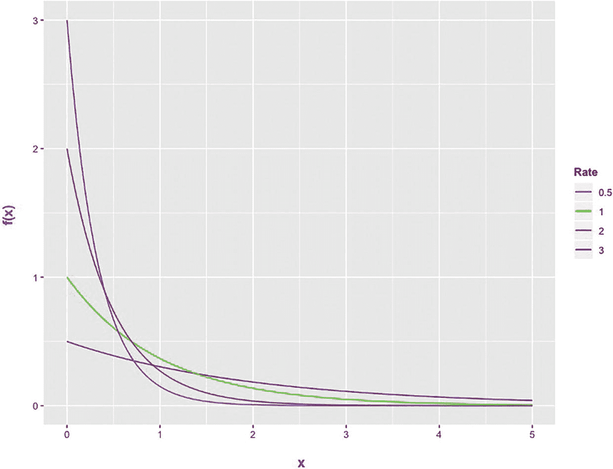
图 5-4 不同参数设置下的指数分布

一个`f(x)`对`x`的线图描绘了 4 条递减曲线，其比率分别为 0.5、1、2 和 3，从底部到顶部。这些曲线相互重叠，并在向右端移动时靠近。

还有几何分布（geometric distribution），它可以告诉我们直到成功之前我们会经历多少次失败。例如，我需要掷多少次骰子，才能掷出一个 6？

二项分布（binomial distribution）描述了在多次试验中成功的次数——例如，如果我押注掷骰子得到 6，那么我掷骰子 100 次会成功多少次？

## 这种不确定性观点存在的问题

概率分布是一个很好的工具，但仍然存在两个争议激烈的主要问题：

# 柏拉图式与实用主义观点

我称之为分布的柏拉图式与实用主义观点。根据柏拉图的说法，像圆和正方形这样的物体代表天上投射到我们世界的理想形式。关于概率分布的问题是，概率分布是自然法则还是简单的工具？

# 游戏谬误

第二个问题由纳西姆·尼古拉斯·塔勒布提出，涉及“游戏谬误”。

让我们逐一分析这些问题。

## 第一个困境

第一个困境问的是，自然界中的现象是否必然遵循某些分布的规律，还是说这些分布只是一种有用的近似。例如，中心极限定理（我们将在下一部分探讨）为正态分布存在于自然界的普遍性提供了一些直观解释²³。复杂性理论家也试图寻找证据，证明自然界中的许多现象遵循某些幂律分布²⁴。

这些分布出现在自然界许多复杂系统中，比如收入分布。当你听到 1%的人控制着世界 90%的财富时，这实际上就是一种幂律分布。图 5-5 说明了这一概念。

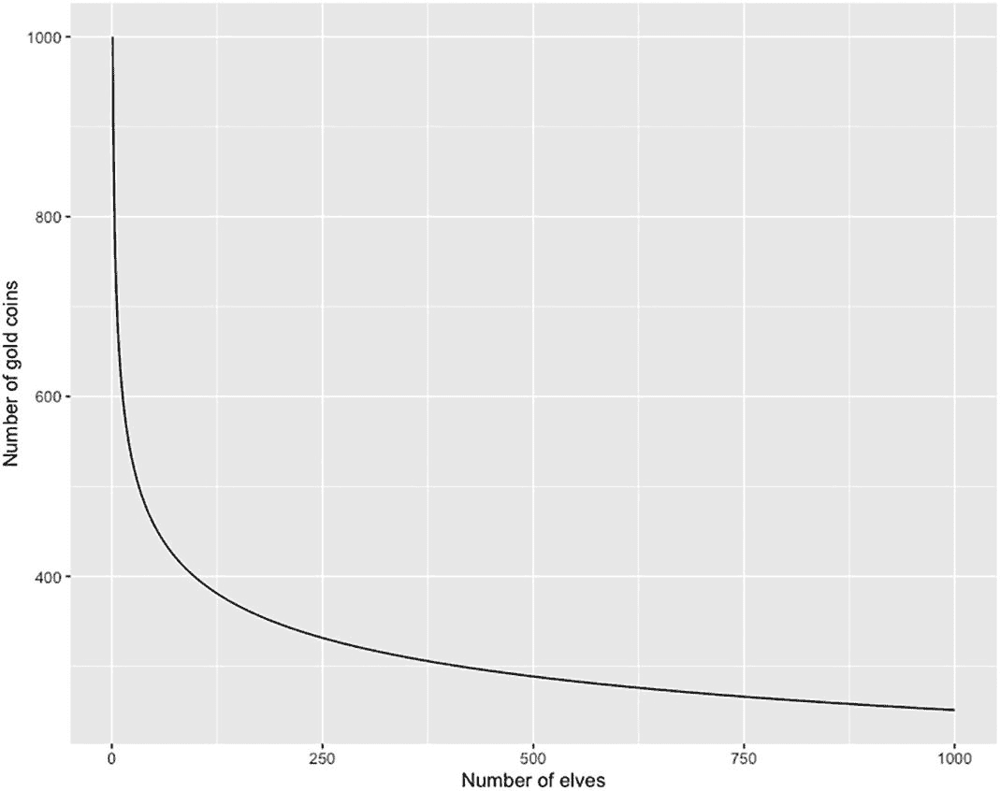

一个关于金币数量与精灵数量的线图描绘了一条递减的曲线，该曲线从(0, 1000) 延伸到 (1000, 250)，中间经过 (100, 475)。这些值为近似值。

**图 5-5** 一个厚尾分布的例子

在图 5-5 中，你可以看到一个虚构的精灵社会的财富分布图，该社会使用金币作为主要货币。你可以看到，大多数金币由少数精灵拥有。只有 23 个精灵持有超过 500 枚金币，而一个精灵拥有 1000 枚金币。虽然这个例子是虚构的（或者也可能不是，取决于你是否相信精灵的存在），但现代社会中的财富分布看起来非常相似。

## 游戏谬误

使用概率分布的另一个问题是，大多数时候，它们只是被用作世界的模型。为了做到这一点，我们必须做出假设并经常过度简化事物——这意味着在许多情况下，这些模型是完全错误的。纳西姆·尼古拉斯·塔勒布在他的著作《黑天鹅》中将此称为“游戏谬误”。术语`ludic`源自拉丁语`ludere`，意为玩耍——而这个词又源自拉丁语的体育或游戏`ludus`。根据塔勒布的说法，当我们相信一个现实世界的现象可以像简单的机会游戏一样被精确建模时，就发生了游戏谬误。

为了说明这一点，塔勒布举了两个男人的例子：

*   约翰博士（Dr. John），他被视为一个具有科学和逻辑思维的人。

*   胖子托尼（Fat Tony），他被视为一个靠智慧生活的人。

这两个人在讨论一个抛硬币游戏。有人问道：“假设硬币连续 99 次都是正面朝上。下一次再出现正面的概率是多少？”约翰博士会回答概率是 50%，因为硬币没有记忆，过去的事件不会影响未来的事件。胖子托尼会回答，这枚硬币很可能是不公平的，所以下一轮还会是正面朝上。

# 这两个人的区别在于，一人将这场游戏视为抽象案例，而另一人则能感知到影响游戏的外部世界。稍后我们将讨论更多关于认知偏差的例子。你会看到，正统的认知偏差研究方法认为人类出错，是因为他们并未依照数学与统计学的抽象规则进行思考。然而，其他方法，如理性分析，则认为认知在很大程度上是适应环境的结果：完全抽象地讨论智力意义不大。胖子托尼体现了人类对现实情境的直觉。任何未受过概率法则教育的人，在这样的例子中，在数学家看来都可能显得“愚笨”。然而，当这枚硬币结果不公时，这位数学家在现实世界中反而会显得“愚笨”。

## 边界与极限

> “确定平均人并非仅仅是出于好奇的理论探讨；它可能对人类科学和社会制度具有最重要的意义。它理应成为所有其他社会物理学研究的前提，因为它可以说是基础。事实上，平均人对于一个国家而言，就如同重心对于一个物体；正是通过把握这个中心点，我们才能理解所有平衡与运动的现象。”
>
> ——阿道夫·凯特勒，19 世纪比利时天文学家兼统计学家，《论人及其官能的发展》

数学中一个令人印象深刻的细节是，某些数学定律在自然界的各种条件下都成立，无需任何实验或经验证据。事实上，有些定律甚至在所有可能存在且数学法则与我们相同的宇宙中都成立。这些定理随后帮助科学家探索知识。在对不确定性的研究中，有些定理显然无可挑剔，例如大数定律和中心极限定理。

概率论与统计学中最强大的定理之一是大数定律（LLN）。例如，如果我们大量抛掷一枚硬币，得到正面的概率约为 50%，这正是正确的理论概率。

泊松在 1837 年提到了大数定律，但它的历史更为悠久。吉罗拉莫·卡尔达诺（1501–1576 年）是第一位通过经验观察到这一现象的数学家。他发现，通过进行大量试验，统计的准确性似乎会提高。雅各布·伯努利在经过 20 年实验后，于 1713 年首次在数学上证明了这一定律，并将其命名为“黄金定律”。

尽管这看起来在直觉上正确——甚至可能显而易见——但它是一个重大成果。对于生活在信息时代之前的人们来说，这绝对不是直觉可及的。该定理为概率的理论世界与现实世界提供了强有力的联系。

那么，这与我们研究不确定性有何关联？简而言之，该法则向我们保证，当我们从现实世界收集更多数据时，我们就越接近真相。但反之亦然。当我们知道某一现象的真实理论概率时，如果我们能够进行足够多次的试验，那么单次试验的结果便不重要——最终，平均值会收敛到该现象背后的真实理论值。这听起来可能很抽象，但有一个价值超过五千亿美元的全球产业^(²⁵)正是建立在这一定理之上：赌博。

你可能听说过“庄家总是赢”这句话。这种情况之所以发生，是因为赌场将所有游戏都设置得使得长期来看期望值总是对赌场有利。

假设有人向你提出以下赌局。你将进行一场抛硬币游戏，输赢的概率各为 50%。如果对方玩家获胜，你将失去所有金钱。但如果你获胜，你将赢得对方玩家的全部金钱。只进行一轮抛硬币，结果要么你拿走对方的所有钱，要么你输光所有钱。你俩财富恰好相等。

这听起来是个相当糟糕的提议。在这场游戏中，单轮比赛任何事情都可能发生。你最终可能会身无分文。

# 赌徒破产、切比雪夫不等式与中心极限定理

然而，如果我们对这个问题稍作改变，会怎么样？如果你们两人的财富并不相等，而你的对手拥有无限的财富呢？此外，规则是你不会拿走对手所有的钱，你只能拿回你所投入金额的两倍。所以，如果你花 10 美元并获胜，你将拿回 20 美元。这听起来不错。如果你足够幸运，你可能会变得富有，对吧？你每轮有 50%的获胜几率，而你的对手拥有无限的资源，所以理论上你可以赢很多钱。

嗯，不幸的是，事实并非如此。有一个著名的定理叫做“赌徒破产定理”。根据这个定理，在一个公平的游戏中，一个玩家与拥有无限资源的对手对抗，在大量尝试后，该玩家最终会输得精光。在这种情况下，赌场就是那个拥有无限资源的玩家。赌场不在乎任何一个单独的玩家。只要它积累越来越多的游戏，它就会获胜。

但这与不确定性有什么关系呢？赌博是一种随机现象。我们无法确定单次尝试的结果。然而，在适当的条件下，我们可以将不确定性控制到如此程度，以至于单次尝试的结果完全无关紧要。

这个赌博的例子是我们与不确定性斗争历史中的核心主题之一。没有单一的方法或途径。有多种方法。当数学家试图解决这个问题时，他们提出的最佳方法之一是极限和界限的概念。什么是极限？你在我们之前讨论抛硬币实验时已经看到了一个例子。单次抛掷的结果是无法预测的。然而，大量抛掷具有一些明确定义的性质。这些性质随着抛硬币实验趋近于无限次尝试的极限而显现出来。概率论中极限计算的概念基于这样一种直觉：大量重复将清除白噪声，并允许有用的模式浮现出来。

界限的概念在概率论中极其有用。当处理一个具有不确定性的量时，我们通常无法知道该量的值会是什么样的。然而，我们可以知道某种边界，该值不能超过这个边界。如果我让你猜我邻居女儿的年龄，你无法做出准确的预测，尤其是如果我没有告诉你她的年龄（例如，她是 5 岁还是 45 岁？）。但如果我让你给我一个她身高的上限，而你告诉我一个像三米这样的数字，那么你的答案将是百分之百正确的。

使用界限的最古老的定理之一是“切比雪夫不等式”。帕夫努季·利沃维奇·切比雪夫（1821–1894）是一位俄罗斯数学家，他被认为是俄罗斯数学的奠基人之一。他也是著名数学家安德雷·马尔可夫的老师。切比雪夫不等式理论为我们提供了随机变量概率的所谓上界。数学中的界限就像上限和下限阈值。上界充当天花板，下界充当地板。一个值不能高于上界或低于下界。界限是通过告诉我们我们可以预期的合理值——并划定不会出现的值——来控制不确定性的一种方法。当然，知道最可能的值会更加有用，但有时我们只能利用已有的信息。

回到切比雪夫不等式，让我们看一个简单的例子。假设我们正在研究一个拥有 1 亿人口的国家的人均收入，该国的平均收入为 45,000 美元，标准差为 20,000 美元。我们观察到某人收入超过 100,000 美元的概率是多少？使用切比雪夫不等式，对于这个例子，我们会发现概率最多为 20%。

切比雪夫不等式被用来证明弱大数定律。如果你能获得总体的均值和标准差信息，你就可以大致了解观察到非常高或非常低值的可能性。这适用于自然界中的任何类型的问题，并且你不需要具备关于该问题或数据的任何其他知识。

这是数学家处理不确定性方式的一个典型例子。在关于某物的信息有限的情况下，你能提取出多少额外的知识？你能从从自然中艰难获取的任何信息碎片中减少多少不确定性？发现界限是一种方法，而切比雪夫是最早发展出这种方法的数学家之一。在切比雪夫之后，还有其他数学家提出了针对各种不同问题的界限定理。

可以说，最著名且影响深远的定理是中心极限定理，我之前简要提到过。第一个触及这个主题的是法国数学家亚伯拉罕·棣莫弗（1667–1754）。他利用正态分布来寻找多次抛掷硬币所得正面朝上的次数。不幸的是，他的概念从未流行起来，并且很快就被遗忘了。

中心极限定理的原始表述归功于拉普拉斯。拉普拉斯的部分工作涉及天文学。例如，他试图解决的问题之一是计算流星倾角之和的分布。他面临着测量结果与他试图捕捉的理论均值之间的偏差这一挑战。关于这项工作的记录早在 1776 年就已存在。拉普拉斯在 1810 年证明了该定理。然而，中心极限定理的最新证明要归功于俄罗斯数学家亚历山大·李雅普诺夫（1857–1918）。

那么，中心极限定理是什么？该定理指出，均值的抽样分布服从正态分布，其均值等于总体`μ`，方差为`σ / √n`。对于非统计学家来说，这（可以理解）可能有点深奥，但它是统计学中最有用的定律之一；让我们看看为什么。

你需要理解的第一件事是抽样分布的概念。假设你对某个数量感兴趣。例如，你关心找出英格兰所有男性的平均身高。或者你关心找出一个城市的平均收入。或者你关心找出斑马的平均数量。

如果你是一个拥有无限资源的人，你就可以找到你研究范围内的每一个个体，然后计算平均值。如果你这样做了，你就会得到真实的总体均值`μ`。但你不太可能拥有无限资源——谁有呢？而且，统计学的整个前提是，你可以通过仅采集一个样本（`sample`）来了解某个人群。你不必接触到英格兰的每一个人，或者世界上的每一只斑马，只需收集一个包含 1,000 个受试者的样本即可。

到目前为止一切顺利。假设还有另一位斑马或英格兰男性身高的爱好者，他做了完全相同的研究。这个人也收集了一个包含 1,000 个受试者的样本。这两个样本会完全相同吗？嗯，不会。样本会有些不同。

让我们聚焦于斑马的例子——比如一个样本显示每只斑马的平均条纹数量是 24 条，而另一个样本显示是 28 条。哪个才是正确的呢？事实上，它们既对又错。当我们从总体中抽取样本时，我们知道每次都会得到不同的结果。总体参数的真实值就在其中某个位置，但我们无法 100%确定其精确数值。而当我们在统计学中无法确定某事时，更倾向于使用概率分布——于是中心极限定理登场了。

24 和 28 这些数值是样本均值，而非总体均值。但我们希望从样本均值推断出总体均值。中心极限定理正是帮助我们实现这一点的工具。假设全球有 100 位不同的研究人员重复这项斑马研究，每位研究者各抽取 1000 只斑马的样本并计算样本均值，他们的结果会是什么样？你可以在图 5-6 中看到。

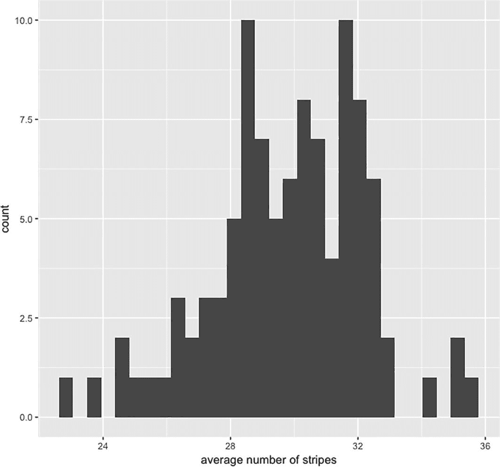

一幅展示“频数”与“平均条纹数量”关系的直方图呈现波动趋势。最高柱状图位于(28.5, 10)和(31.5, 10)处。数值为近似值。

**图 5-6** 斑马平均条纹数量的抽样分布

从这个直方图可以看出，有些研究者得出的均值低于 24，有些则高于 34。如果这项研究由 1000 位研究者进行呢？那么抽样分布将如图 5-7 所示。

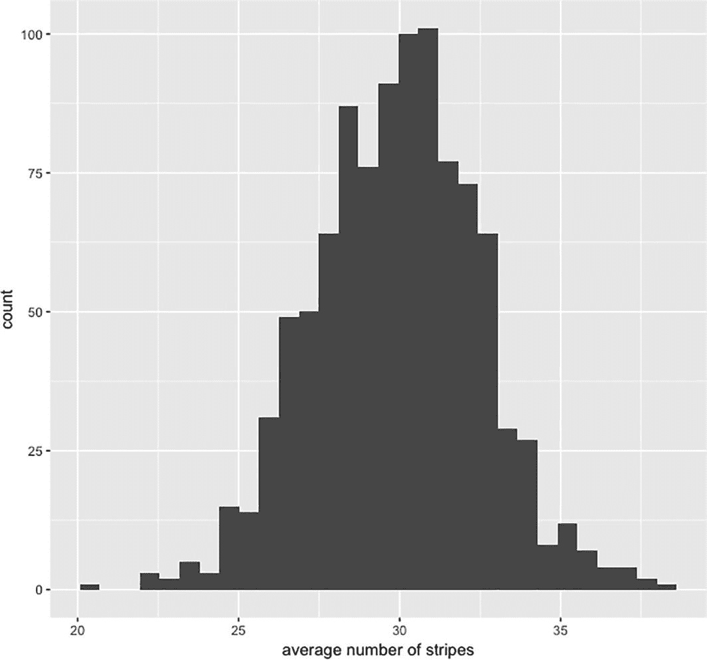

一幅展示“频数”与“平均条纹数量”关系的直方图呈现钟形趋势。最高点大约在(30.5, 110)处。

**图 5-7** 1000 个样本的抽样分布

如果我们收集 10000 个样本呢？那么它会如图 5-8 所示。

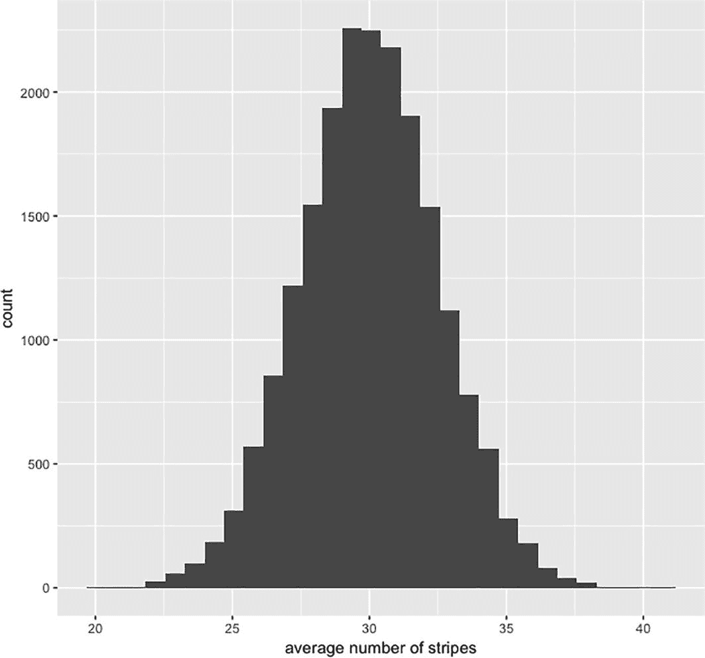

一幅展示“频数”与“平均条纹数量”关系的直方图呈现钟形趋势。最高点大约在(29.5, 2250)处。

**图 5-8** 10000 个样本的抽样分布

希望你能看到这里出现的规律：我们收集的样本越多，这个分布就越集中。不确定性逐渐被抹平，我们越来越接近总体均值。中心极限定理告诉我们，估计值周围的方差（衡量不确定性的指标）与样本容量的平方成反比。

值得注意的是，在使用中心极限定理时，这种关系成立与否与底层现象实际服从的分布无关。这正是其强大之处，也解释了为什么正态分布在物理科学和工程学的许多情境中都会出现。

例如，假设我们想计算掷一次六面骰子的均值。六面骰子是服从离散均匀分布现象的典型例子：掷出六点的概率与掷出一点的概率相同。然而，当我们进行多次投掷时，抽样分布的形状将与图 5-8 类似——它会呈现正态分布，而非均匀分布。

在图 5-9 中，你可以看到六面骰子投掷 10000 次后的结果分布。所有结果出现的次数大致相等。

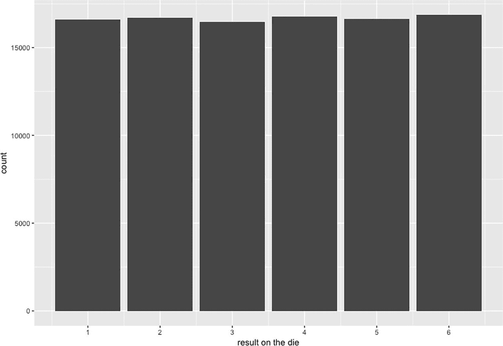

一幅展示“频数”与“骰子结果”关系的柱状图包含以下数据：1，16500；2，16600；3，16400；4，16600；5，16500；6，16700。数值为近似值。

**图 5-9** 六面骰子投掷 10000 次后的结果分布

但当我们绘制每组样本均值的分布图时，会得到图 5-10 的结果：一个以 3.5 为中心的正态分布——这正是六面骰子的真实均值。

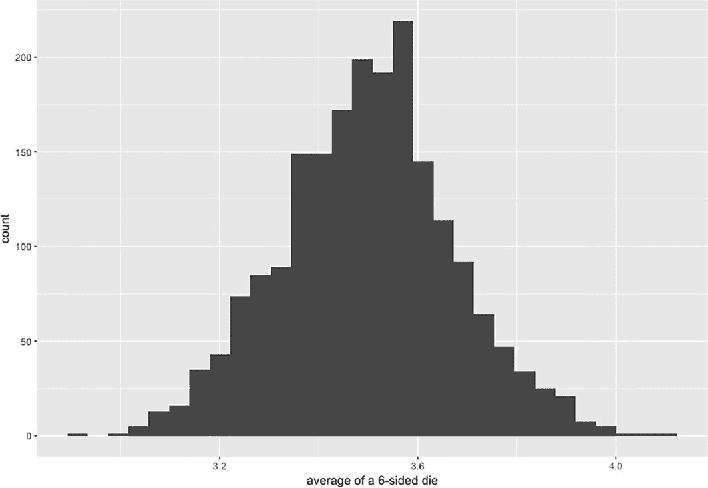

一幅展示“频数”与“六面骰子均值”关系的直方图呈现钟形趋势。最高点大约在(3.55, 220)处。

**图 5-10** 六面骰子投掷 10000 次后的平均值

如你所见，在中心极限定理面前，斑马和骰子的共同点可能比你最初想象的更多。

中心极限定理在统计学中占据特殊地位。自然界许多过程都是随机的：比如测量花朵的尺寸、彗星的速度或动物的大小。这些过程可能遵循不同的规律和分布。但当我们研究这些过程的平均值时，却会得到正态分布。这一结果也解释了为什么高斯分布会出现在如此多的自然过程中——高斯分布之所以也被称为正态分布，正是因其在自然界中的普遍性；而中心极限定理正是其背后的解释。

其次，该定理在众多其他统计模型和假设检验的创建中发挥了重要作用。它使数学运算变得非常便捷——在计算机问世之前，这是一个巨大的优势。

然而，高斯分布作为建模工具的流行，也是导致我们许多模型出错的根源之一。正态分布确实在自然界的许多地方出现，它也是线性回归等一些实用模型的基础。但当你的工具只有一把锤子时，所有东西看起来都像钉子。基于正态分布的模型是我们许多结果出错、模型失效的原因之一。稍后你将了解更多相关内容。

讨论正态分布时，不能不提及两位塑造了我们统计学理解的科学家：阿道夫·雅克·凯特勒（1796–1874）——你之前已看到过他的名言——以及英国统计学家弗朗西斯·高尔顿（1822–1911）。

凯特勒是当时杰出的科学家。他参与创建了英国皇家统计学会和国际统计大会，对比利时一座天文台的建立做出了贡献，还出版了三本关于概率的著作。然而，他最著名的成就是提出了“平均人”的概念（法语*'l'homme moyen'*）。

凯特勒对法国人口进行了全面普查，测量了他能测量的一切——从死亡率到身高、体重、力量、精神疾病等等。他的目标是研究人与人、地区与地区之间的差异是系统性的还是随机性的。

1835 年，他出版了《论人类及其能力的演进》。在这本书中，他描绘了“平均人”的愿景——即当我们计算出所有可以描述人的属性的平均值后呈现的那个人。凯特勒尤其钟爱正态分布，他认为这种分布无处不在。

以当前的统计分析标准来看，凯特勒认为属于正态分布的某些分布实际上并非如此。数学家弗朗西斯·伊西德罗·埃奇沃思（1845–1926）甚至创造了术语“凯特勒主义”来形容这种到处看到正态分布的倾向。

凯特勒的贡献在于：通过测量“平均人”，我们可以更好地研究偏离常态的情况，并理解因果关系。他写道：

# 高尔顿与均值回归

“首先，我们必须停止孤立地看待人，而应将其视为物种的一个片段。去除其个体性，我们将消除一切偶然因素，特殊性也将被抹去。[……] 这便是我们研究人类物种规律的方式，因为若近距离审视，便会发现规律无从寻觅，我们只会陷入无穷无尽的个体特殊性之中。”

凯特勒将他的分析扩展到与行为和心智相关的其他现象，因此他被广泛誉为社会科学之父。直到今天，社会科学中的统计学在很大程度上仍关注群体中“平均人”的面貌、该群体与其他群体的差异，以及这些差异的成因——这正是凯特勒致力于建立的内容。

“平均人”的概念深深吸引了高尔顿。弗朗西斯·高尔顿爵士是一个有趣的人。他继承了一大笔财富，因此从未像大多数人那样需要“工作”。他是查尔斯·达尔文的表亲，同时也是一位探险家、发明家和科学家。他非常好奇，求知若渴。他设计了一种名为“进取心唤醒机”的装置，通过在脸上泼水让他在晚上 10 点到凌晨 2 点保持清醒，以便他能熬夜学习阅读。他还是一位狂热的旅行家和探险家，曾在非洲待过很长时间。

高尔顿相信，“伟大”是遗传的。他注意到，杰出人物通常是其他杰出人物的后代。高尔顿对理解天赋如何在特定家族中延续很感兴趣。于是，他在 1883 年开创了一个新的研究领域，并将其命名为“优生学”，这一学科后来在二战期间被纳粹所采用。关于高尔顿是否会支持纳粹后来对其理论的运用，存在一些争议。时至今日，高尔顿仍是一位有争议的人物，因为他在统计学领域做出了许多卓越的发现，同时也默许了诸如选择性生育之类的一些观念。

高尔顿在 1866 年至 1869 年间进行了研究，收集证据试图证明天才具有遗传性，并将研究成果发表在《遗传的天才》一书中。据高尔顿称，在英国，能够被称为“杰出”的人与总人口的比例约为 1:4000 或 1:5000。而他称之为“白痴和低能者”的人大约占 1/400，因此人数上超过了杰出个体。

高尔顿还发现，家族中的天才并不会持续太久。在杰出人物的儿子中，只有 36%的人本身是杰出的，而到了孙子辈，这一比例仅为 9%。高尔顿试图解释这一模式，以及数据本身为何似乎遵循正态分布。就好像杰出人物高于平均值，与“白痴和低能者”低于平均值的幅度相同。

如今，高尔顿的研究会因忽视了财富和特权等重要的社会因素而受到批评。考虑到 19 世纪的社会规范，这种忽视并不令人意外。但尽管如此，高尔顿确实发现了“均值回归”的概念，这被证明是统计学中最值得注意的概念之一。这个概念解释了为何一系列极端的短暂观测值会很快回归到类似平均观测值的状态。

一个著名的例子是“《体育画报》封面魔咒”。据说，每当一位运动员登上《体育画报》的封面，其随后的表现就会下滑。这个魔咒非常出名，甚至有自己的维基百科页面。^(²⁶)

这很容易用均值回归来解释。运动员的表现围绕一个平均值波动，有时低于平均值，有时高于平均值。运动员完全有可能在一段时间内打出几场精彩的好球。如果发生这种情况，这位运动员就很有可能成为《体育画报》的封面明星。然而，这位运动员不太可能无限期地保持其最佳表现的标准。因此，所谓的诅咒仅仅是表现回归到平均水平。

高尔顿通过一个精巧的装置研究了这一点，如图 5-11 所示。他在 1874 年向皇家学会的一次演示中使用了它。在这个装置中，大头针被投下，然后落入底部的桶中。一个简单的梅花机，比如左边所示的那个，往往会使大头针呈正态分布。高尔顿使用了一个有两层级的机器。他演示了不仅第一层的大头针会呈正态分布，第二层的大头针也会如此。

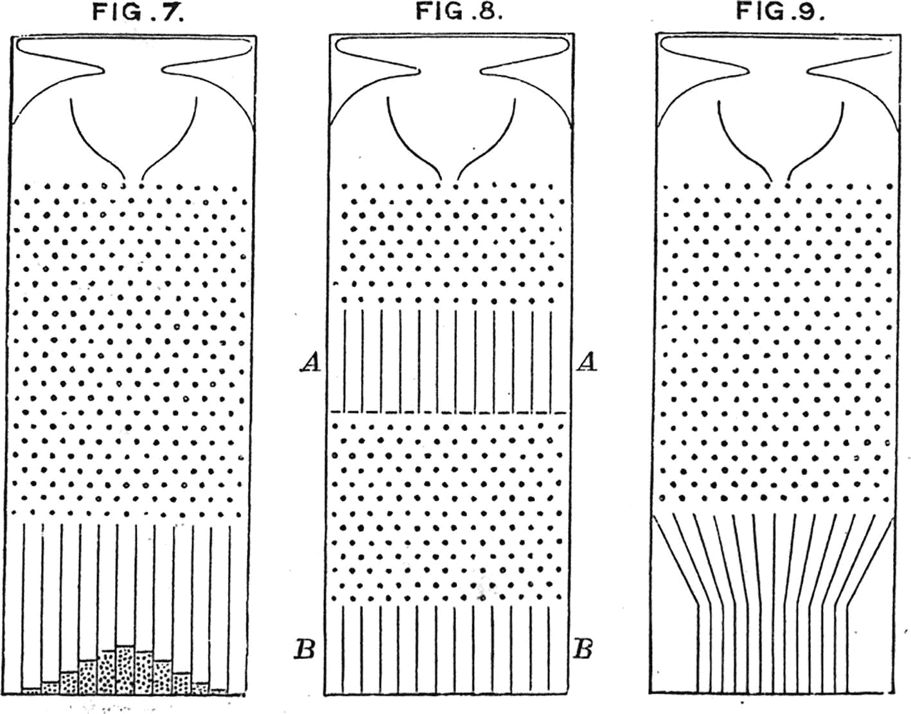

三张高尔顿装置的示意图分别标注为图 7、图 8 和图 9。图 7 底部有一组大头针，并附有一个钟形直方图。图 8 有 A 和 B 两个层级的大头针。图 9 展示了来自两个层级的大头针的排列情况。

**图 5-11**

高尔顿的梅花机装置^(²⁷)

这一发现具有里程碑意义，因为它表明，即使第一层的一些观测值是极端的，它们也会倾向于回归到正态分布的平均值。

虽然这个例子可能看起来抽象且机械，但高尔顿后来通过对 928 名成年人和 208 名父母的身高数据验证了这一直觉。遗传确保了高个子父母生出高个子孩子，但均值回归确保了不会有身高十米的人生活在我们中间。这一系列工作也产生了“相关性”的概念。据说高尔顿是在 1888 年左右发现它的。

均值回归的概念解释了世界的规律性，并构成了我们许多凭常识预测事件的基础。我们知道，一支足球队不可能永远赢下去。一只股票不可能永远上涨，好时光之后可能紧随着坏时光，反之亦然。

但当均值本身已经发生变化时，均值回归就无法帮助我们了。有些股票会崩盘，公司破产，再也无法回到原先的均值水平。几十年来，世界经济一直在增长，因此经济的平均规模总是在变大。理解均值是否发生了偏移并不容易，尤其是对于由多重复杂相互作用构成的人造系统（经济就是这样一个系统）。然而，这并不能抹杀高尔顿对科学的贡献，也不能降低这一思想的实用性。

收敛界限、大数定律、均值回归——它们都属于同一个概念家族。在一个不确定的世界里，我们不必对每件事都感到不确定。随机性和偶然性遵循它们自身的规律，在我们周围产生规律性，并在一个看似混乱的世界中赋予一种秩序感。

脚注 1   2   3   4   5   6   7   8

