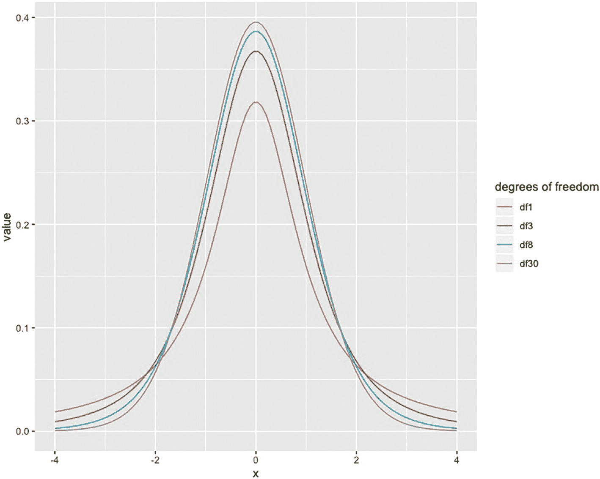
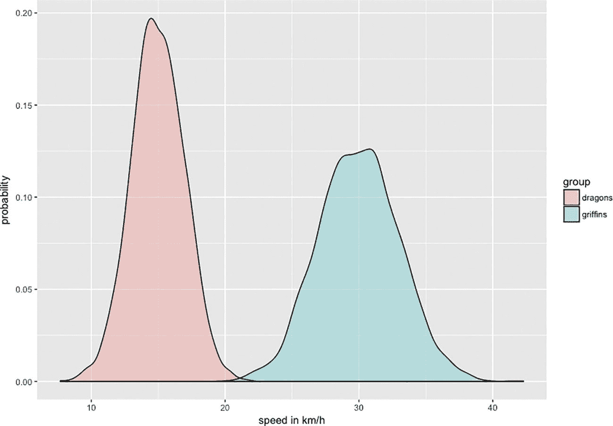
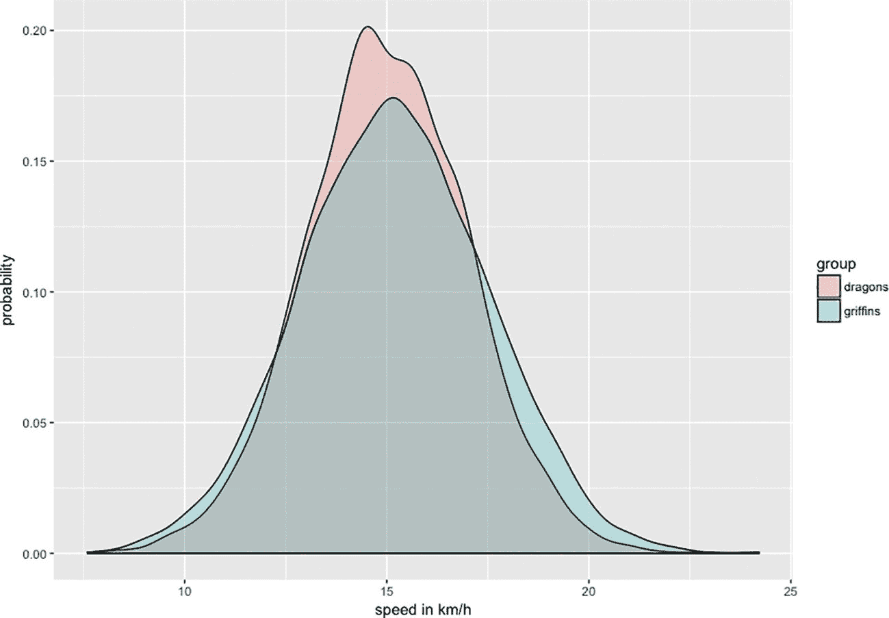
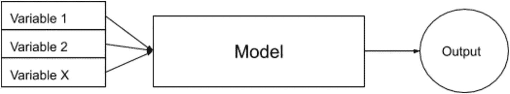
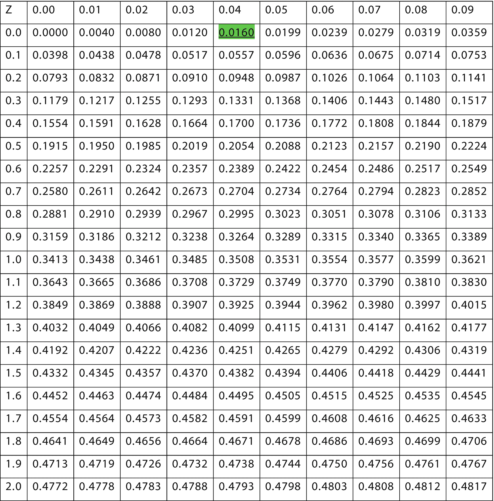
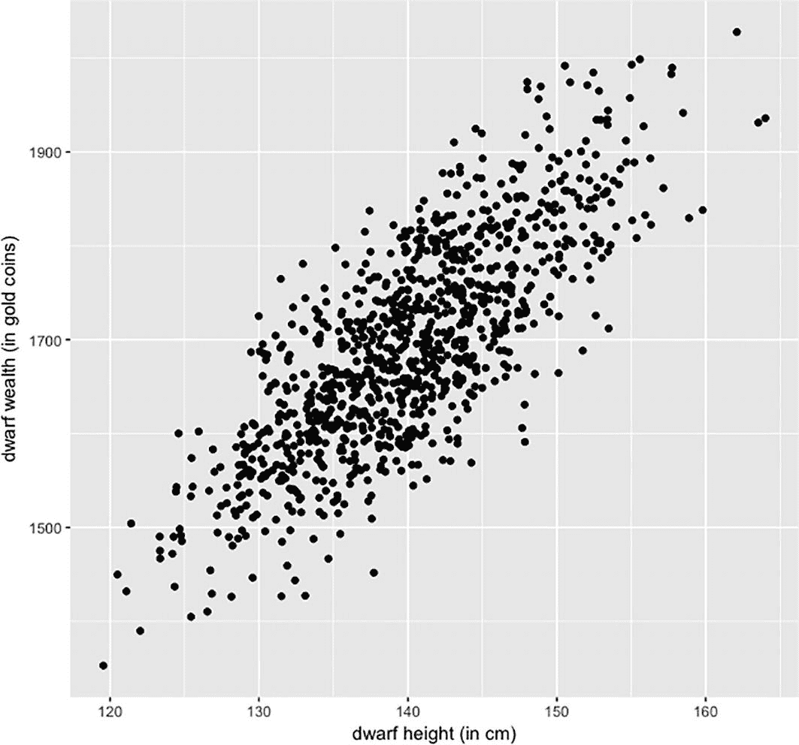
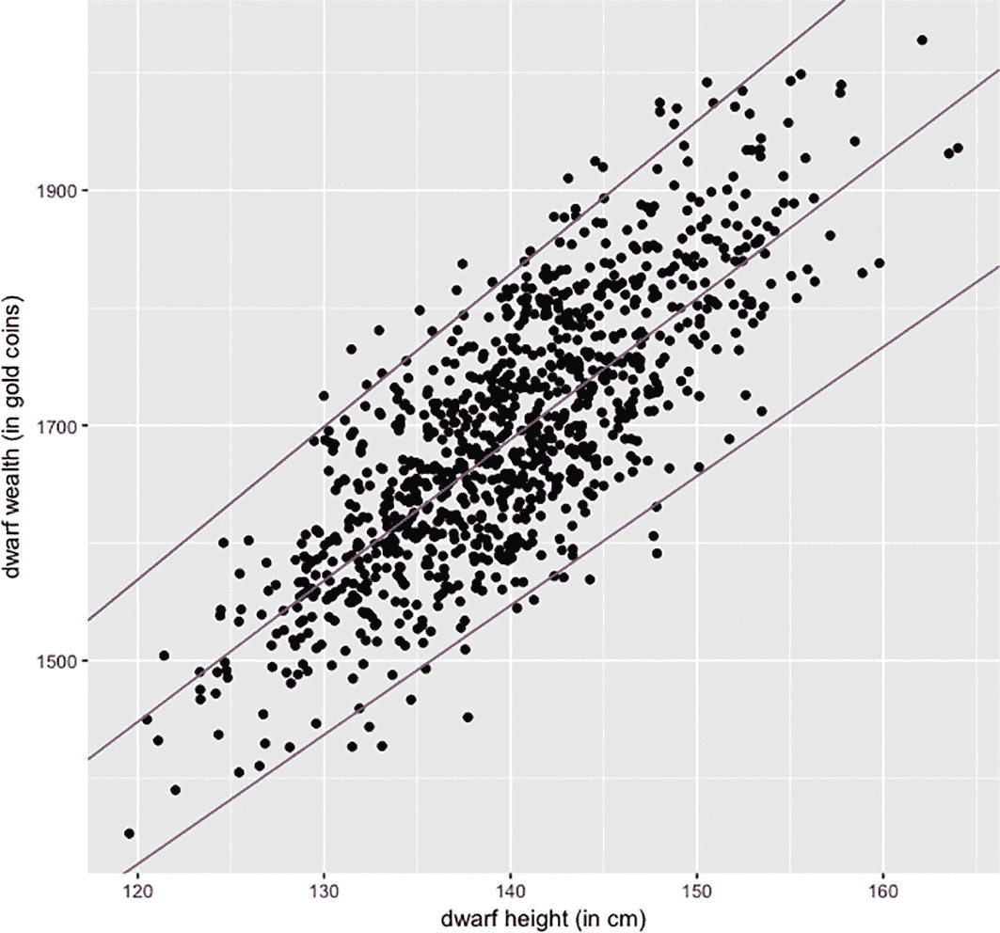
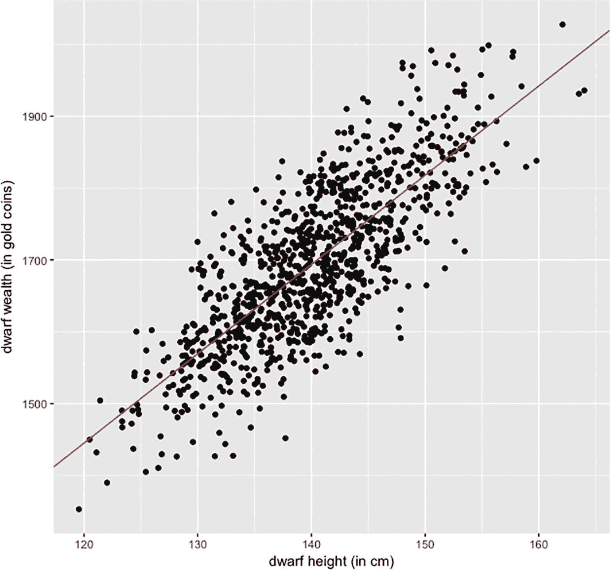
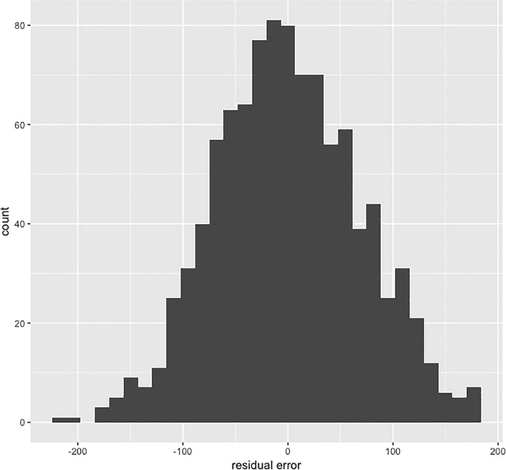
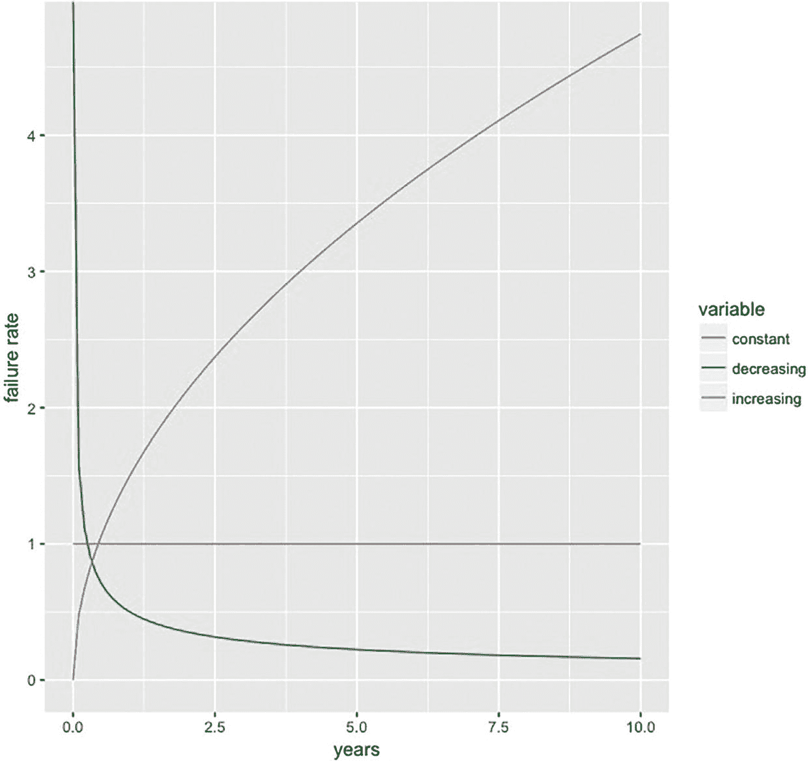

# 7. 统计学：这块最老的招牌

> *“世上有三种谎言：谎言、该死的谎言，以及统计学。”*
> ——本杰明·迪斯雷利

统计学的名声不太好。

它们看起来可能故意晦涩、随意且不切题，像误导性的大字标题一样冲你喊叫：“22% 的人认为巴拉克·奥巴马不是美国人！”，“48% 的英国人上完厕所不洗手！”，或者“三分之一的婚姻以离婚告终！”

这些数字从何而来？这些“人”到底是谁？是否每个英国人都被问及他们是否洗手了？

弄清楚统计学的本质是很有价值的。迄今为止讨论的每一个概念和理论都与统计学这门学科有着内在的联系；统计学是数据科学世界中最重要但最不被认可的学科之一。

事实上，它是第一个系统性地处理数据分析的科学学科。然而如今，数据科学已成为更流行的时髦术语。许多最初由统计学家创造的技术，现在都被作为机器学习技术来推广。此外，由统计学家建立的思维方式也一定程度上受到质疑，转而倾向于数据科学所青睐的、更具实验性的方法。下一节将退一步，解释该学科历史的一些情况，并涵盖当前数据科学方法之间的差异。

# 描述性统计与推断性统计

当人们谈论统计学时，通常会想到他们在学校里做过的事情，比如图表，或者体育统计，比如平均得分。然而，当统计学家思考统计学时，他们通常想到的是推断性统计。

`推断性统计`是一个简单但强大的概念，它指的是科学家可以通过从总体中抽取样本的方式来了解总体情况。抽样是我们如今都熟悉的概念。在试图了解社会脉搏时，民意调查机构不会询问某个国家的每一个个体，而只调查整体人口中的一小部分。当我们去验血时，医生不会抽取我们体内的全部血液，只需一小部分。当你试图判断汤是否太烫时，你只需用舌尖尝一小口，而不是喝完整碗汤。这就像冰山一角的提示。

## 抽样的早期发展

抽样并非一直是一个流行的概念。有趣的是，引入抽样的并不是一位数学家，而是 17 世纪的一位英国缝纫用品商：约翰·格朗特（1620–1674）。格朗特是一位纽扣和针线商人。他是一位相当成功的商人，赚了足够的钱，从而能够在空闲时间追求其他兴趣。1662 年，他出版了一本小册子，名为`《基于死亡率公报的自然与政治观察》`。这本书收录了 1604 年至 1661 年间伦敦的死亡档案，并附有解释，这看起来像是现代所谓的生存分析的首次尝试。

格朗特研究了各种死亡原因，并得出了每种原因导致的死亡概率。格朗特估计大约有 36%的儿童在六岁之前死亡。他还估算了因瘟疫、谋杀和其他疾病导致的死亡百分比。格朗特创建了与现代`生命表`非常相似的东西：一张显示不同年龄存活率的数据表。根据这张表，例如，一个 56 岁的人活到 66 岁的概率仅为 6%。

他还利用这些记录估算出了伦敦的人口。尽管当时普遍认为伦敦大约有 200 万人，但格朗特却估算出了 38.4 万这个数字。他计算出，每年平均约有 1.3 万人死亡。他注意到，平均而言，出生人数少于死亡人数，因此他得出年均出生人数为 1.2 万。这表明大约有 2.4 万名育龄妇女。他假设一户家庭（可能也包括仆人和房客）大约有八个人，并且只有一半的家庭有育龄妇女。因此，总户数约为 4.8 万，这就引出了前面提到的 38.4 万这个总数。

## 哈雷与生命表

英国人埃德蒙·哈雷（1656–1742）在 1693 年发表了该领域的另一部开创性著作，这大约是在格朗特著作问世 30 年之后。哈雷主要以他在天文学方面的成就以及以他名字命名的彗星而闻名。然而，他在统计学方面的贡献却鲜为人知。哈雷获得了布雷斯劳市的生死数据^(⁴²)。利用这些数据，他得出了详细的`生命表`以及不同年龄的存活概率。然而，大约过了 100 年，政府和保险公司才开始使用他的研究成果。在此之前，年金要么是根据罗马法学家乌尔比安（公元 225 年制定）的`生命表`来出售，要么根本不使用这些`生命表`。例如，英国政府在 1540 年出售年金时，完全没有考虑人们的预期寿命。

## 其他早期贡献者

拉普拉斯也参与了早期利用抽样的尝试。他于 1786 年通过使用人口与上一年出生人数的比例计算出了法国的人口。另一位值得注意的人物是威廉·配第（1623–1687）。配第住在伦敦，是一位经济学家、医生和哲学家。他成为了格朗特的朋友，并帮助了他工作的某些方面，同时还提出了自己对出生时预期寿命的估算。配第估计的预期寿命为 18 年，而格朗特估计的是 16 年。

## 现代统计学的诞生

因此，抽样的种子在 17 世纪就已播下。正是这些技术与概率论技术的融合，催生了通过仅调查总体的一小部分来推断总体特性的想法。

现代统计学的形式主要归功于 19 世纪末 20 世纪初的科学家们。最著名的人物有威廉·西利·戈塞特、罗纳德·费希尔、埃贡·皮尔逊和耶日·内曼。这些人通过设计严谨的检验和建模技术，为现代统计学奠定了基础。这些技术从此成为科学领域的主要工具。

# 假设检验：显著还是不显著？

`William Gosset` 是著名的黑啤酒生产商 `Guinness` 的首席酿酒师。在 19 世纪末，`Guinness` 已经成为世界上最大的啤酒厂，为了提高产品质量，它开始寄希望于科学——这很像现在的公司为了获得优势而研究数据科学和 `AI` 的使用。该啤酒厂的主要关注点是保持其啤酒的高品质。在 1887 年至 1914 年间，啤酒产量翻了一番，接近十亿品脱。^(⁴³) 显然，产量的增加对质量提出了挑战。`Gosset` 的工作就是找到这个问题的答案。

像许多其他种类的啤酒一样，`Guinness` 啤酒通过使用啤酒花来调味。`Guinness` 啤酒通过外观和香味等特性来衡量啤酒花的质量。挑战在于，只能通过提取一小部分样品来衡量整批啤酒花的质量。

在那个时代，还没有人处理过小样本的推断统计。使用仅由五个啤酒花组成的样本所带来的挑战，对当时大多数处理更大样本的统计学家来说似乎有些无关紧要。`Gosset` 成功解决了这个问题，随后在伦敦大学学院与 `Egon Pearson`（`Karl Pearson` 之子）一起工作了一年，完善了他方法的数学基础。

这最终促成了统计界著名的《学生分布》的发表（见图 7-1）。`Guinness` 不允许 `Gosset` 以真名发表他的发现，也不允许提及这些技术被 `Guinness` 使用——大概是因为，认为每一颗啤酒花并非经过精心手工挑选用于酿造的想法，与该品牌的形象不太相符。`Gosset` 必须找到一种方法来匿名自己和自己的工作，于是他想出了笔名“`Student`”，这个笔名来自他 1906-1907 年关于使用血细胞计数板计数酵母细胞的笔记本《学生科学笔记本》。就这样，在 1908 年，`Gosset` 在论文《均值的可能误差》中发表了他的成果。^(⁴⁴)

**图 7-1** 不同自由度下的学生 `T` 分布。注意其与正态分布的相似性。

“`Student`”的研究给一位名叫 `Ronald Fisher` 的年轻数学家留下了深刻印象。`Ronald Fisher` 对学生的方法很感兴趣：使用一个分布来估计某件事相对于随机偶然性发生的可能性。以这一概念为基础，`Ronald Fisher` 继续创作了大量令人惊叹的著作——由此，他成为了现代统计学之父。

当 `Gosset` 发表他如今著名的著作时，`Fisher` 还在 `剑桥` 学习数学。`Fisher` 于 1890 年出生于一个富裕家庭，15 岁之前一直居住在伦敦富裕的 `汉普斯特德`。然而，他 14 岁时母亲去世，15 岁时因家族企业倒闭而家道中落。`Fisher` 一家不得不搬到 `斯特里汉姆` 较贫困地区的一所小房子里。`Fisher` 依靠奖学金继续在著名的 `哈罗公学` 学习。

`Fisher` 视力不佳，实际上严重到有人建议他不要在电灯下阅读，因为那样太伤眼睛。这也许因祸得福：`Fisher` 培养出了在脑中可视化和解决数学问题的非凡能力。

`Fisher` 的贡献包括实验设计理论、方差和最大似然估计的概念，以及方差分析（最常见的统计检验之一）。他还在生物学、农学和优生学方面进行了研究。他出版了七本书和 400 多篇论文。

`Ronald Fisher` 的伟大贡献之一是显著性检验。显著性检验试图解决的问题相对简单，但它的解决方式——即解决方案本身——引发了无数争论，其中一些争论至今仍在继续。

想象一下，你正在试图回答一个问题，而这个问题的答案*只能*是真或假。某个国家的男性是否比另一个国家的男性更高？摄入更多碳水化合物的人是否比主要摄入脂肪和蛋白质的人更胖？接受某种疾病药物治疗的人是否比未接受治疗的人恢复得更好？龙的平均速度是否比狮鹫快？

所有这些问题都应该有一个“是”或“否”的答案。但我们如何找到这个答案呢？出于实际目的，我们不可能接近两个国家的每一个人并测量他们的身高。我们也不可能测量每一条龙的速度（它们可能很难被抓住）。一个潜在的解决方法是诉诸抽样：从每个类别中获取一些样本，计算平均值，然后进行比较。

但我们如何确保这个过程产生了可靠的结果呢？让我们看看这会如何出错。假设你刚降落在某个新国家。你注意到你遇到的前十个人都穿着红色运动鞋，因此你推断这个国家的每个人都一定穿着红色运动鞋。你看到问题所在了吗？这基本上就是前一章讨论过的归纳问题。

因此，抽样存在与归纳法类似的问题。每次我们抽取十个人、龙或任何东西时，我们研究的任何量的平均值都会略有不同。仅仅因为你样本中龙的平均速度是 `12 公里/小时`，并不意味着这就是整个群体的平均速度。有时我们的样本会给出更高的平均值，有时会是更低的平均值。在某些比较中，龙可能比狮鹫快，在另一些比较中，结果可能相反，或者这两种神奇动物的速度可能相等。

因此，我们需要一种方法，一个科学过程，通过它我们可以从样本中推断——并带有一定程度的确定性——世界的客观状态。`Fisher` 提出了这个方法。1925 年，他出版了《研究人员统计方法》一书，书中概述了他的方法，并推广了（备受争议的）`p 值`——稍后会详细介绍。

假设，我们暂且假定龙和狮鹫的速度相同。我们收集两个样本，然后测量每个样本的平均速度。如果它们的速度确实相等，那么观察到两个样本平均速度相同的概率是多少？

这听起来可能有点令人费解，但请耐心听我解释。想象一下，这两种生物的速度分布看起来像图 7-2 中的图。

**图 7-2** 龙和狮鹫速度的真实分布

从这张图来看，这两种神奇动物的速度差异非常大。两条分布曲线重叠的区域很小——就在 `20 公里/小时` 标记附近可以看到微小的交叉点。因此，我们随机抽取两个样本并且这两个样本的速度相等的概率非常小。

另一方面，假设真实总体分布如图 7-3 所示。

**图 7-3** 龙与狮鹫速度的真实分布。速度相等的情境

在这种情况下，我们可以预期，对于大多数样本而言，平均速度会非常接近。

`Fisher` 发明的方法正是以科学的方式解决了这类问题——即便研究对象是魔法生物。

除了 `Fisher`，我们还要感谢 `Karl Pearson`，他于 1900 年发表了一篇标题相当冗长的论文：“关于在相关变量系统中，给定系统偏离概率的准则，使其可合理归因于随机抽样”（On the Criterion that a Given System of Deviations from the Probable in the Case of a Correlated System of Variables Is Such that it Can be Reasonably Supposed to Have Arisen from Random Sampling）。在这篇论文中，他为如今所称的卡方检验（一种非常流行的显著性检验）奠定了基础。然而，`Karl Pearson` 未曾像 `Fisher` 那样拓展其思路，从而构建出一套正式的检验框架。

卡尔的儿子 `Egon Pearson` 进一步推进了这个想法。`E. Pearson` 与 `Jerzy Neyman` 合作，提出了他们自己的假设检验版本。尽管如今“显著性检验”和“假设检验”这两个术语可互换使用，但 `Fisher` 只使用“显著性检验”一词，而 `Neyman` 和 `Pearson` 则使用后者。这两种方法存在一些差异，其中最重要的一点是，`Neyman` 和 `Pearson` 设计的方法中包含了两种假设，分别称为“零假设”和“备择假设”。`Fisher` 曾激烈反对 `Neyman` 和 `Pearson`，但如今实践中使用的假设检验版本实际上是这两种方法的融合。

假设检验在科学领域无处不在。事实上，某些学科之所以被视为科学，恰恰是因为统计方法使我们能够以一种系统且理性的方式确认或反驳假设。想比较两组之间某个特征的平均差异？想测试某项干预措施在学校中的效果？想检验一种新药的副作用？每当你阅读一项关于食物、物质、人格特质或几乎任何事物的影响的研究时，其背后极有可能就进行了假设检验。基础统计学和检验是所有年轻科学家的必修课。

因此，我们已经确认假设检验非常有用。然而，正如你可能从本书中已经体会到的那样，天下没有免费的午餐。假设检验也存在一些严重问题，这些问题引发了无数争议，尤其是在最近几年。这些问题触及了一些非常重要的哲学问题，涉及显著性检验的目标及其在科学中的应用。

费希尔提出了统计显著性的概念。他希望有一种方法能够判断某个结果是否重要。因此，他设定了一个阈值，即著名的 5%阈值。如果检验的`p-value`（即“概率值”）小于 0.05，则该检验被认为是显著的。如果高于 0.05，则不显著。有些教科书甚至更进一步，设立了不同的显著性阈值。例如，`p-value`小于 0.10 但高于 0.05 被视为中等显著。`p-value`低于 0.01 则被视为极其显著。这些惯例甚至已渗透到统计软件包中。例如，著名的 R 编程语言就采用了类似的惯例。

现在，好奇的读者会问：“我理解使用阈值的好处，但费希尔是如何得出 5%这个数值的呢？” 事实是，这是一个令人不满意的武断决定，并且在过去 100 年里困扰着统计学和科学界的很大一部分领域。在他的著作《研究人员的统计方法》（Statistical Methods for Research Workers）中，费希尔写道：

> “P = 0.05，即二十分之一的值……为了方便，可将此点作为判断某个偏差是否应被视为显著的界限。因此，超过两倍标准差的偏差在形式上就被视为显著。”

这个界限后来也被内曼和皮尔逊所采用，从而将其确立为一个便捷的标准。

戈塞特（Gosset）本人并不喜欢显著性这个概念。在一篇关于这场讨论的论文中，齐利亚克（Ziliak）^(⁴⁵)提到，戈塞特更关注检验的实际意义，而非检验本身是否显著。戈塞特在这场辩论中采用了更贝叶斯式的方法，因此他更侧重于决策制定，而非揭示某种客观的二元真理。

# 什么是 p 值？

过去几年里，这场争论愈演愈烈。2008 年，Ziliak 和 McCloskey 合著的一本书《统计显著性的崇拜：标准误差如何让我们失去工作、正义与生命》^(⁴⁶)，概述了当前方法学中的诸多问题。他们以默克公司生产的止痛药万络为例。在临床试验中，服用该药的死亡人数是对照药物的五倍。然而，由于观察数量未达到适当规模，这些结果被认为不具备统计显著性。

另一个问题是`p`值操纵。早在 2005 年，John Ioannidis^(⁴⁷)就指出，大多数已发表的研究成果都是错误的。请让我稍作停顿，让你消化一下这个说法。我们在这本书中一直在论证人类为控制不确定性而创造出的强大方法。但现在却有人告诉我们，科学体系中的很大一部分根本就是错误的？

英国经济学家查尔斯·古德哈特有句名言：“当一项指标成为目标时，它就不再是一个好指标了。”大多数人在生活中都遵循最小阻力原则。他们会设法找到做事情最简单的方式。这就是为什么学生会考试作弊，大型咨询公司滥用声誉来签订合同，而创造性的会计手法可以让一个国家或组织的财务状况看起来比实际情况更好。

臭名昭著的`p`值可以成就或毁掉一个人的职业生涯。想象一下你是一位大学里的年轻研究员——也许你正是如此。你知道，如果你能在一本好的期刊上成功发表论文，你就有可能获得宝贵的研究资助，从而开展非常重要的研究。如果你做不到，那么你就会失去资助。你可能不得不到另一所声望较低的大学找工作。除了声望问题，这可能还意味着你要搬到另一个城市或国家，这也许是你并不想做的事情。与此同时，你可能还要好几个月没有收入。因此，操纵`p`值的动机非常巨大。这可能意味着从美化数据，到重复运行同一实验，直到得到一个哪怕只是勉强显著的`p`值（例如 4.8%），无所不包。

这导致了现在所谓的复制危机^(⁴⁸)——许多科学家无法复制其他研究中发表的结果，而这一现象很容易解释，因为很多结果实际上是篡改数据的产物。2016 年《自然》杂志上关于该主题的一篇文章^(⁴⁹)报告称，在接受调查的 1500 名科学家中，有 70%的人未能复现至少一位其他科学家的实验。2009 年，2%的科学家承认自己伪造过研究，14%的人承认知道其他人伪造过研究^(⁵⁰)（也许他们是在替朋友回答）。

`p`值操纵的一个著名例子出现在超心理学领域。虽然在超心理学中，`p`值操纵可能并非源于资金问题，而更多是出于证明超自然现象真实存在的真诚愿望，但它仍然证明了这一点。超心理学家研究的是超感官知觉和心灵感应等现象。如果你研究一下这个主题的历史，你会看到两个阵营。超心理学家阵营认为，他们已经提出了一些研究，并找到了具有统计显著性的结果来证明 X（例如心灵感应）的存在。另一个阵营则认为，这是因为实验者将同一实验重复运行了 100 次，直到得到显著结果为止。

这是所有科学领域都面临的一个重大问题。当你将统计显著性的阈值设定为 5%时，那么就有 5%的概率会出现假阳性。假阳性是指你认为结果是显著的，而实际上并不显著。在假设检验中，这被称为`第一类错误`。

康奈尔大学杰出的心理学教授达里尔·贝姆在权威期刊《人格与社会心理学杂志》^(⁵²)上发表^(⁵¹)了七项实验的结果。他的实验引起了震惊和大量争论。贝姆的实验都涉及超感官知觉的存在。在实验 1 中，参与者（包括 1000 名康奈尔大学的学生）必须在两个窗帘之间做出选择。他们选好窗帘后，一个随机机制会随机决定显示一张图片。这张图片要么是色情图片，要么是其他非色情图片。

色情图片被视为正强化。这个实验的目的是测量预知能力，即预知未来事件的能力。如果预知能力不存在，那么学生选择有色情图片的窗帘的概率应该是 50%（因为图片的选择是完全随机的）。如果预知能力真的存在，那么我们可以预期，预测色情图片的准确率会超过 50%。就好像学生们能稍微窥视未来，预测色情图片会出现在哪里。色情图片的未来位置选择成功率达到了 53.1%。

在实验 2 中，贝姆采用了不同的设置。向学生们展示了两张互为镜像的图片。因此，没有理由根据外观来选择一张图片而不是另一张。当学生选择了一张图片后，计算机会闪烁几毫秒，显示一张消极或积极的图片。这张图片的选择是随机的。

这个实验基于潜意识信息植入的做法。如果学生必须在两张图片之间做选择，但我们在其中一张图片背后闪烁几毫秒的积极图片，在另一张背后闪烁消极图片，那么我们的大脑会倾向于选择带有积极潜意识信息的那张。

所以，贝姆所做的是测试因果关系是否可以逆转。我们知道，在图片显示之前或同时，潜意识地闪烁图片可以影响未来的决策。那么，如果我们是在图片显示之后才闪烁这些图片呢？

在实验 2 中，贝姆发现 51.7%的学生选择了那张背后短暂闪烁过积极图片的图片。因此，根据他的理论，就好像学生们能够短暂地窥视未来，并接收到积极或消极的强化。

贝姆报告的其余实验也相当类似，并且都被认为具有统计显著性。根据贝姆的说法，这为超感官知觉是真实存在的提供了证据。显然，这引起了强烈反对。虽然无法反驳这些结果具有统计显著性，但这真的证明了超感官知觉存在吗？值得称赞的是，贝姆鼓励其他研究人员复制他的实验。但没有一个人成功复现该研究。克里斯·弗伦奇在《卫报》^(⁵³)上撰文描述了他的艰辛经历，以及这项复制研究遭到多次拒绝，直到最终在《公共科学图书馆·综合》^(⁵⁴)上发表。

这里可能发生了什么？一个可能的问题是，贝姆的结果显然是假阳性。由于随机概率，这完全有可能。然而，连续出现七次假阳性的可能性不大。所以，可能发生的另一种情况是，贝姆可能进行了多次实验，并选择性地只展示那些积极的结果。当然，也始终存在超感官知觉真的存在的可能性。

然而，非凡的主张需要非凡的证据。

在这种背景下，反对假设检验的贝叶斯论点是，贝姆本应采用贝叶斯方法，即为超感官知觉不存在设置一个很高的先验概率。然而，设置这个先验概率所涉及的主观程度，可能引发的问题比它解答的问题还要多。

那么，我们从中学到了什么？暂且假设超感知觉（ESP）确实存在。要证明它，最佳方法是什么？显著性检验提供了篡改结果的途径。确保结果正确的唯一方法是通过重复验证。仅凭基于二元阈值的单次检验是无法做到的。对于像超感知觉这样极具争议且复杂的话题尤其如此，它的存在将迫使我们修改物理定律。

微小但显著效应的可能性使问题更加复杂。杰西卡·乌茨^(⁵⁵)一直是遥视存在的坚定信徒。杰西卡·乌茨是一位杰出的统计学家，并在 2016 年担任美国统计协会主席。1995 年，她参加了一个专家小组，该小组的目标是基于 1978 年至 1991 年间运行的“星门”研究项目，调查遥视用于间谍活动的潜力。该小组由美国研究所组织。专家小组的第二位成员是雷·海曼，俄勒冈大学心理学名誉教授。

根据乌茨的观点，有一致的证据表明心灵能力存在，这可以通过微小但一致的效果来证实。这可以用心灵能力遵循正态分布（很像智商）来解释，即大多数人几乎未显露出任何潜能，而少数个体则表现出高于平均水平的能力。

这个理论正确吗？我们不知道，而且这又是一个争议颇多的话题。但关键是，统计显著性的阈值并没有帮助，因为它们常常被研究者视为“临界点”。十个勉强达到统计显著性的结果被视为“证据”，而十个刚刚超过统计显著性水平的结果则被视为无关紧要。这在复杂议题的辩论中毫无助益，因为这些议题的存在本身就可能引发我们世界观的范式转变。

多年来，反对`p`值的声音日益增强。2019 年，最负盛名的科学期刊《自然》（*Nature*）发表了一篇评论^(⁵⁶)，反对使用统计显著性阈值。超过 800 名统计学家签署了该评论。显然，存在反对使用它的社会性论据。然而，该评论也提出了一些科学上的担忧。除了之前讨论过的假阳性问题，另一个问题是假阴性。当我们反驳一个实际上为真的假设时，就会发生假阴性。这在假设检验中被称为`第二类错误`。

假设你正在研究两种药物对血压的影响。一种药物可将血压降低 1 到 10 个点不等，平均值为 4 个点。另一种药物可将血压降低 0 到 5 个点不等，平均值同样为 4 个点。由于对第二种药物的测试会包括一些血压未受影响的试验，它很可能会被视为不显著的结果。

那么，我们应该遵循哪种方法？一个比显著性检验更好的方法是关注决策制定。费舍尔的哲学基于这样一种观点：数据背后隐藏着某种客观真理——这很像柏拉图的理念论。虽然费舍尔最初是贝叶斯学派，但他最终明确拒绝了贝叶斯学派关于概率的观点，认为其过于主观。尽管费舍尔从未在认识论问题上真正表达过官方意见，但所有科学家都在某种程度上（有意或无意地）受到认识论中某种观点的影响。费舍尔的观点可能更偏向浪漫主义，受追寻客观真理的激励。在这方面，他与其他寻求理论来解释世界本质的伟大科学家并无太大不同。^(⁵⁷)

然而，对显著性检验的批评以及贝叶斯方法的逐渐普及，为更务实地运用统计学开辟了道路。在当今时代，数据无处不在。利用数据的机会众多，尤其是在商业环境中。数据科学及其相关研究的很大一部分并非发生在学术界，而是在一切以利润衡量的环境中。

当我们从这个角度审视事物时，显著性检验可能显得从根本上受到限制。即使显著性检验完美无缺，它也只能告诉我们关于世界的一些信息，但并不能直接帮助我们做出决策。有一种不同的统计方法可以从数据中提取信息，同时提供更大的灵活性并辅助决策制定。这可以通过使用统计模型来实现。

# 统计建模：一个有用的抽象

> “所有模型都是错的，但有些是有用的。”
>
> —乔治·博克斯（1919–2013），20 世纪最伟大的统计思想家之一

模型仅仅是世界的一种抽象。仅此而已，不多也不少。所有模型都是错的，但有些是有用的，其意义在于，它们在真实潜在现象、我们的数据和我们的理论之间，捕捉到了恰到好处的抽象程度。

统计建模的原则其实非常简单，即便数学细节有时看起来令人生畏且深奥难懂。我们有两组变量：自变量和因变量。它们也被称为协变量（或预测变量）和响应变量。模型位于中间，连接协变量与响应变量，如图 7-4 所示。

## 图 7-4
统计模型的概念概览。在实践中，大多数模型都遵循这一原则。你将输入馈入模型，然后得到一个输出，该输出包含一个或多个响应。

让我们看一个商业例子：你相信用户的**人口统计学变量**和他们的购买行为之间可能存在某种关系。比如说，你是一家销售衣服的在线零售商。你相信性别、年龄和收入可能会影响顾客在衣服上的花费。使用统计模型，你可以做到以下几点：

1. 确定不同类型用户的预期消费。
2. 了解哪些变量是显著的。

第二点特别有趣。我们可以在统计模型中使用显著性检验来评估单个变量的显著性。这使得统计模型非常强大。事实上，有些统计模型可以被看作是显著性检验的推广。例如，著名的`ANOVA`检验（提醒一下，`ANOVA`代表方差分析）也可以通过线性回归——最基本的统计模型——来实现。

那么，为什么我们不一直使用统计建模呢？有几个原因。首先，简洁往往是关键。有时我们真正感兴趣的是一个可以通过显著性检验来回答的特定问题。假设检验可能比模型更简单易用。统计学被许多科学领域所使用，很多时候，初出茅庐的科学家只接受了其学科中最常用的特定检验和模型的训练。如果某个人只需要一个`t检验`就能证明他们的理论，那么他们就不想再深入了。

其次，统计建模与假设检验的关注点不同。在科学领域，我们通常关心的是证明或推翻一个假设，而我们更喜欢通过实验来做到这一点。费舍尔本人就对实验设计理论做出了许多贡献。一个设计得当的实验很适合进行假设检验，而一旦假设被证明或推翻，统计建模可能就超出了实际需求。

最后，我们并不总是像现在这样拥有丰富的数据和计算能力。如今，拟合一个模型可以简单到只用两行代码。过去当然不是这样。几十年前，我们使用统计表格，这些表格附有与假设检验所需计算相关的预计算值，从而简化了计算。与统计模型相比，大多数检验的计算量较小，相当方便，这可能促使许多科学家倾向于使用假设检验。

图 7-5 展示了一个来自标准正态分布的`z`值表示例。单元格代表位于两个`z`值之间的比例。因此，图中高亮/下划线的单元格是位于`0.0`（均值）和`0.04`之间的样本比例。这些针对各种分布的表格，曾被用于显著性检验的计算中。

## 图 7-5
来自标准正态分布的`z`值表示例（标准正态分布的均值为 0，标准差为 1）。

如今，针对各种各样的问题和挑战，有数不清的模型。统计模型的关键组成部分是它们是随机的。也就是说，它们明确地对不确定性进行建模。它们实现这一点的方式，以及为了实现这一点所做的假设，可能因模型而异，当然，不同种类的方法之间也存在非常大的差异。

迄今为止最流行、最简单、最通用的模型是线性回归。线性回归长期以来一直是科学界的主力。在撰写本文时，在 Google Scholar 上搜索`linear regression`会返回近 500 万个结果。

线性回归遵循一个非常简单的思路。假设你有一个数据的散点图，如图 7-6 所示。

## 图 7-6
中土世界中矮人身高与矮人财富的关系。

图 7-6 展示了中土世界中矮人的身高与财富之间的关系。在这个虚构的例子中，矮人的身高和财富之间存在很强的联系，个子更高的矮人平均来看似乎更富有。看起来这两个变量之间的关系遵循一条直线。

当然，你可能还能识别出其他类型的关系，但直线在这种情况下似乎完全合理。另外，直线是存在的几何关系中最简单的一种，这赋予了它一定的吸引力。如果你还记得本书前面提到的，我们讨论过奥卡姆剃刀，以及我们对更简单规则的偏好。如果我们能画一条直线来描述这两个变量之间的关系，那么我们就拥有了一种简洁且简单的方法，可以根据身高预测财富。

有多种画直线的方法。看看图 7-7。哪条线最好？看起来中间的线比两边的线更好地捕捉了数据的趋势。但是否有一种方法可以将这种直觉系统化呢？

## 图 7-7
以某种方式将身高与体重连接起来的几种不同画直线的方法。

这种直觉通过线性回归得以系统化。线性回归的目标是找到最佳拟合线。也就是那条最紧密跟随数据趋势的线。所以，你找到了最佳拟合线，看起来就像图 7-8 中所示的线。

# 分析与可视化

矮人财富（金币）与身高（厘米）的散点图呈现正相关。最高的两个点分别是`(119.5, 1350)`和`(164, 2025)`。一条递增的直线穿过这些散点。数值均为近似值。

`图 7-8`

身高与财富问题的最优拟合线

好奇的读者可能会在此处皱眉。首先，这条线似乎遵循了整体趋势，但身高与财富之间的关系并非完美无缺。事实上，只有一小部分数据点恰好落在直线上。其次，我们根据什么规则来绘制这条线？

正如你所注意到的，模型会产生一些误差。我们对此能做什么？我们无法预测模型中的每个个别误差。我们接受模型会犯一些误差的事实。这些误差要么源于认知不确定性，要么源于偶然不确定性，但在本例中，我们并不关心其来源。我们关心的是误差的形态。那么，在这种情况下，误差看起来是什么样的？我们可以收集所有误差，并将其绘制成直方图。如图 7-9 所示。

计数与残差的直方图呈钟形趋势。最高峰位于`(负 20, 81)`。该值为近似值。

`图 7-9`

矮人身高-财富模型的误差

这些误差开始看起来有点像正态分布。如果你从本书中注意到了什么，我们可以使用概率分布来建模不确定性。因此，如果我们的误差看起来像正态分布，我们可以将其作为启发式方法，在寻找最优拟合线时指导我们。

在线性回归中，我们假设模型会产生误差，并且这些误差服从正态分布。抛开中土世界的矮人不谈，为什么是正态分布？因为正态分布无处不在，而且测量误差通常呈正态分布。

做出这两个假设（线性关系和正态分布误差）后，我们就得到了线性回归模型。但如果改变这些假设呢？改变这些假设将为我们带来新的模型。约翰·内尔德（1924–2010）和罗伯特·韦德伯恩（1947–1975）是提出广义线性模型概念的统计学家。两人都在伦敦北部的罗瑟姆斯特德实验站工作，罗纳德·费舍尔在那里发展了他的许多实验设计理论。

数学家们喜欢对现有概念进行泛化。例如，有理数（如`1.23`这样的数字）可以看作整数的扩展，因为实数集也包含整数。实数集可以看作进一步的扩展，因为它既包含有理数，也包含无理数（如`√2`）。数学史上充满了类似的例子。这样做的动机是，更高层次的关系可以帮助我们揭示更多关于数学世界运作方式的见解和规则，而这些见解和规则又可以用于其他模型和理论。

统计学也不例外。内尔德和韦德伯恩成功地提出了一个理论框架，将一些现有模型（如逻辑回归和泊松回归）合并到线性回归概念的泛化之下。因此，广义线性模型假设预测变量与响应变量之间的关系是线性的。然而，实际的误差可以服从其他分布。著名的泊松模型假设，除其他事项外，响应变量由整数组成。这个模型何时相关？例如，体育领域。体育比赛中的得分由整数组成。因此，如果我们想预测一场足球比赛的进球数，使用泊松回归比使用线性回归预测实数更有意义。

逻辑回归可用于对二元结果进行建模。某人是否会购买（或不购买）某件商品？某人是否会拖欠贷款？但对于存在多个潜在结果的情况呢？例如，在某些运动中，结果可能是赢/输/平。在这种情况下，我们可以使用多项逻辑回归，它是逻辑回归对多种结果的泛化。贝塔回归可用于对介于 0 和 1 之间的数字（如比例）进行建模。伽马回归可用于预测正实数。这些只是广义线性模型家族中的一部分模型。

其他类型的模型包括生存模型。假设你正在研究一台机器的可靠性。如果你现在买了一辆车，它需要第一次维修要多久？或者你可能关心患有危险疾病的患者的生存率。某人在五年内存活的概率是多少？生存分析有助于找到这些问题的答案。

与生存分析关系最密切的名字是大卫·考克斯（1924–2002）和瓦洛迪·韦布尔（1887–1979）。考克斯为我们提供了该领域最流行的模型之一，称为比例风险模型，而韦布尔研究了同名分布。韦布尔分布是一个很好的例子，展示了统计模型可以表达的灵活性。某些实体存活的越久，其死亡的概率越高。这对于大多数超过一定年龄的生物来说是成立的。

然而，对于其他实体，情况并非如此。企业存在的越久，其破产的可能性就越小，因为它们正在建立忠实的用户群。因此，有人可能会认为，一个企业存在的越久，它存活更久的可能性就越大。最后，还有一些物体在其整个生命周期中具有恒定的生存概率。例如，放在桌子上的玻璃花瓶，除非有人打碎它，否则它将永远留在那里。花瓶放在那里是 1 年还是 100 年并不重要。

图 7-10 显示了韦布尔分布不同参数的失效率。失效率是每单位时间内的失效次数。在本例中，我们以月为单位测量时间。因此，失效率表示每月预计会失效的单元数量。很容易看出，韦布尔分布非常灵活，可以适应这里讨论的所有场景。

失效率与年份的折线图描绘了一条从`(0, 1)`到`(10, 1)`的恒定曲线，一条从`(0, 5)`到`(10, 0.2)`的递减曲线，以及一条从`(0, 0)`到`(10, 4.75)`的递增曲线。数值均为近似值。

`图 7-10`

韦布尔分布不同参数的失效率

那么非线性关系呢？在大多数情况下，统计模型都是可加且线性的。原因是非线性是一个潘多拉魔盒。一旦开始探索它，你就会面临无数的可能性——随之而来的是无数的问题。

首先，模型的解释会变得更加困难。例如，让我们重新审视矮人线性回归模型。假设线性回归方程如下：

`gold coins = 12 * height`

这个模型很好解释。在其他条件相同的情况下，矮人身高每增加 1 厘米，平均就能多获得 12 枚金币。直观易懂，对吧？然而，假设存在另一种关系能更好地解释数据，如下所示：

`gold coins = 12 * log(height)`

这种关系该如何解释？现在有了对数，关系就不像以前那么清晰了。对于受过量化训练的人来说，这并不难理解，但对于普通人来说，可能很难在脑海中想象出身高的对数每增加一个单位是什么样子。

假设我们想在方程中加入一个新变量——胡须长度。于是我们得到了这个：

`gold coins = 12 * (log(height) / sqrt(beard))`

这就更难理解了。但如果方程是下面这样的呢：

`gold coins = 12 * height + 11.5 * beard`

这个模型可以这样解释：在胡须长度不变的情况下，身高每增加 1 厘米，矮人平均多获得 12 枚金币；在身高不变的情况下，胡须长度每增加 1 厘米，矮人平均多获得 11.5 枚金币。这样容易理解多了，对吧？

其次，人们可以使用的非线性函数种类繁多。你很容易得到两三个不同的模型，它们解释起来很困难，但性能却相差无几。统计学向来非常注重结果的可解释性和透明度，而非线性模型在这方面就有所欠缺。

话虽如此，实践中确实也会用到一些非线性模型。广义加性模型就是一个例子。然而，非线性领域主要还是由机器学习方法主导，关于这一点，你将在后续内容中了解更多。

统计模型和检验是非常强大的工具，它们在很长一段时间内都为我们提供了良好的服务——有些甚至已经沿用了几个世纪。然而，正如前面提到的，当你手里只有一把锤子时，看什么都像钉子。统计模型常常被误用，部分原因是许多学科中，初出茅庐的科学家没有足够的时间深入学习统计学。因此，他们常常会忽略模型背后的重要假设，或者对其他方法一无所知。那么，统计建模到底出了什么问题呢？

多年来，我观察到两种常见的谬误。第一种是高斯谬误。第二种是线性世界谬误。

高斯谬误指的是过度使用线性回归模型来处理所有事情。线性回归是每个人学习的第一个统计模型，并且所有统计软件包中都包含它。然而，世界并非总是服从高斯分布。还有许多其他模型可以处理非高斯分布的情况，比如泊松回归、逻辑回归、广义加性模型等等，但这些模型往往被忽视了。

线性谬误则假设世界上的一切都是线性的。无论好坏，事实并非如此。绝大多数采用的统计模型都假设输入和输出之间的关系是线性的。在图 7-11 中，你可以看到一个两个变量之间非线性关系的例子。我们来看看龙的翼展和速度之间的关系。

一张描绘龙的飞行速度（公里/小时）与翼展（米）关系的曲线图，显示出一条递增的曲线，从点`(0.1, 5.95)`延伸到点`(2.125, 9.35)`。数值为近似值。

`图 7-11`：一组两点间的非线性关系示例

假设我们想通过线性回归建立一个模型，根据龙的翼展来预测其速度。这个回归模型解释了约 94%的变异量。这听起来是个不错的模型。那么，让我们绘制出预测值（图 7-12 中的红线）。

一张线条图显示龙的飞行速度（公里/小时）与翼展（米）的关系：一条递增的曲线从点`(0.1, 5.95)`延伸到点`(2.125, 9.35)`；一条递增的直线从点`(0, 6.2)`延伸到点`(2.125, 9.5)`。数值为近似值。

`图 7-12`：对同一组数据应用的回归模型

这个模型相当糟糕。它确实解释了 94%的变异量，但它试图在关系明显呈曲线的问题中拟合一条直线。我们在这里做的是夸大了一个模型的预期，而它显然是错误的。

为什么会出现这类问题？统计模型的一个问题在于，违反假设的情况无法在模型内部被检测到。如果程序员在代码中犯了错误，那么软件很可能会无法运行，或者产生一些奇怪的结果。而线性回归则不同，它仍然可以运行，并给出诸如“解释了 48%的方差”这样的结果。

这里你看到了一个例子，性能指标实际上相当不错，但模型却百分之百错误。在这种情况下，针对模型假设的诊断检验会表明，误差并非正态分布。因此，线性回归的假设未被满足，我们需要一个不同的模型。但并非所有从业者都可能注意到这一点。

这个例子可能看起来有些抽象，直到你意识到许多此类问题正被应用于可能影响我们生活的模型之中。药物的批准或否决基于这些模型。计量经济学模型为经济提供预测，以便中央银行调整通胀率。正确应用所有这些模型颇具挑战性。

如果存在一些方法，它们更易于使用，没有所有这些假设，并且能更轻松地处理非线性问题，那会怎样？这不就使得建模和预测变得更加简单了吗？

机器学习应运而生。

