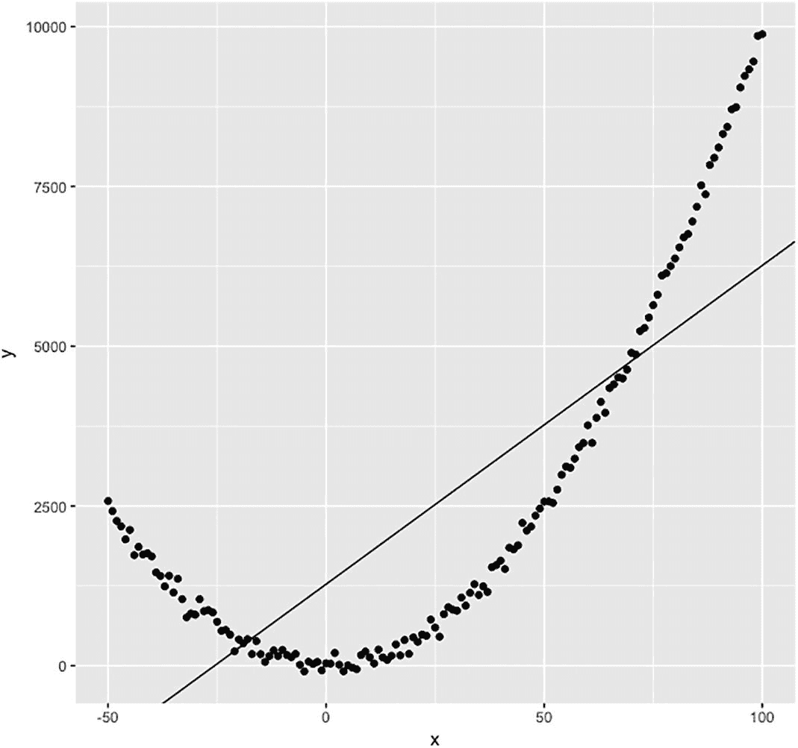
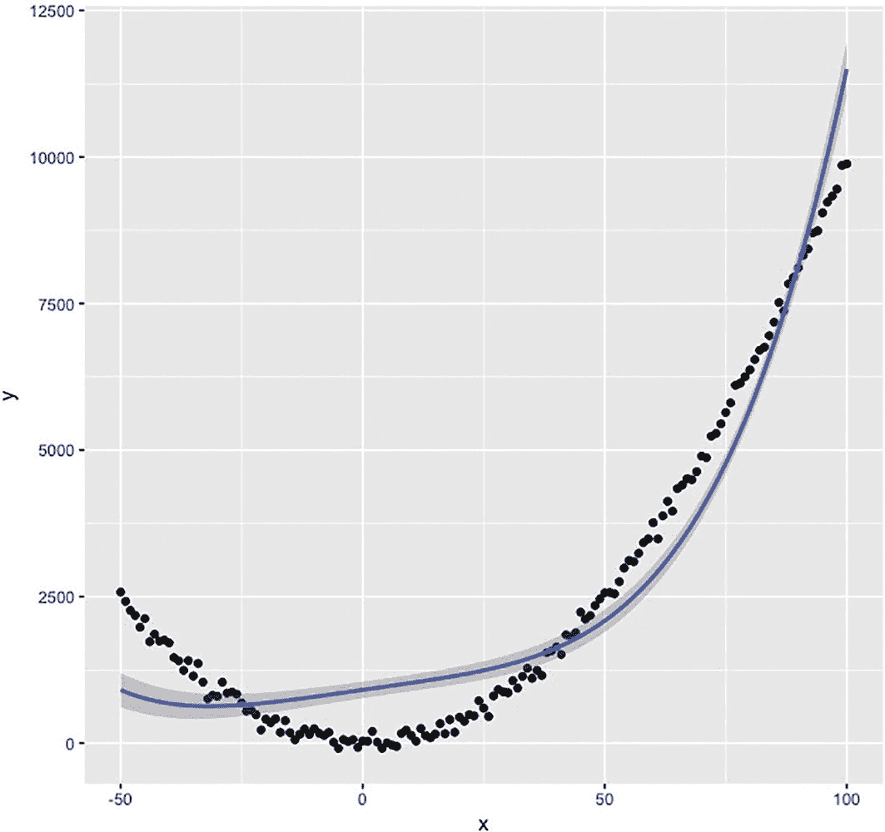
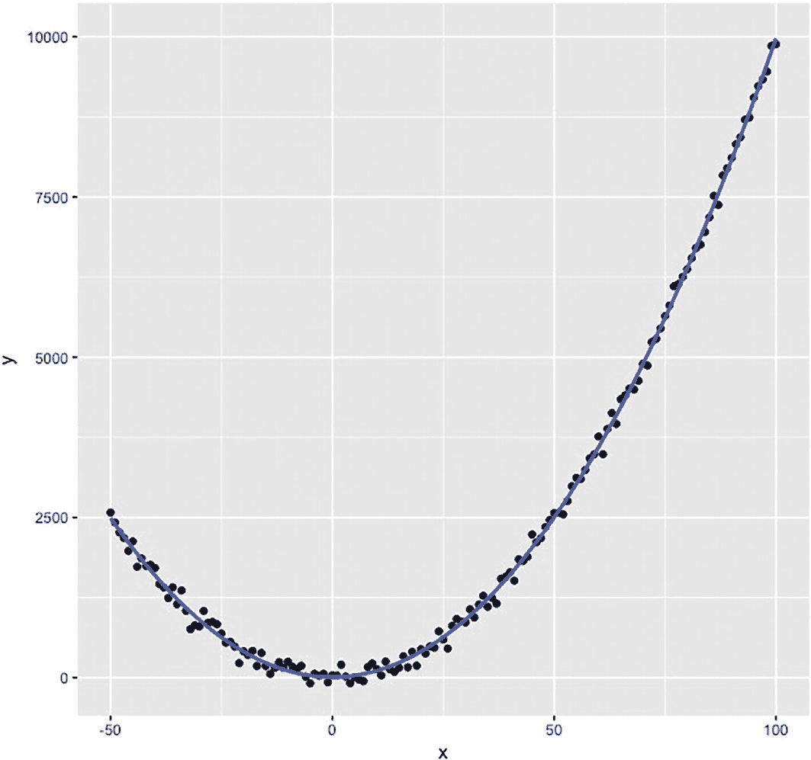
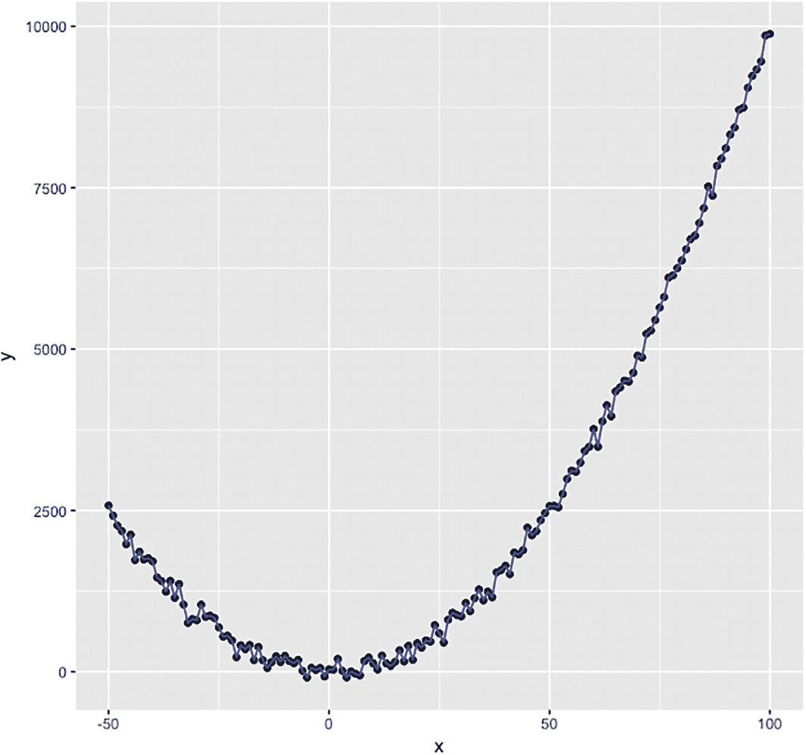

# 8. 机器学习：黑箱之内

> “我相信，到本世纪末，词汇的用法和大众教育观念将发生巨大变化，届时人们谈论‘机器思考’时，将不再担心会被反驳。”
>
> ——艾伦·图灵

艾伦·图灵没有说错。

仅仅几年后，1959 年，著名美国计算机科学家亚瑟·塞缪尔提出了以下广为接受的定义：“机器学习是关于赋予计算机无需明确编程就能学习的能力。”

目前，没有哪项技术比机器学习获得更多热捧，而且这也是理所应当的。1991 年，万维网对外公开，将地球上所有人连接起来。亚马逊于 1994 年上线。博客于 1997 年诞生。谷歌于 1998 年成立。Facebook 于 2004 年创立。亚马逊于 2006 年发布其云计算服务。2007 年，第一代 iPhone 问世。

自 90 年代以来，我们目睹了互联互通、数据生成和数据存储的持续趋势。我们在网上表达想法、购物、询问任何问题（从路线指引到外出就餐地点），所有这些数据都被不断记录，构建着我们世界的数字表征。在新冠疫情之后，这一点变得更为突出，期间许多专业人士被迫居家办公。

在这场数据洪流中，有一套特定的工具自 90 年代起开始流行，如今已主导了科技世界：那就是机器学习。机器学习如今无处不在。从智能手机到在线购物，再到公共交通——机器学习算法不断衡量、预测和优化响应。完整列举机器学习的用例不仅超出了本书的范围，其本身可能就需要一本书来论述。

最初为了重现智能而开始的努力，如今已成为我们对抗各种不确定性所拥有的最强大工具。不谈及机器学习的任何不确定性处理方法都是不完整的。本章旨在揭开机器学习以及“数据科学”等其他术语的神秘面纱。我们将审视其历史，并探讨为什么机器学习似乎效果极佳——但也存在若干缺陷。

## 数据科学与机器学习史

如今，最潮流的词不是“机器学习”或“统计学”，而是*数据科学*。本节在讨论机器学习之前，将先深入探讨这个术语。

什么是数据科学？数据科学本质上是工业界为融合数据相关各学科而创造的一个花哨新名称：机器学习、统计学、计算智能、数据挖掘、人工智能等等。

自远古以来——或大致如此——人类就试图在机器中重现智能，以分析数据并控制不确定性（等等）。几十年来，这催生了各种科学领域，每个领域在实现这些目标上都有不同的方法论。其中一些领域提出了截然不同的方法，但许多其他领域则得出了非常相似的手段。

例如，计算智能在 20 世纪 90 年代非常流行（但现在已不那么盛行），它基于生物学类比。其理论是，如果自然界已经发展出展现智能的机制，那么我们或许可以通过模仿这些机制在机器中复制智能。

你信服吗？

这在某种程度上是有道理的。如果蚂蚁能在蚁群中自我组织，也许我们能从它们身上学到些什么。如果我们的大脑由神经元构成，那么我们就可以模仿它们的功能，并用其来重现智能。

然而，这种方法并未取得太大进展。生物学类比似乎过于松散，尤其对于偏向数学思维的科学家而言。计算智能逐渐失宠，而机器学习开始占据主导。

经典人工智能与 50 年代发展出的一种方法相关联，该方法侧重于使用逻辑规则和推理来重现智能。这种方法与艾伦·纽厄尔（1927–1992）、赫伯特·西蒙（1916–2001）、约翰·麦卡锡（1956–）、马文·明斯基（1927–2016）以及亚瑟·塞缪尔（1901–2000）等人相关。他们的方法将逻辑视为智能的基本过程，并相信只要我们能创造出一台能用逻辑规则思考的机器，就有可能创造出一台智能机器。这种方法同样不太成功，后来被放弃了。

*控制论*是另一个更早于 40 年代出现的术语，由罗伯特·维纳用来描述能够响应环境的系统。*数据挖掘*和*模式识别*也是 90 年代被热议的流行词。

在历史上大部分时间里，这些方法和算法主要在学术界以及像 IBM 这样的一些科技公司中发展。然而，在 21 世纪初数据洪流之后，数据处理算法突然开始变得越来越有价值。这些算法分散在不同学科和思想流派中，并不利于销售产品或服务。因此，“数据科学”这个术语应运而生，用以涵盖任何与数据相关的算法、方法、产品或服务。

这个词已主导了工业领域的格局，很大程度上是因为说自己是数据科学家比深入解释众多思想流派之间的差异以及自己属于哪一派要容易得多。我也自称数据科学家。科技领域之外的人会问什么是数据科学，以及数据科学家是做什么的？然后他们会遇到各种各样的答案。事实是，所有与数据分析、不确定性和人工智能相关的学科都有着悠久的历史传统。这些传统主要扎根于世界一些顶尖大学，而一些大型科技公司也扮演着角色。如今，这些公司开始超越大学，原因很简单：它们手握巨额资源。

# “数据科学”一词及其内涵

“数据科学”这个术语在销售产品和服务时很有用，但当有人想要深入理解这门学科时，我们别无选择，只能认真审视这个术语，并分别研究每个主题。

如果非要给数据科学下个定义，我会说目前大多数数据科学家主要处理的是`Python`或`R`编程语言。他们很可能同时运用机器学习和统计学中的技术——根据目标进行一种精挑细选的组合——以便分析数据并从中提取洞察。然而，正如你将在本书中学到的，机器学习和统计学有着不同的历史渊源——以及不同的解决问题方式。

追溯到机器学习的历史，它与经典人工智能的历史有很大重叠。通过遵循逻辑规则来重现智能的方法被称为`自上而下的方法`。这种思维方式如下：

1. 某个领域的智能由一组有限的逻辑规则组成。例如，在医学领域，医生拥有多条“如果症状`X`，则疾病`Y`”形式的规则。
2. 将许多规则合并在一起应该足以产生智能。
3. 因此，AI 工程师的目标应该是将这些规则编码到机器中。

尽管这种方法取得了一些成功——比如 70 年代初斯坦福大学开发的`MYCIN`专家系统，据称当时比初级医生更有效——但它从未取得足够大的进展。与计算机科学中的许多案例一样，相关领域的人士常常承诺过多而交付不足；这是一个容易掉入的陷阱。AI 经历了两次被称为“AI 寒冬”（该术语首次使用于 1984 年）的时期，这是传统的技术泡沫。市场规模一度达到数十亿美元，但随后却无法再获得投资。

在 80 年代末和 90 年代初，一种不同的创造智能的方法逐渐流行起来，其直觉似乎完全相反。不是手工制定规则让机器遵循，而是让机器自己从数据中学习。与经典 AI 采用的`自上而下的方法`相比，这是一种`自下而上的方法`。

“机器学习”这个术语之所以有用，有两个原因。首先，它准确地描述了这些算法实际上在做什么。其次，它有助于将这种新方法与已经声名狼藉的经典 AI 区分开来。机器学习所走的路线与 90 年代的其他方法类似，比如计算智能、数据挖掘和模式识别。事实上，有时这些术语可以互换使用。

因此，进入 21 世纪，这种`自下而上`、数据驱动的方法正在主导我们生活的许多方面。它为何（以及如何）如此成功？主要有两个原因。

首先，`自上而下的方法`需要大量的人力输入。制定规则的人必须考虑所有可能描述或影响系统的规则。也许不用说，这是一项非常困难、费力且耗时的任务。另一方面，`自下而上的方法`效率更高。算法可以从数据中学习一切。操作人员唯一需要做的就是为算法找到最佳的参数设置。

其次，数据驱动方法能产生更好结果还有一个根本原因。如果你还没有意识到，我们的世界从根本上来说是不确定的。诚然，在很多情况下，结果或关系类型是完全确定的。然而，在大多数情况下，并非如此。让我给你举个例子。试着想出一套规则来预测一只股票未来两天的价格。也许你能想出一套`大致`有效的规则。但你相信有人能想出一套有限的规则，每次都能精确到小数点后几位，并且从不失手吗？老实说，恐怕不行。

最好的方法不是假装不确定性不存在或试图将其完全排除在等式之外，而是简单地接受它。`自下而上的方法`从一开始就明白，预测永远不会完美，也不需要完美。目标只是减少错误的数量。

正是这种直觉，使我们如今拥有了有史以来最优秀的智能算法版本。

## 选择你的学习类型：监督学习、无监督学习、强化学习，还是其他

机器学习并非单一、同质、功能相同的算法家族。相反，如同生活中的事物，它存在细微差别——有不同类型的机器学习应用。最流行的是监督学习、无监督学习和强化学习。

`监督学习`是机器学习的“主力军”。它无疑是目前最流行的算法类别。在监督学习中，算法面临如下问题：存在输入和输出。你必须找到一种将输入匹配到输出的方法。算法位于输入和输出之间——就像一个黑箱——并决定两者如何连接。你可以将监督学习用于许多不同的事情：从自动化人类任务到预测未来。

例如，想想垃圾邮件检测。每当你将一封电子邮件标记为垃圾邮件时，就会有算法学习什么是垃圾邮件，什么不是，从而自动化你的决策。想想预测股票价格。算法可以综合考虑多种信息来源，如历史趋势和社交媒体上关于不同公司的讨论，然后利用这些信息来预测价格下一步的走势。算法会跟踪你在在线零售商处购买的产品，以便找出你最可能接下来购买什么。当你上传一张照片到网上时，算法可以自动检测出人脸的位置，并请你为它们打标签。所有这些都是监督学习的例子。

当大多数人想到机器学习应用时，他们通常指的就是监督学习。自 90 年代以来，该领域见证了强大算法的井喷式发展，这些算法与千年之交经历的数据洪流相结合，将机器学习变成了一个改变游戏规则的力量。现代版本的支持向量机于 1992 年问世。梯度提升算法于 1999 年被发现。^(⁵⁹) 列奥·布雷曼（1928–2005）在 2001 年提出了“随机森林算法”。^(⁶⁰) `Scikit-learn`，`Python`编程语言中最流行的机器学习库，创建于 2007 年，使`Python`成为机器学习的标准语言。如今，甚至有一个名为`Kaggle`的竞赛网站，^(⁶¹) 人们可以在上面进行监督学习的比赛。

监督学习与统计建模密切相关。从机器学习的角度来看，统计模型就是监督学习。实际上，监督学习采用了从统计学中借用的一些算法，如线性回归和逻辑回归。

这两个学科的主要区别在于`思维方式`。统计学诞生于数学系，那里非常注重方法的严谨性和透明性，因此是一种抽象的方法。另一方面，机器学习诞生于计算机科学系和实验室，那里许多人本质上是工程师，更倾向于实验和实用主义而非理论。机器学习是通过反复试验和实验诞生的，专注于预测能力，因此是一种经验主义的方法。

在机器学习中，模型优劣的证明在于其在“测试集”上的表现。若模型具有良好的预测能力，则其为好模型。在统计学中，仅检查性能是不够的，还需要检验一系列假设。机器学习因其缺乏理论严谨性而受到批评。尽管存在一些关于机器学习工作原理的理论（其中许多受贝叶斯统计学启发），但事实上，机器学习更侧重于性能与应用而非理论——许多人认为这是一件好事。正如美国工程师、备受尊敬的管理顾问威廉·爱德华兹·戴明（1900-1993）曾言：“理论上一切皆有可能；然而，我生活在实践中，通往理论的道路已被冲毁。”

毫不意外，`无监督学习`与监督学习截然相反。在无监督学习中，算法接收一组输入，但不存在与这些输入匹配的输出。没有输出，便无法进行监督。取而代之的是，算法在数据中发现模式。举个例子：假设有人向你展示狗、猫和鱼的图片，并要求你对其进行分类。你会提出哪些类别？大多数人可能只会提出三类——猫、狗和鱼。然而，有人可能会认为只有两类：有毛的哺乳动物和鱼。或者，可能存在两种与前一种不同的类别：喜欢水的动物（狗和鱼）和不喜欢水的动物（猫）。

哪种分类方法最好？答案是：没有客观标准可以评判。无监督学习本质上是一个定义不清的问题。它可以帮助你发现数据中的模式，但并没有客观的方法可以声明哪个解决方案最好。无监督学习最著名的例子可能就是客户细分，它允许像零售商这样的公司将客户分为不同的画像，然后利用这些信息进行精准营销。我相信你一定能想起这样的时刻：你被明确归入某个特定人群，随后就看到与你完全不搭的广告，仅仅是因为你曾给姑婆买过一个花园小矮人。

法国计算机科学家杨立昆（1960-），深度学习领域的主要研究者之一（也是图灵奖得主），曾表示`无监督学习`可能是所有类型中最重要的。他认为，原因在于对人类而言，无监督学习构成了我们经验的主要部分。我们学习大多数概念并非通过直接的监督和强化，而是通过观察环境中的模式。破解真正人工智能（即类似于人类智能）的难题，或许需要我们破解无监督学习的难题。

`强化学习`同样位于机器学习谱系中更拟人化的一端，并且与人类的状况紧密对应。在强化学习中，算法被称为“智能体”。智能体存在于一个环境中，这个环境可以是物理的（如机器人），也可以是虚拟的（如算法交易系统）。智能体试图最大化某种奖励，同时避免惩罚。为此，它可以执行有限数量的动作，能够访问所有过去与环境交互的历史记录，并且知道环境当前的状态。智能体通过在环境中进行试验并预测未来的样子来学习。通常，智能体必须学会忍受一些惩罚，以便之后获得更大的奖励。

这如何与现实生活相似？以读大学为例。上大学需要花钱和付出努力。此外，你还必须考虑所学的专业是否真的有助于找到工作。如果你付出这种努力，几年后，你很可能发现自己财务状况比不这样做要好得多。从强化学习的角度来看，你正试图通过短期试验并承受一些惩罚，来最大化未来的财务收益。

或者想想学骑自行车。你必须学会将腿放在正确的位置，然后平衡身体并找到合适的节奏。这样做的时候，你很可能会犯错；你会伤到自己。但随着时间的推移，错误会越来越少，受伤也越来越轻，直到你成为一个不错的骑手。这是强化学习的另一个例子。

强化学习在 2015 年大放异彩。名为`AlphaGo`的算法成为第一个在围棋中击败职业大师的计算机程序。围棋被认为是中国在 2500 多年前发明的，它就像国际象棋更抽象、更复杂的版本。直到 2015 年在伦敦与樊麾的那场决定性比赛之前，人们都认为计算机无法在围棋上战胜人类。`AlphaGo`正是基于强化学习的。

还有许多其他类型的机器学习，如主动学习、半监督学习和推荐系统。然而，逐一介绍每一种都超出了本书的范围。此外，新的算法在不断涌现，其中一些可能结合了所有上述不同类型的学习方法。例如，强化学习可以融合监督学习，而监督学习可以使用无监督学习。这里仅简要提及最令人兴奋的机器学习子类型之一——单样本学习，其目标是让算法仅通过一个或几个示例进行学习。这与人类学习某些新概念（如面孔）的方式类似。

这里概述的所有方法都是为基于不确定性的不同应用而构建的。在监督学习中，我们假设存在一种匹配输入与输出的关系，但我们不知道这种关系是什么样的。在无监督学习中，我们假设存在一种模式、某种规律性，但我们不知道这种规律性是什么。在强化学习中，智能体面临关于环境及其支配规则的不确定性。总而言之，所有这些技术提供了一个强大的工具箱，用于处理我们面临不确定性的各种情况。

# 偏差-方差权衡

机器学习中的另一个关键概念是偏差-方差权衡。我来解释一下。
算法总是面临这种特定的权衡，但这*不仅仅是*算法的问题。正如你将在本章后面看到的，人类也面临偏差-方差问题——而且其原因可能与算法相同。
不过，我们首先来看看偏差和方差在算法语境中的含义。我所说的偏差，是指算法对数据或问题所做的假设。高偏差算法对世界的样子有非常具体的看法。在现实生活中，偏见很深的人（很可能）永远不会改变他们的观点。例如，假设你相信所有精灵都比矮人聪明。需要无数反例才能让你改变看法。算法与此非常相似。
线性回归就是高偏差算法的一个例子。它假设世界上的所有关系都是线性的。想象一下，有人向你展示了图 8-1 中的图像。他们给了你一把尺子，并要求你画一条尽可能贴合数据模式的直线。被迫使用尺子，你只能画直线，结果会得到类似于图 8-1 中实线那样的线条。



`y` 与 `x` 的散点图描绘了一个 U 形图，范围从（负 50，2500）到（100，10000）。一条递增的直线从（负 25，0）延伸到（100，6250）。该直线与 U 形图相交于（负 20，250）和（70，4750）。数值均为近似值。

**图 8-1** 高偏差情况下的示例

低偏差算法则相反。在日常生活中，你会发现有些人更容易接受新的建议和想法。这些人的偏见较低。算法也是类似的。低偏差算法愿意让数据改变自己的观点。例如，假设有人向你提出同样的问题，但告诉你不必使用尺子。你可以自由绘制。虽然你不擅长画线，但这给了你比之前更多的自由。你最终会画出类似图 8-2 中所示的线条。



`y` 与 `x` 的散点图描绘了一个 U 形图，范围从（负 50，2500）到（100，10000）。一条递增的曲线从（负 50，1200）延伸到（100，11500）。该曲线与 U 形图相交于（负 25，750）、（40，1500）和（90，8000）。数值均为近似值。

**图 8-2** 低偏差算法的示例

这比之前的形状准确得多，但仍然不够精确。为了全面解释学习过程，我们还需要考虑方差。
方差描述了算法愿意听取数据意见的程度。回到现实生活的例子，你可能遇到过一些很容易改变主意的人。此刻他们相信爵士乐是世界上最棒的音乐，下个月又迷上了重金属。或者他们每隔一个月就换一个新爱好。甚至可能根据在媒体上看到的内容，随时改变对政治话题的看法；他们是容易受影响、可塑性强的受众。这些就是高方差人群的例子。另一方面，低方差的人不会轻易偏离他们最初的立场。
偏差和方差是相互关联的。高偏差、低方差的人永远不会改变他们的最初观点。然而，高偏差、高方差的人可能最初有非常强烈的观点，但随着更多数据的出现，他们很可能会改变看法。低偏差、高方差的人则对任何旧建议都极度开放。例如，这些人可能是最容易受到同伴压力影响的人。下表总结了所有这些情况：

|   | 高方差 | 低方差 |
|--- |--- |--- |
| 高偏差 | 在看到足够多的反例后会改变想法。 | 永远不会改变想法。 |
| 低偏差 | 会相信任何事情。 | 恰好的平衡。 |

正如你所了解的，算法的行为常常与人类非常相似。在这种情况下，低偏差、低方差的算法将表现得恰到好处，并产生如图 8-3 所示的结果。



`y` 与 `x` 的散点图描绘了一个 U 形图，以及一条与之重叠的 U 形曲线。它们从（负 50，2500）延伸到（100，10000）。数值均为近似值。

**图 8-3** 恰到好处的算法示例

高方差会使算法（和人类）混淆噪声和信号。你听到的每一个新闻故事并非都是真实的，每一个数据点也并非都没有噪声。这一点如今可能比以往任何时候都更为普遍。从正确的来源提取信息是一种平衡的艺术，而且，与人类一样，机器学习算法也必须谨慎地把握好这种平衡。
人类也会使用认知偏差。这些偏差之所以存在，部分原因是在我们的进化史上，它们在各种情况下对我们很有帮助。但很多时候，它们也可能导致我们做出糟糕的决策。例如，当我们还生活在部落中时，能够快速察觉某人是否来自部落之外是一项有用的技能。对外来者持怀疑态度也很正常，因为我们的世界由一个小部落主导，部落之外的任何人可能不会给我们带来太多好处，甚至可能充满敌意。但在全球化的世界里，出于肤浅的原因而对他人持怀疑态度，对我们没有任何帮助。无论我们谈论的是人类还是机器，某些学习原理是相同的。
用不确定性的术语来说，当没有不确定性时，高偏差和低方差是好的。对“太阳明天会升起”这一事实持有高偏差、低方差的看法可能是一件好事。而在不确定性占主导地位的情况下，高方差和低偏差则更为合适。对“明年经济增长率将为 2%”持有高方差、低偏差的看法是一件好事。经济表现可能比这好得多——也可能崩溃。同样，矮人可能比精灵更聪明（好吧，偶尔如此）。
机器学习算法提高性能的方法之一是通过一种称为`正则化`的技术。你可能已经在图 8-3 中注意到，“最佳”拟合仍然包含一些误差。它没有穿过每一个数据点，因此会产生错误，但总体看起来相当不错。然而，图 8-4 中的模型是完美的：误差为零。



`y` 与 `x` 的散点图描绘了一个 U 形图，以及一条与之重叠的、带有波动的 U 形曲线。它们从（负 50，2500）延伸到（100，10000）。数值均为近似值。

**图 8-4** 完美模型（以误差衡量）

你更喜欢这个模型还是上一个？最后一张图是方差极高模型的典型例子。该模型认为它遇到的每一个数据点都是正确的，但它极大概率也是错误的。在机器学习中，我们说这种模型“未能泛化”。这意味着模型记住了每一个数据点，但并没有真正*学习*到任何东西。让我们再看一个现实世界的例子。
假设你正在学习代数。有人给你出了下面这些练习题：

```
2 + x = 0
5 + x = 1
```

第一个练习的解是 -2，第二个的解是 -4。根据这个推理，你可能会这样回答下面这道题：

```
7 + x = 2
```

答案是 -5。但一个只死记硬背了*解法*的人，是无法计算出这个答案的，他们会回答 -2 或 -4，因为他们从未见过最后一个式子。这是一个典型的“电脑说‘不’”的案例。在机器学习中，我们说他们未能“泛化”。
正则化迫使算法得出一个平滑的解，虽然会犯一些错误，但整体上能更好地泛化。一条平滑的曲线在美学上更悦目，而且在大多数情况下也是最佳选择。
那么，为什么正则化有效呢？正则化之所以有效，是因为我们的世界从根本上来说总体上是平滑的——对于一个数据科学家在一本谈论不确定性的书中提出这样的主张可能显得奇怪，但请听我解释。我们期望明天与昨天大体相似。气温不会在一夜之间从零下 20 摄氏度飙升到零上 40 度。孩子每年只会长高几厘米。大自然通常不喜欢突变，它本质上是平滑的。事物的运行有其规律和模式。
当然，在某些情况下也会发生突变，比如在复杂系统中，我稍后会详细讨论。但平均而言，在广泛的问题中，平滑性假设对机器学习社区非常有益。不幸的是，当我们面临严重的外部冲击（比如流行病或金融危机）时，这种情况在现实世界中可能会失效。但在大多数情况下，它一直很管用。

## 机器学习 vs 统计学：为什么“傻瓜式”方法有效

> *“简单的模型加上大量的数据，胜过基于少量数据的更复杂的模型。”*
> ——彼得·诺维格，谷歌研究总监

机器学习的一个显著特点是，它在相对缺乏理论支持的情况下却能表现良好，这与过去主导数据分析的统计学范式形成了对比。尽管关于机器学习算法如何工作以及为何有效有一些理论，但事实上，对于大量的机器学习研究来说，主要的驱动力是反复修补和实践直觉，而不是理论——正如我们之前所见。
假设你面临一个问题：将输入数据集匹配到输出。例如，你想创建一个模型，根据精灵父母的魔法能力来预测该精灵的魔法能力。统计学家会使用一个带有精心设计假设的模型。然后，统计学家会着手检验这些假设，并提出检验方法和结果，告诉你模型与数据的拟合程度。
机器学习理论家则会在没有任何假设的情况下使用模型。该模型将基于数据构建，并在数据上进行测试。模型的性能好坏，仅通过它正确预测新案例的能力来衡量。
统计学更偏向理论和假设驱动，而机器学习——毫不意外地——是数据驱动的。事实上，机器学习中的许多概念都是直接从统计学中“借用”的，没有太多理由或解释。例如，人工神经网络（通常缩写为`ANN`）长期使用逻辑函数作为节点，唯一的原因就是这些函数在统计学中已经是流行的选择。在这些函数被使用了数十年后，人们才发现它们对于神经网络来说是更好的选择。

机器学习的奇妙之处在于，通过反复的试验和改进，机器学习社区在多种任务中取得了无与伦比的性能，这是前所未见的。深度学习方法大概是这种做法的首要例证。神经网络作为一个概念已经存在了很长时间。实际上，第一次有人想到神经网络是在 1943 年，当时神经生理学家沃伦·麦卡洛克（1898–1969）和数学家沃尔特·皮茨（1923–1969）开发了一个简单的电路。第一个现代神经网络是`感知机`，由弗兰克·罗森布拉特于 1958 年设计。后来的进步（主要是反向传播算法的发明）进一步推动了神经网络的发展。然而，它们在 90 年代失宠了，尤其是当其他理论基础更扎实的算法（例如支持向量机⁶³）出现之后。

由于杰弗里·辛顿、扬·勒昆和约书亚·本吉奥的努力，神经网络经历了复兴，他们提出了深度学习的概念。实际上，“深度学习”这个术语是辛顿想出来的，他这么做是为了耍个花招，骗过学术界发表他的成果——因为关于神经网络的论文当时已经过时，根本无法发表。如果有一个故事能说明学术机构经常表现出的非理性，那么非此莫属！

无论如何，深度学习解决了过去无法回答的问题。而且这些问题大多异常困难——它们与计算机视觉、音频、语言等领域相关。深度学习已经主导了所有拥有大量数据的复杂问题的研究领域。所有大型科技公司都在投入巨额资金来推进深度学习研究。辛顿、勒昆和本吉奥因此成为了超级明星，并因对计算机科学的贡献获得了图灵奖⁶⁴。

关于神经网络的一个有趣之处在于，它们基于一种松散的生物学类比——你可能已经从名称中猜到了这一点。神经网络背后的核心概念是，通过模仿生物学产生智能的方式，我们可以在计算机中重现智能。神经网络并没有太多理论支撑，这也是它们在 90 年代失宠的原因之一，当时基于更可靠理论的算法成为了主流。颇具讽刺意味的是，少数关于神经网络的理论论文之一得出的结论是，在神经网络中，你不需要超过一个隐藏层。^(⁶⁵)这被称为“`通用近似定理`”。

深度学习带来的核心创新是，通过增加更多层，网络变得强大得多，这与`通用近似定理`的预测截然相反。因此，通过反复尝试所发现的，实际上最终远优于理论最初所允许的范围。现在，许多数学家和理论家正试图提出解释，来说明为什么深度学习的效果如此之好。这些解释中的一些很可能会存在自身的缺陷，然后会有另一位实践者证明这些理论是错误的。

尽管统计学在许多应用中仍然是最佳的解决方案，但机器学习，尤其是深度学习，是解决各种复杂问题的*唯一*可用方案。其原因可能是纳西姆·尼古拉斯·塔勒布所称的“教鸟儿如何飞翔”^(⁶⁶)效应。大多数科学教科书将科学描述为一种理性且有组织的努力。然而，它们充满了事后的解释。塔勒布认为，科学的进步需要技巧和运气的结合，并且它更多是反复试验、实验和意外发现的产物，而不是精心规划的结果。如果牛顿当时没有坐在那棵苹果树下，会发生什么呢？机器学习将不确定性问题视为首先通过实验而非理论来解决的问题。通过这样做，它在各种主题上都取得了惊人的成功。当实践者期望世界遵循预先设定的模型时，“教鸟儿如何飞翔”效应便存在于不确定性之中。这种方法常常会失败。这也是亚马逊提倡“倾向于行动”^(⁶⁷)的原因。用他们自己的话来说：“速度在商业中至关重要。许多决策和行动是可逆的，不需要广泛的研究。我们重视经过计算的风险承担。”

但这是否意味着我们需要将理论抛诸窗外？一点也不。两种方法都有其优点。我在这里试图说明的是，针对不确定性本身的研究也面临着不确定性。这是一个公认的真理。不确定性无法避免，但可以被应对。我们只需要正确的方法。因此，无休止的理论化往往是适得其反的，因为在严峻的情况下，不采取行动往往是灾难性的。

## 机器学习的局限性

机器学习是完美的吗？嗯，不是，即使许多服务提供商试图让你相信它是完美的。机器学习被誉为万能的解决方案，但它也有一些严重的缺陷。

第一个缺陷是机器学习没有与逻辑推理相结合。虽然传统的人工智能方法做得不够深入，但逻辑推理仍然是人类推理的一部分。如果我给你提供以下陈述：

1.  所有精灵都能释放闪电。

2.  鲍勃是一个精灵。

那么你可以合理地得出结论，你不应该招惹鲍勃，因为他能释放闪电。然而，一个机器学习系统必须看到多个类似示例，才能理解这些关系。目前有一些研究工作致力于使用神经网络进行问答，其目标是让网络学会如何回答问题以及阅读逻辑语句。然而，神经网络执行这些任务所需的数据量，使得它们看起来并不那么智能，因为这种能力对我们来说是自然而然的。这就像一台能够识别猫咪视频的计算机的例子——这听起来很不可思议，直到你想起两岁小孩也能识别猫咪。

机器学习的另一个问题是它是不透明的。算法被普遍视为黑箱。很难理解算法*内部*发生了什么，以及它如何做出决策。话虽如此，还是有办法从算法的内部运作中提取洞见。一些算法会告诉你它们认为哪些变量最重要。有一些方法，例如沙普利值解释，可以帮助用户理解变量之间的交互作用。^(⁶⁸)然而，即使如此，事情也并不总是容易的。机器学习算法专注于性能，而非可解释性。虽然在可解释机器学习领域正在兴起，但挑战依然存在。也许这些问题将永远存在，因为在许多情况下，这个世界太复杂了，无法用简单的关系来表达。机器学习的成功可能归功于它从数据中提取复杂关系的能力。也许我们只是不够聪明，无法超越仅包含少数几个变量的简单关系来进行思考。

这已经引发了一些问题，即使对于雇佣了经验丰富的数据科学家团队的的大公司也是如此。例如，亚马逊的一个团队曾致力于开发一种能够自动筛选软件开发职位简历的工具。有消息泄露称，该算法会惩罚女性候选人，因为它训练所依据的大部分简历来自男性候选人。^(⁶⁹)这最终成了亚马逊的一场公关噩梦，他们迅速取消了该项目。

最后，与前述问题相关的另一个问题是，机器学习不理解因果关系。如果一个婴儿看到一个物体掉下来，它能迅速推断并理解存在一条叫做“重力”的规则。而一个机器学习算法则需要看到大量这样发生的事件，然后才能将一个高概率（例如 0.99）与物体下落关联起来。这显然不太合理。这就像在尖刻的喜剧《硅谷》中，杨建的应用程序一样，它只能将食物识别为“热狗”或“非热狗”。

机器学习的近期进展也体现了这一点，例如 `ChatGPT` 和大型语言模型。这些模型能够对广泛的查询和提示生成类人响应，使其在从客户服务到创意写作的各种应用中都非常实用。然而，`ChatGPT` 无法完全进行逻辑或因果思考。虽然该模型能生成看似符合逻辑或因果关系的响应，但它并不能真正理解特定情境下的底层逻辑或因果关系。这意味着它有时会生成技术上正确，但在对话语境中却毫无意义的回答。

AI 史上最杰出的计算机科学家之一**朱迪亚·珀尔（Judea Pearl）**曾严厉批评机器学习无法理解因果关系。尽管机器学习领域进行了诸多创新，但它仍然基于关联性学习。珀尔认为，因果阶梯共有三个层级，要构建真正智能的机器，我们需要从第一层级（关联）向上攀升至第二和第三层级，即因果关系真正所在之处。如果不理解因果关系，我们拥有的就不是智能算法，而仅仅是“曲线拟合机器”。尽管这些算法执行的某些拟合效果令人印象深刻，但实现真正的人工智能需要我们的思维方式发生范式转变，一种将因果关系置于核心地位的转变。

脚注 1   2   3   4   5   6   7   8   9   10   11

