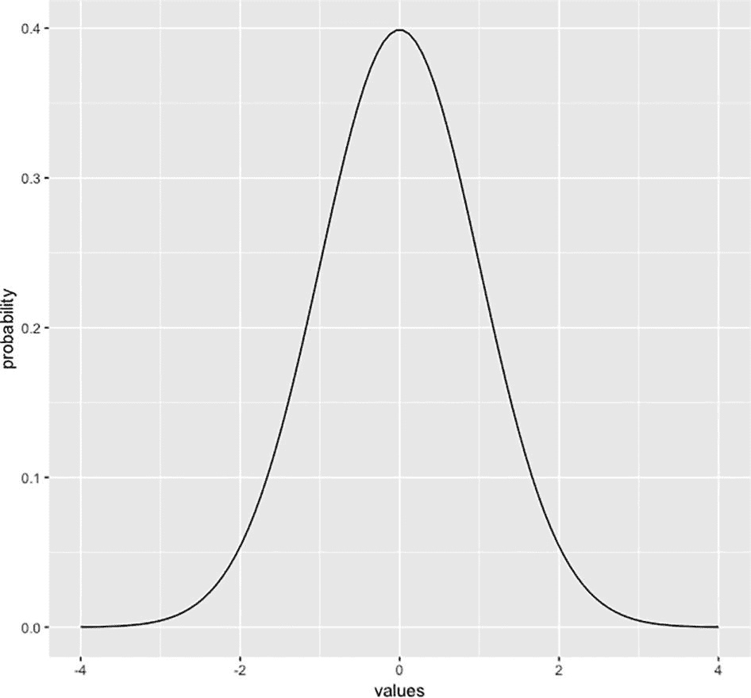
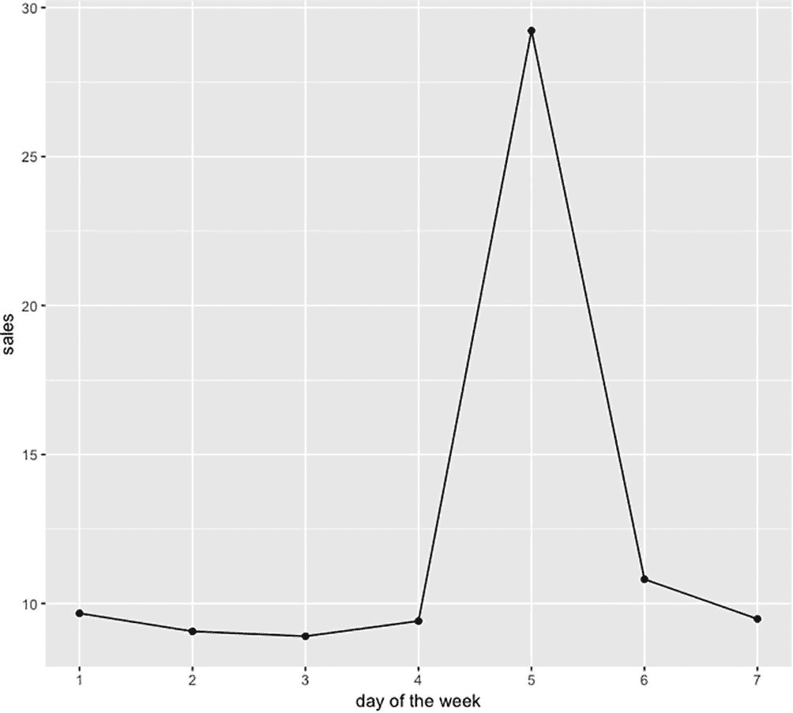
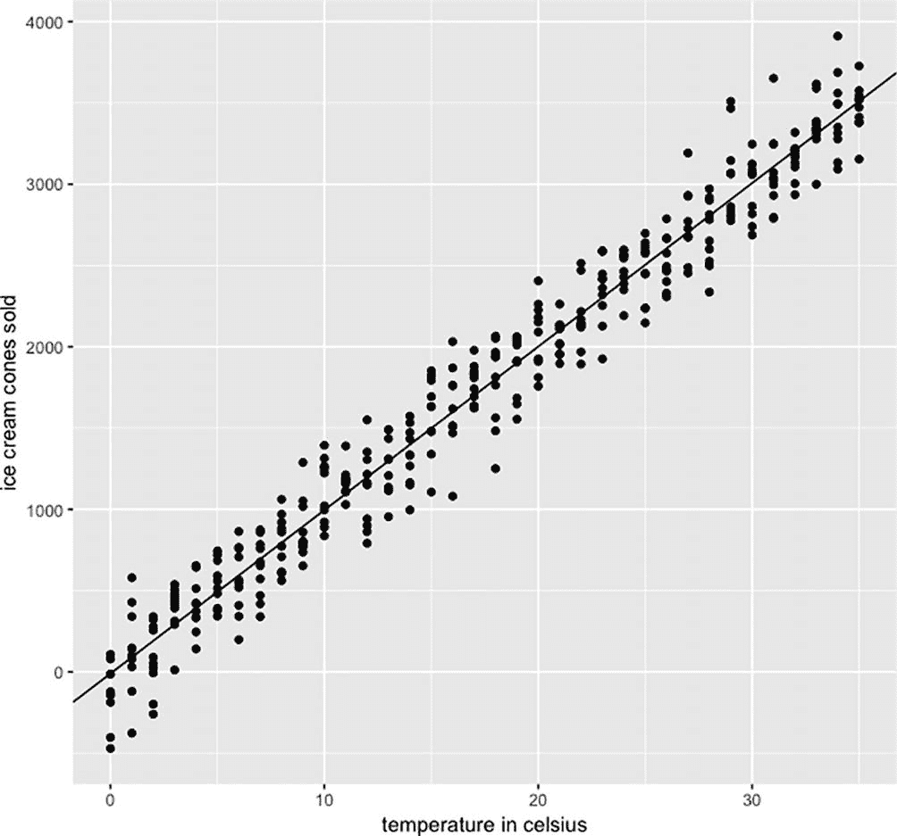
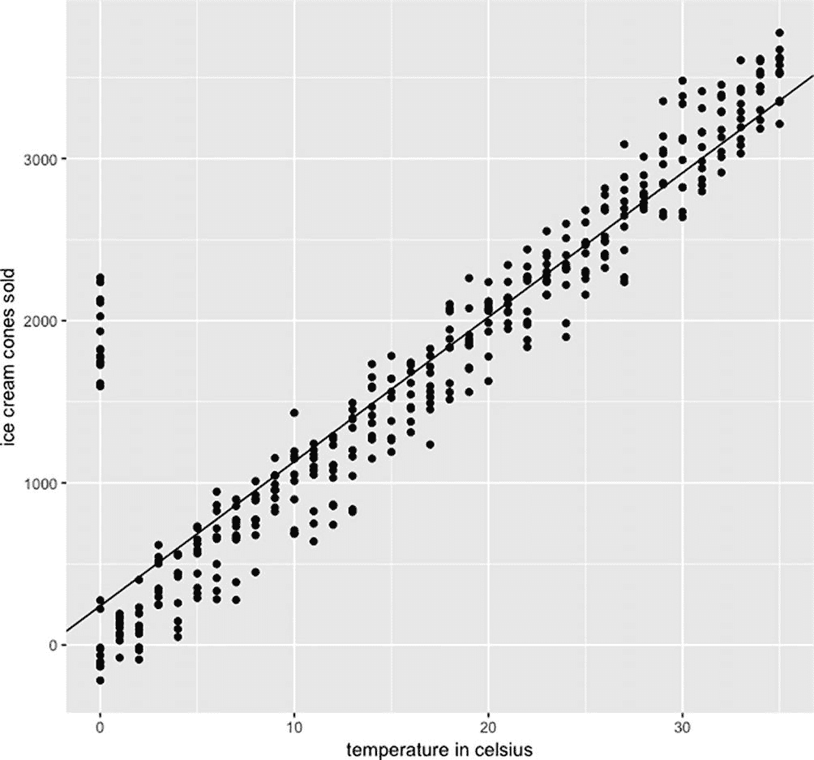

# 3. 天鹅与时空入侵者

> *“平庸斯坦是一个我们必须忍受集体、常规、显而易见和可预测事物之暴政的地方；极端斯坦则是一个我们遭受单一、偶然、未见和不可预测事物之暴政的地方。”*

>

> ——纳西姆·尼古拉斯·塔勒布，《黑天鹅：如何应对不可预知的未来》

当前最著名的研究不确定性的学者之一是纳西姆·尼古拉斯·塔勒布。如今身为学者、散文家及《Incerto》作品集（其中《黑天鹅》是第二部）作者的塔勒布，曾就职于金融业——这可以说是最暴露于不确定性的行业。财富在转瞬之间产生或消失。

塔勒布的观点是，金融和经济学的主要问题之一在于它们属于他所谓的“平庸斯坦”（你可以把它想象成一个地方）；另一方面，我们世界的大部分却属于“极端斯坦”。塔勒布所说的“平庸斯坦”在很大程度上主导了西方思想。“平庸斯坦”描述的是集中于平均值和“正态”分布的统计思维。正如我们之前所学，这种推理方法具有重要影响。

我们的世界大多以常态为特征。你可以在图 3-1 中看到正态分布的样子。

概率与数值关系图显示了一条钟形曲线，其峰值大约在(`0`, `0.4`)处。

**图 3-1**

标准正态分布。标准正态分布的均值为`0`，标准差为`1`。它被用于无数数学模型之中。

正态分布有一个重要特性：`95%`的数据值位于均值的一个标准差范围内，`99%`的数据值位于均值的两个标准差范围内。一个遵循正态分布曲线的良好例子是身高——在特定的年龄组和文化背景下，我们预计不会看到很多非常矮或非常高的人。

智商同样遵循正态分布，体重以及许多其他物理现象也是如此。观察到身高四米（13 英尺）或体重一吨（2200 磅）的人的概率实际上为零。这也与我们日常经验高度吻合。

正态分布被有史以来最流行的统计模型——线性回归——所使用。其他概率分布也被用于类似的模型，所有分布同样排除了极端值。许多此类统计模型已成功应用于教育、救护车等待时间等不同领域。

这就是塔勒布所说的“平庸斯坦”。使用“平庸斯坦”的模型时，极端值不仅不太可能出现，而且也不会对模型产生太大影响。例如，在统计学中，移除异常值是一种常见做法，只是为了结果更清晰一些。异常值是指不符合平均情况的数据点。图 3-2 展示了一个例子。该图显示了一家虚构企业按星期几划分的平均总销售额。第五个点显然是一个明显的异常值，因为它远高于平均销售额。

销售额与星期几的关系折线图显示出一条有峰值的曲线。曲线经过(`1`, `9.8`)、(`2`, `9`)、(`3`, `8.8`)、(`4`, `9.5`)、(`5`, `29.4`)、(`6`, `11`)和(`7`, `9.5`)点。数值为近似值。

**图 3-2**

基于星期几的平均总销售额，图中有一个明显的异常值。

假设你正在研究城市温度对冰淇淋蛋筒消费量的影响。两者遵循密切的线性关系——温度越高，冰淇淋蛋筒消费量越大。但假设 12 月举办了一场仅此一次的冰淇淋节，全球顶尖冰淇淋生产商涌入这座城市，举行盛大的冰淇淋庆典。尽管气温处于最低点，但 12 月的冰淇淋消费量达到了高峰。这是一个异常值，它并不描述温度与冰淇淋消费量之间普遍且正常的关系。因此，你可以将其从数据集中移除。

但在平均斯坦中，一个有趣的性质是：即使我们包含这些异常值，它们也不会从根本上改变结果。让我们在这个虚构的例子中看看，移除异常值后的图表是什么样的。你可以在图 3-3 中看到这一点。

一幅展示冰淇淋蛋筒销售量与摄氏温度关系的散点图描绘了正相关性。一条上升的直线穿过这些散点。它在(0, 0)和(35, 3500)之间延伸。数值为近似值。

**图 3-3** 温度与蛋筒销量图。黑色直线是由线性回归模型生成的最佳拟合线。

回归线的斜率为 `100`。线性回归模型中的斜率衡量了关系的强度与方向。在此模型中，这意味着温度每升高 1 摄氏度，冰淇淋蛋筒的消费量增加 `100`。

让我们看看*包含*异常值的模型是什么样子的。我们有 `15` 天气温为 `0` 摄氏度，但冰淇淋消费量非常高。如图 3-4 所示。

一幅展示冰淇淋蛋筒销售量与摄氏温度关系的散点图描绘了正相关性。一条上升的直线穿过这些散点。它在(0, 250)和(35, 400)之间延伸。数值为近似值。

**图 3-4** 温度与蛋筒销量图及异常值。

这 `15` 天清晰可见。这些天的消费量异常地高。但总体趋势仍然是线性的。模型的实际斜率为 `90`。这与之前的模型并无根本性差异。

塔勒布在《黑天鹅》中给出了关于平均斯坦的以下例子：

-   “假设你从普通大众中随机挑选一千人，让他们在体育场里并排站立。[……] 想象一下你所能想到最重的人，并把他加入这个样本。假设他体重是平均值的 3 倍，在 400 到 500 磅之间，他通常也只占总体重的一个非常小的比例（在这种情况下，大约占 `0.5%`）。[……] 你甚至可以更大胆一点。如果你挑选了地球上生物学上可能存在的体重最重的人[……] 他也不会超过总重量的 `0.6%`，这是一个非常微不足道的增长。”

因此，极端值并不常见，即使它们出现，也不会彻底改变我们的模型以及我们对世界的看法。

另一方面，极端斯坦则是极端值盛行的地方。一个经典的例子是收入。想象一下，我们从美国随机抽取一群人，并记录下他们的总净资产。一方面，像比尔·盖茨这样的人，在撰写本文时，身价高达 1000 亿美元。另一方面，许多人拿着大约 4 万到 5 万美元的美国平均工资。这一次，单一个人控制了 `99%`的财富。这种分布完全不均。然而，这并不让我们感到惊讶。我们知道有些人极其贫穷，而另一些人则极其富有。这种动态存在于许多系统中。但我们经常混淆平均斯坦和极端斯坦这两个世界——当我们猝不及防时，后果往往并不乐观。

根据塔勒布的说法，经济学和金融学的传统理论充斥着来自平均斯坦的模型。然而，经济以及许多其他全球规模的领域，却来自极端斯坦。极端事件会定期发生，并可能对系统产生深远影响。塔勒布认为，黑天鹅是一个异常值，但却是影响巨大的异常值。虽然过去没有任何迹象表明它可能发生，但我们会在事*后*找出解释，使其看起来是可预测的。

战争和金融危机是黑天鹅的一些最佳例子。甚至在 2008 年大金融危机之前，塔勒布就曾批判金融业及其做法，并且他基本上预测到了那次崩盘（这让他一举成名）。每次金融危机之后，都有多种理论来解释危机发生的原因和方式，但金融危机并没有停止发生。同样，任何人都能找到多种解释来说明第一次世界大战是如何开始的。战争的正式开始通常被认为是 1914 年，当时加夫里洛·普林西普刺杀了弗朗茨·斐迪南大公。历史学家也提供了导致一战爆发的各种其他地缘政治和历史原因。

这些解释可能会让战争看起来是其先前事件的必然结果。然而，它们没有考虑两件事。第一，实际的刺杀行动是一个随机事件，结果存有变数。对该事件的详细描述显示，这次刺杀远非易事。弗朗茨·斐迪南本有可能幸存下来。第二，所有这些解释都是在事件发生*之后*才出现的。

根据塔勒布的说法，黑天鹅的主要问题在于它们是不可预测的，并且影响巨大，但许多身居要职的人却愚蠢地认为，我们要么对其免疫，要么能够预测它们。一个很好的例子，说明这在现实生活中是如何运作的，就是塔勒布给出的关于感恩节前火鸡的例子。

-   “一只火鸡被屠夫喂养了一千天；每一天都向其分析师团队确认屠夫‘以日益增长的统计置信度’喜爱火鸡。屠夫会一直喂养这只火鸡，直到感恩节前几天…… [这只]火鸡将在其‘屠夫喜欢火鸡’这一表述的置信度最高、‘非常平静’且安然的可预测性达到顶峰时，修正其信念。”

因此，现实世界中的很多人有点像这只火鸡。他们根据过去的经验进行预测，却没有意识到周围世界正在发生的其他事件，而这些事件可能带来灾难性的后果。塔勒布指出，`1988` 年至 `2008` 年间，衍生品投资组合价值的全部变动中有 `99%`发生在一天之内，也就是 `1992` 年欧洲货币体系崩溃的那一天。单一事件的影响可能比许多小事件的总和还要大。体重属于平均斯坦。一天之内不可能减掉大量体重。但金钱属于极端斯坦。完全有可能在一个小时甚至一分钟内损失大量金钱。

随着世界日益互联且技术不断进步，**黑天鹅事件**正更频繁地进入我们的生活。如今一场战争可能导致的生命损失，可能比中世纪所有战争的总和还要多。一个国家的大型企业违约，就可能引发全球性的经济崩溃。

塔勒布以一种非常全面的视角看待不确定性，并对其如何进入我们的生活做了很好的描述。从个人事件到社会和经济事件，我们所有人都可能遭遇无法预料的戏剧性事件。塔勒布对各种用于研究不确定性的工具持批判态度，因为其中许多工具都源自“平均斯坦”。他对于预测黑天鹅事件的能力、甚至尝试这样做的用处，都显得有些悲观。

他的建议是采取更具战略性的方法。他的交易策略包含了大量非常安全的赌注，以及少数可能带来巨大收益的赌注。根据你的目标，他建议采取类似的策略。首先要做的是认识到你生活在一个黑天鹅事件可能发生的世界里。其次，在你的工作中，要让自己处于能受益于正面黑天鹅事件的位置。如果你是一名企业家，你可能会去参加一场会议，在那里遇到一位能让你的想法一飞冲天的投资者。

塔勒布为不确定性研究做出了两大贡献。

## 奥卡姆剃刀、太空侵略者与蜥蜴人

首先，他对许多统计方法在行业中遭滥用的情况提出了非常出色的批评，这些行业本身就可能发生黑天鹅事件，并带来灾难性后果。

其次，他提出了一种可在现实中使用的定性策略。他建议尝试遵循“杠铃”策略来平衡风险，之所以这样命名，是因为杠铃有两种模式（两个极端）。假设你在考虑如何动用储蓄进行投资。塔勒布建议你将 90%的储蓄投资于一些非常低风险、乏味且失败概率极小的项目。剩下 10%的投资则应投向高风险项目，在这些项目中，黑天鹅事件可能反倒会令你受益。

然而，塔勒布可能比他应有的程度更加悲观。反对塔勒布观点的一个论据是，通过收集越来越多的数据，人类或许真的能够预测目前一些尚不可预测的事件。第一章讨论了两种不同类型的不确定性：随机性不确定性和认知不确定性。我们世界中的许多黑天鹅事件可能都应归因于认知不确定性。自然灾害就是一个黑天鹅事件的例子。然而，更精确的科学方法以及对全球变暖更深入的理解，将有助于人类在海啸等此类事件发生前，以更高的精度进行预测。

其次，我们确实对社会系统及其构建方式拥有一定的控制权。金融体系有着漫长而复杂的历史，但它是人类创造的，是人类在几个世纪中做出的一系列决策才使其发展成如今的形式。显然，完全控制社会的努力既不可取，也未曾被证明是成功的（看看苏联以及世界各地的许多独裁政权便知）。然而，产生黑天鹅事件的游戏规则正在改变。全球化这一重大转变似乎导致了巨大的不平等，以及数量庞大的赢家和输家群体。

> “那些声称某事从未发生的报告，对我来说总是很有趣，因为如我们所知，有已知的已知；我们知道我们知道一些事情。我们也知道有已知的未知；也就是说，我们知道有些事我们不知道。但也存在未知的未知——那些我们不知道自己不知道的事。[……] 没有证据并不等于证据不存在，反之亦然。”
>
> ——唐纳德·拉姆斯菲尔德

或许再没有比这更合适的引文来概括不确定性下决策的含义了。唐纳德·拉姆斯菲尔德在 2001 年至 2006 年间担任小布什总统的国防部长。当被问及美国是否掌握萨达姆·侯赛因向恐怖组织出售大规模杀伤性武器的情报时，拉姆斯菲尔德给出了上述回答。我们时常面临笼罩在不确定性中的决策，它们会带来或大或小的后果。对拉姆斯菲尔德和布什政府而言，他们当时的决策自然是灾难性的、无比重大的。

当面对不确定性或数据短缺时，我们可能会提出各种不同的假设。但我们如何在这些假设中做出选择呢？有人藏匿大规模杀伤性武器的可能性有多大？抑或没有？你的配偶在欺骗你吗？是否有一个秘密阴谋集团控制着人类的大部分？我们需要一个规则来帮助我们弄清这些。

在这方面，最流行的启发式方法之一就是奥卡姆剃刀。奥卡姆剃刀常被错误地归功于奥卡姆的威廉（1287–1347），一位来自英格兰萨里郡的哲学家和神学家。这个概念在奥卡姆之前几个世纪就已存在，而“奥卡姆剃刀”这个术语实际上是后来才被创造出来的。然而，奥卡姆因使用此法而闻名，因此它便与他关联起来（当然，也因名称上的明显相似性！）。是约翰·潘奇（1603–1661）提出了奥卡姆剃刀最著名的定义：

*   *Non sunt multiplicanda entia sine necessitate.*
*   *如无必要，勿增实体。*

用其他（更简单的）话来说，奥卡姆剃刀可以表述为：

*   “在所有其他条件相同的情况下，最简单的解释往往是最好的。”^(¹¹)

这是一个长期以来对我们很有用的启发式方法。从统计学家到侦探，当面对多个相互矛盾的假设时，最简单的那个往往是正确的。但我们时常会忘记这条简单规则。

例如，你的配偶在过去几个小时里没有回复你的信息。也许他们工作很忙，或者他们和情人飞去了某个偏远岛屿？又或者他们遭遇了什么不幸，正在医院里？

你在开车回家的路上轮胎瘪了。更可能的原因是轮胎有缺陷，还是因为狙击手射穿了你的轮胎，好让你晚回家，从而让他们有更多时间偷走你的电视？

选举结果往往出乎大多数人的预料。你会认为这是预测者和民意调查机构有时会搞错预测，还是一群来自地下的蜥蜴人阴谋改变了选举结果？

如你所见，在所有这些例子中，两种解释都有可能（也许最后一个除外）。然而，两种解释中只有一个才是*合理的*。有句与奥卡姆剃刀相关的流行谚语是：“非凡的主张需要非凡的证据。”