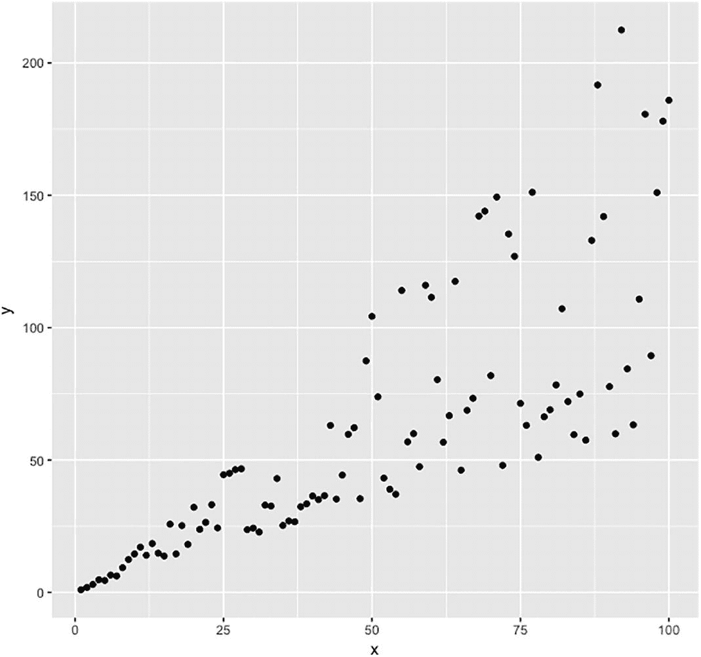
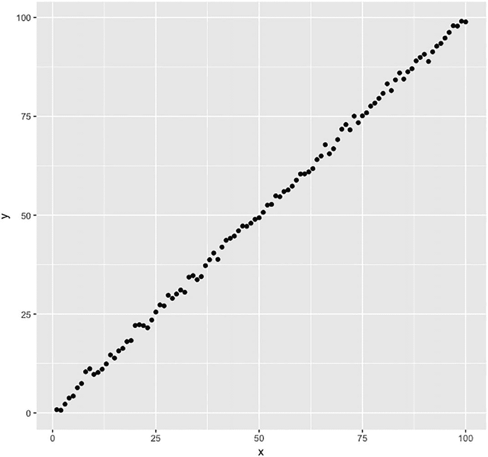
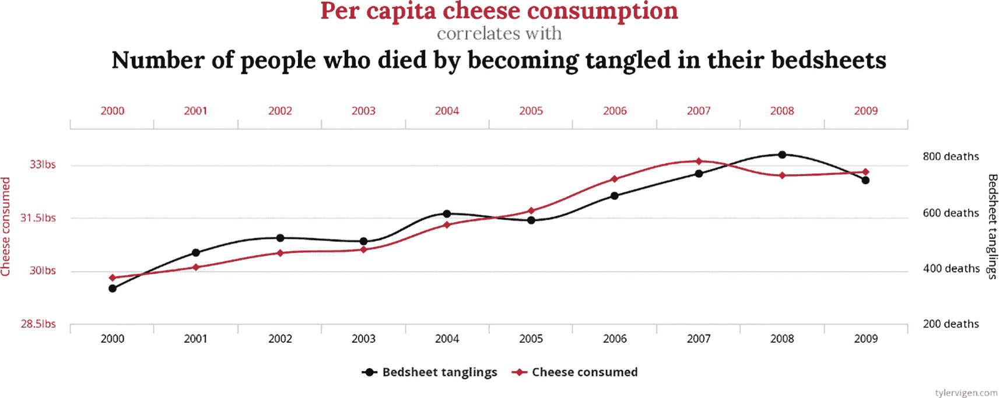

# 9. 因果关系：理解“为什么”

> *“浅薄之人相信运气或环境，坚强之人相信因果。”*
>
> ——拉尔夫·沃尔多·爱默生

不确定性以多种形式出现。大多数人将“不确定性”这个词与未来联系在一起，这很合理。如果我们能预测明天的股市走势，我们一夜之间就能成为亿万富翁。如果我们无法预测明天会下雨，我们可能会被淋湿。然而，不确定性的一个关键部分在于理解事件之间是如何*相互关联*的。这个问题在科学以及日常生活中反复出现。

在医学领域，我们需要了解哪些病毒可能导致特定疾病，以及某种特定物质是否真的是治疗方法。也就是说，某种物质是否真的是患者康复的原因？在这种背景下，寻找原因实质上就是识别自然界中是否存在某种关系。大多数科学家花费大量时间致力于提取这类关系。

在历史学中，我们对重大事件的原因感兴趣。第一次和第二次世界大战的起因是什么？是什么引发了某些意识形态？宗教是如何兴起和传播的？这类因果关系主要涉及对反事实的理解。当我们说——例如，就像我们之前所做的那样——如果弗朗茨·斐迪南大公没有被暗杀，那么第一次世界大战就不会发生，我们便将原因的力量归因于那次暗杀。然而，也许第一次世界大战仍然会发生，但会出于其他原因。调查过去不可重复事件的原因是一个非常棘手且复杂的课题，自然会引起激烈的辩论。

在我们的社会关系（职业关系和个人关系）中，我们不断试图理解是什么导致了特定的“结果”或情况。此外，我们也在积极尝试改变自己的行为，以达到期望的结果。如果我们相信以某种特定方式着装会让我们更受欢迎，那么我们可能会那样做。如果我们相信在某个特定大学学习会帮助我们找到工作，那么我们可能会申请去那里学习。如果我们相信某个特定举动会让老板给我们升职，那么我们可能会着手采取这个行动。这种因果思维与预测密切相关。类似于机器学习算法的工作方式，我们从世界中提取数据，然后试图预测未来。

理解因果关系不仅仅是一种哲学上的好奇。人类在这个星球上非常成功地生存下来，部分原因就在于我们擅长处理因果问题。归纳问题在许多情况下本质上就是从自然界中提取原因和结果的问题。同时，理解因果关系并不一定等同于构建预测模型。两者之间存在根本性差异，我们现在就来探讨这一点。

## 相关性不等于因果性

每个统计学学生都会学到的一件事就是：相关性并不意味着因果关系。请看图 9-1 中的散点图，它展示了两个变量 `x` 和 `y` 之间的关系。



一张 `y` 对 `x` 的散点图，显示了正相关关系。最低点和最高点分别为 (0, 0) 和 (90, 215)。数值为近似值。

**图 9-1** `x` 与 `y` 之间的关系

你会说变量 `x` 和 `y` 之间存在关系吗？看起来是有的。这种关系并不完全清晰，但随着 `x` 的增长，我们也能看到 `y` 在增长。衡量两个变量之间关联度的指标是著名的相关系数（由弗朗西斯·高尔顿首次提出）。在这种情况下，这两个变量之间的相关系数约为 0.8。最大值为 1，这表明存在相当强的相关性。

现在，让我们来看看图 9-2 中散点图所描绘的关系。你觉得这两个变量之间存在强相关性吗？毫无疑问是有的。在这个例子中，`x` 和 `y` 之间的相关系数接近 1，表明二者几乎呈完美的线性关系。

那么，我们能否说在这两个图中，`x` 都是 `y` 的原因？如果可以，是否第二个图中 `x` 是 `y` 的原因的可能性更大？你怎么看？

如果我说，在第一个图中，`x` 是某次全国性考试（如美国的 SAT 或英国的 A-level）的结果，而 `y` 是同一人未来 12 个月的平均薪资；在第二个图中，`x` 是 IBM 股票自发行至 2000 年间的价格，`y` 是宾夕法尼亚州每月至少喝一次可口可乐的人口比例。现在你还会认为其中一个变量是另一个的原因吗？

虽然这些例子看似荒谬，但它们恰恰证明了一点：相关性并不等于因果性。



`y` 相对于 `x` 的散点图展示了正相关性。最低点和最高点分别为 `(0, 0)` 和 `(100, 100)`。数值为近似值。

**图 9-2** `x` 与 `y` 之间更强的相关性

互联网上，恐怕没有其他来源能比泰勒·维根（Tyler Vigen）的网站更能说明这一点了^(⁷⁰^)。泰勒·维根在他的网站上收集了各种有趣且不相关的相关性。例如，在图 9-3 中，你可以看到人均奶酪消费量如何与被床单缠住致死的人数相关。你还可以看出，在游泳池溺亡的人数如何与尼古拉斯·凯奇主演的电影数量相关。



奶酪消费量与床单缠身死亡人数随年份变化的折线图显示了两个上升曲线。床单缠身死亡曲线从 `(2000, 350)` 延伸至 `(2009, 750)`。奶酪消费量曲线从 `(2000, 29.9)` 延伸至 `(2009, 32.8)`。数值为近似值。

**图 9-3** 虚假相关性。依据知识共享许可使用

这类关系被称为“虚假相关性”。两个变量之间的相关性确实很高，但它们之间并不存在真实的、无论因果关系或其他类型的关系。

那么，这一切的意义何在？我们可以总结如下：
1.  相关性不等同于因果性。
2.  用于关联分析的工具可能不适用于理解因果关系。
3.  你不能总是在一个封闭系统内研究因果性。有时必须跳出系统去审视。

第一点，希望现在你已经清楚。第二点则非常有趣且常被误解。大多数数据科学模型是根据一个或多个预测变量 `x` 来预测变量 `y`。然而，这些模型也可以用来反推关系。我们完全可以反过来用 `y` 去预测 `x`。无论怎样，模型都能工作。模型本身无法帮助我们理解是 `x` 导致了 `y`，还是 `y` 导致了 `x`。这一点对于从简单的线性回归到复杂的神经网络等所有模型都适用。如果存在任何因果关系，那也是由实验者假定的。

这就引出了第三点。在我们当前大多数模型的上下文中，因果关系必须由实验者以某种方式假定并加以控制。如果模型和我们的工具本身不具备揭示因果关系的能力，那么这项工作就得由研究者来完成。由罗纳德·费舍尔开创的实验设计领域，正是专门处理这一问题的。

这让我们得出一个有趣的结论：尽管我们当前的工具和方法已经非常复杂，但它们仍旧是基于关联分析的。朱迪亚·珀尔（Judea Pearl）因对计算机科学的贡献于 2011 年获得图灵奖，他曾抨击当前人工智能方法忽视因果性。珀尔认为，识别因果关系是智能的标志之一。然而，我们当前方法所能做到的仅仅是“曲线拟合”。

珀尔相信，开启机器智能的关键在于让它们也理解因果关系。《量子》杂志（*Quanta*）的一篇采访阐明了朱迪亚·珀尔如何看待整个问题^(⁷¹^)。

```
“但你在新书中称自己是当今 AI 社区的‘叛道者’。是从何说起呢？”

“意思就是，当我们开发出能让机器在不确定条件下进行推理的工具后，我便离开了这个领域，去追求一个更具挑战性的任务：基于因果关系的推理。我的许多 AI 同事仍在研究不确定性。一些研究圈子继续致力于诊断问题，却未考虑问题中的因果层面。他们只希望预测得好，诊断得准[...]”

“我可以给你举个例子。我们今天看到的所有机器学习工作都是在诊断模式下进行的——比如，将物体标记为‘猫’或‘老虎’。他们不关心干预；他们只想识别一个物体，并预测它如何随时间演变。”

“当我开发出用于预测和诊断的强大工具时，我感到自己像一个‘叛道者’，因为我深知这仅仅是人类智慧的冰山一角。如果我们希望机器能推理干预行为（‘如果我们禁烟会怎样？’）和内省（‘如果我当初读完高中会怎样？’），我们就必须引入因果模型。关联是不够的——这是一个数学事实，而非个人观点。”
```

## 因果推断的挑战

因果关系是一个要求很高的课题，要妥善处理它，我们或许仍有很长的路要走。但科学和哲学在过去是如何处理这个课题的呢？

# 我们如何理解因果关系？

> *“因为推理因果关系是件极其困难的事，我相信唯一的裁决者只能是上帝。我们尚且难以在如烧焦的树木这般明显的后果，与引发火灾的闪电之间建立关联；因此，去追溯有时无穷无尽的因果链条，在我看来，就如同试图建造一座通天塔般愚蠢。”*

> ——翁贝托·埃科，《玫瑰之名》

最早研究因果关系的人是亚里士多德。他曾说：“只有当我们把握了事物的原因时，我们才认为认识了它。” 根据亚里士多德的观点，事物有四种原因——质料因、形式因、动力因和目的因。

## 质料因
指的是构成物体的材料。例如，一尊青铜雕像的质料因就是青铜金属。质料是雕像的原因，因为它包含了被塑造成雕像的潜能。

## 形式因
指的是物体的形状。例如，雕像的形状就是它的形式因。同样，人体也具有形式因，因为身体的各个部分是以特定方式排列的。桌子之所以是桌子，是因为它有四条腿，否则它会倒下。

## 动力因
指的是将原材料转化为特定形式的施动者。那位能将青铜打造成雕像的工匠，就是雕像的动力因。

## 目的因
在亚里士多德的哲学中扮演着最重要的角色。目的因是物体的目的论目的，源于希腊语 `telos`，意为“终点”、“目的”或“目标”。换句话说，就是它被制造出来的原因。例如，叉子存在的理由就是用於進食。

亚里士多德研究了原因，但并未提供一个研究因果关系本身的框架。实际上，在现代科学方法出现之前，这在大部分哲学史中都是如此。这或许是因为在历史的大部分时期，世界是宗教性的。确实，由威廉·佩利等人提出的目的论论证，是托马斯·阿奎那论证上帝存在的“五路”证明中的第五路。因此，事物的原因很可能被归因于超自然的和神圣的存在。偶因论哲学就是这种方法的典型代表。根据偶因论，并不存在因果关系。是上帝导致了所有事件的发生。只是因为事件可能一个接一个地发生，我们才产生了因果关系的错觉。

大卫·休谟也研究过因果关系这个主题。根据休谟的观点，概念有两种：分析概念和综合概念。分析概念是我们仅凭思考就能推断出其中关系的观念。数学是典型的例子。综合概念则源于我们的经验。我们的心灵无法直接观察到因果关系。它是我们从经验中获得的一种综合概念。

我们所观察到的并非因果关系，而仅仅是一个事件跟随另一个事件发生。休谟提出了三个条件，用以判定事件 `A` 是否导致了结果 `B`：`A` 应始终发生在 `B` 之前，并且两个事件在时间和空间上应具有邻近性。在休谟的时代，关于因果关系的讨论直接关联到归纳问题以及关于知识来源的认识论问题。勒内·笛卡尔等欧洲大陆理性主义者认为我们生来就具有天赋观念，而休谟和约翰·洛克等英国经验主义者则认为，我们是通过与世界的互动来获取知识的。我们心灵如同 *白板*（`tabula rasa`）这一经典例子，就归功于洛克。

## 科学方法与因果模式

文艺复兴之后，随着科学的进步，关于神的解释以及深奥的哲学问题，催生了对自然界中因果关系艰辛的研究。渐渐地，各门科学，特别是物理科学，识别了原子和分子之间的关系，推导出定律，增进了我们对宇宙的理解。现在，通过脑科学的努力，我们知道经验主义者和理性主义者争论中的真理存在于两者之间：我们确实拥有一些先天知识，同时也从经验中学习。

科学方法用于寻找因果模式的实用主义方法的一个典型例子是“科赫法则”。罗伯特·赫尔曼·科赫（1843–1910）是一位德国内科医生，他提出了四条法则，用以确定某种细菌是否能导致疾病：

*   该细菌必须在每一例该疾病病例中都存在。
*   必须从患病宿主中分离出该细菌，并在纯培养基中生长。
*   将纯培养的细菌接种到健康的易感宿主后，必须能再现该特定疾病。
*   必须能从实验感染的宿主中再次分离出该细菌。

后来发现这些法则需要调整，但它们为医学领域带来了极大的清晰度。

## 因果模型与反事实

在因果关系研究中其他重要人物是统计学家唐纳德·鲁宾和耶日·内曼（你在本书中已经遇到过好几次了）。他们提出了现在所谓的“内曼-鲁宾潜在结果模型”。该模型基于反事实条件陈述。反事实是关于*可能*发生了什么的一种假设。例如，假设你找来两个在所有方面都完全相同的人。你给人物 `A` 服用物质 `A`，而不处理人物 `B`。如果人物 `A` 长出了翅膀（或你关注的任何其他显著结果），那么你假设，既然他们之间的一切都相同，翅膀一定是服用了该物质的结果。

这是在医学环境下研究因果关系的一种相当常见的方法。^(⁷²) 我们将样本分为两组：处理组和对照组。两个样本在变异性方面是相同的。处理组接受治疗，对照组给予安慰剂。处理组内的任何效应都归因于该治疗。除了医学之外，你可以想象这里的“治疗”还可以指：心理治疗、教育课程、营养计划等等。

尽管科学在从自然界中提取各种有用关系方面取得了进展——这已转化为巨大的技术成就——但关于研究因果关系本身的讨论却是相当近期的事。虽然科学实验的目标是帮助我们弄清楚这一点，但在许多情况下，结果可能令人困惑。在试图将医疗结果与生活方式因素联系起来的各种研究中，或许没有比这更好的例子了。

例如，吃肉较少的人可能活得更长。因此，我们可能会假设红肉会导致人们过早死亡。然而，有些人吃肉较少可能是因为他们更了解当前的饮食趋势。更多地阅读当前饮食趋势的人，可能是受教育程度和收入水平较高的人——可以说他们更有时间（和金钱）去搜寻以植物为基础的有机农产品。这意味着他们可能拥有更好的生活质量和就医条件，这可以解释其更长的寿命。

我并不是说红肉好或坏——事实上，红肉的益处和坏处极具争议——但你可以在线上的学术期刊中找到大量类似的研究。只需将“红肉”和“寿命”替换为其他某种生活习惯（咖啡、红酒、素食主义）和某项医疗结果，你保证能找到成千上万篇论文，有时它们还相互矛盾。

因果关系识别的问题在于，事物很少是清晰简单的。原因常常混杂在一起，可能产生离奇或滑稽的效果。上述问题被称为“混杂”，是研究因果关系时的一个主要考量。

根据朱迪亚·珀尔的观点，这是因为统计学科学长期以来关注了错误的方向，(⁷³) 可能是太久了。不过，这也可能是因为因果性是一个在数学上非常难以处理的问题，并且许多更简单的方法在很长一段时间内实际上运作良好。

## 混杂与悖论

有时这些方法会彻底失效。一个典型的例子是出生体重悖论，这是一个经典的混杂问题。出生体重悖论是指（经多项研究证实的）观察结果：对于母亲吸烟的低出生体重婴儿，其死亡率低于母亲不吸烟的低出生体重婴儿。这意味着什么？传统上，低出生体重与较高的死亡率相关。同时，吸烟对婴儿有害也已得到证实。然而，如果一个婴儿出生体重低 *且* 母亲吸烟，婴儿的死亡率非但没有更高（正如人们所预期的），反而比母亲不吸烟的婴儿更低。

这听起来可能像无稽之谈，但这是一个已被证实的现象。(⁷⁴) 如何解释？这可以通过混杂来解释。一篇发表在《国际流行病学杂志》上的论文 (⁷⁵) 提供了一个可能的解释：

*   “这背后的直觉是，低出生体重可能由多种原因造成：其中之一可能是母亲吸烟，另一种可能是营养不良或出生缺陷。如果我们考虑那些母亲吸烟的低出生体重婴儿，那么吸烟很可能是低出生体重的原因。如果我们考虑那些母亲不吸烟的低出生体重婴儿，那么我们就排除了母亲吸烟是低出生体重的原因，因此必然存在其他原因，可能是营养不良或出生缺陷之类的情况，而这些原因对婴儿死亡率的影响要严重得多。”

因此，如果母亲吸烟，那么这很可能是低出生体重的原因。如果母亲不吸烟，那么低出生体重是其他可能更严重状况的结果。因此，母亲吸烟的出生体重低的婴儿死亡率反而更低。

另一个著名的悖论是辛普森悖论。按组划分数据时可能显现出一种趋势，但一旦将各组数据合并，这种趋势就消失了。一个著名的例子是“UC 伯克利性别偏见”研究。1974 年的一篇论文 (⁷⁶) 表明，衡量偏见可能并非易事。该论文的结果显示，男性比女性更有可能被伯克利录取，申请者中 44%的男性被录取，而女性的录取率仅为 35%。

然而，当按院系细分申请数据时，观察到的是：男性申请的是竞争不那么激烈的院系，这些院系的录取率更高。女性则申请了竞争更激烈、总体录取率低的院系。按院系细分后的实际数据显示，存在轻微的偏向 *女性* 的偏见。

## 因果之梯

混杂与因果关系是棘手的问题。在理想世界中，我们可以通过反事实解释来研究因果关系，将同质样本分成多个组，并对每组施以不同的处理。然而，现实世界是混乱的。我们常常无法做到这一点，这就是为什么在社会系统研究中，辩论如此普遍。一个主要问题在于，我们的模型不能替代对世界的认识。我们经常需要跳出模型，运用常识来理解变量之间的关系。但正如出生体重悖论所显示的，这并不总是容易的；事实上，已经提出了多种混杂模型试图解决它。

然而，这正是朱迪亚·珀尔着手去做的事。处理因果关系的最新尝试是珀尔的“do-演算”。珀尔将职业生涯的大部分时间投入到因果推理中，这也解释了他对这一主题的热情以及与统计学家的激烈争论。根据他的演算，(⁷⁷) 研究因果关系有三个层次（珀尔称之为“因果之梯”）：

1.  关联
2.  干预
3.  反事实

**关联**与观察有关。与观察相关的问题是“是什么？”以及“观察到`X`会如何改变我对`Y`的信念？”例如，一个症状告诉我关于某种疾病的什么信息？或者，一项调查告诉我关于选举结果的什么信息？

**干预**则与（你猜对了）施加干预有关。你可以问“如果……会怎样？”或“如果我做了`X`会怎样？”。例如，服用阿司匹林能治好我的头痛吗？


最后一个层次，反事实，与想象与内省相关。我们问“为什么？”，这是哲学和科学中能提出的最有力的问题。我们可以思考和分析是否`X`导致了`Y`，以及如果我们采取了不同的行动，结果会怎样。这涵盖了我们最初提出的许多问题。如果你观察到服用了阿司匹林，然后头痛消失了，你可以（通过反事实推理）问：是阿司匹林治好了你的头痛吗？如果奥斯瓦尔德没有枪杀肯尼迪，他 20 年后还会活着吗？如果没有弗朗茨·斐迪南大公遇刺，第一次世界大战还会爆发吗？以及，如果五年前我选择了辞职，我的人生会怎样？

根据朱迪亚·珀尔的观点，反事实推理可追溯到大卫·休谟和约翰·斯图尔特·密尔试图回答的问题。然而，直到现在，我们才真正拥有了以结构化方式研究这些问题的符号工具和方法。反事实预测是一种追溯性推理。通过分析过去的不同版本以及它们与现在的比较，我们可以理解“为什么”。

珀尔的“do-演算”是处理因果关系的最佳方法吗？时间会证明一切，但我们可以确定的是，因果关系的研究将继续在科学和我们的生活中扮演重要角色。事实上，关于因果关系的推理是生活中不可避免的一部分，与前面章节讨论的问题（如归纳推理问题）密切相关。我们的大脑实际上已经进化到一定程度，部分原因正是为了应对这个问题。


# 我们心中的因果律

> “凝视我的脸；我的名字叫‘本可以’；我也被称为‘不再有’、‘太迟了’、‘永别了’。”
>
> ——但丁·加布里埃尔·罗塞蒂

尽管因果律一直是哲学家和数学家激烈争论的话题，但大自然已经为我们提供了解决该问题的线索。“心智理论”这个术语指的是，将因果关系归因于他人心智状态的认知能力。我们都有心理状态：信念、欲望、动机等等。我们知道自己拥有这些状态，并且知道他人也拥有这些状态并能据此采取行动，这种认知定义了心智理论。

尽管这对人类来说似乎是显而易见的，但事实远非如此。这是将我们与大多数动物（并非所有动物）区分开来的特质之一，也是智慧的标志。（2016 年，一项研究发表了潜在证据，表明乌鸦拥有心智理论。乌鸦似乎会藏匿食物，因为它们认为其他乌鸦可能会试图偷走它。^(⁷⁸) 在灵长类动物中也观察到了类似的现象。）

在某些情况下，心智理论会完全出错。例如，在偏执型精神分裂症中，患者可能会将完全非理性的原因归咎于他人的行为。例如，某人可能会认为别人要伤害他，而这对他们自己来说毫无挑衅或利益可言。另一个心智理论受到干扰的案例是患有自闭症的人；自闭症的一个典型特征就是，它可能导致在运用心智理论、理解或与他人建立联系方面存在困难。

随着社会变得日益复杂，心智理论逐渐进化，而理解周围人的动机和信念对我们的生存变得至关重要。

进化赋予我们这种能力的事实，清楚地证明了社会性因果推理的重要性。然而，我们从心理学到神经科学拥有多个学科研究认知和行为这一事实，也表明我们的心智理论可能并不完整。我们仍然无法完全清晰地理解，个体在各种情境下的动机是什么。此外，我们创造出的复杂社会系统似乎拥有了自己的灵魂。

许多暴行也是基于对人类本性的错误信念而犯下的。导致数十万乃至数百万人死亡的文化大革命，就是基于对人性的错误假设。^(⁷⁹) 所有政治体系都需要对人性的本质做出假设，从资本主义者坚信的“人本质上是自私的”，到通常与左派相关联——并由让-雅克·卢梭首先提出的——信念，即人类本质上是仁慈的，是社会导致了腐化。我们仍在争论这些话题的事实，恰恰说明了弄清周围世界因果关系的复杂性。弗洛伊德整个职业生涯都建立在潜意识的概念之上，他认为我们甚至首先根本不清楚自己的动机。

因果律进入我们思维的另一种方式是通过反事实推理。反事实推理可以分为两类。^(⁸⁰) 上行反事实和加法反事实会产生负面情绪，比如后悔。它们的作用是让个体做好准备，以便在未来遇到类似情况时采取不同的行动方案。你多少次对自己说过：“要是当时我做了 X，那么 Y 就会发生了”，或者“如果我当时做了/没做 X，那么也许我就不会遭遇 Y 了？” 这就是一种反事实思维。它们被称为上行反事实，因为正如俗话所说，它们代表了如果生活“蒸蒸日上”，实际事件本可以变得更好的各种途径。

另一类反事实思维由下行反事实和减法反事实组成。它们与上行反事实和加法反事实相反。它们代表了关于事件本来可能变得更糟的反事实推理。下行反事实会产生积极的感觉，比如“如果我没上大学，那么我就不会有现在这份好工作”，或者“如果我没遇到我的伴侣，我们就不会有这个家庭了。” 这些反事实思维让我们对自己经历的结果感觉更好。

研究发现，反事实思维不仅对个体有整体的积极影响，而且在帮助我们为“现实世界”做好准备方面也扮演着重要角色。有观点认为，与其他动物相比，人类之所以拥有更长的成长发育期，部分原因就是为了发展更完善的因果认知能力。^(⁸¹) 当孩子们玩耍时，他们在探索世界，无论是物理世界还是社交世界。他们构建“如果……会怎样”的场景。在这种探索过程中，他们提升了认知技能，其中就包括反事实推理。研究发现，甚至年仅 2.5 岁的孩子都可能具备反事实推理的能力。^(⁸²)

尽管反事实推理的重要性可能起初并不明显，但想想你自己多么频繁地提出类似的陈述就知道了。再看看任何报纸的经济版或政治版；关于政治领袖本应为经济或一系列其他事务采取的不同行动的相互矛盾的意见，就是反事实推理的一个例子。它在我们心中根深蒂固，以至于我们常常都没有意识到自己正在使用它。

反事实推理可以被视为一种应对不确定性的工具，但它同样也是不确定性的来源。当我们思考“原本可能怎样”时，我们是在使用一个世界模型来训练我们的思维，以便在未来情境中以不同或类似的方式做出反应。你在事后获得的知识是一个额外的数据点，你可以利用它来提取关于世界未来如何运作的信息。

然而，反事实推理本身假设我们拥有一个正确的世界模型。现实情况是，我们脑海中永远不可能拥有一个百分之百准确的世界模型。反事实命题“如果我在后备箱里多放了一个备胎，那么轮胎漏气就不会让我耽误那么久”，是一个很好的例子，表明了你给自己的一条合理建议——这是一种追溯推理。然而，反事实命题“联赛结束后，我不该赌曼联能赢得上赛季的英超冠军”可能没什么用，除非这个命题能伴随其他关于如何正确预测体育赛事结果的批评和推理。

这个例子展示了我们目前所见的许多事物之间的密切联系。超越简单常识（例如，“我不该在重要会议前一晚喝十品脱啤酒”）或物理世界（例如，“如果我保养汽车的频率高于每五年一次，它就不会出故障了”）的反事实推理，本质上是复杂的。它需要一个世界模型，同时还需要对过去某件事进行预测。它的有用性在于假设未来我们可能会遇到与过去相似的情况。这确实是智慧的一个真正标志，如果我们想要创造出真正的智慧，我们可能必须将其编码到机器中。

然而，如果我们能预测未来，就不必太过纠结于过去“本会”是什么样子。也许我们能找到一种方法，从过去中真正提取出所有相关信息，并用它来预测未来。一家零售店更感兴趣的，并非如果经理当年采取不同行动，两年前本该如何击败竞争对手，而是预测新产品趋势和需求。我们也不关心，如果当初查了天气预报、带了几把伞，那次野餐本会如何。我们更想知道的是明天的天气。

最后，许多人说过，如果几十年前买了谷歌或苹果的股票，现在早就富了。然而，再过一二十年，又会有人哀叹自己预测能力太差，没能预见某些上个月才成立的公司届时会价值连城。后见之明威力强大，令人着迷——但预测未来的能力更为强大。

脚注 1 2 3 4 5 6 7 8 9 10 11 12 13

