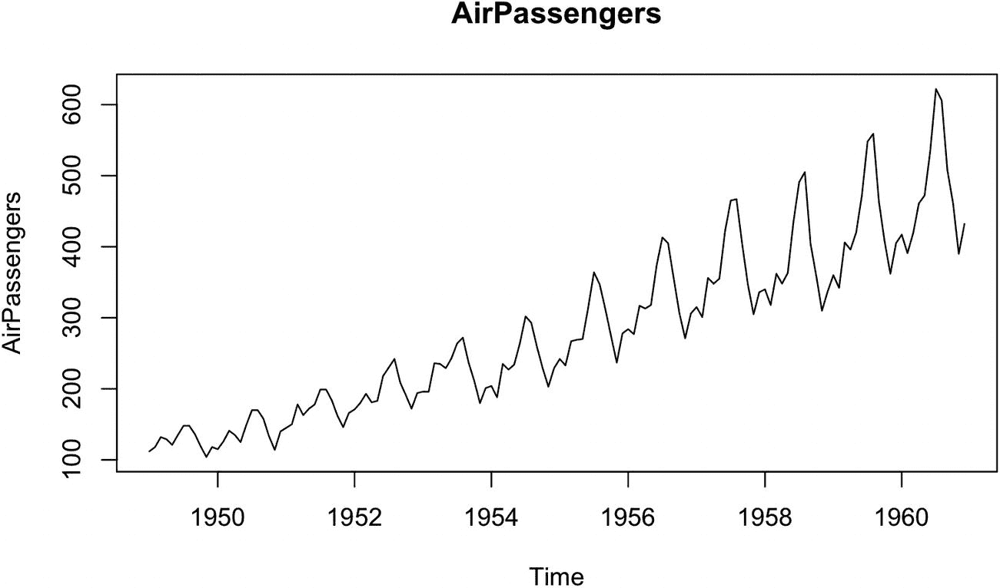
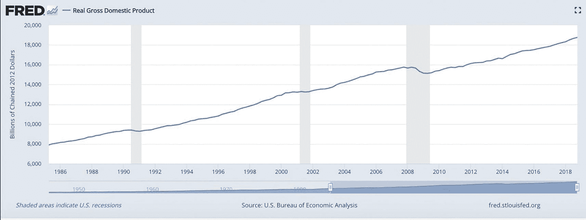
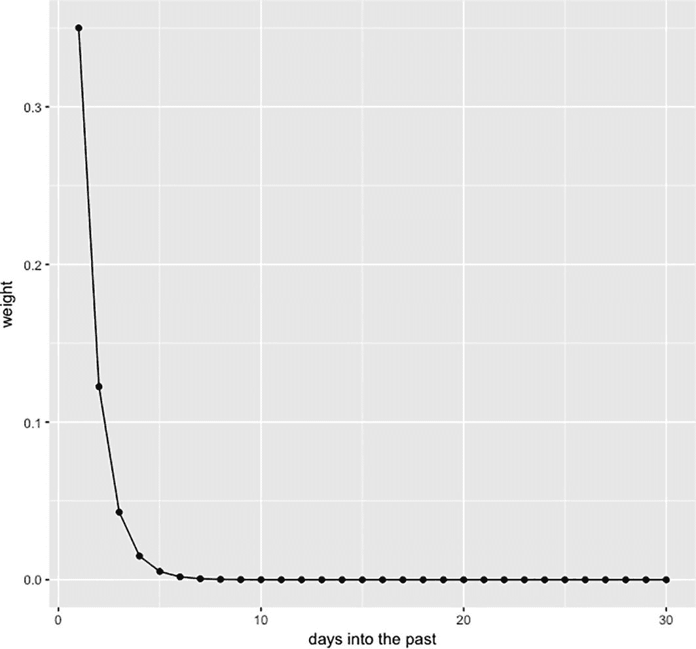
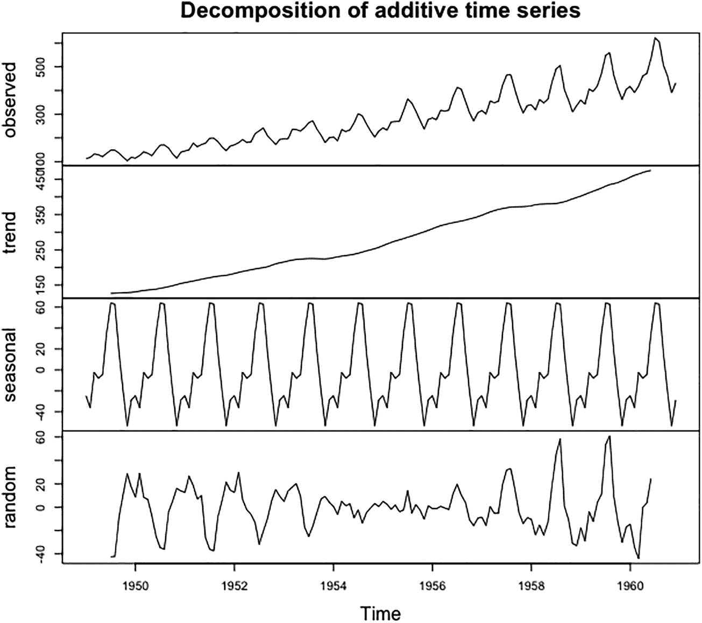
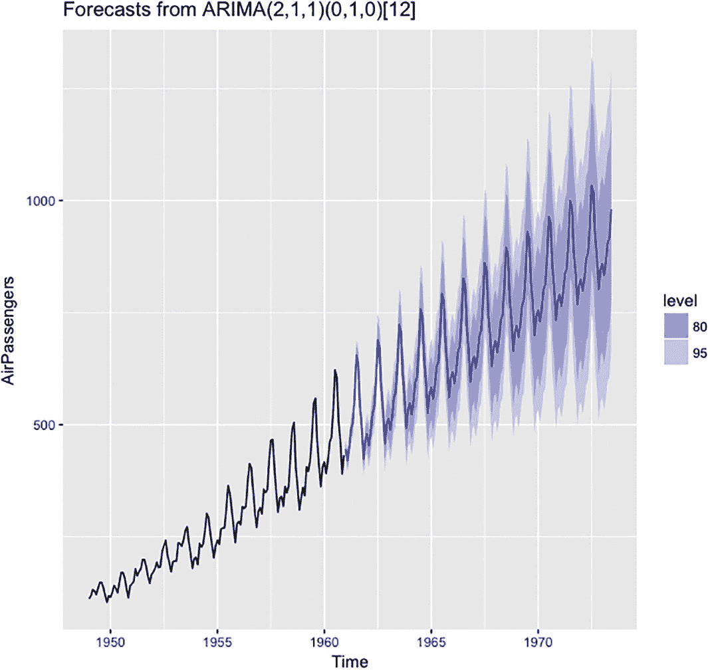

# 10. 预测未来：狐狸与特朗普

> *“知者不言，言者不知。”*
> ——老子
> *“我总是避免事前预言，因为事后预言要好得多。”*
> ——温斯顿·丘吉尔

预测常被称为“黑暗艺术”。它有种与生俱来的蛊惑力，能牢牢抓住大众的想象力；在数据科学的所有应用中，预测是最让公众着迷的领域之一。预测未来一直是人类兴奋的事情，原因不言自明。可以说，科学的主要目标就是解释原因，并建立模型来帮助我们预测和控制周围的世界。在人类历史的大部分时间里，预测未来与巫术、神灵和其他超自然存在联系在一起——如今已不再如此。

在数据科学中，预测已大致成为时间序列预测的同义词。“时间序列”就是一组随时间变化的值。股票市场价格、商品与服务的价格与需求、气温，都是时间序列的例子。

预测基于一个简单的想法：未来会和过去相似，因此我们可以利用过去的信息来预测未来。

预测模型种类繁多，但就本书而言，粗略划分主要有两大类：

1. 内源模型
2. 考虑外生变量的模型

这些定义在学术文献中可能不会以这种方式出现，但它们能帮助你理解模型中使用的不同信息以及所做的不种假设。

第一类预测技术（内源模型）描述的是大多数人联想到的传统预测方式；它基于两个主要假设：

1. 未来会和过去相似。
2. 时间序列提供的信息足以预测未来。

仔细想想，这两个假设既合理又错误。未来无疑会受到过去的影响。如果我问你下一个小时的气温是多少，你给出的预测应该与当前气温相差不大。然而，我们需要回溯多远的历史，又能预测多远的未来？上周的气温会影响下一个小时的气温吗？我们能预测明天的气温吗？下周呢？或者下个月？

显然，对于某些时间序列，上述方法可能比其他序列更合理。假设你想预测某款产品——冬季手套的需求。常识告诉我们，这款产品在冬季和秋季的需求会更高。如果市场变化不大（比如没有新竞争对手推出更便宜的产品），你可能会预期每年的需求看起来非常相似。同样，我们也可能观察到多年来的趋势。一个著名的时间序列例子是二战后的航空旅客数据，当时经济与工业蓬勃发展，导致每年旅客数量持续增长。

图 10-1 的图表由 R 语言生成，使用了 `AirPassengers` 数据集，该数据集由 Box 和 Jenkins 创建，描述了 1949 年至 1960 年间国际航空旅客的月度总数。你可以看到一些稳定的趋势，比如季节性，以及多年来的增长模式。这是一种具有许多规律性的时间序列，我们可以使用内源方法成功建模。

# 时间序列中的概念漂移与外生模型

一幅航空乘客数量与时间的关系折线图，显示出一条带有波动的上升曲线。其范围大致介于（1950 年，120）与（1961 年，620）之间。数值为近似值。

**图 10-1**

时间序列的经典示例

但假设冬季手套的例子发生了一些变化：新的竞争对手推出了更便宜的替代品；出现了新的时尚潮流；全球变暖导致冬季变暖，人们购买的手套减少。在这种情况下，模型将失效。其中一些变化，例如气温变化，可能是逐渐发生的，因此模型能够检测到它们。但在许多情况下，变化可能突然发生，让我们措手不及。

另一个很好的例子来自金融时间序列和零售业。假设你有一个模型来预测某个产品或股票市场价格的需求。然后一场危机发生（例如 2008 年那场危机），引发了全球性衰退，政府为重新平衡经济而介入并出台新法规。类似的情况也发生在 COVID-19 疫情期间。这是另一个可能难以预见的事件，它会彻底改变我们正在建模的基础系统。我们很难期望所研究的时间序列包含足够的信息来预知政府将实施何种法规！

在图 10-2 中，你可以清晰地看到阴影区域所表示的衰退。2008 年之后的衰退在近期历史上是前所未有的，无论从其影响还是持续时间来看都是如此。

**图 10-2**

1986 年至 2019 年美国 GDP。来源：美国经济分析局，实际国内生产总值（`GDPC1`），取自 FRED（圣路易斯联邦储备银行）；[`fred.stlouisfed.org/series/GDPC1`](http://fred.stlouisfed.org/series/GDPC1)

这种系统中的突然变化可能使模型完全失效。这被称为*概念漂移*。它很难在事件发生并造成影响后立即被检测到，而这正是许多预测者的心头大患。

对内生模型的另一个批评源于这样一个事实：通常存在一些有助于预测时间序列的信息——也许是某些其他时间序列——却没有被考虑进去。例如，我们期望 GDP 和通货膨胀率可能会影响需求。这两个时间序列可能包含我们正在预测的时间序列中并未直接包含的信息。或者，假设你正试图预测农作物的产量。气候和土壤信息将极其有用。

为此，我们开发了能够同时纳入外生因素信息的模型。这些模型的开发时间远晚于内生模型。其主要推动力之一是计算机的出现，它使预测者能够以秒为单位计算出复杂模型的结果。

存在多种对包含外生因素的预测模型进行分类的方式。同样，基于本书的目的，我认为主要可以分为两类：内生模型的适应版和通用模型。

所谓原始模型的适应版，我指的是对内生预测模型进行扩展，使其也能包含外生变量。此类模型之一是`ARIMAX`。原始的内生模型称为`ARIMA`（自回归积分滑动平均）。`ARIMA`是一个纯内生模型，利用时间序列的过去值来预测未来。`ARIMAX`则可以纳入其他与时间序列无关的变量。再次回到之前的例子，我们可能希望根据过去的需求（内生部分），再加上一个国家的 GDP 和通货膨胀率，来预测某个产品的需求。

至于通用模型，这些模型可以用于其他目的^(⁸³)，但它们同样可以应用于时间序列。许多机器学习模型就属于这种情况。应用于时间序列预测的最经典模型示例是神经网络和高斯过程。此外，还有更高级的方法，它们结合了机器学习的元素与更传统的技术，例如贝叶斯结构时间序列模型，这类模型备受谷歌青睐^(⁸⁴)。

近几十年来，通用模型因其灵活性以及将多种因素纳入预测的能力而获得了更多应用。然而，这并不意味着它们总是更好。不要忘记偏差-方差权衡。通常，简单的模型可能比高级模型更强大。很快你就会看到，决定“最佳”方法是预测界的一个主要争论。但首先……

## 预测简史

> “我曾见过未来，它与现在极为相似，只是更漫长而已。”

> ——纪伯伦，《先知》，1923 年

现代预测史要从乌德尼·尤尔（1871–1951）和尤金·斯卢茨基（1880–1948）说起。乌德尼·尤尔是一位英国统计学家，对统计学有多项贡献。他于 1911 年撰写了《统计学理论导论》（*An Introduction to the Theory of Statistics*），这是当时最受欢迎的教科书之一。他是第一个发现尤尔悖论（现称辛普森悖论）的人，即群体中存在的趋势在群体合并时消失的现象。他对遗传学、流行病学和时间序列也做出了贡献。

尤金·斯卢茨基（1880–1948）是一位苏联数学家，对经济学和概率论有所贡献。斯卢茨基对经济学和统计学最大的贡献如今被称为斯卢茨基-尤尔定理。

两人互不相识，但同时在同一个结论上达成一致：即随机序列的移动求和或平均可能会在原始数据中不存在此类波动时产生振荡。换句话说，你可以从完全随机的数据中得出有规律的周期性模式。斯卢茨基和尤尔均在 1927 年发表了他们的论文。

斯卢茨基使用了一种在当时非常规的方法，这堪称现代计算机模拟的先驱。他和同事从彩票中随机抽取数字，然后将最近十个数字的结果相加。他意识到，这样产生的模式与在英国商业周期中观察到的模式相似。自然界中的现象（如波浪）也存在类似模式。完全随机的数字能产生规则模式这一发现，在当时具有突破性意义。将其转化为经济理论，意味着经济无需任何外部因素影响，自身就可能经历冲击。

这对经济学，以及对时间序列分析而言都是一项重要发现，因为这实际上是首次使用的自回归过程。自回归过程就是根据过去数值的加权平均来预测未来的模型。过去包含着我们预测未来所需的信息。

此后，情况不断发展。查尔斯·霍尔特（1921–2010）于 1957 年提出了第一个现代预测方法，称为“指数平滑法”。虽然西梅翁·德尼·泊松在 17 世纪就已应用过类似原理，并被信号处理领域所采纳，但这是该原理首次被应用于时间序列。

霍尔特的方法基于一个简单的理念：下一个值可以通过过去的数值来预测，而这些数值的权重会随时间呈指数衰减。这意味着预测会考虑所有历史数据，但对于更古老的数据点，其权重实际上为零。图 10-3 更清晰地说明了这一点。假设你想预测某产品的需求情况，你使用的是每日数据。指数平滑模型的权重会如图 10-3 所示。前一天的权重最大，约为 0.35。超过一周前的天数，其权重实际上为零。

*图 10-3——指数平滑模型权重示例*

这是一种在实践中效果良好的方法，但显然也有其局限性。例如，它没有考虑季节性模式。这就是为什么后来出现了更多对该方法的扩展，如霍尔特-温特斯平滑法、布朗双指数平滑法等。

对预测领域的一项重大贡献来自乔治·博克斯（1919–2013）和格威利姆·詹金斯（1932–1982）。他们发现了前面提到的 `ARIMA` 方法。他们的模型是应用“利用过去数值预测未来数值”这一理念的另一个实例。然而，它采用不同的方法来得出权重。在很长一段时间里，`ARIMA` 被认为是时间序列预测领域的顶尖技术。

大约在同一时期出现的另一项技术是时间序列分解。时间序列分解将时间序列分解为不同的元素。图 10-4 展示了一个时间序列分解的示例。你可以看到，之前见过的`AirPassengers`数据包含一个季节性成分、一个趋势以及随机噪声（在此例中，噪声似乎也遵循某种周期性模式）。该技术用于更好地理解时间序列的行为方式。

*图 10-4——AirPassengers 数据的时间序列分解示例。将所有三个成分（随机、季节性和趋势）相加，即可得到原始时间序列。*

现代预测的发展受到机器学习的启发，也得益于多种不同数据源的可用性和低廉的计算能力。例如，Facebook 发布了一个名为`Prophet`的工具，它同时使用多种不同技术来自动生成一个良好的预测模型。

此外，另一种流行的方法是使用通用算法，如深度神经网络，并向其馈送多种不同来源的信息，从时间序列到社交媒体帖子。

鉴于预测的实用性，我们确信在不久的将来会看到更多技术的涌现。

## 实践中的预测：牛顿与人类的疯狂、特朗普、脱欧，以及因数学模型而亏损

> *“一个不成熟的预测者使用统计数据，就像醉汉使用路灯——不是为了照亮，而是为了支撑。”*

> ——安德鲁·朗

预测是数据科学中一个非常有用的应用，这一点显而易见。上一节希望能帮助您从数学角度理解如何处理该问题。但在实践中，预测的效果如何呢？在众多行业中，它都有着许多成功的应用。

不过，让我们来看看预测出错时会发生什么。

如您所见，许多预测技术都只是同一理念的不同版本：即利用过去来预测未来。我们之前提到过这为什么并不总是成立。

当然，我们在这里讨论的主题是不确定性——那么预测模型是如何处理不确定性的呢？

许多统计预测方法可以通过使用置信区间来显式地对不确定性进行建模。例如，我们之前提到的`ARIMA`模型就是如此。

在图 10-5 中，您可以看到一个拟合了`AirPassengers`数据的`ARIMA`模型，您在图 10-1 中见过这些数据。原始的`AirPassengers`数据截止到 1960 年。预测值则延续到 1975 年。

预测值周围的阴影区域分别是 80%和 95%置信水平的置信区间。95%的置信区间可以解释为：在 95%的时间里，预测值会落在这个范围内的某个位置。

图中呈现出一个清晰的模式。随着时间的推移，置信区间变得越来越宽。到了某个点之后，置信区间变得过大。此时，预测就不再有用。例如，如果我们使用这个模型来预测航空公司的需求和预测收入，那么最终的数字将会大相径庭——5000 万乘客和 10 亿乘客的结果是完全不同的。

一张航空乘客数量与时间关系的图表，描绘了一条带有波动和峰值的上升曲线。范围从（1950 年，100）延伸至（1973 年，950）。标记为 80 级和 95 级的噪声信号从（1961 年，400）开始叠加到曲线上。数值为近似值。

图 10-5

用于预测未来航空乘客数量的`ARIMA`模型的预测结果及其置信区间

很明显，即使趋势相对稳定，不确定性也会随着时间的推移而增长，直到模型不再适用的地步。但这还算乐观的情况。在现实生活中，我们面对的是更复杂的系统，包含许多相互关联的组成部分。这可能会导致问题，通常以意料之外且负面的方式出现。金融领域比任何其他领域都更能说明这一点。

一个非常聪明的人在股市中亏损大笔钱财的著名例子，就是艾萨克·牛顿爵士在南海泡沫中损失巨额财富的故事。南海泡沫是历史上最早、最严重的金融危机之一。1720 年，上议院通过了《南海法案》。该法案授予南海公司对南美洲贸易的垄断权。作为交换，该公司向政府贷款 700 万英镑，用于资助对法战争——按今天的价值计算，这笔钱接近 1 亿英镑，因此其吸引力可见一斑。股票价值迅速上涨，投机者和公众投入了所有积蓄，以期获得超额回报。股价从 128 英镑飙升至超过 1000 英镑。^(⁸⁷) 显然，正如这类故事中经常发生的那样，股市崩盘了，财富灰飞烟灭。

牛顿投资了南海公司并赚取了 7000 英镑的利润。他决定再次投资，最终在泡沫结束时亏损了 20,000 英镑。按今天的货币计算，这相当于大约 300 万英镑。^(⁸⁸)

牛顿有句名言，他“可以计算天体的运动，却无法预测人们的疯狂。”

虽然牛顿没有使用任何数学预测技术，但这个故事说明了，当所讨论的系统暴露于多个相互作用因素时，对未来做出准确预测是多么困难。我们不必远溯历史也能在近期找到类似的故事（互联网泡沫和比特币泡沫仅仅是两个例子），但我们也不必费力就能找到*确实*使用了复杂技术的类似故事。

预测面临的挑战之一在于，未来预测的准确性不仅取决于我们的模型，还取决于底层系统的稳定性。布莱克、斯科尔斯和默顿的例子最能说明这种情况会如何出错。这三个人是著名的布莱克-斯科尔斯模型（一个期权定价公式）的幕后推手。该模型于 1973 年提出，或许是金融界最著名的模型。斯科尔斯和默顿于 1997 年获得了诺贝尔经济学奖。^(⁸⁹)

斯科尔斯和默顿曾担任长期资本管理公司（Long-Term Capital Management L. M.）的董事会成员。该基金最初非常成功，回报率在 20%到 40%之间，直到 1998 年崩盘，在四个月内损失超过 46 亿美元，需要美联储提供救助。结果，默顿和斯科尔斯的理论遭到了质疑和抨击。美林证券报告称，数学模型“可能比实际情况提供了更大的安全感；因此，对这些模型的依赖应当有所限制。”^(⁹⁰)

那么，为什么会发生这种情况呢？长期资本管理公司采用的模型基于有效市场假说。该假说假设投资者是理性的，并且市场在其定价决策中包含了所有相关信息。这些模型没有考虑到可能破坏市场的极端事件。关于这一点，我们可以进行长篇讨论，而且它至今仍是一个争议话题，但简而言之，他们模型中的假设在现实中并不成立。

这个故事说明了过度相信模型可能导致灾难性后果，并且它是仅仅十年后 2008 年金融危机期间发生的一系列事件的先兆。保罗·威尔莫特和大卫·奥雷尔在他们的著作《金钱公式》中讨论了这一点。

金融领域最流行的工具之一是现代投资组合理论。该理论由哈里·马科维茨在 20 世纪 50 年代首创，描述了投资组合经理如何以一种平衡风险与回报的方式来配置资产。现代投资组合理论的问题与布莱克-斯科尔斯公式相同：只要基本假设正确，模型就是正确的。此外，现代投资组合理论中的一些数学处理可能会急剧增加模型的不确定性。威尔莫特和奥雷尔解释道：

*   “当我们估计回报时，我们是在对未来进行预测；但当我们估计风险时，我们是在预测我们预测中的不确定性——一个关于预测的预测——这更加困难。”

在金融领域，就像在其他领域一样，科学家们一直试图设计出各种简化理论，利用数学工具来解释甚至消除不确定性。然而，金融体系的动态本质使得这些模型容易遭受灾难性的失败。

鉴于将某些系统的复杂性抽象成一个公式是困难的，那么是否存在更简单的预测方法呢？如果有一种结构化的方法可以询问人们，因为大部分不易编码的知识都在他们的头脑中，那会怎样？

这就是“群体智慧”方法和预测市场的原理。根据这种方法，对未来做出可靠预测的一个有效方式是询问大量人群，然后对他们的预测结果取平均值。

# 预测市场的结构化方法及其局限

一种更为结构化的预测方式是通过预测市场（prediction market）来实现。这种方法的流行在区块链兴起后再度回归。基于区块链的预测市场示例包括 Augur^(⁹¹) 和 Stox^(⁹²)。预测市场的核心理念是：你对某件事提出预测问题，然后参与者给出各自的猜测，成功的预测将获得奖励。

预测市场可被视为传统博彩的广义版本。在博彩中，可投注的市场由庄家决定；而预测市场则更为民主和灵活。例如，你可以针对任意主题，对某个实数变量（如某个地理区域的总降雨量，或某只股票的价格）提出预测。

显然，预测者过去和现在使用的另一个信息来源是博彩网站的赔率，因为其原理相同。当足够多的专家齐聚一堂对某件事做出判断，并且有资金投入作为激励（以确保参与者认真思考问题）时，我们就能期待获得良好的预测。

这种方法奏效了吗？答案是：既有效，也有局限。赔率确实提供了有用的信息来源。然而，21 世纪最大的几次预测灾难证明了预测可能错得多么离谱：2016 年美国大选和英国脱欧公投的预测失误。在这两个案例中，大多数预测者都完全误判了结果，反而高置信度地认为希拉里·克林顿将赢得大选、英国将选择留在欧盟。^(⁹³) 那么，赔率当时到底在预测什么？直到最后一刻，赔率都显示希拉里会赢。^(⁹⁴) 民调的表现也并不更好。^(⁹⁵)

那么，问题出在哪里呢？原因有几点。首先，尽管博彩赔率是有用的信息来源，但它们当然不是 100%正确的。其次，这两个案例中的民调都存在严重的偏差。许多投票给特朗普或支持脱欧的人并未参与民调，这导致对真实支持者数量的反映完全失真。

即使是 Nate Silver——他曾在 2008 年准确预测了全部 50 个州的胜选者而声名鹊起——这次的预测也完全错了。他的网站`FiveThirtyEight`仅给特朗普 28.6%的胜率。事后，Silver 发表了一系列文章解释问题所在以及如何改进，但存在两个根本性问题。

第一个问题（我刚刚提及）是民调存在偏差。这是一种认知不确定性（epistemic uncertainty）。然而，除非为时已晚，否则很难意识到这种偏差的存在。当我们获得新方法或新工具来更准确地收集更多数据时，认知不确定性就会降低。事实上，社交媒体包含民调无法获取的信息。特朗普在社交媒体上拥有大量互动，他的许多支持者活跃在社交媒体上，却从未参与民调。例如，在一些趋势分析中，可以清楚地看到特朗普在整个竞选期间拥有更积极的情绪。^(⁹⁶)

关于选举这类事件预测的第二个问题是，这些事件是不可重复的。一场选举只发生一次，就此结束——不过公投除外，爱尔兰对《里斯本条约》的投票就是一个最近的例子（欧盟官员迫使爱尔兰进行第二次投票，因为爱尔兰第一次“投错了”）。对概率唯一现实的解释是贝叶斯解释。贝叶斯解释将概率描述为一种信念。因此，说希拉里获胜的概率是 60%，并不意味着希拉里一定会赢，而是说她的赢面更*大*。但特朗普仍然可能获胜。在这种情况下，概率给出了一个置信分数，但我们永远无法完全确定结果。

这是贝叶斯方法的一个根本性问题。贝叶斯提供了对概率的有趣解释，并且在我们对某事具有先验知识时非常有用。但归根结底，当我们构建模型进行预测时，一切都是基于过去的数据。我们至少希望当前系统中我们正在探索的某些特征与过去相似。

例如，我们可能假设民调能准确反映选民的意见。我们可能将国家 GDP 纳入模型，假设 GDP 与某个政党之间存在关系。我们可能使用趋势或季节性现象的信息。然而，所有这些都隐含了某种可重复性的概念。因此，选举一方面是独特的现象（完全相同的选举绝不会发生两次），但另一方面又是可重复的（美国大选每四年举行一次，其他国家也按固定周期举行）。第一点为贝叶斯概率的使用提供了依据，第二点则为频率主义解释提供了依据。

频率主义在实验 100%可重复的情况下表现良好——例如，在研究物理和生物现象时。然而，近年来贝叶斯主义的热度激增，它常被推崇为万能药。

Nate Silver 写了一整本书来倡导贝叶斯方法。^(⁹⁷) 不过，在这场古老的学术辩论中，我将更谨慎地选择立场。部分原因可能是我更注重应用导向，部分原因可能是还没有人提出一个好的理论来融合这两种方法。我不确定这是否可能，也不确定处理这个问题的最佳方式是什么，但如果我们能做到这一点，或许就能构建出更强大的模型。

那么，下一个问题是：哪种预测模型最好？

在数据科学领域，关于哪种算法最适合特定任务，一直存在争论。你在本书前面已经了解了“没有免费午餐定理”及其含义。如果我们对比所有算法在所有历史预测任务上的表现，那么它们将打成平手。然而，从实际出发，我们的世界并非完全随机。我们期望自然界中存在某些规律性，这些规律性意味着某些模型在平均表现上可能优于其他模型。

显然，最优预测方法是一个激烈争论的话题。原因有二。第一，正如本节所展示的，预测对全球众多行业的许多问题具有巨大价值，其利害关系极高。第二，实际预测中充满了问题。正如前面的一些故事所示，我们常常直到为时已晚才意识到预测出了错误。

首次大规模预测方法比较是由保罗·纽博尔德和克莱夫·格兰杰于 1974 年进行的^(⁹⁸)^(⁹⁹)。这并非公开竞赛，而是针对 106 个时间序列的不同方法比较。关键结论之一是：组合方法可能比单一方法表现更优^(¹⁰⁰)。

斯皮罗斯·马克里达基斯和米歇尔·希本在 1979 年进行了类似实验。他们比较了 111 个时间序列上的不同方法并发表了结果^(¹⁰¹)。这在学术界引起轩然大波，许多学者不认同其结论。主要争议点之一在于复杂方法是否优于简单方法；另一个争议点是组合方法能否超越单一模型。当时普遍认为每个时间序列都存在某种待发现的"真实模型"，而组合模型则被视为类似炼金术般的异端。因此，马克里达基斯和希本后续举办了首次公开预测竞赛。

第一届 M 竞赛（M 代表 Makridakis）于 1982 年举行，涉及 1001 个时间序列。竞赛结果证实了他们 1979 年的测试结论。简而言之，核心结论是：复杂方法未必优于简单方法，而组合模型似乎是提升性能的有效途径。

此后又举办了三届竞赛（1993 年、2000 年和 2018 年）。最后一届 M-4 竞赛使用了 10 万个时间序列。所有竞赛均验证了首届竞赛的结论：简单模型似乎效果最佳。参赛方案中机器学习模型不多，而在专项竞赛中，神经网络（最流行的预测模型之一）表现并不理想。

那么，这对非数据科学家意味着什么？预测很难，且复杂方法似乎更容易混淆噪声与信号。M 竞赛的历史及相关争论清晰揭示了预测者面临的挑战以及他们多年间所犯的谬误。

对马克里达基斯和希本 1979 年结果的最大批评者之一是曼彻斯特大学的莫里斯·普里斯特利教授（1933–2013）。他评论道^(¹⁰²)：

* "任何特定方法应用于特定序列时的表现主要取决于：(a) 该序列所遵循的模型；(b) 我们正确识别并拟合该模型的能力；(c) 衡量预测精度的标准。"

这本质上意味着存在一个待发现的"真实模型"。请思考这一理念的隐含意义：普里斯特利描述的正是当时许多同行普遍持有的观点——无论时间序列来源如何，都可以实现高精度预测，而我们与这种神奇模型的唯一距离就是发现其真正的生成过程。因此，无论这个时间序列是经济体的 GDP、产品需求还是交通事故总数——都存在某种自然遵循的公式，且我们可以逼近它。

这一信念基于两个错误假设。首先，无法保证时间序列存在完美模型。为何？因为我们尚未找到。其次，无法保证该模型符合传统数学中的"优美简洁"形式。

这种假设在科学史上屡见不鲜：认为问题存在某种万能解法，且该解法遵循人类可理解的形式——换言之，它是可言说的，而*我们终将找到它*。从数学角度看，组合模型或许不如单一模型优美，但凭什么必须如此？无论是出于人类的自大，还是对我们推理能力的坚定信仰，科学家常假定这种神奇公式必然存在。但正如你将看到的，实际情况远非如此。

机器学习方法成功的关键在于：实验与测量在很大程度上取代了理论推演。快速实验催生了强大的预测新方法与技术。其缺点是模型有时显得不透明，且机器学习更像是一门手艺而非严谨构建的科学。但"先尝试，后理论"的方法在大数据时代行之有效。

有趣的是，模型组合方法甚至已成为天气预报的标准做法。尽管我们拥有相当精确的天气物理模型，但组合多个模型得出的预测比单个模型更准确。

你可能听说过"蝴蝶效应"。混沌理论之父爱德华·洛伦兹（1917-2008）曾在一场会议上提问："巴西一只蝴蝶扇动翅膀能否在得克萨斯州引发龙卷风？"尽管蝴蝶或许没有这种能力，但这个例子展示了复杂系统中微小变化可能产生不成比例的影响。洛伦兹在担任气象学家时发现，模拟初始条件的微小变化会导致截然不同的结果。正如全球变暖——我们或许欢迎春季温度升高几度，但这种微升却会融化冰盖。我们无法掌握影响天气的每个现象的每个细节，因此，偶然不确定性限制了我们的认知^(¹⁰³)。但通过运行多个模型并使用不同初始条件，我们可以更好地了解预测的不确定性及可能结果的范围。

M 竞赛的结果似乎印证了这一点。许多有趣的系统（包括实体经济）过于复杂，我们别无选择，只能承认正面临偶然不确定性。只有在科幻场景中，我们才能想象有能力收集如此详尽的数据，以至于实现完美预测的唯一障碍仅仅是认知不确定性。经验表明，现实限制了我们在多大程度上能够消除不确定性——至少在实践层面如此。

# 如何进行预测：狐狸与刺猬的故事

> *“狐狸知晓许多事，而刺猬只精通一件大事。”*
>
> —以赛亚·伯林，《刺猬与狐狸：论托尔斯泰的历史观》

预测是困难的——这一点我们确知。有趣的是，许多专业人士至今仍未认识到这一点。国际货币基金组织的普拉卡什·朗加尼基于 63 个国家公司样本进行的一项研究显示，私营部门的预测者仅能预测出 60 次经济衰退中的 2 次。^(¹⁰⁴) 菲利普·泰特洛克教授于 1984 年发起了一项名为“专家政治判断研究”的著名项目，^(¹⁰⁵) 他邀请了 284 位专家（学者、权威评论员、经济学家、顾问等）就经济、选举、重要全球事件等主题做出数千项预测。到 2004 年研究结束时，他收集了 28,000 项预测。结果表明，“普通专家”的预见能力并不比一只向图表投掷飞镖的黑猩猩或随机猜测的人更强。

在 2014 年的一段视频中，^(¹⁰⁶) 泰特洛克总结了他的发现。

- “存在系统的过度自信。此外，政治分析师在犯错时不愿改变看法。当他们强烈预测某事会发生而结果并未发生时，他们倾向于辩解，诸如：‘嗯，我预测苏联会继续存在，如果反对戈尔巴乔夫的政变策划者更有组织性，它本来就会存在’，或者‘我预测加拿大或尼日利亚会解体，但分裂只是时间问题’，又或者‘我预测道琼斯指数到 2000 年会下跌 36,000 点，它最终会达到那个水平，只是需要更长时间。’

- 因此，我们发现了三个基本问题：许多权威评论员的预测很难优于随机结果；他们过度自信；并且不愿根据新证据改变想法。这种结合体可不是什么对权威评论阶层的有利写照。”

看来许多专家确实*是*在用统计学，就像醉汉使用路灯柱一样（仅作支撑，而非照明）。

然而，事情并非无可救药。虽然批评预测者很容易，但更难的是提供建设性的批评并理解可以改进之处。世界是不确定的，但并非随机。如果不确定性研究的历史证明了什么，那就是当你无法直接预测某事时，尝试另辟蹊径。我们无法预测下一次掷骰子的结果，但可以预测大量掷骰子的平均结果。我们无法预测下一个遇到的人的身高，但可以对其身高范围做出 99%的置信区间。

那么，我们能做些什么？首先，我们需要区分定性预测和定量预测。菲利普·泰特洛克研究的是定性预测。也就是说，关于那些并非基于某种数学模型的事件的预测。预测者可能会考虑数据，但他们的判断并非基于数学模型。定性预测更适合那些不易用数学模型表达的问题。例如，预测未来十年是否会爆发战争，需要对国际关系有深刻理解。将其编码为数学模型虽有可能，但任务极其复杂。因此，在这些情况下，人类专家的判断是一种更实用的方法。

另一方面，定量预测基于数学模型。定量预测可以处理人类判断难以触及的细节程度或预测范围。例如，使用数十个变量做出精确到小数点后几位的天气预报，更适合用数学模型而非人类判断。人类专家可能能给出“会下雨”或“天气大多炎热晴朗”这样的判断，但若不借助数学模型，精确预测是不可能的。

关于定性预测，泰特洛克注意到，尽管大多数专家的预测不准确，但有一小部分人始终表现优异。泰特洛克将人们分为“狐狸”和“刺猬”。这两个术语源自以赛亚·伯林的文章，该文引用了古希腊诗人阿尔基洛科斯的话：“狐狸知晓许多事，而刺猬只精通一件大事。”在泰特洛克的术语中，狐狸能够从多种不同来源收集信息，并使用更复杂的思维方式。而刺猬则是单一的，固守一种观点并试图为之辩护，无论事实如何。

泰特洛克后来启动了一个名为“良好判断项目”的新项目。^(¹⁰⁷) 该项目的目标是看看普通人能否在预测全球事件方面，比掌握机密情报的情报官员做得更好，并理解为什么有些人比其他人更擅长预测。

泰特洛克找出了最优秀的预测者，称之为*超级预测者*，并就此写了一本书。据泰特洛克所言，超级预测者具有以下特征：^(¹⁰⁸)

1.  保持积极的开放思维，求知欲强，享受解谜，喜欢思考。
2.  擅长处理数字。尽管该研究的大多数预测中并未使用数字，但超级预测者都具备数字处理能力。
3.  是优秀的概率思维者——乐于用百分比给出答案。他们喜欢给出精确答案，但认识到每个预测中都存在不确定性。
4.  不信宗教。超级预测者不相信超自然力量或命运控制着未来。
5.  自我意识较弱。超级预测者更倾向于根据新信息调整信念，并拥有“成长型思维”。他们总是试图通过学习来提升技能。他们还表现出自律和勤奋。
6.  咨询多种观点和来源，并根据新信息定期更新预测。

但以上这些都关乎定性预测。关于*定量*预测，我们能从超级预测者身上学到什么？定量预测对许多人来说可能显得深奥，因为所应用的方法基于高等数学概念。这些方法可以提取人类无法察觉的信息片段。然而，这并不意味着它们能免疫定性预测所面临的某些谬误和问题。

预测模型面临的主要问题之一是之前讨论过的概念漂移。建模者需要谨慎判断并检视各种信息来源，以确定系统是否经历了概念漂移，以及数据质量是否足够高。

其次，定量预测常与定性预测相结合。模型的预测结果可以与其他因素相结合，人们在决策时会考虑这些因素。同时使用定性和定量方法可以成为做决策的绝佳途径。

### 第三点，量化预测的关键在于知道它何时有效、何时无效。

明智的将领懂得如何选择战役，明智的预测者也是如此。机器学习和科技的最新进展已将预测延伸至更奇特的领域，高频交易便是一个例证。在高频交易中，目标是每秒进行多次交易。虽然准确预测股票在较长时段内的具体走势可能无法实现，但在亚秒级时间内预测其动向却有可能。体育预测者也可以借鉴类似的方法。如果你的目标是盈利，有无数博彩市场可供选择。你可以自动搜索那些算法似乎能带来更高收益的市场。

机器学习能够从数据中提取每一丝信息，甚至包括人类无法理解的特征，这使其成为金融预测领域的标准工具。然而，天下没有免费的午餐。将机器学习应用于预测时，难点在于测试。因为机器学习能力强大，它往往会像人类一样，在并不存在模式的地方看出模式。这就是为何一个可靠的测试策略至关重要。机器学习算法在现实世界中表现极差的情况并不少见。最常见的问题之一就是缺乏正确的测试。

### 预测，尤其是在金融领域，似乎只与特定职业相关。

普通人可能觉得这是一个不那么引人入胜的课题。然而，只需要一个投机泡沫，就能看出每个人是如何迅速变成自称的专家，并基于对市场走势的预测而损失惨重。近代历史已经为我们提供了一些绝佳的例子。

2019 年，继而 2022 年，世界被一股加密货币狂热所席卷。在这股热潮的顶峰，比特币价格飙升至 2 万美元，随后又接近 5 万美元。^(¹⁰⁹) 同样，以太坊的价格也涨到了 5000 美元左右。^(¹¹⁰)

在加密货币热潮期间，关于其价格能达到多高的预测层出不穷。过去有，现在也仍然有许多人做出各种预测，例如“比特币将达到 10 万美元”。在谷歌上快速搜索一下，就能找到大量相关文章。

最终，加密货币热潮像郁金香狂热一样收场，所有加密货币崩盘，许多人损失了资金。那么，问题出在哪里？根据我们目前所看到的，如果有人在这个市场中想要做得更好，又该如何做呢？

崩盘之后，人们提出了各种各样的解释。也许是技术尚未成熟，也许这是一个典型的泡沫，又或许比特币价格会再次上涨。事后找解释很容易，更有挑战性的是在事情发生前做出正确的预测。

### 曾有两种战胜市场的方法。

一个定性预测者需要像泰特洛克的“狐狸”一样行事。当时有很多迹象表明，加密货币的牛市实际上是一个泡沫：

1.  新闻中充斥着随机个体的言论，出现在不可靠的网站上，声称所有主要加密货币的价格还会进一步攀升。
2.  事实上，没有真正的抵押资产。比特币在现实世界中不代表任何有形的东西。它之所以昂贵，只是因为人们同意愿意为此支付这个价格，而投机者认为他们能够以更高的价格将其卖给其他人（即“博傻”理论）。
3.  你开始听到那些与加密货币或投资毫无关系的人，突然像专家一样开始谈论加密货币。

从这个意义上说，加密货币价格的未来可以根据过去其他泡沫的例子来预测。在某种意义上，未来如同过去，但不像许多人预期的那样。许多投资者相信，未来会像昨天的过去一样保持 10%的增长，而昨天又像前天的过去一样保持 8%的增长，如此类推。一只“狐狸”本应能够摆脱从众心理，看清全局。

但如果你知道这是一个泡沫，你或许仍然愿意投资，利用你的知识来获利。然而，你又如何能预测泡沫破裂的确切时间并在它发生前及时抽身呢？这或许是不可能的。起初，机器学习和预测模型可能在这方面对你有所帮助——在撰写本文时，在谷歌上搜索“加密货币预测 机器学习”会返回超过两百万个结果——但不要忘记我们之前讨论的内容。最好在你确信机器学习能表现最佳的场合使用它。对短时间间隔的预测，可能比对两天后价格走势的预测更为成功。

### 预测的许多问题都始于人类层面。

预测者常常沦为谬误和偏见的受害者。我们已经讨论过概念漂移的问题，以及未来可能不再像过去，因为底层系统已经改变。另一个最常见的谬误是我喜欢称之为的“正面例子谬误”。假设你想弄清楚成功的公司或成功的企业家有什么共同点。你会如何研究这个问题？你可以简单地抽取一批成功的公司或个人样本，看看他们有什么共同点。很多人都会这么做。然而，这样做就陷入了“正面例子谬误”。

当算法试图学习如何区分不同例子时，它需要变异性。如果你调查的所有公司都是成功的，你就无法分辨哪些特征能够区分成功与不成功。你可能只是在证实自己的偏见。也许还有很多与你所调查的公司一模一样的公司，却纯粹因为运气原因而消失了。没有比较，根本不可能知道真相。

### 事实是，尽管预测很困难，但它永远是被需要的，而且总会有人比别人做得更好。

像沃伦·巴菲特这样的人知道如何保持冷静，尽管市场会暂时波动。最聪明的量化分析师知道如何从股市中提取每一点信息，并在这些模式失效的那一刻更新他们的模型。

预测是一种极其强大且有用的应用，但对大多数人来说，它似乎难以捉摸。即使是世界上最好的预测者，也不可能做到100%正确。这会让人思考我们预测的局限性。我们是否能够无所不知？或者，至少，我们能否知道哪些是我们已知的，哪些是我们未知的？

脚注12345678910111213141516171819202122232425262728

