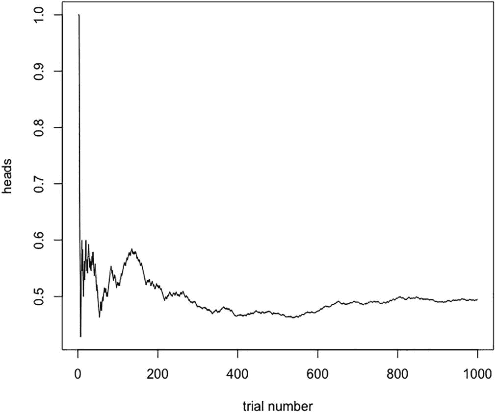
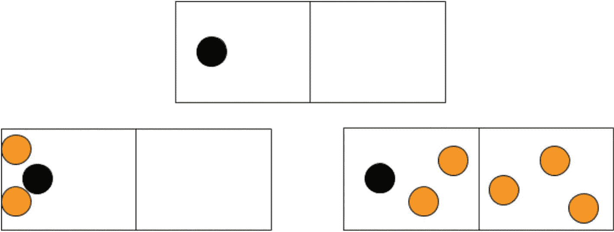

# 4. 概率：用贝叶斯还是不用贝叶斯？

> *“生活是一所概率学校。”*
> ——沃尔特·白哲特

什么是概率？

如果你不是数据科学家，你可能通过学校课程或基于常识对概率有直观的理解。对于许多事件，不可能每次都正确预知结果。但我们知道，某些结果比其他结果更可能发生。简单来说，概率是一种表达和研究哪些结果更可能或更可能发生的方式。“probable”一词的词源学对我们今天如何使用它有着有趣的启示；它源自 14 世纪的法语单词*probable*，意为“可证明或可论证的”，最初源自拉丁语动词*probare*——“尝试、测试”。

如果我问你，抛一枚公平硬币得到反面的概率是多少，你可能会说是 50%。直观上这很合理。然而，你可能无法从数学上解释为什么这应该是正确的。抛硬币是计算概率的一个简单案例。你如何定义曼联赢得下一届欧冠联赛的概率？你可能对哪支足球队最好有个人信念（这种信念每年都可能改变），但你得出这个概率的方式“感觉”与抛硬币的情况不同。

如果你坚信曼联会赢得本赛季的欧冠联赛，你可能会说给它 70%的概率。但你怎么知道不是 71%？或者 61%？在抛硬币的场景中，如果有人告诉你得到正面的概率是 51%，那么你会说这枚硬币不公平。在赌场里，游戏中概率 1%的变化可能就是赌场大赚一笔或蒙受巨额亏损的差异。

我们都熟悉概率——它甚至影响着我们日常生活的细微之处，比如公交车准点到达的可能性——它是我们表达和评估不确定性的主要工具。想想你一周内说了多少次“可能”。尽管如此，定义概率并准确理解它是如何（以及为什么）起作用的，实际上非常棘手。

## 频率学派还是贝叶斯学派？

概率最流行的定义，也可以说是最直观的定义，是频率学派的定义（也称为*频率主义*）。根据频率学派的观点，一个事件的概率被定义为该事件在大量试验中频率的极限。

这到底是什么意思？让我们回到抛一枚公平硬币的例子。你可能会说，单次抛掷得到正面的概率是 50%。然而，你怎么知道这是真的呢？如果连续十次都抛到反面呢？这会改变抛到正面的概率吗？显然不会。直觉上这说得通，但原因何在？

我做了一个抛硬币实验（用`R`编程语言模拟^(¹⁶)），你可以在图 4-1 中看到结果。正面比例非常快地收敛到了 50%。

**图 4-1** — 抛硬币实验

这就是实践中频率学派概率的定义。如果你反复执行一个实验很多次，那么其频率将收敛到它们的真实概率。

在历史上大部分时期，频率学派统计学都是正统的统计学分支。亚里士多德在其《修辞学》中写道：“所谓‘概然’者，乃多数情况下会发生之事。”统计学实践基于这样一种信念：你可以从一个总体中抽取一个样本，然后研究该总体的性质。如果我们把样本中的每个实体都看作一次实验，那么我们收集的样本越多，就越接近真相。

然而，对于某些事件，频率学派的解释毫无意义。这其中许多事件对我们的生活有着重大影响——例如，选举或公投的结果。我们无法进行 1000 次选举实验来观察会发生什么。同样，我们无法进行 1000 场欧冠决赛来确定曼联获胜的真实概率。

正是在这一点上，贝叶斯概率的定义派上了用场。

尽管托马斯·贝叶斯牧师从未亲自发表过他的理论——这些理论是由他的朋友理查德·普莱斯在他去世后记录并编辑的——但贝叶斯定理（或称贝叶斯理论）却以他的名字命名。具有讽刺意味的是，没有人确切知道贝叶斯出生的时间（尽管他于 1761 年去世），或他的长相；虽然有一幅肖像画流传下来，但画中人是否*确实*是贝叶斯本人并不确定。

贝叶斯在 1763 年提交给皇家学会的《论机会学说中一个问题的求解》一文中使用了条件概率（你很快就会学到）。贝叶斯的工作涉及以下问题：仅根据一个事件过去发生——或未发生——的次数，你如何能知道该事件的概率？贝叶斯使用了一个思想实验来阐述他的论点。

贝叶斯背对着桌子，他的助手将一个球扔到桌上。球落在桌上任何位置的概率都是相等的。贝叶斯必须猜出球在哪里。第一次扔球时，贝叶斯面临着最大的不确定性，因为球可能落在桌子上的任何地方。

下一步，他的助手又扔了一个球，并报告这个球是落在第一个球的左边还是右边。假设这次球落在了桌子的右边。我们可以推断，第一个球现在更可能是在左边。如果第一个球本来落在左边，那么右边就会有更多空间让另一个球落下。

然后，助手再次扔球，这个球又落在了右边。这使得第一个球在左边的可能性进一步增大。因此，随着每一次投掷，我们都在越来越精确地缩小第一个球的位置范围。图 4-2 展示了这一思想。

**图 4-2** — 贝叶斯论点的图示

如图 4-2 所示，第一个球（黑球）扔出后，第二个球（橙色球）在桌子右侧的空间比左侧大。在第二行（左图）中，你可以看到只有少数位置能让第二个球落在第一个球的左边。在第二行（右图）中，你看到的是第一个球右边所有橙色球可能落到的位置。很明显，第一个球右边的空间更大，而且大部分空间位于桌子的右侧。不过，橙色球仍有可能位于黑球的右边，但却在桌子的左侧。因此，仅凭两次掷球不足以完全确定黑球的位置。

在现代世界中，这或许让我们有点想起“海战棋”桌游。在海战棋中，每个玩家（游戏只有两名玩家）需要将舰船放置在一个方形棋盘上。每轮，玩家指定棋盘上的一个点进行攻击。如果击中了船的一部分，对方玩家会告知他们成功击中了船的一部分，但不提供其他信息。舰船在棋盘上可以有两种放置方式（水平或垂直）。因此，玩家必须首先通过一次命中找到船的位置，然后猜测船剩下的部分在哪里。通过在棋盘上尝试更多点，对舰船位置的不确定性会一轮轮地降低。

想想 1976 年著名的小品《双人组》中的“四根蜡烛”。对店主说“叉柄”（fork handles）在发音上与说“四根蜡烛”（four candles）相同；这是一对同音词。如果你在一家既卖叉柄也卖蜡烛的五金店，那么有 50% 的概率顾客想要的是蜡烛。但如果你在一家蜡烛店，这就是一条新信息，那么顾客要的是蜡烛——而非叉柄——的概率就增加了。

贝叶斯理论背后的主要概念如下：

-   *初始信念 + 新信息 = 新信念*

用现代术语表述，就变成了：

-   *先验 + 似然 = 后验*

你接下来会学到更多。

贝叶斯本人从未专注于这个如今以他名字命名的定理。他同时代的数学家们对他的方法并不满意，原因有二。第一，“猜测”听起来不像一个严谨的过程。第二，在缺乏信息的情况下，贝叶斯假设所有结果都是等可能的。用现代统计学的说法，我们会说先验是均匀的。不得不赋予一个先验信念概率似乎是一个额外的障碍。

这个定理被有史以来最杰出的数学家之一独立发现：皮埃尔-西蒙·德·拉普拉斯。拉普拉斯重新发现了这一原理，并于 1774 年发表。1781 年，拉普拉斯在访问巴黎时，终于得知了贝叶斯更早的发现。拉普拉斯改进他的公式，并决定对其进行检验。

拉普拉斯想知道，出生男孩多于女孩这一事实究竟是自然规律，还是仅仅是统计异常。他收集了来自伦敦、巴黎、圣彼得堡、法国乡村地区、埃及和中美洲的记录。利用他的定理，他成功地得出结论，即这确实似乎是一条自然规律。^(¹⁷)