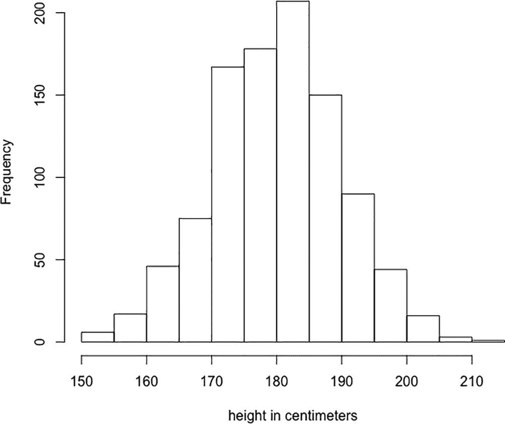
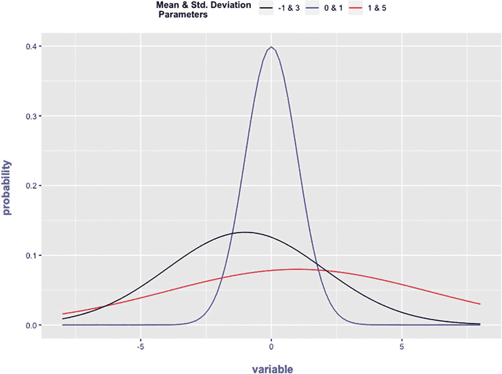
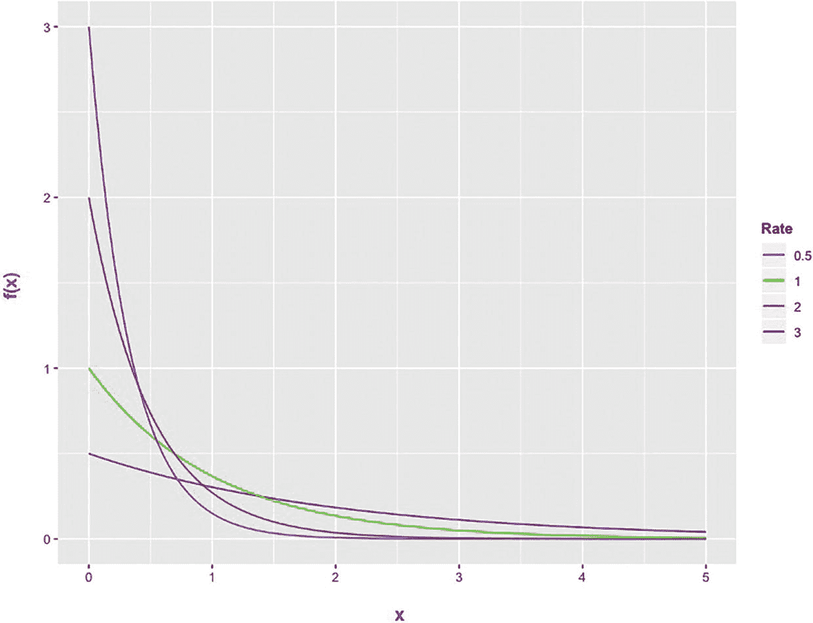
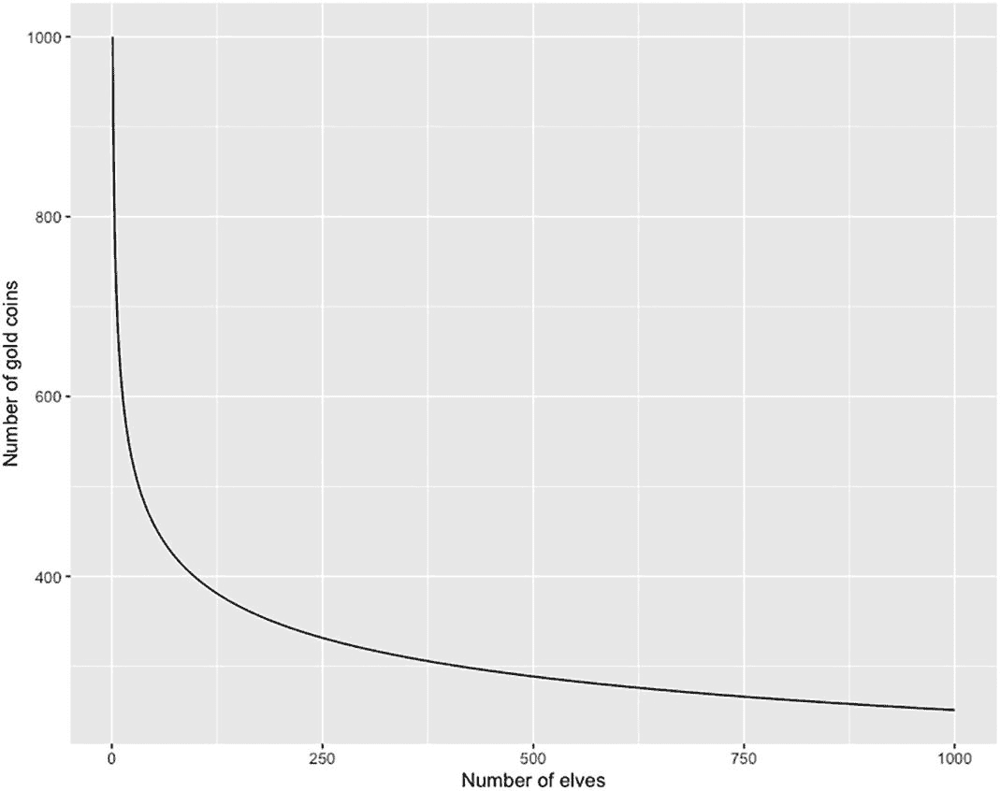

# 5. 数学与概率分布的力量

> *“概率论不过是把常识简化为计算。”*
>
> ——皮埃尔-西蒙·拉普拉斯

“概率分布”是数学史上最重要的概念之一。在充满不确定性的环境中，我们无法百分之百预测结果。无论是预测骰子的下一次点数，还是体育比赛的结果，我们只能在部分情况下猜对，而非每次都正确。如果我们能找到一种方法来表达不同结果的概率呢？由此，我们便可计算出有用的结果，比如最可能发生的结果，或其他诸如方差（稍后会介绍）等有用量值。

第 1 章曾说明，不确定性分为两种：认知不确定性和偶然不确定性。认知不确定性源于知识匮乏。例如，假设我们使用一台医疗仪器采集血液数据，试图通过这些预测某人是否感染了严重病毒。这些数据并非完全准确——实际上，任何测量值都可能存在约 20%的误差。十年后，我们或许能研发出更精密的仪器（误差可能仅 10%），这便是认知不确定性。

在抛硬币实验中，我们面临的是偶然不确定性。假设硬币是均匀的，正面或反面朝上便是一种随机现象。同样，在骰子被掷出之前，我们无法预知结果。“Epistemic”源自希腊语“知识”（*episteme*）；而“Aleatoric”则源于拉丁语中表示骰子的词（*alea*）——或指掷骰者（*aleator*）。这种词源差异有助于我们区分两种不确定性。

概率分布为我们提供了一种简洁的表达方式，来刻画这两种不确定性。大多数概率分布并非随意构造，而是源自对现实世界过程的特定建模。

让我们以研究美国男性平均身高的例子来说明。

你会预期见到一个身高 180 厘米（5 英尺 10 英寸）的人吗？这很合理。那一个身高 250 厘米（8 英尺 2 英寸）的成年人呢？这几乎不可能。同样，身高 150 厘米（4 英尺 9 英寸）的成年男性也不多见。直觉告诉我们，某些数值出现的概率更高。我们不仅要捕捉这种规律，还要确定某些数值比另一些*究竟*高多少。

如果从总体中采集一个样本，总容量为 1000 人，你可能会得到如图 5-1 所示的直方图。

频率对身高（厘米）的直方图呈现钟形趋势。最高峰位于（180, 210）附近。数值为近似值。

**图 5-1** 1000 位成年男性身高（厘米）测量值的直方图

众所周知，人类身高可以相当精确地通过高斯分布来建模。高斯分布以 18 世纪德国数学家卡尔·弗里德里希·高斯（1777–1855）命名，它出现在许多物理现象以及重要的统计定理中——例如你将在后续章节学到的中心极限定理。

为什么这个结论如此重要？正态分布具有某些特定性质。首先，它有两个完全表征该分布的变量（我们称之为参数）：均值（以希腊字母 *μ* 表示）和标准差（以希腊字母 *σ* 表示），或者方差（标准差的平方）。均值是分布的中心，标准差则描述分布的离散程度。见图 5-2。

概率对变量的曲线图展示了两个正态曲线和一个平缓的钟形曲线。峰值（0, 0.4）的曲线均值和标准差分别为 0 和 1；峰值（-2, 0.135）的曲线均值和标准差分别为-1 和 3；平缓曲线的均值和标准差分别为 1 和 5。

**图 5-2** 不同均值和标准差的正态分布

那么，为何这一切如此重要？原因有二：

1.  它捕捉了我们对哪些数值更可能出现的直觉判断。
2.  正态分布保证了落在特定区间内的人群比例。

正态分布具有以下性质：95%的个体位于均值两个标准差之内，99%的个体位于均值三个标准差之内。虽然我们无法确定下一个样本的确切值，但我们可以对其所在区间抱有不同程度的置信度。

让我们回到研究美国男性身高的例子。该直方图的均值为 180，标准差为 10。这意味着，如果我们从总体中随机选取一个人，在 100 次尝试中，有 95 次这个人的身高会在 160 到 200 厘米之间。如果我们收集了整个总体的数据，就能得到总体的真实均值——假设为 181.23 厘米，真实标准差为 10.54。此时，我们已完全消除了估计中的认知不确定性。

然而，对于新出生的男性个体，我们在其最终身高上仍然面临偶然不确定性。通过使用高斯分布模型来刻画总体特征，这一统计框架可以解决该问题。

前文提到，高斯分布完全由两个参数表征：均值和标准差。这是参数统计中的一个重要概念^(²⁰)。如果一个现象遵循某种分布，那么该分布由特定参数表征，知道这些参数就等同于掌握了所需的一切信息。统计学家的目标是获取足够大的样本，以高精度确定这些参数。一旦完成，我们就能从样本推断出总体的属性。

因此，在这个例子中，我们能够成功建模新生个体成年身高的偶然不确定性。于是我们可以说：身高~*N*(181.23, 10.54)，这意味着每个新生个体的身高服从一个均值为 181.23、标准差为 10.54 的正态分布^(²¹)。

你可能已经注意到，这个方法完全是数学性的——我们在任何环节都没有依赖关于研究对象（男性身高）参数的主观信念。这是一种纯粹频率主义的方法。频率主义之所以如此突出，部分原因在于中心极限定理及其相关定理——这些定理在未提及任何主观信念的情况下，很好地解释了如何逼近参数的真实值。

频率主义具有某种智力上的吸引力：我们无需借助假设，就能达到关于世界的真实状态。它也更符合经久不衰的浪漫主义理想——科学家通过研究和过程达到客观真理。本质上，它提供了*确定性*。

然而，贝叶斯主义对这些过程有自己独特的解读。

在频率主义中，我们相信我们寻找的参数是固定的，而数据是随机的。其中一个重要概念是“置信区间”（confidence interval）。我们之前已经通过正态分布看到了这个概念的一个例子。在频率学派的解释下，置信区间是一个值的范围。在这个范围内，我们期望在一定次数内看到参数的真实值。因此，如果使用 95%的置信区间，我们期望在 95%的情况下，参数的真实值会落在我们样本的这个范围内。

在贝叶斯主义中，概率是对值的不确定性的度量，因此我们将数据视为固定的，而将参数视为随机值。我们使用可信区间（credible interval）代替置信区间。一个 95%的可信区间意味着，参数的真实值位于该区间内的概率为 95%²²。

这种差异可能看起来很学术，对于非统计学家来说可能没什么吸引力，但正如我们之前所见，我们现在拥有了一种讨论不确定性的客观语言，这一事实本身就具有巨大价值。否则，我们该如何谈论并赋予不确定的命题以价值呢？这就像试图描述一个橙子却不知道“橙色”这个词一样。

关于哪种解释更好，存在一场激烈的争论。频率主义方法在其历史上大部分时间里主导了统计学。然而，贝叶斯方法在某些问题上取得了令人难以置信的成功。通常，这发生在满足两个条件的时候：

1.  我们对问题有先验知识（prior knowledge）。
2.  我们拥有的数据有限；例如，我们没有关于某些我们知道原则上可能发生的事件的数据。

先验知识指的是我们对世界已知的事情。例如，如果我们使用一个统计模型来预测体育赛事的结果，我们也许知道 A 队比 B 队强。贝叶斯方法可以非常容易地处理这一点。此外，有些事件是半独特的（我们将在后面讨论）。例如，选举在所有民主国家都以半规律的间隔发生，但每次都有很多事情可能不同（例如候选人）。与此相比，掷骰子每次的结果都差不多，并且我们可以无限次地重复这个实验。对于半独特的事件，贝叶斯方法是一个更好的选择。

## 其他分布模型

存在着无数的分布用来解释各种问题和不确定性。我们在此将解释其中的一部分，但如果您觉得过于技术性，可以忽略此部分。另一个著名的分布是泊松分布（Poisson distribution）——以 19 世纪法国数学家西梅翁·德尼·泊松（Simeon Denis Poisson）的名字命名——用于模拟稀有事件的发生，例如地震。见图 5-3。

一个泊松分布与`x`值的条形图描绘了 3 条不同的曲线。当`lambda = 1`时呈现递减趋势，当`lambda = 5`和`9`时呈现钟形趋势。这些条形图相互重叠。

图 5-3 不同参数`lambda`值下的泊松分布

另一个流行的分布是指数分布（exponential distribution）。这是一种等待时间的分布。如果我们模拟救护车的到达，我们可能会问：下一辆救护车到达需要多长时间？见图 5-4。

一个`f(x)`对`x`的线图描绘了 4 条递减曲线，其比率分别为 0.5、1、2 和 3，从底部到顶部。这些曲线相互重叠，并在向右端移动时靠近。

图 5-4 不同参数设置下的指数分布

还有几何分布（geometric distribution），它可以告诉我们直到成功之前我们会经历多少次失败。例如，我需要掷多少次骰子，才能掷出一个 6？

二项分布（binomial distribution）描述了在多次试验中成功的次数——例如，如果我押注掷骰子得到 6，那么我掷骰子 100 次会成功多少次？

## 这种不确定性观点存在的问题

概率分布是一个很好的工具，但仍然存在两个争议激烈的主要问题：

1.  我称之为分布的柏拉图式（platonic）与实用主义（pragmatic）观点。根据柏拉图的说法，像圆和正方形这样的物体代表天上投射到我们世界的理想形式。关于概率分布的问题是，概率分布是自然法则还是简单的工具？

2.  第二个问题由纳西姆·尼古拉斯·塔勒布（Nassim Nicholas Taleb）提出，涉及“游戏谬误”（the ludic fallacy）。

让我们逐一分析这些问题。

第一个困境问的是，自然界中的现象是否*必然*遵循某些分布的规律，还是说这些分布只是一种有用的近似。例如，中心极限定理（我们将在下一部分探讨）为正态分布存在于自然界的普遍性提供了一些直观解释²³。复杂性理论家也试图寻找证据，证明自然界中的许多现象遵循某些幂律分布（power law distributions）²⁴。

这些分布出现在自然界许多复杂系统中，比如收入分布。当你听到 1%的人控制着世界 90%的财富时，这实际上就是一种幂律分布。图 5-5 说明了这一概念。

一个关于金币数量与精灵数量的线图描绘了一条递减的曲线，该曲线从(0, 1000) 延伸到 (1000, 250)，中间经过 (100, 475)。这些值为近似值。

图 5-5 一个厚尾分布（fat-tailed distribution）的例子

在图 5-5 中，你可以看到一个虚构的精灵社会的财富分布图，该社会使用金币作为主要货币。你可以看到，大多数金币由少数精灵拥有。只有 23 个精灵持有超过 500 枚金币，而一个精灵拥有 1000 枚金币。虽然这个例子是虚构的（或者也可能不是，取决于你是否相信精灵的存在），但现代社会中的财富分布看起来非常相似。

使用概率分布的另一个问题是，大多数时候，它们只是被用作世界的模型。为了做到这一点，我们必须做出假设并经常过度简化事物——这意味着在许多情况下，这些模型是完全错误的。纳西姆·尼古拉斯·塔勒布在他的著作《黑天鹅》（*The Black Swan*）中将此称为“游戏谬误”。术语*ludic*源自拉丁语*ludere*，意为玩耍——而这个词又源自拉丁语的体育或游戏*ludus*。根据塔勒布的说法，当我们相信一个现实世界的现象可以像简单的机会游戏一样被精确建模时，就发生了游戏谬误。

为了说明这一点，塔勒布举了两个男人的例子：

*   约翰博士（Dr. John），他被视为一个具有科学和逻辑思维的人。
*   胖子托尼（Fat Tony），他被视为一个靠智慧生活的人。

这两个人在讨论一个抛硬币游戏。有人问道：“假设硬币连续 99 次都是正面朝上。下一次再出现正面的概率是多少？”约翰博士会回答概率是 50%，因为硬币没有记忆，过去的事件不会影响未来的事件。胖子托尼会回答，这枚硬币很可能是不公平的，所以下一轮还会是正面朝上。

