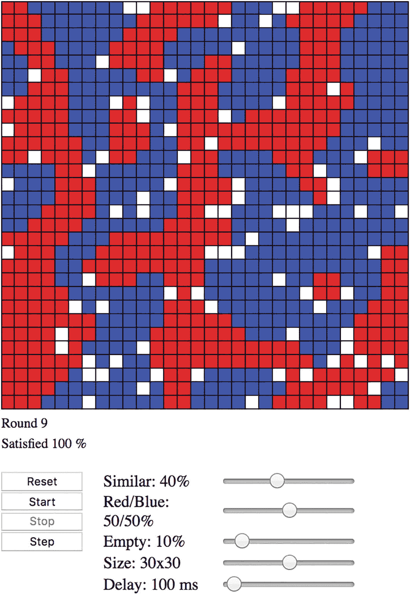
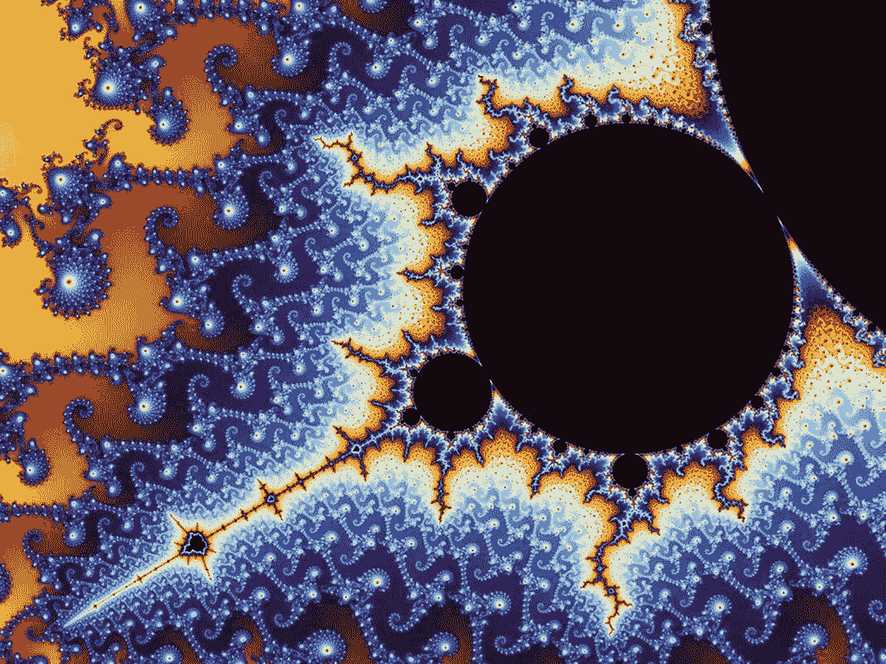
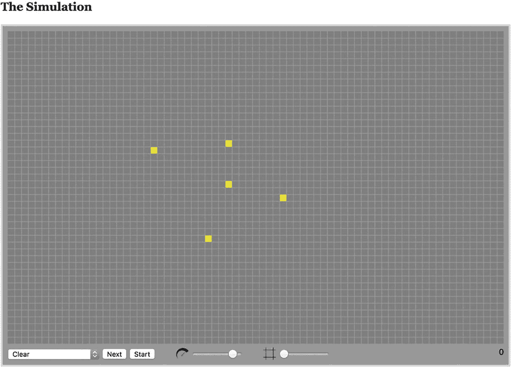
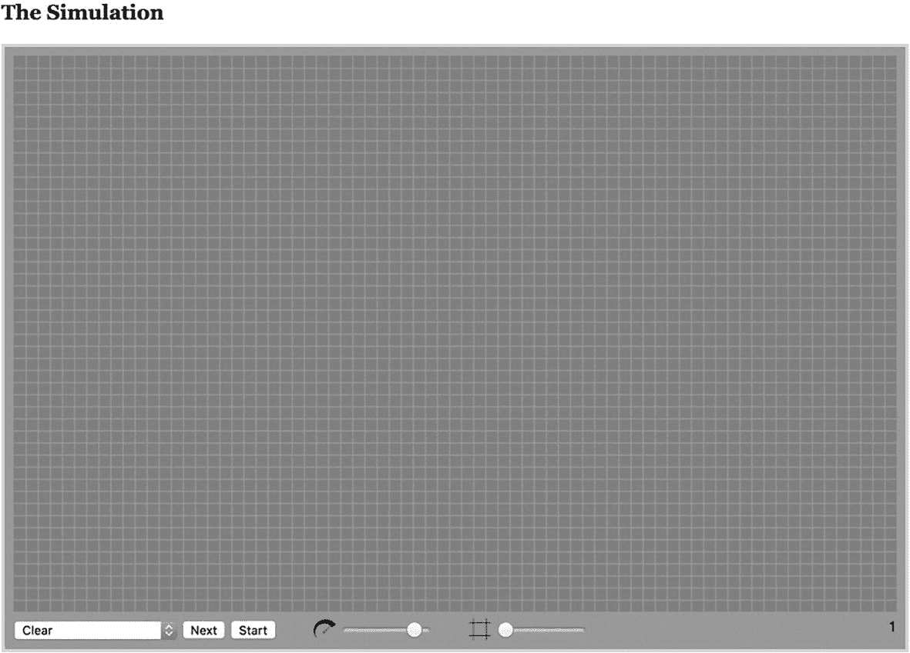
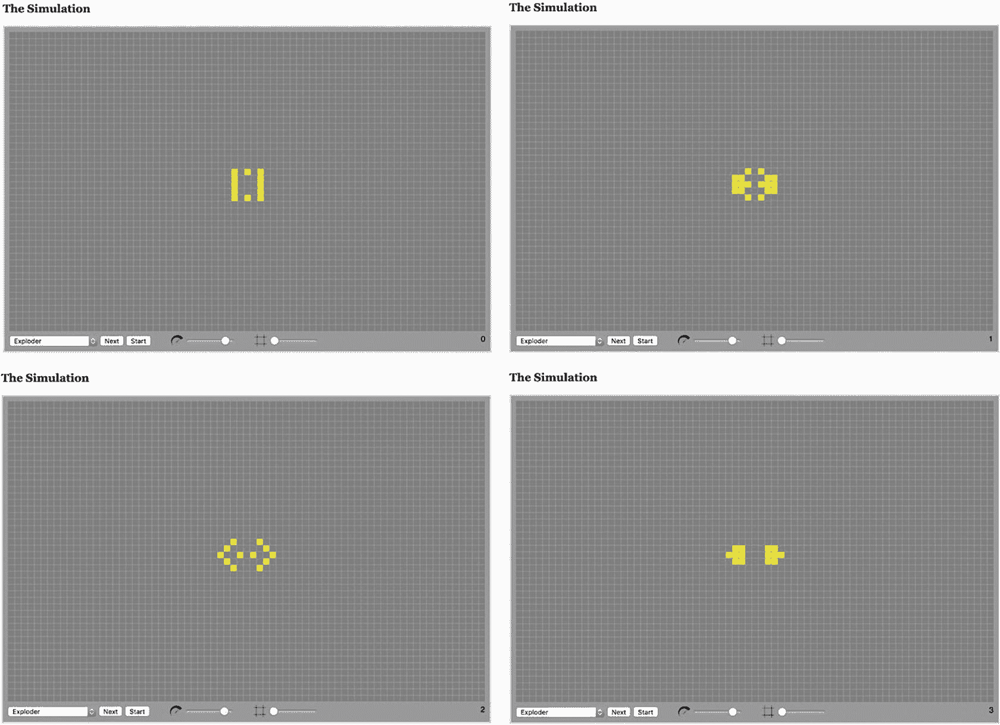
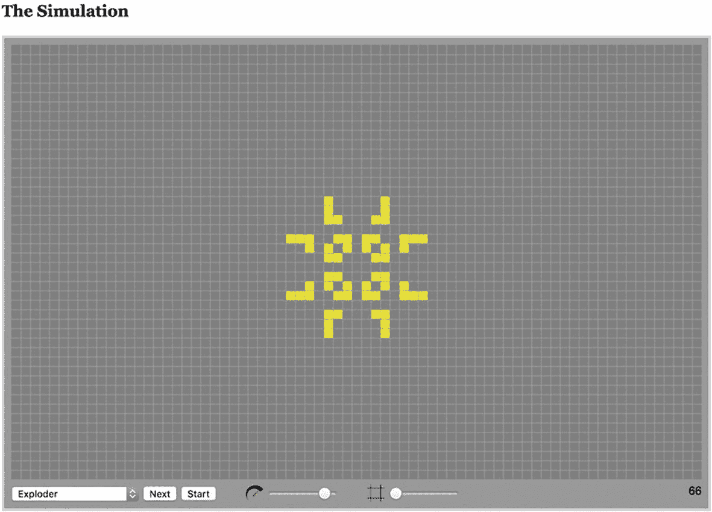
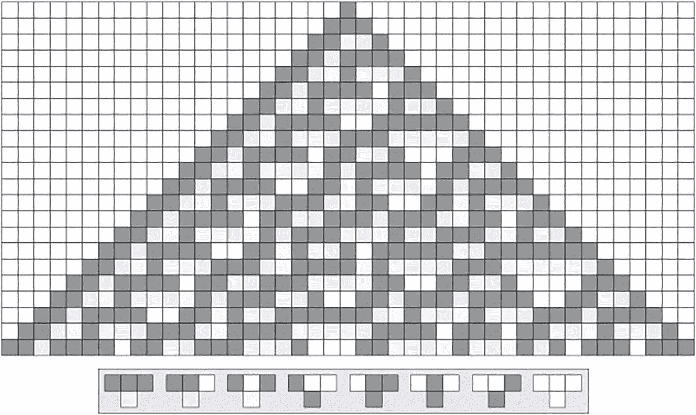
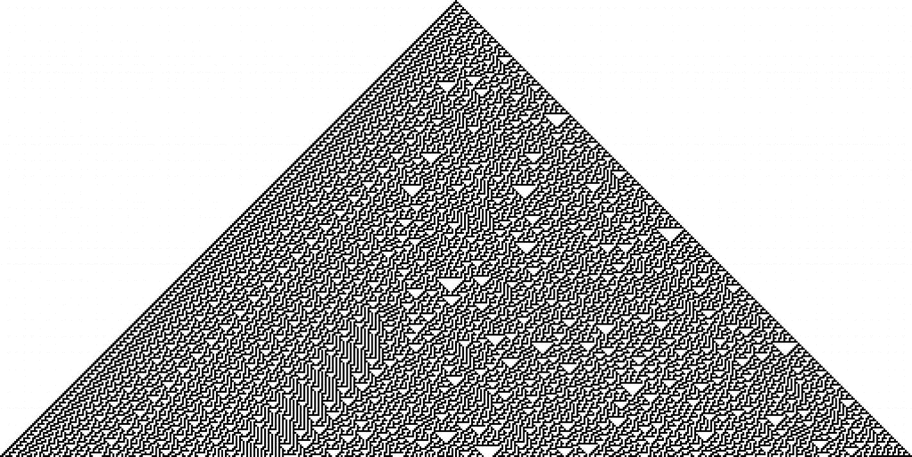
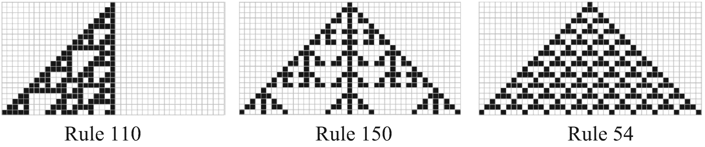

# 12. 预测的极限（第二部分）：博弈论、基于主体的建模与复杂性（行动与反应）

> *“抱怨人们自私和背信弃义，就像抱怨没有旋度的电场就不会有磁场增加一样愚蠢。两者都是自然法则。”*
> 
> ——约翰·冯·诺伊曼

可以说，没有哪门数学理论能像博弈论那样，如此彻底地摧毁了社会动力学中存在均衡的幻想。博弈论最初由约翰·冯·诺伊曼和奥斯卡·摩根斯特恩于 1944 年创立。^(¹¹⁸) 博弈论对科学的贡献在于，它假设系统中的参与者具有能动性，且他们的行为会影响博弈的结果。换句话说，每个人都有自己的算盘。每个参与者都有一系列目标，但也需要弄清其他参与者会怎么做。在此之前，不确定性被认为是仅属于自然的一部分。博弈论证明了人类的意图和策略也是不确定性的一个来源，并且在许多社会系统中，人类实际上是不确定性的主要来源。

博弈论中最著名的例子是“`囚徒困境`”，最初由梅里尔·弗拉德和梅尔文·德雷舍于 1950 年提出。囚徒困境描述了一个虚构场景：两个罪犯正在被警察审讯。他们面临以下选择：招供还是不招供。每个参与者的收益取决于双方的行为。因此，可能出现以下结果：^(¹¹⁹)

1. 双方都不招供：两人都被判一年监禁。
2. 一方招供，另一方不招供：招供者无罪释放（作为与当局合作的奖励），不招供者被判三年监禁。
3. 双方都招供：两人都被判五年监禁。

这个博弈非常棘手。对单个参与者来说，最好的结果是自己招供，而对方不招供。从道德角度看，最好的结果是双方都不招供。然而，假设参与者是理性的，最终的结果是双方都招供，从而陷入最糟糕的境地。

博弈论被用于分析寡头垄断市场，即只有少数几家公司竞争的市场——可以把它想象成寡头与垄断的结合。例如，价格战就是囚徒困境在现实生活中的一个典型例子。博弈论还可应用于许多其他情境，从理解利率应如何征税，到核裁军。后者是囚徒困境的另一个现实世界例子。虽然对所有国家来说，销毁所有核武器可能更安全，但如果某个特定国家不遵守，它就会自动成为一个超级大国。

博弈论对经济学和数学产生了巨大影响。其影响力可见于它已成为 11 项诺贝尔奖的主题。获奖者之一便是约翰·纳什，他的故事因罗素·克劳主演的电影《美丽心灵》而广为人知。

虽然博弈论展示了社会互动的复杂性以及它们如何成为不确定性的来源，但它也表明，即使在存在不确定性的情况下，我们也可以确信某些结果，因为某些博弈可以达到均衡状态^(¹²⁰)（在给定一些假设的前提下）。这种研究不确定性的方法直接关系到基于主体的建模，我稍后会回到这个话题。

一个方便的假设是，参与者会表现得理性，这使我们能够预测各种结果的均衡状态。然而，正如卡尼曼和特沃斯基（你很快就会读到他们）所发现的那样，人类远非完全理性——至少从博弈论的意义上讲是如此。真实行为比博弈论所能预测的还要复杂，这就是复杂性理论家（你很快也会读到他们）运用博弈论的原因。

# 基于智能体的建模：构建人工世界

基于智能体的建模有点像尝试制作一个世界的电子游戏——*模拟人生*，但带有理论色彩。在基于智能体的建模中，目标与其说是抽象出关系，不如说是在计算机内部（即 *in silico*）精确地再现世界。最早的一些基于智能体的模型可以归功于冯·诺依曼的元胞自动机（我将在后面的章节中讨论），但第一个真实的基于智能体的模型很可能是谢林的隔离模型。

托马斯·谢林（1921–2016）是一位美国经济学家和外交政策教授。在哈佛大学期间，他对隔离现象是如何产生的产生了兴趣。于是，他创建了以下这个简单的模型。有一些智能体生活在一个由方形网格组成的世界中，很像棋盘游戏。这些智能体是非常简单的实体，代表了抽象化的人类。智能体被分成两种不同的颜色，比如说红色和蓝色。游戏按轮次进行，在每一轮中，每个智能体都会判断自己是否满意。对于一个智能体来说，要感到满意，其邻居中需要有特定比例的颜色与自己相同。如果不满足，该智能体就会尝试移动到其他空单元格。

在这个游戏中我们可以看到，即使智能体非常宽容，游戏最终也会收敛到一种状态，即出现由相同颜色智能体组成的明显聚居区。你可以在图 12-1 中看到这一点。在这个特定的游戏实例中，只要智能体有 40% 的邻居与它颜色相同，它就会感到满意。但即便如此，也足以迫使形成隔离的聚居区。

屏幕截图包含一个带网格的正方形。正方形内包含若干蓝色和红色方块组以及几个空方块。以下为相关数据：相似度 40%；红色或蓝色各占 50%；空置率 10%；尺寸 30×30；延迟 100 毫秒。

**图 12-1** 谢林的隔离模型^(¹²¹)

这一点特别有趣，因为它表明隔离不一定是个人偏见的结果。即使个人并不太在意大多数邻居是否与自己相似，隔离仍然可能发生。谢林模型的行为是具有涌现行为特征的复杂系统的典型表现。我稍后会讨论这是什么意思，但其核心思想是整体大于部分之和。

另一个著名的基于智能体的模型是 `Sugarscape`。`Sugarscape` 由约书亚·M·爱泼斯坦（Joshua M. Epstein）和罗伯特·阿克斯特尔（Robert Axtell）创建。爱泼斯坦是纽约大学全球公共卫生学院的流行病学教授，阿克斯特尔是乔治梅森大学计算社会科学教授。`Sugarscape` 是一个人工世界，由一个 51x51 的方形网格构成。智能体有各种规则来管理它们的交互，这些规则基于我们现实世界的简化版本。这个世界的主要资源是“糖”，智能体必须消耗糖才能生存。智能体还可以繁殖和死亡，在更复杂的版本中，甚至可以进行物物交换。

爱泼斯坦和阿克斯特尔将他们的研究成果出版成书，书名为《*人工社会：自下而上的社会科学*》（Growing Artificial Societies: Social Science from the Bottom Up），该书于 1994 年首次出版。该模型的主要目的是展示简单的规则如何能产生复杂的动力，以及这些动力和规则如何能与我们在现实世界中观察到的动力和规则非常相似。^(¹²²)

关于基于智能体建模的研究进一步推进，并被应用于各种问题。1999 年，奈杰尔·吉尔伯特（Nigel Gilbert）出版了该领域的第一本教科书《社会模拟：为社会科学研究者而设的模拟》（*Social Simulation: Simulation for the Social Scientist*），他还创立了社会科学领域第一本关于基于智能体建模的期刊《人工社会与社会模拟杂志》（*Journal of Artificial Societies and Social Simulation*）。在谷歌学术上搜索“agent-based model”会返回超过 450 万个结果，涉及从供应链到军事行动的各种模型。成立于 1984 年的圣塔菲研究所^(¹²³) 也是该领域的知名机构，对该领域，特别是经济学中基于智能体模型领域，做出了多项贡献。

计算机模拟在物理科学中发挥了重要作用，而基于智能体的建模则试图为社会科学做同样的事情。基于智能体的模型有一个独特的性质，即我们不需要提出关于世界如何运作的数学模型或抽象理论。我们只需提取理论的小片段，将它们组合起来，然后在模拟中运行。理解人类心理学如何影响经济选择是一个迷人且复杂的问题，而回答这个问题的过程催生了行为经济学领域。

理解行为经济学的发现如何影响更广泛的经济环境则是一个更为棘手的问题。然而，利用基于智能体的模型，我们可以创建模拟真实人类的智能体，利用我们已有的任何心理学理论，然后观察它们的互动如何产生各种现象。

基于智能体的建模可以非常强大。自然界中的许多复杂系统——比如社会系统——都具有反馈循环和动态特征，这使得它们难以控制或预测。事实上，对于许多自然系统来说，它们甚至不需要遵循复杂的规则就能展现出这种复杂行为。在这种情况下，更简单的确定性或分析模型就不那么有用了。基于智能体的建模是一种接受我们方法和知识局限性的方式，同时也提出了一种解决同样问题的新途径。这是一种明显的实用主义方法，与我之前讨论过的计算学习理论形成直接对比。

尽管基于智能体的建模（以及这些观察）自 20 世纪 40 年代以来就已存在，但直到 20 世纪 90 年代，这种方法才开始形成理论形态。这一努力被称为“复杂性理论”。

# 复杂性理论：模拟与预测的极限

> *“简单的规则反复无尽，便能衍生出无穷无尽的奇迹。”*
> **——** 20 世纪数学家与博学家 本华·曼德博

复杂性理论在 20 世纪 90 年代至 21 世纪初曾风靡一时。它完全依赖模拟，属于那种试图解释一切的科学理论，但最终……嗯，它并未实现这一目标。不过，在这一过程中，它让我们深刻认识到，在研究众多重要现象（无论是社会现象还是物理现象）中的不确定性时，自身所存在的局限性。

顾名思义，复杂性理论是研究复杂系统的科学。究竟什么是复杂系统？虽然没有明确定义，但我们可以对其进行描述。复杂系统是指那些难以通过传统分析技术进行剖析的系统。复杂系统拥有众多相互作用的组成部分，并且可能表现出不可预测的行为。这两点是关键。例如，用于描述简单物理现象的分析方程，无法用来理解系统的下一个状态。这意味着，必须设计一套新的工具来尝试实现这一目标。

为何要如此关注复杂系统？我们所遇到的一些最有趣（也最重要）的系统都是复杂的：经济体系、各类社会系统，甚至我们在自然界中遇到的某些系统，如神经网络和蚁群。理解它们如何演化与适应，将有助于我们更好地掌控经济、解开大脑的奥秘，甚至消除全球冲突。至少，理论上是这样说的。

复杂性理论中最广为人知的概念之一是自组织临界性。什么是自组织临界性？我用沙堆的例子来解释，这可能是复杂性理论中最著名的例子了。想象一个沙堆，我们不断地往上面加沙子，一次一粒。存在一个临界点，当我们再添加一粒沙子时，就会引发一场“雪崩”。许多沙粒会沿着沙堆滚落，使其重新组合，而这一切都源于添加的那一粒沙子。

当沙堆处于“再添一粒沙子就会引发雪崩”的状态时，我们就说它处于自组织临界点。在投入那粒沙子之前，沙堆处于平衡状态。然而，一个微小的变化就会彻底改变它。但在雪崩之后，沙堆重新组合，它会达到一个新的平衡状态。此后，又需要添加相当数量的沙子，才会引发新的雪崩。

我们之前讨论过蝴蝶效应——巴西的一只蝴蝶扇动翅膀，可能会在德克萨斯州引发龙卷风。这个例子在混沌理论中用于展示世界的相互关联性。然而，这种相互关联性在复杂性理论中有着不同的含义。沙堆的例子并非试图证明世界的混沌本质。相反，自组织临界性背后的理论是，处于临界边缘的系统能够迅速改变其结构，达到新的平衡状态。然而，这一过程的具体细节——何时发生转变，转变后的系统是什么样子——并不容易预测。

自组织临界性的概念最早由 `Per Bak`、`Chao Tang` 和 `Kurt Wiesenfeld` 于 1987 年提出。^(¹²⁴) 他们观察到，自然界中的各种系统，包括我接下来要讨论的元胞自动机，都具有一些共同特性，如分形结构、粉红噪声和幂律。分形是维度为分数的数学对象。例如，它们并非存在于一维、二维或三维，而是存在于 2.43 维。分形的主要特征是自相似性。无论你将分形放大还是缩小，观察到的图案都是相似的。类比到社会，一个家庭内部的经济组织方式，可能类似于一个行政区，而行政区又类似于一个城市，更大的县、国家，或者像欧盟这样的国际组织。见图 12-2。

*曼德博集合分形的一个示例。该图案包含大小不等的深色圆形，周围环绕着色彩斑斓的图形。*

第一个将分形几何学与经济学、金融学联系起来的人是本华·曼德博。在他的著作《市场的（错误）行为：金融风暴的分形视角》中，他解释了如何通过分形几何学比现有经济理论更好地理解市场波动。他的工作也是复杂性理论的前驱，因为他展示了复杂的模式如何从简单的规则中涌现出来。

沙堆的类比可能看起来与更有意义的系统不太相关。然而，自组织临界性这一概念确实出现在许多真实系统中。经济体系一直是复杂性理论最钟爱的研究对象，以至于“复杂性经济学”这个术语甚至被用来描述将这些理论应用于经济学的实践。

在 1992 年的一篇论文中，`Bak` 描述了^(¹²⁵) 经济如何可以被视为一个具有相互作用的反馈回路的动态系统。在古典经济学中，偏离均值的微小扰动最终会收敛回来；而在动态系统中，微小的扰动可以以无数种方式组合。一种方式是它们可以相互抵消并消散（这解释了主流经济学家预期的行为），但它们也可以在正反馈回路中结合，最终导致金融危机或其他重大的灾难性现象。经济体处于一种自组织临界状态，这有助于它们适应变化，但有时也会引发重大动荡。

这些观点与正统经济学直接冲突，后者假设经济处于均衡状态，危机是罕见的。古典经济学是一种均衡方法。古典经济学家寻求能够提供更好均衡的策略和方法。相反，复杂性经济学家研究的是由主体间相互作用而产生的动态回路反馈。这是一种非均衡方法，代表了与以往方法的彻底范式转变。用曼德博的话来说：

> “大多数经济学家在建模市场行为时，倾向于将重大波动扫到地毯下，并假定它们是异常现象。而我发现的是，价格的大幅上涨和下跌实际上是不可避免的。”^(¹²⁶)

有人认为，自组织临界性在生物神经网络中也很明显。自组织临界点是秩序与混乱之间的平衡。这种平衡有助于信息的适应和传播。虽然并非所有人都接受这一理论，但有证据表明情况可能确实如此。^(¹²⁷)

# 复杂自组织系统与涌现

复杂自组织系统的另一个例子是蚁群。虽然蚂蚁是非常简单的生物，但它们的蚁群却是高度复杂的社会，能够适应多种不同环境，并作为一个整体对环境刺激做出反应。据推测，蚁群存在于一种自组织临界状态中。

复杂性理论背后的另一个关键术语是“涌现”。当整体大于部分之和时，涌现便产生了。复杂系统可以以某些方式相互作用，并产生与其组成部分完全不同的现象。

最著名的例子就是意识。意识问题被描述为现代科学中最具挑战性和最关键的问题之一。尽管有些人可能不同意这种说法，但我认为对意识的研究，在某种程度上类似于对宗教中所谓的“灵魂”进行的科学研究。

## 意识究竟是什么？

意识描述了一个生物所能体验的所有主观感受。意识有不同的种类。最简单的意识仅仅是拥有感觉。例如，我们无法知道昆虫的脑海中发生了什么。然而，我们知道昆虫像我们一样拥有大脑，并且我们可以相当确定它们一定能感受到触觉和温度等感觉。

更高层次的意识是自我意识：知道自己的存在。大多数动物不具备这种能力。像灵长类动物和海豚这样的哺乳动物才通过了“镜像测试”。^(128)

## 涌现与意识有何关联？

如果我们研究单个神经元，没有任何迹象表明以相同方式连接的神经元能够产生任何与意识稍有关联的东西。让我们来看看科学的还原论观点：一切都可以分解成其组成部分，这就是我们理解世界的方式。

神经元由细胞体组成。它们通过突触、轴突以及电化学反应相互传递信息。神经元本身由分子和原子构成。那么，众多相连的神经元是如何共同产生出能够拥有情感和感觉的东西——即人类——的呢？

这个问题越想越复杂。你可以基于类比推理，假设其他人是有意识的。你有意识，而其他生物看起来像你，所以他们也一定是有意识的。其他动物有意识吗？嗯，它们确实有大脑和神经系统，因此有理由假定它们也有意识，尽管过去的研究者，比如行为主义者，完全忽视了心智在许多生物体中的作用。

然而，那些不像我们，但仍然拥有与我们的神经元和大脑（尽管不同）的生物呢？蠕虫有意识吗？没有大脑但有神经系统的生物有意识吗？单个神经元有意识吗？也许这个问题毫无意义，但你如何知道答案呢？如果众多神经元因某种原因共同产生了意识，为什么每个单独的神经元或小群神经元就不能也有意识呢？

## 思想实验与意识的边界

我们还可以进行以下思想实验。假设有一个邪恶的巫师/疯狂的科学家正在研究意识，并对回答这些确切的问题很感兴趣。这位邪恶的巫师/疯狂的科学家决定通过抓一个人，一次移除一个神经元，然后使用他们特殊的意识测量装置来观察这个人是否仍有意识。人类在失去多少个神经元后就不再具有意识了？神经元之间的连接性起作用吗？

我们也可以反过来问这个问题。甚至有人尝试使用生物神经元进行计算。威廉·迪托在佐治亚理工学院工作期间研究了这一概念。这被称为“湿件”计算机。迪托成功地用蚂蟥神经元制造了一台能够进行加法运算的计算机。^(129) 因此，与其使用带有硅制CPU的普通计算机，我们完全可以简单地使用体外培养的神经元。问题是，这台机器会有意识吗？我们如何知道，一个由100个神经元在实验室里创造的计算机，仅仅因为它无法与我们交流，就不会感到疼痛、喜悦或某种我们无法触及的非凡体验？

在这一点上，我们开始涉足一个奇异且未知领域的泥潭，这引发了大量的哲学、科学和伦理问题——其中最重要的问题是，我们是否真的存在？还是笛卡尔一直都是对的？如果没人去听，倒下的树还会发出声音吗？

## 意识的简单问题与困难问题

最杰出的精神哲学家之一大卫·查尔默斯将意识问题^(130) 分解为两个子问题：意识的简单问题和困难问题。他用“简单问题”或“软问题”这个术语，指的是那些可以通过当前科学方法回答的与意识相关的所有难题。例如，区分刺激和报告情绪或行为等问题就是软问题。我们可以记录这些信息，或者让受试者报告这些信息。

困难问题则关乎“如何”与“为何”。意识是如何在大脑中产生的，又为什么会这样？当一个生物感知世界时，成为这个生物就存在“某种特定的感受”。蝙蝠之所以是蝙蝠，因为成为蝙蝠意味着通过回声定位来感知世界。这种主观方面就是体验。用他自己的话说：^(131)

- “意识的真正困难问题是体验的问题。”

- “人们普遍认为体验源于物理基础，但我们对于它为何以及如何产生缺乏合理的解释。为什么物理处理过程会产生丰富的内心生活？这从客观上看似乎不合理，但它确实发生了。如果有什么问题称得上是意识问题，那就是这个了。”

简单问题在于寻找意识的神经关联。也就是说，大脑的哪些部分产生了哪些感觉？通过功能性磁共振成像等现代方法的进步，我们也能找到各种事件的神经关联。例如，受试者可以报告他们感受到某种特定情绪，然后我们可以在大脑中识别这种情绪。然而，这并没有回答哪些特定的神经元或神经元事件能够产生意识体验，以及为什么。

## 意识作为一种涌现现象

根据复杂性理论，意识是一种涌现现象。也就是说，没有任何东西能预先说明一组以特定方式连接的神经元应该表现出意识的属性。这是一种作为特定方式下众多神经元相互连接的结果而出现的属性。

还有其他涌现现象吗？是的，有。社会结构（如文化和经济）的形成也被认为是涌现现象。各种昆虫（如蚁群和蜂群）的组织也被认为是涌现现象。它们之间共同的特点是：整体大于部分之和。

# 研究复杂性是一项复杂的事业

> “事物之复杂——事物中的事物——似乎是无穷无尽的。我的意思是，没有什么是容易的，没有什么是简单的。”

> ——爱丽丝·门罗，诺贝尔文学奖得主

## 复杂性理论的挑战

在复杂性科学最受欢迎的时期，研究人员对这些新理论抱有热情，认为它们能够以全新且信息量更大的方式解释现象。鉴于上述许多问题被归类为涌现现象，我们很容易理解为什么相信能够通过一种通用的涌现理论来解释广泛的重要科学问题是一个极具吸引力的想法。

然而，这并未发生。为什么？好吧，试图解释一切的理论存在一个问题：它们往往最终什么也解释不了。复杂性理论家提出了许多有趣的例子和公式，但大多数对实际系统没有预测价值。这些公式的行为像真实系统，但正如我们之前所讨论的，复杂系统的一个关键组成部分是它们难以预测。复杂性理论家在解释这类系统的定性属性方面取得了成功，但在预测定量属性方面却不太成功。

## 沃尔夫勒姆与《一种新科学》

复杂性科学同时既辉煌又彻底失败的一个最著名例子是斯蒂芬·沃尔夫勒姆的《一种新科学》。斯蒂芬·沃尔夫勒姆是一位神童，19 岁时在加州理工学院获得了博士学位。他离开学术界去创建了广受欢迎的数学软件 `Mathematica`。他的公司 `Wolfram Research` 于 1987 年成立，最终取得了相当大的成功。除此之外，`Wolfram Research` 还发布了一个名为 `Wolfram Alpha`^(132) 的搜索引擎，为数学和数据相关的问题提供智能答案。你可以用它来运行本章中提到的一些模型。

大约在复杂性科学兴起的同时，沃尔夫勒姆顿悟了一个道理。他正在研究一组名为元胞自动机的计算系统。元胞自动机基于简单的逻辑规则。最著名的元胞自动机之一是约翰·霍顿·康威创建的“康威生命游戏”。这个游戏于 1970 年首次出现在《科学美国人》杂志的一个名为“数学游戏”的专栏中。

## 康威生命游戏与元胞自动机

游戏在一个由黑白方格组成的方形网格上进行。每个回合中，每个方格与周围的八个方格（其邻居）进行交互。康威提出了四组交互规则：

1. 任何活着的方格，如果其活着的邻居少于两个，则会死亡（称为人口不足或暴露）。
2. 任何活着的方格，如果其活着的邻居超过三个，则会死亡（称为人口过剩或过度拥挤）。
3. 任何活着的方格，如果有两个或三个活着的邻居，则会存活至下一代，状态不变。
4. 任何死亡的方格，如果恰好有三个活着的邻居，则会获得生命。

好吧，这听起来可能有点抽象。生命游戏到底是什么样子的？你可以通过这个链接^(133)找到该游戏的网页应用版本。让我们从一些随机放置的彩色方格开始，如图 12-3 所示。

**图 12-3** — 生命游戏，第 1 轮

现在我们处于游戏的第 1 轮。下一轮会发生什么？好吧，我们必须遵守规则，所以在下一轮中，方格会全部死亡——它们都遭受人口不足。见图 12-4。

**图 12-4** — 生命游戏，第 2 轮

好吧，这不算一个很有趣的例子。但是，如果我们改变初始图案，让一些方格聚集在一起，会发生什么？让我们尝试“爆炸器”图案，运行四个回合。见图 12-5。

**图 12-5** — 康威生命游戏产生的更有趣的图案

这个图案显然更有趣！如果我们像图 12-6 那样组合图案，会发生什么？

**图 12-6** — 生命游戏生成的另一图案

还有更多图案可以供你尝试。生命游戏的主要意义在于，使用四条简单的规则，你可以获得许多不同且复杂且不可预测的行为。康威的生命游戏已被证明是图灵完备的。术语“图灵完备”与计算机科学之父艾伦·图灵（1912–1954）有关，它指的是一种自动机（比如这个），理论上具有计算机的所有计算能力。这是一个极其有趣的特性，因为这意味着如此简单的游戏基本上可以计算各种程序。理论上，它可用于计算我们能用于现代计算机的任何东西。

## 规则30的复杂性

沃尔夫勒姆注意到，规则的简单性或复杂性并不能预测将出现的图案的简单性或复杂性。元胞自动机中非常简单的规则可以生成非常复杂的图案。例如，沃尔夫勒姆对元胞自动机中的规则 30 着迷，该规则可以生成非常复杂的图案。事实上，这些图案似乎无限延续下去，无法预测下一步会发生什么。沃尔夫勒姆甚至在他的软件 `Mathematica` 中将这个元胞自动机用作随机数生成器。

元胞自动机中的规则 30 如图 12-7 所示。这是一个一维元胞自动机的例子。从顶行开始，规则决定了下一行方格的颜色。因此，你可以看到顶行中间的方格是黑色的，有两个白色邻居。因此，它下方的方格也将是黑色的。在第一行中，它旁边的每个方格都是白色的，有一个黑色邻居（黑色邻居是中间的黑色方格）。因此，正下方一行的方格将是黑色的。

**图 12-7** — 元胞自动机中的规则 30^(134)

好吧，这看起来可能不那么令人印象深刻，但看看经过更多次迭代后会发生什么，如图 12-8 所示。

**图 12-8** — 多次迭代后的元胞自动机规则 30

没有可辨别的演化模式。不同区域会出现一些形状，但确实无法预测自动机的精确演化。图 12-9 显示了这个元胞自动机与其他能产生更简单图案的规则有多么不同。

**图 12-9** — 其他类型的元胞自动机

值得注意的是，元胞自动机的创建者正是来自洛斯阿拉莫斯实验室的同一批人——冯·诺依曼和斯坦尼斯瓦夫·乌拉姆。

沃尔夫勒姆提出了一个与复杂性理论家们相似的观察：从简单的规则中，可能会涌现出复杂的现象。许多分子聚集在一起可以形成细胞。神经元细胞的二元放电活动产生了意识。两个商人之间以物易物的简单互动，逐渐演变成足以制造飞船前往其他行星的复杂全球经济。沃尔夫勒姆提出，这种“新科学”将基于计算机模拟，物理系统将以计算类比为基础，就像元胞自动机一样。然而，尽管沃尔夫勒姆对自己的发现沾沾自喜，并且对更传统的方法颇为贬低，他却从未真正解释过这究竟如何实现。同样，元胞自动机似乎与现实世界中的许多系统具有相似性，但我们又该如何利用其中一个来预测另一个呢？

## 复杂性与不确定性

那么，这一切与不确定性有何关联？我认为，复杂性理论背后的一个问题在于，对许多科学家而言，其核心愿景从根本上与启蒙运动时期确立的还原论方法所设定的原始愿景紧密相连。长久以来，科学通过精确逼近自然界的分析方程来解释自然现象，取得了巨大成功。最著名的例子就是牛顿的万有引力定律。

然而，正如你之前所见，即使是牛顿本人也无法应对人类的疯狂——例如，经济、金融结构等涌现的社会现象，以及随后南海公司泡沫期间出现的狂热。这些现象长期以来一直让科学家们感到困惑，并且在很大程度上至今依然如此。复杂性理论家们相信，通过使用像元胞自动机这样与真实系统具有相似属性的模型，他们能够提出类似的公式或模型（就像牛顿的万有引力定律一样），从而预测前面讨论过的某些现象的路径。

对于科学家来说，这或多或少是最终目标。尽管复杂性科学家拒绝还原论，并认为涌现是无法解释的，但他们在本质上追寻的，正是还原论者通过物理世界模型所实现的那种清晰性。这些模型能够提供最小程度的不确定性。力学和化学定律让我们对两个物体碰撞或化学反应的结果充满信心。如果我们拥有能够为所有其他复杂系统做出这类预测的模型或方法，那么我们就会被公认为发现了有史以来最重要的科学突破。

我之前讨论过，当洛斯阿拉莫斯的物理学家无法找到所研究问题的精确解时，他们是如何运用蒙特卡洛模拟的。他们遇到了一个传统方法无法突破的不确定性极限。因此，他们不得不采用其他明确纳入不确定性的方法，试图去控制它——换句话说，就是知己知彼。复杂性理论家们基本上认为他们可以在不依赖明确纳入不确定性的情况下取得成功。然而，他们无意中采用的方法在很大程度上揭示了他们所面临的挑战，并阐明了为什么他们的愿景可能终究无法实现。

复杂性理论家最常用的工具之一是基于主体的模拟。假设你想使用基于主体的模型来模拟一个城市的经济。想象一下你将面临的各种不确定性。完全模拟每个个体的偏好和思维过程是不可能的。即使你能通过多种数据收集方法，对每个人进行全天候跟踪，你仍然无法百分之百确定每一个个体可能会做出的决定。你必须在模型中进行大量简化，而这只会增加不确定性。

复杂性理论借鉴并扩展了混沌理论的观点，即微小的效应会带来不成比例的巨大结果。的确，元胞自动机背后的整个理论就是，简单的规则和简单的相互作用可以产生截然不同的现象。

回到我们正在构建的基于主体的模型这个例子，我们已经接受了一个事实：我们模型的许多参数都将存在高度不确定性。在系统内对各种条件具有这种敏感性的基础上，再叠加各种不确定性，我们就会得到系统在任何给定时刻可能采取的、数量极其庞大的潜在路径。你可能听过各种各样的争论，关于如果历史上某件其他事件发生或未发生，历史会怎样发展。例如，如果德军做出了不同的战略决策并最终赢得了第二次世界大战，历史将会如何演变？如果爱因斯坦出于某种原因没能提出相对论，人类又会取得怎样的进步？

你可能也在自己的生活中思考过这样的例子。如果你做出了不同的决定，你的生活将会如何发展？更进一步说，如果你做出了不同的决定，你所遇到（或未遇到）的所有其他人的生活会如何演变？多年来，这个问题一直是许多热门电影的主题，比如《滑动门》和《蝴蝶效应》。

当我们试图通过基于主体的模型来模拟经济时，我们正在尝试做完全相同的事情，但任务的难度呈指数级增加。不确定性通过所有这些相互作用被叠加放大，我们很快就会忘记要创造任何具有预测价值的东西。

# 从复杂中学习：计算的极限即不确定性的极限

> *“人不是生来就要解决宇宙的问题，而是要找到自己必须做什么；并在自己理解力的范围内约束自己。”*
> ——约翰·沃尔夫冈·冯·歌德

纵观历史，人类总是不断改变关于不确定性极限的范式。在文艺复兴之前，不确定性由超自然力量、神灵和运气主宰。试图研究它是徒劳的，因为人类在命运之手面前毫无防备。帕斯卡、卡尔达诺、雅各布·伯努利、高斯和棣莫弗等人的工作将概率推到了前沿。格兰特、哈雷和凯特勒将测量和预期寿命带到了前台，并表明人类并非完全无法抵御不确定性。

## 维多利亚时代的测量与认知不确定性

在维多利亚时代，由高尔顿、凯特勒和威廉·杰文斯等人倡导的方法是持续而仔细的测量。在前一章中你曾遇到过高尔顿和凯特勒。威廉·杰文斯（1835–1882）是一位英国经济学家，在他的著作《政治经济学理论》中，他倡导用数学方法研究经济学，并主张将效用作为衡量价值的概念。用数字来描述商品或服务价值的观念是革命性的，这也是那个时代存在的范式的明显例证。

在维多利亚时代之前，像伯努利和拉普拉斯这样在不确定性数学工具发展中发挥关键作用的人认为，所有事件都可以归因于某种原因。我们未能掌握全貌的唯一原因是我们没有完整的信息。本质上，他们认为所有不确定性都是认知性的。拉普拉斯在其《概率的哲学导论》中写道：

> “所有事件，即使是那些因其微不足道而似乎不遵循自然伟大法则的事件，也同太阳的运转一样，必然是这些法则的结果。”

## 范式的转变与复杂性科学

这一范式在第一次世界大战后被抛弃，战争的恐怖证明了知晓一切是不可能的，并摧毁了不确定性终将被消除的希望。一战是令人痛心的证据，证明我们实际上根本不了解人类，也不了解人类的能力。西格蒙德·弗洛伊德的理论揭示了人类的非理性，以及他们暴力、性和被压抑的无意识——弗洛伊德认为，这些是行为的驱动力。阿尔伯特·爱因斯坦证明了欧几里得几何学并非对我们世界的准确描述。海森堡发现了不确定性原理，证明了在最微观层面上获得完全知识是不可能的。约翰·梅纳德·凯恩斯在他 1936 年的杰作《就业、利息和货币通论》中，表达了对将概率严格应用于经济问题的反对意见：

> “我们处处面临着有机统一、离散性、不连续性的问题——整体不等于部分之和，数量比较对我们失效，微小的变化产生巨大的影响，而均匀连续体的假设并不成立。”

凯恩斯在其理论中，将对未来经济状态的预测以及不确定性视为关键的经济变量。家庭和企业根据对未来状况的预测做出决策。决策会对世界产生影响，改变经济，进而创造新的条件，使得旧的机会可能不再相关。这使他倡导一种干预主义政策，与由其他经济学家倡导的*自由放任*方法形成对比，后者认为放任自流的经济最终会达到稳定均衡。

类似的观点也由弗兰克·奈特（1885–1972）提出，他是著名的芝加哥学派的经济学家，他反对那种假定决策基于完美信息的古典经济理论。他在康奈尔大学的博士论文于 1921 年发表，是最早明确探讨不确定性下决策的著作。

计算机时代的到来，连同二战期间的科学发现，重新激发了人们对测量和不确定性的热情，但也带来了对限制我们完全确定地预测系统方向的复杂相互作用的更清醒的认识。诺伊曼的博弈论、混沌理论和复杂性理论都体现了这种权衡。然而，复杂性理论与维多利亚时代那种能够解释一切的热情相结合。不幸的是，它们未能解释，甚至未能预测系统的状态。

我们可以说，当前对数据和测量的热情是维多利亚时代的强化版。我们当前的时代再次检验了预测和测量的极限。随着智能设备测量我们生活的方方面面，从睡眠模式到步行步数，我们有理由期待未来会将预测用于一切，从我们的健康到寻找浪漫伴侣（事实上，这已经发生了——`OkCupid` 由哈佛大学数学家克里斯蒂安·鲁德联合创立，他后来写了一本名为《数据失控》的书）。机器学习尽管缺乏理论严谨性，但其成功也体现了我们这个时代的功利主义精神。复杂性理论试图以一种优美的方式解释一切，但未能产出非常实用的工具，因此它已被一套更实用的工具和方法所取代。

## `P=NP`：计算的基本限制

那么，复杂性理论仅仅是一种短暂的学术好奇吗？可以说并非如此——复杂性科学给了我们一些有用的见解。

首先，对系统进行定性研究是有价值的，即使它不如定量预测那样信息量大。理解系统之间的相似性可以催生新的思想和有价值的理论。

其次，复杂性科学倡导的许多工具，例如基于智能体的建模，实际上可能非常有用。一个精心构建的基于智能体的模型，如果做得好，可以提供大量信息，甚至具有预测性。然而，关于什么是最佳模型以及如何构建它，并没有通用的解决方案。如果复杂性理论家希望提出一套神奇的公式来解释世界，那么他们失败了。但如果有人付出努力去构建一个模型，并对所做的假设保持诚实，那么这个模型就可以产生有用的结果。

基于智能体的模型已在多种场景中成功应用。然而，每个模型都不同，有些模型可能看起来过于复杂，以至于你最终会怀疑实际的模型是否与被研究的现象本身一样复杂。然而，我们必须明确我们的局限性，尤其是在不确定性方面。你可以选择忽视不确定性，但它始终存在。你能做的最好的事情就是认识到它。

数据科学方法之所以在不确定性领域占据主导地位的原因之一是，只要有足够的数据，我们就可以针对一系列狭窄的问题获得相当准确的预测和良好的模型。因此，虽然构建一个完整经济的模拟很困难，但利用大量不同的数据源来预测某些经济指标最终可能会容易得多。显然，没有规则说不能组合使用多种方法，许多数据科学家实际上就是这么做的。通常情况下，结合使用多种方法，例如将基于智能体的建模与机器学习相结合，可以比单独使用一种方法产生更强大的结果。

最后，还有一个根本性的原因，说明为什么我们可能永远无法完全消除复杂系统中的所有不确定性。这与计算机科学中最基本的问题之一有关：`P=NP` 问题。属于 `P` 复杂度类别的问题可以在多项式时间内解决。从实际角度来看，这意味着我们可以在合理的时间内找到最优解。

然而，对于其他问题，其复杂度类别是 `NP`，代表非确定性多项式时间。对于这些问题，不存在能保证在多项式时间内求解的算法。从实际角度来看，这意味着找到解可能需要非常长的时间，而找到最优解可能超出了实际可行的手段。不过，`NP` 问题的解可以在多项式时间内验证。因此，虽然寻找解可能困难，但验证解却很容易。

`P=NP` 猜想提出的问题是：是否每一个解能在多项式时间（即相对较快地）内验证的问题，也都有一个多项式时间的解。简而言之，它询问的是，是否每一个难题（可能找不到好的解）都可以简化为一个容易找到解的问题。

那么，为什么这很重要？许多最重要的科学问题和挑战都属于 `NP` 类别的问题。基因组学中的问题，如最佳线程处理程序，是 `NP` 问题。优化重要常规任务的问题，比如车辆路径规划或大学课程安排，也是 `NP` 问题。密码学一直基于解密密文在非多项式时间内的难度。

如果我们能证明 `P=NP` 成立，那么世界将会变得非常不同。从交通运输、电信网络到基因组学，计算各种问题的最优解将变得轻而易举。然而，我们能做的远不止这些。如果 `P=NP` 成立，那么我们就可以为每一个场景发现最佳模型。我们甚至能够在世界中创建模型表示。

事实上，这可能是预测未来状态的一个绝佳方法。那么，我们为什么不去做呢？假设我们对物理定律的掌握已经精确到可以从亚原子层面一直模拟到社会层面的程度。我们可以构建一个完全精确的宇宙模型，在计算机中模拟它，然后完全确定地预测世界的下一个状态会是什么样子。

假设我们确实掌握了这些知识。那又有什么会阻止我们做到这一点呢？有几个问题。首先，要完成这样的模拟所需的那种计算能力，可能已经超过了宇宙所能提供的计算能力，即使我们试图将每一个原子都用作二进制处理单元。但即使情况并非如此，比如我们拥有像量子计算机这样的不可思议的新技术，我们仍然需要巨大的计算能力，而这在实际中是几乎无法获得的。

降低计算需求的方法是找到更高效的方式来代表这个模型的部分内容。因此，与其模拟系统的每一个部分，我们可以使用更高效的数学模型来达到同样的结果。然而，这些数学模型很可能属于 `NP` 类别，这意味着我们仍然没有足够的计算资源去完成它。

确实，大自然本身似乎对我们的计算能力设定了限制。这就是为什么我们很可能始终不得不在模型中使用抽象、启发式方法和近似。如果我们想预测未来或理解系统的状态转变，我们可能永远无法达到像拉普拉斯这样的人所表达的浪漫理想，即每一丝不确定性都是认知性的，而将我们与完全知识隔开的仅仅是*更多*的信息。随机不确定性可能是自然界固有的属性。

然而，这并不一定是一场灾难。虽然模拟整个宇宙可能是不可能的，但从实用目的来看，我们可以为我们面临的大多数问题找到足够好的解决方案。此外，计算技术的进步，甚至量子计算机的出现，将使这一过程更加高效。因此，虽然完全揭开不确定性的面纱可能非我们力所能及，但对于大多数实际应用来说，这或许并非必要。

`P=NP` 问题是克雷数学研究所选定的七个千年奖难题之一，每个难题的第一个正确解将获得 100 万美元的奖金。迄今为止，它仍未得到解决，而且我们目前甚至不知道是否存在解。然而，很可能是 `P≠NP`，而这正是我们必须学会与之共存的确定性界限之一。

脚注 1   2   3   4   5   6   7   8   9   10   11   12   13   14   15   16   17

