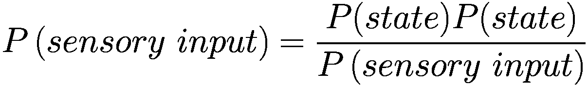
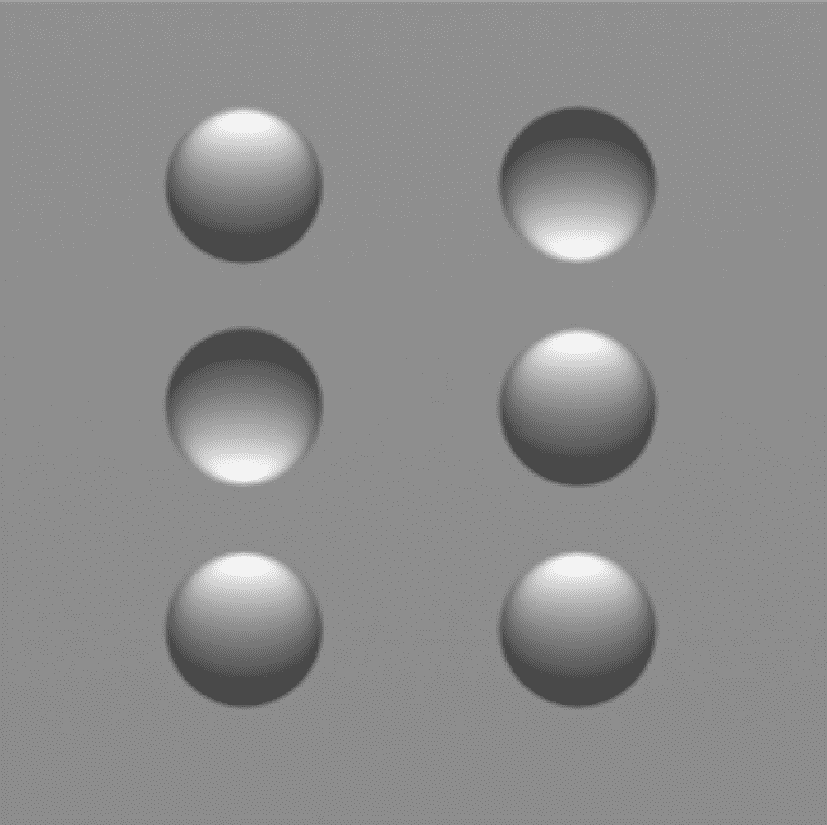

# 13. 吾等之不确定性：人类心智如何应对不确定性

> *“我们只能满足于环境所赋予的神秘、荒谬、矛盾、敌意，以及慷慨。这并不算多，但总比偏执狂那致命且挫败的确定性要好。”*
>
> ——菲利普·K·迪克

不确定性是生命中如此重要的一部分，以至于我们的大脑和心智在数百万年的进化中已对其适应。在我们生命的大部分时间里，我们的许多思想和决策都受到不确定性的影响，或是对不确定性的回应。

不确定性可能发生在不同层面和时间尺度上。我们可能会面对未来一小时内可能发生的事件的不确定性（例如，会下雨吗？），或者面对未来数年才会展开的事件的不确定性（例如，如果我搬到另一个城市，生活会不会更好？）。我们既会面对自己能够控制的事物（如我们的决策）的不确定性，也会面对完全超出我们控制范围的事物的不确定性。

不确定性是压力的一个主要来源。这是医学文献中有充分记载的事实。^(¹³⁵) “认知恐惧”一词描述的是一种现象，即对某事件的预期本身可能比该事件本身更糟糕。在 2013 年的一项研究中，^(¹³⁶) 研究人员让受试者面临两难选择。他们可以选择立即遭受真实的痛苦刺激（如电击），或者选择未来可能发生的痛苦事件（如去看牙医）。绝大多数受试者更愿意立即体验痛苦，而不是将其推迟。仅仅是对未来痛苦的预期，实际上可能比痛苦本身更令人不安。我们宁愿现在就承受确定的不适，也不愿将其推迟到未来。这就像那句经典格言：有时候，你必须果断撕掉膏药（或创可贴）。

在 2016 年进行的另一项实验中，^(¹³⁷) 伦敦大学学院的研究人员发现，受到电击的可能性很小，比肯定会受到电击要明显更具压力。该实验涉及 45 名受试者，他们玩一种电脑游戏，目标是要翻开石头并猜测下面是否有蛇。如果石头下面有蛇，受试者就会受到轻微电击。

找到蛇的概率取决于石头的类型。受试者最终学会了模式，但随着游戏的进行，模式又发生了变化。这造成了一种不确定性的状况，由实验人员控制。他们通过要求参与者报告压力水平，以及测量瞳孔扩张和出汗情况（两种常见的压力反应指标）来追踪压力。受电击的可能性为 100%的情况，比有 50%的可能性*可能*会受到电击的情况要好。压力与不确定性直接相关。

像这样简单而巧妙的实验清楚地表明，我们的大脑天生就会对不确定性做出反应。减少不确定性也可以成为一种动力。1975 年，查尔斯·伯格和理查德·卡拉布雷塞提出了不确定性减少理论，^(¹³⁸) 该理论应用于沟通领域。根据该理论，不确定性会导致认知困扰，因此当两个人见面时，他们会寻求关于对方的信息，以减少对对方认知状态和行为的不确定性。

鉴于不确定性是我们生命如此重要的一部分，大自然赋予了我们以不同方式应对不确定性的机制。认知科学和脑科学最近发现了许多我们心智和大脑应对不确定性的迷人方式，这些方式对我们生活和社会产生了深远的影响。

## 不确定性及我们的心智

> *“我们那令人欣慰的‘世界是有意义的’信念，建立在一个稳固的基础之上：我们几乎无限的能力去忽视我们的无知。”*
>
> ——丹尼尔·卡尼曼，《思考，快与慢》

在不确定性背景下，最具影响力的心理学家可能是丹尼尔·卡尼曼（1934–）和阿莫斯·特沃斯基（1937–1996）。卡尼曼和特沃斯基研究了人们做决策的方式，并在此过程中重塑了我们关于人类如何得出结论、如何为未来做出选择的一些长期持有的信念。

卡尼曼和特沃斯基于 20 世纪 60 年代开始合作，当时两人都是耶路撒冷希伯来大学的教授。在接下来的十年里，他们进行了一系列实验，最终形成了“前景理论”。1979 年，他们在享有盛誉的期刊《计量经济学》上发表了一篇论文，题为“前景理论：风险决策分析”。^(¹³⁹) 这篇论文被引用了超过 54000 次。在这篇论文中，他们从根本上摧毁了经济学中旧的决策范式。他们的工作被认为是行为经济学领域的开创性论文。

在此之前，决策理论是规范性的。它们假设人们会根据预期效用做出理性决策。卡尼曼和特沃斯基的目标是提出一种能够描述人们*实际*如何做决策的理论——而不是如果遵循某种理性观念，他们*应该*如何做决策。

卡尼曼和特沃斯基的主要观察结果是，人们可能会以不同方式对待损失和收益，这取决于问题是如何提出的，即使其数学期望相同。假设有人向你提出以下问题。你有两个选择：

*   选择 A：有 50%的机会赚 200 美元，或 50%的机会一无所获。
*   选择 B：有 100%的机会赚 100 美元。

从数学角度看，它们是等价的。选择 A 的期望值是 100 美元。然而，大多数人表现出风险规避行为，会更喜欢选择 B 而非选择 A。

现在假设有人向你提出以下选择：

*   选择 A：有 50%的机会损失 200 美元，或 50%的机会损失 0 美元。
*   选择 B：有 100%的机会损失 100 美元。

在这种情况下，人们更有可能选择 A。然而，从数学角度看，选择 A 和选择 B 具有相同的期望值。

人类倾向于风险规避在当时是众所周知的事实。然而，卡尼曼和特沃斯基还发现了所谓的“不变性失效”。改变提问的方式也会改变结果，尽管数学表达式是相同的。当我们面临不确定的损失时，人们会转向风险寻求行为。

这对现实世界中的决策具有巨大影响。卡尼曼和特沃斯基^(¹⁴⁰) 提出了以下问题。想象一下，某种疾病在某社区爆发，预计将导致 600 人死亡。你面临两个方案之间的选择：

*   方案 A：200 人将获救。
*   方案 B：有 1/3 的概率所有人都会获救，有 2/3 的概率无人获救。

大多数人（在原始研究中占 72%）选择了方案 A，这是一种风险规避行为。卡尼曼和特沃斯基随后要求受试者在以下两个方案之间做出选择：

*   方案 C：600 人中有 400 人会死亡。
*   方案 D：有 1/3 的概率无人死亡，有 2/3 的概率所有人都会死亡。

这两个方案与之前的方案完全相同，只是以损失而非收益的方式来表述。在这种情况下，大部分受试者（78%）选择了方案 D。仅仅通过改变提问的方式，他们将风险规避的受试者变成了风险寻求者。

这种表现与人们在此之前一直秉持的假设——认为人类遵循严格理性——并不一致。此外，人们并非风险厌恶，而是损失厌恶。特沃斯基写道：“与其说人们讨厌不确定性，不如说他们讨厌损失。”

问题的核心在于，现实世界是复杂的。我们的心智与认知能力有限，且常常需要快速做出决策。为了节省资源，大脑会采用启发式策略，而这作为副作用，会在决策中产生偏见。在 1974 年发表于《科学》杂志的一篇题为《不确定性下的判断：启发式与偏见》的文章中，特沃斯基和卡尼曼描述了人类在面对不确定性时，如何利用各种启发式方法来快速作出决策^(¹⁴¹)。

其中一种启发式方法是代表性启发。当人们被问及某件事的概率时，他们可能会忽略基础概率。卡尼曼和特沃斯基进行了一项实验，向受试者提出了以下问题：

*   “汤姆·W. 智商很高，但缺乏真正的创造力。他需要秩序与清晰，喜欢整洁有序的系统，每个细节都各得其所。他的文章相当枯燥刻板，偶尔被一些低级的双关语和科幻式的想象火花所点缀。他有很强的能力驱动力。他似乎对他人的感受漠不关心，也不喜欢与人交往。他虽以自我为中心，却有深刻的道德感。”

然后，他们询问受试者，汤姆是大学里九个主要专业之一的概率是多少。大多数受试者认为汤姆很可能是工程系的学生，尽管工程系学生在该大学中是少数。受试者忽略了某人属于工程系学生的先验概率很小这一事实，本质上是未能正确应用贝叶斯定理。简而言之，我们基于刻板印象做出仓促判断。

他们发现的另一种启发式方法是可得性启发。快速思考——英语中，首字母是 K 的单词多，还是第三个字母是 K 的单词多？大多数人会说首字母是 K 的单词更多，即单词开头的 K，而事实上后者更多。发生这种情况的原因是，回忆以 K 开头的单词比回忆 K 在中间位置的单词更容易。

最后，还有一种被销售人员和营销团队广泛采用的启发式方法，称为锚定效应。一件商品从 200 美元降至 100 美元，打五折，看起来比从 120 美元降至 100 美元的打折更具吸引力。当销售人员谈判价格时，他们希望从一个高价开始，这样任何折扣最终对买家来说都显得划算。锚定效应甚至可以在毫无关联的事物之间发挥作用。卡尼曼和特沃斯基让受试者猜测非洲国家在所有国家中所占的百分比。然而，在提问之前，参与者观察了一轮轮盘赌游戏，该游戏被设定为停在 10 或 65。轮盘赌的结果足以改变他们的估计，看到 10 的人报告的比例低于看到 65 的人。

1961 年，丹尼尔·埃尔斯伯格提出，人类具有模糊厌恶的特征，^(¹⁴²)这一点后来得到了卡尼曼和特沃斯基的证实。简而言之，人们就是不喜欢不确定性。然而，正如卡尼曼和特沃斯基所发现的，我们运用各种规则和策略来应对不确定性，这使得人类行为模式比任何人之前预期的都要复杂。卡尼曼提出，我们的大脑通过两个不同的系统运作：^(¹⁴³)系统 1（快速模式）和系统 2（缓慢模式）。系统 1 效率高，但广泛使用启发式和偏见，因此常常会出错。系统 2 缓慢且有意识，因此更准确，但效率低下。系统 1 是我们的自动驾驶系统，也是我们一天中大部分时间（例如，下班开车回家时）的默认模式，但当需要时，我们会切换至系统 2 进行思考。

这些演化而来的启发式与偏见常被以负面角度描述，但它们是数百万年进化的结果，在许多其他需要快速决策至关重要的情境中，它们能很好地服务于我们，甚至拯救我们的生命。只是有时，它们也会成为糟糕决策的根源。

尽管卡尼曼和特沃斯基的研究涉及经济学，但显而易见，不确定性在我们大脑的运作方式中扮演着关键角色。这对社会和经济都具有重大影响。丹尼尔·卡尼曼在其著作《思考，快与慢》中描述了企业家如何是“妄想型的乐观主义者”。面对不确定性，企业家天性地相信未来会比实际更好。有时候，有点妄想也许是件好事。

该领域最重要的研究者之一是理查德·塞勒，他也因对行为经济学的贡献于 2017 年获得了诺贝尔经济学奖。在他 2008 年出版的《助推》一书中，他概述了自己的愿景：如何利用这些启发式与偏见，在无意识中引导公民朝着期望的行为改变。例如，大多数人会选择任何选项中的默认项。在默认选项是死后成为器官捐献者的国家，其捐献者数量多于那些必须明确声明愿意成为器官捐献者的国家。因此，通过将捐献设置为默认选项，一个国家可以轻松增加可移植器官的供应量。这正是英国政府在 2020 年实施的政策。

需要记住的重要一点是，即使不确定性不是核心主题，它也能通过对其心智与生物学其他方面的间接影响，对我们的生命产生巨大影响。

另一套关于心智运作方式的理论认为，我们的认知系统遵循贝叶斯推断原理运作。该领域一些最杰出的研究者是汤姆·格里菲思、约什·特南鲍姆、尼克·查特和查尔斯·肯普。然而，相关的理论早在 19 世纪 60 年代就由赫尔曼·亥姆霍兹（1821–1894）提出。那么，我们究竟如何在认知中运用贝叶斯定理呢？贝叶斯定理提供了一种将先验知识与新数据结合的方法。假设你在打网球，看到球朝你飞来。根据你的经验，你对球通常落在哪里有一些先验知识。这也会受到你对对手的了解以及对手在场上的位置的影响。

在你对手击球后，你的大脑开始收集关于球实际轨迹的数据。你将之前关于球最有可能落点的所有先验信息，与当前轨迹的更新相结合，随着每一刻的流逝，构建出越来越准确的估计。这可以很容易地用贝叶斯公式来描述：

```math
P(A|B) = \frac{P(B|A) \cdot P(A)}{P(B)}
```

# 贝叶斯认知与自由能原理



有证据表明，我们的认知系统正是以这种方式整合感官信息的^((144))。这一点在视错觉中很容易看到，例如图 13-1 中的错觉。如果你和大多数人一样，你会看到四个凸起和两个凹陷。通常光源（例如太阳）位于我们上方，因此我们对这一假设有很强的先验。每个圆形，如你所见，顶部或底部都涂有阴影区域。如果阴影区域在底部，那么圆形看起来像凸起，因为这样可以解释阴影。如果阴影区域在顶部，那么圆形被视为凹陷，因为只有这样才能解释来自上方光源的阴影的存在。如果你将图像倒转，你会看到四个凹陷和两个凸起，这与之前的模式相反。



六个带有不同位置阴影的球体视错觉图像，排列成 2 列 3 行。

**图 13-1** 形状与阴影错觉^((145))

我们大脑如何生成我们对世界版本的另一个好例子是*空想性错视*（`pareidolia`）。空想性错视描述了在模糊的视觉输入中看到熟悉模式的现象，例如在云中观察到人脸。

这个领域有很多出版物，但也不乏批评者。对认知的贝叶斯解释的主要批评是，仅仅因为贝叶斯定理和模型可以解释实验结果，并不意味着我们的思维必然以这种方式运作。正如乔什·霍根（Josh Horgan）在《科学美国人》（*Scientific American*）的一篇文章中所写：

> “此外，贝叶斯大脑的论点可以归结为一个可疑的三段论：我们的大脑擅长某些任务。贝叶斯程序擅长类似的任务。因此，我们的大脑采用了贝叶斯程序。”

虽然关于贝叶斯方法在认知建模中合理性的争论可能永无止境，但最近出现了一种新理论，它解释了我们的大脑和其他生物系统如何在不确定性下做出推理和决策。这就是弗里斯顿的“自由能原理”。卡尔·弗里斯顿（Karl Friston）是伦敦大学学院的神经科学家，同时也是（在撰写本文时）世界上被引用次数最多的神经科学家。

贝叶斯认知理论解释的一个迷人之处在于，我们的大脑并非不确定性下的简单被动观察者。相反，我们的大脑遵循一个生成模型。在图 13-1 所示的错觉中，你的大脑并非被动地记录信息，你也不必花大量时间去思考这个错觉。你的大脑对圆形和阴影做出了非常快速的解释。你正在生成一个世界的版本，主动解释结果。

弗里斯顿将这一点向前推进了一步。他认为，最小化不确定性本质上是所有生命的目标。他的自由能原理将不确定性置于所有智能行为的中心。弗里斯顿将该原理建立在一些基本假设之上。所有生物有机体都倾向于抵抗无序，为了做到这一点，它们必须将感官输入与对世界的预测相匹配。有两种方法可以做到这一点——要么更新关于预测的理论（即对世界有何期望），要么采取行动以最小化意外。术语“自由能”源于对问题的贝叶斯处理。自由能是对不确定性的贝叶斯量化，衡量生物体的预期与其接收的感官输入之间的差异。大脑（进而思维）在生成关于世界的理论方面扮演着积极角色，同时也影响世界。

这是对该理论非常高层次、宽泛的解释。弗里斯顿关于这一理论的著作跨越了十多年，并且可能显得深奥而难以理解，因为它结合了从神经科学到贝叶斯统计学等多个不同领域的概念。弗里斯顿还将其理论推广为对所有与大脑和思维相关现象的解释，从神经递质的功能到情绪障碍^((146))。有很多人表示无法理解他的著作。例如，在一份研究摘要中，彼得·弗里德（Peter Freed）写道^((147))：

> “在哥伦比亚大学的精神病学系，我最近带领了一个由 15 名 PET 和 fMRI^((148))研究人员组成的期刊俱乐部，这些人都是博士和医学博士，我们之间拥有超过 1000 万美元的美国国立卫生研究院（NIH）^((149))资助，我们试图理解弗里斯顿 2010 年发表在《自然评论·神经科学》（*Nature Reviews Neuroscience*）上的论文——长达一个半小时。房间里充满了数学知识：三位统计学家、两位物理学家、一位物理化学家、一位核物理学家和一大群神经影像学家——但显然我们不具备所需的水平。我与一位普林斯顿大学的物理学家、一位斯坦福大学的神经生理学家、一位冷泉港实验室的神经生物学家讨论了这篇论文。结果又是一脸茫然，无一例外。”

甚至有一个推特账户在模仿理解该理论的难度^((150))。无论弗里斯顿的理论最终是否被证明是脑与思维科学中的主导范式，它都清楚地表明了一点：不确定性是我们存在的核心，即使我们没有意识到，我们的行为和身体功能，直至神经递质的微观层面，都受到不确定性在漫长岁月中影响的冲击。弗里斯顿的理论将不确定性视为宇宙中原始力量之一，并置于我们存在的中心。

# 不确定性与我们的大脑

> “我认为生活中很多事情只是随机发生，很大程度上，事后我们编造一个故事使其看起来合情合理。我们都喜欢简单的故事，暗示着生活事件之间存在因果关系。然而，随机性无处不在。”
> —迈克尔·S·加扎尼加

决策塑造了我们的思维方式，但这在大脑中是如何体现的呢？我们大脑的基本沟通机制是`神经递质`。`神经递质`是通过化学脉冲从一个神经元传递到另一个神经元的化学物质。从身体运动到情绪感受，`神经递质`在我们所做的一切事情中都扮演着角色。

## 神经递质与不确定性

对认知而言最重要的`神经递质`之一是`多巴胺`。`多巴胺`在奖励机制中扮演着巨大作用。`纹状体`是大脑内部的一个结构，常被称为大脑的“奖励中枢”。它接收来自大脑许多其他部位的信息，涉及动机、决策和规划。对于物质成瘾或行为成瘾（如赌博）的人来说，每次他们屈服于成瘾冲动时，`纹状体`就会充满`多巴胺`。

最近发现，`纹状体`还执行着另一项重要功能。它不仅奖励某些行为，还会计算后果的概率。^(¹⁵¹) 当几率接近 50%时，`纹状体`的激活程度最高。也就是说，在好结果与坏结果之间的不确定性达到最大时。这已被发现是赌博成瘾的一个关键机制。赌博成瘾者对不确定性所释放的`多巴胺`非常敏感。^(¹⁵²) 我们的大脑天生就对不确定性做出反应，而赌博是对大脑的一种“黑客攻击”，对于那些大脑天生敏感的人来说，这可能是灾难性的。

然而，`多巴胺`只是其中一部分，因为还有其他`神经递质`参与处理不确定性。在 2016 年发表在《PLOS》期刊上的一篇研究论文中，^(¹⁵³) 伦敦大学学院的研究人员发现，除了`多巴胺`之外，`神经递质`去甲肾上腺素和乙酰胆碱在不确定性下的决策中也扮演着关键角色。去甲肾上腺素调节我们对环境不稳定程度的估计，而乙酰胆碱则平衡对事件归因于偶然性的倾向。`多巴胺`的作用是推动我们基于对不确定性的信念采取行动。其他研究也表明，`神经递质`去甲肾上腺素作为意外不确定性的信号，在不确定性中发挥着重要作用。^(¹⁵⁴)

## 大脑学习与偏侧化

耶鲁大学的研究人员发现，在涉及不确定性的情境下，我们的大脑会更活跃，并成为更好的学习者。^(¹⁵⁵) 如果我们的大脑*一直*在学习，那么我们将面临两个不利后果。首先，我们的大脑会吸收各种错误信息和虚假关联。仅仅因为火车晚点了一次，并不意味着你必须记住它永远会晚点。其次，我们会消耗超出所需的资源。正如启发式和偏差研究所证明的，人类大脑只在必要时才会消耗更多资源，对于大多数问题，它会诉诸“快速思考模式”。因此，知道何时该学习、何时不该学习至关重要。

耶鲁大学的研究表明，当面对不确定性时，学习能力会提高。从进化角度来看，这也说得通，因为此时获得回报的几率更高。高不确定性的情况通常给我们呈现一个两难困境：要么是潜在巨大收益，要么是潜在巨大损失。学会区分这两者，对于早期人类来说可能意味着生死攸关。

甚至我们大脑的两个半球——左脑和右脑——也被发现根据它们处理不确定性和模糊性的方式而有所专长。自迈克尔·加扎尼加（1939 年出生）和罗杰·斯佩里（1913-1994 年）的开创性研究以来，众所周知，每个大脑半球执行不同的功能。加扎尼加和斯佩里在 20 世纪 60 年代和 70 年代研究了患有裂脑综合征的患者。在裂脑综合征中，连接两个半球的`胼胝体`被切断了。在各种实验中，患者表现出仿佛身体里有两个自我的行为。

例如，当年轻患者保罗·S 被问及他的右半球长大后想做什么时，他回答“赛车手”，但左半球回答“绘图员”。另一名患者用一只手（由一个半球控制）拉下裤子，而另一只手（由另一个半球控制）则在拉起裤子。类似地，还有一名患者试图用一只手勒死他的妻子，而另一只手则试图阻止他这样做。在流行文化中，我们认为右半球更具表现力、艺术性和整体性，而左半球则更理性，是语言的中心。虽然这是一个简洁的简化说法，但并非完全不准确。

左半球专注于消除不确定性，而右半球则专注于解决不一致性。左半球讨厌不确定性，会编造任何解释来合理化所发生的事情。在一个著名实验中，^(¹⁵⁶) 向一名裂脑综合征患者展示了两张不同的图像。左半球看到了一只鸡爪的图像，右半球看到了雪花的图像。然后要求他用每一只手选择与所展示图像配对的图片。他用左手（由右半球控制）选择了一把铲子，与雪景相匹配；用右手（由左半球控制）选择了一只鸡，与鸡爪相匹配。

当实验者问他为什么用右手选择铲子时，控制语言的左半球无法获取右半球看到雪的信息。左半球编造了一个解释，说选择铲子是为了清理鸡舍。在类似的实验中，展示了左半球会如何为了消除不确定性而编造任何解释。

右半球似乎负责检测理论之间的不一致性。在一系列实验中，左半球可以做出快速推断并固守其中，即使它是错误的。^(¹⁵⁷) 检测不一致性并修正关于世界的假设是右半球的工作。以最佳方式处理不确定性需要两个半球之间保持平衡。

## 不确定性、偏执与社会体系

不确定性也出现在我们大脑的其他地方，比如导致功能衰弱的偏执型精神分裂症。偏执型患者饱受错误信念的折磨。想想你每天做的许多事情有多少是基于对环境的内隐信念。例如，你相信你的配偶没有在密谋反对你。你假设政府提供的公共服务，至少在原则上，是以公民的最大利益为出发点的（除非你生活在威权政权下）。你相信你的商业伙伴没有试图在背后捅你一刀。你相信你所居住的城市地下有污水系统在运行，即使你从未见过它；你还相信除了你居住的大陆之外还有其他大陆，即使你从未亲自去过那里。你也相信龙是虚构的生物，只存在于奇幻书籍中。

对于患有偏执症的人而言，上述这些信念中的一部分或全部会与你截然不同。其他人可能图谋不轨，政府被心怀恶意的非人实体所控制，而其他大洲根本不存在——这一切不过是一场企图控制我们生活的巨大阴谋。最后，龙确实是存在的，只是被某个邪恶的巫师转移到了另一个维度。

这一切与不确定性有何关联？简单来说，对于大多数事情，你永远无法百分之百确定。你之所以相信存在其他大洲，仅仅是因为有人告诉你如此，而这个人是一位权威人物（比如你的父母）。这一信念又被其他权威来源（例如老师）进一步强化。你往往在无意识中运用了多重线索，从而得出这一信息是正确的结论。然而，严格来说，在这一过程中，针对其可靠性可以提出诸多反驳。

你在之前的章节中已经看到，如何证实和证伪假设从古至今一直困扰着哲学家和科学家。在类似上述情境时，大多数人会本能地使用奥卡姆剃刀原则。你所获得的信息是正确的，因为假定其错误会要求你做出许多过于复杂的假设。但对于偏执的人而言却并非如此。对他们来说，存在一个涉及数千人的复杂阴谋以掩盖亚特兰蒂斯存在的理论，比简单地假设这些人没有任何动机或理由去做这件事更可信。

对于我们大多数人来说，大多数时候，我们的大脑无需过多思考便能自动解决不确定的情景。但有些人会固执于错误的事情。

研究发现，`神经递质``多巴胺`在这一过程中再次扮演了重要角色。`多巴胺`决定了我们将注意力集中在何处，以及故事中的哪些细节更为突出。`多巴胺`功能失调会导致妄想，包括偏执。报纸上的文章可能看似隐藏着重要信息，而我们周围的人也不再是原本的那个人，而是机器人冒充者。在一篇关于妄想神经生理学的论文中，耶鲁大学的`Corlett`等人写道：

> “[……] 妄想（及其神经递质基础）代表了一种未能正确编码预测和预测误差精确性的失败；换言之，是一种未能优化感官信息不确定性的失败。[……] 妄想的病理生理学涉及对显著性、不确定性、新颖性或精确性（数学上，精确性是不确定性的倒数）的错误表征。”

从我们的大脑到我们的社会，一切都在与不确定性的对抗中被塑造。当那些经过数百万年生物进化而形成的系统和谐运作时，我们便会繁荣发展。而当它们失调时，后果可能非常严重。

我们的社会体系也是如此。社会在很大程度上是为了应对自然强加给我们的各种不确定性而创造的——从我们下一顿饭从何而来，到保护自己免受敌意和自然灾害的侵害。当我们步入 21 世纪，我们控制不确定性的工具——无论是通过预测还是通过其他类型的工程（例如控制风险的金融工具）——正变得越来越精密。你在下一章中学到的技术，将呈现许多基于不确定性的产品（如金融工具）的下一阶段演变。

脚注 1 2 3 4 5 6 7 8 9 10 11 12 13 14 15 16 17 18 19 20 21 22 23 24

