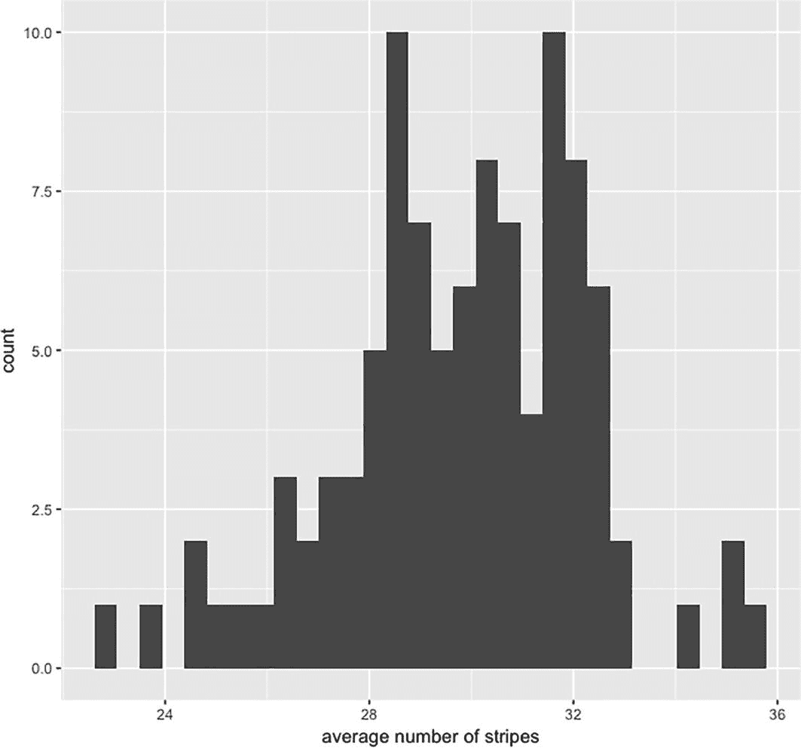
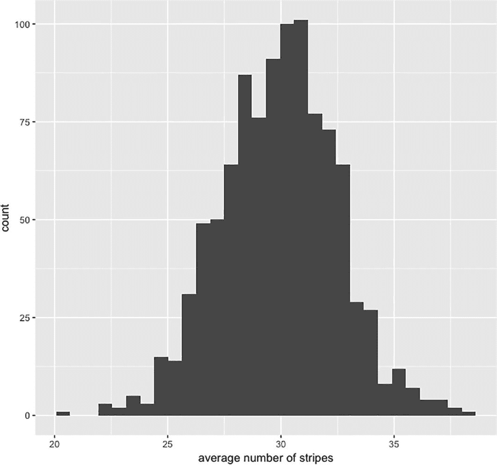
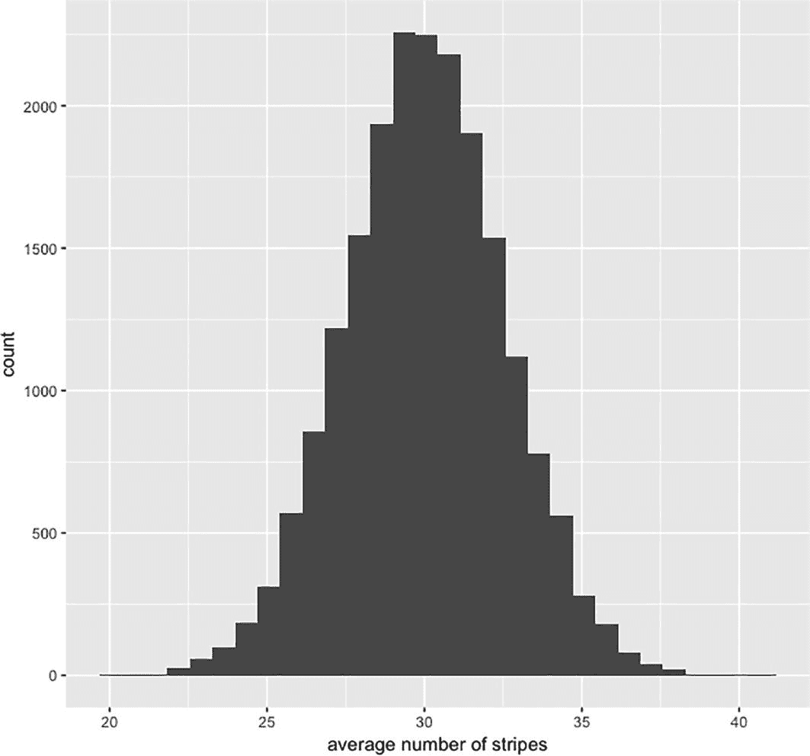
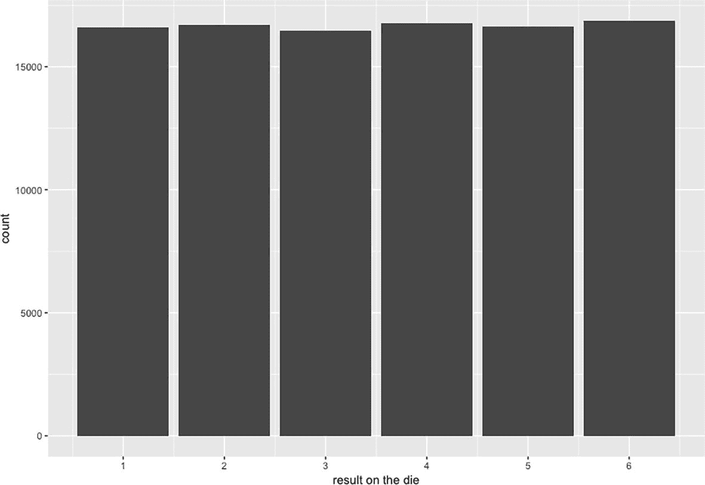
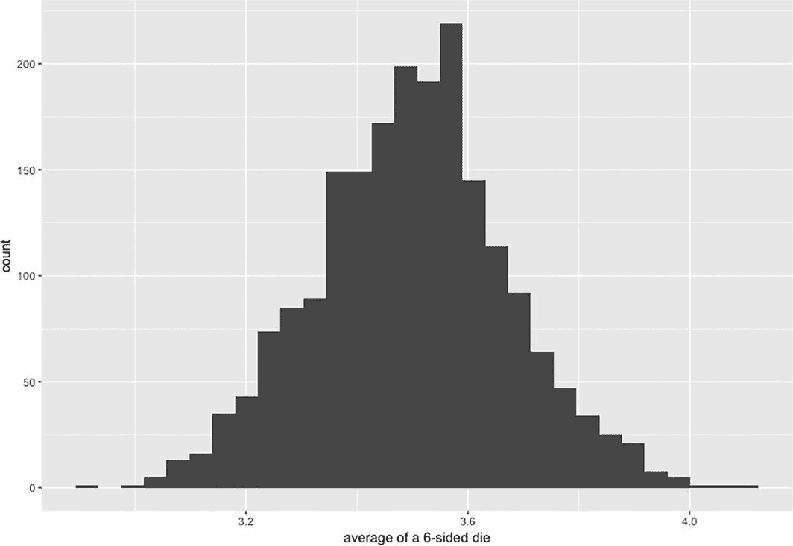

# 赌徒破产、切比雪夫不等式与中心极限定理

然而，如果我们对这个问题稍作改变，会怎么样？如果你们两人的财富并不相等，而你的对手拥有无限的财富呢？此外，规则是你不会拿走对手所有的钱，你只能拿回你所投入金额的两倍。所以，如果你花 10 美元并获胜，你将拿回 20 美元。这听起来不错。如果你足够幸运，你可能会变得富有，对吧？你每轮有 50%的获胜几率，而你的对手拥有无限的资源，所以理论上你可以赢很多钱。

嗯，不幸的是，事实并非如此。有一个著名的定理叫做“赌徒破产定理”。根据这个定理，在一个公平的游戏中，一个玩家与拥有无限资源的对手对抗，在大量尝试后，该玩家最终会输得精光。在这种情况下，赌场就是那个拥有无限资源的玩家。赌场不在乎任何一个单独的玩家。只要它积累越来越多的游戏，它就会获胜。

但这与不确定性有什么关系呢？赌博是一种随机现象。我们无法确定单次尝试的结果。然而，在适当的条件下，我们可以将不确定性控制到如此程度，以至于单次尝试的结果完全无关紧要。

这个赌博的例子是我们与不确定性斗争历史中的核心主题之一。没有单一的方法或途径。有多种方法。当数学家试图解决这个问题时，他们提出的最佳方法之一是极限和界限的概念。什么是极限？你在我们之前讨论抛硬币实验时已经看到了一个例子。单次抛掷的结果是无法预测的。然而，大量抛掷具有一些明确定义的性质。这些性质随着抛硬币实验趋近于无限次尝试的极限而显现出来。概率论中极限计算的概念基于这样一种直觉：大量重复将清除白噪声，并允许有用的模式浮现出来。

界限的概念在概率论中极其有用。当处理一个具有不确定性的量时，我们通常无法知道该量的值会是什么样的。然而，我们可以知道某种边界，该值不能超过这个边界。如果我让你猜我邻居女儿的年龄，你无法做出准确的预测，尤其是如果我没有告诉你她的年龄（例如，她是 5 岁还是 45 岁？）。但如果我让你给我一个她身高的上限，而你告诉我一个像三米这样的数字，那么你的答案将是百分之百正确的。

使用界限的最古老的定理之一是“切比雪夫不等式”。帕夫努季·利沃维奇·切比雪夫（1821–1894）是一位俄罗斯数学家，他被认为是俄罗斯数学的奠基人之一。他也是著名数学家安德雷·马尔可夫的老师。切比雪夫不等式理论为我们提供了随机变量概率的所谓上界。数学中的界限就像上限和下限阈值。上界充当天花板，下界充当地板。一个值不能高于上界或低于下界。界限是通过告诉我们我们可以预期的合理值——并划定不会出现的值——来控制不确定性的一种方法。当然，知道最可能的值会更加有用，但有时我们只能利用已有的信息。

回到切比雪夫不等式，让我们看一个简单的例子。假设我们正在研究一个拥有 1 亿人口的国家的人均收入，该国的平均收入为 45,000 美元，标准差为 20,000 美元。我们观察到某人收入超过 100,000 美元的概率是多少？使用切比雪夫不等式，对于这个例子，我们会发现概率最多为 20%。

切比雪夫不等式被用来证明弱大数定律。如果你能获得总体的均值和标准差信息，你就可以大致了解观察到非常高或非常低值的可能性。这适用于自然界中的任何类型的问题，并且你不需要具备关于该问题或数据的任何其他知识。

这是数学家处理不确定性方式的一个典型例子。在关于某物的信息有限的情况下，你能提取出多少额外的知识？你能从从自然中艰难获取的任何信息碎片中减少多少不确定性？发现界限是一种方法，而切比雪夫是最早发展出这种方法的数学家之一。在切比雪夫之后，还有其他数学家提出了针对各种不同问题的界限定理。

可以说，最著名且影响深远的定理是中心极限定理，我之前简要提到过。第一个触及这个主题的是法国数学家亚伯拉罕·棣莫弗（1667–1754）。他利用正态分布来寻找多次抛掷硬币所得正面朝上的次数。不幸的是，他的概念从未流行起来，并且很快就被遗忘了。

中心极限定理的原始表述归功于拉普拉斯。拉普拉斯的部分工作涉及天文学。例如，他试图解决的问题之一是计算流星倾角之和的分布。他面临着测量结果与他试图捕捉的理论均值之间的偏差这一挑战。关于这项工作的记录早在 1776 年就已存在。拉普拉斯在 1810 年证明了该定理。然而，中心极限定理的最新证明要归功于俄罗斯数学家亚历山大·李雅普诺夫（1857–1918）。

那么，中心极限定理是什么？该定理指出，均值的抽样分布服从正态分布，其均值等于总体`μ`，方差为`σ / √n`。对于非统计学家来说，这（可以理解）可能有点深奥，但它是统计学中最有用的定律之一；让我们看看为什么。

你需要理解的第一件事是抽样分布的概念。假设你对某个数量感兴趣。例如，你关心找出英格兰所有男性的平均身高。或者你关心找出一个城市的平均收入。或者你关心找出斑马的平均数量。

如果你是一个拥有无限资源的人，你就可以找到你研究范围内的每一个个体，然后计算平均值。如果你这样做了，你就会得到真实的总体均值`μ`。但你不太可能拥有无限资源——谁有呢？而且，统计学的整个前提是，你可以通过仅采集一个样本（`sample`）来了解某个人群。你不必接触到英格兰的每一个人，或者世界上的每一只斑马，只需收集一个包含 1,000 个受试者的样本即可。

到目前为止一切顺利。假设还有另一位斑马或英格兰男性身高的爱好者，他做了完全相同的研究。这个人也收集了一个包含 1,000 个受试者的样本。这两个样本会完全相同吗？嗯，不会。样本会有些不同。

让我们聚焦于斑马的例子——比如一个样本显示每只斑马的平均条纹数量是 24 条，而另一个样本显示是 28 条。哪个才是正确的呢？事实上，它们既对又错。当我们从总体中抽取样本时，我们知道每次都会得到不同的结果。总体参数的真实值就在其中某个位置，但我们无法 100%确定其精确数值。而当我们在统计学中无法确定某事时，更倾向于使用概率分布——于是中心极限定理登场了。

24 和 28 这些数值是样本均值，而非总体均值。但我们希望从样本均值推断出总体均值。中心极限定理正是帮助我们实现这一点的工具。假设全球有 100 位不同的研究人员重复这项斑马研究，每位研究者各抽取 1000 只斑马的样本并计算样本均值，他们的结果会是什么样？你可以在图 5-6 中看到。

一幅展示“频数”与“平均条纹数量”关系的直方图呈现波动趋势。最高柱状图位于(28.5, 10)和(31.5, 10)处。数值为近似值。

**图 5-6** 斑马平均条纹数量的抽样分布

从这个直方图可以看出，有些研究者得出的均值低于 24，有些则高于 34。如果这项研究由 1000 位研究者进行呢？那么抽样分布将如图 5-7 所示。

一幅展示“频数”与“平均条纹数量”关系的直方图呈现钟形趋势。最高点大约在(30.5, 110)处。

**图 5-7** 1000 个样本的抽样分布

如果我们收集 10000 个样本呢？那么它会如图 5-8 所示。

一幅展示“频数”与“平均条纹数量”关系的直方图呈现钟形趋势。最高点大约在(29.5, 2250)处。

**图 5-8** 10000 个样本的抽样分布

希望你能看到这里出现的规律：我们收集的样本越多，这个分布就越集中。不确定性逐渐被抹平，我们越来越接近总体均值。中心极限定理告诉我们，估计值周围的方差（衡量不确定性的指标）与样本容量的平方成反比。

值得注意的是，在使用中心极限定理时，这种关系成立与否与底层现象实际服从的分布无关。这正是其强大之处，也解释了为什么正态分布在物理科学和工程学的许多情境中都会出现。

例如，假设我们想计算掷一次六面骰子的均值。六面骰子是服从离散均匀分布现象的典型例子：掷出六点的概率与掷出一点的概率相同。然而，当我们进行多次投掷时，抽样分布的形状将与图 5-8 类似——它会呈现正态分布，而非均匀分布。

在图 5-9 中，你可以看到六面骰子投掷 10000 次后的结果分布。所有结果出现的次数大致相等。

一幅展示“频数”与“骰子结果”关系的柱状图包含以下数据：1，16500；2，16600；3，16400；4，16600；5，16500；6，16700。数值为近似值。

**图 5-9** 六面骰子投掷 10000 次后的结果分布

但当我们绘制每组样本均值的分布图时，会得到图 5-10 的结果：一个以 3.5 为中心的正态分布——这正是六面骰子的真实均值。

一幅展示“频数”与“六面骰子均值”关系的直方图呈现钟形趋势。最高点大约在(3.55, 220)处。

**图 5-10** 六面骰子投掷 10000 次后的平均值

如你所见，在中心极限定理面前，斑马和骰子的共同点可能比你最初想象的更多。

中心极限定理在统计学中占据特殊地位。自然界许多过程都是随机的：比如测量花朵的尺寸、彗星的速度或动物的大小。这些过程可能遵循不同的规律和分布。但当我们研究这些过程的平均值时，却会得到正态分布。这一结果也解释了为什么高斯分布会出现在如此多的自然过程中——高斯分布之所以也被称为正态分布，正是因其在自然界中的普遍性；而中心极限定理正是其背后的解释。

其次，该定理在众多其他统计模型和假设检验的创建中发挥了重要作用。它使数学运算变得非常便捷——在计算机问世之前，这是一个巨大的优势。

然而，高斯分布作为建模工具的流行，也是导致我们许多模型出错的根源之一。正态分布确实在自然界的许多地方出现，它也是线性回归等一些实用模型的基础。但当你的工具只有一把锤子时，所有东西看起来都像钉子。基于正态分布的模型是我们许多结果出错、模型失效的原因之一。稍后你将了解更多相关内容。

讨论正态分布时，不能不提及两位塑造了我们统计学理解的科学家：阿道夫·雅克·凯特勒（1796–1874）——你之前已看到过他的名言——以及英国统计学家弗朗西斯·高尔顿（1822–1911）。

凯特勒是当时杰出的科学家。他参与创建了英国皇家统计学会和国际统计大会，对比利时一座天文台的建立做出了贡献，还出版了三本关于概率的著作。然而，他最著名的成就是提出了“平均人”的概念（法语*'l'homme moyen'*）。

凯特勒对法国人口进行了全面普查，测量了他能测量的一切——从死亡率到身高、体重、力量、精神疾病等等。他的目标是研究人与人、地区与地区之间的差异是系统性的还是随机性的。

1835 年，他出版了《论人类及其能力的演进》。在这本书中，他描绘了“平均人”的愿景——即当我们计算出所有可以描述人的属性的平均值后呈现的那个人。凯特勒尤其钟爱正态分布，他认为这种分布无处不在。

以当前的统计分析标准来看，凯特勒认为属于正态分布的某些分布实际上并非如此。数学家弗朗西斯·伊西德罗·埃奇沃思（1845–1926）甚至创造了术语“凯特勒主义”来形容这种到处看到正态分布的倾向。

凯特勒的贡献在于：通过测量“平均人”，我们可以更好地研究偏离常态的情况，并理解因果关系。他写道：