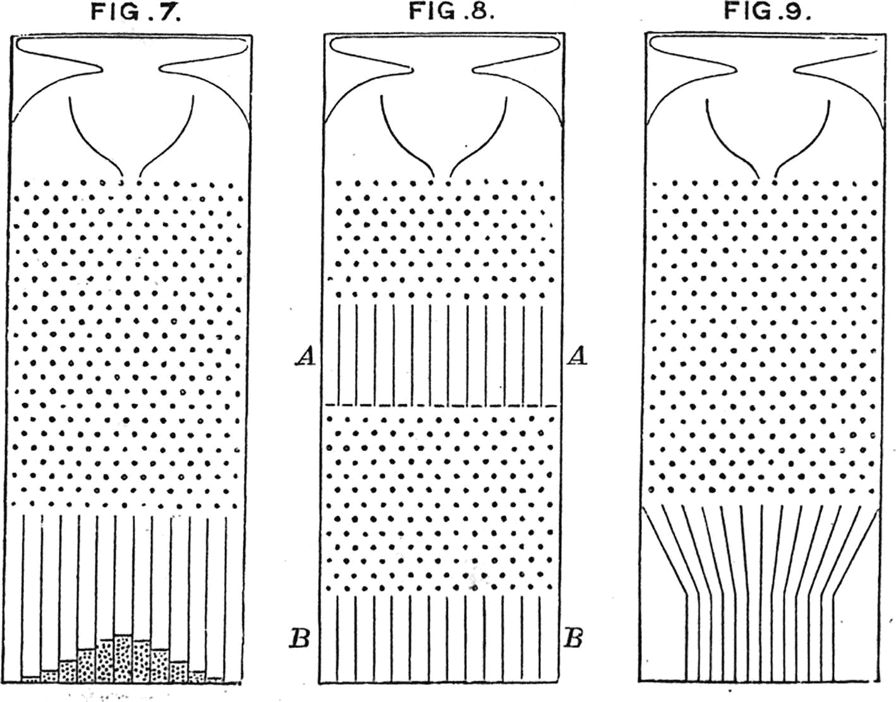

# 排版结果

“首先，我们必须停止孤立地看待人，而应将其视为物种的一个片段。去除其个体性，我们将消除一切偶然因素，特殊性也将被抹去。[……] 这便是我们研究人类物种规律的方式，因为若近距离审视，便会发现规律无从寻觅，我们只会陷入无穷无尽的个体特殊性之中。”

凯特勒将他的分析扩展到与行为和心智相关的其他现象，因此他被广泛誉为社会科学之父。直到今天，社会科学中的统计学在很大程度上仍关注群体中“平均人”的面貌、该群体与其他群体的差异，以及这些差异的成因——这正是凯特勒致力于建立的内容。

“平均人”的概念深深吸引了高尔顿。弗朗西斯·高尔顿爵士是一个有趣的人。他继承了一大笔财富，因此从未像大多数人那样需要“工作”。他是查尔斯·达尔文的表亲，同时也是一位探险家、发明家和科学家。他非常好奇，求知若渴。他设计了一种名为“进取心唤醒机”的装置，通过在脸上泼水让他在晚上 10 点到凌晨 2 点保持清醒，以便他能熬夜学习阅读。他还是一位狂热的旅行家和探险家，曾在非洲待过很长时间。

高尔顿相信，“伟大”是遗传的。他注意到，杰出人物通常是其他杰出人物的后代。高尔顿对理解天赋如何在特定家族中延续很感兴趣。于是，他在 1883 年开创了一个新的研究领域，并将其命名为“优生学”，这一学科后来在二战期间被纳粹所采用。关于高尔顿是否会支持纳粹后来对其理论的运用，存在一些争议。时至今日，高尔顿仍是一位有争议的人物，因为他在统计学领域做出了许多卓越的发现，同时也默许了诸如选择性生育之类的一些观念。

高尔顿在 1866 年至 1869 年间进行了研究，收集证据试图证明天才具有遗传性，并将研究成果发表在《遗传的天才》一书中。据高尔顿称，在英国，能够被称为“杰出”的人与总人口的比例约为 1:4000 或 1:5000。而他称之为“白痴和低能者”的人大约占 1/400，因此人数上超过了杰出个体。

高尔顿还发现，家族中的天才并不会持续太久。在杰出人物的儿子中，只有 36%的人本身是杰出的，而到了孙子辈，这一比例仅为 9%。高尔顿试图解释这一模式，以及数据本身为何似乎遵循正态分布。就好像杰出人物高于平均值，与“白痴和低能者”低于平均值的幅度相同。

如今，高尔顿的研究会因忽视了财富和特权等重要的社会因素而受到批评。考虑到 19 世纪的社会规范，这种忽视并不令人意外。但尽管如此，高尔顿确实发现了“均值回归”的概念，这被证明是统计学中最值得注意的概念之一。这个概念解释了为何一系列极端的短暂观测值会很快回归到类似平均观测值的状态。

一个著名的例子是“《体育画报》封面魔咒”。据说，每当一位运动员登上《体育画报》的封面，其随后的表现就会下滑。这个魔咒非常出名，甚至有自己的维基百科页面。^(²⁶)

这很容易用均值回归来解释。运动员的表现围绕一个平均值波动，有时低于平均值，有时高于平均值。运动员完全有可能在一段时间内打出几场精彩的好球。如果发生这种情况，这位运动员就很有可能成为《体育画报》的封面明星。然而，这位运动员不太可能无限期地保持其最佳表现的标准。因此，所谓的诅咒仅仅是表现回归到平均水平。

高尔顿通过一个精巧的装置研究了这一点，如图 5-11 所示。他在 1874 年向皇家学会的一次演示中使用了它。在这个装置中，大头针被投下，然后落入底部的桶中。一个简单的梅花机，比如左边所示的那个，往往会使大头针呈正态分布。高尔顿使用了一个有两层级的机器。他演示了不仅第一层的大头针会呈正态分布，第二层的大头针也会如此。

三张高尔顿装置的示意图分别标注为图 7、图 8 和图 9。图 7 底部有一组大头针，并附有一个钟形直方图。图 8 有 A 和 B 两个层级的大头针。图 9 展示了来自两个层级的大头针的排列情况。

图 5-11

高尔顿的梅花机装置^(²⁷)

这一发现具有里程碑意义，因为它表明，即使第一层的一些观测值是极端的，它们也会倾向于回归到正态分布的平均值。

虽然这个例子可能看起来抽象且机械，但高尔顿后来通过对 928 名成年人和 208 名父母的身高数据验证了这一直觉。遗传确保了高个子父母生出高个子孩子，但均值回归确保了不会有身高十米的人生活在我们中间。这一系列工作也产生了“相关性”的概念。据说高尔顿是在 1888 年左右发现它的。

均值回归的概念解释了世界的规律性，并构成了我们许多凭常识预测事件的基础。我们知道，一支足球队不可能永远赢下去。一只股票不可能永远上涨，好时光之后可能紧随着坏时光，反之亦然。

但当均值本身已经发生变化时，均值回归就无法帮助我们了。有些股票会崩盘，公司破产，再也无法回到原先的均值水平。几十年来，世界经济一直在增长，因此经济的平均规模总是在变大。理解均值是否发生了偏移并不容易，尤其是对于由多重复杂相互作用构成的人造系统（经济就是这样一个系统）。然而，这并不能抹杀高尔顿对科学的贡献，也不能降低这一思想的实用性。

收敛界限、大数定律、均值回归——它们都属于同一个概念家族。在一个不确定的世界里，我们不必对每件事都感到不确定。随机性和偶然性遵循它们自身的规律，在我们周围产生规律性，并在一个看似混乱的世界中赋予一种秩序感。

脚注 1   2   3   4   5   6   7   8

