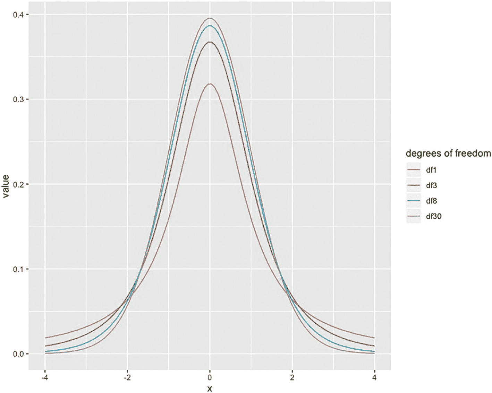
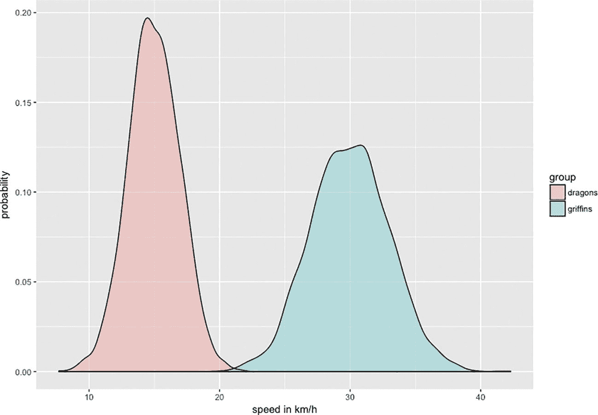
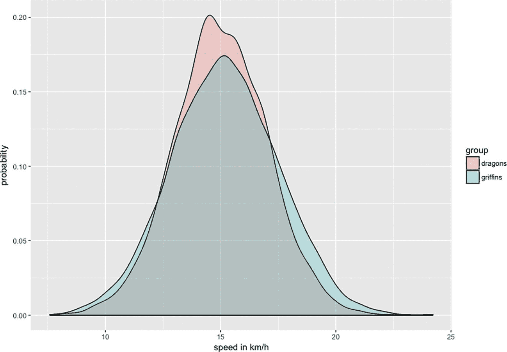

# 假设检验：显著还是不显著？

`William Gosset` 是著名的黑啤酒生产商 `Guinness` 的首席酿酒师。在 19 世纪末，`Guinness` 已经成为世界上最大的啤酒厂，为了提高产品质量，它开始寄希望于科学——这很像现在的公司为了获得优势而研究数据科学和 `AI` 的使用。该啤酒厂的主要关注点是保持其啤酒的高品质。在 1887 年至 1914 年间，啤酒产量翻了一番，接近十亿品脱。^(⁴³) 显然，产量的增加对质量提出了挑战。`Gosset` 的工作就是找到这个问题的答案。

像许多其他种类的啤酒一样，`Guinness` 啤酒通过使用啤酒花来调味。`Guinness` 啤酒通过外观和香味等特性来衡量啤酒花的质量。挑战在于，只能通过提取一小部分样品来衡量整批啤酒花的质量。

在那个时代，还没有人处理过小样本的推断统计。使用仅由五个啤酒花组成的样本所带来的挑战，对当时大多数处理更大样本的统计学家来说似乎有些无关紧要。`Gosset` 成功解决了这个问题，随后在伦敦大学学院与 `Egon Pearson`（`Karl Pearson` 之子）一起工作了一年，完善了他方法的数学基础。

这最终促成了统计界著名的《学生分布》的发表（见图 7-1）。`Guinness` 不允许 `Gosset` 以真名发表他的发现，也不允许提及这些技术被 `Guinness` 使用——大概是因为，认为每一颗啤酒花并非经过精心手工挑选用于酿造的想法，与该品牌的形象不太相符。`Gosset` 必须找到一种方法来匿名自己和自己的工作，于是他想出了笔名“`Student`”，这个笔名来自他 1906-1907 年关于使用血细胞计数板计数酵母细胞的笔记本《学生科学笔记本》。就这样，在 1908 年，`Gosset` 在论文《均值的可能误差》中发表了他的成果。^(⁴⁴)

**图 7-1** 不同自由度下的学生 `T` 分布。注意其与正态分布的相似性。

“`Student`”的研究给一位名叫 `Ronald Fisher` 的年轻数学家留下了深刻印象。`Ronald Fisher` 对学生的方法很感兴趣：使用一个分布来估计某件事相对于随机偶然性发生的可能性。以这一概念为基础，`Ronald Fisher` 继续创作了大量令人惊叹的著作——由此，他成为了现代统计学之父。

当 `Gosset` 发表他如今著名的著作时，`Fisher` 还在 `剑桥` 学习数学。`Fisher` 于 1890 年出生于一个富裕家庭，15 岁之前一直居住在伦敦富裕的 `汉普斯特德`。然而，他 14 岁时母亲去世，15 岁时因家族企业倒闭而家道中落。`Fisher` 一家不得不搬到 `斯特里汉姆` 较贫困地区的一所小房子里。`Fisher` 依靠奖学金继续在著名的 `哈罗公学` 学习。

`Fisher` 视力不佳，实际上严重到有人建议他不要在电灯下阅读，因为那样太伤眼睛。这也许因祸得福：`Fisher` 培养出了在脑中可视化和解决数学问题的非凡能力。

`Fisher` 的贡献包括实验设计理论、方差和最大似然估计的概念，以及方差分析（最常见的统计检验之一）。他还在生物学、农学和优生学方面进行了研究。他出版了七本书和 400 多篇论文。

`Ronald Fisher` 的伟大贡献之一是显著性检验。显著性检验试图解决的问题相对简单，但它的解决方式——即解决方案本身——引发了无数争论，其中一些争论至今仍在继续。

想象一下，你正在试图回答一个问题，而这个问题的答案*只能*是真或假。某个国家的男性是否比另一个国家的男性更高？摄入更多碳水化合物的人是否比主要摄入脂肪和蛋白质的人更胖？接受某种疾病药物治疗的人是否比未接受治疗的人恢复得更好？龙的平均速度是否比狮鹫快？

所有这些问题都应该有一个“是”或“否”的答案。但我们如何找到这个答案呢？出于实际目的，我们不可能接近两个国家的每一个人并测量他们的身高。我们也不可能测量每一条龙的速度（它们可能很难被抓住）。一个潜在的解决方法是诉诸抽样：从每个类别中获取一些样本，计算平均值，然后进行比较。

但我们如何确保这个过程产生了可靠的结果呢？让我们看看这会如何出错。假设你刚降落在某个新国家。你注意到你遇到的前十个人都穿着红色运动鞋，因此你推断这个国家的每个人都一定穿着红色运动鞋。你看到问题所在了吗？这基本上就是前一章讨论过的归纳问题。

因此，抽样存在与归纳法类似的问题。每次我们抽取十个人、龙或任何东西时，我们研究的任何量的平均值都会略有不同。仅仅因为你样本中龙的平均速度是 `12 公里/小时`，并不意味着这就是整个群体的平均速度。有时我们的样本会给出更高的平均值，有时会是更低的平均值。在某些比较中，龙可能比狮鹫快，在另一些比较中，结果可能相反，或者这两种神奇动物的速度可能相等。

因此，我们需要一种方法，一个科学过程，通过它我们可以从样本中推断——并带有一定程度的确定性——世界的客观状态。`Fisher` 提出了这个方法。1925 年，他出版了《研究人员统计方法》一书，书中概述了他的方法，并推广了（备受争议的）`p 值`——稍后会详细介绍。

假设，我们暂且假定龙和狮鹫的速度相同。我们收集两个样本，然后测量每个样本的平均速度。如果它们的速度确实相等，那么观察到两个样本平均速度相同的概率是多少？

这听起来可能有点令人费解，但请耐心听我解释。想象一下，这两种生物的速度分布看起来像图 7-2 中的图。

**图 7-2** 龙和狮鹫速度的真实分布

从这张图来看，这两种神奇动物的速度差异非常大。两条分布曲线重叠的区域很小——就在 `20 公里/小时` 标记附近可以看到微小的交叉点。因此，我们随机抽取两个样本并且这两个样本的速度相等的概率非常小。

另一方面，假设真实总体分布如图 7-3 所示。

**图 7-3** 龙与狮鹫速度的真实分布。速度相等的情境

在这种情况下，我们可以预期，对于大多数样本而言，平均速度会非常接近。

`Fisher` 发明的方法正是以科学的方式解决了这类问题——即便研究对象是魔法生物。

除了 `Fisher`，我们还要感谢 `Karl Pearson`，他于 1900 年发表了一篇标题相当冗长的论文：“关于在相关变量系统中，给定系统偏离概率的准则，使其可合理归因于随机抽样”（On the Criterion that a Given System of Deviations from the Probable in the Case of a Correlated System of Variables Is Such that it Can be Reasonably Supposed to Have Arisen from Random Sampling）。在这篇论文中，他为如今所称的卡方检验（一种非常流行的显著性检验）奠定了基础。然而，`Karl Pearson` 未曾像 `Fisher` 那样拓展其思路，从而构建出一套正式的检验框架。

卡尔的儿子 `Egon Pearson` 进一步推进了这个想法。`E. Pearson` 与 `Jerzy Neyman` 合作，提出了他们自己的假设检验版本。尽管如今“显著性检验”和“假设检验”这两个术语可互换使用，但 `Fisher` 只使用“显著性检验”一词，而 `Neyman` 和 `Pearson` 则使用后者。这两种方法存在一些差异，其中最重要的一点是，`Neyman` 和 `Pearson` 设计的方法中包含了两种假设，分别称为“零假设”和“备择假设”。`Fisher` 曾激烈反对 `Neyman` 和 `Pearson`，但如今实践中使用的假设检验版本实际上是这两种方法的融合。

假设检验在科学领域无处不在。事实上，某些学科之所以被视为科学，恰恰是因为统计方法使我们能够以一种系统且理性的方式确认或反驳假设。想比较两组之间某个特征的平均差异？想测试某项干预措施在学校中的效果？想检验一种新药的副作用？每当你阅读一项关于食物、物质、人格特质或几乎任何事物的影响的研究时，其背后极有可能就进行了假设检验。基础统计学和检验是所有年轻科学家的必修课。

因此，我们已经确认假设检验非常有用。然而，正如你可能从本书中已经体会到的那样，天下没有免费的午餐。假设检验也存在一些严重问题，这些问题引发了无数争议，尤其是在最近几年。这些问题触及了一些非常重要的哲学问题，涉及显著性检验的目标及其在科学中的应用。

费希尔提出了统计显著性的概念。他希望有一种方法能够判断某个结果是否重要。因此，他设定了一个阈值，即著名的 5%阈值。如果检验的`p-value`（即“概率值”）小于 0.05，则该检验被认为是显著的。如果高于 0.05，则不显著。有些教科书甚至更进一步，设立了不同的显著性阈值。例如，`p-value`小于 0.10 但高于 0.05 被视为中等显著。`p-value`低于 0.01 则被视为极其显著。这些惯例甚至已渗透到统计软件包中。例如，著名的 R 编程语言就采用了类似的惯例。

现在，好奇的读者会问：“我理解使用阈值的好处，但费希尔是如何得出 5%这个数值的呢？” 事实是，这是一个令人不满意的武断决定，并且在过去 100 年里困扰着统计学和科学界的很大一部分领域。在他的著作《研究人员的统计方法》（Statistical Methods for Research Workers）中，费希尔写道：

> “P = 0.05，即二十分之一的值……为了方便，可将此点作为判断某个偏差是否应被视为显著的界限。因此，超过两倍标准差的偏差在形式上就被视为显著。”

这个界限后来也被内曼和皮尔逊所采用，从而将其确立为一个便捷的标准。

戈塞特（Gosset）本人并不喜欢显著性这个概念。在一篇关于这场讨论的论文中，齐利亚克（Ziliak）^(⁴⁵)提到，戈塞特更关注检验的实际意义，而非检验本身是否显著。戈塞特在这场辩论中采用了更贝叶斯式的方法，因此他更侧重于决策制定，而非揭示某种客观的二元真理。