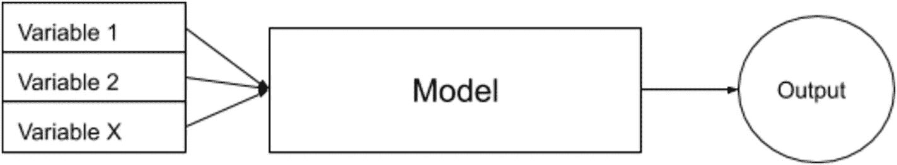
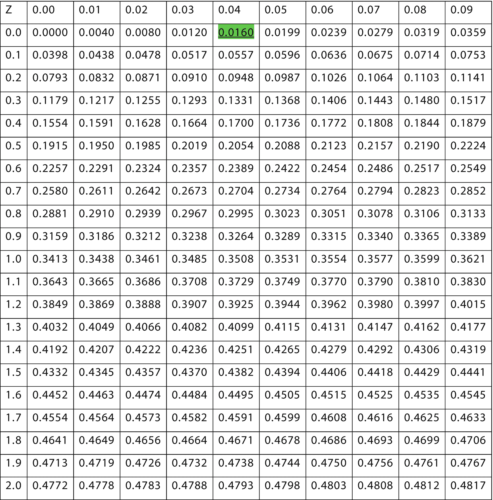
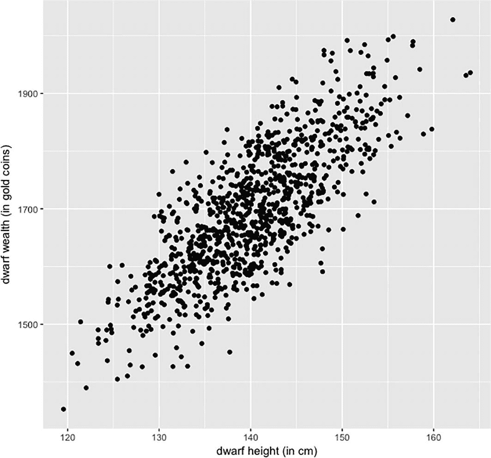
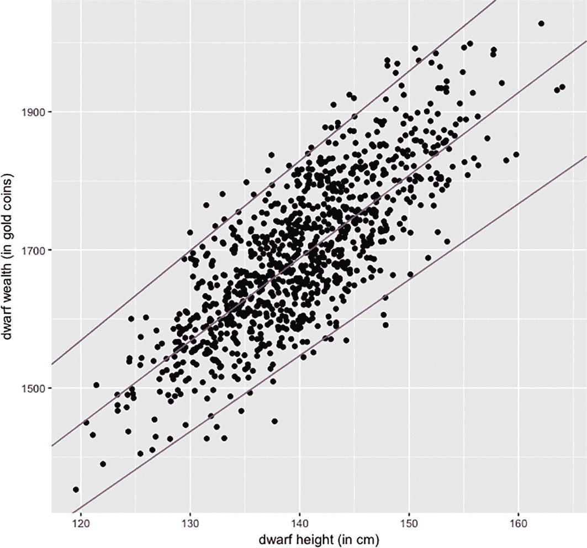
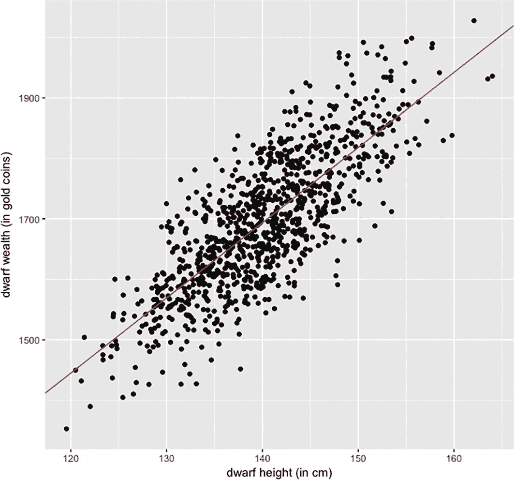

# 统计建模：一个有用的抽象

> “所有模型都是错的，但有些是有用的。”
> 
> —乔治·博克斯（1919–2013），20 世纪最伟大的统计思想家之一

模型仅仅是世界的一种抽象。仅此而已，不多也不少。所有模型都是错的，但有些是有用的，其意义在于，它们在真实潜在现象、我们的数据和我们的理论之间，捕捉到了恰到好处的抽象程度。

统计建模的原则其实非常简单，即便数学细节有时看起来令人生畏且深奥难懂。我们有两组变量：自变量和因变量。它们也被称为协变量（或预测变量）和响应变量。模型位于中间，连接协变量与响应变量，如图 7-4 所示。

**图 7-4** 统计模型的概念概览。在实践中，大多数模型都遵循这一原则。你将输入馈入模型，然后得到一个输出，该输出包含一个或多个响应。

让我们看一个商业例子：你相信用户的**人口统计学变量**和他们的购买行为之间可能存在某种关系。比如说，你是一家销售衣服的在线零售商。你相信性别、年龄和收入可能会影响顾客在衣服上的花费。使用统计模型，你可以做到以下几点：

1.  确定不同类型用户的预期消费。
2.  了解哪些变量是显著的。

第二点特别有趣。我们可以在统计模型中使用显著性检验来评估单个变量的显著性。这使得统计模型非常强大。事实上，有些统计模型可以被看作是显著性检验的推广。例如，著名的`ANOVA`检验（提醒一下，`ANOVA`代表方差分析）也可以通过线性回归——最基本的统计模型——来实现。

那么，为什么我们不一直使用统计建模呢？有几个原因。首先，简洁往往是关键。有时我们真正感兴趣的是一个可以通过显著性检验来回答的特定问题。假设检验可能比模型更简单易用。统计学被许多科学领域所使用，很多时候，初出茅庐的科学家只接受了其学科中最常用的特定检验和模型的训练。如果某个人只需要一个`t 检验`就能证明他们的理论，那么他们就不想再深入了。

其次，统计建模与假设检验的关注点不同。在科学领域，我们通常关心的是证明或推翻一个假设，而我们更喜欢通过实验来做到这一点。费舍尔本人就对实验设计理论做出了许多贡献。一个设计得当的实验很适合进行假设检验，而一旦假设被证明或推翻，统计建模可能就超出了实际需求。

最后，我们并不总是像现在这样拥有丰富的数据和计算能力。如今，拟合一个模型可以简单到只用两行代码。过去当然不是这样。几十年前，我们使用统计表格，这些表格附有与假设检验所需计算相关的预计算值，从而简化了计算。与统计模型相比，大多数检验的计算量较小，相当方便，这可能促使许多科学家倾向于使用假设检验。

图 7-5 展示了一个来自标准正态分布的`z`值表示例。单元格代表位于两个`z`值之间的比例。因此，图中高亮/下划线的单元格是位于`0.0`（均值）和`0.04`之间的样本比例。这些针对各种分布的表格，曾被用于显著性检验的计算中。

**图 7-5** 来自标准正态分布的`z`值表示例（标准正态分布的均值为 0，标准差为 1）。

如今，针对各种各样的问题和挑战，有数不清的模型。统计模型的关键组成部分是它们是随机的。也就是说，它们明确地对不确定性进行建模。它们实现这一点的方式，以及为了实现这一点所做的假设，可能因模型而异，当然，不同种类的方法之间也存在非常大的差异。

迄今为止最流行、最简单、最通用的模型是线性回归。线性回归长期以来一直是科学界的主力。在撰写本文时，在 Google Scholar 上搜索`linear regression`会返回近 500 万个结果。

线性回归遵循一个非常简单的思路。假设你有一个数据的散点图，如图 7-6 所示。

**图 7-6** 中土世界中矮人身高与矮人财富的关系。

图 7-6 展示了中土世界中矮人的身高与财富之间的关系。在这个虚构的例子中，矮人的身高和财富之间存在很强的联系，个子更高的矮人平均来看似乎更富有。看起来这两个变量之间的关系遵循一条直线。

当然，你可能还能识别出其他类型的关系，但直线在这种情况下似乎完全合理。另外，直线是存在的几何关系中最简单的一种，这赋予了它一定的吸引力。如果你还记得本书前面提到的，我们讨论过奥卡姆剃刀，以及我们对更简单规则的偏好。如果我们能画一条直线来描述这两个变量之间的关系，那么我们就拥有了一种简洁且简单的方法，可以根据身高预测财富。

有多种画直线的方法。看看图 7-7。哪条线最好？看起来中间的线比两边的线更好地捕捉了数据的趋势。但是否有一种方法可以将这种直觉系统化呢？

**图 7-7** 以某种方式将身高与体重连接起来的几种不同画直线的方法。

这种直觉通过线性回归得以系统化。线性回归的目标是找到最佳拟合线。也就是那条最紧密跟随数据趋势的线。所以，你找到了最佳拟合线，看起来就像图 7-8 中所示的线。

