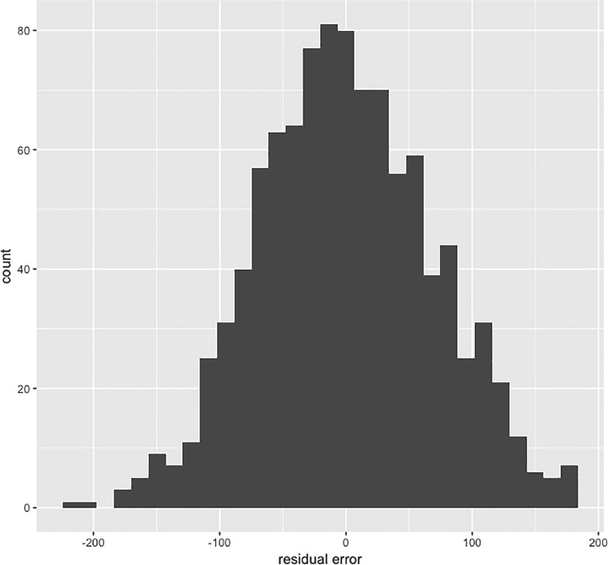
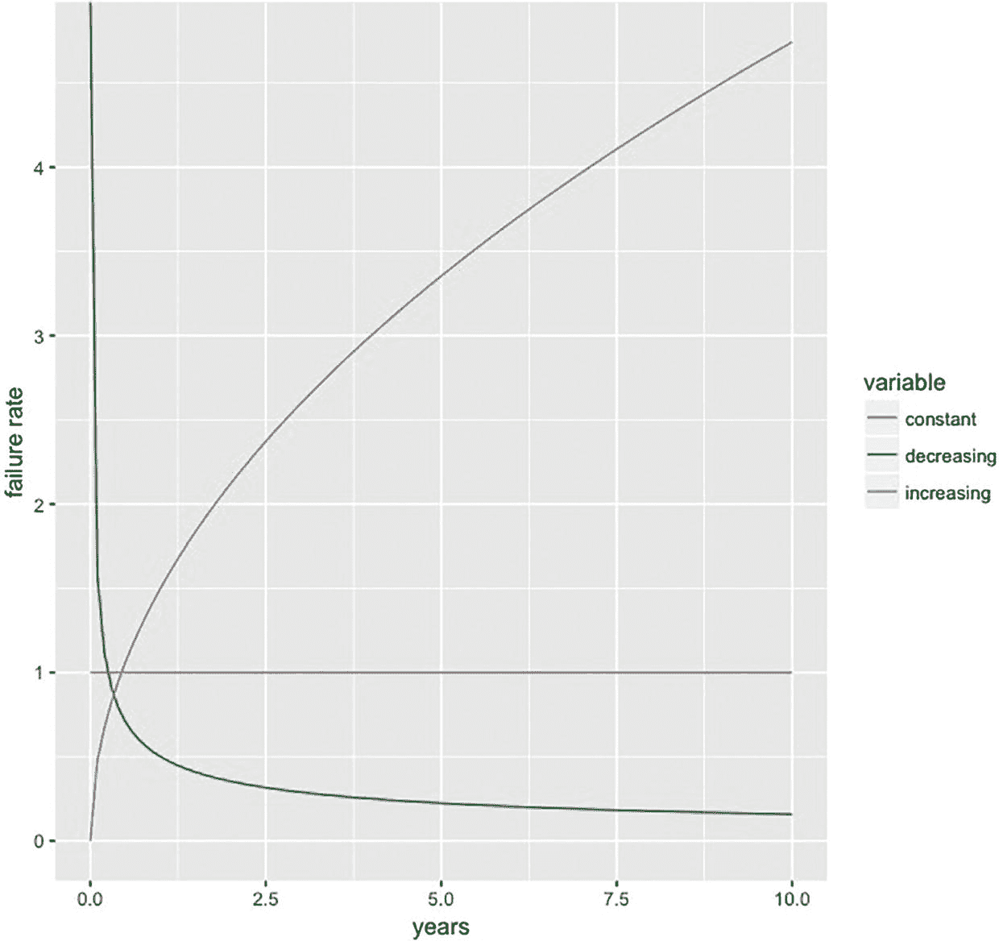

# 分析与可视化

矮人财富（金币）与身高（厘米）的散点图呈现正相关。最高的两个点分别是`(119.5, 1350)`和`(164, 2025)`。一条递增的直线穿过这些散点。数值均为近似值。

`图 7-8`

身高与财富问题的最优拟合线

好奇的读者可能会在此处皱眉。首先，这条线似乎遵循了整体趋势，但身高与财富之间的关系并非完美无缺。事实上，只有一小部分数据点恰好落在直线上。其次，我们根据什么规则来绘制这条线？

正如你所注意到的，模型会产生一些误差。我们对此能做什么？我们无法预测模型中的每个个别误差。我们接受模型会犯一些误差的事实。这些误差要么源于认知不确定性，要么源于偶然不确定性，但在本例中，我们并不关心其来源。我们关心的是误差的形态。那么，在这种情况下，误差看起来是什么样的？我们可以收集所有误差，并将其绘制成直方图。如图 7-9 所示。

计数与残差的直方图呈钟形趋势。最高峰位于`(负 20, 81)`。该值为近似值。

`图 7-9`

矮人身高-财富模型的误差

这些误差开始看起来有点像正态分布。如果你从本书中注意到了什么，我们可以使用概率分布来建模不确定性。因此，如果我们的误差看起来像正态分布，我们可以将其作为启发式方法，在寻找最优拟合线时指导我们。

在线性回归中，我们假设模型会产生误差，并且这些误差服从正态分布。抛开中土世界的矮人不谈，为什么是正态分布？因为正态分布无处不在，而且测量误差通常呈正态分布。

做出这两个假设（线性关系和正态分布误差）后，我们就得到了线性回归模型。但如果改变这些假设呢？改变这些假设将为我们带来新的模型。约翰·内尔德（1924–2010）和罗伯特·韦德伯恩（1947–1975）是提出广义线性模型概念的统计学家。两人都在伦敦北部的罗瑟姆斯特德实验站工作，罗纳德·费舍尔在那里发展了他的许多实验设计理论。

数学家们喜欢对现有概念进行泛化。例如，有理数（如`1.23`这样的数字）可以看作整数的扩展，因为实数集也包含整数。实数集可以看作进一步的扩展，因为它既包含有理数，也包含无理数（如`√2`）。数学史上充满了类似的例子。这样做的动机是，更高层次的关系可以帮助我们揭示更多关于数学世界运作方式的见解和规则，而这些见解和规则又可以用于其他模型和理论。

统计学也不例外。内尔德和韦德伯恩成功地提出了一个理论框架，将一些现有模型（如逻辑回归和泊松回归）合并到线性回归概念的泛化之下。因此，广义线性模型假设预测变量与响应变量之间的关系是线性的。然而，实际的误差可以服从其他分布。著名的泊松模型假设，除其他事项外，响应变量由整数组成。这个模型何时相关？例如，体育领域。体育比赛中的得分由整数组成。因此，如果我们想预测一场足球比赛的进球数，使用泊松回归比使用线性回归预测实数更有意义。

逻辑回归可用于对二元结果进行建模。某人是否会购买（或不购买）某件商品？某人是否会拖欠贷款？但对于存在多个潜在结果的情况呢？例如，在某些运动中，结果可能是赢/输/平。在这种情况下，我们可以使用多项逻辑回归，它是逻辑回归对多种结果的泛化。贝塔回归可用于对介于 0 和 1 之间的数字（如比例）进行建模。伽马回归可用于预测正实数。这些只是广义线性模型家族中的一部分模型。

其他类型的模型包括生存模型。假设你正在研究一台机器的可靠性。如果你现在买了一辆车，它需要第一次维修要多久？或者你可能关心患有危险疾病的患者的生存率。某人在五年内存活的概率是多少？生存分析有助于找到这些问题的答案。

与生存分析关系最密切的名字是大卫·考克斯（1924–2002）和瓦洛迪·韦布尔（1887–1979）。考克斯为我们提供了该领域最流行的模型之一，称为比例风险模型，而韦布尔研究了同名分布。韦布尔分布是一个很好的例子，展示了统计模型可以表达的灵活性。某些实体存活的越久，其死亡的概率越高。这对于大多数超过一定年龄的生物来说是成立的。

然而，对于其他实体，情况并非如此。企业存在的越久，其破产的可能性就越小，因为它们正在建立忠实的用户群。因此，有人可能会认为，一个企业存在的越久，它存活更久的可能性就越大。最后，还有一些物体在其整个生命周期中具有恒定的生存概率。例如，放在桌子上的玻璃花瓶，除非有人打碎它，否则它将永远留在那里。花瓶放在那里是 1 年还是 100 年并不重要。

图 7-10 显示了韦布尔分布不同参数的失效率。失效率是每单位时间内的失效次数。在本例中，我们以月为单位测量时间。因此，失效率表示每月预计会失效的单元数量。很容易看出，韦布尔分布非常灵活，可以适应这里讨论的所有场景。

失效率与年份的折线图描绘了一条从`(0, 1)`到`(10, 1)`的恒定曲线，一条从`(0, 5)`到`(10, 0.2)`的递减曲线，以及一条从`(0, 0)`到`(10, 4.75)`的递增曲线。数值均为近似值。

`图 7-10`

韦布尔分布不同参数的失效率

那么非线性关系呢？在大多数情况下，统计模型都是可加且线性的。原因是非线性是一个潘多拉魔盒。一旦开始探索它，你就会面临无数的可能性——随之而来的是无数的问题。

首先，模型的解释会变得更加困难。例如，让我们重新审视矮人线性回归模型。假设线性回归方程如下：

`gold coins = 12 * height`

这个模型很好解释。在其他条件相同的情况下，矮人身高每增加 1 厘米，平均就能多获得 12 枚金币。直观易懂，对吧？然而，假设存在另一种关系能更好地解释数据，如下所示：

`gold coins = 12 * log(height)`

这种关系该如何解释？现在有了对数，关系就不像以前那么清晰了。对于受过量化训练的人来说，这并不难理解，但对于普通人来说，可能很难在脑海中想象出身高的对数每增加一个单位是什么样子。

假设我们想在方程中加入一个新变量——胡须长度。于是我们得到了这个：

`gold coins = 12 * (log(height) / sqrt(beard))`

这就更难理解了。但如果方程是下面这样的呢：

`gold coins = 12 * height + 11.5 * beard`

这个模型可以这样解释：在胡须长度不变的情况下，身高每增加 1 厘米，矮人平均多获得 12 枚金币；在身高不变的情况下，胡须长度每增加 1 厘米，矮人平均多获得 11.5 枚金币。这样容易理解多了，对吧？

其次，人们可以使用的非线性函数种类繁多。你很容易得到两三个不同的模型，它们解释起来很困难，但性能却相差无几。统计学向来非常注重结果的可解释性和透明度，而非线性模型在这方面就有所欠缺。

话虽如此，实践中确实也会用到一些非线性模型。广义加性模型就是一个例子。然而，非线性领域主要还是由机器学习方法主导，关于这一点，你将在后续内容中了解更多。

统计模型和检验是非常强大的工具，它们在很长一段时间内都为我们提供了良好的服务——有些甚至已经沿用了几个世纪。然而，正如前面提到的，当你手里只有一把锤子时，看什么都像钉子。统计模型常常被误用，部分原因是许多学科中，初出茅庐的科学家没有足够的时间深入学习统计学。因此，他们常常会忽略模型背后的重要假设，或者对其他方法一无所知。那么，统计建模到底出了什么问题呢？

多年来，我观察到两种常见的谬误。第一种是高斯谬误。第二种是线性世界谬误。

高斯谬误指的是过度使用线性回归模型来处理所有事情。线性回归是每个人学习的第一个统计模型，并且所有统计软件包中都包含它。然而，世界并非总是服从高斯分布。还有许多其他模型可以处理非高斯分布的情况，比如泊松回归、逻辑回归、广义加性模型等等，但这些模型往往被忽视了。

线性谬误则假设世界上的一切都是线性的。无论好坏，事实并非如此。绝大多数采用的统计模型都假设输入和输出之间的关系是线性的。在图 7-11 中，你可以看到一个两个变量之间非线性关系的例子。我们来看看龙的翼展和速度之间的关系。

一张描绘龙的飞行速度（公里/小时）与翼展（米）关系的曲线图，显示出一条递增的曲线，从点`(0.1, 5.95)`延伸到点`(2.125, 9.35)`。数值为近似值。

`图 7-11`：一组两点间的非线性关系示例

假设我们想通过线性回归建立一个模型，根据龙的翼展来预测其速度。这个回归模型解释了约 94%的变异量。这听起来是个不错的模型。那么，让我们绘制出预测值（图 7-12 中的红线）。

一张线条图显示龙的飞行速度（公里/小时）与翼展（米）的关系：一条递增的曲线从点`(0.1, 5.95)`延伸到点`(2.125, 9.35)`；一条递增的直线从点`(0, 6.2)`延伸到点`(2.125, 9.5)`。数值为近似值。

`图 7-12`：对同一组数据应用的回归模型

这个模型相当糟糕。它确实解释了 94%的变异量，但它试图在关系明显呈曲线的问题中拟合一条直线。我们在这里做的是夸大了一个模型的预期，而它显然是错误的。

为什么会出现这类问题？统计模型的一个问题在于，违反假设的情况无法在模型内部被检测到。如果程序员在代码中犯了错误，那么软件很可能会无法运行，或者产生一些奇怪的结果。而线性回归则不同，它仍然可以运行，并给出诸如“解释了 48%的方差”这样的结果。

这里你看到了一个例子，性能指标实际上相当不错，但模型却百分之百错误。在这种情况下，针对模型假设的诊断检验会表明，误差并非正态分布。因此，线性回归的假设未被满足，我们需要一个不同的模型。但并非所有从业者都可能注意到这一点。

这个例子可能看起来有些抽象，直到你意识到许多此类问题正被应用于可能影响我们生活的模型之中。药物的批准或否决基于这些模型。计量经济学模型为经济提供预测，以便中央银行调整通胀率。正确应用所有这些模型颇具挑战性。

如果存在一些方法，它们更易于使用，没有所有这些假设，并且能更轻松地处理非线性问题，那会怎样？这不就使得建模和预测变得更加简单了吗？

机器学习应运而生。