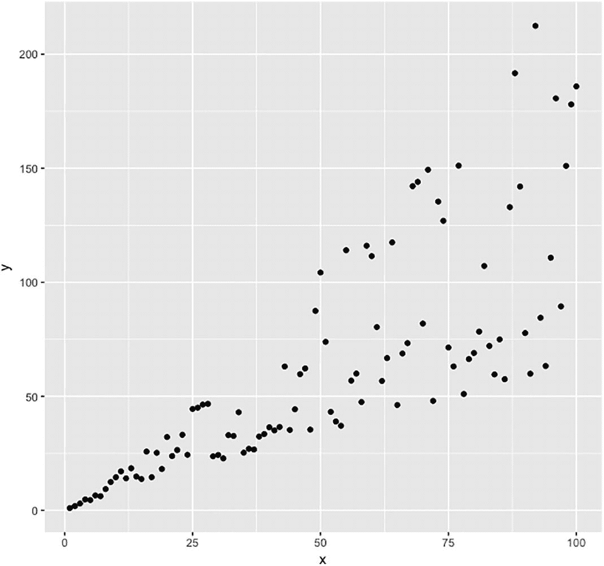
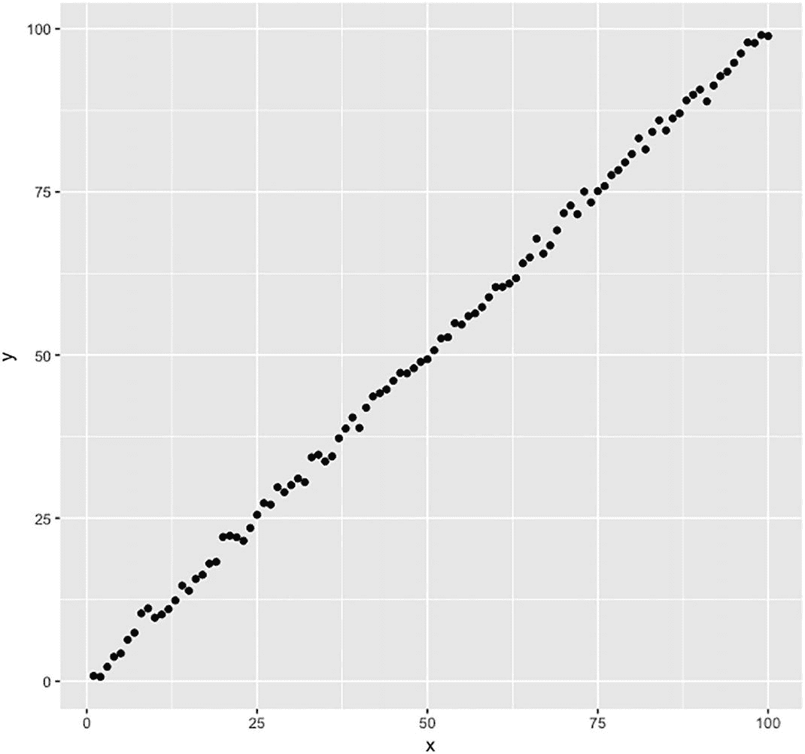
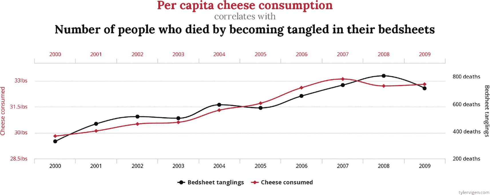

# 9. 因果关系：理解“为什么”

> *“浅薄之人相信运气或环境，坚强之人相信因果。”*
> 
> ——拉尔夫·沃尔多·爱默生

不确定性以多种形式出现。大多数人将“不确定性”这个词与未来联系在一起，这很合理。如果我们能预测明天的股市走势，我们一夜之间就能成为亿万富翁。如果我们无法预测明天会下雨，我们可能会被淋湿。然而，不确定性的一个关键部分在于理解事件之间是如何*相互关联*的。这个问题在科学以及日常生活中反复出现。

在医学领域，我们需要了解哪些病毒可能导致特定疾病，以及某种特定物质是否真的是治疗方法。也就是说，某种物质是否真的是患者康复的原因？在这种背景下，寻找原因实质上就是识别自然界中是否存在某种关系。大多数科学家花费大量时间致力于提取这类关系。

在历史学中，我们对重大事件的原因感兴趣。第一次和第二次世界大战的起因是什么？是什么引发了某些意识形态？宗教是如何兴起和传播的？这类因果关系主要涉及对反事实的理解。当我们说——例如，就像我们之前所做的那样——如果弗朗茨·斐迪南大公没有被暗杀，那么第一次世界大战就不会发生，我们便将原因的力量归因于那次暗杀。然而，也许第一次世界大战仍然会发生，但会出于其他原因。调查过去不可重复事件的原因是一个非常棘手且复杂的课题，自然会引起激烈的辩论。

在我们的社会关系（职业关系和个人关系）中，我们不断试图理解是什么导致了特定的“结果”或情况。此外，我们也在积极尝试改变自己的行为，以达到期望的结果。如果我们相信以某种特定方式着装会让我们更受欢迎，那么我们可能会那样做。如果我们相信在某个特定大学学习会帮助我们找到工作，那么我们可能会申请去那里学习。如果我们相信某个特定举动会让老板给我们升职，那么我们可能会着手采取这个行动。这种因果思维与预测密切相关。类似于机器学习算法的工作方式，我们从世界中提取数据，然后试图预测未来。

理解因果关系不仅仅是一种哲学上的好奇。人类在这个星球上非常成功地生存下来，部分原因就在于我们擅长处理因果问题。归纳问题在许多情况下本质上就是从自然界中提取原因和结果的问题。同时，理解因果关系并不一定等同于构建预测模型。两者之间存在根本性差异，我们现在就来探讨这一点。

每个统计学学生都会学到的一件事就是：相关性并不意味着因果关系。请看图 9-1 中的散点图，它展示了两个变量 `x` 和 `y` 之间的关系。

一张 `y` 对 `x` 的散点图，显示了正相关关系。最低点和最高点分别为 (0, 0) 和 (90, 215)。数值为近似值。

**图 9-1**

`x` 与 `y` 之间的关系

你会说变量 `x` 和 `y` 之间存在关系吗？看起来是有的。这种关系并不完全清晰，但随着 `x` 的增长，我们也能看到 `y` 在增长。衡量两个变量之间关联度的指标是著名的相关系数（由弗朗西斯·高尔顿首次提出）。在这种情况下，这两个变量之间的相关系数约为 0.8。最大值为 1，这表明存在相当强的相关性。

现在，让我们来看看图 9-2 中散点图所描绘的关系。你觉得这两个变量之间存在强相关性吗？毫无疑问是有的。在这个例子中，`x` 和 `y` 之间的相关系数接近 1，表明二者几乎呈完美的线性关系。

那么，我们能否说在这两个图中，`x` 都是 `y` 的原因？如果可以，是否第二个图中 `x` 是 `y` 的原因的可能性更大？你怎么看？

如果我说，在第一个图中，`x` 是某次全国性考试（如美国的 SAT 或英国的 A-level）的结果，而 `y` 是同一人未来 12 个月的平均薪资；在第二个图中，`x` 是 IBM 股票自发行至 2000 年间的价格，`y` 是宾夕法尼亚州每月至少喝一次可口可乐的人口比例。现在你还会认为其中一个变量是另一个的原因吗？

虽然这些例子看似荒谬，但它们恰恰证明了一点：相关性并不等于因果性。

`y` 相对于 `x` 的散点图展示了正相关性。最低点和最高点分别为 `(0, 0)` 和 `(100, 100)`。数值为近似值。

**图 9-2** `x` 与 `y` 之间更强的相关性

互联网上，恐怕没有其他来源能比泰勒·维根（Tyler Vigen）的网站更能说明这一点了^(⁷⁰^)。泰勒·维根在他的网站上收集了各种有趣且不相关的相关性。例如，在图 9-3 中，你可以看到人均奶酪消费量如何与被床单缠住致死的人数相关。你还可以看出，在游泳池溺亡的人数如何与尼古拉斯·凯奇主演的电影数量相关。

奶酪消费量与床单缠身死亡人数随年份变化的折线图显示了两个上升曲线。床单缠身死亡曲线从 `(2000, 350)` 延伸至 `(2009, 750)`。奶酪消费量曲线从 `(2000, 29.9)` 延伸至 `(2009, 32.8)`。数值为近似值。

**图 9-3** 虚假相关性。依据知识共享许可使用

这类关系被称为“虚假相关性”。两个变量之间的相关性确实很高，但它们之间并不存在真实的、无论因果关系或其他类型的关系。

那么，这一切的意义何在？我们可以总结如下：

1.  相关性不等同于因果性。
2.  用于关联分析的工具可能不适用于理解因果关系。
3.  你不能总是在一个封闭系统内研究因果性。有时必须跳出系统去审视。

第一点，希望现在你已经清楚。第二点则非常有趣且常被误解。大多数数据科学模型是根据一个或多个预测变量 `x` 来预测变量 `y`。然而，这些模型也可以用来反推关系。我们完全可以反过来用 `y` 去预测 `x`。无论怎样，模型都能工作。模型本身无法帮助我们理解是 `x` 导致了 `y`，还是 `y` 导致了 `x`。这一点对于从简单的线性回归到复杂的神经网络等所有模型都适用。如果存在任何因果关系，那也是由实验者假定的。

这就引出了第三点。在我们当前大多数模型的上下文中，因果关系必须由实验者以某种方式假定并加以控制。如果模型和我们的工具本身不具备揭示因果关系的能力，那么这项工作就得由研究者来完成。由罗纳德·费舍尔开创的实验设计领域，正是专门处理这一问题的。

这让我们得出一个有趣的结论：尽管我们当前的工具和方法已经非常复杂，但它们仍旧是基于关联分析的。朱迪亚·珀尔（Judea Pearl）因对计算机科学的贡献于 2011 年获得图灵奖，他曾抨击当前人工智能方法忽视因果性。珀尔认为，识别因果关系是智能的标志之一。然而，我们当前方法所能做到的仅仅是“曲线拟合”。

珀尔相信，开启机器智能的关键在于让它们也理解因果关系。《量子》杂志（*Quanta*）的一篇采访阐明了朱迪亚·珀尔如何看待整个问题^(⁷¹^)。

- “但你在新书中称自己是当今 AI 社区的‘叛道者’。是从何说起呢？”
- “意思就是，当我们开发出能让机器在不确定条件下进行推理的工具后，我便离开了这个领域，去追求一个更具挑战性的任务：基于因果关系的推理。我的许多 AI 同事仍在研究不确定性。一些研究圈子继续致力于诊断问题，却未考虑问题中的因果层面。他们只希望预测得好，诊断得准[...]”
- “我可以给你举个例子。我们今天看到的所有机器学习工作都是在诊断模式下进行的——比如，将物体标记为‘猫’或‘老虎’。他们不关心干预；他们只想识别一个物体，并预测它如何随时间演变。”
- “当我开发出用于预测和诊断的强大工具时，我感到自己像一个‘叛道者’，因为我深知这仅仅是人类智慧的冰山一角。如果我们希望机器能推理干预行为（‘如果我们禁烟会怎样？’）和内省（‘如果我当初读完高中会怎样？’），我们就必须引入因果模型。关联是不够的——这是一个数学事实，而非个人观点。”

因果关系是一个要求很高的课题，要妥善处理它，我们或许仍有很长的路要走。但科学和哲学在过去是如何处理这个课题的呢？

