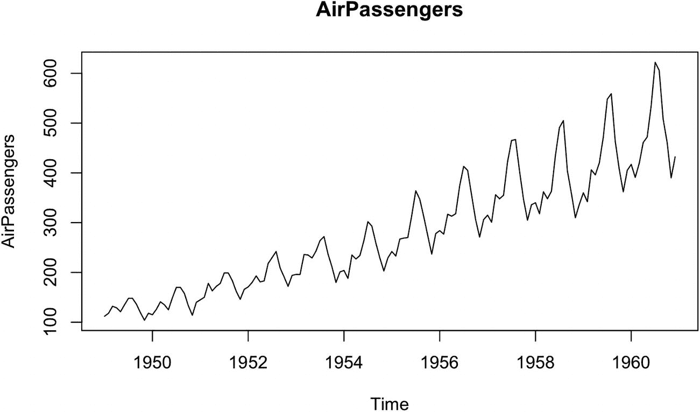

# 10. 预测未来：狐狸与特朗普

> *“知者不言，言者不知。”*
> ——老子
> *“我总是避免事前预言，因为事后预言要好得多。”*
> ——温斯顿·丘吉尔

预测常被称为“黑暗艺术”。它有种与生俱来的蛊惑力，能牢牢抓住大众的想象力；在数据科学的所有应用中，预测是最让公众着迷的领域之一。预测未来一直是人类兴奋的事情，原因不言自明。可以说，科学的主要目标就是解释原因，并建立模型来帮助我们预测和控制周围的世界。在人类历史的大部分时间里，预测未来与巫术、神灵和其他超自然存在联系在一起——如今已不再如此。

在数据科学中，预测已大致成为时间序列预测的同义词。“时间序列”就是一组随时间变化的值。股票市场价格、商品与服务的价格与需求、气温，都是时间序列的例子。

预测基于一个简单的想法：未来会和过去相似，因此我们可以利用过去的信息来预测未来。

预测模型种类繁多，但就本书而言，粗略划分主要有两大类：

1. 内源模型
2. 考虑外生变量的模型

这些定义在学术文献中可能不会以这种方式出现，但它们能帮助你理解模型中使用的不同信息以及所做的不种假设。

第一类预测技术（内源模型）描述的是大多数人联想到的传统预测方式；它基于两个主要假设：

1. 未来会和过去相似。
2. 时间序列提供的信息足以预测未来。

仔细想想，这两个假设既合理又错误。未来无疑会受到过去的影响。如果我问你下一个小时的气温是多少，你给出的预测应该与当前气温相差不大。然而，我们需要回溯多远的历史，又能预测多远的未来？上周的气温会影响下一个小时的气温吗？我们能预测明天的气温吗？下周呢？或者下个月？

显然，对于某些时间序列，上述方法可能比其他序列更合理。假设你想预测某款产品——冬季手套的需求。常识告诉我们，这款产品在冬季和秋季的需求会更高。如果市场变化不大（比如没有新竞争对手推出更便宜的产品），你可能会预期每年的需求看起来非常相似。同样，我们也可能观察到多年来的趋势。一个著名的时间序列例子是二战后的航空旅客数据，当时经济与工业蓬勃发展，导致每年旅客数量持续增长。

图 10-1 的图表由 R 语言生成，使用了 `AirPassengers` 数据集，该数据集由 Box 和 Jenkins 创建，描述了 1949 年至 1960 年间国际航空旅客的月度总数。你可以看到一些稳定的趋势，比如季节性，以及多年来的增长模式。这是一种具有许多规律性的时间序列，我们可以使用内源方法成功建模。

