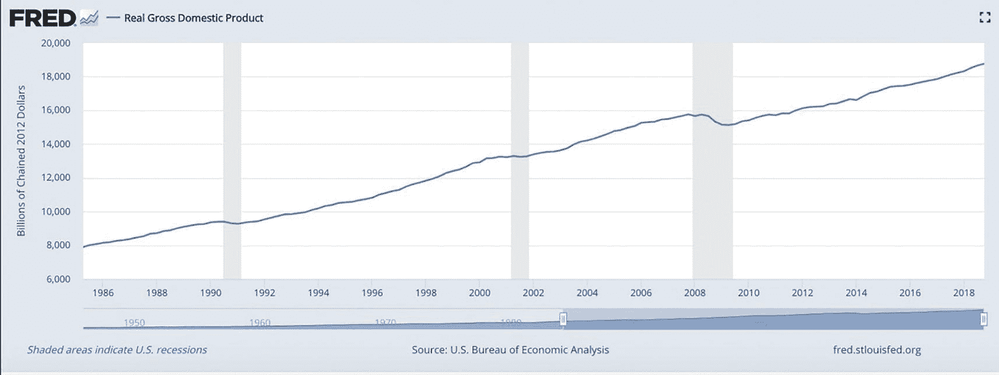
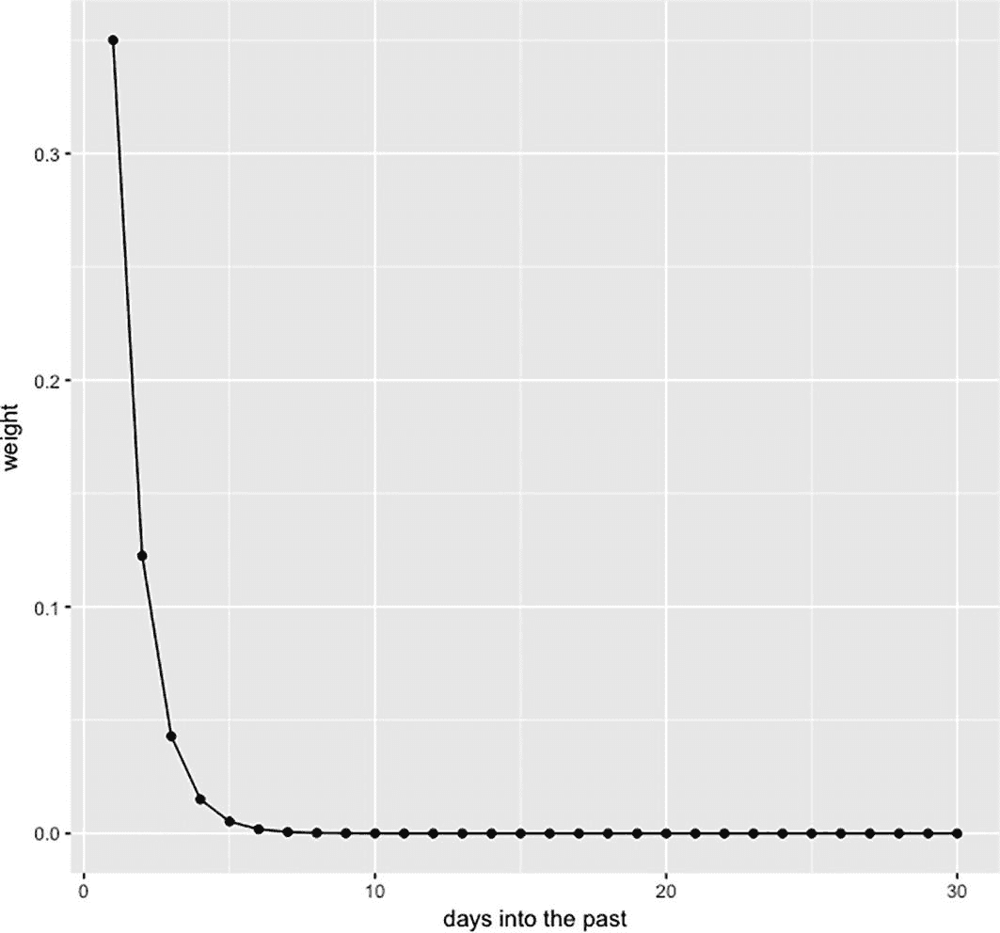
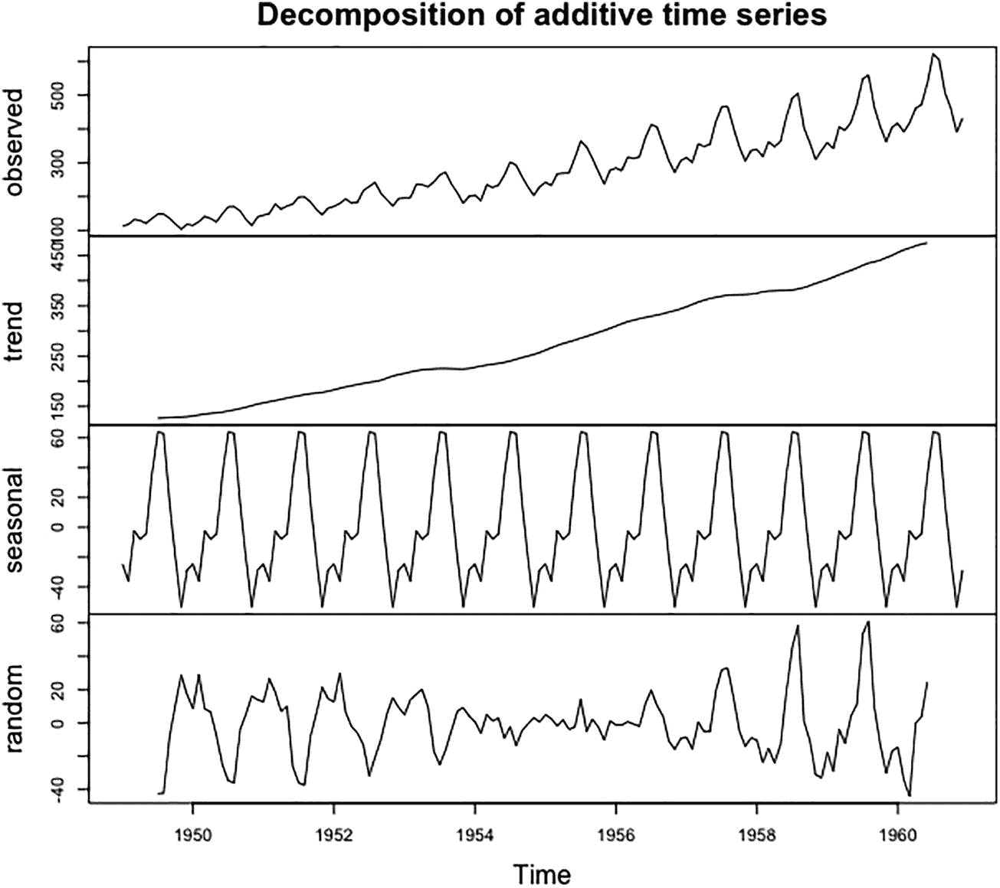
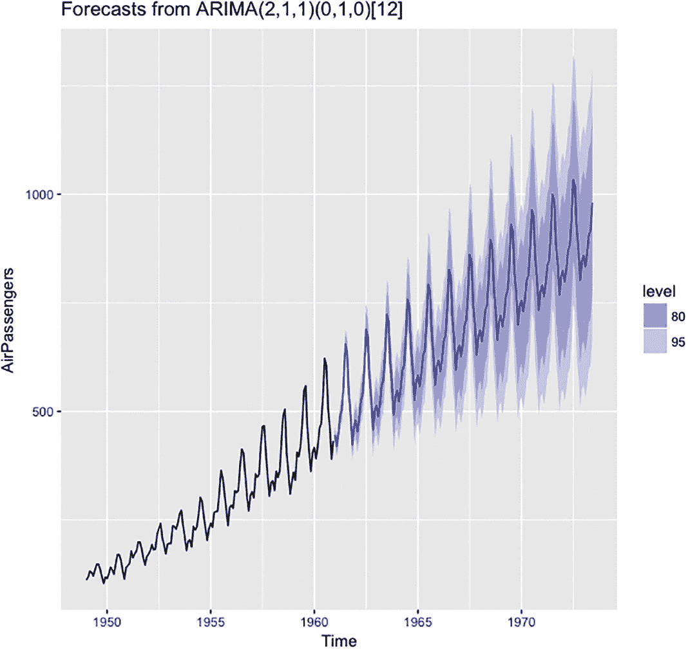

# 时间序列中的概念漂移与外生模型

一幅航空乘客数量与时间的关系折线图，显示出一条带有波动的上升曲线。其范围大致介于（1950 年，120）与（1961 年，620）之间。数值为近似值。

**图 10-1**

时间序列的经典示例

但假设冬季手套的例子发生了一些变化：新的竞争对手推出了更便宜的替代品；出现了新的时尚潮流；全球变暖导致冬季变暖，人们购买的手套减少。在这种情况下，模型将失效。其中一些变化，例如气温变化，可能是逐渐发生的，因此模型能够检测到它们。但在许多情况下，变化可能突然发生，让我们措手不及。

另一个很好的例子来自金融时间序列和零售业。假设你有一个模型来预测某个产品或股票市场价格的需求。然后一场危机发生（例如 2008 年那场危机），引发了全球性衰退，政府为重新平衡经济而介入并出台新法规。类似的情况也发生在 COVID-19 疫情期间。这是另一个可能难以预见的事件，它会彻底改变我们正在建模的基础系统。我们很难期望所研究的时间序列包含足够的信息来预知政府将实施何种法规！

在图 10-2 中，你可以清晰地看到阴影区域所表示的衰退。2008 年之后的衰退在近期历史上是前所未有的，无论从其影响还是持续时间来看都是如此。

**图 10-2**

1986 年至 2019 年美国 GDP。来源：美国经济分析局，实际国内生产总值（`GDPC1`），取自 FRED（圣路易斯联邦储备银行）；[`fred.stlouisfed.org/series/GDPC1`](http://fred.stlouisfed.org/series/GDPC1)

这种系统中的突然变化可能使模型完全失效。这被称为*概念漂移*。它很难在事件发生并造成影响后立即被检测到，而这正是许多预测者的心头大患。

对内生模型的另一个批评源于这样一个事实：通常存在一些有助于预测时间序列的信息——也许是某些其他时间序列——却没有被考虑进去。例如，我们期望 GDP 和通货膨胀率可能会影响需求。这两个时间序列可能包含我们正在预测的时间序列中并未直接包含的信息。或者，假设你正试图预测农作物的产量。气候和土壤信息将极其有用。

为此，我们开发了能够同时纳入外生因素信息的模型。这些模型的开发时间远晚于内生模型。其主要推动力之一是计算机的出现，它使预测者能够以秒为单位计算出复杂模型的结果。

存在多种对包含外生因素的预测模型进行分类的方式。同样，基于本书的目的，我认为主要可以分为两类：内生模型的适应版和通用模型。

所谓原始模型的适应版，我指的是对内生预测模型进行扩展，使其也能包含外生变量。此类模型之一是`ARIMAX`。原始的内生模型称为`ARIMA`（自回归积分滑动平均）。`ARIMA`是一个纯内生模型，利用时间序列的过去值来预测未来。`ARIMAX`则可以纳入其他与时间序列无关的变量。再次回到之前的例子，我们可能希望根据过去的需求（内生部分），再加上一个国家的 GDP 和通货膨胀率，来预测某个产品的需求。

至于通用模型，这些模型可以用于其他目的^(⁸³)，但它们同样可以应用于时间序列。许多机器学习模型就属于这种情况。应用于时间序列预测的最经典模型示例是神经网络和高斯过程。此外，还有更高级的方法，它们结合了机器学习的元素与更传统的技术，例如贝叶斯结构时间序列模型，这类模型备受谷歌青睐^(⁸⁴)。

近几十年来，通用模型因其灵活性以及将多种因素纳入预测的能力而获得了更多应用。然而，这并不意味着它们总是更好。不要忘记偏差-方差权衡。通常，简单的模型可能比高级模型更强大。很快你就会看到，决定“最佳”方法是预测界的一个主要争论。但首先……

## 预测简史

> “我曾见过未来，它与现在极为相似，只是更漫长而已。”

> ——纪伯伦，《先知》，1923 年

现代预测史要从乌德尼·尤尔（1871–1951）和尤金·斯卢茨基（1880–1948）说起。乌德尼·尤尔是一位英国统计学家，对统计学有多项贡献。他于 1911 年撰写了《统计学理论导论》（*An Introduction to the Theory of Statistics*），这是当时最受欢迎的教科书之一。他是第一个发现尤尔悖论（现称辛普森悖论）的人，即群体中存在的趋势在群体合并时消失的现象。他对遗传学、流行病学和时间序列也做出了贡献。

尤金·斯卢茨基（1880–1948）是一位苏联数学家，对经济学和概率论有所贡献。斯卢茨基对经济学和统计学最大的贡献如今被称为斯卢茨基-尤尔定理。

两人互不相识，但同时在同一个结论上达成一致：即随机序列的移动求和或平均可能会在原始数据中不存在此类波动时产生振荡。换句话说，你可以从完全随机的数据中得出有规律的周期性模式。斯卢茨基和尤尔均在 1927 年发表了他们的论文。

斯卢茨基使用了一种在当时非常规的方法，这堪称现代计算机模拟的先驱。他和同事从彩票中随机抽取数字，然后将最近十个数字的结果相加。他意识到，这样产生的模式与在英国商业周期中观察到的模式相似。自然界中的现象（如波浪）也存在类似模式。完全随机的数字能产生规则模式这一发现，在当时具有突破性意义。将其转化为经济理论，意味着经济无需任何外部因素影响，自身就可能经历冲击。

这对经济学，以及对时间序列分析而言都是一项重要发现，因为这实际上是首次使用的自回归过程。自回归过程就是根据过去数值的加权平均来预测未来的模型。过去包含着我们预测未来所需的信息。

此后，情况不断发展。查尔斯·霍尔特（1921–2010）于 1957 年提出了第一个现代预测方法，称为“指数平滑法”。虽然西梅翁·德尼·泊松在 17 世纪就已应用过类似原理，并被信号处理领域所采纳，但这是该原理首次被应用于时间序列。

霍尔特的方法基于一个简单的理念：下一个值可以通过过去的数值来预测，而这些数值的权重会随时间呈指数衰减。这意味着预测会考虑所有历史数据，但对于更古老的数据点，其权重实际上为零。图 10-3 更清晰地说明了这一点。假设你想预测某产品的需求情况，你使用的是每日数据。指数平滑模型的权重会如图 10-3 所示。前一天的权重最大，约为 0.35。超过一周前的天数，其权重实际上为零。

*图 10-3——指数平滑模型权重示例*

这是一种在实践中效果良好的方法，但显然也有其局限性。例如，它没有考虑季节性模式。这就是为什么后来出现了更多对该方法的扩展，如霍尔特-温特斯平滑法、布朗双指数平滑法等。

对预测领域的一项重大贡献来自乔治·博克斯（1919–2013）和格威利姆·詹金斯（1932–1982）。他们发现了前面提到的 `ARIMA` 方法。他们的模型是应用“利用过去数值预测未来数值”这一理念的另一个实例。然而，它采用不同的方法来得出权重。在很长一段时间里，`ARIMA` 被认为是时间序列预测领域的顶尖技术。

大约在同一时期出现的另一项技术是时间序列分解。时间序列分解将时间序列分解为不同的元素。图 10-4 展示了一个时间序列分解的示例。你可以看到，之前见过的`AirPassengers`数据包含一个季节性成分、一个趋势以及随机噪声（在此例中，噪声似乎也遵循某种周期性模式）。该技术用于更好地理解时间序列的行为方式。

*图 10-4——AirPassengers 数据的时间序列分解示例。将所有三个成分（随机、季节性和趋势）相加，即可得到原始时间序列。*

现代预测的发展受到机器学习的启发，也得益于多种不同数据源的可用性和低廉的计算能力。例如，Facebook 发布了一个名为`Prophet`的工具，它同时使用多种不同技术来自动生成一个良好的预测模型。

此外，另一种流行的方法是使用通用算法，如深度神经网络，并向其馈送多种不同来源的信息，从时间序列到社交媒体帖子。

鉴于预测的实用性，我们确信在不久的将来会看到更多技术的涌现。

## 实践中的预测：牛顿与人类的疯狂、特朗普、脱欧，以及因数学模型而亏损

> *“一个不成熟的预测者使用统计数据，就像醉汉使用路灯——不是为了照亮，而是为了支撑。”*

> ——安德鲁·朗

预测是数据科学中一个非常有用的应用，这一点显而易见。上一节希望能帮助您从数学角度理解如何处理该问题。但在实践中，预测的效果如何呢？在众多行业中，它都有着许多成功的应用。

不过，让我们来看看预测出错时会发生什么。

如您所见，许多预测技术都只是同一理念的不同版本：即利用过去来预测未来。我们之前提到过这为什么并不总是成立。

当然，我们在这里讨论的主题是不确定性——那么预测模型是如何处理不确定性的呢？

许多统计预测方法可以通过使用置信区间来显式地对不确定性进行建模。例如，我们之前提到的`ARIMA`模型就是如此。

在图 10-5 中，您可以看到一个拟合了`AirPassengers`数据的`ARIMA`模型，您在图 10-1 中见过这些数据。原始的`AirPassengers`数据截止到 1960 年。预测值则延续到 1975 年。

预测值周围的阴影区域分别是 80%和 95%置信水平的置信区间。95%的置信区间可以解释为：在 95%的时间里，预测值会落在这个范围内的某个位置。

图中呈现出一个清晰的模式。随着时间的推移，置信区间变得越来越宽。到了某个点之后，置信区间变得过大。此时，预测就不再有用。例如，如果我们使用这个模型来预测航空公司的需求和预测收入，那么最终的数字将会大相径庭——5000 万乘客和 10 亿乘客的结果是完全不同的。

一张航空乘客数量与时间关系的图表，描绘了一条带有波动和峰值的上升曲线。范围从（1950 年，100）延伸至（1973 年，950）。标记为 80 级和 95 级的噪声信号从（1961 年，400）开始叠加到曲线上。数值为近似值。

图 10-5

用于预测未来航空乘客数量的`ARIMA`模型的预测结果及其置信区间

很明显，即使趋势相对稳定，不确定性也会随着时间的推移而增长，直到模型不再适用的地步。但这还算乐观的情况。在现实生活中，我们面对的是更复杂的系统，包含许多相互关联的组成部分。这可能会导致问题，通常以意料之外且负面的方式出现。金融领域比任何其他领域都更能说明这一点。

一个非常聪明的人在股市中亏损大笔钱财的著名例子，就是艾萨克·牛顿爵士在南海泡沫中损失巨额财富的故事。南海泡沫是历史上最早、最严重的金融危机之一。1720 年，上议院通过了《南海法案》。该法案授予南海公司对南美洲贸易的垄断权。作为交换，该公司向政府贷款 700 万英镑，用于资助对法战争——按今天的价值计算，这笔钱接近 1 亿英镑，因此其吸引力可见一斑。股票价值迅速上涨，投机者和公众投入了所有积蓄，以期获得超额回报。股价从 128 英镑飙升至超过 1000 英镑。^(⁸⁷) 显然，正如这类故事中经常发生的那样，股市崩盘了，财富灰飞烟灭。

牛顿投资了南海公司并赚取了 7000 英镑的利润。他决定再次投资，最终在泡沫结束时亏损了 20,000 英镑。按今天的货币计算，这相当于大约 300 万英镑。^(⁸⁸)

牛顿有句名言，他“可以计算天体的运动，却无法预测人们的疯狂。”

虽然牛顿没有使用任何数学预测技术，但这个故事说明了，当所讨论的系统暴露于多个相互作用因素时，对未来做出准确预测是多么困难。我们不必远溯历史也能在近期找到类似的故事（互联网泡沫和比特币泡沫仅仅是两个例子），但我们也不必费力就能找到*确实*使用了复杂技术的类似故事。

预测面临的挑战之一在于，未来预测的准确性不仅取决于我们的模型，还取决于底层系统的稳定性。布莱克、斯科尔斯和默顿的例子最能说明这种情况会如何出错。这三个人是著名的布莱克-斯科尔斯模型（一个期权定价公式）的幕后推手。该模型于 1973 年提出，或许是金融界最著名的模型。斯科尔斯和默顿于 1997 年获得了诺贝尔经济学奖。^(⁸⁹)

斯科尔斯和默顿曾担任长期资本管理公司（Long-Term Capital Management L. M.）的董事会成员。该基金最初非常成功，回报率在 20%到 40%之间，直到 1998 年崩盘，在四个月内损失超过 46 亿美元，需要美联储提供救助。结果，默顿和斯科尔斯的理论遭到了质疑和抨击。美林证券报告称，数学模型“可能比实际情况提供了更大的安全感；因此，对这些模型的依赖应当有所限制。”^(⁹⁰)

那么，为什么会发生这种情况呢？长期资本管理公司采用的模型基于有效市场假说。该假说假设投资者是理性的，并且市场在其定价决策中包含了所有相关信息。这些模型没有考虑到可能破坏市场的极端事件。关于这一点，我们可以进行长篇讨论，而且它至今仍是一个争议话题，但简而言之，他们模型中的假设在现实中并不成立。

这个故事说明了过度相信模型可能导致灾难性后果，并且它是仅仅十年后 2008 年金融危机期间发生的一系列事件的先兆。保罗·威尔莫特和大卫·奥雷尔在他们的著作《金钱公式》中讨论了这一点。

金融领域最流行的工具之一是现代投资组合理论。该理论由哈里·马科维茨在 20 世纪 50 年代首创，描述了投资组合经理如何以一种平衡风险与回报的方式来配置资产。现代投资组合理论的问题与布莱克-斯科尔斯公式相同：只要基本假设正确，模型就是正确的。此外，现代投资组合理论中的一些数学处理可能会急剧增加模型的不确定性。威尔莫特和奥雷尔解释道：

*   “当我们估计回报时，我们是在对未来进行预测；但当我们估计风险时，我们是在预测我们预测中的不确定性——一个关于预测的预测——这更加困难。”

在金融领域，就像在其他领域一样，科学家们一直试图设计出各种简化理论，利用数学工具来解释甚至消除不确定性。然而，金融体系的动态本质使得这些模型容易遭受灾难性的失败。

鉴于将某些系统的复杂性抽象成一个公式是困难的，那么是否存在更简单的预测方法呢？如果有一种结构化的方法可以询问人们，因为大部分不易编码的知识都在他们的头脑中，那会怎样？

这就是“群体智慧”方法和预测市场的原理。根据这种方法，对未来做出可靠预测的一个有效方式是询问大量人群，然后对他们的预测结果取平均值。