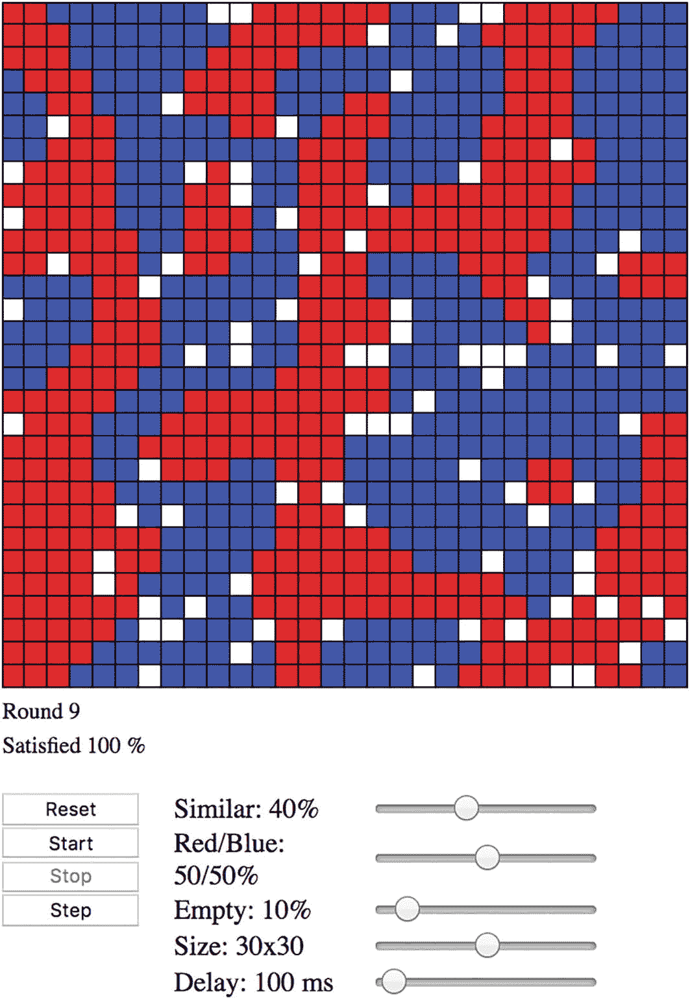

# 基于智能体的建模：构建人工世界

基于智能体的建模有点像尝试制作一个世界的电子游戏——*模拟人生*，但带有理论色彩。在基于智能体的建模中，目标与其说是抽象出关系，不如说是在计算机内部（即 *in silico*）精确地再现世界。最早的一些基于智能体的模型可以归功于冯·诺依曼的元胞自动机（我将在后面的章节中讨论），但第一个真实的基于智能体的模型很可能是谢林的隔离模型。

托马斯·谢林（1921–2016）是一位美国经济学家和外交政策教授。在哈佛大学期间，他对隔离现象是如何产生的产生了兴趣。于是，他创建了以下这个简单的模型。有一些智能体生活在一个由方形网格组成的世界中，很像棋盘游戏。这些智能体是非常简单的实体，代表了抽象化的人类。智能体被分成两种不同的颜色，比如说红色和蓝色。游戏按轮次进行，在每一轮中，每个智能体都会判断自己是否满意。对于一个智能体来说，要感到满意，其邻居中需要有特定比例的颜色与自己相同。如果不满足，该智能体就会尝试移动到其他空单元格。

在这个游戏中我们可以看到，即使智能体非常宽容，游戏最终也会收敛到一种状态，即出现由相同颜色智能体组成的明显聚居区。你可以在图 12-1 中看到这一点。在这个特定的游戏实例中，只要智能体有 40% 的邻居与它颜色相同，它就会感到满意。但即便如此，也足以迫使形成隔离的聚居区。

屏幕截图包含一个带网格的正方形。正方形内包含若干蓝色和红色方块组以及几个空方块。以下为相关数据：相似度 40%；红色或蓝色各占 50%；空置率 10%；尺寸 30×30；延迟 100 毫秒。

**图 12-1** 谢林的隔离模型^(¹²¹)

这一点特别有趣，因为它表明隔离不一定是个人偏见的结果。即使个人并不太在意大多数邻居是否与自己相似，隔离仍然可能发生。谢林模型的行为是具有涌现行为特征的复杂系统的典型表现。我稍后会讨论这是什么意思，但其核心思想是整体大于部分之和。

另一个著名的基于智能体的模型是 `Sugarscape`。`Sugarscape` 由约书亚·M·爱泼斯坦（Joshua M. Epstein）和罗伯特·阿克斯特尔（Robert Axtell）创建。爱泼斯坦是纽约大学全球公共卫生学院的流行病学教授，阿克斯特尔是乔治梅森大学计算社会科学教授。`Sugarscape` 是一个人工世界，由一个 51x51 的方形网格构成。智能体有各种规则来管理它们的交互，这些规则基于我们现实世界的简化版本。这个世界的主要资源是“糖”，智能体必须消耗糖才能生存。智能体还可以繁殖和死亡，在更复杂的版本中，甚至可以进行物物交换。

爱泼斯坦和阿克斯特尔将他们的研究成果出版成书，书名为《*人工社会：自下而上的社会科学*》（Growing Artificial Societies: Social Science from the Bottom Up），该书于 1994 年首次出版。该模型的主要目的是展示简单的规则如何能产生复杂的动力，以及这些动力和规则如何能与我们在现实世界中观察到的动力和规则非常相似。^(¹²²)

关于基于智能体建模的研究进一步推进，并被应用于各种问题。1999 年，奈杰尔·吉尔伯特（Nigel Gilbert）出版了该领域的第一本教科书《社会模拟：为社会科学研究者而设的模拟》（*Social Simulation: Simulation for the Social Scientist*），他还创立了社会科学领域第一本关于基于智能体建模的期刊《人工社会与社会模拟杂志》（*Journal of Artificial Societies and Social Simulation*）。在谷歌学术上搜索“agent-based model”会返回超过 450 万个结果，涉及从供应链到军事行动的各种模型。成立于 1984 年的圣塔菲研究所^(¹²³) 也是该领域的知名机构，对该领域，特别是经济学中基于智能体模型领域，做出了多项贡献。

计算机模拟在物理科学中发挥了重要作用，而基于智能体的建模则试图为社会科学做同样的事情。基于智能体的模型有一个独特的性质，即我们不需要提出关于世界如何运作的数学模型或抽象理论。我们只需提取理论的小片段，将它们组合起来，然后在模拟中运行。理解人类心理学如何影响经济选择是一个迷人且复杂的问题，而回答这个问题的过程催生了行为经济学领域。

理解行为经济学的发现如何影响更广泛的经济环境则是一个更为棘手的问题。然而，利用基于智能体的模型，我们可以创建模拟真实人类的智能体，利用我们已有的任何心理学理论，然后观察它们的互动如何产生各种现象。

基于智能体的建模可以非常强大。自然界中的许多复杂系统——比如社会系统——都具有反馈循环和动态特征，这使得它们难以控制或预测。事实上，对于许多自然系统来说，它们甚至不需要遵循复杂的规则就能展现出这种复杂行为。在这种情况下，更简单的确定性或分析模型就不那么有用了。基于智能体的建模是一种接受我们方法和知识局限性的方式，同时也提出了一种解决同样问题的新途径。这是一种明显的实用主义方法，与我之前讨论过的计算学习理论形成直接对比。

尽管基于智能体的建模（以及这些观察）自 20 世纪 40 年代以来就已存在，但直到 20 世纪 90 年代，这种方法才开始形成理论形态。这一努力被称为“复杂性理论”。

