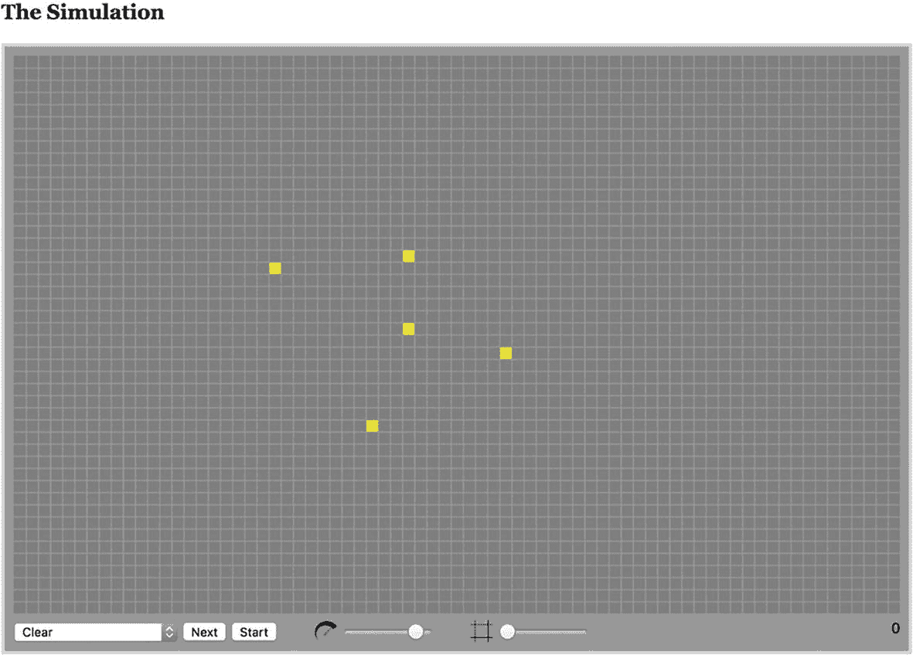
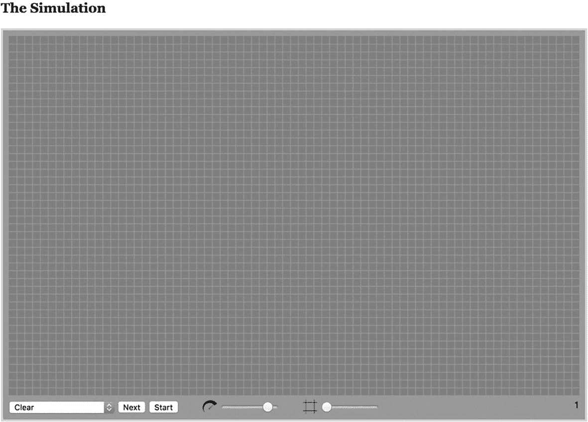
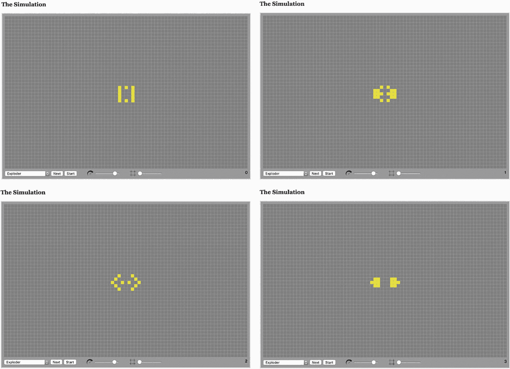
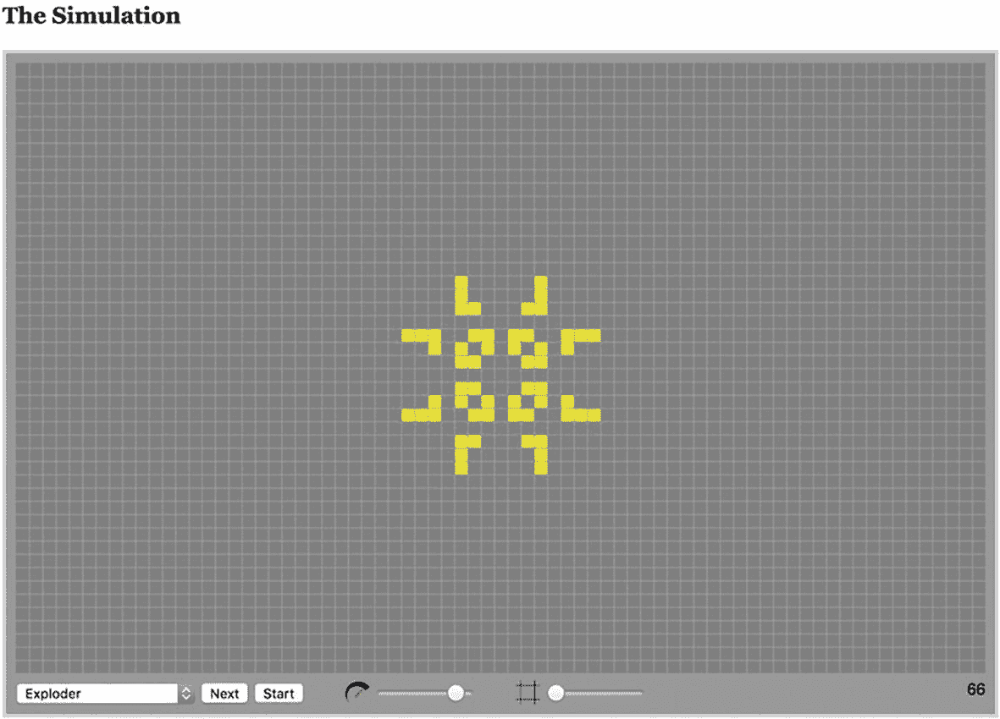
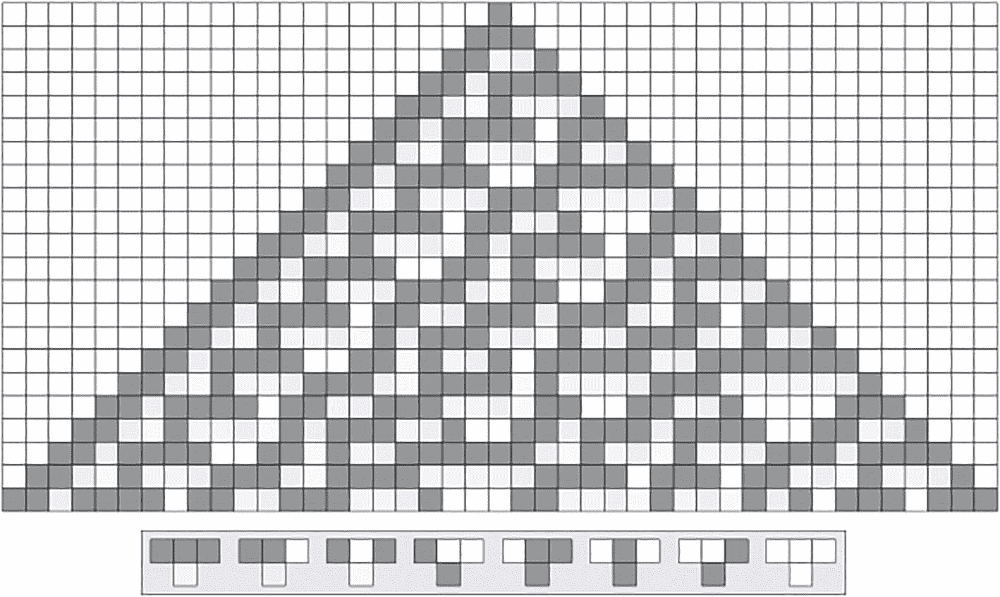
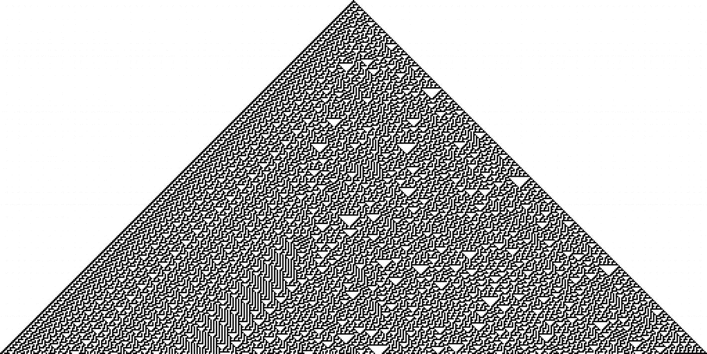
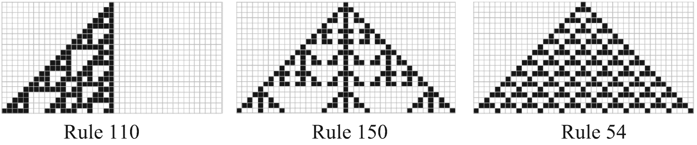

# 研究复杂性是一项复杂的事业

> “事物之复杂——事物中的事物——似乎是无穷无尽的。我的意思是，没有什么是容易的，没有什么是简单的。”
> 
> ——爱丽丝·门罗，诺贝尔文学奖得主

在复杂性科学最受欢迎的时期，研究人员对这些新理论抱有热情，认为它们能够以全新且信息量更大的方式解释现象。鉴于上述许多问题被归类为涌现现象，我们很容易理解为什么相信能够通过一种通用的涌现理论来解释广泛的重要科学问题是一个极具吸引力的想法。

然而，这并未发生。为什么？好吧，试图解释一切的理论存在一个问题：它们往往最终什么也解释不了。复杂性理论家提出了许多有趣的例子和公式，但大多数对实际系统没有预测价值。这些公式的行为像真实系统，但正如我们之前所讨论的，复杂系统的一个关键组成部分是它们难以预测。复杂性理论家在解释这类系统的定性属性方面取得了成功，但在预测定量属性方面却不太成功。

复杂性科学同时既辉煌又彻底失败的一个最著名例子是斯蒂芬·沃尔夫勒姆的《一种新科学》。斯蒂芬·沃尔夫勒姆是一位神童，19 岁时在加州理工学院获得了博士学位。他离开学术界去创建了广受欢迎的数学软件 `Mathematica`。他的公司 `Wolfram Research` 于 1987 年成立，最终取得了相当大的成功。除此之外，`Wolfram Research` 还发布了一个名为 `Wolfram Alpha`^(¹³²) 的搜索引擎，为数学和数据相关的问题提供智能答案。你可以用它来运行本章中提到的一些模型。

大约在复杂性科学兴起的同时，沃尔夫勒姆顿悟了一个道理。他正在研究一组名为元胞自动机的计算系统。元胞自动机基于简单的逻辑规则。最著名的元胞自动机之一是约翰·霍顿·康威创建的“康威生命游戏”。这个游戏于 1970 年首次出现在《科学美国人》杂志的一个名为“数学游戏”的专栏中。

游戏在一个由黑白方格组成的方形网格上进行。每个回合中，每个方格与周围的八个方格（其邻居）进行交互。康威提出了四组交互规则：

1.  任何活着的方格，如果其活着的邻居少于两个，则会死亡（称为人口不足或暴露）。
2.  任何活着的方格，如果其活着的邻居超过三个，则会死亡（称为人口过剩或过度拥挤）。
3.  任何活着的方格，如果有两个或三个活着的邻居，则会存活至下一代，状态不变。
4.  任何死亡的方格，如果恰好有三个活着的邻居，则会获得生命。

好吧，这听起来可能有点抽象。生命游戏到底是什么样子的？你可以通过这个链接^(¹³³)找到该游戏的网页应用版本。让我们从一些随机放置的彩色方格开始，如图 12-3 所示。

一个标题为“模拟”的窗口截图，包含一个网格。网格中有 5 个随机方格被着色。下方的选项包括“清除”、“下一步”和“开始”。

**图 12-3** — 生命游戏，第 1 轮

现在我们处于游戏的第 1 轮。下一轮会发生什么？好吧，我们必须遵守规则，所以在下一轮中，方格会全部死亡——它们都遭受人口不足。见图 12-4。

一个标题为“模拟”的窗口截图，包含一个空网格。下方的选项包括“清除”、“下一步”和“开始”。

**图 12-4** — 生命游戏，第 2 轮

好吧，这不算一个很有趣的例子。但是，如果我们改变初始图案，让一些方格聚集在一起，会发生什么？让我们尝试“爆炸器”图案，运行四个回合。见图 12-5。

四个标题为“模拟”的窗口截图，包含一个网格，网格中心有 4 种不同的图案。下方的选项包括“爆炸器”、“下一步”和“开始”。

**图 12-5** — 康威生命游戏产生的更有趣的图案

这个图案显然更有趣！如果我们像图 12-6 那样组合图案，会发生什么？

一个标题为“模拟”的窗口截图，包含一个网格，网格中心有一个图案。下方的选项包括“爆炸器”、“下一步”和“开始”。

**图 12-6** — 生命游戏生成的另一图案

还有更多图案可以供你尝试。生命游戏的主要意义在于，使用四条简单的规则，你可以获得许多不同且复杂且不可预测的行为。康威的生命游戏已被证明是图灵完备的。术语“图灵完备”与计算机科学之父艾伦·图灵（1912–1954）有关，它指的是一种自动机（比如这个），理论上具有计算机的所有计算能力。这是一个极其有趣的特性，因为这意味着如此简单的游戏基本上可以计算各种程序。理论上，它可用于计算我们能用于现代计算机的任何东西。

沃尔夫勒姆注意到，规则的简单性或复杂性并不能预测将出现的图案的简单性或复杂性。元胞自动机中非常简单的规则可以生成非常复杂的图案。例如，沃尔夫勒姆对元胞自动机中的规则 30 着迷，该规则可以生成非常复杂的图案。事实上，这些图案似乎无限延续下去，无法预测下一步会发生什么。沃尔夫勒姆甚至在他的软件 `Mathematica` 中将这个元胞自动机用作随机数生成器。

元胞自动机中的规则 30 如图 12-7 所示。这是一个一维元胞自动机的例子。从顶行开始，规则决定了下一行方格的颜色。因此，你可以看到顶行中间的方格是黑色的，有两个白色邻居。因此，它下方的方格也将是黑色的。在第一行中，它旁边的每个方格都是白色的，有一个黑色邻居（黑色邻居是中间的黑色方格）。因此，正下方一行的方格将是黑色的。

一个一维元胞自动机的示意图，底部有 8 个不同阴影图案的方块。

**图 12-7** — 元胞自动机中的规则 30^(¹³⁴)

好吧，这看起来可能不那么令人印象深刻，但看看经过更多次迭代后会发生什么，如图 12-8 所示。

一个具有倒三角形图案的元胞自动机示意图。

**图 12-8** — 多次迭代后的元胞自动机规则 30

没有可辨别的演化模式。不同区域会出现一些形状，但确实无法预测自动机的精确演化。图 12-9 显示了这个元胞自动机与其他能产生更简单图案的规则有多么不同。

三个元胞自动机图案，左侧是规则 110，中间是规则 150，右侧是规则 54。

**图 12-9** — 其他类型的元胞自动机

值得注意的是，元胞自动机的创建者正是来自洛斯阿拉莫斯实验室的同一批人——冯·诺依曼和斯坦尼斯瓦夫·乌拉姆。

沃尔夫勒姆提出了一个与复杂性理论家们相似的观察：从简单的规则中，可能会涌现出复杂的现象。许多分子聚集在一起可以形成细胞。神经元细胞的二元放电活动产生了意识。两个商人之间以物易物的简单互动，逐渐演变成足以制造飞船前往其他行星的复杂全球经济。沃尔夫勒姆提出，这种“新科学”将基于计算机模拟，物理系统将以计算类比为基础，就像元胞自动机一样。然而，尽管沃尔夫勒姆对自己的发现沾沾自喜，并且对更传统的方法颇为贬低，他却从未真正解释过这究竟如何实现。同样，元胞自动机似乎与现实世界中的许多系统具有相似性，但我们又该如何利用其中一个来预测另一个呢？

那么，这一切与不确定性有何关联？我认为，复杂性理论背后的一个问题在于，对许多科学家而言，其核心愿景从根本上与启蒙运动时期确立的还原论方法所设定的原始愿景紧密相连。长久以来，科学通过精确逼近自然界的分析方程来解释自然现象，取得了巨大成功。最著名的例子就是牛顿的万有引力定律。

然而，正如你之前所见，即使是牛顿本人也无法应对人类的疯狂——例如，经济、金融结构等涌现的社会现象，以及随后南海公司泡沫期间出现的狂热。这些现象长期以来一直让科学家们感到困惑，并且在很大程度上至今依然如此。复杂性理论家们相信，通过使用像元胞自动机这样与真实系统具有相似属性的模型，他们能够提出类似的公式或模型（就像牛顿的万有引力定律一样），从而预测前面讨论过的某些现象的路径。

对于科学家来说，这或多或少是最终目标。尽管复杂性科学家拒绝还原论，并认为涌现是无法解释的，但他们在本质上追寻的，正是还原论者通过物理世界模型所实现的那种清晰性。这些模型能够提供最小程度的不确定性。力学和化学定律让我们对两个物体碰撞或化学反应的结果充满信心。如果我们拥有能够为所有其他复杂系统做出这类预测的模型或方法，那么我们就会被公认为发现了有史以来最重要的科学突破。

我之前讨论过，当洛斯阿拉莫斯的物理学家无法找到所研究问题的精确解时，他们是如何运用蒙特卡洛模拟的。他们遇到了一个传统方法无法突破的不确定性极限。因此，他们不得不采用其他明确纳入不确定性的方法，试图去控制它——换句话说，就是知己知彼。复杂性理论家们基本上认为他们可以在不依赖明确纳入不确定性的情况下取得成功。然而，他们无意中采用的方法在很大程度上揭示了他们所面临的挑战，并阐明了为什么他们的愿景可能终究无法实现。

复杂性理论家最常用的工具之一是基于主体的模拟。假设你想使用基于主体的模型来模拟一个城市的经济。想象一下你将面临的各种不确定性。完全模拟每个个体的偏好和思维过程是不可能的。即使你能通过多种数据收集方法，对每个人进行全天候跟踪，你仍然无法百分之百确定每一个个体可能会做出的决定。你必须在模型中进行大量简化，而这只会增加不确定性。

复杂性理论借鉴并扩展了混沌理论的观点，即微小的效应会带来不成比例的巨大结果。的确，元胞自动机背后的整个理论就是，简单的规则和简单的相互作用可以产生截然不同的现象。

回到我们正在构建的基于主体的模型这个例子，我们已经接受了一个事实：我们模型的许多参数都将存在高度不确定性。在系统内对各种条件具有这种敏感性的基础上，再叠加各种不确定性，我们就会得到系统在任何给定时刻可能采取的、数量极其庞大的潜在路径。你可能听过各种各样的争论，关于如果历史上某件其他事件发生或未发生，历史会怎样发展。例如，如果德军做出了不同的战略决策并最终赢得了第二次世界大战，历史将会如何演变？如果爱因斯坦出于某种原因没能提出相对论，人类又会取得怎样的进步？

你可能也在自己的生活中思考过这样的例子。如果你做出了不同的决定，你的生活将会如何发展？更进一步说，如果你做出了不同的决定，你所遇到（或未遇到）的所有其他人的生活会如何演变？多年来，这个问题一直是许多热门电影的主题，比如《滑动门》和《蝴蝶效应》。

当我们试图通过基于主体的模型来模拟经济时，我们正在尝试做完全相同的事情，但任务的难度呈指数级增加。不确定性通过所有这些相互作用被叠加放大，我们很快就会忘记要创造任何具有预测价值的东西。

