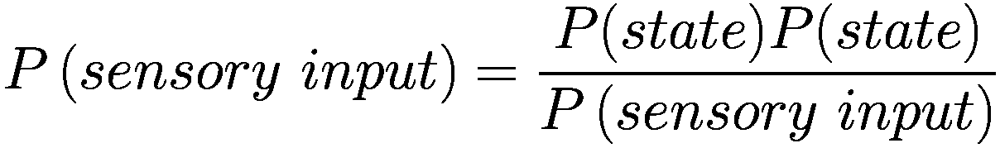
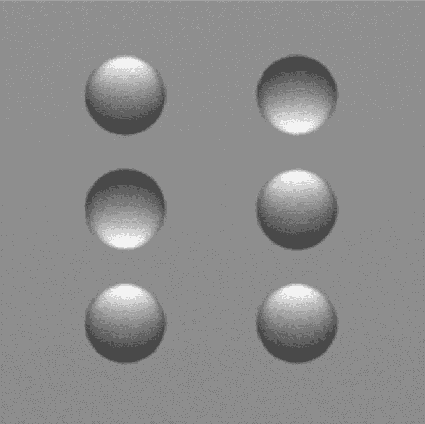

# 贝叶斯认知与自由能原理

有证据表明，我们的认知系统正是以这种方式整合感官信息的^((144))。这一点在视错觉中很容易看到，例如图 13-1 中的错觉。如果你和大多数人一样，你会看到四个凸起和两个凹陷。通常光源（例如太阳）位于我们上方，因此我们对这一假设有很强的先验。每个圆形，如你所见，顶部或底部都涂有阴影区域。如果阴影区域在底部，那么圆形看起来像凸起，因为这样可以解释阴影。如果阴影区域在顶部，那么圆形被视为凹陷，因为只有这样才能解释来自上方光源的阴影的存在。如果你将图像倒转，你会看到四个凹陷和两个凸起，这与之前的模式相反。

六个带有不同位置阴影的球体视错觉图像，排列成 2 列 3 行。

**图 13-1** 形状与阴影错觉^((145))

我们大脑如何生成我们对世界版本的另一个好例子是*空想性错视*（`pareidolia`）。空想性错视描述了在模糊的视觉输入中看到熟悉模式的现象，例如在云中观察到人脸。

这个领域有很多出版物，但也不乏批评者。对认知的贝叶斯解释的主要批评是，仅仅因为贝叶斯定理和模型可以解释实验结果，并不意味着我们的思维必然以这种方式运作。正如乔什·霍根（Josh Horgan）在《科学美国人》（*Scientific American*）的一篇文章中所写：

> “此外，贝叶斯大脑的论点可以归结为一个可疑的三段论：我们的大脑擅长某些任务。贝叶斯程序擅长类似的任务。因此，我们的大脑采用了贝叶斯程序。”

虽然关于贝叶斯方法在认知建模中合理性的争论可能永无止境，但最近出现了一种新理论，它解释了我们的大脑和其他生物系统如何在不确定性下做出推理和决策。这就是弗里斯顿的“自由能原理”。卡尔·弗里斯顿（Karl Friston）是伦敦大学学院的神经科学家，同时也是（在撰写本文时）世界上被引用次数最多的神经科学家。

贝叶斯认知理论解释的一个迷人之处在于，我们的大脑并非不确定性下的简单被动观察者。相反，我们的大脑遵循一个生成模型。在图 13-1 所示的错觉中，你的大脑并非被动地记录信息，你也不必花大量时间去思考这个错觉。你的大脑对圆形和阴影做出了非常快速的解释。你正在生成一个世界的版本，主动解释结果。

弗里斯顿将这一点向前推进了一步。他认为，最小化不确定性本质上是所有生命的目标。他的自由能原理将不确定性置于所有智能行为的中心。弗里斯顿将该原理建立在一些基本假设之上。所有生物有机体都倾向于抵抗无序，为了做到这一点，它们必须将感官输入与对世界的预测相匹配。有两种方法可以做到这一点——要么更新关于预测的理论（即对世界有何期望），要么采取行动以最小化意外。术语“自由能”源于对问题的贝叶斯处理。自由能是对不确定性的贝叶斯量化，衡量生物体的预期与其接收的感官输入之间的差异。大脑（进而思维）在生成关于世界的理论方面扮演着积极角色，同时也影响世界。

这是对该理论非常高层次、宽泛的解释。弗里斯顿关于这一理论的著作跨越了十多年，并且可能显得深奥而难以理解，因为它结合了从神经科学到贝叶斯统计学等多个不同领域的概念。弗里斯顿还将其理论推广为对所有与大脑和思维相关现象的解释，从神经递质的功能到情绪障碍^((146))。有很多人表示无法理解他的著作。例如，在一份研究摘要中，彼得·弗里德（Peter Freed）写道^((147))：

> “在哥伦比亚大学的精神病学系，我最近带领了一个由 15 名 PET 和 fMRI^((148))研究人员组成的期刊俱乐部，这些人都是博士和医学博士，我们之间拥有超过 1000 万美元的美国国立卫生研究院（NIH）^((149))资助，我们试图理解弗里斯顿 2010 年发表在《自然评论·神经科学》（*Nature Reviews Neuroscience*）上的论文——长达一个半小时。房间里充满了数学知识：三位统计学家、两位物理学家、一位物理化学家、一位核物理学家和一大群神经影像学家——但显然我们不具备所需的水平。我与一位普林斯顿大学的物理学家、一位斯坦福大学的神经生理学家、一位冷泉港实验室的神经生物学家讨论了这篇论文。结果又是一脸茫然，无一例外。”

甚至有一个推特账户在模仿理解该理论的难度^((150))。无论弗里斯顿的理论最终是否被证明是脑与思维科学中的主导范式，它都清楚地表明了一点：不确定性是我们存在的核心，即使我们没有意识到，我们的行为和身体功能，直至神经递质的微观层面，都受到不确定性在漫长岁月中影响的冲击。弗里斯顿的理论将不确定性视为宇宙中原始力量之一，并置于我们存在的中心。

