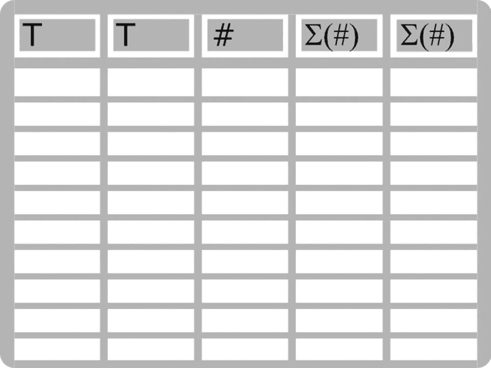
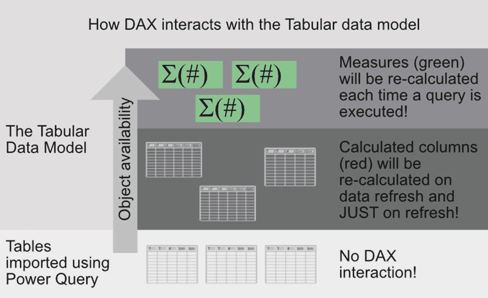

# 1. DAX 机制

本章的构思非常简单。在过去的几年里，我们被问及许多关于如何计算度量和计算列的问题。同时，我们也无数次被问到这样一个问题：“为什么这样不行？”

当我们开始更深入地审视潜在的业务问题时，我们常常会想：“他们为什么会问这个问题？这太简单了。” 然后我们意识到，那些我们认为简单的事情，对其他人来说往往并不简单。

在 Power BI 论坛（`https://community.powerbi.com`）上回答与 DAX 相关的问题，为我赢得了诸如“你真是个传奇！”或“哇，你是个 DAX 忍者！”之类的感谢之词。

诚然，其中一些问题回答起来很有挑战性，但我绝对不是什么传奇，也不是忍者。我从未拥有过，也从未穿过一件能让我随心所欲消失或在我家乡的楼顶上空飞行的黑色睡衣。通过与客户和朋友的多次交谈，我知道外面有很多聪明人正面临着超出他们当前能力的 DAX 挑战，这让他们思考：“我要怎么做才能学会这种黑暗的艺术？”

如果你可能认为 DAX 是一种黑暗的艺术，并且阅读本书能帮你征服世界、学到一些咒语，那么你恐怕会在某种程度上感到失望。是的，你会读到一些能帮你征服世界的 DAX 代码；至少，它会帮你创建富有揭示性的 DAX 语句，从而帮助你发掘隐藏在数据中的全部潜力。但你肯定不会找到任何咒语或诅咒。

DAX 极大地帮助我们从数据中提取见解。有时这种提取相当简单，使用一个 DAX 函数就足够了。不幸的是，也有些时候这种提取必须强力进行，这意味着要使用多个 DAX 函数，并且创建一个“简单”度量的 DAX 代码会横跨多行，甚至多页。正是这些 DAX 语句可能导致人们产生 DAX 是一门艺术，或是一种由女巫、巫师或其他神秘人物使用的古老强大语言的印象，但请放心，它不是。

但如果 DAX 不是一种“施法”语言，为什么在像 Power BI 甚至 Stack Overflow 这样的论坛上还有那么多问题呢？

从我们的角度来看，大多数时候问题在于忽视了简单的东西，也就是我们所说的“活动部件”。人们常常会问，他们是否忽略了某个隐藏的“上下文转换”，或者是否需要更仔细地考虑“影子筛选器”。他们也在谈论掌握计算上下文，仿佛掌握了它就能获得一条黑带。

这里的问题是，有时确实存在隐藏的上下文转换，有时影子筛选器也确实在起作用。但大多数时候，他们忘记了掌握“五指死亡拳”意味着首先必须理解和掌握构成 DAX 基础的那些部分。这些基础部分构成了 DAX 展现其“魔力”的根基。

## 为什么是 DAX 机制

如前所述，使用 DAX 解决分析问题并非少数入门者所掌握的秘密科学。相反，我们将其视为一门手艺。这是因为我们认为，任何愿意投入时间并且不惧怕一些挫折的人，都能够掌握这门手艺。我们认为，将编写 DAX 语句与制作陶器相比较是合理的。如你所知，成功完成学徒期可能需要一些时间，甚至可能要用一生才能成为一门手艺的大师（想到一些日本陶艺）。有时候，一个复杂 DAX 语句的精密运作，可能更像是瑞士制造、计量宝贵时间的杰作，而不是一个帮助我们保持清醒、思考我们的 DAX 语句如何将活动部件连接起来的简单咖啡杯。

但尽管如此，需要完美协同工作的部件数量并不多，而支配这些部件（即活动部件）的法则或原理，并不像支配行星运动的规则那样复杂或困难。因此，我们认为努力为编写 DAX 祛魅，并将其与一门可以掌握的技艺进行比较，是合理的。

## 活动部件

在我们开始编写 DAX 之前，我们需要一个能够执行 DAX 语句的环境，并且该环境还要提供一个我们可以编写 DAX 语句的界面。就本书而言，这个环境是通过使用 Power BI Desktop 来搭建的，该软件可以从 `www.powerbi.com` 下载。

Power BI Desktop 附带一个数据库（用于存储数据并能理解/执行 DAX 查询），同时也提供了编写这些 DAX 语句的界面。除此之外，Power BI Desktop 中最显而易见的方面或许是多种将数据库中存储的数据进行可视化的方法。在本书中，我们会提到 DAX 语句或 DAX 查询，大多数时候两者并无区别。但细微的差别在于：

- DAX 语句

术语 `DAX 语句` 在我们指代用于定义度量或计算列的一段 DAX 代码时使用。

- DAX 查询

术语 `DAX 查询` 在我们指代由 Power BI Desktop “自动”创建/组合，用于从数据库中检索数据以“填充”可视化元素（无论是卡片图、表格图还是簇状柱形图）的查询时使用。

### 数据库

关于数据库，有很多可说，它帮助我们找到组织中各个部门关键问题的答案，无论这些组织是大型企业还是小型公司。

这个数据库是 Analysis Services 表格模型，其引擎官方称为“xVelocity 内存分析引擎”。该引擎提供两种访问数据的模式：

- **本地数据** – 数据以内存列式数据存储形式保存在数据库中；此模式通常被称为 `VertiPaq`。

- **远程数据** – 从数据源查询数据；此模式通常被称为 `DirectQuery`。

为简单起见，此处统称为 `VertiPaq` 或更简单地称为 Analysis Services 表格模型；该名称源于“商业智能语义模型表格模型”，该名称随 SQL Server 2012 的发布而引入，用于区分自那时起随 SQL Server 提供的两种分析引擎。

`VertiPaq` 为微软商业智能产品中的以下产品提供能力：

- MSFT SQL Server Analysis Services (`SSAS`；本地部署，自 SQL Server 2012 起)

- Azure Analysis Services

- Power BI Desktop

- Power BI Service

- Power Pivot（与 MSFT Excel 2010 至 MSFT Excel 2016 结合使用）

如未特别说明，我们始终指代随 Power BI Desktop 提供的版本。本书不旨在涵盖 `VertiPaq` 引擎的所有技术细节。这本身就需要另一本书来阐述，但有两点必须提及：

- 数据以列式结构存储。

- 数据保存在内存中。

数据的列式和内存存储方式使 `VertiPaq` 引擎有别于 SQL Server 关系数据库和 SQL Server Analysis Services 多维数据库（`MD`）。有人可能认为内存存储限制了可存储和分析的数据集大小。但与关系数据库引擎基于行的数据存储相比，可以将数据压缩数个数量级。

尽管如此，我们将重点关注对您（Power BI 用户）来说更显而易见的对象。这些对象是：

- 表

- 这些表之间的关系

- 度量值和计算列

我们使用以下示意图（图 1-1）来解释特定 DAX 语句的工作原理。

**图 1-1** 示意图表

上表有五列：

- **两列文本列（T）** – 这些列用于描述数据，例如客户名称或产品名称。

- **一列数值列（#）** – 此列不应被聚合。这也适用于数据类型为 `datetime` 和 `date` 的列。这些列通常代表源系统中的键值，如订单编号。

- **两列数值列（Σ(#)）** – 这些列代表数值数据类型的列，如整数或小数值。这些列将被聚合，并且最常用于度量值中。

**关系**对数据分析至关重要，并对高性能的 DAX 语句起着关键作用，将在第 2 章“数据建模”中详细阐述。基本上，它们将表格数据模型中的表关联起来。

**度量值**可能是 xVelocity 引擎中最强大的功能。这仅仅是因为每当表中的数据不足以提取我们所需的见解时，我们就使用 DAX 来创建计算。

### 定义

度量值返回一个标量值；这意味着一个单一的值。此标量值基于表（在应用所有筛选器后剩余的行）进行计算。因此，可以稳妥地说：度量值是通过聚合筛选后的行来计算的。

如果您觉得这个定义有些奇怪，并且您想到了像 `SUMX` 这样的迭代函数——其表达式允许引用迭代中当前行的单个值——请记住，最终值是被聚合的。

#### 注意

度量值不能在切片器中使用，也不能在 Power BI 报表的筛选器窗格中作为报表级筛选器或页面级筛选器使用。在此，它们仅能用作视觉对象级筛选器。

**计算列**为表增加了额外的分析能力。使用 Power BI Desktop 创建数据模型时，始终需要回答一个问题：是使用 Power Query 还是 DAX 来创建附加列。有时使用 DAX 创建列似乎更简单，但使用 DAX 创建列是需要付出代价的。

- 使用 DAX 创建的计算列会延长处理模型所需的时间。

- 使用 DAX 创建的计算列的压缩效果不如使用 Power Query 创建的列。

上述内容并非普遍建议不要使用 DAX 向数据模型添加列。在某些情况下，使用 DAX 添加列可能会减少数据刷新和模型处理的总时间，直到模型准备好用于分析。

# Power BI中的DAX

必须意识到这样一个事实：每一列都会增加数据模型的内存占用。因此，您可能应考虑在未来尽可能创建度量值。

## 注意

计算列可以在 Power BI 报表中用于切片器、作为报表级筛选器以及页面级筛选器，并构成 Power BI 中视觉对象分类轴的内容。

## Power BI Desktop

Analysis Services 数据库最强大的功能之一是可以向数据模型添加计算列和度量值。除了这个数据库引擎接口之外，Power BI 还搭建了舞台，让我们的 `DAX` 语句大放异彩，那就是视觉对象。这些视觉对象有其独特之处。它们像矩阵视觉对象一样提供行和列标题，或者为分类值（除数值数据类型字段外的所有内容）提供 x 轴。有时，显示我们想要可视化的数据会变得和创建度量值本身一样困难。第 8 章“使用 DAX 解决高级报表需求”将数据建模技术与 `DAX` 语句相结合，以创建满足以下要求的视觉对象：

- 在簇状柱形图中显示最近 N 个月，并且用户必须能够选择某个特定的月份作为锚点
- 在 Top N 客户柱形图旁边，显示一个额外的列，代表所有其他客户的值

目前，只需始终记住我们使用 `DAX` 创建的对象（即`计算列`和`度量值`）的“交互层级”就足够了。其含义如图 1-2 所示。

**图 1-2** `DAX` 如何与表格数据模型交互

从图 1-2 中可以了解到以下内容：

## 规则

- 在表格数据模型中使用 `DAX` 创建的对象无法从 Power Query 中使用。
- 计算列在执行查询时不会重新计算。如果 `DAX` 语句在初始提交时以及数据刷新期间，其计算结果将持久保存在底层表中。
- 在度量值定义之外创建的计算表将在数据模型内部“创建”，这意味着 `DAX` 语句在初始创建时、定义更改时以及（当然）数据刷新期间执行。