# DAX：初识

本书将使用 Git 上提供的"Wide World Importers"（WWI）数据模型来演示 DAX 语句，该模型并非过于简单。本章所使用的数据集则更为简单。我认为这对于更好地理解实际发生的情况是必要的。

## 隐式筛选器

在创建第一个 DAX 语句之前，有必要先查看本章所用简单数据模型的基础数据。图 1-3 显示了`simple table values`表的内容。

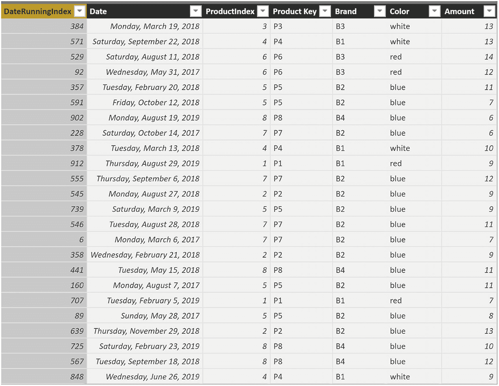

图 1-3
表 – simple table values

如果将此表用于具有以下设置的矩阵视觉对象：

* `Brand` 列作为行
* `Color` 列作为列
* `Amount` 列作为值

你将得到图 1-4 所示的结果（圆形标记除外）。

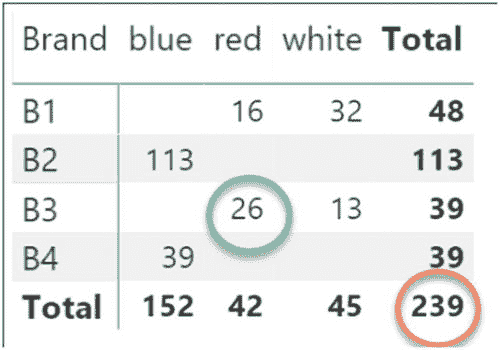

图 1-4
`simple table values` 矩阵

在 Phil 的著作《Beginning DAX with Power BI》中，他解释了 Power BI 会将行标题`Brand`和列标题`Color`中的值添加到矩阵视觉对象值字段中所用度量的计算上下文中。

#### 注意

源自列标题、行标题或切片器选择的筛选器被称为隐式筛选器。这同样适用于簇状柱形图 x 轴上使用的值（此逻辑可推广到所有其他视觉对象）。

我猜你对`B3`/`red`交叉点显示的值并不感到惊讶，即使我们尚未定义任何度量。只需在数据视图中筛选该表即可轻松验证结果，见图 1-5。

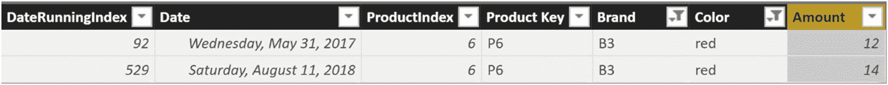

图 1-5
`simple table values` – 筛选后的`B3`/`red`

很容易验证`Amount`列中值的总和等于 26。我们可以推断出以下几点：

* 视觉对象会对包含用作值的列（此处为`Amount`列）的表进行筛选。
* 在应用筛选器后，会使用聚合函数从剩余的两行中计算出值 26。

很明显，聚合函数是`SUM`。`SUM`是数值列用作值时的默认聚合函数。默认函数可以针对每列进行更改，并且至少应进行检查。如有必要，可以在"建模"菜单的"属性"功能区中更改`默认汇总方式`的值。可以从"报表"或"数据"视图中访问该函数；必须选中已检查的列。

图 1-6 展示了如何更改所选字段`Amount`的默认汇总方式。

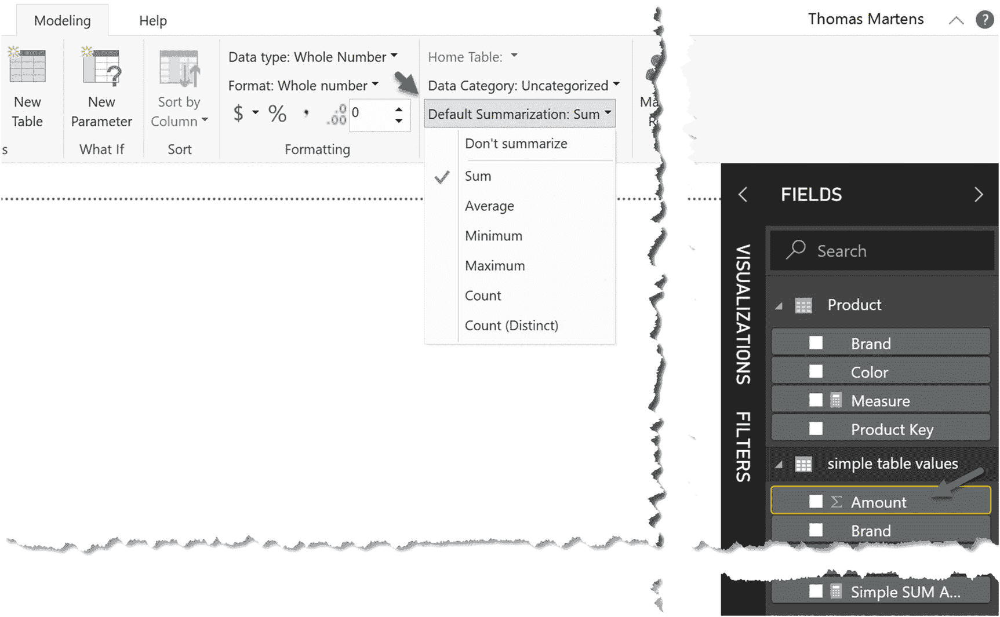

图 1-6
列默认聚合函数

### 说明

如果更改了列的默认汇总方式，则必须先从视觉对象中移除该列，然后再重新添加。

我不得不承认，在很长一段时间里，我一直认为矩阵视觉对象中的每个单元格（包括行和列上的总计值）都会创建一个单独的 DAX 查询，因为每个单元格的筛选上下文都会发生变化。幸运的是，情况并非如此。其幕后真正发生的事情可以通过 `DAX Studio` 来控制，这是一个主要由 `sqlbi.com` 和 `Darren Gosbell` 的成员开发的开源工具。`DAX Studio` 是创建 DAX 语句（其格式化功能更智能）以及在你对 DAX 语句的性能不满意时必不可少的工具。因此，第 12 章“DAX Studio”中描述了 `DAX Studio` 的一些功能——至少是优化性能低下的 DAX 语句所必需的功能。

为了发现幕后发生了什么，`DAX Studio` 能够捕获由 Power BI Desktop 创建的 DAX 查询，以检索数据来填充视觉对象。

当包含简单矩阵的报表页被激活时，会生成以下 DAX 代码（见清单 1-1）。

```
DEFINE
VAR __DS0Core =
SUMMARIZECOLUMNS(
ROLLUPADDISSUBTOTAL('simple table values'[Brand], "IsGrandTotalRowTotal"),
ROLLUPADDISSUBTOTAL('simple table values'[Color], "IsGrandTotalColumnTotal"),
"SumAmount", CALCULATE(SUM('simple table values'[Amount]))
)
VAR __DS0Primary =
TOPN(
102,
SUMMARIZE(__DS0Core, 'simple table values'[Brand], [IsGrandTotalRowTotal]),
[IsGrandTotalRowTotal],
0,
'simple table values'[Brand],

)
VAR __DS0Secondary =
TOPN(
102,
SUMMARIZE(__DS0Core, 'simple table values'[Color], [IsGrandTotalColumnTotal]),
[IsGrandTotalColumnTotal],
1,
'simple table values'[Color],

)
EVALUATE
__DS0Secondary
ORDER BY
[IsGrandTotalColumnTotal], 'simple table values'[Color]
EVALUATE
NATURALLEFTOUTERJOIN(
__DS0Primary,
SUBSTITUTEWITHINDEX(
__DS0Core,
"ColumnIndex",
__DS0Secondary,
[IsGrandTotalColumnTotal],
ASC,
'simple table values'[Color],
ASC
)
)
ORDER BY
[IsGrandTotalRowTotal] DESC, 'simple table values'[Brand], [ColumnIndex]
```

清单 1-1
简单矩阵

我们将在第 12 章“DAX Studio”中更详细地探讨这类 DAX 查询。但现在，我只想让你关注 DAX 查询的第一部分。在这里你会看到以下代码片段，它是 DAX 函数 `SUMMARIZECOLUMNS` 的一部分。

```
"SumAmount", CALCULATE(SUM('simple table values'[Amount]))
```

清单 1-2
隐式度量定义

如果我们自己编写度量，它看起来几乎一样。因此，我们在 *simple table values* 表中使用如下 DAX 语句创建一个度量，但没有使用 `CALCULATE` 函数（见清单 1-3）。

```
Simple SUM Amount =
SUM('simple table values'[Amount])
```

清单 1-3
度量 – Simple SUM Amount

如果你想要检查结果，你会发现我们检索到了与第一个查询相同的值，但这正是我们所期望的。

但我们真正关心的是第一个度量出现在 Power BI 创建的查询中。下面的清单显示了该查询的第一部分。我们可以看到，“自然”列被当作显式定义的度量来处理：

```
VAR __DS0Core =
SUMMARIZECOLUMNS(
ROLLUPADDISSUBTOTAL('simple table values'[Brand], "IsGrandTotalRowTotal"),
ROLLUPADDISSUBTOTAL('simple table values'[Color], "IsGrandTotalColumnTotal"),
"SumAmount", CALCULATE(SUM('simple table values'[Amount])),
"Simple_SUM_Amount", 'simple table values'[Simple SUM Amount]
)
```

到目前为止，你需要相信我，这两种定义是相同的，即使看起来缺少了包裹我们度量的 `CALCULATE` 函数，除非你已经读过 Phil 的书或其他一些现有的优秀 DAX 书籍。但我们也可以通过移除 `CALCULATE` 并在 `DAX Studio` 中执行查询来证明这两个度量产生完全相同的结果。

在解释什么是显式筛选器之前，我只想稍微修改一下矩阵视觉对象。你可以在报表页“第 1 章 – 隐式筛选器 – b”中找到这个矩阵。除了将应用于查询执行的隐式筛选器之外，我还添加了列 *Brand* 作为页面级筛选器（只是为了避免与其他报表页产生不必要的干扰）。筛选器设置请见图 1-7。

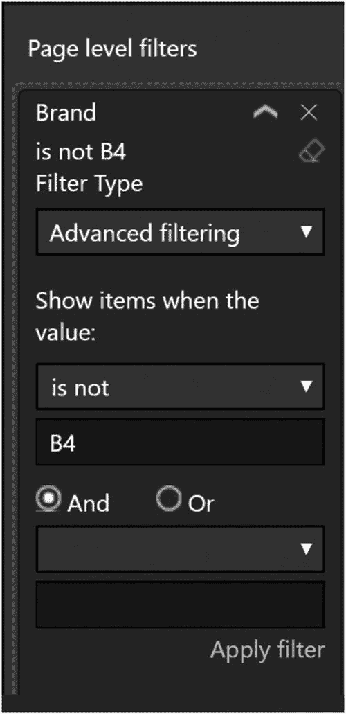
图 1-7 页面级筛选器 `Brand` 不等于 `B4`

这是一项重要任务，因为对于报表级筛选器、页面级筛选器以及视觉对象级筛选器的行为存在一些误解。配置如下：移除列 `Brand` 的值等于 `B4` 的行。清单 1-4 显示了 Power BI Desktop 创建的查询（至少是重要部分）。

```
VAR __DS0FilterTable =
FILTER(
KEEPFILTERS(VALUES('simple table values'[Brand])),
'simple table values'[Brand]  "B4"
)
VAR __DS0Core =
SUMMARIZECOLUMNS(
ROLLUPADDISSUBTOTAL('simple table values'[Brand], "IsGrandTotalRowTotal"),
ROLLUPADDISSUBTOTAL('simple table values'[Color], "IsGrandTotalColumnTotal"),
__DS0FilterTable,
"SumAmount", CALCULATE(SUM('simple table values'[Amount]))
)
```
清单 1-4 `FilterTable`

这里需要注意的重要一点是创建了一个名为 `__DS0FilterTable` 的变量，该变量将在查询的所有后续部分中使用。

为了更有趣，我将使用第三个报表页“第 1 章 – 隐式筛选器 – c”。这个报表页也有相同的页面级筛选器，但此外还有一个同样使用列 `Brand` 的切片器。在这里，我将选择品牌 `B1` 和 `B2`。图 1-8 显示了报表的外观。

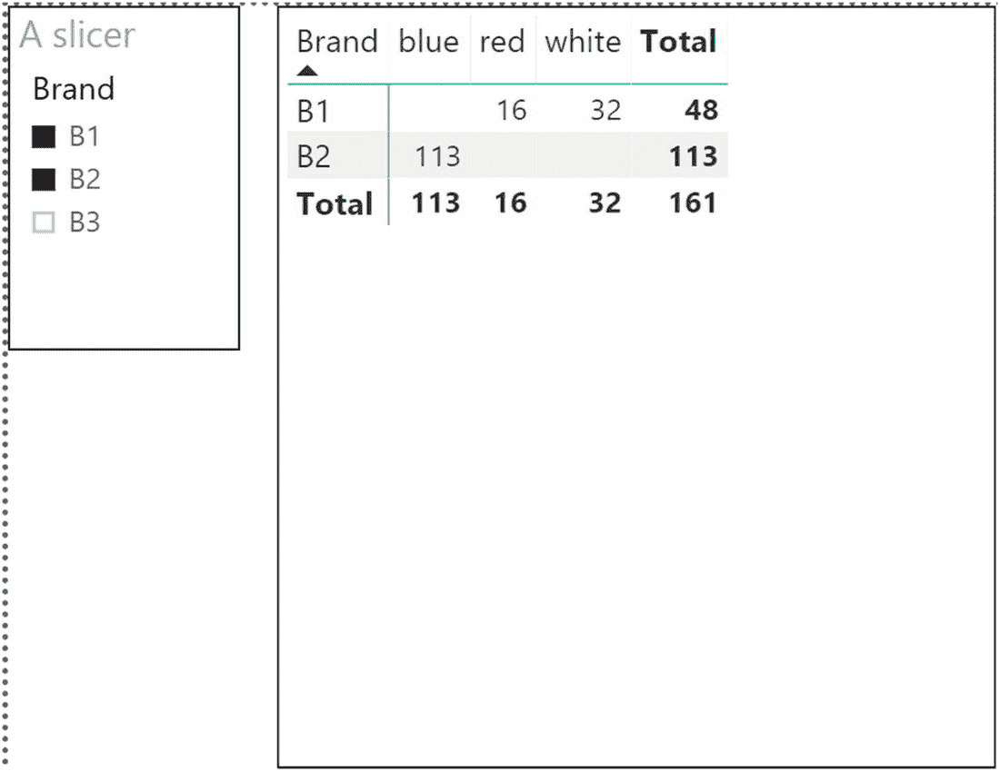
图 1-8 页面级筛选器和切片器

清单 1-5 显示了查询的重要部分。

```
VAR __DS0FilterTable =
FILTER(
KEEPFILTERS(VALUES('simple table values'[Brand])),
AND(
'simple table values'[Brand] IN {"B2",
"B1"},
'simple table values'[Brand]  "B4"
)
)
VAR __DS0Core =
SUMMARIZECOLUMNS(
ROLLUPADDISSUBTOTAL('simple table values'[Brand], "IsGrandTotalRowTotal"),
ROLLUPADDISSUBTOTAL('simple table values'[Color], "IsGrandTotalColumnTotal"),
__DS0FilterTable,
"SumAmount", CALCULATE(SUM('simple table values'[Amount]))
)
```
清单 1-5 `FilterTable` 页面级筛选器和切片器

你可能想知道为什么这让我如此兴奋，或者为什么我觉得变量 `__DS0FilterTable` 这么有趣。但答案其实很简单。

不可能创建一个能够显示这三个品牌 Amount 之和的度量。必要的是移除切片器隐式添加的筛选器，但保留来自页面级筛选器的筛选器。要创建这样的度量，就需要在数据模型中预先采取一些预防措施。

### 规则

无法移除来自切片器的筛选器，同时保留来自报表级筛选器或页面级筛选器的筛选器。

### 显式筛选器

每当我们需要编写度量值时，都必须应对计算上下文的挑战。计算上下文描述了度量值（以及计算列）被计算时所处的上下文。

决定此上下文有两个组成部分：

*   筛选上下文

*   行上下文

筛选上下文可以非常直观地展现；只需创建一个矩阵视觉对象，你就能欣赏到筛选上下文的全部魅力。行标题和列标题会被添加到 `FilterTable` 中，代表该单元格上下文中 DAX 公式计算时的筛选上下文。而行上下文有时则不那么明显。即使是创建一个简单的计算列，也可能变得很棘手。每当 `CALCULATE` 使用多个参数时，我们都需要通过提供显式筛选器来改变筛选上下文。

这一点非常重要，因此我们专门用两个章节来讨论它：第 4 章“这个奇怪的上下文”和第 5 章“DAX 中的筛选”。

# 数据建模

## 引言

尽管 Power BI 已经存在相当长一段时间，但数据建模似乎经常被忽视，这意味着很多报表只是基于单个表来施展其魔力。有时，人们会付出巨大的努力从各种来源收集数据以创建一个单表，然后用这个单表来创建吸引人的可视化效果。

但随后，突然间，创建一个度量值似乎变得异常复杂，更糟糕的是，组合而成的度量值却返回了意想不到的结果。

为了充分利用 DAX 的分析潜力，有必要在一定程度上理解表格数据模型的某些方面。本章的主要目标是介绍重要的数据建模方面。

通常，一个 Power BI 项目需要为以下任务提供解决方案：

*   计算年初至今。

*   计算过去六个月的平均销售额，以便与本月进行比较。

随着时间的推移，这导致了互联网上以及书籍中积累了大量可用的模式。但有时，这些模式无法应用于特定问题，因为需要考虑到一些特殊变化。计算一个名为“过去六个月的平均销售额”的度量值可能具有挑战性，因为可能没有足够的数据点可用，也就是说，对于早期数据点，不存在“过去 6 个月”。仅使用可用数据来计算平均值是不够的，因为它无法反映我们的业务场景“6 个月的平均值”，或者不符合我们的业务模型。突然间，计算面临了额外的复杂性。这不仅是要找到计算所需的过去六个月，还涉及到如何在数据不足时避免计算。

如果到目前为止，您仅在单个表上使用 DAX 进行计算，那么本书希望能为您提供一些新思路，并说明为什么开发由多个表组成的数据集几乎是强制性的。

### 什么是数据模型？

关于“以数据模型思考”包含三个方面，因此在详细解释这些方面之前，有必要简要说明什么是数据模型，尤其是在 Power BI 中创建数据模型意味着什么。

*   业务流程

*   逻辑数据模型

*   技术实现

已经有许多关于数据建模的书籍，它们侧重于不同的主题或专注于特定领域。一些书籍侧重于高层数据建模，即提供概念以在业务人员和 IT 人员之间建立共同理解。一些书籍侧重于与某个数据库相关的特定方面。还有一些书籍提供了如何将面向业务的数据模型转换为从技术角度适合特定数据库的物理数据模型的技术。

数据模型是对一个或多个业务流程的表示，其目标是描述如何捕获和存储数据，以便能够反映业务流程并回答特定问题。

在分析领域，主要有两种不同的数据模型创建方法：一种称为“雪花模式”，另一种称为“星型模式”。本书并非要争论孰优孰劣，也不是要支持或反对哪一种。商业智能世界中许多贴近业务用户的产品似乎都倾向于使用星型模式建模的数据。Power BI、Power Pivot 以及 SQL Server Analysis Services（多维模式和表格模式）对此并无区别。因此，本书重点介绍遵循“星型模式”方法的数据建模。

无论您偏好哪种方法或哪种概念，所有概念至少都有一个共同点：

*   ***一个数据模型由多个表组成。***

强调这个简单的陈述可能看起来很奇怪，因为这似乎是一个普遍真理，但围绕着这个主题——如何以及为什么必须（甚至可以称为强制要求）创建一个数据模型——仍然存在许多问题。

### 星型模式

深入探究分析解决方案的数据建模，迟早会发现星型模式的概念以及维度建模的底层技术。维度建模是一种由 Ralph Kimball 及其 Kimball 小组的同事（[`www.kimballgroup.com`](http://www.kimballgroup.com)）推广的技术。即使 Kimball 小组已不再活跃，其网站内容仍提供着宝贵信息。

这类数据模型的名称来源于组成模型的表可以排列成的形状，如图 2-1 所示。

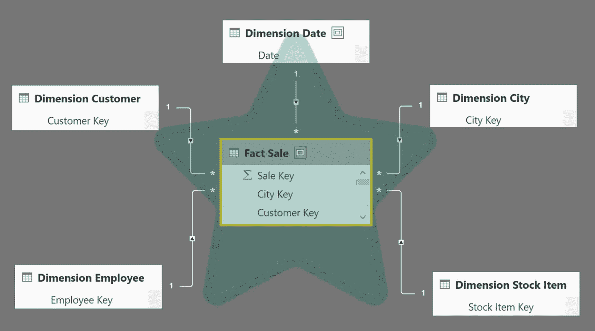
图 2-1 星型模式的可视化

图 2-1 展示了来自 pbix 文件“CH 2 – relationships – Star Schema.pbix”的数据模型。使用维度建模技术的数据模型包含两种类型的表：

*   维度表

*   事实表

维度表表示某个特定的概念或业务对象，例如客户或产品，而事实表则包含在业务对象上下文中的业务流程度量值。这使得可以通过使用维度表进行筛选、切片和切块来分析度量值。在分析数据模型中，常见的维度表包括客户表和产品表。当然，这取决于业务流程的性质。

除了上述业务对象，还有一个基本概念，即时间概念。这个概念，或者更简单地称为日历表，允许将度量值置于时间上下文中，例如：

*   比较现在和过去

*   将现在和过去投射到未来

由于时间概念是数据分析的核心，因此在第 9 章“时间智能”中会详细讨论。

## 为什么数据建模很重要

如果前一章所述的所有内容还不足以令人信服，那么现在是时候深入探讨 Power BI 数据模型的某些方面了。有必要记住，这些细节同样适用于存储数据和评估 DAX 语句的数据库的所有不同版本。我们将使用简单的示例来演示数据模型如何影响查询结果（即符合我们预期的结果）、简化性以及性能。

### 正确的结果：来自单表的合并筛选器

#### 注意
本节使用 pbix 文件 `"CH 2 – Auto-Exists.pbix"`。

SQL Server Analysis Services 多维（SSAS MD）的重要概念或特性之一便是 `Auto-Exist（自动存在）`，但其中一些细节可能已变得有些模糊。因此，这里做一个回顾。

Auto-Exist 能够防止 SSAS 多维数据在同一个查询中使用同一维度的一个或多个属性时，返回不存在的属性组合。将其对应到 SSAS 表格模型或 Power BI 数据模型，可以这样理解：查询不会返回表中（维度）不存在的列（属性）组合。由于 Power BI 数据模型仅包含表，因此将关系一端（关于关系，本章后面会更详细讨论）的表视为按关系多端进行筛选的表，是一种合理的思路。

这里的关键点是，这个概念在 Power BI 中同样存在，当然在 Power Pivot 和 SSAS 表格模型中也是如此。即使目前尚不明显，始终考虑这一事实依然很重要。

以下 SQL 语句（参见列表 2-1）用于从 Wide World Importers DW 数据库的三个代表表中创建一个视图。

```sql
CREATE VIEW
[Fact].[v_sales_singletable]
AS
SELECT
dimDate.[Calendar Year]
,      i.Size
,      COUNT(f.[Sale Key]) AS NoOfSales
FROM [Fact].[Sale] AS f
INNER JOIN Dimension.Date AS dimDate ON
f.[Invoice Date Key] = dimDate.Date
INNER JOIN Dimension.[Stock Item] AS i ON
f.[Stock Item Key] = i.[Stock Item Key]
GROUP BY
dimDate.[Calendar Year]
,      i.size
```

*列表 2-1* Auto-Exist – SingleTable

数据已导入到 Power BI 文件 `"CH 2 – Auto-Exists.pbix"`。图 2-2 展示了该表的列。

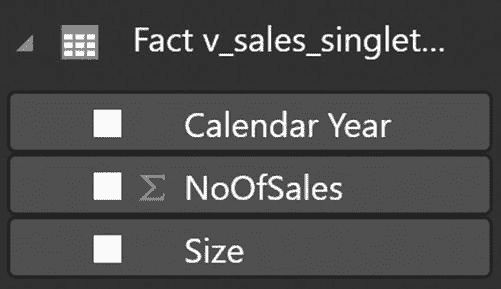

*图 2-2* 单表

该表展示了不同日历年（`Calendar Year`）下各种产品尺寸（`Size`）的销售订单数量（`NoOfSales`）。此表仅用于证明一个观点：在某些情况下，DAX 语句可能不会返回预期结果。即使该表只是反映了来自不同业务对象（产品和时间）的两个列的随机组合，但在实际应用中，这种情况迟早都可能发生。不幸的是，这个隐藏问题不会立即显现，但一旦需要在更大的数据集上回答更复杂的问题，意外结果或错误结果就可能导致错误决策。

下一张截图显示了报告页面“Ch 02 – Auto Exist and a Single Table”的一小部分。

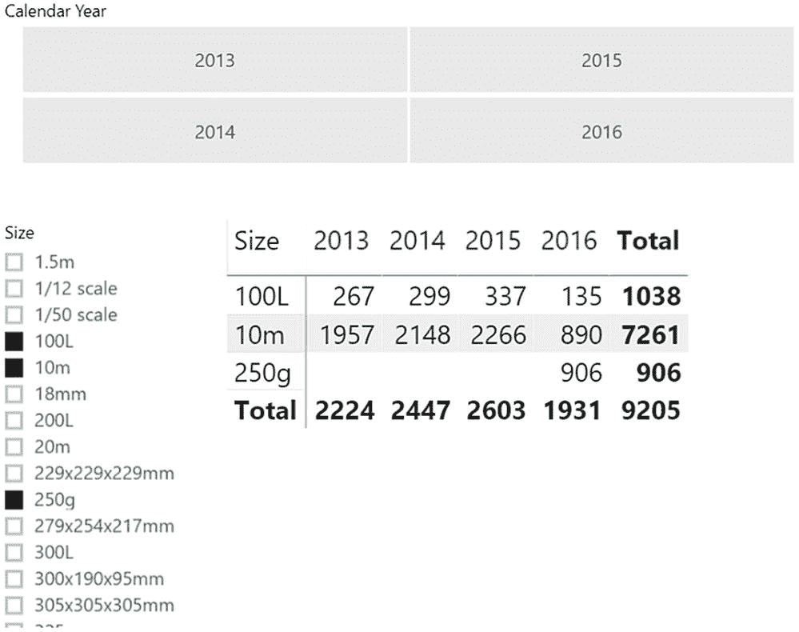

*图 2-3* 单表基础报告

假设需要定义以下度量值来回答一些业务问题：
- 一个度量值，用于计算当前选择中的尺寸数量
- 一个度量值，用于计算不依赖于年份选择的尺寸数量

这些度量值的示例可视化效果见图 2-4。

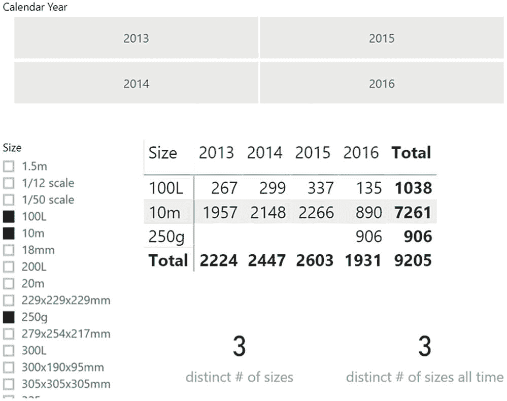

*图 2-4* 单表基础报告 – 度量值

列表 2-2 和 2-3 展示了用于定义度量值的 DAX 语句。

```
distinct # of sizes = 
DISTINCTCOUNT('Fact v_sales_singletable'[Size])
```

*列表 2-2* Auto-Exist – SingleTable, 不同的尺寸数量

```
distinct # of sizes all time = 
CALCULATE(
[distinct # of sizes]
,ALL('Fact v_sales_singletable'[Calendar Year])
)
```

*列表 2-3* Auto-Exist – SingleTable, 度量值 2, 所有时间的不同尺寸数量

从列表 2-3 可以看出，在 `CALCULATE(...)` 内部，使用了 `ALL(...)` 函数来移除 `[Calendar Year]` 列上的任何现有筛选器。第 5 章“DAX 中的筛选”将详细解释所有筛选的复杂性。因此，这里仅作如下说明：DAX 函数 `CALCULATE(...)` 允许修改现有的筛选上下文。这意味着 `CALCULATE` 函数的第一个参数（表达式）将在应用所有其他参数以更改现有筛选上下文之后进行计算。用于修改现有筛选上下文的 DAX 函数之一是 `ALL`。`ALL` 可以移除整个表或单个列上的现有筛选上下文。

在图 2-4 中，两个度量值都返回值 `3`。即使我们选择 `Calendar Year : 2016`，这一点也成立，只是矩阵视觉对象的内容会根据当前选择进行调整。但是，如果我们从切片器中选择 `Calendar Year : 2015`，度量值 `"distinct # of sizes all time"` 的值也会发生变化（见图 2-5）。

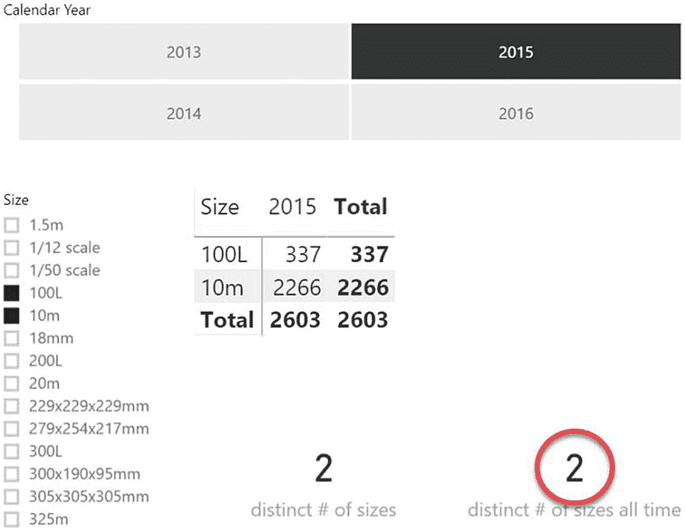

*图 2-5* 单表基础报告 – 错误预期

从预期角度来看，并根据对度量值 `distinct # of sizes all time` 工作方式的解释，预期结果应为 `3`，因为无论从切片器中选择哪一年，该度量值都应返回尺寸数量。

要理解发生了什么，有必要捕获 Power BI 生成并发送到数据模型以填充每个视觉对象的 DAX 查询。为此，需要用到 DAX Studio。DAX Studio 不仅对于优化 DAX 语句至关重要，而且对于理解内部机制以及真正领会相似 DAX 函数之间的细微差别也必不可少。因此，第 12 章“DAX Studio”将讨论如何使用 DAX Studio 来更好地理解 DAX 并优化 DAX 语句。

#### 注意
务必牢记，每个视觉对象都由其自身的 DAX 查询生成。单个报表页面上使用的视觉对象越多，生成的 DAX 查询也越多。

话虽如此，让我们直接深入探究从切片器中选择 `日历年份：2015` 时传递的 DAX 语句。

```
DEFINE
VAR __DS0FilterTable =
TREATAS({2015}, 'Fact v_sales_singletable'[Calendar Year])
VAR __DS0FilterTable2 =
TREATAS({"100L",
"10m",
"250g"}, 'Fact v_sales_singletable'[Size])
EVALUATE
SUMMARIZECOLUMNS(
__DS0FilterTable,
__DS0FilterTable2,
"distinct___of_sizes_all_time", IGNORE('Fact v_sales_singletable'[distinct # of sizes all time])
)
代码清单 2-4
自动存在 – 单表，发送的 DAX 查询
```

如果在 DAX Studio 中执行此 DAX 语句，查询将返回 2。

这是为什么？

答案并不简单，但这是由于函数 `SUMMARIZECOLUMNS(...)` 所考虑的自动存在概念。如果使用来自同一张表的两个列，则只会返回表中已有的值组合。由于表中不存在 `[日历年份] = 2015` 和 `[类别] = 250 克` 的组合，因此计算不重复类别数量的度量只会考虑值 `100 升` 和 `10 米`，正因如此，查询返回了 2。

为了在应用度量之前检查行，有必要重写代码清单 2-4 中的 DAX 查询。该查询将如代码清单 2-5 所示。

### 自动存在 – 单表，重写的 DAX

```
EVALUATE
CALCULATETABLE(
SUMMARIZE('Fact v_sales_singletable','Fact v_sales_singletable'[Calendar Year],'Fact v_sales_singletable'[Size])
,TREATAS({2015}, 'Fact v_sales_singletable'[Calendar Year])
,TREATAS({"100L","10m","250g"}, 'Fact v_sales_singletable'[Size])
)
代码清单 2-5
自动存在 – 单表，重写的 DAX
```

代码清单 2-5 中的查询返回一个只有两行的表，即使预期结果可能不同，即三行，这取决于度量内部使用的 `ALL(...)` 函数（见图 2-6）。

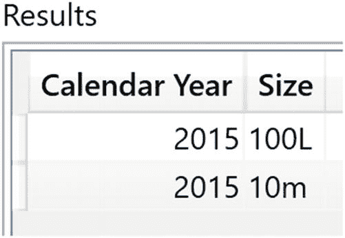

**图 2-6**
单表基础报表 – 考虑的行

#### 注意

如果列来自同一张表，`SUMMARIZE` 和 `SUMMARIZECOLUMNS` 将仅返回已有的组合。

我们可能会认为 `ALL(...)` 应该移除切片器选择所应用的筛选器，但我们必须考虑到该表本来就不包含`日历年份 2016` 和类别 `250 克`。这是因为不存在的组合已被 `SUMMARIZECOLUMNS` 移除。`ALL` 会移除列 `日历年份` 的现有筛选器，但它不会恢复第三个类别 `250 克`，因为该类别在 2015 年不存在。

这种行为绝非缺陷，而是其设计如此，并且在几乎所有情况下，这正是我们想要的行为。这种实现是为了优化性能。只有由单表组成的数据模型才可能遇到此问题。

如果我们从一开始就尝试创建合适的星型架构，则可以避免此问题。为此，pbix 文件还包含一个简单的星型架构（见图 2-7）。

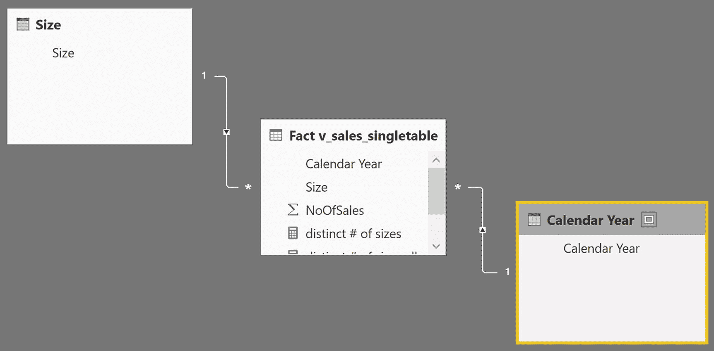

**图 2-7**
简单的星型架构

为了正确使用此星型架构，我们可以创建一个如代码清单 2-6 所示的度量。

```
星型架构 所有时间的不同大小数量 =
CALCULATE(
[不同大小的数量]
,ALL('日历年份'[日历年份])
)
代码清单 2-6
自动存在 – 星型架构，重写的度量
```

现在，此度量不是使用来自表 `Fact v_sales_singletable` 的列 `日历年份`，而是将 `ALL(...)` 与来自*维度*表 `日历年份` 的列结合使用。

如果仔细查看，报表页“CH 02 – 星型架构”正在使用来自两个*维度*表 `日历年份` 和 `类别` 的列。

使用维度建模技术构建的数据模型因此会带来另一个巨大优势，那就是简单性。

### 简单性：关于关系和筛选器传播

#### 注意

本节使用的 pbix 文件为“CH 2 – 关系 – 单表.pbix”。

如前所述，分析数据模型中回答不断重复出现的问题的最重要概念之一，就是随时间变化的度量分析。Power BI 报表“CH 2 – 关系 – 单表.pbix”中包含的数据模型有一个度量 `年初至今数量 时间智能`，它被分配给表“Fact Sale”。此度量计算给定年份截至某时间段结束时度量 `数量` 的总和。此度量的 DAX 语句如代码清单 2-7 所示。

```
年初至今数量 时间智能 =
CALCULATE(
SUM('Fact Sale'[Quantity])
,DATESYTD('维度日期'[Date])
)
代码清单 2-7
星型架构 – 年初至今 时间智能
```

此度量使用了时间智能函数 `DATESYTD`。

度量 `年初至今数量` 计算相同的结果，但未使用时间智能函数。此度量的 DAX 如代码清单 2-8 所示。

```
年初至今数量 =
CALCULATE(
SUM('Fact Sale'[Quantity])
,FILTER(
ALL('维度日期'[Date])
,'维度日期'[Date] <= MAX('维度日期'[Date])
&& YEAR('维度日期'[Date]) = YEAR(MAX('维度日期'[Date]))
)
)
代码清单 2-8
星型架构 – 年初至今 基础函数
```

即使这些 DAX 语句并未揭示任何新内容，但仍然值得一提的是，此度量可以在不同情况下使用，并且无需调整 DAX 语句。

图 2-8 使这一点更加清晰。

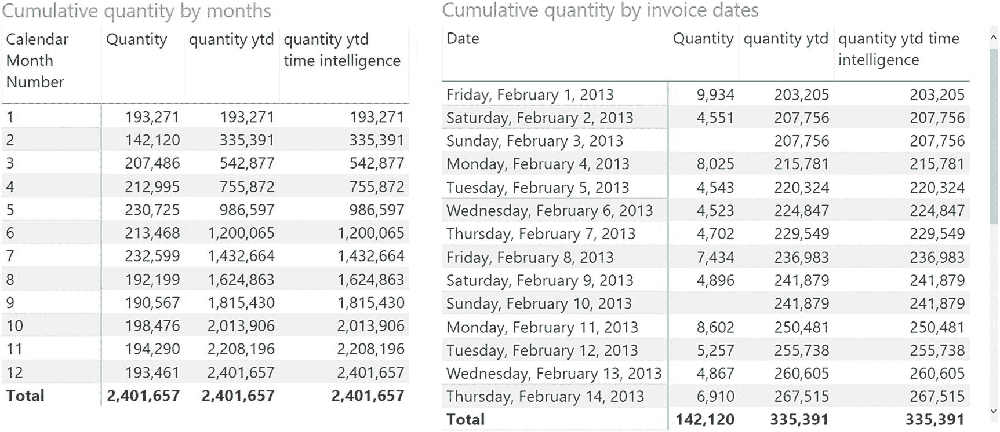

**图 2-8**
星型架构 – 时间智能工作（报表页：月份）

### 说明

以下内容引用了 Power BI 文件 `“CH 2 – relationships – One table.pbix”`。

尝试将类似的逻辑（应用时间智能来回答问题）应用于数据模型时，我们会发现无法使用任何时间智能函数。清单 2-9 展示了“单表解决方案”调整后的 DAX 语句。

```
quantity ytd time intelligence =
CALCULATE(
SUM('Fact v_starschema_asonetable'[Quantity])
,DATESYTD('Fact v_starschema_asonetable'[Date])
)
Listing 2-9
One table – ytd time intelligence
```

图 2-9 表明这行不通。第二个月的累计值与第二个月的非累计值相等。

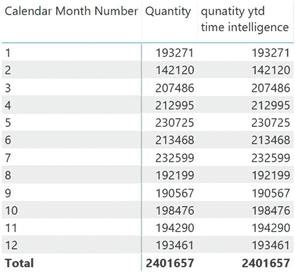

**图 2-9**
单表 – 时间智能无效

这是由于 `Date` 列未在行上使用（关于筛选实际工作原理的更多细节将在第 5 章“DAX 中的筛选”中揭示）。返回月份编号累计值的 DAX 语句如清单 2-10 所示。

```
quantity ytd =
CALCULATE(
SUM('Fact v_starschema_asonetable'[Quantity])
,FILTER(
ALL(
'Fact v_starschema_asonetable'[Calendar Month Number]
,'Fact v_starschema_asonetable'[Calendar Month Number]
)
,'Fact v_starschema_asonetable'[Calendar Month Number] <= MAX('Fact v_starschema_asonetable'[Calendar Month Number])
)
)
Listing 2-10
One table – ytd base functions month number
```

此度量值创建了预期值，如图 2-10 所示。

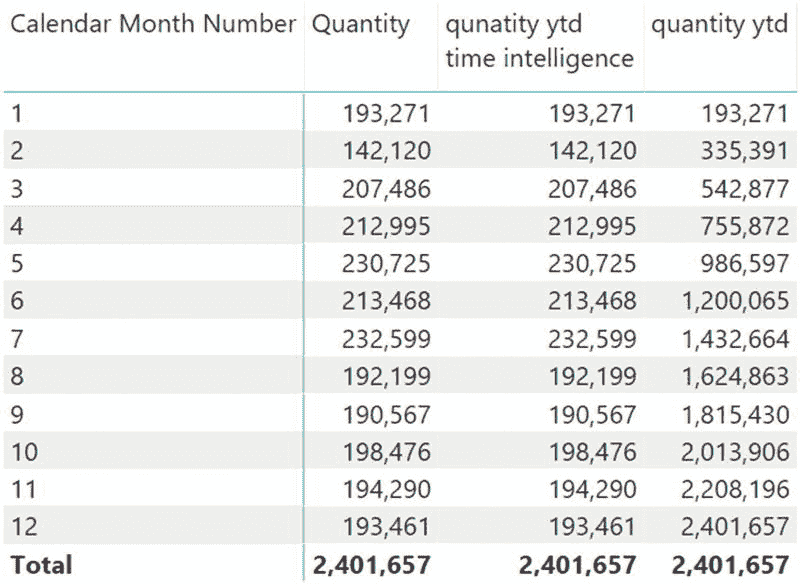

**图 2-10**
单表 – 累计月份编号

即使度量值 `"quantity ytd"` 返回了正确且预期的结果，该度量值在许多方面仍不如星型模式的度量值。一旦需要使用 `Calendar Month Label` 列而不是 `Calendar Month Number` 列作为行标题，当前的度量值就会失效。如图 2-11 所示。

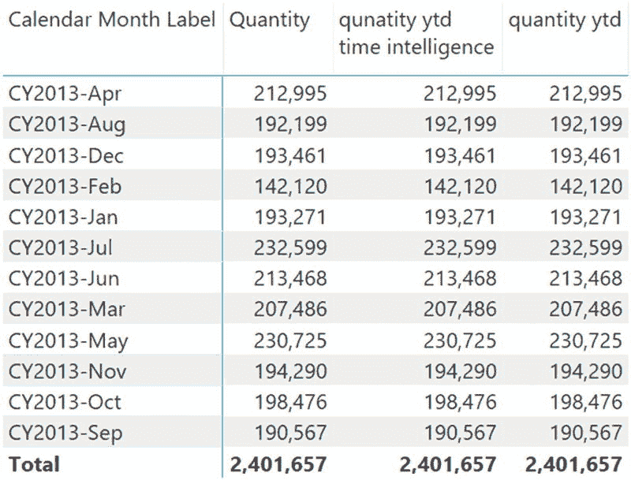

**图 2-11**
单表 – 累计月份标签

如果改用 `Date` 列，也会出现这种情况。基本上，无论使用哪个与日期相关的列，都会发生这种情况。创建一个在单表解决方案中行之有效的 DAX 语句，无论我们在矩阵视觉对象中使用哪个列作为行标题，或多或少都是简单的。这可以通过在 DAX 语句中考虑每个列来实现。如清单 2-11 所示。

```
### 关系

#### 说明

本节使用的 pbix 文件为 `“CH 2 – relationships – missing relationships.pbix”`。

一旦我们的数据基于多个表，我们就必须考虑如何关联这些表。数据模型中表之间的关系可以在 Power BI Desktop 的“关系”视图中定义。

在 Power BI 文件 `“CH 2 – Star Schema – import from SQL – missing relationships.pbix”` 中，缺少两个关系：

* 维度 库存项目 ➔ 事实 销售

* 维度 日期 ➔ 事实 销售

在两个表之间定义关系的最简单方法是将一个表中的一列拖拽到另一个表中的相应列。可以通过将 `Stock Item Key` 列从一个表拖到另一个表的相应列来建立 `Fact Sale` 表和 `Dimension Stock Item` 表之间缺失的关系。选择哪个表作为起点并不重要。

创建关系的另一种方法是使用“管理关系”对话框。可以从“开始”菜单中，使用“关系”功能区的 `Manage Relationships` 命令调出此对话框，如图 2-12 所示。

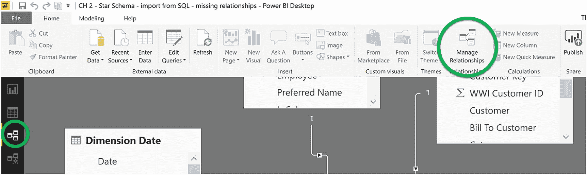

**图 2-12** 关系 – 管理关系对话框

使用此对话框，可以选择需要创建关系的两个表。图 2-13 演示了如何使用“新建”按钮创建 `Fact Sale` 表和 `Dimension Date` 表之间的关系。

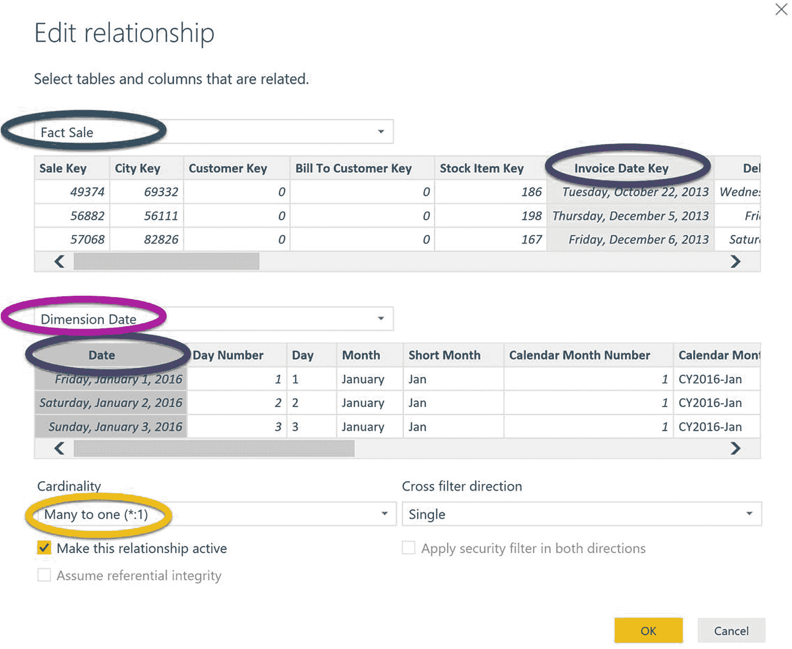

**图 2-13** 关系 – 使用对话框

图 2-13 中的绿色和紫色圆圈标记了这两个表。蓝色圆圈标记了用于创建两个表之间关系的列。

#### 说明

每个表只能使用一列来建立关系。

`基数` 字段中的“多对一 (∗:1)”选择是自动进行的。

#### 筛选传播

##### 注意

本节使用的 pbix 文件为 `“CH 2 – relationships – Star Schema.pbix”`。

筛选传播是分析型数据模型中的一个核心概念，不仅适用于 Power BI 所使用的数据模型，也适用于 Power Pivot、SQL Server Analysis Services 表格模型以及 Azure Analysis Services 中的数据模型。因此，必须理解字段 `“Cardinality”`（基数）的可能取值与属性 `“Cross filter direction”`（交叉筛选方向）的取值之间的组合关系，以及这些值如何影响通用可用性，并如何影响度量值的结果。

筛选传播的概念非常简单。如果对一个表进行筛选，例如通过选择一个切片器，筛选后的值将通过关系传播到相关表中。从 `Dimension Calendar`（维度日历）表的 `Calendar Year Label`（日历年份标签）列中选择值 `CY2014`，会将表筛选（缩减）为所有与该选定值相等的行。

默认情况下，这种传播沿着关系路径，从关系的一端（一）传播到多端（多）。图 2-14 将有助于更清楚地说明这一点。

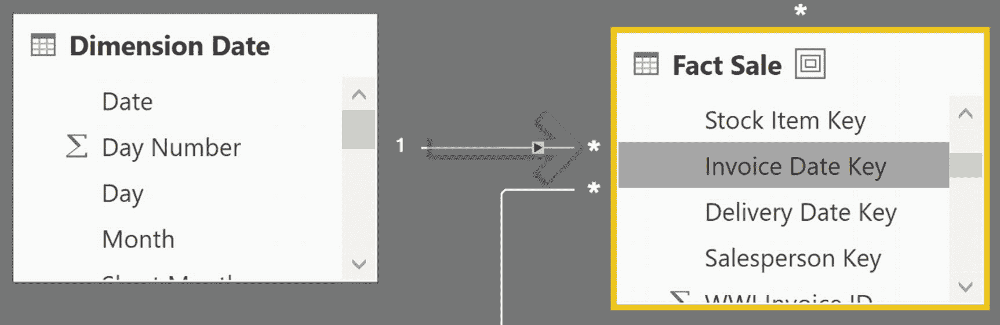

图 2-14 关系 – 一对多

由于两个表之间的关系是通过列 `‘Dimension Date’[Date]` 和 `‘Fact Sale’[Invoice Date Key]` 建立的，因此任何基于 `Dimension Date` 表的切片器筛选出的 `[Date]` 列的值，都会自动传播到多端的表，在本例中即事实表。

这是允许对存储在 Power BI 数据模型（当然也包括所有其他数据模型）中的大量数据进行高效切片和切块操作的关键因素之一。

Power BI 文件 `“CH 2 – relationships – Star Schema.pbix”` 包含一个名为 `“Filter propagation”`（筛选传播）的报告页面。创建此报告页的目的并非为了使其外观精美，而是为了可视化筛选传播。图 2-15 显示了在从切片器中选择了一些值之后的报告页面。

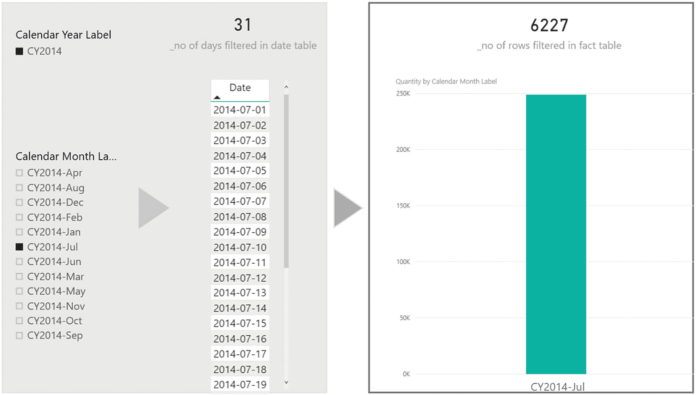

图 2-15 关系 – 筛选传播

报告页面的左侧部分显示了切片器的选择如何与表 `Dimension Date` 交互，而右侧部分则显示了筛选后的表如何与表 `“Fact Sale”` 交互。这种交互基于筛选传播的概念。

基于关系的筛选传播也可以通过使用 DAX Studio 进行观察。代码清单 2-12 显示了一个 DAX 查询，该查询检索了卡片视觉对象的数值，该视觉对象显示了来自事实表 `“Fact Sale”` 的行数。

```
DEFINE
VAR __DS0FilterTable =
TREATAS({"CY2014"}, 'Dimension Date'[Calendar Year Label])
VAR __DS0FilterTable2 =
TREATAS({"CY2014-Jul"}, 'Dimension Date'[Calendar Month Label])
EVALUATE
SUMMARIZECOLUMNS(
__DS0FilterTable,
__DS0FilterTable2,
"v_no_of_rows_filtered_in_fact_table", IGNORE('Fact Sale'[_no of rows filtered in fact table])
)
```

代码清单 2-12 关系 – DAX 与 xmSQL，DAX

尽管之前没有提及，并且将在第 12 章“DAX Studio”中更详细地介绍，但现在有必要提及驱动列式内存数据库的两个引擎。它们是存储引擎和公式引擎。请不要被“存储引擎”这个术语所迷惑。这个存储引擎（SE）从 RAM 而非磁盘中检索数据。可能存在某些情况，与存储引擎相关的任务会触发其他任务，然后这些任务可能会从较慢的硬盘或更快的固态硬盘读取数据，但如果我们使用的是存储在 Power BI 文件中的数据，则不会出现这种情况。

公式引擎检测需要哪些数据来回答问题，即提供可视化数据和计算复杂表达式所需的结果。存储引擎检索数据，并在需要时将数据传回给公式引擎进行进一步计算。

可以将存储引擎视为“肌肉”，将公式引擎视为“大脑”。这意味着存储引擎能够以极快的速度解决其任务，而公式引擎则能够解决复杂的计算。因此，只要可能，充分利用存储引擎的能力总是一个好主意。DAX 优化基本上就是将任务从公式引擎转移到存储引擎。

为了克服缺少一个专用日历表的限制，可以将所有列放入 `ALL` 函数中。`ALL` 函数内引用的所有列也都用于 `FILTER`（`<filter>`）函数中，至少是其中两列。

不需要在筛选部分也考虑 `Calendar Month Label` 列，因为 `Calendar Month Label` 列和 `Calendar Month Number` 列之间存在隐式的一对一关系。

与遵循星型模式方法的数据模型解决方案相比，单表解决方案中度量值复杂性不断增加的原因在于，后者能够利用关系概念和筛选传播。这两个概念将在下一节中详细解释。

```
quantity ytd a little more final =
CALCULATE(
SUM('Fact v_starschema_asonetable'[Quantity])
,FILTER(
ALL(
'Fact v_starschema_asonetable'[Calendar Month Number]
,'Fact v_starschema_asonetable'[Calendar Month Label]
,'Fact v_starschema_asonetable'[Date]
)
,'Fact v_starschema_asonetable'[Calendar Month Number] <= MAX('Fact v_starschema_asonetable'[Calendar Month Number])
&& 'Fact v_starschema_asonetable'[Date] <= MAX('Fact v_starschema_asonetable'[Date])
)
)
```

Listing 2-11 One table – ytd base functions a little more final
```

说到此处，我们将其视为一个简短的介绍。现在回到前面的 DAX 查询。DAX Studio 还提供了一个捕获存储引擎活动的功能。此活动以某种称为 `xmSQL` 的 SQL 方言表示。代码清单 2-13 显示了这个查询。

```
SET DC_KIND="AUTO";
SELECT
COUNT (  )
FROM 'Fact Sale'
LEFT OUTER JOIN 'Dimension Date' ON 'Fact Sale'[Invoice Date Key]='Dimension Date'[Date]
WHERE
'Dimension Date'[Calendar Month Label] = 'CY2014-Jul' VAND
'Dimension Date'[Calendar Year Label] = 'CY2014';
-- 代码清单 2-13
-- 关系 – DAX 与 xmSQL，xmSQL
```

从代码清单 2-13 所示的 `xmSQL` 查询中，关键要点是用以定义关系的列之间的 `LEFT OUTER JOIN`。

将筛选传播的概念“可视化”为将关联的一端使用的列的值传递到关联的多端列中的过程，会有所帮助。这种值的传递最终会得到一个筛选后的表。在这些“剩余”行上，应用计算行数的度量值。

### 关系基数

关系的基数对于用户体验以及 DAX 函数如何发挥其魔力并利用关系的基数起着重要作用。这将在接下来的章节中进行解释和演示。

#### 多对一 (∗:1) / 一对多 (1:∗)

具有多方和一方关系的表之间的关系是 Power BI 及相关数据模型中最重要的关系类型。这种关系类型也被称为“强关系”。如果你好奇是否存在弱关系，请继续阅读。

这种关系类型对执行 DAX 查询和评估 DAX 表达式的数据模型的可用性和性能起着重要作用。因此，有必要尽可能多地使用这种关系。

关系（以及由此带来的数据模型性能）可以在我们的 DAX 语句中加以利用。以下列表展示了一些如何在 DAX 中使用表之间关系的示例。

```
EVALUATE
SUMMARIZECOLUMNS(
'Dimension City'[Sales Territory]
,'Dimension Stock Item'[Color]
,"No of rows"
,COUNTROWS('Fact Sale')
)
-- 代码清单 2-14
-- 关系 – DAX, SUMMARIZECOLUMNS
```

图 2-16 显示了在 SQL Server Management Studio (SSMS) 中执行代码清单 2-14 中的 DAX 语句时返回表的一部分。

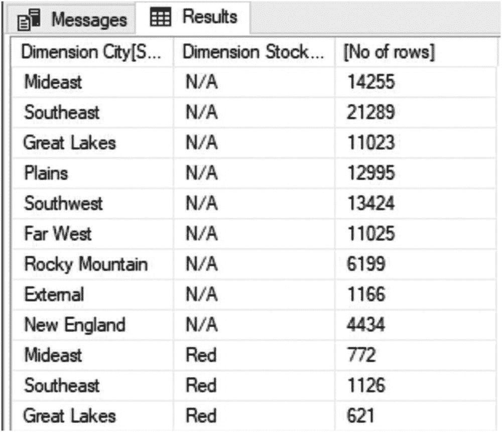

`图 2-16` – 关系 – DAX, SUMMARIZECOLUMNS

代码清单 2-15 展示了相同的查询，但这次使用了较旧的函数 `SUMMARIZE`。

```
EVALUATE
ADDCOLUMNS(
SUMMARIZE(
'Fact Sale'
,'Dimension Customer'[Category]
,'Dimension Stock Item'[Color]
)
,"No of rows"
,COUNTROWS('Fact Sale')
)
-- 代码清单 2-15
-- 关系 – DAX, SUMMARIZE
```

`SUMMARIZECOLUMNS` 可以被视为 `SUMMARIZE` 的优化版本，速度更快，并且克服了较旧 `SUMMARIZE` 的一些局限性。然而，在撰写本文时，`SUMMARIZECOLUMNS` 不能在度量值内部使用。因此，你会发现许多度量值仍然在使用 `SUMMARIZE`。

无论使用 DAX Studio 还是 SQL Server Management Studio 执行这两个查询，它们都不会返回相同的结果。这是因为函数 `ADDCOLUMNS(...)` 不会隐式创建一个在评估表达式 `COUNTROWS(...)` 时使用的筛选上下文。这可以通过在 `COUNTROWS(...)` 外层包裹 `CALCULATE(...)` 来解决。

进一步探究会发现，即使不使用 `ADDCOLUMNS(...)`，而是在 `SUMMARIZE(...)` 内部创建列，`SUMMARIZE` 也能返回预期结果。但是必须意识到，在某些情况下这可能会产生意外结果。按预期使用 `SUMMARIZE` 本身就有其难点。这些难点在来自 `sqlbi.com` 的杰出人士 Alberto Ferrari 和 Marco Russo 的一篇博文中有所描述：[`www.sqlbi.com/articles/best-practices-using-summarize-and-addcolumns/`](http://www.sqlbi.com/articles/best-practices-using-summarize-and-addcolumns/)。

因此，`SUMMARIZE` 应仅用于对列进行分组。

代码清单 2-16 和 2-17 展示了如何使用 DAX 函数 `RELATED` 和 `RELATEDTABLE` 将值从一方“拉取”到多方，或从多方“拉取”到一方。

代码清单 2-16 展示了如何在“Fact Sale”表内部的“计算列”定义中使用 `RELATED(...)` 函数。该 DAX 语句将 `Unit Price` 列的值从 `Dimension Stock Item` 表拉取到 `Fact Sale` 表中。语法相当简单，因为会利用现有的关系。

需要记住的是，`RELATED` 需要一个明确的行上下文。因此，它既可以在用于创建计算列的 DAX 语句中使用，也可以在像 `SUMX(...)` 这样的迭代函数内部使用。

```
Sales for 250g items =
SUMX(
FILTER(
'Fact Sale'
,RELATED('Dimension Stock Item'[Size]) = "250g"
)
,'Fact Sale'[Quantity] * RELATED('Dimension Stock Item'[Unit Price])
)
-- 代码清单 2-17
-- 关系 – DAX, RELATEDSUMX
```

```
Unit Price 2 =
RELATED('Dimension Stock Item'[Unit Price])
-- 代码清单 2-16
-- 关系 – DAX, RELATED
```

`...X` 类函数，如 `SUMX(...)` 或 `MINX(...)`，是表迭代函数。这些函数用于遍历表的所有行。代码清单 2-17 展示了如何将 `RELATED(...)` 与函数 `FILTER(...)` 和 `SUMX(...)` 结合使用。该 DAX 语句计算表“`Fact Sale`”中的 `[Quantity]` 与 `Dimension Stock Item` 表中的 `[Unit Price]` 的乘积，但仅限于尺寸为 250 克的商品。

`RELATEDTABLE(...)` 的工作方式与 `RELATED` 类似，但也有其自身的特点。`RELATEDTABLE(...)` 返回一个表，该表将现有的行上下文转换为用于评估函数的筛选上下文。

```
No of sales =
COUNTROWS(
RELATEDTABLE('Fact Sale')
)
-- 代码清单 2-18
-- 关系 – DAX, RELATEDTABLE
```

代码清单 2-18 中计算列的结果如图 2-17 所示。

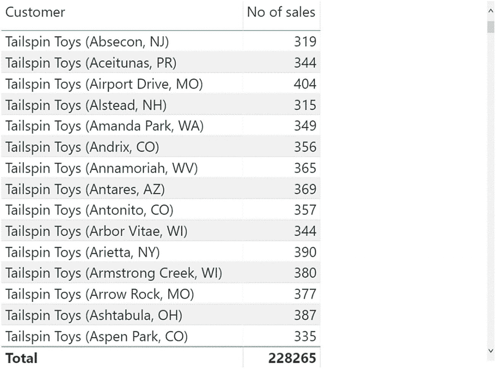

`图 2-17` – 关系 – DAX, RELATEDTABLE 结果

`RELATEDTABLE` 的工作原理可以通过将代码清单 2-18 中的 DAX 语句与相应的 SQL 语句进行比较来最好地解释。该语句如代码清单 2-19 所示。

```sql
SELECT
    c.[Customer Key]
,   c.Customer
,   COUNT(factsale.[sale key]) AS 'No of Sales'
FROM
    dimension.customer AS c
LEFT OUTER JOIN fact.Sale AS factsale ON
    factsale.[Customer Key] = c.[Customer Key]
GROUP BY
    c.[Customer Key]
,   c.Customer
-- 代码清单 2-19
-- 重现 RELATEDTABLE 的 SQL 语句
```

`RELATEDTABLE` 利用了 `Dimension Customer` 表与 `Fact Sale` 表之间存在的现有关系。在 SQL 语句中，对应的部分是 `LEFT OUTER JOIN`。由于 `RELATEDTABLE` 返回一个表，因此当使用 `RELATEDTABLE` 创建计算列时，需要创建一个标量值。为此，`RELATEDTABLE` 被包裹在 `COUNTROWS` 内部。

基数为“一对多”或“多对一”的关系是最强大和最重要的关系类型。

### 规则
始终使用 1:∗（一对多）关系。如果你认为不可能，请再想想。如果仍然不可能，则使用不同的基数。

#### 一对一 (1:1)

### 说明
本节使用 `pbix` 文件“CH 2 – relationships – one to one.pbix”。

一对一关系相当不常见，不应使用，因为这些关系不提供任何分析功能。

如果表是从关系数据源导入的，则分析对象的某些上下文可能会被建模到不同的表中。例如，职业和地址可以在两个不同的表中建模。使用一对一关系会妨碍使用强大的一对多关系。强烈建议将两个表合并为一个表。

图 2-18 展示了此类关系的示例。请注意这只是一个示例。

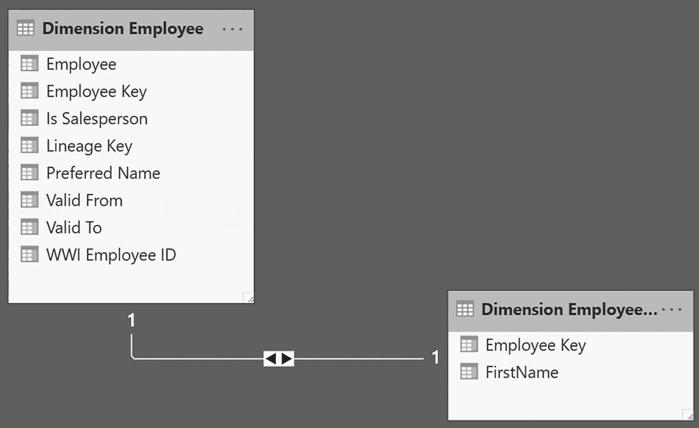

**图 2-18** – 关系 – 一对一 EmployeeFirstName 详细信息

#### 多对多 (∗:∗)
这种关系类型允许关联表，即使用于创建关系的列没有唯一值。

### 说明
本节使用的 `pbix` 文件为“CH 2 – relationships – many to many.pbix”。

图 2-19 展示了一个简单的示例，该示例使用了一个仅包含三列和一个 `Customer Hobby (m2m)` 表的简单事实表。

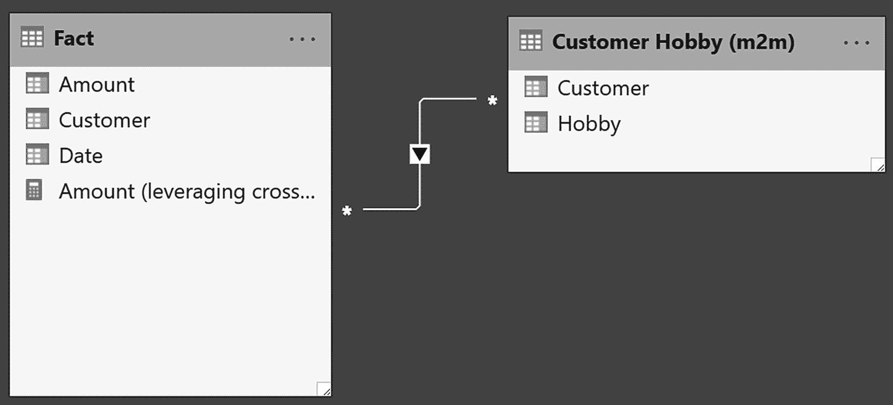

**图 2-19** 关系 – 多对多

这些表使我们能够从客户与其爱好的关系以及相应的事实中提取见解。

图 2-20 显示了使用 `Customer` 列创建关系时的关系对话框。

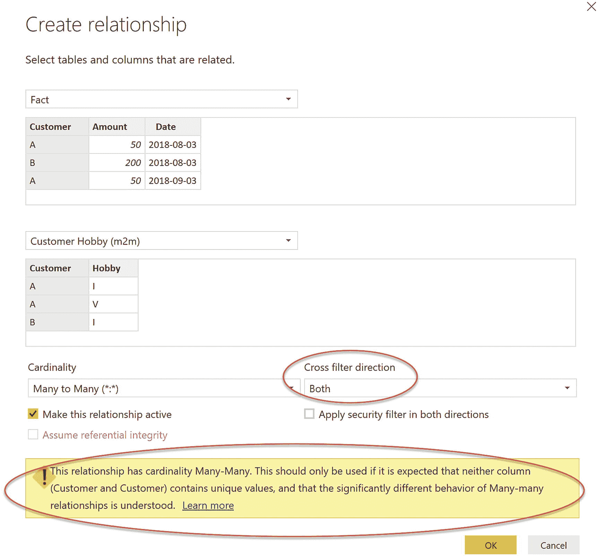

**图 2-20** 关系 – 多对多，基数

正如警告消息所述，有必要了解一些显著不同的行为，即：
- `RELATED` 不再可用
- `ALL` 不再移除筛选上下文

除了行为不同外，还需要更改交叉筛选方向的值。这在图 2-21 中展示。

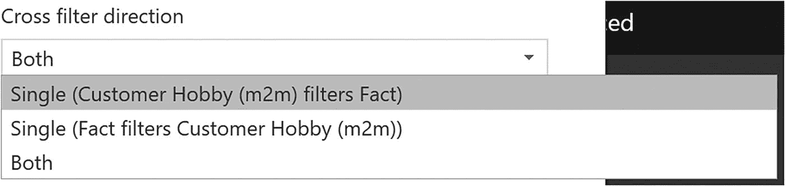

**图 2-21** 关系 – 多对多，筛选方向

图 2-22 展示了多对多关系的结果。

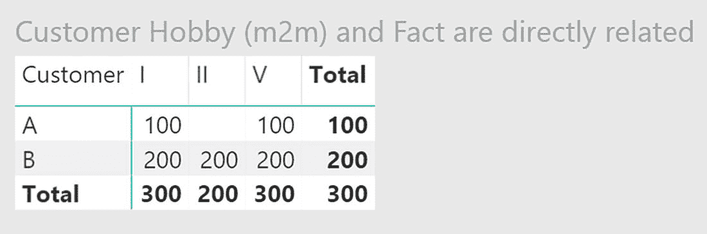

**图 2-22** 关系 – 多对多，多对多结果

为了避免不同的行为，可以创建一个仅使用一对多关系的模型。该模型如图 2-23 所示。

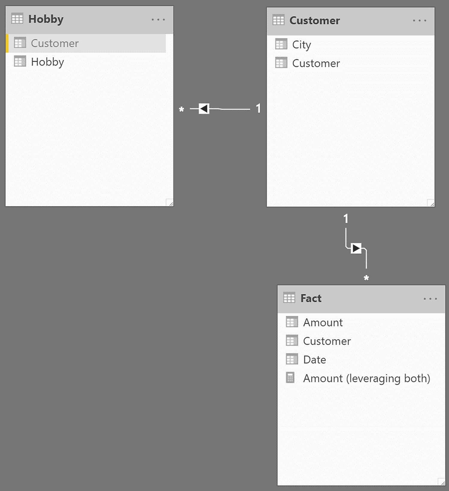

**图 2-23** 关系 – 多对多，使用一对多

该模型的结果如图 2-24 所示。

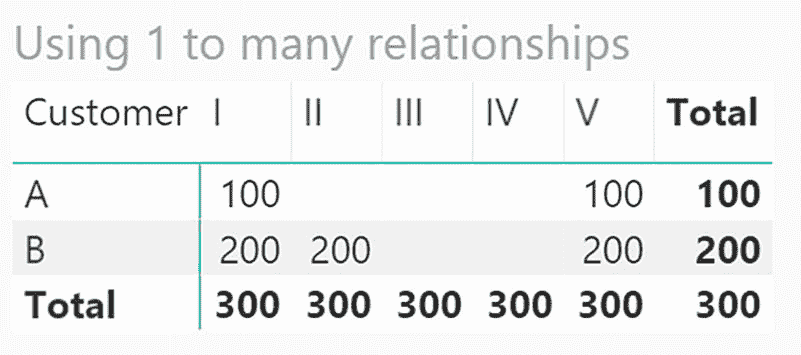

**图 2-24** 关系 – 多对多，使用一对多后的结果

两个表都为每个客户显示了相同的结果，但两个表之间也存在一个主要区别。使用一对多关系的表显示了爱好 III 和 IV，即使没有客户在事实表中拥有对应的行。这完全是因为`Hobby`表与事实表没有直接关联。

这个“问题”可以通过将`Hobby`和`Customer`表之间关系的交叉筛选方向从“单向”改为“双向”来解决。这在图 2-25 中展示。

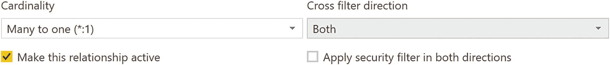

**图 2-25** 关系 – 多对多，使用一对多，双向

使用值为“双向”的关系可能会变得危险，因为如果数据模型变得更大且包含大量表，它们可能成为循环依赖的一部分。

因此，更好的办法是使用一些 DAX。这允许仅使用一对多关系，同时仍能避免 NULL 值。这可以通过使用 DAX 函数 `CROSSFILTER` 来实现。清单 2-20 可用于创建此度量值。

```
Amount (leveraging cross filter direction both) =
CALCULATE(
SUM('Fact'[Amount])
, CROSSFILTER('Hobby'[Customer], 'Customer'[Customer], Both)
)
```

**清单 2-20** 关系 – 使用 `CROSSFILTER`

只要有可能，建议使用 DAX 而不是将交叉筛选方向值更改为“双向”。