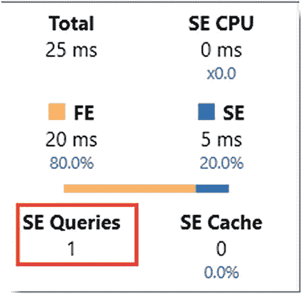
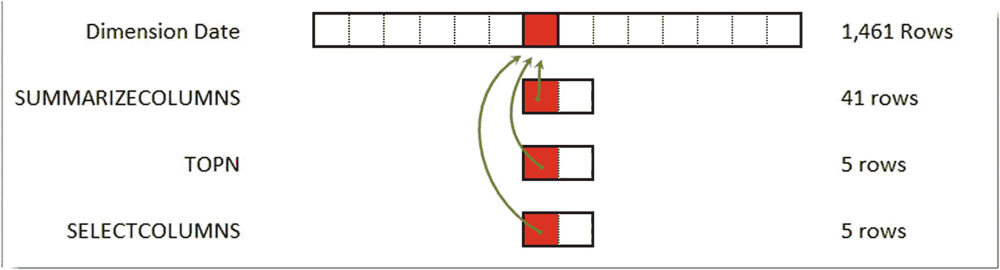
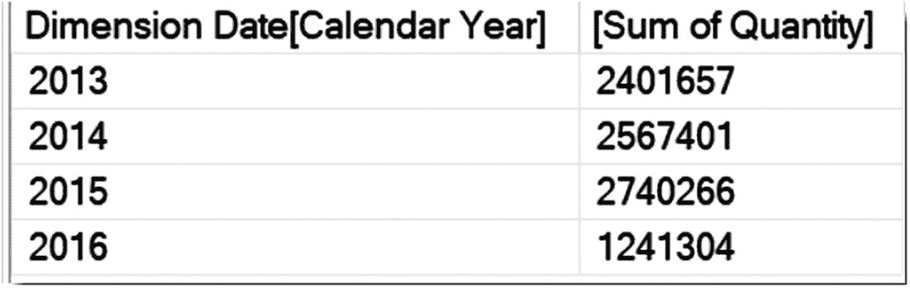
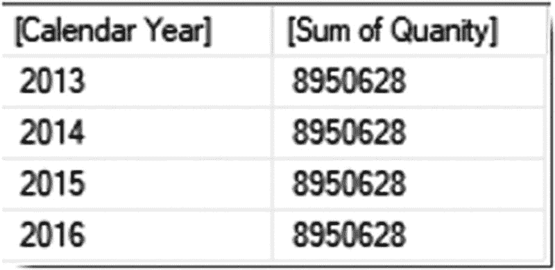
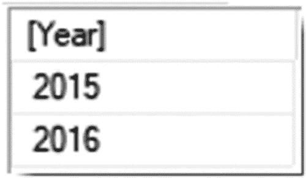
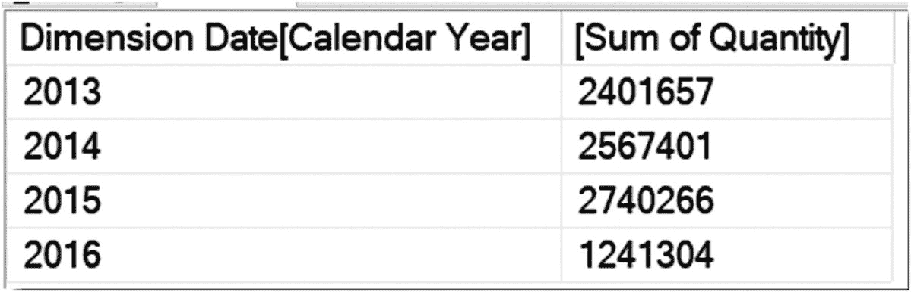
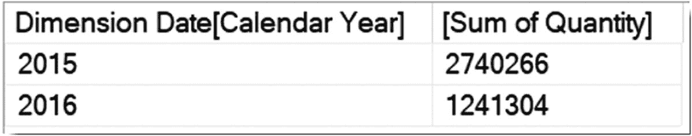

# 3. DAX 沿袭

## 引言

在使用 DAX 计算时，一个需要学习的便捷概念是沿袭（lineage）概念。DAX 沿袭指的是追踪表表达式中的数据来源，回溯到原始物理表的能力。当通过各种 DAX 函数构建新的表表达式时，新表中的列可能包含对最初派生它的原始物理表的引用。

DAX 查询引擎也可以利用沿袭信息，帮助决定在某些情况下生成输出的最优方法是什么。

可以编写包含多代语句的 DAX 计算，这些语句通过一系列步骤处理、聚合和筛选来自物理表的数据。这些语句生成用于构建其他表表达式或用于筛选或与其他物理表合并的表表达式。

当 DAX 引擎需要处理一个计算时，后台会执行许多智能操作，而了解列的沿袭使 DAX 查询引擎能够采用有用的捷径来提高性能，同时又不影响结果的准确性。

### 说明

DAX 引擎出于语义原因，而不仅仅是为了性能优化，来跟踪列沿袭。性能优化器跟踪与列沿袭相关的其他信息，但不是同一回事。

不思考沿袭也可能编写出复杂的 DAX 并成功运行，但稍微了解沿袭是什么以及它如何工作，至少可以解释为什么 IntelliSense 有时会在你输入时建议列，而有时却不能。这通常是因为 IntelliSense 能够检测到当前代码位置的沿袭状态。

将沿袭视为模型中每个列的族谱是一种理解方式。在任何时候，表表达式中的一列都知道自己是皇族后裔还是美洲原住民酋长的后裔。大多数情况下并没有那么令人兴奋，该列通常是一些不起眼的源系统数据的产物。☺

### 定义

在深入探讨沿袭之前，需要明确两个基本定义，即物理表和表表达式。

#### 物理表

物理表是数据库中任何可以直接使用 `EVALUATE` 语句查询的表：

```
EVALUATE 'Dates'
```

这些表在 Power BI Desktop 的“报表”、“数据”和“模型”视图中可见。或者，这些表可以像 DAX 自动生成的日期表一样被隐藏。

物理表存在于内存中，被视为数据模型整体占用空间的一部分。

物理表可以是导入模型的数据，也可以使用 Power BI Desktop 功能区上的“新建表”按钮创建。

物理表中的列由 DAX 引擎分配唯一的列标识符，并且与任何其他列都没有沿袭关系。

DAX 存储引擎是负责从物理表中检索数据的过程。

#### 表表达式

表表达式（也称为虚拟表）是临时创建的实体，仅在计算的短暂生命周期中存在。表表达式是任何返回表作为输出的 DAX 函数的结果。这些表不会影响数据模型（静态时）的整体内存占用，但在计算处理过程中需要它们时，会消耗内存。

当表表达式通过 DAX 函数从物理表创建时，新表中的列通常携带一个引用，指向其派生来源的物理列的唯一列 ID。此引用在内部存储，并非轻易可见。这些数据可能通过使用 DMV 查询数据模型来查看。通常，这些信息对性能优化没有帮助。

逻辑或物理查询计划可能会在其看似晦涩的输出中提供关于列引用的线索，但同样，这在优化计算时也不太可能有帮助。

## 示例 1

让我们从一个简单的 DAX 函数示例开始，该函数生成一个表表达式，然后逐步分析其组成部分。

考虑清单 3-1 中的以下计算度量，它返回单个值，该值表示由 `SUMMARIZECOLUMNS` 函数生成的表表达式中的总行数。

```
我的计算度量 =
VAR 我的表表达式 1 =
SUMMARIZECOLUMNS(
'维度 日期'[日历月标签],
'维度 日期'[日历年标签],
"数量总和",
SUM('事实 销售'[数量])
)
RETURN
MAXX(我的表表达式 1, [数量总和])
清单 3-1
一个表表达式的简单示例
```

#### 注意

通常，你不应在度量定义中使用 `SUMMARIZECOLUMNS`。清单 3-1 中的示例用于演示表表达式。

在此示例中，`SUMMARIZECOLUMNS` 函数返回一个三列的表，该表被分配给 `我的表表达式 1` 变量。由 `SUMMARIZECOLUMNS` 函数生成的表不是物理表，仅存在于该计算度量的作用域内。一旦计算度量产生其最终输出，存储在 `我的表表达式 1` 变量中的表便会随时间消逝……如同雨中的眼泪。

这个分配给 `我的表表达式 1` 变量的临时表就是一个表表达式。该表有三个可见列，可能还有一个隐藏列用于跟踪每行的标识符。在这三个可见列中，第一列是对 `'维度 日期'[日历月标签]` 列的聚合分组。清单 3-1 中使用的语法意味着新列使用与聚合来源列相同的名称创建。重要的是，新列还存储了一个指向其来源原始物理列的引用。在这个例子中，新列与原始列仅相隔一步。

在表表达式中重命名列，不会破坏指向原始列的沿袭引用。存储在表内部的这个元数据引用，正是沿袭的关键。

表表达式中名为 `[日历年标签]` 的第二列，其行为与第一列大致相同。指向 `'维度 日期'` 表中原始列内部 ID 的引用，会作为元数据存储在表表达式中。

表表达式中最后一个可见列名为 `"数量总和"`，它不存储对 `'事实 销售'[数量]` 列的内部引用。在沿袭方面，该列被视为原始列，并且不再与 `'事实 销售'[数量]` 列有任何直接关系。

最后，清单 3-1 中的计算度量将存储在 `我的表表达式 1` 变量中的表表达式传递给 `MAXX` 函数，该函数遍历行数以确定一个单一值，该值代表月份/年份分组中的最大值。使用 Wide World Importers 数据集的结果是 270,036。

这个结果意味着数据集中存在 `[日历月标签]` 和 `[日历年标签]` 的 41 种不同组合。此计算度量对 `[数量]` 列的总计聚合未进行任何操作。

当 `COUNTROWS` 函数将表表达式中的行数减少到单行时，它为计算引入了第二层聚合。查看此计算的探查器跟踪事件时，它只产生一次存储引擎 (SE) 扫描。图 3-1 显示了 DAX Studio 中此计算的服务器计时。该图确认仅对底层数据库进行了一次 SE 调用。



图 3-1

显示清单 3-1 中查询的服务器计时

尽管 DAX 逻辑暗示逻辑上应执行两次基于表的操作，但仅需一次扫描即可检索数据以满足计算的输出。在这种情况下，当 DAX 引擎制定满足查询的计划时，考虑的因素之一是查询中使用的每个列之间的基于沿袭的关系，并且在可能的情况下，引擎会生成一个高效的计划，以充分利用单次存储引擎调用。

## 示例 2

理解 DAX 沿袭工作原理的另一种方法是，将一个表表达式作为另一个表的筛选器。

考虑清单 3-2 中的计算。该计算旨在从 `'Dimension Date'` 表中生成一份列表，列出属于按月度销量排名前五的月份中的所有日期。第一步是识别数据中排名前五的月份，然后返回数据库，检索属于这五个月份中任意一个月份的所有日期数据。

```
EVALUATE
VAR MyTableExpression1 =
SUMMARIZECOLUMNS(
'Dimension Date'[Calendar Month Label],
"Sum of Quantity",
SUM('Fact Sale'[Quantity])
)
VAR myTableExpression2 =
TOPN(
5,
MyTableExpression1,
[Sum of Quantity]
)
RETURN
CALCULATETABLE(
'Dimension Date',
myTableExpression2
)
清单 3-2
使用表表达式作为筛选器以突出沿袭的计算
```

清单 3-2 中的计算是一个多步骤过程，首先创建一个表表达式，将 `'Dimension Date'` 表汇总到日历月份级别。`SUMMARIZECOLUMNS` 函数返回一个包含 41 行和 2 列的表表达式，Wide World Importers 数据集中的每个日历月份均在表达式中得到体现。`SUMMARIZECOLUMNS` 函数的输出存储在 `MyTableExpression1` 变量中，此时尚未进行筛选以识别前五个月份。

`MyTableExpression2` 变量存储了 `TOPN` 函数的输出，在此情况下，该函数使用了其第一个参数之前的语句创建的表表达式。后续参数指示 `TOPN` 函数，当按 `[Sum of Quantity]` 列排序时，从该表表达式中找出前五行。

这个新的表表达式现在只有五行，但保留了相同的两列。重要的是，新表表达式中的 `[Calendar Month Label]` 列包含一个指向 `'Dimension Date'` 表中原始 `[Calendar Month Label]` 列的沿袭引用。这个引用在下一步骤中变得有用，因为它提供了筛选效果。

查询的最后一步是显示 `'Dimension Date'` 表中属于前五个月份中任意一个月份的所有行。`CALCULATETABLE` 函数接受表表达式作为筛选器，在此情况下，`CALCULATETABLE` 函数的第一个参数指明，我们应该从完整的 `'Dimension Date'` 表开始，该表包含所有列和全部 1461 行。

第二个参数正是沿袭魔法发生的地方。`MyTableExpression2` 变量包含一个具有两列的表表达式。`CALCULATETABLE` 函数识别出，作为筛选器传递的表有一个列与作为第一个参数传递的表共用一个沿袭。一旦识别出公共列，引擎就会为每个公共列（可能不止一个）构建一个值列表，然后这些值被用作基表上的筛选器。

### 注意
DAX 引擎跟踪列沿袭的主要原因是使用表表达式构建筛选器。
在清单 3-2 所示的示例中，存储引擎对数据库进行了两次调用。
存储引擎的第一次调用对应 `SUMMARIZECOLUMNS` 函数，该函数将输出存储在 `MyTableExpression1` 变量中，在分析器跟踪中捕获的伪 T-SQL 代码如清单 3-3 所示。该查询没有 `WHERE` 子句，抓取了所有数据。语句没有指定 `GROUP BY` 子句，但 `SELECT` 语句中存在 `SUM` 函数意味着结果集将按 `[Calendar Month Label]` 列进行分组。请注意，清单 3-3 中的伪 T-SQL 文本还包括表名和列名中的引用编号。

```
SELECT
[Dimension Date (12)].[Calendar Month Label (130)]
AS [Dimension Date (12)$Calendar Month Label (130)],
SUM([Fact Sale (1113)].[Quantity (1150)]) AS [$Measure0]
FROM [Fact Sale (1113)]
LEFT OUTER JOIN [Dimension Date (12)]
ON [Fact Sale (1113)].[Invoice Date Key (1130)]
=[Dimension Date (12)].[Date (117)];
清单 3-3
清单 3-2 中查询第一部分的 VertiPaq 扫描详情
```

存储引擎对数据库的第二次调用如清单 3-4 所示。在这个类似伪 T-SQL 的示例中，为了将文本适配到单页，已移除了 14 个单独的列名。重要的方面在于：查询有一个 `WHERE` 子句，其中包含一个由五个值组成的列表，这些值被用作 `'Dimension Date'` 表中 `[Calendar Month Label]` 列的筛选器。这些值是动态创建的，以反映上一步识别出的前五个月份。
清单 3-2 中的原始 DAX 代码从未指定应应用哪些列筛选器。这种筛选是由 DAX 引擎完成的，它识别出在 `CALCULATETABLE` 的筛选器参数中使用的筛选器表里的某一列包含一个沿袭引用列，该列与第一个参数中的一列相匹配。然后，DAX 引擎推导出这些列之间的共享值，进而构建一个 `IN` 语句，供存储引擎在第二次调用数据库时使用。

```
SELECT

FROM [Dimension Date (12)]
WHERE
[Dimension Date (12)].[Calendar Month Label (130)] IN
(
'CY2016-Apr',
'CY2016-Mar',
'CY2015-Apr',
'CY2016-May',
'CY2015-Jul'
);
清单 3-4
清单 3-2 中查询第二部分的 VertiPaq 扫描详情
```

结果是一个包含 153 行的表，其中包括来自 `'Dimension Date'` 的所有 14 列。这 153 行代表基于销量排名前五的月份中的每一天。它们并非数据表中任意位置的 153 行最佳数据。

### 重命名列
清单 3-2 中 `CALCULATETABLE` 的筛选之所以有效，是因为表表达式中存储了沿袭引用。即使列名被更改，也会产生相同的行为。清单 3-5 中的示例演示了，尽管中间更改了列名，沿袭筛选仍然有效。

```
EVALUATE
VAR MyTableExpression1 =
SUMMARIZECOLUMNS(
'Dimension Date'[Calendar Month Label],
"Sum of Quantity",
SUM('Fact Sale'[Quantity])
)
VAR myTableExpression2 =
SELECTCOLUMNS(
TOPN(
5,
MyTableExpression1,
[Sum of Quantity]
),
"My New Columnname",
[Calendar Month Label]
)
RETURN
CALCULATETABLE(
'Dimension Date',
myTableExpression2
)
清单 3-5
清单 3-2 中查询的修改版本，用于演示 DAX 沿袭中的列重命名
```

现在，`TOPN` 函数外面包裹了一个 `SELECTCOLUMNS` 函数，该函数用于将 `[Calendar Month Label]` 列有效地重命名为 `[My New Columnname]`。由 `SELECTCOLUMNS` 函数生成的表表达式中的重命名列，仍然包含对 `'Dimension Date'` 中原始列的引用。清单 3-5 中更新的计算与清单 3-2 中的计算结果相同。更改 `[Calendar Month Label]` 列的名称不会破坏 `CALCULATETABLE` 函数中的筛选效果。
图 3-2 展示了在计算过程中产生的多代表表达式，其中的箭头显示了表表达式中的列与原始物理表中的列之间的链接。



图 3-2

三个表表达式，其中包含指向其原始列的沿袭箭头

## 沿袭与行上下文
如之前的示例所示，沿袭最终决定了筛选的工作方式。若沿袭被确认，则筛选生效。若沿袭无法追溯，则该列将不会用于筛选，也不会被筛选。
DAX 沿袭在上下文转换中也扮演着关键角色。
考虑清单 3-6 中的计算，它为 `[Calendar Year]` 列中的每个唯一值返回一行。清单 3-6 中的示例恰好有四行。然后在另一列中，为每一年计算一个值，该值表示来自 `'Fact Sale'` 表的 `[Quantity]` 列的总和。

``` 
EVALUATE
ADDCOLUMNS(
VALUES('Dimension Date'[Calendar Year]),
"Sum of Quantity",
CALCULATE(
SUM('Fact Sale'[Quantity])
)
)
清单 3-6
一个简单的上下文转换示例，用以展示沿袭的作用
```

清单 3-6 中查询的结果如图 3-3 所示。每一年在 `[Sum of Quantity]` 列中都有一个不同的值。
在清单 3-6 的计算中，`VALUES` 函数输出一个单列表表达式，其沿袭追溯到 `'Dimension Date'[Calendar Year]` 列。`CALCULATE` 函数克隆当前的筛选上下文，并引入所有生效的行筛选。
在 `ADDCOLUMNS` 表所用的基表中，表表达式的第一行有一个筛选器，要求 `[Calendar Year]` 为 2013。此筛选列的沿袭详细信息被传递到由 `CALCULATE` 语句创建的筛选上下文中，并应用于所有找到的具有相同沿袭的*任何*列。
碰巧的是，扩展后的 `'Fact Sale'` 表已经包含了来自 `'Dimension Date'` 表的所有列（参见第 5 章“DAX 中的筛选”），并且由于找到了具有共同沿袭的列，因此会在该列上放置一个筛选器，仅考虑值等于 2013 的行。
如果用于 `ADDCOLUMNS` 第一个参数的基表包含其他列，这些列的沿袭详细信息也会传递给 `CALCULATE` 函数。任何基于扩展 `'Fact Sale'` 表中的沿袭信息找到的共同列都会被相应地筛选。



图 3-3

清单 3-6 中查询的结果

### 中断沿袭
通过一系列表表达式维护沿袭可能很方便，但有时你需要中断沿袭。可以使用 `SELECTCOLUMNS` 等函数，并借助一个不会改变值但足够复杂、能使函数决定不为原始列添加沿袭引用的 `<expression>` 来实现中断沿袭。
考虑清单 3-7 中的计算，它扩展了清单 3-6 中的计算。在此示例中，`VALUES` 函数被包含在 `SELECTCOLUMNS` 函数内部。`SELECTCOLUMNS` 函数从 `VALUES` 函数接收一个包含四行、单列的表表达式。
此时，此表表达式中的列包含一个指向 `'Dimension Date'` 中原始列的沿袭引用。
然而，`SELECTCOLUMNS` 函数创建了一个新的表表达式，同样只有一列，但用于生成每行值的 DAX 表达式中包含了一个 `+ 0` 语句。这个表达式足以让 `SELECTCOLUMNS` 函数仍生成一个包含四行、单列的表表达式，但现在决定不包含对原始物理列的引用。因此，沿袭现在被中断了。

# DAX 中的沿袭与 `TREATAS` 函数

```dax
EVALUATE
ADDCOLUMNS(
    SELECTCOLUMNS(
        VALUES('Dimension Date'[Calendar Year]),
        "Calendar Year",
        [Calendar Year] + 0
    ),
    "Sum of Quanity",
    CALCULATE(
        SUM('Fact Sale'[Quantity])
    )
)
```
**清单 3-7**
一个修改后的语句，演示了如何在需要时中断沿袭

`CALCULATE` 语句仍然克隆现有的筛选上下文，并从 `ADDCOLUMNS` 函数的基表传递行级筛选信息，但由于在 `ADDCOLUMNS` 的基表与扩展 `'Fact Sale'` 表中的任何列之间没有找到共同列，结果如图 3-4 所示。



**图 3-4**
清单 3-7 中查询的结果

尽管在 `SELECTCOLUMNS` 函数中仍然将列命名为“Calendar Year”，但这没有任何效果。由于对扩展后的 `'Fact Sale'` 表缺少有效的筛选器，意味着第二列中的每一行都反复产生相同的值，该值恰好是整个列的总计。

在此示例中，沿袭之所以被中断，是因为对其加了一个零。要使沿袭包含在输出中，语法需要遵循 `T[C]` 表示法（即 `'表名'[列名]`），且不做任何修改。在此示例中，使用了零，因为 `[Calendar Year]` 列是数值类型，这足以中断沿袭——但不会改变值。如果核心列使用文本数据类型，则附加一个空字符串具有相同的效果。

## 伪造沿袭

2018 年添加到 DAX 语言中的一个绝佳函数是 `TREATAS` 函数。除其他功能外，此函数专门用于覆盖表表达式中的沿袭详细信息。这种沿袭覆盖功能有点像我有能力让你相信我的曾祖父是英国国王亨利八世。当然，他不是，但如果你是一个下游的 DAX 函数，我就可以使用 `TREATAS` 函数来愚弄你，让你以为我真的源自这位著名的国王。

### 语法

`TREATAS ( <table> , <column> [,<column>]… )`

### 输出

`<table expression>`

`TREATAS` 的语法要求将表作为第一个参数。该表可以是物理表或表表达式。然后，需要提供的 `<column>` 参数的数量必须与作为第一个参数传递的表中的列数相同。

如果传递给 `TREATAS` 第一个参数的表有四列，则除了表参数之外，还需要传递四个参数。参数的顺序与传递的 `<table>` 中列的顺序匹配，并且它们必须具有相同的数据类型。

参考清单 3-8 中的计算，该计算输出一个旨在按年度汇总 `[Quantity]` 列的表。该计算的 `DEFINE` 部分将一个表表达式存储在一个变量中，该变量旨在用作 `CALCULATETABLE` 函数的筛选器。`DATATABLE` 函数允许您使用硬编码值创建表表达式。在本例中，存储在 `MyYearFilter` 变量中的表表达式只有一列和两行，如图 3-5 所示。

重要的是，此表表达式没有将其链接回数据模型中任何物理表的沿袭信息。通常，表表达式中缺乏任何有用的沿袭会使其作为筛选表毫无用处。



**图 3-5**
显示清单 3-8 中 `MyYearFilter` 变量的内容

```dax
DEFINE
VAR MyYearFilter =
    DATATABLE(
        "Year" , INTEGER ,
        {
            {2015},
            {2016}
        }
    )
MEASURE 'Fact Sale'[Sum of Quantity] =
    SUM('Fact Sale'[Quantity])
EVALUATE
CALCULATETABLE(
    SUMMARIZECOLUMNS(
        'Dimension Date'[Calendar Year],
        "Sum of Quantity",
        [Sum of Quantity]
    ),
    MyYearFilter
)
```
**清单 3-8**
一个修改后的语句，演示了如何在需要时中断沿袭

在此示例中，`MyYearFilter` 表表达式作为筛选器参数传递给 `CALCULATETABLE`。然后，将表表达式中每一列的沿袭详细信息与 `'Dimension Date'` 扩展版本中的每一列进行比较。按照现有的代码，没有找到公共列，因此 `MyYearFilter` 表表达式对 `SUMMARIZECOLUMNS` 列没有筛选效果。清单 3-8 中此代码的输出如图 3-6 所示。



**图 3-6**
清单 3-8 中查询的结果

图 3-6 中的结果显示，即使将 `MyYearFilter` 变量传递给 `CALCULATE` 函数，它也没有筛选效果，结果集仍然为 `[Calendar Year]` 2013 和 2014 生成了值。最终表没有被筛选为仅包含两年，因为筛选表表达式与正在被筛选的表没有共享沿袭。

要使分配给 `MyYearFilter` 变量的表表达式能够用作筛选器，需要进行的修改是让 `CALCULATETABLE` 函数相信 `MyYearFilter` 表表达式中的列确实源自 `'Dimension Date'` 表。实现此目的的一种方法是使用 DAX 在 `MyYearFilter` 中存储一个表表达式，该表达式使用 `'Dimension Date'` 物理表，从而传递沿袭引用。清单 3-9 展示了此方法的一个版本。

```dax
VAR MyYearFilter =
    FILTER(
        VALUES('Dimension Date'[Calendar Year]) ,
        [Calendar Year] IN {2015,2016}
    )
```
**清单 3-9**
一个修改后的表表达式，使用不间断的沿袭来有效筛选 'Dimension Date' 表

这也可以使用清单 3-10 中所示的 `TREATAS` 函数来实现。

```dax
EVALUATE
CALCULATETABLE(
    SUMMARIZECOLUMNS(
        'Dimension Date'[Calendar Year],
        "Sum of Quantity",
        [Sum of Quantity]
    ),
    TREATAS(
        MyYearFilter ,
        'Dimension Date'[Calendar Year]
    )
)
```
**清单 3-10**
清单 3-8 中修改后的 EVALUATE 语句，它使用 `TREATAS` 更新 `MyYearFilter` 表表达式的沿袭详细信息

在清单 3-10 的示例中，`TREATAS` 函数被传递给一个 `MyYearFilter` 变量，该变量包含一个只有两行的单列表表达式。因为这个表表达式只有一列，所以只需要向 `TREATAS` 函数传递一个额外的参数。在此示例中，指定了 `'Dimension Date'[Calendar Year]` 列。

`TREATAS` 函数输出一个单列表表达式，该表达式现在包含对 `'Dimension Date'[Calendar Year]` 表的沿袭引用，即使该表表达式并非由 `'Dimension Date'` 生成。

`CALCULATETABLE` 现在使用来自表筛选器参数中列的沿袭来筛选 `SUMMARIZECOLUMNS`。现在找到了匹配项，因此第一个参数中的 DAX 表达式使用 `MyYearFilter` 表表达式中的列的值，对 `SUMMARIZECOLUMNS` 函数中的 `'Dimension Date'[Calendar Year]` 列应用筛选器。

新结果如图 3-7 所示。对于清单 3-9 和清单 3-10 中展示的 `FILTER` 和 `TREATAS` 方法，此结果都相同。



**图 3-7**
来自清单 3-9 或清单 3-10 的更新查询结果

这种创建包含硬编码值的小型表表达式并使用 `TREATAS` 函数分配沿袭详细信息的技术，是 Power BI Desktop 在画布上为视觉对象创建 DAX 时使用的方法。

清单 3-8 中显示的示例使用 `DATATABLE` 函数生成新的表表达式。该表也可以使用清单 3-11 中所示的更简洁语法来生成。

```dax
TREATAS(
    {2015,2016},
    'Dimension Date'[Calendar Year]
)
```
**清单 3-11**
展示了一种创建硬编码表表达式的简写方法

在清单 3-11 中，`TREATAS` 函数的第一个参数使用一系列花括号和值来生成一个表。外层的 `{}` 括号定义了整个表。此方法仅支持具有默认列名 `"Value"` 的单列，不能用于生成多列表。

## 修复损坏的沿袭

回顾清单 3-7 中的示例，该代码旨在突出显示如何可能破坏沿袭。在这个例子中，一个零被添加到一个整数列中，因此 DAX 函数将输出一个表表达式，且该表达式不包含对其源列的沿袭引用。

清单 3-12 中的示例取自清单 3-7 的代码，并展示了如何使用 `TREATAS` 函数修复损坏的沿袭。

```
EVALUATE
ADDCOLUMNS(
TREATAS(
SELECTCOLUMNS(
VALUES('Dimension Date'[Calendar Year]) ,
"Calendar Year" ,
[Calendar Year] + 0
),
'Dimension Date'[Calendar Year]
)      ,
"Sum of Quantity" ,
CALCULATE(
SUM('Fact Sale'[Quantity])
)
)
清单 3-12
基于清单 3-7 的代码展示了使用 TREATAS 函数恢复沿袭
```

在此示例中，`VALUES` 函数输出一个单列表表达式。此表表达式中的单个列具有指向源列的沿袭引用。

下一步，`SELECTCOLUMNS` 函数获取从 `VALUES` 函数返回的表表达式，并通过向该列添加零来有效地破坏沿袭。

最后，`TREATAS` 函数接收 `SELECTCOLUMNS` 返回的单列表表达式，并将该列重新分配为指向其源列的引用。

`CALCULATE` 函数在为 `SUM` 函数构建筛选上下文时使用修复后的沿袭。清单 3-12 中查询的结果如图 3-8 所示。


图 3-8

清单 3-12 中查询的结果

通常情况下，你不会编写一个查询刻意破坏沿袭，然后再将其恢复到之前的状态。这个“左右抹蜡”的示例旨在效仿宫城先生的教导，演示列沿袭如何被破坏以及重新分配的概念。掌握沿袭，你就能更接近写出 DAX 领域的“鹤踢”。

## 总结

理解沿袭及其与筛选的结合方式，可以极大地帮助你解决使用 DAX 时遇到的棘手挑战。了解物理表与表表达式之间的区别有助于解释 DAX 中各种函数为何会有不同的行为。本章不仅展示了沿袭的工作原理，还展示了如何根据需要有意破坏或重新分配列沿袭。

